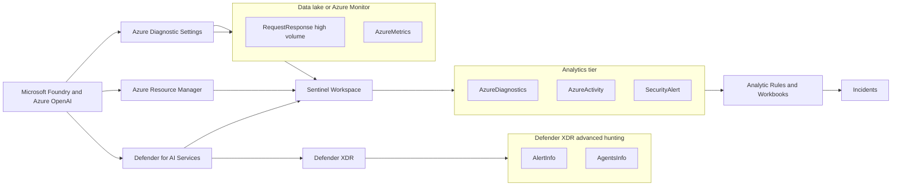

# Microsoft Foundry (formerly Azure AI Foundry) and Azure OpenAI

> Status: verified. Priority: P2. Last verified: 21 Nov 2026.

## What it is

Microsoft Foundry (formerly Azure AI Foundry) hosts foundation models, including Azure OpenAI deployments, and custom AI agents on `Microsoft.CognitiveServices/accounts` resources. Diagnostic logs, Azure control-plane logs and Microsoft Defender for AI Services alerts give a SOC visibility into API key theft, unauthorised model deployments, prompt injection, credential leakage in model responses and abnormal token burn.

## Key recommendations

- Turn on diagnostic settings on every production Foundry and Azure OpenAI resource (`Microsoft.CognitiveServices/accounts`) via Azure Policy, not by hand. Send `Audit` and `AzureOpenAIRequestUsage` to your Sentinel workspace first; decide deliberately on `RequestResponse` because it can be high volume and may contain sensitive payloads depending on logging configuration ([Microsoft Learn](https://learn.microsoft.com/en-us/azure/foundry/how-to/diagnostic-logging)).
- Expect logs to land in `AzureDiagnostics`, not resource-specific tables. `Microsoft.CognitiveServices/accounts` still emits `Audit`, `RequestResponse`, `AzureOpenAIRequestUsage`, `Trace` and `ManagedNetworkEvent` into `AzureDiagnostics` ([table reference](https://learn.microsoft.com/en-us/azure/azure-monitor/reference/tables/azurediagnostics)).
- Keep `AzureActivity` connected at the subscription level (it is free in Sentinel). It captures `listKeys`, model deployment creation, network rule edits and RBAC grants that never show up in data-plane request logs ([table reference](https://learn.microsoft.com/en-us/azure/azure-monitor/reference/tables/azureactivity)).
- Enable **Microsoft Defender for AI Services** in Microsoft Defender for Cloud for production subscriptions. It pairs Azure AI Content Safety Prompt Shields with Microsoft Threat Intelligence to alert on jailbreaks, prompt injection, credential theft in responses and access anomalies ([Microsoft Learn](https://learn.microsoft.com/en-us/azure/defender-for-cloud/ai-threat-protection)).
- Stream Defender for Cloud alerts into Sentinel (`SecurityAlert`) and review them in Defender XDR (`AlertInfo`). Pass `UserSecurityContext` (`EndUserId`, `SourceIP`) in application API calls so Defender for AI alerts carry end-user attribution rather than just a gateway IP.
- Keep `AzureMetrics` out of the Sentinel Analytics tier unless you build specific metric-based detections. Use native Azure Monitor metrics and alerts for throttling (HTTP 429) and token spikes to save ingestion cost.
- Plan for **Microsoft Agent 365** if you run Foundry agents. Agent-level inventory (`AgentsInfo`) and runtime agent threat protection shifted to Agent 365 in Defender XDR on 1 July 2026.

## High-value log sources

| Source | Table name | Connector | Tier | Cost / volume | Value |
|---|---|---|---|---|---|
| Foundry and Azure OpenAI resource logs (`Audit`, `AzureOpenAIRequestUsage`, `RequestResponse`, `ManagedNetworkEvent`) | `AzureDiagnostics` (`ResourceProvider == "MICROSOFT.COGNITIVESERVICES"`) | Azure diagnostic settings on each `Microsoft.CognitiveServices/accounts` resource | Analytics for `Audit` and `AzureOpenAIRequestUsage`; data lake for high-volume `RequestResponse` and `Trace` | Billable. `Audit` is low; `AzureOpenAIRequestUsage` is medium; `RequestResponse` is medium to high | Data-plane authentication, caller IP, operation name, HTTP status, token consumption and request/response diagnostics ([Microsoft Learn](https://learn.microsoft.com/en-us/azure/foundry/how-to/diagnostic-logging)). |
| Control-plane management activity | `AzureActivity` | Azure Activity (Microsoft Sentinel connector) | Analytics | Free ingestion in Sentinel. Low volume | Tracks `listKeys`, key regeneration, new model deployments, public network access changes, diagnostic setting tampering and RBAC changes ([table reference](https://learn.microsoft.com/en-us/azure/azure-monitor/reference/tables/azureactivity)). |
| Defender for AI Services alerts | `SecurityAlert` | Microsoft Defender for Cloud (Sentinel connector) | Analytics | Alerts ingestion is free; Defender for AI Services plan is billed per 1,000 tokens scanned | Real-time detections for prompt injection, jailbreaks, credential leakage in responses, phishing URLs and access anomalies ([Microsoft Learn](https://learn.microsoft.com/en-us/azure/defender-for-cloud/ai-threat-protection)). |
| Defender XDR alert view | `AlertInfo` | None, already in Defender XDR advanced hunting | Already in Defender XDR | Free, 30 days retention in Defender XDR | Unified incident graph correlating Defender for AI alerts with Entra ID, endpoint and cloud alerts ([table reference](https://learn.microsoft.com/en-us/defender-xdr/advanced-hunting-alertinfo-table)). |
| Foundry agent inventory | `AgentsInfo` | None, already in Defender XDR advanced hunting | Already in Defender XDR | Requires Microsoft Agent 365 eligible licence from 1 July 2026 | Discovery, identity, permissions and lifecycle state for Microsoft Foundry agents ([table reference](https://learn.microsoft.com/en-us/defender-xdr/advanced-hunting-agentsinfo-table)). |
| Platform metrics | `AzureMetrics` | Azure diagnostic settings (`AllMetrics`) | Skip in Sentinel (use Azure Monitor Metrics) or data lake | Billable if sent to Log Analytics. Medium volume | Request counts, prompt/completion token metrics and HTTP 429 throttling. Better monitored natively in Azure Monitor Metrics ([table reference](https://learn.microsoft.com/en-us/azure/azure-monitor/reference/tables/azuremetrics)). |

### What to ingest first

| Priority | Table / category | Why | Rough volume | Tier |
|---|---|---|---|---|
| 1 | `AzureActivity` | Free in Sentinel; catches key extraction (`listKeys`), firewall openings and rogue deployments | Low | Analytics |
| 2 | `SecurityAlert` (Defender for AI Services) | High-signal prompt injection, jailbreak and credential theft alerts with low noise | Very low | Analytics |
| 3 | `AzureDiagnostics` (`Audit`, `AzureOpenAIRequestUsage`, `ManagedNetworkEvent`) | Data-plane audit, token burn anomalies and private network events | Low to medium | Analytics |
| 4 | `AzureDiagnostics` (`RequestResponse`) | Detailed inference logging and content-filter audit; review privacy and volume first | Medium to high | Data lake, or Analytics with DCR filtering |
| Skip | `AzureDiagnostics` (`Trace`) and `AzureMetrics` in Analytics | Diagnostic noise and metrics better handled in Azure Monitor | Medium to high | Skip or data lake |

## Prerequisites and licensing

| Item | Detail |
|---|---|
| Azure subscription and resources | Microsoft Foundry or Azure OpenAI accounts (`Microsoft.CognitiveServices/accounts`) in an Azure subscription with access to your Sentinel Log Analytics workspace. |
| Defender for AI Services | Optional but strongly recommended. Enabled per subscription in Microsoft Defender for Cloud. Billed by token volume (indicatively USD 0.0008 per 1,000 tokens scanned, with a 30-day free trial capped at 75 billion tokens; check current regional pricing before enabling) ([Microsoft Learn](https://learn.microsoft.com/en-us/azure/defender-for-cloud/ai-threat-protection)). |
| Microsoft Agent 365 | Required from 1 July 2026 for agent-level discovery, posture and runtime blocking on Microsoft Foundry agents in the Defender portal. |
| Sentinel | A Log Analytics workspace with Microsoft Sentinel enabled. `AzureActivity` and `SecurityAlert` are free to ingest; `AzureDiagnostics` and `AzureMetrics` are billable. |
| Entra ID authentication (recommended) | Disable local API key authentication (`disableLocalAuth = true`) where applications support Microsoft Entra ID and Managed Identity. This makes actor attribution far stronger in `Audit` logs. |

### Roles you need

| Task | Role |
|---|---|
| Create diagnostic settings on Foundry / Azure OpenAI resources | Monitoring Contributor (or Owner) on the resource or subscription, plus Log Analytics Contributor on the workspace ([Microsoft Learn](https://learn.microsoft.com/en-us/azure/sentinel/connect-services-diagnostic-setting-based)) |
| Deploy Azure Policy for diagnostic settings at scale | Resource Policy Contributor on the subscription or management group |
| Enable Defender for AI Services plan | Subscription Owner or Security Admin on the subscription ([Microsoft Learn](https://learn.microsoft.com/en-us/azure/defender-for-cloud/ai-threat-protection)) |
| Connect Azure Activity and Defender for Cloud to Sentinel | Microsoft Sentinel Contributor on the workspace plus Subscription Owner or Security Admin ([Microsoft Learn](https://learn.microsoft.com/en-us/azure/sentinel/connect-defender-for-cloud)) |

## Step-by-step setup

1. **Connect Azure Activity (free).** Defender portal > Microsoft Sentinel > Content management > Content hub. Install the **Azure Activity** solution, open the connector, and launch the Azure Policy assignment wizard to stream subscription activity logs into your Sentinel workspace ([Microsoft Learn](https://learn.microsoft.com/en-us/azure/sentinel/sentinel-solutions-deploy)).
2. **Connect Microsoft Defender for Cloud.** Install the **Microsoft Defender for Cloud** solution from Content Hub and connect the tenant-based or subscription-based connector so alerts flow into `SecurityAlert` ([Microsoft Learn](https://learn.microsoft.com/en-us/azure/sentinel/connect-defender-for-cloud)).
3. **Enable Defender for AI Services.** In the Azure portal, open Microsoft Defender for Cloud > Environment settings > select your subscription > Defender plans > toggle **AI Services** on and Save ([Microsoft Learn](https://learn.microsoft.com/en-us/azure/defender-for-cloud/ai-threat-protection)).
4. **Configure diagnostic settings on each Foundry / Azure OpenAI resource.** In the Azure portal, open your Microsoft Foundry or Azure OpenAI resource > Monitoring > Diagnostic settings > + Add diagnostic setting. Tick **Audit**, **AzureOpenAIRequestUsage**, **ManagedNetworkEvent** and (if approved for privacy and cost) **RequestResponse**. Choose **Send to Log Analytics workspace**, select your Sentinel workspace, and Save ([Microsoft Learn](https://learn.microsoft.com/en-us/azure/foundry/how-to/diagnostic-logging)). For production environments, enforce this with Azure Policy so new resources never launch unlogged.
5. **Enrich application calls (recommended).** Update production apps calling Azure OpenAI or Foundry inference endpoints to include `UserSecurityContext` (`EndUserId` and `SourceIP`) in requests so Defender for AI alerts identify the actual end user.
6. **Review table routing.** In the Defender portal under Setup & configuration > Data management > Tables, keep `AzureDiagnostics` in Analytics if your rules read it, or add a workspace transformation DCR to drop `Trace` or non-security categories before billing.
7. **Generate test events.** Send a test chat completion call via the API (not just the portal playground, which can bypass some API log paths) and trigger a harmless control-plane action such as listing keys in a non-production resource.
8. **Validate.** Diagnostic logs can take up to 2 hours to appear after first configuration, though steady-state latency is normally minutes. Run the validation queries below in Advanced hunting with your Sentinel workspace selected.

## Best-practice security configuration

Enable **Microsoft Defender for AI Services** alongside diagnostic logging so prompt attacks and key abuse are detected in real time. See [Defender best-practice security configurations](../../docs/defender-best-practices.md#other-defender-for-cloud-workload-plans).

- **Defender for AI Services:** Enable at subscription scope to detect jailbreak/prompt injection attempts, sensitive data leaks and anomalous model/API key abuse ([AI threat protection](https://learn.microsoft.com/en-us/azure/defender-for-cloud/ai-threat-protection)).
- **Prompt Shields & Content Safety:** Turn on Azure AI Content Safety Prompt Shields (both direct user prompts and indirect document/tool-output prompts) on production deployments.
- **Identity & network isolation:** Disable local API keys (`disableLocalAuth = true`) in favour of Microsoft Entra ID RBAC and Managed Identities, and place Foundry / Azure OpenAI endpoints behind Private Endpoints.

## Architecture diagram



## Validation KQL

For group-wide and workspace-wide freshness checks, see [ai.kql](../../queries/validation/ai.kql) and the [validation query pack](../../queries/validation/README.md).

```kql
// 1. Confirm Microsoft.CognitiveServices diagnostic categories are landing
AzureDiagnostics
| where TimeGenerated > ago(1d)
| where ResourceProvider == "MICROSOFT.COGNITIVESERVICES"
| summarize Rows = count(), Latest = max(TimeGenerated) by Category, Resource
| order by Category asc

// 2. Freshness check for Foundry / Azure OpenAI logs
AzureDiagnostics
| where ResourceProvider == "MICROSOFT.COGNITIVESERVICES"
| summarize Latest = max(TimeGenerated), AgeMinutes = round((now() - max(TimeGenerated)) / 1m, 1) by Category

// 3. Confirm control-plane AzureActivity events for Cognitive Services
AzureActivity
| where TimeGenerated > ago(7d)
| where ResourceProviderValue =~ "Microsoft.CognitiveServices"
| summarize Events = count(), Latest = max(TimeGenerated) by OperationNameValue
| order by Events desc

// 4. Confirm Defender for AI Services alerts (if any have fired)
SecurityAlert
| where TimeGenerated > ago(30d)
| where ProductName has "Defender" and (AlertName has_any ("AI", "OpenAI", "prompt", "jailbreak") or ProviderName has "AI")
| summarize Alerts = count(), Latest = max(TimeGenerated) by AlertName, AlertSeverity

// 5. Cost: GB per day for AzureDiagnostics (workspace-wide) and estimated Cognitive Services share
AzureDiagnostics
| where TimeGenerated > ago(30d)
| where ResourceProvider == "MICROSOFT.COGNITIVESERVICES"
| summarize GB = round(sum(_BilledSize) / 1073741824.0, 3) by Category, Day = bin(TimeGenerated, 1d)
| summarize GBperDay = round(avg(GB), 3), TotalGB30d = round(sum(GB), 2) by Category
| order by GBperDay desc

// 6. Workspace-level Usage check for AzureDiagnostics and AzureMetrics
Usage
| where TimeGenerated > ago(30d)
| where DataType in ("AzureDiagnostics", "AzureMetrics", "AzureActivity", "SecurityAlert")
| summarize GB = round(sum(Quantity) / 1024, 2) by DataType, Day = bin(TimeGenerated, 1d)
| summarize GBperDay = round(avg(GB), 2), TotalGB30d = round(sum(GB), 2) by DataType
| order by GBperDay desc
```

## Out-of-box analytic rules

There is no dedicated standalone Microsoft Foundry Content Hub analytic rule pack yet. Instead, out-of-box detections come from **Microsoft Defender for AI Services** (surfaced into `SecurityAlert` and `AlertInfo`) and the **Microsoft Defender for Cloud** Sentinel incident creation rule ([Microsoft Learn](https://learn.microsoft.com/en-us/azure/defender-for-cloud/ai-threat-protection)).

| Detection / Alert | Detects | Tables | MITRE | Suggested |
|---|---|---|---|---|
| Create incidents based on Microsoft Defender for Cloud alerts (Sentinel connector rule) | Promotes Defender for AI Services alerts into Sentinel incidents automatically | `SecurityAlert` | Multiple | Enable day 1 |
| Detected credential theft attempts on an Azure AI model deployment (`AI.Azure_CredentialTheftAttempt`) | Credentials or secrets returned inside generative AI model responses | `SecurityAlert`, `AlertInfo` | Credential Access | Enabled via Defender for AI |
| Prompt injection and jailbreak detections (Prompt Shields integration) | Direct and indirect prompt injection or jailbreak attempts against model deployments | `SecurityAlert`, `AlertInfo` | ATLAS AML.T0051 | Enabled via Defender for AI |
| Access anomaly in AI resource | Unusual IP ranges, user agents or request patterns hitting a Foundry or Azure OpenAI endpoint | `SecurityAlert`, `AlertInfo` | Initial Access, Exfiltration | Enabled via Defender for AI |
| Phishing URL shared in an AI application | Malicious or phishing URLs introduced via conversation payloads | `SecurityAlert`, `AlertInfo` | Initial Access | Enabled via Defender for AI |
| Suspicious invocation of a high-risk operation | Unusual administrative operations targeting AI resources in the subscription | `SecurityAlert`, `AlertInfo` | Persistence, Privilege Escalation | Enabled via Defender for AI |

## Custom detections

Because Sentinel doesn't ship a full set of scheduled rules on `AzureDiagnostics` for Foundry and Azure OpenAI yet, write custom rules covering control-plane key theft, firewall weakening and inference abuse.

### C1. Azure OpenAI or Foundry API keys listed or regenerated by unexpected caller (High)

Listing keys (`listKeys/action`) lets an attacker bypass Entra ID RBAC and call models directly from anywhere if local auth isn't disabled.

```kql
// CUSTOM - API keys listed or regenerated on a Microsoft Foundry or Azure OpenAI account
// ASSUMPTION: OperationNameValue strings match standard Microsoft.CognitiveServices ARM actions.
// Verify exact values in your tenant with:
//   AzureActivity | where ResourceProviderValue =~ "Microsoft.CognitiveServices" | distinct OperationNameValue
let approved_callers = dynamic(["platform-deployer-spn"]);
AzureActivity
| where TimeGenerated > ago(1h)
| where ResourceProviderValue =~ "Microsoft.CognitiveServices"
| where OperationNameValue in~ (
    "Microsoft.CognitiveServices/accounts/listKeys/action",
    "Microsoft.CognitiveServices/accounts/regenerateKey/action"
)
| where ActivityStatusValue =~ "Success"
| where Caller !in~ (approved_callers)
| project TimeGenerated, Caller, CallerIpAddress, OperationNameValue, ResourceGroup, _ResourceId, Properties
```

MITRE ATT&CK: Credential Access T1552 (Unsecured Credentials) and T1528.

### C2. Spike in HTTP 401/403 or 429 responses on Foundry inference endpoints (Medium)

Sudden authentication failures indicate key stuffing or stolen-key probing; sustained HTTP 429 (`QuotaExceeded`) spikes from an unusual IP can signal API key leakage and unauthorised model consumption (denial-of-wallet).

```kql
// CUSTOM - Burst of auth failures or throttling on Cognitive Services / Azure OpenAI endpoints
// ASSUMPTION: ResultSignature holds the HTTP status code string (for example "401", "403", "429")
// in AzureDiagnostics for RequestResponse / Audit categories. Confirm column name (ResultSignature
// vs StatusCode_d) on a sample row in your workspace before enabling.
AzureDiagnostics
| where TimeGenerated > ago(1h)
| where ResourceProvider == "MICROSOFT.COGNITIVESERVICES"
| where Category in ("RequestResponse", "Audit")
| extend HttpStatus = coalesce(tostring(ResultSignature), tostring(column_ifexists("StatusCode_d", "")))
| where HttpStatus in ("401", "403", "429")
| summarize FailureCount = count(),
            Operations = make_set(OperationName, 10),
            Statuses = make_set(HttpStatus, 5)
            by Resource, CallerIPAddress, bin(TimeGenerated, 1h)
| where FailureCount >= 50
| project TimeGenerated, Resource, CallerIPAddress, FailureCount, Statuses, Operations
```

MITRE ATT&CK: Impact T1499 (Endpoint Denial of Service) and Credential Access T1110.

### C3. Public network access enabled or local auth re-enabled on a Foundry account (High)

```kql
// CUSTOM - Cognitive Services account updated with public network access or local auth enabled
// ASSUMPTION: Properties_d / Properties JSON carries requestbody fields on ARM write operations
// when request body logging is present. Validate exact JSON path in your tenant first.
AzureActivity
| where TimeGenerated > ago(1h)
| where ResourceProviderValue =~ "Microsoft.CognitiveServices"
| where OperationNameValue =~ "Microsoft.CognitiveServices/accounts/write"
| where ActivityStatusValue =~ "Success"
| where Properties has_any ("\"publicNetworkAccess\":\"Enabled\"", "\"disableLocalAuth\":false")
| project TimeGenerated, Caller, CallerIpAddress, ResourceGroup, _ResourceId, Properties
```

MITRE ATT&CK: Defense Evasion T1562.007 (Disable or Modify Cloud Firewall).

## Playbooks

No Foundry-specific Logic App playbooks ship in Content Hub today. Two high-value playbooks to build with Managed Identity authentication:

- **Rotate keys or disable local auth on suspected key leak.** Triggered from a Sentinel incident on `AI.Azure_CredentialTheftAttempt` or C1 (`listKeys` alert). Calls Azure Resource Manager (`Microsoft.CognitiveServices/accounts/regenerateKey/action`) behind a Teams approval step so you don't break production apps without sign-off. Needs Cognitive Services Contributor on the target resource group and Microsoft Sentinel Responder on the workspace.
- **Enrich and notify app owner.** On any Defender for AI alert, look up the resource owner tag from Azure Resource Graph and send an adaptive card to the app team and SOC channel with `Resource`, `AlertName`, `CallerIPAddress` and `EndUserId` (if populated).

## Workbooks and hunting

The official Azure-Sentinel repository ships the **Azure OpenAI Monitoring** workbook ([AzureOpenAIMonitoring.json](https://github.com/Azure/Azure-Sentinel/blob/master/Workbooks/AzureOpenAIMonitoring.json)), which visualises `AzureDiagnostics` operations, latency, errors and usage for `MICROSOFT.COGNITIVESERVICES` resources.

Two hunting queries worth running regularly:

- **Content filter block rate by caller IP or deployment.** Look for callers repeatedly hitting Azure AI Content Safety blocks (HTTP 400 with content-filter indicators in `RequestResponse`) to spot systematic red-teaming or prompt injection probing.

```kql
// Hunt: Repeated HTTP 400 responses on chat completions (often content filter blocks or malformed probes)
AzureDiagnostics
| where TimeGenerated > ago(7d)
| where ResourceProvider == "MICROSOFT.COGNITIVESERVICES"
| where Category == "RequestResponse"
| where OperationName in ("Completions_Create", "ChatCompletions_Create")
| where tostring(ResultSignature) == "400"
| summarize BlockedRequests = count(), FirstSeen = min(TimeGenerated), LastSeen = max(TimeGenerated)
    by Resource, CallerIPAddress
| where BlockedRequests >= 10
| order by BlockedRequests desc
```

- **Inventory of Foundry agents and permissions (Defender XDR).** Query `AgentsInfo` in Defender XDR advanced hunting (with Agent 365) to audit newly registered Foundry agents and confirm none hold over-privileged Entra roles or unmanaged connectors.

## Gotchas and deprecations

- **No resource-specific tables for `Microsoft.CognitiveServices/accounts`.** Even if you select resource-specific mode in a diagnostic setting or Azure CLI, Foundry and Azure OpenAI logs still land in `AzureDiagnostics`. Always filter by `ResourceProvider == "MICROSOFT.COGNITIVESERVICES"` ([table reference](https://learn.microsoft.com/en-us/azure/azure-monitor/reference/tables/azurediagnostics)).
- **Renamed from Azure AI Foundry to Microsoft Foundry.** Existing ARM templates, portal blades and older docs may still say Azure AI Foundry or Azure Cognitive Services, while the resource provider remains `Microsoft.CognitiveServices/accounts`.
- **Agent security moved to Microsoft Agent 365 on 1 July 2026.** Model-level alerts remain under Defender for AI Services in Defender for Cloud, but discovery, posture and runtime blocking for Foundry agents require an Agent 365 eligible licence in the Defender portal.
- **Playground calls can bypass API diagnostic logs.** Testing only inside the Foundry portal playground may not populate `RequestResponse` the same way as programmatic API traffic; validate logging with real API requests.
- **Privacy and cost on `RequestResponse`.** Enabling `RequestResponse` can log prompt and completion payloads depending on your diagnostic and redaction settings. Get privacy and data-classification sign-off before sending `RequestResponse` to a shared SIEM workspace, and restrict RBAC on the workspace accordingly.
- **Defender for AI Services is billed by token.** High-throughput batch inference workloads can generate substantial token scan charges. Review the 30-day / 75-billion-token trial limit and scope subscriptions deliberately ([Microsoft Learn](https://learn.microsoft.com/en-us/azure/defender-for-cloud/ai-threat-protection)).
- **Sentinel in the Azure portal retires on 31 March 2027.** Build and test rules and workbooks in the Defender portal ([Microsoft Learn](https://learn.microsoft.com/en-us/azure/sentinel/microsoft-sentinel-defender-portal)).

## Official links

- [Enable diagnostic logging for Microsoft Foundry](https://learn.microsoft.com/en-us/azure/foundry/how-to/diagnostic-logging)
- [AI threat protection in Microsoft Defender for Cloud](https://learn.microsoft.com/en-us/azure/defender-for-cloud/ai-threat-protection)
- [Reference table for all AI security recommendations in Microsoft Defender for Cloud](https://learn.microsoft.com/en-us/azure/defender-for-cloud/recommendations-reference-ai)
- [Connect Sentinel to Azure services using diagnostic settings](https://learn.microsoft.com/en-us/azure/sentinel/connect-services-diagnostic-setting-based)
- [Ingest Microsoft Defender for Cloud alerts into Microsoft Sentinel](https://learn.microsoft.com/en-us/azure/sentinel/connect-defender-for-cloud)
- [AzureDiagnostics table reference](https://learn.microsoft.com/en-us/azure/azure-monitor/reference/tables/azurediagnostics)
- [AzureActivity table reference](https://learn.microsoft.com/en-us/azure/azure-monitor/reference/tables/azureactivity)
- [AzureMetrics table reference](https://learn.microsoft.com/en-us/azure/azure-monitor/reference/tables/azuremetrics)
- [SecurityAlert table reference](https://learn.microsoft.com/en-us/azure/azure-monitor/reference/tables/securityalert)
- [AlertInfo table, Defender XDR](https://learn.microsoft.com/en-us/defender-xdr/advanced-hunting-alertinfo-table)
- [AgentsInfo table, Defender XDR](https://learn.microsoft.com/en-us/defender-xdr/advanced-hunting-agentsinfo-table)
- [Azure OpenAI Monitoring workbook, Azure-Sentinel repo](https://github.com/Azure/Azure-Sentinel/blob/master/Workbooks/AzureOpenAIMonitoring.json)
- [Microsoft Sentinel in the Defender portal](https://learn.microsoft.com/en-us/azure/sentinel/microsoft-sentinel-defender-portal)

## Last verified

21 Nov 2026, against Microsoft Learn, the Defender XDR schema references and the Azure-Sentinel repo. Re-verify before relying on diagnostic categories, token pricing or Agent 365 licensing terms.
