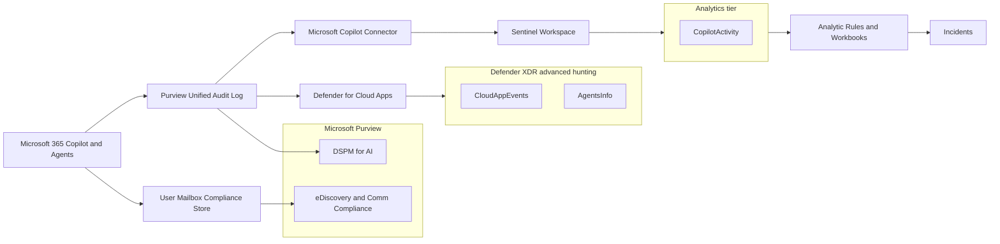

# Microsoft 365 Copilot

> Status: verified. Priority: P2. Last verified: 21 Nov 2026.

## What it is

Microsoft 365 Copilot brings generative AI across Word, Excel, PowerPoint, Outlook, Teams and Microsoft 365 Copilot Chat, grounded in the user's Microsoft Graph data. Its audit logs show who prompted Copilot, which host app or agent handled it, which SharePoint or OneDrive files were accessed for grounding, whether a jailbreak was flagged, and when plugins or settings changed.

## Key recommendations

- Install the **Microsoft Copilot** solution from Content Hub and connect the **Microsoft Copilot** data connector. It ingests `CopilotActivity` via the Office 365 Management API, covering `CopilotInteraction`, plugin management and workspace changes ([Microsoft Learn](https://learn.microsoft.com/en-us/azure/azure-monitor/reference/tables/copilotactivity)).
- Keep `CopilotActivity` in the **Analytics** tier for most tenants. Volume is low to medium compared to raw endpoint or network telemetry, and detections for plugin tampering, jailbreak attempts and oversharing read it directly. Revisit the tier after a week with the `Usage` query if your organisation has tens of thousands of heavy Copilot users.
- Don't ingest `CloudAppEvents` into Sentinel just for Copilot. If you already license Microsoft Defender for Cloud Apps, `CloudAppEvents` carries `CopilotInteraction`, `AIAppInteraction` and `ConnectedAIAppInteraction` in Defender XDR advanced hunting for free with 30 days retention ([Microsoft Learn](https://learn.microsoft.com/en-us/defender-xdr/advanced-hunting-cloudappevents-table)).
- Understand what audit logs don't include. `CopilotActivity`, Purview Audit and `CloudAppEvents` record interaction metadata (actor, app host, accessed files, sensitivity labels, `JailbreakDetected` flag), not the raw prompt or response text ([Microsoft Learn](https://learn.microsoft.com/en-us/purview/audit-copilot)). Use Microsoft Purview DSPM for AI, Communication Compliance or eDiscovery when an investigation requires the full conversation text.
- Turn on **Microsoft Purview DSPM for AI** early. It surfaces oversharing risks, sensitive files referenced by Copilot, and one-click policies for audit and data protection without extra Sentinel ingestion cost ([Microsoft Learn](https://learn.microsoft.com/en-us/purview/dspm-for-ai)).
- Watch for duplicate ingestion if you also run the Office 365 connector (`OfficeActivity`). Confirm which table your rules target before paying to store `CopilotInteraction` twice.

## High-value log sources

| Source | Table name | Connector | Tier | Cost / volume | Value |
|---|---|---|---|---|---|
| Copilot activity and admin audit | `CopilotActivity` | Microsoft Copilot (Content Hub solution) | Analytics | Billable. Low to medium, scales with active Copilot users and prompts | Dedicated Copilot table. Covers `CopilotInteraction`, plugin create/update/delete, workspace changes, `AppHost`, `AgentName`, `AIModelName` and `LLMEventData` ([table reference](https://learn.microsoft.com/en-us/azure/azure-monitor/reference/tables/copilotactivity)). |
| Purview unified audit feed | `OfficeActivity` | Office 365 (Microsoft Sentinel connector) | Analytics (if already connected for M365) | Billable. Low for Copilot rows, part of broader M365 audit stream | Carries `CopilotInteraction` and plugin operations from the unified audit log if you haven't deployed the dedicated `CopilotActivity` connector yet ([table reference](https://learn.microsoft.com/en-us/azure/azure-monitor/reference/tables/officeactivity)). |
| Defender for Cloud Apps AI view | `CloudAppEvents` | None, already in Defender XDR advanced hunting | Already in Defender XDR | Free, 30 days retention in Defender XDR (streaming to Sentinel is billable) | Surfaces `CopilotInteraction` plus `AIAppInteraction` (unmanaged third-party AI apps) and `ConnectedAIAppInteraction` with `RawEventData.CopilotEventData` ([table reference](https://learn.microsoft.com/en-us/defender-xdr/advanced-hunting-cloudappevents-table)). |
| AI agent inventory | `AgentsInfo` | None, already in Defender XDR advanced hunting | Already in Defender XDR | Free in Defender XDR with eligible Agent 365 licence | Inventory, permissions and lifecycle status for agents across Copilot Studio, Agent Builder and Microsoft Foundry ([table reference](https://learn.microsoft.com/en-us/defender-xdr/advanced-hunting-agentsinfo-table)). |
| Prompt and response text | Purview eDiscovery / DSPM for AI | Native Microsoft Purview compliance store | Not a Sentinel table | Covered by Purview / M365 licensing (Audit Standard captures metadata; eDiscovery and Communication Compliance retrieve content) | Full prompt and completion text stored in user mailboxes for legal hold, insider risk and deep incident response ([Microsoft Learn](https://learn.microsoft.com/en-us/purview/audit-copilot)). |

### What to ingest first

| Priority | Table | Why | Rough volume | Tier |
|---|---|---|---|---|
| 1 | `CopilotActivity` | Dedicated schema for Copilot interactions, plugin tampering and jailbreak indicators | Low to medium | Analytics |
| 2 | `CloudAppEvents` (in Defender XDR) | Already available for 30 days with Defender for Cloud Apps; adds third-party `AIAppInteraction` visibility | Free in Defender XDR | Already in Defender XDR |
| 3 | `OfficeActivity` | Only rely on it for Copilot if you already ingest M365 audit logs and have not yet enabled `CopilotActivity` | Low (Copilot subset) | Analytics |
| Skip | Streaming `CloudAppEvents` into Sentinel solely for Copilot | Duplicates `CopilotActivity` at higher billable volume | Medium to high | Skip unless needed for broader SaaS rules |

## Prerequisites and licensing

| Item | Detail |
|---|---|
| Copilot licence | Microsoft 365 Copilot (or Microsoft 365 Copilot Chat / Security Copilot) active in the tenant so `CopilotInteraction` records are generated. |
| Purview Audit | Microsoft Purview Audit (Standard) is on by default for Microsoft 365 tenants and captures `CopilotInteraction` automatically. Third-party `AIAppInteraction` auditing uses pay-as-you-go billing with 180-day retention ([Microsoft Learn](https://learn.microsoft.com/en-us/purview/audit-copilot)). |
| Prompt and response review | Reviewing actual prompt and response text requires Microsoft Purview eDiscovery or Communication Compliance with appropriate Purview licences ([Communication Compliance](https://learn.microsoft.com/en-us/purview/ai-microsoft-purview)). |
| Defender XDR `CloudAppEvents` | Requires Microsoft Defender for Cloud Apps with the Microsoft 365 app connector enabled (`Microsoft 365 activities` ticked). |
| Sentinel | A Log Analytics workspace with Microsoft Sentinel enabled and onboarded to the Defender portal. `CopilotActivity` is billable ingestion ([table reference](https://learn.microsoft.com/en-us/azure/azure-monitor/reference/tables/copilotactivity)). |

### Roles you need

| Task | Role |
|---|---|
| Install the Microsoft Copilot solution and create rules | Microsoft Sentinel Contributor on the resource group ([Microsoft Learn](https://learn.microsoft.com/en-us/azure/sentinel/sentinel-solutions-deploy)) |
| Enable the Microsoft Copilot data connector | Global Administrator or Security Administrator on the tenant, plus Microsoft Sentinel Contributor on the workspace ([Microsoft Learn](https://learn.microsoft.com/en-us/azure/sentinel/data-connectors-reference)) |
| Search Purview Audit or configure DSPM for AI | Audit Logs role / Purview Compliance Administrator in the Microsoft Purview portal |
| Retrieve prompt and response text in eDiscovery | eDiscovery Manager or eDiscovery Administrator (keep separated from routine SOC roles) |

## Step-by-step setup

1. **Confirm Purview Audit is on.** Open the Microsoft Purview portal > Audit and verify auditing is enabled for the tenant. It is on by default in modern Microsoft 365 tenants, and `CopilotInteraction` relies on the unified audit pipeline ([Microsoft Learn](https://learn.microsoft.com/en-us/purview/audit-copilot)).
2. **Install the Microsoft Copilot solution.** Defender portal > Microsoft Sentinel > Content management > Content hub. Search for **Microsoft Copilot**, select View details, then Install ([Microsoft Learn](https://learn.microsoft.com/en-us/azure/sentinel/sentinel-solutions-deploy)).
3. **Connect the Microsoft Copilot data connector.** Defender portal > Setup & configuration > Data management > Data & connectors > Connectors tab > Classic connectors - Microsoft Sentinel. Select **Microsoft Copilot**, open the connector page, authenticate with a Security Administrator or Global Administrator account, and apply changes ([Microsoft Learn](https://learn.microsoft.com/en-us/azure/sentinel/configure-data-connector)).
4. **Confirm table tier and retention.** In Table management on the connector page, keep `CopilotActivity` in the Analytics tier (data lake mirroring is included for Analytics retention).
5. **Verify Defender for Cloud Apps M365 connector (for Defender XDR hunting).** Defender portal > Settings > Cloud apps > Connected apps > App connectors > Microsoft 365. Confirm **Microsoft 365 activities** is enabled so `CloudAppEvents` receives `CopilotInteraction` rows.
6. **Enable Purview DSPM for AI policies.** In the Microsoft Purview portal > DSPM for AI, run the one-click policies to monitor sensitive file access by Copilot and third-party AI apps ([Microsoft Learn](https://learn.microsoft.com/en-us/purview/dspm-for-ai)).
7. **Generate test events.** Send a few prompts in Microsoft 365 Copilot Chat referencing a test SharePoint document with a sensitivity label.
8. **Validate.** Wait 15 to 60 minutes for unified audit pipeline latency, then run the validation queries below in the Defender portal under Investigation & response > Advanced hunting.

## Best-practice security configuration

Microsoft 365 Copilot inherits every user's existing Microsoft 365 permissions, so fixing oversharing is the single most impactful control. See [Microsoft recommended security configurations](../../docs/security-configurations.md).

- **Fix SharePoint oversharing first:** Use SharePoint Advanced Management (Restricted SharePoint Search, site access reviews, Restricted Access Control) to eliminate "Everyone except external users" sites before broad Copilot rollout ([M365 Copilot security and privacy](https://learn.microsoft.com/en-us/copilot/microsoft-365/microsoft-365-copilot-privacy)).
- **Purview DSPM for AI & sensitivity labels:** Enable **Microsoft Purview DSPM for AI** to monitor AI interactions, apply sensitivity labels (Copilot respects label encryption/extraction rights and inherits the highest label of referenced files), and deploy Purview DLP rules to exclude highly confidential files from Copilot grounding ([DSPM for AI](https://learn.microsoft.com/en-us/purview/dspm-for-ai)).
- **Control web search & plugins:** Govern Copilot plugins/extensibility via the Microsoft 365 admin centre Integrated Apps allow-list.

## Architecture diagram



## Validation KQL

For group-wide and workspace-wide freshness checks, see [ai.kql](../../queries/validation/ai.kql) and the [validation query pack](../../queries/validation/README.md).

```kql
// 1. Confirm CopilotActivity is landing and check record types
CopilotActivity
| where TimeGenerated > ago(1d)
| summarize Events = count(), Latest = max(TimeGenerated), Users = dcount(ActorName) by RecordType, Workload
| order by Events desc

// 2. Freshness check (unified audit latency is usually 15 to 60 minutes)
CopilotActivity
| summarize Latest = max(TimeGenerated), AgeMinutes = round((now() - max(TimeGenerated)) / 1m, 1)

// 3. Check app hosts and agents in your tenant before writing detections
CopilotActivity
| where TimeGenerated > ago(7d)
| summarize Events = count() by AppHost, AgentName
| order by Events desc

// 4. Cost: GB per day for CopilotActivity (and OfficeActivity if also enabled)
Usage
| where TimeGenerated > ago(30d)
| where DataType in ("CopilotActivity", "OfficeActivity")
| summarize GB = round(sum(Quantity) / 1024, 3) by DataType, Day = bin(TimeGenerated, 1d)
| summarize GBperDay = round(avg(GB), 3), TotalGB30d = round(sum(GB), 2) by DataType
| order by GBperDay desc

// 5. Defender XDR side: confirm CopilotInteraction and AIAppInteraction in CloudAppEvents
CloudAppEvents
| where Timestamp > ago(1d)
| where ActionType in ("CopilotInteraction", "AIAppInteraction", "ConnectedAIAppInteraction")
| summarize Events = count(), Latest = max(Timestamp) by ActionType, Application
```

## Out-of-box analytic rules

From the **Microsoft Copilot** solution in Content Hub ([solution folder](https://github.com/Azure/Azure-Sentinel/tree/master/Solutions/Microsoft%20Copilot)). Out-of-box rule coverage in this solution is still compact compared to mature identity solutions, so pair the shipped rules with custom detections and Purview DSPM for AI alerts.

| Rule | Detects | Tables | MITRE | Suggested |
|---|---|---|---|---|
| Copilot plugin tampering (`CopilotPluginTampering.yaml`) | Creation, modification or deletion of Copilot plugins that could introduce untrusted connectors or data egress ([rule YAML](https://github.com/Azure/Azure-Sentinel/blob/master/Solutions/Microsoft%20Copilot/Analytic%20Rules/CopilotPluginTampering.yaml)) | `CopilotActivity` | Persistence, Defense Evasion | Enable day 1 |

Check the **Microsoft Copilot** solution Manage page in Content Hub after updates, as Microsoft continues adding detection templates for Copilot and agent activity.

## Custom detections

Run these hourly with a 1-hour lookback unless noted. Inspect sample rows in your workspace before turning them into high-severity incidents, because nested `LLMEventData` properties evolve as new Copilot hosts ship.

### C1. Jailbreak or prompt injection flag detected in Copilot interactions (High)

Microsoft 365 Copilot records safety flags including `JailbreakDetected` inside message metadata. Alerting on repeated or targeted jailbreak detections catches adversarial prompting early.

```kql
// CUSTOM - Jailbreak flag set in CopilotActivity interaction events
// ASSUMPTION: LLMEventData contains a Messages array with a boolean JailbreakDetected field,
// matching the Purview CopilotInteraction schema. Inspect a sample row in your tenant first.
CopilotActivity
| where TimeGenerated > ago(1h)
| where RecordType == "CopilotInteraction"
| extend Messages = LLMEventData.Messages
| mv-expand Message = Messages
| where tobool(Message.JailbreakDetected) == true
| summarize JailbreakCount = count(),
            AppHosts = make_set(AppHost, 10),
            Agents = make_set(AgentName, 10),
            SrcIPs = make_set(SrcIpAddr, 10)
            by ActorName, ActorUserId, bin(TimeGenerated, 1h)
| project TimeGenerated, ActorName, ActorUserId, JailbreakCount, AppHosts, Agents, SrcIPs
```

If you hunt in Defender XDR instead of Sentinel, run the equivalent check against `CloudAppEvents` where `ActionType == "CopilotInteraction"` and expand `RawEventData.CopilotEventData.Messages`. MITRE ATLAS: AML.T0051 (LLM Prompt Injection).

### C2. Unusual burst of Copilot prompts referencing sensitive files (Medium)

A compromised account or departing insider can use Copilot to summarise dozens of confidential files rapidly without triggering bulk SharePoint download thresholds.

```kql
// CUSTOM - Single user accessing many distinct resources via Copilot in one hour
// ASSUMPTION: LLMEventData.AccessedResources holds the array of grounded files with Id/Name
// and SensitivityLabelId properties, matching the Purview CopilotInteraction schema.
// Confirm exact key names on one sample row in your workspace before enabling.
let resource_threshold = 20;
CopilotActivity
| where TimeGenerated > ago(1h)
| where RecordType == "CopilotInteraction"
| extend Resources = LLMEventData.AccessedResources
| mv-expand Resource = Resources
| extend ResourceId = tostring(Resource.Id),
         SensitivityLabelId = tostring(Resource.SensitivityLabelId)
| where isnotempty(ResourceId)
| summarize DistinctResources = dcount(ResourceId),
            LabelledResources = dcountif(ResourceId, isnotempty(SensitivityLabelId)),
            SampleResources = make_set(ResourceId, 10),
            AppHosts = make_set(AppHost, 5),
            SrcIPs = make_set(SrcIpAddr, 5)
            by ActorName, ActorUserId, bin(TimeGenerated, 1h)
| where DistinctResources >= resource_threshold
| project TimeGenerated, ActorName, ActorUserId, DistinctResources, LabelledResources, AppHosts, SrcIPs, SampleResources
```

Tune `resource_threshold` against a 14-day baseline in your tenant, or filter specifically on your Confidential and Highly Confidential `SensitivityLabelId` GUIDs. MITRE ATT&CK: Collection T1213 (Data from Information Repositories).

### C3. Copilot configuration or plugin changes by non-approved actors (Medium)

```kql
// CUSTOM - Copilot settings or plugin lifecycle changes outside the approved admin list
// ASSUMPTION: RecordType or Operation values include CopilotSettings/Plugin actions.
// Verify exact strings in your tenant with:
//   CopilotActivity | where TimeGenerated > ago(30d) | distinct RecordType
let approved_admins = dynamic(["ai-admin@yourdomain.gov.au"]);
CopilotActivity
| where TimeGenerated > ago(1h)
| where RecordType != "CopilotInteraction"
| where ActorName !in~ (approved_admins)
| project TimeGenerated, RecordType, Workload, ActorName, ActorUserType, AppHost, SrcIpAddr, LLMEventData
```

MITRE ATT&CK: Persistence T1098 (Account Manipulation) and Defense Evasion T1562.

## Playbooks

No Copilot-specific containment playbooks ship by default in the Microsoft Copilot solution as of verification. Pair Copilot incidents with the identity response playbooks from the **Microsoft Entra ID** solution (`Revoke-AADSignInSessions`, `Prompt-User`, `Block-AADUser`):

- **Session revocation on confirmed compromise.** When a Copilot data harvesting or jailbreak alert correlates with a risky sign-in, trigger `Revoke-AADSignInSessions` using a Logic App managed identity with Microsoft Graph `User.RevokeSessions.All` (or `User.ReadWrite.All`) and Microsoft Sentinel Responder on the workspace.
- **SOC enrichment notification.** Build a Logic App that posts the `ActorName`, `AppHost`, `AgentName`, `SrcIpAddr` and accessed resource count to a SOC Teams channel, with a link to Purview eDiscovery if an authorised reviewer needs to inspect the prompt text.

## Workbooks and hunting

The **Microsoft Copilot** Content Hub solution ships a Copilot activity monitoring workbook (`MicrosoftCopilotActivityMonitoring`) covering interaction volume, top users, host apps, models and administrative changes ([solution folder](https://github.com/Azure/Azure-Sentinel/tree/master/Solutions/Microsoft%20Copilot)).

Two hunting queries worth running weekly:

- **Copilot activity from unusual regions or new IPs.** Join `CopilotActivity` against `SigninLogs` on `ActorName == UserPrincipalName` to spot Copilot usage originating outside expected corporate countries or immediately after an anomalous sign-in.

```kql
// Hunt: Copilot activity by users who had a medium or high risk sign-in in the last 24h
let risky_users = SigninLogs
    | where TimeGenerated > ago(1d)
    | where RiskLevelDuringSignIn in ("medium", "high")
    | summarize LastRiskySignIn = max(TimeGenerated) by ActorName = tolower(UserPrincipalName);
CopilotActivity
| where TimeGenerated > ago(1d)
| extend ActorLower = tolower(ActorName)
| join kind=inner risky_users on $left.ActorLower == $right.ActorName
| where TimeGenerated >= LastRiskySignIn
| project TimeGenerated, ActorName, RecordType, AppHost, AgentName, SrcIpAddr, LastRiskySignIn
```

- **Third-party AI app discovery (Defender XDR).** Query `CloudAppEvents | where Timestamp > ago(7d) | where ActionType == "AIAppInteraction" | summarize Prompts = count(), Users = dcount(AccountObjectId) by Application` to find unsanctioned AI tools in use across the organisation.

## Gotchas and deprecations

- **`LLMActivity` renamed to `CopilotActivity`.** The preview table `LLMActivity` was renamed to `CopilotActivity` in December 2025, ahead of the connector's general availability in April 2026. Older blog posts, community rules and even some Microsoft Learn sample queries still reference `LLMActivity`; update any saved queries to `CopilotActivity` ([table reference](https://learn.microsoft.com/en-us/azure/azure-monitor/reference/tables/copilotactivity)).
- **No prompt or response text in audit logs.** `CopilotActivity`, `OfficeActivity` and `CloudAppEvents` store metadata and grounding resource references only. Don't promise investigators full prompt text from Sentinel; document the Purview eDiscovery escalation path up front ([Microsoft Learn](https://learn.microsoft.com/en-us/purview/audit-copilot)).
- **Possible duplication with `OfficeActivity`.** If you run both the Office 365 connector and the Microsoft Copilot connector, verify whether `CopilotInteraction` rows are landing in both tables and adjust your rules so you don't double-alert or double-pay.
- **Third-party AI auditing costs extra.** `CopilotInteraction` is included with Purview Audit (Standard), whereas `AIAppInteraction` for unmanaged third-party AI apps uses pay-as-you-go billing ([Microsoft Learn](https://learn.microsoft.com/en-us/purview/audit-copilot)).
- **Audit pipeline delay.** Events flow through the Office 365 Management API and typically take 15 to 60 minutes (occasionally longer) to reach `CopilotActivity`. Size scheduled rule lookback windows accordingly so events aren't missed.
- **Sentinel in the Azure portal retires on 31 March 2027.** Build and test connectors, rules and hunting queries in the Defender portal ([Microsoft Learn](https://learn.microsoft.com/en-us/azure/sentinel/microsoft-sentinel-defender-portal)).

## Official links

- [Audit logs for Copilot and AI applications](https://learn.microsoft.com/en-us/purview/audit-copilot)
- [Microsoft Purview Data Security Posture Management (DSPM) for AI](https://learn.microsoft.com/en-us/purview/dspm-for-ai)
- [Configure a Communication Compliance policy to detect generative AI interactions](https://learn.microsoft.com/en-us/purview/ai-microsoft-purview)
- [CopilotActivity table reference](https://learn.microsoft.com/en-us/azure/azure-monitor/reference/tables/copilotactivity)
- [OfficeActivity table reference](https://learn.microsoft.com/en-us/azure/azure-monitor/reference/tables/officeactivity)
- [CloudAppEvents table, Defender XDR](https://learn.microsoft.com/en-us/defender-xdr/advanced-hunting-cloudappevents-table)
- [AgentsInfo table, Defender XDR](https://learn.microsoft.com/en-us/defender-xdr/advanced-hunting-agentsinfo-table)
- [Microsoft Copilot solution, Azure-Sentinel repo](https://github.com/Azure/Azure-Sentinel/tree/master/Solutions/Microsoft%20Copilot)
- [Find your Microsoft Sentinel data connector](https://learn.microsoft.com/en-us/azure/sentinel/data-connectors-reference)
- [Enable a data connector, Defender portal navigation](https://learn.microsoft.com/en-us/azure/sentinel/configure-data-connector)
- [Discover and deploy content from Content hub](https://learn.microsoft.com/en-us/azure/sentinel/sentinel-solutions-deploy)
- [Microsoft Sentinel in the Defender portal](https://learn.microsoft.com/en-us/azure/sentinel/microsoft-sentinel-defender-portal)

## Last verified

21 Nov 2026, against Microsoft Learn, the Defender XDR schema references and the Azure-Sentinel repo. Re-verify before relying on table names, nested JSON paths or rule names.
