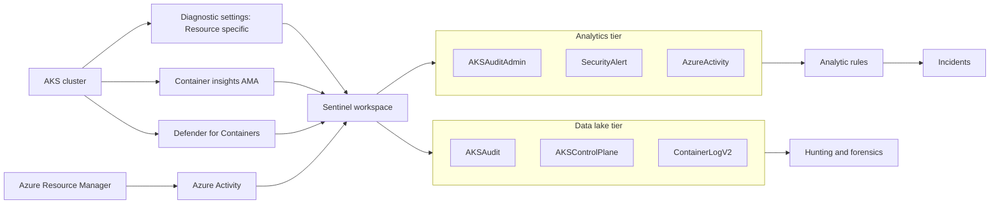

# Azure Kubernetes Service (AKS)

> Status: verified. Priority: P2. Last verified: 21 Nov 2026.

## What it is

Azure Kubernetes Service (AKS) runs managed Kubernetes clusters on Azure. Its control plane audit logs show interactive `kubectl exec` into pods, RBAC edits, privileged workload creation and secret access, while Microsoft Defender for Containers monitors both the Kubernetes API and node runtime syscalls for container escapes, web shells and crypto-mining.

## Key recommendations

- Always choose **Resource specific** destination tables in AKS diagnostic settings, never legacy `AzureDiagnostics`. Resource-specific mode gives you clean typed columns in `AKSAuditAdmin`, `AKSAudit` and `AKSControlPlane` instead of raw JSON strings ([Microsoft Learn](https://learn.microsoft.com/en-us/azure/aks/monitor-aks)).
- Send `kube-audit-admin` (`AKSAuditAdmin`) to the **Analytics** tier as your default day-1 audit log. It excludes noisy `get` and `list` verbs while keeping every `create`, `update`, `patch`, `delete` and `pods/exec` action ([table reference](https://learn.microsoft.com/en-us/azure/azure-monitor/reference/tables/aksauditadmin)).
- Treat full `kube-audit` (`AKSAudit`) deliberately. It includes every `get` and `list` request and generates huge volume. Only turn it on if you specifically need to alert or hunt on `get`/`list` of Kubernetes `secrets`, and send it to the **Data lake** tier (or filter it to `secrets` with a workspace transformation DCR). Don't enable both `kube-audit` and `kube-audit-admin` unfiltered into Analytics, or you'll pay twice for every write event.
- Enable **Microsoft Defender for Containers** and stream its alerts into Sentinel (`SecurityAlert`). Defender for Containers analyses AKS control-plane audit logs agentlessly on Microsoft's side (no diagnostic setting needed) and runs a lightweight DaemonSet runtime sensor on nodes for process, file and network threats. Its alerts are free to ingest into Sentinel ([Microsoft Learn](https://learn.microsoft.com/en-us/azure/defender-for-cloud/defender-for-containers-introduction)).
- Keep `ContainerLogV2` (container `stdout`/`stderr` from Container insights) in the **Data lake** tier or Basic/Auxiliary logs, not Analytics. Application container logs are high volume and best suited to post-incident investigation.
- Connect **Azure Activity** (`AzureActivity`) to catch cluster-level control-plane abuse, especially calls to `listClusterAdminCredential` that pull static cluster-admin kubeconfigs and bypass Entra RBAC.

## High-value log sources

AKS diagnostic categories route to resource-specific tables when you pick **Resource specific** in diagnostic settings. Container stdout/stderr comes from Container insights via Azure Monitor Agent (AMA), and runtime/control-plane threat alerts come from Defender for Containers.

| Source | Table name | Connector | Tier | Cost / volume | Value |
|---|---|---|---|---|---|
| Kubernetes audit (admin) | `AKSAuditAdmin` | Azure Kubernetes Service (diagnostic settings, `kube-audit-admin`) | Analytics | Low to medium. Excludes `get` and `list` verbs | Best cost-to-signal AKS table. Catches `pods/exec`, RBAC role bindings, privileged pod creation and config changes ([table reference](https://learn.microsoft.com/en-us/azure/azure-monitor/reference/tables/aksauditadmin)). |
| Kubernetes audit (full) | `AKSAudit` | Azure Kubernetes Service (diagnostic settings, `kube-audit`) | Data lake (or skip unless hunting `secrets` reads) | Very high. Logs every `get` and `list` API call | Superset of `AKSAuditAdmin`. Only needed if you must track read-only `get`/`list` of Kubernetes `secrets` or ConfigMaps ([table reference](https://learn.microsoft.com/en-us/azure/azure-monitor/reference/tables/aksaudit)). |
| Control plane and Guard | `AKSControlPlane` | Azure Kubernetes Service (diagnostic settings: `guard`, `kube-apiserver`, `kube-controller-manager`, `kube-scheduler`) | Data lake | Medium to high | Control plane component logs. Includes the `guard` category (Entra authentication/authorisation webhook); there is no separate `AKSGuard` table ([table reference](https://learn.microsoft.com/en-us/azure/azure-monitor/reference/tables/akscontrolplane)). |
| Container stdout/stderr | `ContainerLogV2` | Container insights (Azure Monitor Agent) | Data lake | Very high. Every container stdout/stderr line | Application-level forensics after a pod compromise. Successor to legacy `ContainerLog`, with 64 KB lines and `KubernetesMetadata` ([table reference](https://learn.microsoft.com/en-us/azure/azure-monitor/reference/tables/containerlogv2)). |
| Defender for Containers alerts | `SecurityAlert` | Microsoft Defender for Cloud | Analytics | Free Sentinel ingestion. Plan billed per protected vCore per hour | Control-plane and node runtime threat alerts: container escape, reverse shells, web shells, crypto-mining, privileged containers ([Microsoft Learn](https://learn.microsoft.com/en-us/azure/defender-for-cloud/defender-for-containers-introduction)). |
| AKS Azure control plane | `AzureActivity` | Azure Activity | Analytics | Free Sentinel ingestion, low volume | Tracks `listClusterAdminCredential`, cluster RBAC changes, network policy edits and diagnostic setting removals ([table reference](https://learn.microsoft.com/en-us/azure/azure-monitor/reference/tables/azureactivity)). |

### What to ingest first

| Priority | Table | Why | Rough volume | Tier |
|---|---|---|---|---|
| 1 | `SecurityAlert` (Defender for Containers) + `AzureActivity` | Free Sentinel ingestion; immediate runtime, control-plane and kubeconfig-pull coverage | Low | Analytics |
| 2 | `AKSAuditAdmin` | Every mutating API call (`exec`, RBAC, deployments) without `get`/`list` noise | Low to medium | Analytics |
| 3 | `AKSControlPlane` (`guard` first) | Entra auth webhook diagnostics and control-plane troubleshooting | Medium | Data lake |
| 4 | `ContainerLogV2` | Post-incident pod forensics | Very high | Data lake |
| 5 | `AKSAudit` | Only if compliance or threat model requires tracking `get`/`list` on `secrets` | Very high | Data lake (or DCR-filtered to `secrets`) |
| Skip | Legacy `ContainerLog`, `kube-audit` unfiltered in Analytics | Superseded schema or unsustainable cost | High to very high | Migrate to `ContainerLogV2` and `AKSAuditAdmin` |

## Prerequisites and licensing

| Item | Detail |
|---|---|
| AKS diagnostic logs | No extra AKS licence required. You pay Log Analytics and Sentinel ingestion for `AKSAuditAdmin`, `AKSAudit` and `AKSControlPlane` ([Monitor AKS](https://learn.microsoft.com/en-us/azure/aks/monitor-aks)). |
| Container insights (`ContainerLogV2`) | Uses Azure Monitor Agent (AMA) managed by AKS Container insights. Billed on Log Analytics ingestion volume; set the table plan to Basic/Data lake where possible to control cost ([ContainerLogV2 schema](https://learn.microsoft.com/en-us/azure/azure-monitor/reference/tables/containerlogv2)). |
| Microsoft Defender for Containers | Paid plan in Microsoft Defender for Cloud, billed per protected vCore per hour across cluster nodes (includes a monthly container registry image scan allowance per vCore). Alerts forwarded to Sentinel incur no Sentinel ingestion charge ([Microsoft Learn](https://learn.microsoft.com/en-us/azure/defender-for-cloud/defender-for-containers-introduction)). |
| Entra ID integration (`guard`) | Managed Microsoft Entra ID integration on AKS is recommended so `AKSAuditAdmin` records real user UPNs/object IDs rather than shared certificate identities. |

### Roles you need

| Task | Role |
|---|---|
| Install Content Hub solutions and create rules | Microsoft Sentinel Contributor on the resource group ([Microsoft Learn](https://learn.microsoft.com/en-us/azure/sentinel/sentinel-solutions-deploy)) |
| Configure AKS diagnostic settings and Container insights | Azure Kubernetes Service Contributor Role (plus Monitoring Contributor / Log Analytics Contributor on the workspace) |
| Assign Azure Policy for diagnostic settings at scale | Resource Policy Contributor at subscription or management group scope ([Microsoft Learn](https://learn.microsoft.com/en-us/azure/sentinel/connect-services-diagnostic-setting-based)) |
| Enable Defender for Containers and deploy the runtime sensor | Security Admin or Subscription Owner on the subscription ([Microsoft Learn](https://learn.microsoft.com/en-us/azure/sentinel/connect-defender-for-cloud)) |

## Step-by-step setup

1. **Install Content Hub solutions.** In the Defender portal, go to **Microsoft Sentinel** > **Content management** > **Content hub**. Install **Microsoft Defender for Cloud** and **Azure Activity**, plus **Azure Kubernetes Service** if listed in your workspace catalogue ([Microsoft Learn](https://learn.microsoft.com/en-us/azure/sentinel/sentinel-solutions-deploy)).
2. **Enable Defender for Containers.** In **Microsoft Defender for Cloud** > **Environment settings**, select your subscriptions and enable the **Containers** plan with auto-provisioning turned on for the **Defender sensor** (DaemonSet) and **Azure Policy for Kubernetes**. Then connect the tenant-based **Microsoft Defender for Cloud** connector in Sentinel ([Microsoft Learn](https://learn.microsoft.com/en-us/azure/sentinel/connect-defender-for-cloud)).
3. **Configure AKS resource-specific diagnostic settings.** In the Azure portal, open your AKS cluster > **Monitoring** > **Diagnostic settings** > **+ Add diagnostic setting**.
   - Select **kube-audit-admin** (writes to `AKSAuditAdmin`) and **guard** (writes to `AKSControlPlane`). Add `kube-apiserver` if you want API server operational diagnostics in Data lake.
   - Under **Destination details**, tick **Send to Log Analytics workspace**, choose your Sentinel workspace, and set **Destination table** to **Resource specific** (critical: do not leave it on `AzureDiagnostics`).
   - Save ([Microsoft Learn](https://learn.microsoft.com/en-us/azure/aks/monitor-aks)).
4. **Apply across clusters with Azure Policy.** In the Defender portal, open **Setup & configuration** > **Data management** > **Data & connectors** > **Connectors** > **Classic connectors - Microsoft Sentinel** > **Azure Kubernetes Service (AKS)** > **Open connector page**, and assign the built-in Azure Policy to deploy resource-specific diagnostic settings across all clusters ([Microsoft Learn](https://learn.microsoft.com/en-us/azure/sentinel/connect-services-diagnostic-setting-based)).
5. **Configure Container insights with `ContainerLogV2` (optional, Data lake tier).** On the AKS cluster, open **Monitoring** > **Insights**, enable Container insights pointing to your workspace, and confirm `ContainerLogV2` schema is enabled. Set `ContainerLogV2` to Data lake or Basic retention in table management so verbose container stdout doesn't consume Analytics budget ([Microsoft Learn](https://learn.microsoft.com/en-us/azure/azure-monitor/reference/tables/containerlogv2)).
6. **Connect Azure Activity.** Ensure **Azure Activity** is streaming from every subscription hosting AKS clusters so `listClusterAdminCredential` and cluster config changes are captured.
7. **Validate.** Run a benign `kubectl` mutation (such as labelling a test pod in a dev namespace), wait 5 to 15 minutes, then run the validation KQL below in the Defender portal under **Investigation & response** > **Advanced hunting**.

## Architecture diagram



## Validation KQL

For group-wide and workspace-wide freshness checks, see [azure.kql](../../queries/validation/azure.kql) and the [validation query pack](../../queries/validation/README.md).

```kql
// 1. Check which AKS tables are landing and how fresh they are
// Note: Tables set to data lake only do not appear here; check Data lake explorer for those.
union withsource=Table isfuzzy=true
    AKSAuditAdmin, AKSAudit, AKSControlPlane, ContainerLogV2
| where TimeGenerated > ago(1d)
| summarize Rows = count(), Latest = max(TimeGenerated) by Table
| order by Table asc

// 2. Freshness check on AKSAuditAdmin (should be minutes old on active clusters)
AKSAuditAdmin
| summarize Latest = max(TimeGenerated), AgeMinutes = (now() - max(TimeGenerated)) / 1m

// 3. Verify Defender for Containers alerts are arriving in SecurityAlert
SecurityAlert
| where TimeGenerated > ago(30d)
| where ProductName has "Container" or ProductComponentName has "Kubernetes" or ProviderName has "MDC"
| summarize Alerts = count(), Latest = max(TimeGenerated) by AlertName
| order by Alerts desc

// 4. Confirm guard logs are landing inside AKSControlPlane (not a separate table)
AKSControlPlane
| where TimeGenerated > ago(1d)
| summarize Events = count() by Category
| order by Events desc

// 5. Cost: GB per table per day over the last 30 days
Usage
| where TimeGenerated > ago(30d)
| where DataType in ("AKSAuditAdmin", "AKSAudit", "AKSControlPlane", "ContainerLogV2", "SecurityAlert")
| summarize GB = round(sum(Quantity) / 1024, 2) by DataType, Day = bin(TimeGenerated, 1d)
| summarize GBperDay = round(avg(GB), 2), TotalGB30d = round(sum(GB), 2) by DataType
| order by GBperDay desc
```

## Out-of-box analytic rules

AKS diagnostic logs ship with very few standalone Sentinel analytic rule templates compared to identity sources. Your primary out-of-box detection coverage comes from **Microsoft Defender for Containers** alerts promoted via the **Microsoft Defender for Cloud** solution ([solution folder](https://github.com/Azure/Azure-Sentinel/tree/master/Solutions/Microsoft%20Defender%20for%20Cloud)) and control-plane rules in the **Azure Activity** solution ([Azure Activity solution](https://github.com/Azure/Azure-Sentinel/tree/master/Solutions/Azure%20Activity)). Pair those with the custom `AKSAuditAdmin` rules below.

| Rule | Detects | Tables | MITRE | Suggested |
|---|---|---|---|---|
| Create incidents based on Microsoft Defender for Cloud alerts | Promotes Defender for Containers runtime and API alerts (container escape, web shell, crypto-mining, privileged container, exposed Kubernetes dashboard) into Sentinel incidents | `SecurityAlert` | Execution, Privilege Escalation, Defense Evasion, Impact | Enable day 1 |
| Azure Activity diagnostic setting or RBAC rules (Azure Activity solution) | Control-plane tampering across subscriptions hosting AKS clusters | `AzureActivity` | Persistence, Defense Evasion | Enable day 1 |

## Custom detections

Run hourly with a 1-hour lookback unless noted. `AKSAuditAdmin` uses typed dynamic columns (`User`, `ObjectRef`, `ResponseStatus`, `SourceIps`) documented in the [AKSAuditAdmin table reference](https://learn.microsoft.com/en-us/azure/azure-monitor/reference/tables/aksauditadmin).

### C1. Interactive exec or attach into a Kubernetes pod (Medium, High in production)

Attackers who obtain cluster credentials frequently run `kubectl exec` into running pods to steal mounted tokens, pivot or drop tools.

```kql
// CUSTOM - Interactive exec or attach into a pod in AKS
// ASSUMPTION: Resource-specific diagnostic setting kube-audit-admin is enabled (writes to AKSAuditAdmin).
// Filter approved break-glass or SRE accounts via a watchlist after baselining.
let approved_users = dynamic(["sre-breakglass@yourdomain.gov.au"]);
AKSAuditAdmin
| where TimeGenerated > ago(1h)
| where Verb in ("create", "get")
| where tostring(ObjectRef.resource) == "pods"
    and tostring(ObjectRef.subresource) in ("exec", "attach")
| extend Username = tostring(User.username),
         Namespace = tostring(ObjectRef.namespace),
         PodName = tostring(ObjectRef.name),
         ResponseCode = toint(ResponseStatus.code)
| where ResponseCode between (100 .. 299)
| where Username !startswith "system:"
| where Username !in~ (approved_users)
| project TimeGenerated, Cluster = _ResourceId, Username, Namespace, PodName,
          Subresource = tostring(ObjectRef.subresource), RequestUri, SourceIps, ResponseCode
```

MITRE: Execution, Container Administration Command T1609.

### C2. ClusterRoleBinding created or modified for privileged access (High)

Creating or modifying a `ClusterRoleBinding` (especially binding `cluster-admin`) grants cluster-wide control and is a classic Kubernetes persistence technique.

```kql
// CUSTOM - ClusterRoleBinding created, updated or patched outside system controllers
// ASSUMPTION: Verify your GitOps controller service account name (e.g. Flux or ArgoCD) and add to allow list.
let gitops_accounts = dynamic(["system:serviceaccount:flux-system:kustomize-controller"]);
AKSAuditAdmin
| where TimeGenerated > ago(1h)
| where Verb in ("create", "update", "patch")
| where tostring(ObjectRef.resource) in ("clusterrolebindings", "rolebindings")
| extend Username = tostring(User.username),
         BindingName = tostring(ObjectRef.name),
         Namespace = tostring(ObjectRef.namespace),
         ResponseCode = toint(ResponseStatus.code)
| where ResponseCode between (200 .. 299)
| where Username !startswith "system:apiserver"
    and Username !startswith "system:kube-controller-manager"
    and Username !in~ (gitops_accounts)
| project TimeGenerated, Cluster = _ResourceId, Verb, Username,
          ResourceType = tostring(ObjectRef.resource), Namespace, BindingName, SourceIps, RequestUri
```

MITRE: Privilege Escalation and Persistence, Account Manipulation T1098.

### C3. Static AKS cluster-admin credentials retrieved via Azure API (High)

Calling `listClusterAdminCredential` returns a static certificate-based `cluster-admin` kubeconfig that bypasses Entra ID Conditional Access and RBAC unless local accounts are disabled.

```kql
// CUSTOM - Retrieval of AKS static cluster-admin credentials via Azure Resource Manager
// ASSUMPTION: AzureActivity is connected for subscriptions hosting AKS clusters.
AzureActivity
| where TimeGenerated > ago(1h)
| where ActivityStatusValue in ("Success", "Succeeded")
| where OperationNameValue =~ "Microsoft.ContainerService/managedClusters/listClusterAdminCredential/action"
| project TimeGenerated, Caller, CallerIpAddress, SubscriptionId, ResourceGroup, Cluster = _ResourceId
```

If local accounts are disabled (`--disable-local-accounts`), this API call fails and any successful occurrence is an immediate severity-high incident. MITRE: Credential Access, Steal Application Access Token / Valid Accounts T1078.004.

## Playbooks

No AKS-specific containment playbooks ship out of the box. Common Logic App patterns to build:

| Playbook pattern | What it does | Connectors and permissions |
|---|---|---|
| Enrich AKS alert with audit trail | Queries `AKSAuditAdmin` for the caller or pod over the preceding 2 hours and appends a comment to the Sentinel incident | Azure Monitor Logs connector (`Log Analytics Reader`), Microsoft Sentinel Responder |
| Revoke compromised Entra caller | Calls `Revoke-AADSignInSessions` and optionally `Block-AADUser` from the Microsoft Entra ID solution when an Entra user triggers a high-severity AKS alert | Microsoft Graph (`User.ReadWrite.All`), Microsoft Sentinel Responder |
| Isolate node or notify platform team | Posts incident context (cluster, namespace, pod, image, caller) to the Kubernetes platform on-call channel for rapid pod eviction or network policy isolation | Teams / Slack / PagerDuty connector, Microsoft Sentinel Responder |

## Workbooks and hunting

- **AKS Guided Hunting notebook.** Microsoft publishes the interactive `Azure Kubernetes Service Guided Hunting.ipynb` notebook covering container escapes, suspicious API calls and privilege escalation hunts ([Azure-Sentinel-Notebooks](https://github.com/Azure/Azure-Sentinel-Notebooks/blob/master/azure-hunting/Azure%20Kubernetes%20Service%20Guided%20Hunting.ipynb)).
- **Container insights workbooks.** In the Azure portal, open your AKS cluster > **Monitoring** > **Workbooks** for built-in operational views over `ContainerLogV2` and cluster health.
- **Recommended hunt: Anonymous or failed API authentication spikes.** Hunt `AKSAuditAdmin` for `401` and `403` bursts indicating probing or misconfigured/stolen service account tokens:

```kql
AKSAuditAdmin
| where TimeGenerated > ago(7d)
| extend ResponseCode = toint(ResponseStatus.code), Username = tostring(User.username)
| where ResponseCode in (401, 403)
| summarize Attempts = count(), Targets = make_set(tostring(ObjectRef.resource), 10)
    by Username, SourceIp = tostring(SourceIps[0]), ResponseCode, Cluster = _ResourceId
| where Attempts >= 20
| order by Attempts desc
```

## Gotchas and deprecations

- **`AKSGuard` is not a standalone table.** Enabling the `guard` diagnostic log category writes rows into `AKSControlPlane` (with `Category == "guard"`), not a separate `AKSGuard` table ([AKSControlPlane reference](https://learn.microsoft.com/en-us/azure/azure-monitor/reference/tables/akscontrolplane)).
- **Full `kube-audit` (`AKSAudit`) is extremely noisy.** Because it logs every `get` and `list` from Kubernetes controllers, operators and dashboards, it can generate gigabytes per hour per cluster. Use `AKSAuditAdmin` (`kube-audit-admin`) for Analytics, and only send `AKSAudit` to Data lake or filter it with a workspace transformation DCR.
- **Avoid enabling both `kube-audit` and `kube-audit-admin` to Analytics.** `kube-audit` already includes every mutating event in `kube-audit-admin`. Enabling both unfiltered duplicates write events and increases spend.
- **Resource-specific versus `AzureDiagnostics`.** If you leave the diagnostic setting on `AzureDiagnostics`, AKS audit logs land as unparsed JSON inside `log_s` and none of the typed queries against `AKSAuditAdmin` will match. Always select **Resource specific** ([Monitor AKS](https://learn.microsoft.com/en-us/azure/aks/monitor-aks)).
- **`ContainerLog` versus `ContainerLogV2`.** `ContainerLogV2` replaces the legacy `ContainerLog` schema with stitched multiline logs, 64 KB line limits and structured `KubernetesMetadata`. Enable `ContainerLogV2` for all clusters using Container insights ([schema reference](https://learn.microsoft.com/en-us/azure/azure-monitor/reference/tables/containerlogv2)).
- **Defender for Containers does not require your diagnostic setting.** Defender for Containers inspects AKS control-plane audit logs through its own Azure-managed pipeline, so its alerts still work even if you haven't enabled `AKSAuditAdmin`. You still need `AKSAuditAdmin` for custom detections and forensic timeline reconstruction.
- **Sentinel in the Azure portal retires on 31 March 2027.** Build and manage rules in the Defender portal ([Microsoft Learn](https://learn.microsoft.com/en-us/azure/sentinel/microsoft-sentinel-defender-portal)).

## Official links

- [Monitor Azure Kubernetes Service (AKS)](https://learn.microsoft.com/en-us/azure/aks/monitor-aks)
- [Monitoring Azure Kubernetes Service (AKS) data reference](https://learn.microsoft.com/en-us/azure/aks/monitor-aks-reference)
- [AKSAuditAdmin table reference](https://learn.microsoft.com/en-us/azure/azure-monitor/reference/tables/aksauditadmin)
- [AKSAudit table reference](https://learn.microsoft.com/en-us/azure/azure-monitor/reference/tables/aksaudit)
- [AKSControlPlane table reference](https://learn.microsoft.com/en-us/azure/azure-monitor/reference/tables/akscontrolplane)
- [ContainerLogV2 table reference](https://learn.microsoft.com/en-us/azure/azure-monitor/reference/tables/containerlogv2)
- [ContainerLogV2 schema in Container insights](https://learn.microsoft.com/en-us/azure/azure-monitor/reference/tables/containerlogv2)
- [Introduction to Microsoft Defender for Containers](https://learn.microsoft.com/en-us/azure/defender-for-cloud/defender-for-containers-introduction)
- [Connect Sentinel to Azure services using diagnostic settings](https://learn.microsoft.com/en-us/azure/sentinel/connect-services-diagnostic-setting-based)
- [Connect Microsoft Defender for Cloud to Microsoft Sentinel](https://learn.microsoft.com/en-us/azure/sentinel/connect-defender-for-cloud)
- [Azure Kubernetes Service Guided Hunting notebook](https://github.com/Azure/Azure-Sentinel-Notebooks/blob/master/azure-hunting/Azure%20Kubernetes%20Service%20Guided%20Hunting.ipynb)
- [Microsoft Defender for Cloud solution, Azure-Sentinel repo](https://github.com/Azure/Azure-Sentinel/tree/master/Solutions/Microsoft%20Defender%20for%20Cloud)
- [Azure Activity solution, Azure-Sentinel repo](https://github.com/Azure/Azure-Sentinel/tree/master/Solutions/Azure%20Activity)
- [Microsoft Sentinel in the Defender portal](https://learn.microsoft.com/en-us/azure/sentinel/microsoft-sentinel-defender-portal)

## Last verified

21 Nov 2026, against Microsoft Learn and the Azure-Sentinel repo. Re-verify before relying on table names, navigation or rule names.
