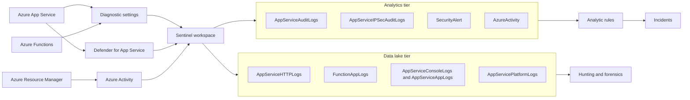

# Azure App Service and Azure Functions

> Status: verified. Priority: P3. Last verified: 21 Nov 2026.

## What it is

Azure App Service hosts managed web apps and APIs, and Azure Functions runs serverless code on the same `Microsoft.Web/sites` platform. Their diagnostic logs record publishing authentication (FTP and Kudu/SCM), IP access restriction decisions, incoming HTTP requests and function execution traces, while Microsoft Defender for App Service alerts on web shells, injection and remote code execution.

## Key recommendations

- **Start with `AppServiceAuditLogs` and `AppServiceIPSecAuditLogs` in the Analytics tier.** Publishing credentials (FTP/FTPS and Kudu/SCM basic auth) are a prime path for attackers deploying web shells onto exposed web apps. `AppServiceAuditLogs` is tiny and every unexpected row deserves investigation ([table reference](https://learn.microsoft.com/en-us/azure/azure-monitor/reference/tables/appserviceauditlogs)).
- **Disable FTP and SCM basic authentication wherever possible.** Use Microsoft Entra ID authentication for deployments and enforce it with Azure Policy; then alert on any `AppServiceAuditLogs` login or any `AzureActivity` change that turns basic auth back on ([Microsoft Learn](https://learn.microsoft.com/en-us/azure/app-service/configure-basic-auth-disable)).
- **Put `AppServiceHTTPLogs`, `AppServiceConsoleLogs`, `AppServiceAppLogs`, `AppServicePlatformLogs` and `FunctionAppLogs` in the Data lake tier by default.** HTTP and console/application logs can be noisy on busy web apps. Only promote `AppServiceHTTPLogs` to Analytics for high-value internet-facing apps where you run Threat Intelligence IP matching or custom HTTP detections.
- **Enable Microsoft Defender for App Service** in Microsoft Defender for Cloud and connect Defender for Cloud to Sentinel. It detects web shells, crypto-mining, remote code execution and dangling DNS at the platform layer without requiring raw HTTP ingestion, and its alerts land free in `SecurityAlert` ([Microsoft Learn](https://learn.microsoft.com/en-us/azure/defender-for-cloud/defender-for-app-service-introduction)).
- **Pair with `AzureActivity`.** Control-plane actions such as reading publishing profiles (`listpublishingcredentials`), changing app settings/connection strings or relaxing IP restrictions land in `AzureActivity` at no Sentinel ingestion cost ([table reference](https://learn.microsoft.com/en-us/azure/azure-monitor/reference/tables/azureactivity)).

## High-value log sources

All App Service and Function App diagnostic categories route via Azure Monitor diagnostic settings on `Microsoft.Web/sites` directly into their resource-specific tables (no `AzureDiagnostics` parsing needed).

| Source | Table name | Connector | Tier | Cost / volume | Value |
|---|---|---|---|---|---|
| Publishing and FTP audit logs | `AppServiceAuditLogs` | App Service / Function App (diagnostic settings) | Analytics | Very low | Successful and attempted publishing logins via FTP/FTPS and Kudu/SCM basic auth. Highest-signal App Service log ([table reference](https://learn.microsoft.com/en-us/azure/azure-monitor/reference/tables/appserviceauditlogs)). |
| IP restriction audit logs | `AppServiceIPSecAuditLogs` | App Service / Function App (diagnostic settings) | Analytics | Low to medium | Records allowed and denied requests evaluated against IP access restriction rules (`CIp`, `Result`, `Details`) ([table reference](https://learn.microsoft.com/en-us/azure/azure-monitor/reference/tables/appserviceipsecauditlogs)). |
| HTTP access logs | `AppServiceHTTPLogs` | App Service / Function App (diagnostic settings) | Data lake (Analytics for tier-0 internet apps) | Medium to high | Incoming HTTP requests (`CIp`, `CsMethod`, `CsUriStem`, `ScStatus`, `UserAgent`). Web exploit triage and TI IP matching ([table reference](https://learn.microsoft.com/en-us/azure/azure-monitor/reference/tables/appservicehttplogs)). |
| Function execution logs | `FunctionAppLogs` | Function App (diagnostic settings) | Data lake | Medium to high | Azure Functions host and function execution logs (`FunctionName`, `Level`, `Message`, `Category`). Tracks anomalous triggers and errors ([table reference](https://learn.microsoft.com/en-us/azure/azure-monitor/reference/tables/functionapplogs)). |
| Platform logs | `AppServicePlatformLogs` | App Service (diagnostic settings) | Data lake | Low | Underlying platform lifecycle, deployment and infrastructure events ([table reference](https://learn.microsoft.com/en-us/azure/azure-monitor/reference/tables/appserviceplatformlogs)). |
| Console and application logs | `AppServiceConsoleLogs`, `AppServiceAppLogs` | App Service (diagnostic settings) | Data lake | Medium to high | Container/app `stdout`/`stderr` and framework trace logs. Useful for post-incident forensics ([ConsoleLogs](https://learn.microsoft.com/en-us/azure/azure-monitor/reference/tables/appserviceconsolelogs), [AppLogs](https://learn.microsoft.com/en-us/azure/azure-monitor/reference/tables/appserviceapplogs)). |
| Defender for App Service alerts | `SecurityAlert` | Microsoft Defender for Cloud | Analytics | Free Sentinel ingestion. Plan billed per App Service plan compute instance | Cloud-native and runtime detections: web shells, RCE, injection, crypto-mining and dangling DNS ([Microsoft Learn](https://learn.microsoft.com/en-us/azure/defender-for-cloud/defender-for-app-service-introduction)). |
| App Service control plane | `AzureActivity` | Azure Activity | Analytics | Free Sentinel ingestion, low volume | Publishing profile exports, basic auth toggles, app setting edits and slot swaps ([table reference](https://learn.microsoft.com/en-us/azure/azure-monitor/reference/tables/azureactivity)). |

Optional categories on `Microsoft.Web/sites` worth enabling when relevant: `AppServiceAuthenticationLogs` (if using built-in Easy Auth), `AppServiceAntivirusScanAuditLogs` and `AppServiceFileAuditLogs` (Windows plans, file modification tracking).

### What to ingest first

| Priority | Table | Why | Rough volume | Tier |
|---|---|---|---|---|
| 1 | `SecurityAlert` (Defender for App Service) + `AzureActivity` | Free Sentinel ingestion; immediate coverage for web shells, RCE and publishing profile theft | Low | Analytics |
| 2 | `AppServiceAuditLogs` + `AppServiceIPSecAuditLogs` | Catches FTP/Kudu basic-auth logins and IP restriction bypass/probing at tiny cost | Very low to low | Analytics |
| 3 | `AppServiceHTTPLogs` | Web request forensics and Threat Intelligence IP correlation | Medium to high | Data lake (or Analytics on tier-0 apps) |
| 4 | `FunctionAppLogs` | Serverless execution anomalies and abuse investigation | Medium to high | Data lake |
| 5 | `AppServicePlatformLogs`, `AppServiceConsoleLogs`, `AppServiceAppLogs` | Deep application forensics after a compromise | Medium to high | Data lake |

## Prerequisites and licensing

| Item | Detail |
|---|---|
| App Service and Functions diagnostic logs | Supported on App Service plans and Function Apps with no extra feature licence; you pay Log Analytics and Sentinel ingestion for logs sent to your workspace ([Monitor App Service](https://learn.microsoft.com/en-us/azure/app-service/monitor-app-service)). |
| Microsoft Defender for App Service | Paid plan in Microsoft Defender for Cloud, billed based on total compute instances across App Service plans in the subscription. Alerts forwarded to Sentinel incur no Sentinel ingestion charge ([Defender for App Service](https://learn.microsoft.com/en-us/azure/defender-for-cloud/defender-for-app-service-introduction)). |
| App Service diagnostic logging switch | `AppServiceAppLogs` and `AppServiceHTTPLogs` only emit rows if application/web server logging is also enabled in the App Service configuration (for Windows plans) and selected in the diagnostic setting ([diagnostic logs guide](https://learn.microsoft.com/en-us/azure/app-service/troubleshoot-diagnostic-logs)). |
| Azure Functions telemetry | Function Apps commonly send detailed app traces to Application Insights; sending `FunctionAppLogs` via diagnostic settings routes execution logs directly to your Sentinel workspace without duplicating full APM traces ([monitor Functions](https://learn.microsoft.com/en-us/azure/azure-functions/functions-monitoring)). |

### Roles you need

| Task | Role |
|---|---|
| Install Content Hub solutions and create rules | Microsoft Sentinel Contributor on the resource group ([Microsoft Learn](https://learn.microsoft.com/en-us/azure/sentinel/sentinel-solutions-deploy)) |
| Configure diagnostic settings and disable basic auth | Website Contributor (plus Log Analytics Contributor or Monitoring Contributor on the workspace) |
| Assign Azure Policy at scale | Resource Policy Contributor at subscription or management group scope ([Microsoft Learn](https://learn.microsoft.com/en-us/azure/sentinel/connect-services-diagnostic-setting-based)) |
| Enable Defender for App Service and connect Defender for Cloud | Security Admin or Subscription Owner on the subscription ([Microsoft Learn](https://learn.microsoft.com/en-us/azure/sentinel/connect-defender-for-cloud)) |

## Step-by-step setup

1. **Install Content Hub solutions.** In the Defender portal, go to **Microsoft Sentinel** > **Content management** > **Content hub**. Install **Microsoft Defender for Cloud**, **Azure Activity**, and **Threat Intelligence** (for the `AppServiceHTTPLogs` TI IP matching rule) ([Microsoft Learn](https://learn.microsoft.com/en-us/azure/sentinel/sentinel-solutions-deploy)).
2. **Harden publishing credentials first.** On every App Service and Function App (or via Azure Policy), disable FTP and SCM basic authentication under **Configuration** > **General settings** (or via CLI below) so deployments use Microsoft Entra ID ([Microsoft Learn](https://learn.microsoft.com/en-us/azure/app-service/configure-basic-auth-disable)):

   ```bash
   az resource update --resource-group <rg> --name ftp \
     --namespace Microsoft.Web --resource-type basicPublishingCredentialsPolicies \
     --parent sites/<app-name> --set properties.allow=false

   az resource update --resource-group <rg> --name scm \
     --namespace Microsoft.Web --resource-type basicPublishingCredentialsPolicies \
     --parent sites/<app-name> --set properties.allow=false
   ```

3. **Configure App Service diagnostic settings.** In the Azure portal, open each Web App > **Monitoring** > **Diagnostic settings** > **+ Add diagnostic setting**.
   - Tick **AppServiceAuditLogs** and **AppServiceIPSecAuditLogs** for Analytics.
   - Tick **AppServiceHTTPLogs**, **AppServicePlatformLogs**, **AppServiceConsoleLogs** and **AppServiceAppLogs** as needed (plan to keep noisy ones in Data lake).
   - Select **Send to Log Analytics workspace**, choose your Sentinel workspace, and save ([reference](https://learn.microsoft.com/en-us/azure/app-service/monitor-app-service-reference)).
4. **Configure Function App diagnostic settings.** On each Function App > **Monitoring** > **Diagnostic settings** > **+ Add diagnostic setting**. Tick **FunctionAppLogs** and **AppServiceAuditLogs** (plus **AppServiceIPSecAuditLogs** if using IP restrictions), select your Sentinel workspace, and save.
5. **Apply at scale with Azure Policy.** Assign Azure Policy definitions to deploy diagnostic settings across all `Microsoft.Web/sites` resources in each subscription so newly deployed apps and functions are covered automatically ([Microsoft Learn](https://learn.microsoft.com/en-us/azure/sentinel/connect-services-diagnostic-setting-based)).
6. **Connect Microsoft Defender for Cloud and Azure Activity.** Enable the **App Service** plan in Defender for Cloud, connect the tenant-based **Microsoft Defender for Cloud** connector in Sentinel, and ensure **Azure Activity** is connected for all subscriptions ([Microsoft Learn](https://learn.microsoft.com/en-us/azure/sentinel/connect-defender-for-cloud)).
7. **Set table tiers.** In the Defender portal under **Setup & configuration** > **Data management** > **Data & connectors**, keep `AppServiceAuditLogs` and `AppServiceIPSecAuditLogs` in **Analytics**, and set `AppServiceConsoleLogs`, `AppServiceAppLogs`, `AppServicePlatformLogs`, `FunctionAppLogs` and (unless alerting on it) `AppServiceHTTPLogs` to the **Data lake** tier ([Microsoft Learn](https://learn.microsoft.com/en-us/azure/sentinel/configure-data-connector)).
8. **Validate.** Browse to the app, trigger a function execution, wait 5 to 15 minutes, then run the validation queries below in the Defender portal under **Investigation & response** > **Advanced hunting**.

## Best-practice security configuration

Enable **Microsoft Defender for App Service** and eliminate legacy publishing credentials. See [Defender best-practice security configurations](../../docs/defender-best-practices.md#other-defender-for-cloud-workload-plans).

- **Defender for App Service:** Enable at subscription scope to catch dangling DNS takeover attempts, web-shell/command-injection indicators and suspicious Kudu/SCM activity ([Defender for App Service](https://learn.microsoft.com/en-us/azure/defender-for-cloud/defender-for-app-service-introduction)).
- **Disable FTP & SCM basic auth:** Turn off both `ftp` and `scm` basic publishing credentials via Azure Policy and deploy using Microsoft Entra ID or OIDC federated CI/CD.
- **Transport & secrets:** Enforce HTTPS-only, minimum TLS 1.2, Managed Identities with Key Vault references instead of plaintext app settings, and restrict inbound access with Private Endpoints or WAF / IP restrictions.

## Architecture diagram



## Validation KQL

For group-wide and workspace-wide freshness checks, see [azure.kql](../../queries/validation/azure.kql) and the [validation query pack](../../queries/validation/README.md).

```kql
// 1. Check which App Service and Function App tables are landing in Analytics and how fresh they are
// Tables set to data lake only do not appear here; check Data lake explorer instead.
union withsource=Table isfuzzy=true
    AppServiceAuditLogs, AppServiceIPSecAuditLogs, AppServiceHTTPLogs,
    AppServicePlatformLogs, AppServiceConsoleLogs, AppServiceAppLogs, FunctionAppLogs
| where TimeGenerated > ago(1d)
| summarize Rows = count(), Latest = max(TimeGenerated) by Table
| order by Table asc

// 2. Freshness check on HTTP and Function logs
union withsource=Table isfuzzy=true AppServiceHTTPLogs, FunctionAppLogs
| summarize Latest = max(TimeGenerated), AgeMinutes = (now() - max(TimeGenerated)) / 1m by Table

// 3. Check if any apps are still receiving FTP or SCM basic-auth publishing logins
AppServiceAuditLogs
| where TimeGenerated > ago(7d)
| summarize Logins = count(), Sources = make_set(UserAddress, 10) by _ResourceId, Protocol, User
| order by Logins desc

// 4. Cost: GB per table per day over the last 30 days
Usage
| where TimeGenerated > ago(30d)
| where DataType in (
    "AppServiceAuditLogs", "AppServiceIPSecAuditLogs", "AppServiceHTTPLogs",
    "AppServicePlatformLogs", "AppServiceConsoleLogs", "AppServiceAppLogs", "FunctionAppLogs"
)
| summarize GB = round(sum(Quantity) / 1024, 2) by DataType, Day = bin(TimeGenerated, 1d)
| summarize GBperDay = round(avg(GB), 2), TotalGB30d = round(sum(GB), 2) by DataType
| order by GBperDay desc
```

## Out-of-box analytic rules

Azure App Service does not have a dedicated standalone analytic rule pack in Content Hub. Out-of-box coverage comes from three solutions: **Threat Intelligence** ([solution folder](https://github.com/Azure/Azure-Sentinel/tree/master/Solutions/Threat%20Intelligence)), **Microsoft Defender for Cloud** ([solution folder](https://github.com/Azure/Azure-Sentinel/tree/master/Solutions/Microsoft%20Defender%20for%20Cloud)) and **Azure Activity** ([solution folder](https://github.com/Azure/Azure-Sentinel/tree/master/Solutions/Azure%20Activity)).

| Rule | Detects | Tables | MITRE | Suggested |
|---|---|---|---|---|
| TI map IP entity to AppServiceHTTPLogs (Threat Intelligence) | Incoming client IPs in `AppServiceHTTPLogs` matching Threat Intelligence indicators | `AppServiceHTTPLogs`, `ThreatIntelligenceIndicator` | Command and Control, Initial Access | Enable if `AppServiceHTTPLogs` is in Analytics |
| Create incidents based on Microsoft Defender for Cloud alerts | Promotes Defender for App Service alerts (web shell, RCE, injection, crypto-mining, dangling DNS) into Sentinel incidents | `SecurityAlert` | Initial Access, Execution, Persistence | Enable day 1 |
| Azure Activity control-plane rules (Azure Activity) | Unauthorised subscription and resource modifications | `AzureActivity` | Persistence, Defense Evasion | Enable day 1 |

## Custom detections

Run hourly with a 1-hour lookback unless noted.

### C1. FTP or SCM basic-auth publishing login on an App Service or Function App (High)

In environments that deploy via Entra ID and CI/CD pipelines, any row in `AppServiceAuditLogs` indicates legacy basic authentication or leaked publish credentials in use.

```kql
// CUSTOM - Publishing credential (FTP or SCM/Kudu basic auth) login detected
// ASSUMPTION: AppServiceAuditLogs diagnostic setting is enabled on target Web Apps and Function Apps.
// Add known legacy deployment runner IPs to approved_ips while migrating them to Entra ID.
let approved_ips = dynamic([]);
AppServiceAuditLogs
| where TimeGenerated > ago(1h)
| where UserAddress !in (approved_ips)
| project TimeGenerated, App = _ResourceId, OperationName, Protocol, User, UserAddress
```

MITRE: Initial Access and Persistence, Valid Accounts T1078, Server Software Component T1505.003.

### C2. Publishing credentials fetched or basic auth re-enabled in Azure Activity (High)

Catches someone exporting a publish profile (`listpublishingcredentials`) or turning FTP/SCM basic auth back on via Azure Resource Manager.

```kql
// CUSTOM - App Service publishing profile fetched or basic auth policy modified
// ASSUMPTION: AzureActivity is connected for subscriptions hosting App Service and Function Apps.
// Exclude approved CI/CD deployment service principals after baselining.
let approved_callers = dynamic([]);
AzureActivity
| where TimeGenerated > ago(1h)
| where ActivityStatusValue in ("Success", "Succeeded")
| where OperationNameValue has_any (
    "Microsoft.Web/sites/config/listpublishingcredentials/action",
    "Microsoft.Web/sites/basicPublishingCredentialsPolicies/write",
    "Microsoft.Web/sites/publishxml/action"
)
| where Caller !in~ (approved_callers)
| project TimeGenerated, Caller, CallerIpAddress, SubscriptionId, ResourceGroup,
          OperationNameValue, App = _ResourceId
```

MITRE: Credential Access, Unsecured Credentials T1552, Defense Evasion T1562.

### C3. Suspicious Kudu/SCM probing or web shell path hits in HTTP logs (Medium)

Run hourly if `AppServiceHTTPLogs` is in Analytics, or as a scheduled Data lake hunt. Flags external requests probing common Kudu/SCM, `.env`, backup or web shell endpoints that return HTTP 200.

```kql
// CUSTOM - Successful HTTP 200 responses on sensitive paths or suspected web shell probes
// ASSUMPTION: AppServiceHTTPLogs is in Analytics (or run in Data lake explorer as a scheduled hunt).
// Tune CsUriStem patterns for your application stack.
AppServiceHTTPLogs
| where TimeGenerated > ago(1h)
| where ScStatus == 200
| where CsUriStem has_any (
    "/.env", "/.git/", "/web.config", "/wp-admin", "/cmd.aspx", "/shell.aspx",
    "/api/vfs", "/api/command", "/api/zipdeploy"
)
| summarize Hits = count(), Paths = make_set(CsUriStem, 10), UserAgents = make_set(UserAgent, 5)
    by CIp, CsHost, _ResourceId
| order by Hits desc
```

MITRE: Initial Access T1190, Persistence, Web Shell T1505.003.

## Playbooks

No App Service-specific containment playbooks ship out of the box. Useful Logic App automations:

| Playbook pattern | What it does | Connectors and permissions |
|---|---|---|
| Enrich App Service alert | Pulls recent `AppServiceAuditLogs`, `AppServiceIPSecAuditLogs` and `AzureActivity` rows for the affected app and comments on the incident | Azure Monitor Logs connector (`Log Analytics Reader`), Microsoft Sentinel Responder |
| Disable basic auth on alert | Sets `ftp` and `scm` `basicPublishingCredentialsPolicies` to `allow=false` after analyst approval | Azure Resource Manager (`Website Contributor`), Microsoft Sentinel Responder |
| Rotate publish credentials or stop app | Triggers `newpassword` publishing credential rotation or stops a compromised non-critical slot behind a Teams approval card | Azure Resource Manager (`Website Contributor`), Teams connector, Microsoft Sentinel Responder |

## Workbooks and hunting

- **App Service built-in diagnostics.** In the Azure portal, open your Web App or Function App > **Monitoring** > **Logs** to run built-in query packs over `AppServiceHTTPLogs`, `AppServiceAuditLogs` and `FunctionAppLogs`.
- **Recommended hunt: IP restriction denials spike.** Hunt `AppServiceIPSecAuditLogs` for IPs repeatedly denied by access restrictions (scanning or attempting to reach private/internal web apps):

```kql
AppServiceIPSecAuditLogs
| where TimeGenerated > ago(7d)
| where Result =~ "Denied"
| summarize DeniedCount = count(), Hosts = make_set(CsHost, 10) by CIp, _ResourceId
| where DeniedCount >= 50
| order by DeniedCount desc
```

- **Recommended hunt: Function App error or critical bursts.** Sudden spikes in `Error` or `Critical` rows in `FunctionAppLogs` often reveal malformed payload probing or broken/abused HTTP triggers:

```kql
FunctionAppLogs
| where TimeGenerated > ago(24h)
| where Level in ("Error", "Critical")
| summarize Errors = count(), SampleMessages = make_set(Message, 5) by FunctionName, _ResourceId
| order by Errors desc
```

## Gotchas and deprecations

- **Publishing credentials are the highest-value signal, not raw HTTP logs.** Many teams ingest gigabytes of `AppServiceHTTPLogs` and skip `AppServiceAuditLogs`. Flip that priority: always ingest `AppServiceAuditLogs` into Analytics, disable FTP/SCM basic auth, and put raw HTTP/console logs into Data lake.
- **No standalone Sentinel App Service solution.** Don't waste time looking for an "Azure App Service" analytic rule pack in Content Hub. Combine Defender for App Service (`SecurityAlert`), the Threat Intelligence IP rule (`AppServiceHTTPLogs`), `AzureActivity` and the custom detections above.
- **Linux versus Windows log differences.** Some categories such as `AppServiceFileAuditLogs` and certain IIS fields behave differently or are Windows-only. Check `AppServiceConsoleLogs` for Linux container stdout/stderr and confirm which categories emit rows on your OS tier before writing rules ([monitored resources reference](https://learn.microsoft.com/en-us/azure/app-service/monitor-app-service-reference)).
- **Consumption Functions and Application Insights overlap.** Azure Functions writes rich trace telemetry to Application Insights by default. Sending `FunctionAppLogs` to Log Analytics via diagnostic settings can overlap with workspace-based Application Insights `traces` and double-bill if you send both to the same workspace. Pick one path per Function App.
- **Changing basic auth restarts the app.** Toggling FTP or SCM basic authentication in **Configuration** > **General settings** can trigger an app restart; schedule changes during a maintenance window ([Microsoft Learn](https://learn.microsoft.com/en-us/azure/app-service/configure-basic-auth-disable)).
- **Sentinel in the Azure portal retires on 31 March 2027.** Build and test rules in the Defender portal ([Microsoft Learn](https://learn.microsoft.com/en-us/azure/sentinel/microsoft-sentinel-defender-portal)).

## Official links

- [Monitor Azure App Service](https://learn.microsoft.com/en-us/azure/app-service/monitor-app-service)
- [Azure App Service monitoring data reference](https://learn.microsoft.com/en-us/azure/app-service/monitor-app-service-reference)
- [Enable diagnostics logging for apps in Azure App Service](https://learn.microsoft.com/en-us/azure/app-service/troubleshoot-diagnostic-logs)
- [Disable basic authentication in Azure App Service deployments](https://learn.microsoft.com/en-us/azure/app-service/configure-basic-auth-disable)
- [Monitor Azure Functions](https://learn.microsoft.com/en-us/azure/azure-functions/functions-monitoring)
- [Microsoft Defender for App Service benefits and features](https://learn.microsoft.com/en-us/azure/defender-for-cloud/defender-for-app-service-introduction)
- [AppServiceHTTPLogs table reference](https://learn.microsoft.com/en-us/azure/azure-monitor/reference/tables/appservicehttplogs)
- [AppServiceAuditLogs table reference](https://learn.microsoft.com/en-us/azure/azure-monitor/reference/tables/appserviceauditlogs)
- [AppServicePlatformLogs table reference](https://learn.microsoft.com/en-us/azure/azure-monitor/reference/tables/appserviceplatformlogs)
- [AppServiceConsoleLogs table reference](https://learn.microsoft.com/en-us/azure/azure-monitor/reference/tables/appserviceconsolelogs)
- [AppServiceAppLogs table reference](https://learn.microsoft.com/en-us/azure/azure-monitor/reference/tables/appserviceapplogs)
- [AppServiceIPSecAuditLogs table reference](https://learn.microsoft.com/en-us/azure/azure-monitor/reference/tables/appserviceipsecauditlogs)
- [FunctionAppLogs table reference](https://learn.microsoft.com/en-us/azure/azure-monitor/reference/tables/functionapplogs)
- [Connect Sentinel to Azure services using diagnostic settings](https://learn.microsoft.com/en-us/azure/sentinel/connect-services-diagnostic-setting-based)
- [Connect Microsoft Defender for Cloud to Microsoft Sentinel](https://learn.microsoft.com/en-us/azure/sentinel/connect-defender-for-cloud)
- [Threat Intelligence solution, Azure-Sentinel repo](https://github.com/Azure/Azure-Sentinel/tree/master/Solutions/Threat%20Intelligence)
- [Microsoft Defender for Cloud solution, Azure-Sentinel repo](https://github.com/Azure/Azure-Sentinel/tree/master/Solutions/Microsoft%20Defender%20for%20Cloud)
- [Azure Activity solution, Azure-Sentinel repo](https://github.com/Azure/Azure-Sentinel/tree/master/Solutions/Azure%20Activity)
- [Microsoft Sentinel in the Defender portal](https://learn.microsoft.com/en-us/azure/sentinel/microsoft-sentinel-defender-portal)

## Last verified

21 Nov 2026, against Microsoft Learn and the Azure-Sentinel repo. Re-verify before relying on table names, navigation or rule names.
