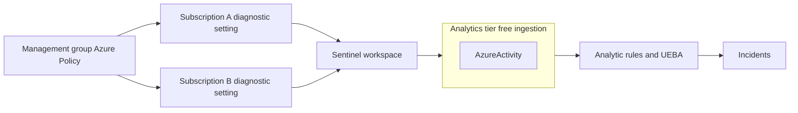

# Azure Activity (control plane)

> Status: verified. Priority: P1 (start here). Last verified: 21 Nov 2026.

## What it is

The Azure Activity log records every Azure Resource Manager (ARM) control plane operation in a subscription: role assignments, resource creations and deletions, policy changes, diagnostic setting edits and key or storage key listings. It is the baseline audit trail for your Azure estate and backs almost every Azure privilege escalation and defence evasion detection.

## Key recommendations

- Collect `AzureActivity` from every subscription in the tenant. It is a free Sentinel data source (`_IsBillable == false`), so there is no ingestion cost reason to leave any subscription out ([Microsoft Learn](https://learn.microsoft.com/en-us/azure/sentinel/billing)).
- Assign the connector's built-in Azure Policy (`DeployIfNotExists`) at the highest management group you control, ideally the tenant root group or your landing zone root, so new subscriptions onboard automatically ([Microsoft Learn](https://learn.microsoft.com/en-us/azure/sentinel/data-connectors/azure-activity)).
- Run a remediation task right after assigning the policy. Azure Policy only applies to newly created subscriptions until you remediate existing ones.
- Keep `AzureActivity` in the Analytics tier. Ingestion is free, the table is low volume and every control plane rule reads it.
- Disconnect any legacy subscription-level Azure Activity connector before deploying the Azure Policy diagnostic settings pipeline so you don't ingest duplicate rows ([Microsoft Learn](https://learn.microsoft.com/en-us/azure/sentinel/data-connectors/azure-activity)).
- Enable UEBA if you want `AzureActivity` correlated with identity profiles and anomaly rules ([Microsoft Learn](https://learn.microsoft.com/en-us/azure/sentinel/ueba-reference)).

## High-value log sources

`AzureActivity` is populated by subscription-level diagnostic settings deployed via the Azure Activity connector's Azure Policy wizard. All eight activity log categories flow into the single `AzureActivity` table.

| Source | Table name | Connector | Tier | Cost / volume | Value |
|---|---|---|---|---|---|
| Subscription control plane activity | `AzureActivity` | Azure Activity (Azure Policy based) | Analytics | Free in Sentinel (`_IsBillable == false`). Low volume in most environments | Every ARM write, delete, action, RBAC role assignment, policy update, diagnostic setting change and listKeys call across all subscriptions. |

### Categories included in subscription diagnostic settings

| Category | Keep? | Why |
|---|---|---|
| Administrative | Yes | Every ARM create, update, delete and action operation, including RBAC changes and `listKeys`. Primary SOC value. |
| Security | Yes | Security alerts and control plane security events emitted to the activity log. |
| Policy | Yes | Azure Policy evaluations and assignments, useful for spotting weakened guardrails. |
| Alert | Yes | Azure Monitor alert rule activations and changes. |
| ServiceHealth | Optional | Azure platform outages and planned maintenance. Low volume, free to keep. |
| ResourceHealth | Optional | Resource availability transitions. Useful context during incidents. |
| Recommendation | Optional | Azure Advisor recommendations. Low volume, free to keep. |
| Autoscale | Optional | Autoscale engine actions. Low volume, free to keep. |

Because ingestion into `AzureActivity` is free, enabling all categories through the connector's default Azure Policy is simpler than maintaining custom category filters.

## Prerequisites and licensing

| Item | Detail |
|---|---|
| Azure licence | Included with every Azure subscription. No extra Azure or Defender plan is required to generate Activity logs ([Microsoft Learn](https://learn.microsoft.com/en-us/azure/sentinel/data-connectors/azure-activity)). |
| Sentinel billing | Free data source in Microsoft Sentinel (`_IsBillable == false`) for ingestion and the included 90-day Analytics retention ([Microsoft Learn](https://learn.microsoft.com/en-us/azure/sentinel/billing)). Retention beyond 90 days is billed normally. |
| Legacy connector cleanup | Disconnect any subscriptions still using the legacy Azure Activity connector before assigning the diagnostic settings policy ([Microsoft Learn](https://learn.microsoft.com/en-us/azure/sentinel/data-connectors/azure-activity)). |
| Resource providers | `Microsoft.Insights` must be registered on target subscriptions so diagnostic settings can be created. |

### Roles you need

| Task | Role |
|---|---|
| Install the Azure Activity solution and create rules | Microsoft Sentinel Contributor on the workspace resource group ([Microsoft Learn](https://learn.microsoft.com/en-us/azure/sentinel/sentinel-solutions-deploy)) |
| Assign the Azure Policy and create its managed identity | Owner on the target management group or subscription scope, plus read and write permissions on the Log Analytics workspace ([Microsoft Learn](https://learn.microsoft.com/en-us/azure/sentinel/data-connectors/azure-activity)) |
| Run remediation tasks on existing subscriptions | Owner or Resource Policy Contributor with permission to assign Monitoring Contributor to the policy's managed identity |
| Query `AzureActivity` in Sentinel | Microsoft Sentinel Reader on the workspace |

## Step-by-step setup

1. **Confirm the workspace.** Choose your central Log Analytics workspace with Microsoft Sentinel enabled and onboarded to the Defender portal.
2. **Install the Azure Activity solution.** Defender portal > Microsoft Sentinel > Content management > Content hub. Search for **Azure Activity**, select View details, then Install ([Microsoft Learn](https://learn.microsoft.com/en-us/azure/sentinel/sentinel-solutions-deploy)).
3. **Open the connector.** Defender portal > Setup & configuration > Data management > Data & connectors > Connectors tab > Classic connectors - Microsoft Sentinel. Select **Azure Activity**, then Open connector page ([Microsoft Learn](https://learn.microsoft.com/en-us/azure/sentinel/configure-data-connector)).
4. **Disconnect any legacy subscriptions.** If the connector page lists subscriptions still connected through the retired legacy pipeline, disconnect them first to avoid duplicate rows.
5. **Launch the Azure Policy Assignment Wizard.** Under Configuration on the connector page, select **Launch Azure Policy Assignment Wizard**.
6. **Set the scope to a management group.** On the Basics tab, select your top-level management group (or target subscription) as the Scope so every current and future child subscription inherits the policy.
7. **Pick your Sentinel workspace.** On the Parameters tab, select your primary Microsoft Sentinel Log Analytics workspace as the target.
8. **Create a remediation task.** On the Remediation tab, tick **Create a remediation task** and select a system-assigned managed identity. Without this, existing subscriptions won't get diagnostic settings until manually remediated.
9. **Review and create.** Select Review + create, then Create. Wait 15 to 30 minutes for the remediation task to deploy diagnostic settings across subscriptions.
10. **Validate.** Run the validation KQL queries below in Defender portal > Investigation & response > Advanced hunting with your Sentinel workspace selected, and verify every subscription ID appears in `AzureActivity`.

## Best-practice security configuration

Combine free `AzureActivity` logging with Azure governance guardrails. See [Microsoft recommended security configurations](../../docs/security-configurations.md).

- **Management group hierarchy & Azure Policy:** Organise subscriptions under management groups and assign the **Microsoft Cloud Security Benchmark (MCSB)** initiative plus DeployIfNotExists policies for diagnostic settings at management group scope ([Management groups](https://learn.microsoft.com/en-us/azure/governance/management-groups/overview), [Microsoft Cloud Security Benchmark](https://learn.microsoft.com/en-us/security/benchmark/azure/overview)).
- **PIM for Azure RBAC:** Keep `Owner`, `Contributor` and `User Access Administrator` assignments eligible via Entra PIM (never permanent), and prefer built-in least-privilege roles.
- **Resource locks & allowed regions:** Apply `CanNotDelete` locks on critical networking, identity and Sentinel Log Analytics workspaces, and enforce allowed Azure regions and SKUs via Azure Policy.

## Architecture diagram



## Validation KQL

For group-wide and workspace-wide freshness checks, see [azure.kql](../../queries/validation/azure.kql) and the [validation query pack](../../queries/validation/README.md).

```kql
// 1. Confirm AzureActivity is landing and list every reporting subscription
AzureActivity
| where TimeGenerated > ago(1d)
| summarize Events = count(), Latest = max(TimeGenerated) by SubscriptionId
| order by Events desc

// 2. Freshness check. Activity logs normally land within 5 to 15 minutes.
AzureActivity
| summarize Latest = max(TimeGenerated), AgeMinutes = round((now() - max(TimeGenerated)) / 1m, 1)

// 3. Check categories and activity statuses landing in the workspace
AzureActivity
| where TimeGenerated > ago(1d)
| summarize Events = count() by CategoryValue, ActivityStatusValue
| order by Events desc

// 4. Confirm volume and verify ingestion is marked non-billable (free)
Usage
| where TimeGenerated > ago(30d)
| where DataType == "AzureActivity"
| summarize GB = round(sum(Quantity) / 1024, 3) by DataType, IsBillable, Day = bin(TimeGenerated, 1d)
| summarize GBperDay = round(avg(GB), 3), TotalGB30d = round(sum(GB), 2) by DataType, IsBillable

// 5. Spot duplicate subscription diagnostic settings (same CorrelationId and EventSubmissionTimestamp)
AzureActivity
| where TimeGenerated > ago(1d)
| summarize Rows = count() by CorrelationId, OperationNameValue, ActivityStatusValue, EventSubmissionTimestamp
| where Rows > 1
| take 20
```

## Out-of-box analytic rules

From the **Azure Activity** solution in Content Hub ([solution folder](https://github.com/Azure/Azure-Sentinel/tree/master/Solutions/Azure%20Activity), [analytic rules folder](https://github.com/Azure/Azure-Sentinel/tree/master/Solutions/Azure%20Activity/Analytic%20Rules)).

### Day-1 rules

| Rule | Detects | Tables | MITRE | Suggested |
|---|---|---|---|---|
| Subscription Migration | An Azure subscription moved to another Microsoft Entra tenant | `AzureActivity` | Impact, Defense Evasion | Enable day 1 |
| Creation of Expensive Computes in Azure (NRT or scheduled) | High-cost GPU or large vCPU VM deployments often linked to cryptomining | `AzureActivity` | Impact T1496 | Enable day 1 (pick NRT or scheduled, not both) |
| Time Series Anomaly for Mass Cloud Resource Deletions | Unusual spike in resource deletion operations across subscriptions | `AzureActivity` | Impact T1485 | Enable day 1 |
| Creating Anomalous Number of Resources Detection | Unusual burst of resource creations by a caller | `AzureActivity` | Impact, Execution | Enable, tune thresholds |
| Rare Operations | Uncommon administrative or high-risk ARM operations executed in the subscription | `AzureActivity` | Discovery, Privilege Escalation | Enable, tune allow lists |
| New Resource Groups Deployed To | Deployments into resource groups by callers not previously seen there | `AzureActivity` | Execution, Persistence | Enable, tune for CI/CD |

### Also in the solution

- Hybrid identity infrastructure rules: deletion of Entra ID Hybrid Health AD FS service (`AADHybridHealthADFSServiceDelete`) and new AD FS servers registered (`NRT-AADHybridHealthADFSNewServer`).
- Additional scheduled and NRT rule variants in the solution folder; enable either the NRT or scheduled version per detection, not both, to avoid duplicate incidents.

## Custom detections

These are community-written rules, not Microsoft content. Run them hourly with a 1-hour lookback unless noted. Anything unconfirmed carries an `ASSUMPTION` comment.

### C1. Diagnostic setting deleted or modified (High)

Attackers often disable or tamper with subscription and resource diagnostic settings to blind the SOC before privilege escalation or data theft.

```kql
// CUSTOM - Subscription or resource diagnostic setting deleted or modified
// ASSUMPTION: OperationNameValue uses uppercase ARM action strings in your tenant.
// Verify with: AzureActivity | where OperationNameValue has "DIAGNOSTICSETTINGS" | distinct OperationNameValue
let approved_automation = dynamic(["terraform-spn-object-id"]);
AzureActivity
| where TimeGenerated > ago(1h)
| where OperationNameValue in~ (
    "MICROSOFT.INSIGHTS/DIAGNOSTICSETTINGS/DELETE",
    "MICROSOFT.INSIGHTS/DIAGNOSTICSETTINGS/WRITE"
)
| where ActivityStatusValue in~ ("Success", "Succeeded")
| where Caller !in~ (approved_automation)
| project TimeGenerated, SubscriptionId, ResourceGroup, OperationNameValue, Caller, CallerIpAddress, ResourceId
```

Tune `approved_automation` against your IaC deployment service principals (via a Sentinel watchlist). MITRE: Defense Evasion, Impair Defenses T1562.008.

### C2. Owner or User Access Administrator role assigned at subscription or management group scope (High)

Granting high-privilege Azure RBAC roles at broad scope gives an attacker full control over subscriptions, key vaults and storage accounts.

```kql
// CUSTOM - High-privilege Azure RBAC role assignment created
// ASSUMPTION: Role definition GUIDs match built-in Owner (8e3af657-a8ff-443c-a75c-2fe8c4bcb635)
// and User Access Administrator (18d7d88d-d35e-4fb5-a5c3-7773c20a72d9).
// Confirm JSON shape of Properties.requestbody in one sample row before enabling.
let high_priv_roles = dynamic([
    "8e3af657-a8ff-443c-a75c-2fe8c4bcb635",
    "18d7d88d-d35e-4fb5-a5c3-7773c20a72d9"
]);
AzureActivity
| where TimeGenerated > ago(1h)
| where OperationNameValue =~ "MICROSOFT.AUTHORIZATION/ROLEASSIGNMENTS/WRITE"
| where ActivityStatusValue in~ ("Success", "Succeeded")
| extend RequestBody = parse_json(tostring(parse_json(Properties).requestbody))
| extend RoleDefId = tostring(RequestBody.Properties.RoleDefinitionId)
| extend PrincipalId = tostring(RequestBody.Properties.PrincipalId)
| where RoleDefId has_any (high_priv_roles)
| project TimeGenerated, SubscriptionId, Caller, CallerIpAddress, RoleDefId, PrincipalId, ResourceId
```

MITRE: Persistence and Privilege Escalation, Account Manipulation T1098.

### C3. Storage account or Key Vault access keys listed by an unusual caller (Medium)

Listing storage account keys via ARM gives full data plane access to every blob and file share in the account, bypassing Entra RBAC.

```kql
// CUSTOM - Storage account listKeys operation by caller outside known automation
// ASSUMPTION: OperationNameValue matches MICROSOFT.STORAGE/STORAGEACCOUNTS/LISTKEYS/ACTION.
// Check 30 days of history first to populate known_callers.
let known_callers = dynamic(["backup-automation-spn"]);
AzureActivity
| where TimeGenerated > ago(1h)
| where OperationNameValue =~ "MICROSOFT.STORAGE/STORAGEACCOUNTS/LISTKEYS/ACTION"
| where ActivityStatusValue in~ ("Success", "Succeeded")
| where Caller !in~ (known_callers)
| summarize Calls = count(), Accounts = make_set(ResourceId, 10) by Caller, CallerIpAddress, SubscriptionId
```

MITRE: Credential Access, Unsecured Credentials T1552.

## Playbooks

The **Azure Activity** solution focuses on detection, hunting and workbooks rather than bundled containment playbooks. Pair high-severity control plane incidents with standard response playbooks from the Microsoft Entra ID solution or custom Logic Apps:

| Playbook | What it does | Connectors and permissions |
|---|---|---|
| Revoke caller sessions / disable caller (from Microsoft Entra ID solution) | Revokes refresh tokens or disables the compromised user or service principal that ran the ARM operation | Microsoft Sentinel Responder on the workspace, Microsoft Graph `User.ReadWrite.All` or Entra admin role |
| Post control plane alert to SOC channel | Posts `Caller`, `OperationNameValue`, `SubscriptionId` and `ResourceId` to Teams or Slack for rapid triage | Microsoft Sentinel Responder, Teams or webhook connector |
| Revert unauthorised role assignment (custom Logic App) | Prompts an approver and deletes the newly created RBAC role assignment via ARM REST API | Managed identity with User Access Administrator on target scope (always gate behind human approval) |

## Workbooks and hunting

The **Azure Activity** solution ships the **Azure Activity** workbook (open from Content hub > Manage), which summarises administrative operations, failed deployments, caller trends and subscription coverage.

The solution also ships hunting queries in the [hunting queries folder](https://github.com/Azure/Azure-Sentinel/tree/master/Solutions/Azure%20Activity/Hunting%20Queries), including **Anomalous Azure Operation Model**. Two extra hunts worth running weekly:

- **Subscriptions missing from `AzureActivity`.** Export your full subscription list from Azure Resource Graph and diff it against `AzureActivity | where TimeGenerated > ago(30d) | distinct SubscriptionId`. Any subscription missing events has a broken or absent diagnostic setting.
- **Failed ARM operations burst.** Hunt for callers hitting repeated `AuthorizationFailed` errors across multiple subscriptions, which often signals post-compromise Azure enumeration.

```kql
// Hunt: Callers generating high volumes of failed ARM operations (reconnaissance)
AzureActivity
| where TimeGenerated > ago(1d)
| where ActivityStatusValue =~ "Failed"
| summarize FailedOps = count(), DistinctOps = dcount(OperationNameValue),
            SampleOps = make_set(OperationNameValue, 10) by Caller, CallerIpAddress
| where FailedOps >= 25 and DistinctOps >= 5
| order by FailedOps desc
```

## Gotchas and deprecations

- **Existing subscriptions need a remediation task.** Assigning the `DeployIfNotExists` Azure Policy only covers newly created subscriptions until you run a remediation task against existing ones. Check Azure Policy compliance regularly so new subscriptions don't go dark.
- **Duplicate rows from legacy connector or double diagnostic settings.** If a subscription still has the retired legacy Azure Activity connector attached or has two diagnostic settings pointing to the same workspace, you get duplicate `AzureActivity` rows. Run validation query 5 to catch this.
- **Control plane only, not data plane.** `AzureActivity` records ARM management operations (creating a vault, listing storage keys, changing RBAC), not secret reads inside Key Vault or blob downloads inside Azure Storage. Use the dedicated Key Vault and Storage guides for data plane logging.
- **Activity Log retention is 90 days by default outside Sentinel.** Azure only retains native Activity Log events for 90 days. Streaming to Sentinel keeps them searchable alongside other tables, and you can extend retention in the Analytics or data lake tier if compliance requires more than 90 days.
- **Retention beyond 90 days is billable.** Ingestion into `AzureActivity` and the first 90 days of interactive retention are free in Sentinel, but extending Analytics or long-term retention past 90 days incurs standard Log Analytics retention charges ([Microsoft Learn](https://learn.microsoft.com/en-us/azure/sentinel/billing)).
- **Sentinel in the Azure portal retires on 31 March 2027.** Build, test and operate connectors and rules in the Microsoft Defender portal ([Microsoft Learn](https://learn.microsoft.com/en-us/azure/sentinel/microsoft-sentinel-defender-portal)).

## Official links

- [Azure Activity data connector for Microsoft Sentinel](https://learn.microsoft.com/en-us/azure/sentinel/data-connectors/azure-activity)
- [AzureActivity table reference](https://learn.microsoft.com/en-us/azure/azure-monitor/reference/tables/azureactivity)
- [Plan costs and understand Microsoft Sentinel pricing and billing](https://learn.microsoft.com/en-us/azure/sentinel/billing)
- [Connect Microsoft Sentinel to Azure services using diagnostic settings](https://learn.microsoft.com/en-us/azure/sentinel/connect-services-diagnostic-setting-based)
- [Discover and deploy Microsoft Sentinel out-of-the-box content](https://learn.microsoft.com/en-us/azure/sentinel/sentinel-solutions-deploy)
- [Enable a data connector in Microsoft Sentinel](https://learn.microsoft.com/en-us/azure/sentinel/configure-data-connector)
- [Microsoft Sentinel UEBA reference](https://learn.microsoft.com/en-us/azure/sentinel/ueba-reference)
- [Microsoft Sentinel in the Microsoft Defender portal](https://learn.microsoft.com/en-us/azure/sentinel/microsoft-sentinel-defender-portal)
- [Azure Activity solution, Azure-Sentinel repo](https://github.com/Azure/Azure-Sentinel/tree/master/Solutions/Azure%20Activity)
- [Azure Activity analytic rules, Azure-Sentinel repo](https://github.com/Azure/Azure-Sentinel/tree/master/Solutions/Azure%20Activity/Analytic%20Rules)
- [Azure Activity hunting queries, Azure-Sentinel repo](https://github.com/Azure/Azure-Sentinel/tree/master/Solutions/Azure%20Activity/Hunting%20Queries)

## Last verified

21 Nov 2026, against Microsoft Learn and the Azure-Sentinel repo. Re-verify before relying on table names, navigation or rule names.
