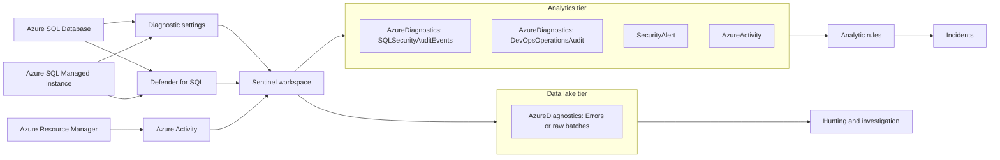

# Azure SQL Database and Managed Instance

> Status: verified. Priority: P2. Last verified: 21 Nov 2026.

## What it is

Azure SQL Database and Azure SQL Managed Instance host managed relational databases across Azure workloads. Their audit logs record every database authentication, permission change, schema edit and executed T-SQL batch, while Microsoft Defender for SQL detects injection, brute force and anomalous data access. Together they give a SOC visibility over both data-plane abuse and control-plane tampering.

## Key recommendations

- Enable auditing at the **server level** for Azure SQL Database, not on individual databases, unless a specific database needs separate retention or custom action groups. Enabling both runs two audits side by side and duplicates every event ([Microsoft Learn](https://learn.microsoft.com/en-us/azure/azure-sql/database/auditing-overview)).
- Expect audit rows in `AzureDiagnostics` filtered by `Category == "SQLSecurityAuditEvents"`, not a standalone `SQLSecurityAuditEvents` table. Both Azure SQL Database and Azure SQL Managed Instance currently route audit logs to `AzureDiagnostics` ([supported logs reference](https://learn.microsoft.com/en-us/azure/azure-monitor/reference/supported-logs/microsoft-sql-servers-databases-logs)).
- Enable **Auditing of Microsoft support operations** on every production logical server. It writes low-volume rows to `AzureDiagnostics` under `Category == "DevOpsOperationsAudit"` whenever Microsoft engineers access the server during a support ticket ([Microsoft Learn](https://learn.microsoft.com/en-us/azure/azure-sql/database/auditing-microsoft-support-operations)).
- Tune audit action groups on busy OLTP databases before sending everything to the Analytics tier. The default `BATCH_COMPLETED_GROUP` logs every single T-SQL batch and can easily dominate workspace spend. Either narrow action groups to authentication and DDL/permission changes, or drop benign application queries with a workspace transformation.
- Turn on **Microsoft Defender for SQL** (part of Defender for Databases in Microsoft Defender for Cloud) and connect Defender for Cloud to Sentinel. Its alerts land in `SecurityAlert` at no Sentinel ingestion cost ([Microsoft Learn](https://learn.microsoft.com/en-us/azure/defender-for-cloud/defender-for-sql-usage)).
- Connect **Azure Activity** alongside SQL auditing. Control-plane changes such as opening the SQL firewall to `0.0.0.0`, disabling auditing or swapping the Entra admin land in `AzureActivity`, which is free to ingest into Sentinel ([table reference](https://learn.microsoft.com/en-us/azure/azure-monitor/reference/tables/azureactivity)).

## High-value log sources

Azure SQL Database and Azure SQL Managed Instance stream auditing and diagnostic categories through Azure Monitor diagnostic settings into `AzureDiagnostics`. Defender for SQL alerts arrive through the Microsoft Defender for Cloud connector in `SecurityAlert`.

| Source | Table name | Connector | Tier | Cost / volume | Value |
|---|---|---|---|---|---|
| SQL security audit events | `AzureDiagnostics` (`Category == "SQLSecurityAuditEvents"`) | Azure SQL Databases (diagnostic settings) | Analytics (tune action groups or transform noisy batches) | Medium to high. Default `BATCH_COMPLETED_GROUP` logs every T-SQL batch | Logins, failed auth, permission grants, DDL changes, stored procedure execution and bulk reads. Feeds the Azure SQL Sentinel rules ([audit log format](https://learn.microsoft.com/en-us/azure/azure-sql/database/audit-log-format)). |
| Microsoft support operations audit | `AzureDiagnostics` (`Category == "DevOpsOperationsAudit"`) | Azure SQL Databases / Managed Instance (diagnostic settings) | Analytics | Very low. Only emits when Microsoft support accesses the server | Compliance and transparency over Microsoft support access during support cases ([Microsoft Learn](https://learn.microsoft.com/en-us/azure/azure-sql/database/auditing-microsoft-support-operations)). |
| Defender for SQL alerts | `SecurityAlert` | Microsoft Defender for Cloud | Analytics | Free Sentinel ingestion. Plan billed per protected SQL resource in Defender for Cloud | SQL injection, anomalous client login, brute force and unusual data extraction alerts without raw query volume ([Microsoft Learn](https://learn.microsoft.com/en-us/azure/defender-for-cloud/defender-for-sql-usage)). |
| Azure SQL control plane | `AzureActivity` | Azure Activity | Analytics | Free Sentinel ingestion, low volume | Server firewall edits, auditing turned off, Entra admin changes and database exports ([table reference](https://learn.microsoft.com/en-us/azure/azure-monitor/reference/tables/azureactivity)). |
| SQL diagnostic errors | `AzureDiagnostics` (`Category == "Errors"`) | Azure SQL Databases (diagnostic settings) | Data lake (or skip unless investigating firewall blocks) | Low to medium | Connection and firewall error telemetry (for example error 40615 firewall denials) for triage and anomaly rules. |

### What to ingest first

| Priority | Table | Why | Rough volume | Tier |
|---|---|---|---|---|
| 1 | `SecurityAlert` (Defender for SQL) + `AzureActivity` | Free Sentinel ingestion; immediate coverage for SQLi, anomalous logins and control-plane tampering | Low | Analytics |
| 2 | `AzureDiagnostics` (`SQLSecurityAuditEvents`) | Core data-plane audit trail for logins, role changes, DDL and bulk queries | Medium to high (depends on `BATCH_COMPLETED_GROUP`) | Analytics (scope action groups or filter noisy queries) |
| 3 | `AzureDiagnostics` (`DevOpsOperationsAudit`) | Tracks Microsoft support engineer access for compliance | Very low | Analytics |
| 4 | `AzureDiagnostics` (`Errors`) | Useful if you enable the firewall-error anomaly rule | Low to medium | Data lake or Analytics |
| Skip | `QueryStoreRuntimeStatistics`, `DatabaseWaitStatistics`, `Blocks`, `Deadlocks` | Performance and DBA telemetry, minimal SOC value | Medium to high | Keep in Azure Monitor or skip in Sentinel |

## Prerequisites and licensing

| Item | Detail |
|---|---|
| Azure SQL auditing | Included with Azure SQL Database and Azure SQL Managed Instance at no extra feature licence. You pay standard Log Analytics and Sentinel ingestion for rows sent to your workspace ([Microsoft Learn](https://learn.microsoft.com/en-us/azure/azure-sql/database/auditing-overview)). |
| Microsoft Defender for SQL | Paid plan under Microsoft Defender for Cloud (Defender for Databases), billed per protected SQL resource or vCore tier depending on resource type. Alerts forwarded to Sentinel incur no Sentinel ingestion charge ([Defender for SQL](https://learn.microsoft.com/en-us/azure/defender-for-cloud/defender-for-sql-usage)). |
| Managed Instance audit setup | Unlike Azure SQL Database, Managed Instance uses T-SQL `CREATE SERVER AUDIT ... TO EXTERNAL_MONITOR` plus a diagnostic setting on `Microsoft.Sql/managedInstances` to send `SQLSecurityAuditEvents` to Log Analytics ([Managed Instance auditing](https://learn.microsoft.com/en-us/azure/azure-sql/managed-instance/auditing-configure)). |
| Sentinel workspace | A Log Analytics workspace with Microsoft Sentinel enabled, onboarded to the Defender portal. Check Sentinel billing guidance for free versus billable tables ([Sentinel billing](https://learn.microsoft.com/en-us/azure/sentinel/billing)). |

### Roles you need

| Task | Role |
|---|---|
| Install Content Hub solutions and create rules | Microsoft Sentinel Contributor on the resource group ([Microsoft Learn](https://learn.microsoft.com/en-us/azure/sentinel/sentinel-solutions-deploy)) |
| Enable auditing and diagnostic settings on SQL servers or Managed Instances | SQL Security Manager (plus Log Analytics Contributor or Monitoring Contributor on the target workspace), or Contributor/Owner on the SQL resource |
| Assign Azure Policy to enforce diagnostic settings at scale | Resource Policy Contributor at subscription or management group scope ([Microsoft Learn](https://learn.microsoft.com/en-us/azure/sentinel/connect-services-diagnostic-setting-based)) |
| Enable Defender for SQL and connect Defender for Cloud | Security Admin or Subscription Owner on the subscription ([Microsoft Learn](https://learn.microsoft.com/en-us/azure/sentinel/connect-defender-for-cloud)) |

## Step-by-step setup

1. **Install the Content Hub solutions.** In the Defender portal, go to **Microsoft Sentinel** > **Content management** > **Content hub**. Search for and install **Azure SQL Database solution for sentinel**, **Microsoft Defender for Cloud**, and **Azure Activity** ([Microsoft Learn](https://learn.microsoft.com/en-us/azure/sentinel/sentinel-solutions-deploy)).
2. **Enable server-level auditing on Azure SQL logical servers.** In the Azure portal, open each Azure SQL logical server > **Security** > **Auditing**. Toggle **Enable Azure SQL Auditing** to **On**, tick **Log Analytics**, select your Sentinel workspace, and save. Leave individual database auditing off unless you need database-specific overrides ([Microsoft Learn](https://learn.microsoft.com/en-us/azure/azure-sql/database/auditing-overview)).
3. **Turn on Microsoft support operations auditing.** On the same **Auditing** blade, switch **Enable Auditing of Microsoft support operations** to **On**, select **Log Analytics**, choose your Sentinel workspace, and save. This provisions the `DevOpsOperationsAudit` diagnostic category automatically ([Microsoft Learn](https://learn.microsoft.com/en-us/azure/azure-sql/database/auditing-microsoft-support-operations)).
4. **Configure Azure SQL Managed Instance auditing (if used).** On each Managed Instance, add a diagnostic setting under **Monitoring** > **Diagnostic settings** targeting your Sentinel workspace with `SQLSecurityAuditEvents` and `DevOpsOperationsAudit` ticked. Then connect via T-SQL and create a server audit targeting `EXTERNAL_MONITOR` with your chosen server audit specification ([Microsoft Learn](https://learn.microsoft.com/en-us/azure/azure-sql/managed-instance/auditing-configure)).
5. **Enforce at scale with Azure Policy.** In the Defender portal, open **Setup & configuration** > **Data management** > **Data & connectors** > **Connectors** > **Classic connectors - Microsoft Sentinel** > **Azure SQL Databases** > **Open connector page**, and launch the Azure Policy assignment wizard to enforce diagnostic settings across subscriptions ([Microsoft Learn](https://learn.microsoft.com/en-us/azure/sentinel/connect-services-diagnostic-setting-based)).
6. **Connect Microsoft Defender for Cloud and Azure Activity.** On the **Connectors** page, enable the tenant-based **Microsoft Defender for Cloud** connector (with Defender for Databases / Defender for SQL turned on in Defender for Cloud) and connect **Azure Activity** via Azure Policy ([Microsoft Learn](https://learn.microsoft.com/en-us/azure/sentinel/connect-defender-for-cloud)).
7. **Tune audit action groups for noisy databases.** Review volume after 48 hours. If `BATCH_COMPLETED_GROUP` generates excessive GB/day from repetitive application queries, narrow action groups via PowerShell (`Set-AzSqlServerAudit`) or filter benign service principals with a Log Analytics workspace transformation.
8. **Validate ingestion.** Run a test login and a benign query, wait 10 to 15 minutes, then run the validation KQL below in the Defender portal under **Investigation & response** > **Advanced hunting** with your Sentinel workspace selected.

## Best-practice security configuration

Enable **Microsoft Defender for Azure SQL Databases** at subscription scope via Azure Policy alongside auditing. See [Defender best-practice security configurations](../../docs/defender-best-practices.md#defender-for-sql).

- **Vulnerability Assessment (Express configuration):** Turn on Express configuration (no separate storage account needed), review the initial scan, approve a clean baseline, and triage weekly recurring scan findings ([SQL Vulnerability Assessment](https://learn.microsoft.com/en-us/azure/defender-for-cloud/sql-azure-vulnerability-assessment-overview)).
- **Advanced Threat Protection:** Keep all threat detection categories enabled (SQL injection, anomalous client login/location, brute force and data exfiltration) ([Defender for Azure SQL](https://learn.microsoft.com/en-us/azure/defender-for-cloud/defender-for-sql-introduction)).
- **Identity & network hardening:** Enforce **Microsoft Entra-only authentication** where supported, disable **Allow Azure services and resources to access this server**, enforce Private Endpoints and minimum TLS 1.2, and enable Transparent Data Encryption (TDE).

## Architecture diagram



## Validation KQL

For group-wide and workspace-wide freshness checks, see [azure.kql](../../queries/validation/azure.kql) and the [validation query pack](../../queries/validation/README.md).

```kql
// 1. Confirm SQL audit categories and Defender for SQL alerts are landing
let sqlDiag = AzureDiagnostics
    | where TimeGenerated > ago(1d)
    | where ResourceProvider =~ "MICROSOFT.SQL"
    | where Category in ("SQLSecurityAuditEvents", "DevOpsOperationsAudit", "Errors")
    | summarize Rows = count(), Latest = max(TimeGenerated) by Source = strcat("AzureDiagnostics/", Category);
let sqlAlerts = SecurityAlert
    | where TimeGenerated > ago(1d)
    | where ProductName has "SQL" or AlertName has "SQL"
    | summarize Rows = count(), Latest = max(TimeGenerated) by Source = "SecurityAlert (Defender for SQL)";
union sqlDiag, sqlAlerts
| order by Source asc

// 2. Freshness check for SQLSecurityAuditEvents (should be within 15 minutes on active servers)
AzureDiagnostics
| where ResourceProvider =~ "MICROSOFT.SQL"
| where Category == "SQLSecurityAuditEvents"
| summarize Latest = max(TimeGenerated), AgeMinutes = (now() - max(TimeGenerated)) / 1m

// 3. Check top noisy databases and actions before tuning action groups
AzureDiagnostics
| where TimeGenerated > ago(1d)
| where Category == "SQLSecurityAuditEvents"
| summarize Events = count() by LogicalServerName_s, database_name_s, action_name_s
| top 20 by Events desc

// 4. Cost: GB per day for AzureDiagnostics (workspace-wide) and SQL share estimate
// Note: Usage reports AzureDiagnostics as a single DataType; use _BilledSize to split SQL share.
Usage
| where TimeGenerated > ago(30d)
| where DataType in ("AzureDiagnostics", "SecurityAlert", "AzureActivity")
| summarize GB = round(sum(Quantity) / 1024, 2) by DataType, Day = bin(TimeGenerated, 1d)
| summarize GBperDay = round(avg(GB), 2), TotalGB30d = round(sum(GB), 2) by DataType
| order by GBperDay desc

// 5. SQL-specific billed volume breakdown by Category over the last 7 days
AzureDiagnostics
| where TimeGenerated > ago(7d)
| where ResourceProvider =~ "MICROSOFT.SQL"
| summarize GB7d = round(sum(_BilledSize) / 1e9, 3), GBperDay = round(sum(_BilledSize) / 1e9 / 7, 3) by Category
| order by GB7d desc
```

## Out-of-box analytic rules

From the **Azure SQL Database solution for sentinel** in Content Hub ([solution folder](https://github.com/Azure/Azure-Sentinel/tree/master/Solutions/Azure%20SQL%20Database%20solution%20for%20sentinel)), paired with the incident creation rule from the **Microsoft Defender for Cloud** solution ([Defender for Cloud solution](https://github.com/Azure/Azure-Sentinel/tree/master/Solutions/Microsoft%20Defender%20for%20Cloud)).

| Rule | Detects | Tables | MITRE | Suggested |
|---|---|---|---|---|
| Volume Response Rows Stateful Anomaly on Database | Unusually high number of rows returned by queries compared to the database baseline (data exfiltration signal) | `AzureDiagnostics` (`SQLSecurityAuditEvents`) | Exfiltration, Collection | Enable day 1, tune baseline |
| Volume Affected Rows Stateful Anomaly on Database | Anomalous bulk update or delete row counts indicating sabotage or ransomware | `AzureDiagnostics` (`SQLSecurityAuditEvents`) | Impact | Enable day 1, tune for ETL jobs |
| Hotwords Execution Stateful Anomaly on Database | Execution batches containing risky commands or shell-execution tokens | `AzureDiagnostics` (`SQLSecurityAuditEvents`) | Execution | Enable day 1 |
| Hotwords Drop Stateful Anomaly on Database | Statements containing destructive drop keywords (`drop table`, `drop database`) outside normal patterns | `AzureDiagnostics` (`SQLSecurityAuditEvents`) | Impact | Enable day 1 |
| Firewall Errors Stateful Anomaly on Database | Unusual spikes in Azure SQL firewall denial errors | `AzureDiagnostics` (`Errors`) | Discovery, Initial Access | Enable if ingesting `Errors` |
| Create incidents based on Microsoft Defender for Cloud alerts | Promotes Defender for SQL alerts (SQLi, brute force, anomalous access) into Sentinel incidents | `SecurityAlert` | Initial Access, Credential Access, Exfiltration | Enable day 1 |

## Custom detections

Run hourly with a 1-hour lookback unless noted. Test column names and string values against your own servers before enabling, as column casing in `AzureDiagnostics` can vary slightly between Azure SQL Database and Managed Instance.

### C1. SQL privilege escalation or role membership change (High)

Out-of-box stateful anomaly rules focus on row volumes and destructive keywords, not direct permission grants. This rule catches principals granted high database privileges or added to privileged roles.

```kql
// CUSTOM - Privilege or role membership changes in Azure SQL audit logs
// ASSUMPTION: Default BATCH_COMPLETED_GROUP or DATABASE_ROLE_MEMBER_CHANGE_GROUP / DATABASE_PERMISSION_CHANGE_GROUP is enabled.
// Pin exact action_name_s values in your workspace before enabling.
let approved_principals = dynamic(["cicd-deploy-spn", "sql-admin@yourdomain.gov.au"]);
AzureDiagnostics
| where TimeGenerated > ago(1h)
| where Category == "SQLSecurityAuditEvents"
| where succeeded_s =~ "true"
| where action_name_s in ("ADD MEMBER", "GRANT", "ALTER ROLE", "CREATE USER", "ALTER USER")
    or statement_s has_any ("sp_addrolemember", "ALTER ROLE", "GRANT CONTROL", "GRANT IMPERSONATE", "db_owner")
| where server_principal_name_s !in~ (approved_principals)
| project TimeGenerated, LogicalServerName_s, database_name_s, server_principal_name_s,
          client_ip_s, action_name_s, statement_s
```

MITRE: Privilege Escalation and Persistence, Account Manipulation T1098.

### C2. SQL authentication brute force followed by success (High)

Catches a client IP spraying or brute-forcing database logins and then succeeding within the same hour, which complements Defender for SQL alerts when auditing is active.

```kql
// CUSTOM - Multiple failed SQL authentications followed by a success from the same client IP
// ASSUMPTION: FAILED_DATABASE_AUTHENTICATION_GROUP and SUCCESSFUL_DATABASE_AUTHENTICATION_GROUP are enabled (on by default).
let lookback = 1h;
let failedThreshold = 15;
let failures = AzureDiagnostics
    | where TimeGenerated > ago(lookback)
    | where Category == "SQLSecurityAuditEvents"
    | where action_name_s == "DATABASE AUTHENTICATION FAILED"
    | summarize FailedCount = count(), FirstFail = min(TimeGenerated), LastFail = max(TimeGenerated),
                TargetedUsers = make_set(server_principal_name_s, 10)
        by client_ip_s, LogicalServerName_s, database_name_s
    | where FailedCount >= failedThreshold;
let successes = AzureDiagnostics
    | where TimeGenerated > ago(lookback)
    | where Category == "SQLSecurityAuditEvents"
    | where action_name_s == "DATABASE AUTHENTICATION SUCCEEDED"
    | summarize SuccessCount = count(), FirstSuccess = min(TimeGenerated),
                SucceededUsers = make_set(server_principal_name_s, 10)
        by client_ip_s, LogicalServerName_s, database_name_s;
failures
| join kind=inner successes on client_ip_s, LogicalServerName_s, database_name_s
| where FirstSuccess >= FirstFail
| project FirstFail, FirstSuccess, LogicalServerName_s, database_name_s, client_ip_s,
          FailedCount, SuccessCount, TargetedUsers, SucceededUsers
```

MITRE: Credential Access, Brute Force T1110.

### C3. SQL auditing disabled or firewall opened to all IPs (High)

Data-plane auditing can't catch someone turning auditing off or adding a `0.0.0.0` firewall rule. Monitor `AzureActivity` for control-plane tampering.

```kql
// CUSTOM - Azure SQL auditing disabled or permissive firewall rule added in AzureActivity
// ASSUMPTION: AzureActivity diagnostic setting is connected for all subscriptions hosting Azure SQL.
AzureActivity
| where TimeGenerated > ago(1h)
| where ActivityStatusValue in ("Success", "Succeeded")
| where OperationNameValue has_any (
    "Microsoft.Sql/servers/auditingSettings/write",
    "Microsoft.Sql/servers/databases/auditingSettings/write",
    "Microsoft.Sql/servers/firewallRules/write",
    "Microsoft.Sql/servers/administrators/write"
)
| extend Props = parse_json(Properties)
| project TimeGenerated, Caller, CallerIpAddress, SubscriptionId, ResourceGroup,
          OperationNameValue, Resource = _ResourceId, Props
```

Filter out your approved Terraform or Bicep deployment service principals once you baseline normal pipeline activity. MITRE: Defense Evasion, Impair Defenses T1562.008.

## Playbooks

No SQL-specific containment playbooks ship by default inside the Azure SQL solution. Build Logic Apps triggered on Sentinel incidents with a managed identity granted least-privilege RBAC:

| Playbook pattern | What it does | Connectors and permissions |
|---|---|---|
| Notify and enrich SQL alert | Queries recent `SQLSecurityAuditEvents` for the offending `client_ip_s` and `server_principal_name_s`, then posts a Teams or ticket summary | Azure Monitor Logs connector (`Log Analytics Reader`), Microsoft Sentinel Responder, Teams or ITSM connector |
| Remove unauthorised SQL firewall rule | Deletes a newly added public firewall rule after analyst approval | Azure Resource Manager connector (`SQL Security Manager` or scoped custom role on `Microsoft.Sql/servers/firewallRules/delete`) |
| Disable compromised Entra user | For Entra-authenticated SQL logins, triggers `Revoke-AADSignInSessions` and `Block-AADUser` from the Microsoft Entra ID solution | Microsoft Graph (`User.ReadWrite.All` via managed identity), Microsoft Sentinel Responder |

Avoid auto-disabling application SQL logins without human approval; a single false positive can take down production apps.

## Workbooks and hunting

- **Built-in SQL Auditing workbook.** In the Azure portal, open your SQL server or database > **Security** > **Auditing** > **View audit logs** > **Log Analytics**, or open the **Azure Monitor SQL Auditing** workbook template to inspect top logins, failed authentications and query volume.
- **Out-of-box hunting query.** The Azure SQL solution includes **Suspicious Stored Procedures** (`HuntingQuery-SuspiciousStoredProcedures.yaml`), which hunts `SQLSecurityAuditEvents` for abuse of risky stored procedures such as `xp_cmdshell` and `sp_oacreate` ([solution folder](https://github.com/Azure/Azure-Sentinel/tree/master/Solutions/Azure%20SQL%20Database%20solution%20for%20sentinel)).
- **Recommended hunt: Microsoft support operations review.** Run weekly to confirm every `DevOpsOperationsAudit` row ties back to an open support ticket:

```kql
AzureDiagnostics
| where TimeGenerated > ago(7d)
| where Category == "DevOpsOperationsAudit"
| project TimeGenerated, Resource, database_name_s, client_ip_s, action_name_s, statement_s
| order by TimeGenerated desc
```

## Gotchas and deprecations

- **`AzureDiagnostics` versus `SQLSecurityAuditEvents` table name confusion.** Azure SQL Database and Managed Instance write SQL audit rows into `AzureDiagnostics` with `Category == "SQLSecurityAuditEvents"`, not into a standalone `SQLSecurityAuditEvents` table ([supported logs reference](https://learn.microsoft.com/en-us/azure/azure-monitor/reference/supported-logs/microsoft-sql-servers-databases-logs)). Queries written directly against `SQLSecurityAuditEvents` return empty or fail on Azure SQL Database workspaces.
- **Double auditing doubles your bill.** Turning on both server-level auditing and database-level auditing logs every event twice. Use server-level auditing by default and leave database-level auditing off ([Microsoft Learn](https://learn.microsoft.com/en-us/azure/azure-sql/database/auditing-overview)).
- **`BATCH_COMPLETED_GROUP` volume spikes.** The default audit policy includes `BATCH_COMPLETED_GROUP`, which records every query batch. On high-TPS databases, this can generate tens of GB per day. Scope action groups or apply a workspace transformation DCR to drop benign application reads while keeping authentication, DDL and privileged actions.
- **Deleting the diagnostic setting breaks Log Analytics silently.** Enabling auditing to Log Analytics creates a diagnostic setting named `SQLSecurityAuditEvents_...` under the hood. Removing or editing it breaks Sentinel ingestion even if the Auditing toggle still appears enabled.
- **500-column limit on `AzureDiagnostics`.** Because `AzureDiagnostics` is shared across legacy Azure services, workspaces with many services writing to it can hit the 500-column limit and drop overflow columns. Move other supported services (such as AKS, Azure Firewall and Application Gateway) to resource-specific tables to protect `AzureDiagnostics` headroom ([AzureDiagnostics reference](https://learn.microsoft.com/en-us/azure/azure-monitor/reference/tables/azurediagnostics)).
- **Sentinel in the Azure portal retires on 31 March 2027.** Build, test and operate rules in the Defender portal ([Microsoft Learn](https://learn.microsoft.com/en-us/azure/sentinel/microsoft-sentinel-defender-portal)).

## Official links

- [Auditing for Azure SQL Database and Azure Synapse Analytics](https://learn.microsoft.com/en-us/azure/azure-sql/database/auditing-overview)
- [Analyze Azure SQL Database audit logs and reports](https://learn.microsoft.com/en-us/azure/azure-sql/database/auditing-overview)
- [Auditing of Microsoft support operations for Azure SQL Database](https://learn.microsoft.com/en-us/azure/azure-sql/database/auditing-microsoft-support-operations)
- [Azure SQL Database and Azure SQL Managed Instance audit log format](https://learn.microsoft.com/en-us/azure/azure-sql/database/audit-log-format)
- [Azure SQL Managed Instance auditing with T-SQL](https://learn.microsoft.com/en-us/azure/azure-sql/managed-instance/auditing-configure)
- [Azure SQL Managed Instance monitoring data reference](https://learn.microsoft.com/en-us/azure/azure-sql/managed-instance/monitoring-sql-managed-instance-azure-monitor-reference)
- [Supported resource logs for Microsoft.Sql/servers/databases](https://learn.microsoft.com/en-us/azure/azure-monitor/reference/supported-logs/microsoft-sql-servers-databases-logs)
- [Benefits and features of Microsoft Defender for Azure SQL Databases](https://learn.microsoft.com/en-us/azure/defender-for-cloud/defender-for-sql-usage)
- [Connect Sentinel to Azure services using diagnostic settings](https://learn.microsoft.com/en-us/azure/sentinel/connect-services-diagnostic-setting-based)
- [Connect Microsoft Defender for Cloud to Microsoft Sentinel](https://learn.microsoft.com/en-us/azure/sentinel/connect-defender-for-cloud)
- [AzureDiagnostics table reference](https://learn.microsoft.com/en-us/azure/azure-monitor/reference/tables/azurediagnostics)
- [SecurityAlert table reference](https://learn.microsoft.com/en-us/azure/azure-monitor/reference/tables/securityalert)
- [AzureActivity table reference](https://learn.microsoft.com/en-us/azure/azure-monitor/reference/tables/azureactivity)
- [Azure SQL Database solution for sentinel, Azure-Sentinel repo](https://github.com/Azure/Azure-Sentinel/tree/master/Solutions/Azure%20SQL%20Database%20solution%20for%20sentinel)
- [Microsoft Defender for Cloud solution, Azure-Sentinel repo](https://github.com/Azure/Azure-Sentinel/tree/master/Solutions/Microsoft%20Defender%20for%20Cloud)
- [Microsoft Sentinel in the Defender portal](https://learn.microsoft.com/en-us/azure/sentinel/microsoft-sentinel-defender-portal)

## Last verified

21 Nov 2026, against Microsoft Learn and the Azure-Sentinel repo. Re-verify before relying on table names, navigation or rule names.
