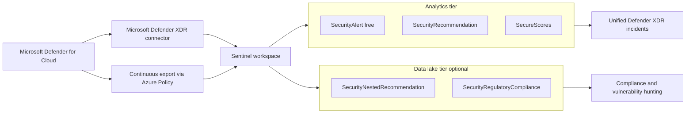

# Microsoft Defender for Cloud

> Status: verified. Priority: P2. Last verified: 21 Nov 2026.

## What it is

Microsoft Defender for Cloud provides cloud security posture management (CSPM) and cloud workload protection (CWP) across Azure, AWS and GCP workloads: servers, storage, Key Vault, containers, databases, App Service, APIs and AI workloads. Its security alerts belong in the SOC incident queue, and its recommendations, secure scores and compliance data help analysts prioritise alerts by asset posture and track drift over time.

## Key recommendations

- Don't ingest alerts twice. Once your Sentinel workspace is onboarded to the Microsoft Defender portal, Defender for Cloud alerts already flow natively through Microsoft Defender XDR integration (`SecurityAlert` in Sentinel, plus Defender XDR incidents) ([Microsoft Learn](https://learn.microsoft.com/en-us/azure/sentinel/connect-defender-for-cloud)).
- Disconnect the legacy subscription-based Defender for Cloud connector as soon as you move to Defender XDR or the tenant-based connector, and turn off duplicate Microsoft security incident creation rules for Defender for Cloud ([Microsoft Learn](https://learn.microsoft.com/en-us/azure/sentinel/connect-microsoft-365-defender)).
- Enable bi-directional alert and incident sync so closing an incident in the Defender portal or Sentinel closes the underlying alert in Defender for Cloud ([Microsoft Learn](https://learn.microsoft.com/en-us/azure/sentinel/connect-defender-for-cloud)).
- Use Continuous export to Log Analytics only for the posture tables you actually report or alert on (`SecurityRecommendation`, `SecureScores`, `SecurityRegulatoryCompliance`, `SecurityNestedRecommendation`). Unlike `SecurityAlert`, exported posture data incurs Log Analytics ingestion charges ([Microsoft Learn](https://learn.microsoft.com/en-us/azure/defender-for-cloud/continuous-export)).
- Deploy Continuous export via the built-in Azure Policy at management group scope rather than configuring subscriptions one by one.

## High-value log sources

Alerts arrive free into `SecurityAlert` through Microsoft Defender XDR integration (or the tenant-based Defender for Cloud connector). Posture, score and compliance tables are optional and come from Defender for Cloud Continuous export to your Log Analytics workspace.

| Source | Table name | Connector | Tier | Cost / volume | Value |
|---|---|---|---|---|---|
| Cloud workload security alerts | `SecurityAlert` | Microsoft Defender XDR (unified portal) or Tenant-based Microsoft Defender for Cloud | Analytics | Free in Sentinel (`_IsBillable == false`). Low volume ([Microsoft Learn](https://learn.microsoft.com/en-us/azure/sentinel/billing)) | Alerts from Defender for Servers, Storage, Key Vault, Containers, SQL, App Service and multicloud plans. Primary SOC detection feed. |
| Security posture recommendations | `SecurityRecommendation` | Defender for Cloud Continuous export | Analytics (or Data lake if reporting only) | Billable Log Analytics ingestion. Low to medium, depends on subscription and resource count | Resource misconfigurations, severity and remediation state over time. Useful for enriching alerts and tracking exposure drift. |
| Nested sub-recommendations | `SecurityNestedRecommendation` | Defender for Cloud Continuous export | Data lake (or Analytics if alerting on vulnerabilities) | Billable Log Analytics ingestion. Medium to high in estates with many VM, SQL or container CVEs | Individual CVE and sub-assessment findings grouped under a parent recommendation. |
| Secure score history | `SecureScores` | Defender for Cloud Continuous export | Analytics | Billable Log Analytics ingestion. Very low volume | Subscription and control-level Secure Score snapshots over time for executive reporting and regression alerts. |
| Regulatory compliance states | `SecurityRegulatoryCompliance` | Defender for Cloud Continuous export | Data lake (or Analytics for compliance dashboards) | Billable Log Analytics ingestion. Low to medium | Assessment states against compliance standards (ISO 27001, NIST, PCI-DSS, Essential Eight and custom standards). |

### How alerts reach Sentinel without duplicates

Pick one alert path and disable the others:

| Deployment model | Recommended connector | What to disable |
|---|---|---|
| Unified Microsoft Defender portal (recommended) | Microsoft Defender XDR connector (native incident and alert sync) | Disconnect the legacy Subscription-based Defender for Cloud connector and disable standalone Microsoft security incident creation rules for Defender for Cloud ([Microsoft Learn](https://learn.microsoft.com/en-us/azure/sentinel/connect-defender-for-cloud)) |
| Sentinel workspace not yet using Defender XDR incident sync | Tenant-based Microsoft Defender for Cloud connector | Disconnect the legacy Subscription-based Defender for Cloud connector to avoid duplicate `SecurityAlert` rows |
| Continuous export to Log Analytics | Export recommendations, secure scores and regulatory compliance only | Do not also tick **Security alerts** in Continuous export to the same workspace if the XDR or tenant-based connector is already streaming `SecurityAlert` |

## Prerequisites and licensing

| Item | Detail |
|---|---|
| Defender for Cloud plans | Foundational CSPM is free and generates basic recommendations and Secure Score. Workload threat alerts require paid Defender plans (such as Defender for Servers, Storage, Key Vault, Containers, Databases or CSPM) on target subscriptions ([Microsoft Learn](https://learn.microsoft.com/en-us/azure/sentinel/connect-defender-for-cloud)). |
| Sentinel billing, alerts | `SecurityAlert` rows from Defender for Cloud are free in Microsoft Sentinel (`_IsBillable == false`) ([Microsoft Learn](https://learn.microsoft.com/en-us/azure/sentinel/billing)). |
| Sentinel billing, Continuous export | Continuous export has no extra Defender licence fee, but tables written to Log Analytics (`SecurityRecommendation`, `SecurityNestedRecommendation`, `SecureScores`, `SecurityRegulatoryCompliance`) incur standard Log Analytics ingestion and retention charges ([Microsoft Learn](https://learn.microsoft.com/en-us/azure/defender-for-cloud/continuous-export)). |
| Resource providers | `Microsoft.Security` and `Microsoft.OperationalInsights` / `SecurityInsights` registered on target subscriptions. |

### Roles you need

| Task | Role |
|---|---|
| Install the Microsoft Defender for Cloud solution | Microsoft Sentinel Contributor on the workspace resource group ([Microsoft Learn](https://learn.microsoft.com/en-us/azure/sentinel/sentinel-solutions-deploy)) |
| Connect Microsoft Defender XDR integration | Global Administrator or Security Administrator on the tenant, plus Microsoft Sentinel Contributor on the workspace ([Microsoft Learn](https://learn.microsoft.com/en-us/azure/sentinel/connect-microsoft-365-defender)) |
| Enable Tenant-based Defender for Cloud connector and bi-directional sync | Security Administrator on the tenant, read and write on the workspace, and Security Admin or Contributor on target subscriptions ([Microsoft Learn](https://learn.microsoft.com/en-us/azure/sentinel/connect-defender-for-cloud)) |
| Configure Continuous export (or deploy via Azure Policy) | Owner or Security Admin on target subscriptions (or Owner / Resource Policy Contributor at management group scope) plus Log Analytics Contributor on the destination workspace |

## Step-by-step setup

1. **Confirm Defender plans.** In the Azure portal, open **Microsoft Defender for Cloud** > **Environment settings** and verify which subscriptions have Foundational CSPM, Defender CSPM and workload protection plans enabled.
2. **Install the Microsoft Defender for Cloud solution.** Defender portal > Microsoft Sentinel > Content management > Content hub. Search for **Microsoft Defender for Cloud**, select View details, then Install ([Microsoft Learn](https://learn.microsoft.com/en-us/azure/sentinel/sentinel-solutions-deploy)).
3. **Connect alerts via Microsoft Defender XDR (recommended).** Defender portal > Setup & configuration > Data management > Data & connectors > Connectors tab > Classic connectors - Microsoft Sentinel. Open **Microsoft Defender XDR** and verify **Connect incidents & alerts** is enabled ([Microsoft Learn](https://learn.microsoft.com/en-us/azure/sentinel/connect-microsoft-365-defender)). Defender for Cloud alerts now correlate into unified Defender XDR incidents and land in `SecurityAlert`.
4. **Remove overlapping alert connectors.** If you previously enabled the **Subscription-based Microsoft Defender for Cloud (Legacy)** connector, open it and disconnect every subscription. In Defender portal > Microsoft Sentinel > Configuration > Analytics, disable any standalone Microsoft security incident creation rule for Defender for Cloud so you don't get duplicate incidents ([Microsoft Learn](https://learn.microsoft.com/en-us/azure/sentinel/connect-defender-for-cloud)).
5. **Alternative (no Defender XDR incident sync).** If your workspace isn't using Defender XDR incident sync, enable the **Tenant-based Microsoft Defender for Cloud** connector instead and toggle bi-directional alert sync on. Note that once a workspace is onboarded to the unified Defender portal, the standalone tenant-based connector is superseded by native Defender XDR alert flow.
6. **Configure Continuous export for posture data (optional).** In the Azure portal, open **Microsoft Defender for Cloud** > **Environment settings** > select a subscription > **Continuous export** > **Log Analytics workspace** ([Microsoft Learn](https://learn.microsoft.com/en-us/azure/defender-for-cloud/continuous-export)).
7. **Pick posture data types carefully.** Tick **Security recommendations**, **Secure score** and **Regulatory compliance** as needed, and choose Streaming updates, Snapshots, or both. Leave **Security alerts** unticked if alerts already arrive via Defender XDR or the tenant-based connector.
8. **Scale Continuous export with Azure Policy.** For multi-subscription estates, assign the built-in Azure Policy **Deploy export to Log Analytics workspace for Microsoft Defender for Cloud alerts and recommendations** (or the matching Continuous export policy) at management group scope and run a remediation task.
9. **Set table tiers for posture tables.** If `SecurityNestedRecommendation` or `SecurityRegulatoryCompliance` are only used for monthly audits or hunting, review their volume after a week and move them to the data lake tier if Analytics ingestion is unnecessary.
10. **Validate.** Trigger a sample alert from Defender for Cloud > Security alerts > Sample alerts, wait 10 to 15 minutes, and run the validation queries below.

## Best-practice security configuration

Enable **Defender CSPM** alongside workload plans at management group or subscription scope via Azure Policy. See the full cross-product checklist in [Defender best-practice security configurations](../../docs/defender-best-practices.md#defender-cspm-cloud-security-posture-management).

- **Defender CSPM:** Turn on **Agentless scanning for machines** (OS CVE and cleartext-secret scanning without agents), **Sensitive data discovery**, and **Attack Path Analysis** to prioritise internet-exposed high-privilege paths ([What is CSPM](https://learn.microsoft.com/en-us/azure/defender-for-cloud/concept-cloud-security-posture-management), [Agentless scanning](https://learn.microsoft.com/en-us/azure/defender-for-cloud/concept-agentless-data-collection), [Attack paths](https://learn.microsoft.com/en-us/azure/defender-for-cloud/concept-attack-path)).
- **Governance rules:** Create subscription/management-group governance rules assigning owners and remediation SLAs (for example 7 days High, 30 days Medium) with weekly overdue digests ([Governance rules](https://learn.microsoft.com/en-us/azure/defender-for-cloud/governance-rules)).
- **Core workload plans:** Enable **Defender for Servers Plan 2**, **Defender for SQL**, **Defender for Storage** (with Malware Scanning on upload buckets), **Defender for Containers**, **Defender for Key Vault**, **Defender for App Service**, **Defender for Resource Manager** and **Defender for AI Services** where those workloads run.
- **Multi-cloud & DevOps:** Onboard AWS accounts, Google Cloud projects, GitHub organisations and Azure DevOps organisations so code-to-cloud attack paths and secret findings stay in one posture queue.

## Architecture diagram



## Validation KQL

For group-wide and workspace-wide freshness checks, see [azure.kql](../../queries/validation/azure.kql) and the [validation query pack](../../queries/validation/README.md).

```kql
// 1. Confirm which Defender for Cloud tables are landing and how fresh each is
union withsource=Table isfuzzy=true
    SecurityAlert, SecurityRecommendation, SecurityNestedRecommendation,
    SecureScores, SecurityRegulatoryCompliance
| where TimeGenerated > ago(7d)
| where Table != "SecurityAlert" or ProviderName == "ASI Scheduled Alerts" or ProductName has "Defender for Cloud" or ProductName has "Azure Security Center"
| summarize Rows = count(), Latest = max(TimeGenerated) by Table
| order by Table asc

// 2. Freshness check for Defender for Cloud alerts
SecurityAlert
| where TimeGenerated > ago(7d)
| where ProductName has_any ("Defender for Cloud", "Azure Security Center", "Microsoft Defender")
| summarize Alerts = count(), Latest = max(TimeGenerated),
            AgeMinutes = round((now() - max(TimeGenerated)) / 1m, 1) by ProductName

// 3. Check for duplicate Defender for Cloud alerts (sign of overlapping connectors or export)
SecurityAlert
| where TimeGenerated > ago(1d)
| where ProductName has_any ("Defender for Cloud", "Azure Security Center")
| summarize Rows = count(), Providers = make_set(ProviderName, 5) by SystemAlertId
| where Rows > 1
| take 20

// 4. Cost: GB per day and billable status for each Defender for Cloud table
Usage
| where TimeGenerated > ago(30d)
| where DataType in (
    "SecurityAlert", "SecurityRecommendation", "SecurityNestedRecommendation",
    "SecureScores", "SecurityRegulatoryCompliance"
)
| summarize GB = round(sum(Quantity) / 1024, 3) by DataType, IsBillable, Day = bin(TimeGenerated, 1d)
| summarize GBperDay = round(avg(GB), 3), TotalGB30d = round(sum(GB), 2) by DataType, IsBillable
| order by GBperDay desc
```

## Out-of-box analytic rules

From the **Microsoft Defender for Cloud** solution in Content Hub ([solution folder](https://github.com/Azure/Azure-Sentinel/tree/master/Solutions/Microsoft%20Defender%20for%20Cloud)). Defender for Cloud generates its own high-fidelity detections across workloads (Servers, Storage, Key Vault, Containers, SQL, App Service and multicloud), so Sentinel mainly ingests those alerts via Microsoft incident creation or unified Defender XDR incident correlation rather than re-writing them as scheduled KQL rules.

| Rule / mechanism | Detects | Tables | MITRE | Suggested |
|---|---|---|---|---|
| Defender XDR native incident correlation | Automatically groups Defender for Cloud alerts with identity, endpoint and email alerts into unified incidents | `SecurityAlert` | Multiple (mapped per workload alert) | Enable day 1 (use instead of legacy incident creation rule) |
| Create incidents based on Microsoft Defender for Cloud (Microsoft incident creation rule) | Turns incoming Defender for Cloud `SecurityAlert` rows into Sentinel incidents | `SecurityAlert` | Multiple | Disable if Microsoft Defender XDR incident integration is enabled, to avoid duplicates |

## Custom detections

Defender for Cloud alerts cover workload threats well, but posture regressions and repeated alerts on misconfigured assets are often missed unless you correlate Continuous export tables with alerts. Run these daily or hourly as noted.

### C1. Sharp Secure Score drop in a subscription (Medium)

A sudden drop in Secure Score often means someone disabled a Defender plan, opened a public network rule or weakened storage or Key Vault protections.

```kql
// CUSTOM - Subscription Secure Score drops by more than 10 percent compared to the prior 7-day peak
// ASSUMPTION: Continuous export for Secure score is enabled and writes to SecureScores.
// Check column names PercentageScore and SubscriptionId in a sample row before enabling.
let baseline = SecureScores
    | where TimeGenerated between (ago(7d) .. ago(1d))
    | summarize MaxScore7d = max(PercentageScore) by SubscriptionId;
SecureScores
| where TimeGenerated > ago(1d)
| summarize arg_max(TimeGenerated, PercentageScore, CurrentScore, MaxScore) by SubscriptionId
| join kind=inner baseline on SubscriptionId
| extend DropPercent = round((MaxScore7d - PercentageScore) * 100, 1)
| where DropPercent >= 10
| project TimeGenerated, SubscriptionId, MaxScore7d, PercentageScore, DropPercent
```

MITRE: Defense Evasion, Impair Defenses T1562.

### C2. High-severity Defender for Cloud alert on a resource with active unhealthy recommendations (High)

Correlating active workload alerts with open high-severity recommendations surfaces compromised resources that also have known exposure paths.

```kql
// CUSTOM - High-severity Defender for Cloud alert on an asset with High unhealthy recommendations
// ASSUMPTION: Continuous export for Security recommendations is active and AssessedResourceId
// matches CompromisedEntity or ResourceId formats in your tenant. Inspect one sample join first.
let unhealthy = SecurityRecommendation
    | where TimeGenerated > ago(2d)
    | summarize arg_max(TimeGenerated, RecommendationState, RecommendationSeverity, RecommendationDisplayName)
        by AssessedResourceId, RecommendationId
    | where RecommendationState =~ "Unhealthy" and RecommendationSeverity =~ "High"
    | summarize OpenHighRecs = count(), SampleRecs = make_set(RecommendationDisplayName, 5)
        by ResourceKey = tolower(AssessedResourceId);
SecurityAlert
| where TimeGenerated > ago(1h)
| where AlertSeverity =~ "High"
| where ProductName has_any ("Defender for Cloud", "Azure Security Center")
| extend ResourceKey = tolower(ResourceId)
| join kind=inner unhealthy on ResourceKey
| project TimeGenerated, AlertName, AlertSeverity, CompromisedEntity, ResourceId, OpenHighRecs, SampleRecs
```

MITRE: Initial Access and Privilege Escalation (tactics inherit from the underlying alert).

## Playbooks

Defender for Cloud supports **Workflow automation** directly inside Defender for Cloud (Logic Apps triggered on alerts, recommendations or compliance changes) as well as Sentinel automation rules triggered on incidents.

| Playbook | What it does | Connectors and permissions |
|---|---|---|
| Post Defender for Cloud alert / incident to Teams or Slack | Routes high-severity cloud workload alerts with resource ID, subscription and remediation link to the cloud ops and SOC channels | Microsoft Sentinel Responder or Defender for Cloud workflow automation trigger |
| Create Jira / ServiceNow ticket on new High recommendation | Opens an engineering ticket when a High-severity `SecurityRecommendation` flips to `Unhealthy` | Defender for Cloud Workflow automation, ITSM connector |
| Tag or isolate affected Azure resource | Applies an incident tag or updates an NSG on a compromised VM after analyst approval | Managed identity with Network Contributor or Virtual Machine Contributor (always gate behind approval) |

## Workbooks and hunting

The **Microsoft Defender for Cloud** solution ships workbooks for posture and alert visibility, and Defender for Cloud itself includes built-in Azure Workbooks (such as Secure Score Over Time and Compliance Over Time) that query Azure Resource Graph without needing Log Analytics ingestion.

Two practical hunts on the Continuous export tables:

- **High-severity recommendations flapping between Healthy and Unhealthy.** Indicates configuration drift or IaC pipelines overwriting manual security fixes.
- **Compliance drift by standard.** Group `SecurityRegulatoryCompliance` by `ComplianceStandard` and `State` over 30 days to spot controls moving from `Passed` to `Failed`.

```kql
// Hunt: Regulatory compliance controls that regressed to Failed in the last 7 days
SecurityRegulatoryCompliance
| where TimeGenerated > ago(7d)
| summarize arg_max(TimeGenerated, State, FailedResources) by ComplianceStandard, ComplianceControl
| where State =~ "Failed" and FailedResources > 0
| order by FailedResources desc
```

## Gotchas and deprecations

- **Duplicate alerts and incidents with Defender XDR.** Leaving the legacy Subscription-based Defender for Cloud connector active alongside Microsoft Defender XDR integration (or leaving Continuous export **Security alerts** pointing to the same Sentinel workspace) causes duplicate `SecurityAlert` records or duplicate incidents. Keep one path only ([Microsoft Learn](https://learn.microsoft.com/en-us/azure/sentinel/connect-defender-for-cloud)).
- **Tenant-based connector visibility in the unified portal.** Once a workspace is onboarded to the unified Microsoft Defender portal, Defender for Cloud alerts flow through Defender XDR natively, and the standalone tenant-based connector may no longer appear in the Defender portal Data connectors list ([Microsoft Learn](https://learn.microsoft.com/en-us/azure/sentinel/connect-defender-for-cloud)).
- **Multi-workspace Sentinel setups.** In environments with more than one Sentinel workspace connected to the Defender portal, Defender XDR tenant-wide alerts route to the primary workspace. Disable standalone Defender for Cloud alert connectors in secondary workspaces to avoid paying for duplicate storage or splitting triage.
- **Continuous export is billable.** `SecurityAlert` ingestion via the connector is free, but posture tables exported via Continuous export (`SecurityRecommendation`, `SecurityNestedRecommendation`, `SecureScores`, `SecurityRegulatoryCompliance`) are billed as standard Log Analytics ingestion. Scope Continuous export carefully and consider whether Azure Resource Graph (`securityresources`) is enough for occasional posture queries ([Microsoft Learn](https://learn.microsoft.com/en-us/azure/defender-for-cloud/continuous-export)).
- **Old product names still appear in `SecurityAlert`.** `ProductName` and legacy templates may still emit `Azure Security Center` (the former name of Microsoft Defender for Cloud). Match both names in KQL filters until you confirm what your tenant writes.
- **Sentinel in the Azure portal retires on 31 March 2027.** Manage Defender XDR integration, incidents and rules in the Microsoft Defender portal ([Microsoft Learn](https://learn.microsoft.com/en-us/azure/sentinel/microsoft-sentinel-defender-portal)).

## Official links

- [Connect Microsoft Defender for Cloud to Microsoft Sentinel](https://learn.microsoft.com/en-us/azure/sentinel/connect-defender-for-cloud)
- [Continuous export of Microsoft Defender for Cloud data](https://learn.microsoft.com/en-us/azure/defender-for-cloud/continuous-export)
- [Connect Microsoft Defender XDR to Microsoft Sentinel](https://learn.microsoft.com/en-us/azure/sentinel/connect-microsoft-365-defender)
- [Microsoft Defender XDR integration with Microsoft Sentinel](https://learn.microsoft.com/en-us/azure/sentinel/microsoft-365-defender-sentinel-integration)
- [Plan costs and understand Microsoft Sentinel pricing and billing](https://learn.microsoft.com/en-us/azure/sentinel/billing)
- [SecurityAlert table reference](https://learn.microsoft.com/en-us/azure/azure-monitor/reference/tables/securityalert)
- [SecurityRecommendation table reference](https://learn.microsoft.com/en-us/azure/azure-monitor/reference/tables/securityrecommendation)
- [SecurityNestedRecommendation table reference](https://learn.microsoft.com/en-us/azure/azure-monitor/reference/tables/securitynestedrecommendation)
- [SecureScores table reference](https://learn.microsoft.com/en-us/azure/azure-monitor/reference/tables/securescores)
- [SecurityRegulatoryCompliance table reference](https://learn.microsoft.com/en-us/azure/azure-monitor/reference/tables/securityregulatorycompliance)
- [Discover and deploy Microsoft Sentinel out-of-the-box content](https://learn.microsoft.com/en-us/azure/sentinel/sentinel-solutions-deploy)
- [Enable a data connector in Microsoft Sentinel](https://learn.microsoft.com/en-us/azure/sentinel/configure-data-connector)
- [Microsoft Sentinel in the Microsoft Defender portal](https://learn.microsoft.com/en-us/azure/sentinel/microsoft-sentinel-defender-portal)
- [Microsoft Defender for Cloud solution, Azure-Sentinel repo](https://github.com/Azure/Azure-Sentinel/tree/master/Solutions/Microsoft%20Defender%20for%20Cloud)

## Last verified

21 Nov 2026, against Microsoft Learn and the Azure-Sentinel repo. Re-verify before relying on table names, navigation or rule names.
