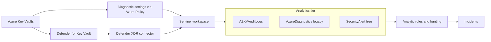

# Azure Key Vault

> Status: verified. Priority: P2. Last verified: 21 Nov 2026.

## What it is

Azure Key Vault stores application secrets, encryption keys and TLS certificates. Its data plane audit logs record every secret read, key operation, vault policy change, deletion and purge along with caller identity and IP address, making them essential for detecting credential dumping, secret exfiltration and ransomware key destruction.

## Key recommendations

- Enable diagnostic settings on every Key Vault using the built-in Azure Policy **Deploy Diagnostic Settings for Key Vault to Log Analytics workspace** at management group or subscription scope ([Microsoft Learn](https://learn.microsoft.com/en-us/azure/key-vault/general/logging)).
- Check which destination table mode your vaults use. Azure Monitor supports the resource-specific table `AZKVAuditLogs` alongside the legacy `AzureDiagnostics` table (`ResourceProvider == "MICROSOFT.KEYVAULT"` and `Category == "AuditEvent"`) ([Microsoft Learn](https://learn.microsoft.com/en-us/azure/azure-monitor/reference/tables/azkvauditlogs)). Standardise on `AZKVAuditLogs` for new deployments, but verify whether your out-of-box Sentinel rules still query `AzureDiagnostics` and update or clone them to match.
- Keep Key Vault audit logs in the Analytics tier. Volume is usually low to medium, and mass secret retrieval and purge rules depend on near-real-time Analytics queries.
- Enable **Microsoft Defender for Key Vault** for ML-based threat alerts (Tor access, suspicious IP access, anomalous operation volume) that arrive free in `SecurityAlert` via Defender for Cloud ([Microsoft Learn](https://learn.microsoft.com/en-us/azure/defender-for-cloud/defender-for-key-vault-introduction)).
- Enforce **soft-delete** (on by default) and **purge protection** on all production vaults, and prefer Azure RBAC over legacy vault access policies so permission changes also appear cleanly in `AzureActivity` ([Microsoft Learn](https://learn.microsoft.com/en-us/azure/key-vault/general/soft-delete-overview), [RBAC guide](https://learn.microsoft.com/en-us/azure/key-vault/general/rbac-guide)).

## High-value log sources

Key Vault data plane logs are collected via Azure Monitor diagnostic settings (category `AuditEvent` and `AzurePolicyEvaluationDetails`). Choosing resource-specific mode writes to dedicated tables (`AZKVAuditLogs`, `AZKVPolicyEvaluationDetailsLogs`); legacy Azure Diagnostics mode writes to `AzureDiagnostics`.

| Source | Table name | Connector | Tier | Cost / volume | Value |
|---|---|---|---|---|---|
| Key Vault audit logs (resource-specific, recommended) | `AZKVAuditLogs` | Azure Key Vault (diagnostic settings, Azure Policy) | Analytics | Billable Log Analytics ingestion. Low to medium, depends on app secret-fetch caching | Dedicated schema for every secret, key and certificate read, write, delete, backup, purge and auth event, with `Identity`, `CallerIpAddress` and `OperationName` ([table reference](https://learn.microsoft.com/en-us/azure/azure-monitor/reference/tables/azkvauditlogs)). |
| Key Vault audit logs (legacy mode) | `AzureDiagnostics` (`ResourceProvider == "MICROSOFT.KEYVAULT"` and `Category == "AuditEvent"`) | Azure Key Vault (diagnostic settings, Azure Policy) | Analytics | Billable Log Analytics ingestion. Same volume as `AZKVAuditLogs` | Same audit events in the shared legacy table. Still queried by older Sentinel analytic rule templates; don't send to both tables from the same vault. |
| Key Vault policy evaluation logs | `AZKVPolicyEvaluationDetailsLogs` | Azure Key Vault (diagnostic settings, resource-specific) | Data lake (or skip if unused) | Billable Log Analytics ingestion. Low | Azure Policy data plane evaluation details for Key Vault certificates, keys and secrets ([supported tables](https://learn.microsoft.com/en-us/azure/azure-monitor/reference/tables/azkvpolicyevaluationdetailslogs)). |
| Defender for Key Vault alerts | `SecurityAlert` | Microsoft Defender XDR / Defender for Cloud | Analytics | Free in Sentinel (`_IsBillable == false`) once Defender for Key Vault is licensed | Behavioural and threat-intel alerts such as `KV_SuspiciousIPAccess`, `KV_TORAccess` and `KV_OperationVolumeAnomaly` ([alert catalog](https://learn.microsoft.com/en-us/azure/defender-for-cloud/alerts-azure-key-vault)). |
| Control plane vault changes | `AzureActivity` | Azure Activity | Analytics | Free in Sentinel | Vault creation, deletion, firewall changes, purge protection updates and RBAC assignments. |

## Prerequisites and licensing

| Item | Detail |
|---|---|
| Key Vault diagnostic logging | Included with Azure Key Vault Standard and Premium. No extra Key Vault licence is needed to send `AuditEvent` logs to Log Analytics ([Microsoft Learn](https://learn.microsoft.com/en-us/azure/key-vault/general/logging)). |
| Sentinel billing | `AZKVAuditLogs` and `AzureDiagnostics` are billable Sentinel ingestion. `AZKVAuditLogs` supports Basic/Auxiliary/Data lake tiers and DCR workspace transformations if a noisy app floods secret reads ([table reference](https://learn.microsoft.com/en-us/azure/azure-monitor/reference/tables/azkvauditlogs)). |
| Defender for Key Vault | Optional paid Defender for Cloud plan (billed per transaction) that generates `SecurityAlert` detections ([Microsoft Learn](https://learn.microsoft.com/en-us/azure/defender-for-cloud/defender-for-key-vault-introduction)). |
| Soft-delete and purge protection | Soft-delete is enabled by default (7 to 90 day retention). Enable purge protection explicitly on production vaults so nobody, including admins or attackers, can permanently purge deleted secrets or keys early ([Microsoft Learn](https://learn.microsoft.com/en-us/azure/key-vault/general/soft-delete-overview)). |

### Roles you need

| Task | Role |
|---|---|
| Install the Azure Key Vault solution and create rules | Microsoft Sentinel Contributor on the workspace resource group ([Microsoft Learn](https://learn.microsoft.com/en-us/azure/sentinel/sentinel-solutions-deploy)) |
| Configure diagnostic settings on a single Key Vault | Monitoring Contributor (or Owner / Contributor) on the Key Vault, plus Log Analytics Contributor on the workspace |
| Enforce diagnostic settings across subscriptions via Azure Policy | Owner or Resource Policy Contributor at management group or subscription scope |
| Enable Defender for Key Vault | Security Admin or Owner on target subscriptions |

## Step-by-step setup

1. **Install the Azure Key Vault solution.** Defender portal > Microsoft Sentinel > Content management > Content hub. Search for **Azure Key Vault**, select View details, then Install ([Microsoft Learn](https://learn.microsoft.com/en-us/azure/sentinel/sentinel-solutions-deploy)).
2. **Choose your destination table mode.** Decide whether to standardise on the resource-specific table `AZKVAuditLogs` (recommended by Microsoft for cleaner schema and DCR transformation support) or legacy `AzureDiagnostics` (matching older built-in rule templates without editing). Pick one consistently across your vaults so detections don't miss half the estate.
3. **Deploy at scale with Azure Policy.** In the Azure portal, open **Policy** > **Definitions** and find the built-in policy **Deploy Diagnostic Settings for Key Vault to Log Analytics workspace** (or a custom policy that sets `logAnalyticsDestinationType` to `Dedicated` for `AZKVAuditLogs`). Assign it at management group or subscription scope, point it to your Sentinel workspace, and tick **Create a remediation task** so existing vaults are onboarded.
4. **Configure a single vault manually (for testing).** Open a Key Vault in the Azure portal > **Monitoring** > **Diagnostic settings** > **+ Add diagnostic setting**. Tick **audit** (`AuditEvent`), choose **Send to Log Analytics workspace**, select your Sentinel workspace, set **Destination table** to **Resource specific** (`AZKVAuditLogs`), then Save ([Microsoft Learn](https://learn.microsoft.com/en-us/azure/key-vault/general/logging)).
5. **Enable Microsoft Defender for Key Vault.** In the Azure portal, open **Microsoft Defender for Cloud** > **Environment settings** > select your subscription > **Defender plans** > toggle **Key Vault** on and Save. Alerts will flow into `SecurityAlert` through your Defender XDR or Defender for Cloud connector.
6. **Check soft-delete and purge protection.** Verify production vaults have purge protection enabled and review whether any still use legacy vault access policies instead of Azure RBAC.
7. **Generate test events.** Read a test secret and attempt an unauthorised secret get (403) against a test vault.
8. **Validate.** Wait 10 to 15 minutes and run the validation KQL queries below to verify whether events are landing in `AZKVAuditLogs`, `AzureDiagnostics`, or both.
9. **Align analytic rules to your table.** Before enabling the Content Hub rules, inspect each rule's KQL to confirm it queries the table your vaults actually populate (`AZKVAuditLogs` vs `AzureDiagnostics`).

## Best-practice security configuration

Enable **Microsoft Defender for Key Vault** alongside vault access and recovery controls. See [Defender best-practice security configurations](../../docs/defender-best-practices.md#other-defender-for-cloud-workload-plans).

- **Defender for Key Vault:** Enable at subscription scope to detect Tor access, suspicious IP access and anomalous secret-read volume ([Defender for Key Vault](https://learn.microsoft.com/en-us/azure/defender-for-cloud/defender-for-key-vault-introduction)).
- **Soft-delete & purge protection:** Keep soft-delete on (default) and enable **purge protection** on every production vault so neither attackers nor compromised admins can permanently wipe keys or secrets.
- **Azure RBAC & network isolation:** Prefer **Azure RBAC** over legacy vault access policies (least privilege, auditable in `AzureActivity`) and restrict public network access using Private Endpoints and firewall rules.

## Architecture diagram



## Validation KQL

For group-wide and workspace-wide freshness checks, see [azure.kql](../../queries/validation/azure.kql) and the [validation query pack](../../queries/validation/README.md).

```kql
// 1. Check whether Key Vault audit logs are landing in AZKVAuditLogs, AzureDiagnostics, or both
union withsource=Table isfuzzy=true
    (AZKVAuditLogs | where TimeGenerated > ago(1d) | project TimeGenerated, OperationName),
    (AzureDiagnostics
     | where TimeGenerated > ago(1d)
     | where ResourceProvider =~ "MICROSOFT.KEYVAULT" and Category == "AuditEvent"
     | project TimeGenerated, OperationName)
| summarize Events = count(), Latest = max(TimeGenerated) by Table

// 2. Freshness check on the resource-specific table (swap for AzureDiagnostics if using legacy mode)
AZKVAuditLogs
| summarize Latest = max(TimeGenerated), AgeMinutes = round((now() - max(TimeGenerated)) / 1m, 1)

// 3. Top operations and result statuses in the last 24 hours
AZKVAuditLogs
| where TimeGenerated > ago(1d)
| summarize Events = count() by OperationName, ResultSignature
| order by Events desc
| take 20

// 4. Cost: GB per day for AZKVAuditLogs and Key Vault share of AzureDiagnostics
Usage
| where TimeGenerated > ago(30d)
| where DataType in ("AZKVAuditLogs", "AZKVPolicyEvaluationDetailsLogs", "AzureDiagnostics")
| summarize GB = round(sum(Quantity) / 1024, 3) by DataType, Day = bin(TimeGenerated, 1d)
| summarize GBperDay = round(avg(GB), 3), TotalGB30d = round(sum(GB), 2) by DataType
| order by GBperDay desc

// 5. Confirm Defender for Key Vault alerts are flowing into SecurityAlert
SecurityAlert
| where TimeGenerated > ago(30d)
| where AlertName has "Key Vault" or ProductComponentName has "KeyVault"
| summarize Alerts = count(), Latest = max(TimeGenerated) by AlertName, AlertSeverity
```

## Out-of-box analytic rules

From the **Azure Key Vault** solution in Content Hub ([solution folder](https://github.com/Azure/Azure-Sentinel/tree/master/Solutions/Azure%20Key%20Vault), [analytic rules folder](https://github.com/Azure/Azure-Sentinel/tree/master/Solutions/Azure%20Key%20Vault/Analytic%20Rules)).

> Note: Check the KQL in each template before enabling. The shipped YAML rules historically query `AzureDiagnostics` (`ResourceType =~ "VAULTS"`). If your diagnostic settings use resource-specific mode (`AZKVAuditLogs`), update the table reference and column names when creating your active rules.

### Day-1 rules

| Rule | Detects | Tables | MITRE | Suggested |
|---|---|---|---|---|
| Mass Secret Retrieval from Azure Key Vault | Single user or application reading an unusually high number of distinct secrets in a short window | `AzureDiagnostics` (adapt to `AZKVAuditLogs` if resource-specific) | Credential Access | Enable day 1, tune app exclusions |
| Sensitive Azure Key Vault operations | Destructive or sensitive operations: `VaultDelete`, `KeyDelete`, `SecretDelete`, `SecretPurge`, `KeyPurge`, `SecretBackup`, `KeyBackup` | `AzureDiagnostics` (adapt to `AZKVAuditLogs` if resource-specific) | Impact, Credential Access | Enable day 1 |

Complement these with Microsoft Defender for Key Vault alerts (`KV_SuspiciousIPAccess`, `KV_TORAccess`, `KV_OperationVolumeAnomaly`, unusual principal access), which arrive automatically in `SecurityAlert`.

## Custom detections

These are community-written rules targeting the resource-specific `AZKVAuditLogs` table. If your estate still uses `AzureDiagnostics`, replace `AZKVAuditLogs` with `AzureDiagnostics | where ResourceProvider =~ "MICROSOFT.KEYVAULT" and Category == "AuditEvent"` and verify column suffixes (`identity_claim_upn_s`, `identity_claim_appid_g`, `id_s`).

### C1. Key Vault secret list and read sweep by a human user (High)

Applications fetch specific known secrets by name. Human users listing all secrets (`SecretList`) and then reading multiple secrets (`SecretGet`) in quick succession is a classic manual credential-dumping pattern.

```kql
// CUSTOM - Human caller lists secrets then reads multiple secrets within 15 minutes
// ASSUMPTION: Identity JSON in AZKVAuditLogs contains claim.upn for interactive user tokens.
// Inspect one sample row of AZKVAuditLogs (project Identity, OperationName, RequestUri) before enabling.
AZKVAuditLogs
| where TimeGenerated > ago(1h)
| where OperationName in ("SecretList", "SecretGet")
| where ResultType =~ "Success" or HttpStatusCode == 200
| extend IdentityJson = parse_json(Identity)
| extend UserUpn = tostring(IdentityJson.claim.upn)
| where isnotempty(UserUpn)
| summarize Listed = countif(OperationName == "SecretList"),
            SecretsRead = dcountif(RequestUri, OperationName == "SecretGet"),
            SampleUris = make_set_if(RequestUri, OperationName == "SecretGet", 10),
            IPs = make_set(CallerIpAddress, 5)
            by UserUpn, _ResourceId, Window = bin(TimeGenerated, 15m)
| where Listed >= 1 and SecretsRead >= 5
```

MITRE: Credential Access, Unsecured Credentials T1552.

### C2. Repeated unauthorised (403) Key Vault access attempts (Medium)

A spike in `403 Forbidden` responses against a vault often means a compromised identity is probing vaults to see which secrets it can read, or an attacker's IP hit a Key Vault firewall rule.

```kql
// CUSTOM - Burst of Forbidden (403) Key Vault data plane requests
// ASSUMPTION: HttpStatusCode is numeric 403 and ResultSignature contains Forbidden in AZKVAuditLogs.
// Confirm both fields with a sample 403 row in your workspace.
AZKVAuditLogs
| where TimeGenerated > ago(1h)
| where HttpStatusCode == 403 or ResultSignature has "Forbidden"
| summarize DeniedCount = count(),
            Operations = make_set(OperationName, 10),
            Vaults = make_set(_ResourceId, 10)
            by CallerIpAddress, Identity = tostring(Identity)
| where DeniedCount >= 10
| order by DeniedCount desc
```

MITRE: Discovery and Credential Access, Cloud Infrastructure Discovery T1580.

### C3. Key Vault purge or firewall / access policy weakening (High)

Catching `VaultPatch`, `VaultPut`, `SecretPurge` and `KeyPurge` helps stop attackers from lowering network restrictions or permanently destroying encryption keys.

```kql
// CUSTOM - Key Vault purge or configuration change outside approved change identities
// ASSUMPTION: OperationName values match Key Vault audit log action names.
// Pin exact OperationName strings in your tenant with: AZKVAuditLogs | distinct OperationName
let approved_cicd = dynamic(["iac-pipeline-spn"]);
AZKVAuditLogs
| where TimeGenerated > ago(1h)
| where OperationName in ("SecretPurge", "KeyPurge", "CertificatePurge", "VaultPatch", "VaultPut", "KeyBackup", "SecretBackup")
| where ResultType =~ "Success" or HttpStatusCode in (200, 202)
| extend Caller = tostring(Identity)
| where not(Caller has_any (approved_cicd))
| project TimeGenerated, _ResourceId, OperationName, Caller, CallerIpAddress, ClientInfo
```

MITRE: Impact and Defense Evasion, Data Destruction T1485 and Impair Defenses T1562.

## Playbooks

Pair Key Vault incidents with identity containment and secret-rotation workflows:

| Playbook | What it does | Connectors and permissions |
|---|---|---|
| Revoke caller sessions / disable caller (from Microsoft Entra ID solution) | Cuts off a compromised user or service principal immediately after mass secret retrieval | Microsoft Sentinel Responder, Microsoft Graph `User.ReadWrite.All` |
| Notify vault owner for emergency secret rotation | Posts the affected vault, accessed secret URIs and caller details to the owning team and opens a P1 rotation ticket | Microsoft Sentinel Responder, Teams / ServiceNow / Jira connector |
| Lock down Key Vault network rules (custom Logic App) | Switches a vault from public access to selected networks after SOC approval | Managed identity with Key Vault Contributor on target vaults (always gate behind human approval to avoid breaking production apps) |

## Workbooks and hunting

The **Azure Key Vault** Content Hub solution ships a Key Vault workbook tracking vault access patterns, top callers, HTTP status codes and sensitive operations.

Two hunts worth running regularly:

- **Secret reads by interactive users vs service principals.** Production vaults should normally be read by managed identities and service principals, not human UPNs. Any human reading production secrets is a candidate for JIT/PIM review or an indicator of compromise.
- **Vaults without recent logs.** Diff your Azure Resource Graph list of `microsoft.keyvault/vaults` against distinct `_ResourceId` values in `AZKVAuditLogs` and `AzureDiagnostics` to catch newly deployed vaults missing diagnostic settings.

```kql
// Hunt: Human users reading secrets in production vaults over the last 7 days
// ASSUMPTION: Production vault names include "prod" and Identity JSON contains claim.upn.
AZKVAuditLogs
| where TimeGenerated > ago(7d)
| where OperationName == "SecretGet"
| where _ResourceId has "prod"
| extend UserUpn = tostring(parse_json(Identity).claim.upn)
| where isnotempty(UserUpn)
| summarize Reads = count(), DistinctSecrets = dcount(RequestUri),
            IPs = make_set(CallerIpAddress, 5) by UserUpn, _ResourceId
| order by DistinctSecrets desc
```

## Gotchas and deprecations

- **`AZKVAuditLogs` vs `AzureDiagnostics` mismatch.** This is the single biggest Key Vault logging trap. New diagnostic settings configured in Resource-specific mode write to `AZKVAuditLogs`, whereas older diagnostic settings (and the default built-in Azure Policy unless configured for dedicated tables) write to `AzureDiagnostics`. Always verify which table your vaults write to and make sure your Sentinel analytic rules read the same table ([Microsoft Learn](https://learn.microsoft.com/en-us/azure/key-vault/general/logging)).
- **Managed HSM has separate auditing.** If you run Azure Key Vault Managed HSM (`Microsoft.KeyVault/managedHSMs`), configure diagnostic settings on the Managed HSM resource as well; policies targeting `Microsoft.KeyVault/vaults` alone won't cover Managed HSMs.
- **Chatty applications can inflate ingestion.** Microservices that fetch the same secret on every HTTP request instead of caching it in memory can generate gigabytes of `SecretGet` rows a day. Fix caching in the app or use a DCR workspace transformation on `AZKVAuditLogs` to drop known high-frequency health-check reads.
- **No purge protection means permanent loss.** Soft-delete is on by default, but without purge protection an attacker with `purge` permission can permanently destroy customer-managed encryption keys (CMKs) immediately, rendering encrypted storage and databases unrecoverable ([Microsoft Learn](https://learn.microsoft.com/en-us/azure/key-vault/general/soft-delete-overview)).
- **RBAC vs Access Policies.** Vaults still using legacy access policies hide permission changes inside vault `VaultPatch` operations rather than standard Azure RBAC role assignments in `AzureActivity`. Migrate to Azure RBAC where possible ([Microsoft Learn](https://learn.microsoft.com/en-us/azure/key-vault/general/rbac-guide)).
- **Sentinel in the Azure portal retires on 31 March 2027.** Build and manage Sentinel rules and incidents in the Microsoft Defender portal ([Microsoft Learn](https://learn.microsoft.com/en-us/azure/sentinel/microsoft-sentinel-defender-portal)).

## Official links

- [Azure Key Vault logging](https://learn.microsoft.com/en-us/azure/key-vault/general/logging)
- [Enable Azure Key Vault logging](https://learn.microsoft.com/en-us/azure/key-vault/general/logging)
- [AZKVAuditLogs table reference](https://learn.microsoft.com/en-us/azure/azure-monitor/reference/tables/azkvauditlogs)
- [Azure Monitor tables for microsoft.keyvault/vaults](https://learn.microsoft.com/en-us/azure/azure-monitor/reference/tables/azkvpolicyevaluationdetailslogs)
- [Azure Key Vault soft-delete overview](https://learn.microsoft.com/en-us/azure/key-vault/general/soft-delete-overview)
- [Provide access to Key Vault keys, certificates, and secrets with Azure RBAC](https://learn.microsoft.com/en-us/azure/key-vault/general/rbac-guide)
- [Overview of Microsoft Defender for Key Vault](https://learn.microsoft.com/en-us/azure/defender-for-cloud/defender-for-key-vault-introduction)
- [Security alerts for Azure Key Vault](https://learn.microsoft.com/en-us/azure/defender-for-cloud/alerts-azure-key-vault)
- [Connect Microsoft Sentinel to Azure services using diagnostic settings](https://learn.microsoft.com/en-us/azure/sentinel/connect-services-diagnostic-setting-based)
- [Discover and deploy Microsoft Sentinel out-of-the-box content](https://learn.microsoft.com/en-us/azure/sentinel/sentinel-solutions-deploy)
- [Enable a data connector in Microsoft Sentinel](https://learn.microsoft.com/en-us/azure/sentinel/configure-data-connector)
- [Microsoft Sentinel in the Microsoft Defender portal](https://learn.microsoft.com/en-us/azure/sentinel/microsoft-sentinel-defender-portal)
- [Azure Key Vault solution, Azure-Sentinel repo](https://github.com/Azure/Azure-Sentinel/tree/master/Solutions/Azure%20Key%20Vault)
- [Azure Key Vault analytic rules, Azure-Sentinel repo](https://github.com/Azure/Azure-Sentinel/tree/master/Solutions/Azure%20Key%20Vault/Analytic%20Rules)

## Last verified

21 Nov 2026, against Microsoft Learn and the Azure-Sentinel repo. Re-verify before relying on table names, navigation or rule names.
