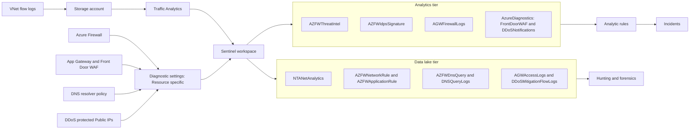

# Azure networking (VNet flow logs, Azure Firewall, WAF, DNS and DDoS)

> Status: verified. Priority: P2. Last verified: 27 Nov 2026.

## What it is

Azure networking telemetry spans four layers: Virtual Network (VNet) flow logs via Network Watcher Traffic Analytics, Azure Firewall structured logs (rules, Threat Intelligence, IDPS and DNS proxy), Web Application Firewall (WAF) logs on Application Gateway and Azure Front Door, plus Azure DNS security policies and Azure DDoS Protection. Together they show lateral movement, C2 beaconing, web exploits, malicious DNS resolution and volumetric attacks.

## Key recommendations

- **Split Analytics and Data lake tiers deliberately.** Network logs are the classic cost blow-up in Sentinel. Keep high-signal, low-volume alert streams (`AZFWThreatIntel`, `AZFWIdpsSignature`, `DDoSProtectionNotifications`, and tuned `AGWFirewallLogs` / Front Door WAF rule hits) in the **Analytics** tier. Route high-volume flow, firewall rule, HTTP access and raw DNS streams (`NTANetAnalytics`, `AZFWNetworkRule`, `AZFWApplicationRule`, `AZFWNatRule`, `AZFWDnsQuery`, `AZFWFatFlow`, `AGWAccessLogs`, `DNSQueryLogs`, `DDoSMitigationFlowLogs`) to the **Data lake** tier unless specific analytic rules require them in Analytics.
- **Migrate off NSG flow logs onto VNet flow logs now.** New NSG flow logs can no longer be created, and NSG flow logs fully retire on **30 September 2027**, when Azure stops Traffic Analytics for NSG flow logs and deletes NSG flow log resources ([Microsoft Learn](https://learn.microsoft.com/en-us/azure/network-watcher/nsg-flow-logs-overview)). Use **VNet flow logs** with Traffic Analytics writing to `NTANetAnalytics` ([VNet flow logs overview](https://learn.microsoft.com/en-us/azure/network-watcher/vnet-flow-logs-overview)).
- **Use Resource-specific tables for Azure Firewall and Application Gateway WAF.** Never pick legacy `AzureDiagnostics` on new deployments. Resource-specific mode splits firewall logs into typed tables (`AZFWNetworkRule`, `AZFWApplicationRule`, `AZFWThreatIntel`, `AZFWIdpsSignature`, `AZFWNatRule`, `AZFWDnsQuery`, `AZFWFatFlow`) and WAF logs into `AGWFirewallLogs` and `AGWAccessLogs`, avoiding regex parsing and the 500-column `AzureDiagnostics` limit ([Azure Firewall structured logs](https://learn.microsoft.com/en-us/azure/firewall/firewall-structured-logs)).
- **Update DDoS queries from `DDoSMitigationReports` to `DDoSMitigationFlowLogs`.** `DDoSMitigationReports` retired in mid-August 2026; use `DDoSProtectionNotifications` for attack start/stop alerts and `DDoSMitigationFlowLogs` for mitigation flow telemetry ([Microsoft Learn](https://learn.microsoft.com/en-us/azure/ddos-protection/diagnostic-logging)).
- **Use Azure DNS resolver policies (DNS security policies)** if you want VNet-wide DNS query logging and Microsoft Threat Intelligence domain blocking without routing every VNet through Azure Firewall DNS proxy. Logs land cleanly in `DNSQueryLogs` ([Microsoft Learn](https://learn.microsoft.com/en-us/azure/dns/dns-security-policy)).

## High-value log sources

| Source | Table name | Connector | Tier | Cost / volume | Value |
|---|---|---|---|---|---|
| Azure Firewall threat intel | `AZFWThreatIntel` | Azure Firewall (diagnostic settings, resource-specific) | Analytics | Low | Traffic matching Microsoft Threat Intelligence IPs, FQDNs or URLs. Immediate C2 and malware hit signal ([table reference](https://learn.microsoft.com/en-us/azure/azure-monitor/reference/tables/azfwthreatintel)). |
| Azure Firewall IDPS | `AZFWIdpsSignature` | Azure Firewall Premium (diagnostic settings, resource-specific) | Analytics | Low to medium | Signature-based intrusion detection and prevention matches on east-west and north-south traffic ([table reference](https://learn.microsoft.com/en-us/azure/azure-monitor/reference/tables/azfwidpssignature)). |
| Azure Firewall network, app and NAT rules | `AZFWNetworkRule`, `AZFWApplicationRule`, `AZFWNatRule` | Azure Firewall (diagnostic settings, resource-specific) | Data lake (promote selectively if running port-scan/anomaly rules) | High to very high | Every allowed and denied flow, FQDN request and DNAT hit. Essential for lateral movement and egress forensics ([structured logs](https://learn.microsoft.com/en-us/azure/firewall/firewall-structured-logs)). |
| Azure Firewall DNS proxy and fat flows | `AZFWDnsQuery`, `AZFWFatFlow` | Azure Firewall (diagnostic settings, resource-specific) | Data lake | Medium to high | DNS requests proxied by the firewall plus top bandwidth-consuming flows for exfiltration triage ([AZFWDnsQuery](https://learn.microsoft.com/en-us/azure/azure-monitor/reference/tables/azfwdnsquery), [AZFWFatFlow](https://learn.microsoft.com/en-us/azure/azure-monitor/reference/tables/azfwfatflow)). |
| VNet flow logs (Traffic Analytics) | `NTANetAnalytics` | Network Watcher Traffic Analytics (Storage to Log Analytics) | Data lake | Very high | Enriched VNet-level flow records, public/private classification and `MaliciousFlow` tagging. Replaces legacy NSG flow logs and `AzureNetworkAnalytics_CL` ([table reference](https://learn.microsoft.com/en-us/azure/azure-monitor/reference/tables/ntanetanalytics)). |
| Application Gateway WAF | `AGWFirewallLogs` | Azure Web Application Firewall (diagnostic settings, resource-specific) | Analytics (Data lake if untuned Detection mode) | Medium | OWASP CRS and custom WAF rule matches (SQLi, XSS, scanners, code injection). Feeds WAF Content Hub rules ([table reference](https://learn.microsoft.com/en-us/azure/azure-monitor/reference/tables/agwfirewalllogs)). |
| Application Gateway access logs | `AGWAccessLogs` | Application Gateway (diagnostic settings, resource-specific) | Data lake | High to very high | Every HTTP/HTTPS request passing through Application Gateway. Investigation context only ([table reference](https://learn.microsoft.com/en-us/azure/azure-monitor/reference/tables/agwaccesslogs)). |
| Azure Front Door WAF | `AzureDiagnostics` (`Category == "FrontDoorWebApplicationFirewallLog"`) | Azure Web Application Firewall (diagnostic settings) | Analytics (Data lake if noisy) | Medium to high | Edge WAF rule hits on Front Door Standard/Premium, where the category is `FrontDoorWebApplicationFirewallLog`. Classic Front Door uses `FrontdoorWebApplicationFirewallLog` ([Front Door WAF monitoring](https://learn.microsoft.com/en-us/azure/web-application-firewall/afds/waf-front-door-monitor)). |
| Azure DNS security policy | `DNSQueryLogs` | DNS resolver policy (diagnostic settings) | Data lake (or transform `Block`/`Alert` rows to Analytics) | High to very high | VNet-level public and private DNS queries plus `ResolverPolicyRuleAction` (`Allow`, `Block`, `Alert`) for threat-intel DNS hits ([table reference](https://learn.microsoft.com/en-us/azure/azure-monitor/reference/tables/dnsquerylogs)). |
| Azure DDoS notifications and mitigation flows | `AzureDiagnostics` (`Category == "DDoSProtectionNotifications"`, `Category == "DDoSMitigationFlowLogs"`) | Azure DDoS Protection (diagnostic settings on Public IPs) | Analytics for notifications; Data lake for mitigation flows | Very low for notifications; high during an active attack for flow logs | Real-time attack start/stop alerts and packet-drop forensics during DDoS mitigation ([DDoS diagnostic logging](https://learn.microsoft.com/en-us/azure/ddos-protection/diagnostic-logging)). |

### What to ingest first

| Priority | Table | Why | Rough volume | Tier |
|---|---|---|---|---|
| 1 | `AZFWThreatIntel` + `AZFWIdpsSignature` | Highest signal-to-noise network telemetry; catches C2 and exploit payloads immediately | Low to medium | Analytics |
| 2 | `AGWFirewallLogs` + Front Door `FrontDoorWebApplicationFirewallLog` | Web exploit detections (SQLi, XSS, scanners) on internet-facing apps | Medium | Analytics (tune noisy rules first) |
| 3 | `AzureDiagnostics` (`DDoSProtectionNotifications`) | Instant visibility when a protected public IP enters mitigation | Very low | Analytics |
| 4 | `NTANetAnalytics` | East-west and egress flow coverage across VNets; replaces retiring NSG flow logs | Very high | Data lake |
| 5 | `AZFWNetworkRule`, `AZFWApplicationRule`, `AZFWNatRule`, `AZFWDnsQuery`, `DNSQueryLogs` | Deep hunting, lateral movement reconstruction and DNS investigation | High to very high | Data lake (add DCR filters or summary rules for alerting) |
| 6 | `AGWAccessLogs`, `AZFWFatFlow`, `DDoSMitigationFlowLogs` | Post-incident triage and attack forensics | High to very high | Data lake |
| Skip | Legacy NSG flow logs (`AzureNetworkAnalytics_CL`), `DDoSMitigationReports` | Retiring or already retired | High | Migrate to `NTANetAnalytics` and `DDoSMitigationFlowLogs` |

## Prerequisites and licensing

| Item | Detail |
|---|---|
| VNet flow logs and Traffic Analytics | Requires **Azure Network Watcher** enabled in each VNet's region and a Storage account in the same region for raw flow JSON. Traffic Analytics incurs per-GB processing charges on top of Storage and Log Analytics/Sentinel ingestion ([Traffic Analytics](https://learn.microsoft.com/en-us/azure/network-watcher/traffic-analytics)). |
| Azure Firewall | Structured logs work on Standard and Premium tiers. **`AZFWIdpsSignature`** requires **Azure Firewall Premium** with IDPS enabled in Alert or Alert-and-Deny mode ([Monitor Azure Firewall](https://learn.microsoft.com/en-us/azure/firewall/monitor-firewall)). |
| Azure WAF | Supported on Application Gateway WAF v2 and Azure Front Door Standard/Premium. Resource-specific tables (`AGWFirewallLogs`, `AGWAccessLogs`) require Application Gateway v2 ([Application Gateway diagnostics](https://learn.microsoft.com/en-us/azure/application-gateway/application-gateway-diagnostics)). |
| Azure DNS security policy | Regional `Microsoft.Network/dnsResolverPolicies` resource linked to VNets in the same region. Billed per linked VNet and DNS queries processed ([DNS security policy](https://learn.microsoft.com/en-us/azure/dns/dns-security-policy)). |
| Azure DDoS Protection | Diagnostic logging (`DDoSProtectionNotifications` and `DDoSMitigationFlowLogs`) requires **Azure DDoS Network Protection** or **DDoS IP Protection** enabled on the public IP ([DDoS diagnostic logging](https://learn.microsoft.com/en-us/azure/ddos-protection/diagnostic-logging)). |
| Sentinel workspace | Every table above is billable Sentinel ingestion. Configure Data lake tier early in Table management to prevent high-volume flow and firewall logs from exhausting Analytics spend ([Sentinel billing](https://learn.microsoft.com/en-us/azure/sentinel/billing)). |

### Roles you need

| Task | Role |
|---|---|
| Install Content Hub solutions and enable rules | Microsoft Sentinel Contributor on the resource group ([Microsoft Learn](https://learn.microsoft.com/en-us/azure/sentinel/sentinel-solutions-deploy)) |
| Create diagnostic settings on Firewalls, WAFs, Public IPs and DNS policies | Network Contributor (plus Log Analytics Contributor or Monitoring Contributor on the workspace) |
| Enable VNet flow logs and Traffic Analytics | Network Contributor on the VNet and Network Watcher, Storage Account Contributor on the flow log storage account, and Log Analytics Contributor on the workspace |
| Enforce diagnostic settings at scale | Resource Policy Contributor at subscription or management group scope ([Microsoft Learn](https://learn.microsoft.com/en-us/azure/sentinel/connect-services-diagnostic-setting-based)) |

## Step-by-step setup

1. **Install Content Hub solutions.** In the Defender portal, go to **Microsoft Sentinel** > **Content management** > **Content hub**. Install **Azure Firewall**, **Azure Web Application Firewall (WAF)** and **Azure DDoS Protection** ([Microsoft Learn](https://learn.microsoft.com/en-us/azure/sentinel/sentinel-solutions-deploy)).
2. **Connect Azure Firewall with resource-specific tables.** In the Azure portal, open each Azure Firewall > **Monitoring** > **Diagnostic settings** > **+ Add diagnostic setting**.
   - Tick **AZFWThreatIntel**, **AZFWIdpsSignature** (Premium), **AZFWNetworkRule**, **AZFWApplicationRule**, **AZFWNatRule**, **AZFWDnsQuery** and **AZFWFatFlow**.
   - Select **Send to Log Analytics workspace**, pick your Sentinel workspace, and set **Destination table** to **Resource specific**. Save ([structured logs](https://learn.microsoft.com/en-us/azure/firewall/firewall-structured-logs)).
3. **Enable VNet flow logs with Traffic Analytics.** In the Azure portal, open **Network Watcher** > **Logs** > **Flow logs** > **+ Create**.
   - Set **Flow log type** to **Virtual network**, pick your target VNets (or subnets/NICs) and a regional Storage account.
   - Enable **Traffic Analytics**, choose your processing interval (10 minutes for near-real-time SOC triage, 60 minutes to reduce cost), select your Sentinel Log Analytics workspace, and save ([VNet flow logs](https://learn.microsoft.com/en-us/azure/network-watcher/vnet-flow-logs-overview)).
4. **Connect Application Gateway and Front Door WAF.**
   - On Application Gateway WAF v2: **Monitoring** > **Diagnostic settings** > **+ Add diagnostic setting** > tick **ApplicationGatewayFirewallLog** (and optionally **ApplicationGatewayAccessLog**), choose **Resource specific**, point to your Sentinel workspace, save (`AGWFirewallLogs` / `AGWAccessLogs`).
   - On Azure Front Door Standard/Premium: **Monitoring** > **Diagnostic settings** > tick **FrontDoorWebApplicationFirewallLog**, send to your Sentinel workspace.
5. **Connect Azure DNS security policy and DDoS Protection (where deployed).**
   - On each **DNS Resolver Policy**: **Monitoring** > **Diagnostic settings** > tick **DNSQueryLogs**, send to your Sentinel workspace.
   - On each DDoS-protected **Public IP address**: **Monitoring** > **Diagnostic settings** > tick **DDoSProtectionNotifications** and **DDoSMitigationFlowLogs**, send to your Sentinel workspace.
6. **Set table tiers immediately.** In the Defender portal, go to **Setup & configuration** > **Data management** > **Data & connectors** (or Table management) and move high-volume hunt-only tables (`NTANetAnalytics`, `AZFWNetworkRule`, `AZFWApplicationRule`, `AZFWNatRule`, `AZFWDnsQuery`, `AZFWFatFlow`, `AGWAccessLogs`, `DNSQueryLogs`) to the **Data lake** tier before peak traffic hits ([Microsoft Learn](https://learn.microsoft.com/en-us/azure/sentinel/configure-data-connector)).
7. **Scale with Azure Policy.** Use the Azure Policy assignment wizards on the **Azure Firewall**, **Azure Web Application Firewall (WAF)** and **Azure DDoS Protection** connector pages so new networking resources auto-attach to Sentinel.
8. **Validate.** Generate test traffic (for example a benign WAF test request or firewall rule hit), wait 10 to 15 minutes (up to 60 minutes for Traffic Analytics if on the 60-minute interval), and run the validation queries below.

## Best-practice security configuration

Harden Azure network perimeters alongside flow, firewall and WAF logging. See [Microsoft recommended security configurations](../../docs/security-configurations.md).

- **Azure Firewall Premium (IDPS + Threat Intel):** Enable Threat Intelligence in **Alert and deny** mode, enable **IDPS** in **Alert and deny** (after a short alert-only tuning window) with TLS inspection for sensitive outbound workloads, and use Firewall Policies centrally ([Azure Firewall overview](https://learn.microsoft.com/en-us/azure/firewall/overview)).
- **WAF in Prevention mode:** Run Azure Application Gateway and Front Door WAF with the latest Microsoft Default / DRS managed rule set + Bot Manager in **Prevention** mode (use Detection mode only briefly while tuning exclusions) ([WAF best practices](https://learn.microsoft.com/en-us/azure/web-application-firewall/ag/best-practices)).
- **VNet flow logs & DDoS Protection:** Migrate all NSG flow logs to **VNet flow logs** well ahead of the 30 September 2027 retirement, enable **Azure DDoS Network Protection** on internet-facing VNets, and default-deny inbound internet traffic on NSGs ([Azure DDoS Protection](https://learn.microsoft.com/en-us/azure/ddos-protection/ddos-protection-overview)).

## Architecture diagram



## Validation KQL

For group-wide and workspace-wide freshness checks, see [azure.kql](../../queries/validation/azure.kql) and the [validation query pack](../../queries/validation/README.md).

```kql
// 1. Check which structured networking tables are landing in Analytics and how fresh they are
// Tables set to data lake only do not appear here; query them in Data lake explorer.
union withsource=Table isfuzzy=true
    AZFWThreatIntel, AZFWIdpsSignature, AZFWNetworkRule, AZFWApplicationRule,
    AZFWNatRule, AZFWDnsQuery, AZFWFatFlow, NTANetAnalytics,
    AGWFirewallLogs, AGWAccessLogs, DNSQueryLogs
| where TimeGenerated > ago(1d)
| summarize Rows = count(), Latest = max(TimeGenerated) by Table
| order by Table asc

// 2. Check AzureDiagnostics categories for Front Door WAF and DDoS Protection
AzureDiagnostics
| where TimeGenerated > ago(7d)
| where Category in ("FrontDoorWebApplicationFirewallLog", "DDoSProtectionNotifications", "DDoSMitigationFlowLogs")
| summarize Rows = count(), Latest = max(TimeGenerated) by Category

// 3. Freshness check for Azure Firewall Threat Intel and Application Gateway WAF
union withsource=Table isfuzzy=true AZFWThreatIntel, AZFWIdpsSignature, AGWFirewallLogs
| summarize Latest = max(TimeGenerated), AgeMinutes = (now() - max(TimeGenerated)) / 1m by Table

// 4. Verify VNet flow logs (not retiring NSG flow logs) are populating NTANetAnalytics
NTANetAnalytics
| where TimeGenerated > ago(1d)
| summarize Flows = count() by FlowType, FlowStatus
| order by Flows desc

// 5. Cost: GB per table per day over the last 30 days (use this to tune Analytics vs Data lake)
Usage
| where TimeGenerated > ago(30d)
| where DataType in (
    "NTANetAnalytics", "AZFWNetworkRule", "AZFWApplicationRule", "AZFWNatRule",
    "AZFWThreatIntel", "AZFWIdpsSignature", "AZFWDnsQuery", "AZFWFatFlow",
    "AGWFirewallLogs", "AGWAccessLogs", "DNSQueryLogs"
)
| summarize GB = round(sum(Quantity) / 1024, 2) by DataType, Day = bin(TimeGenerated, 1d)
| summarize GBperDay = round(avg(GB), 2), TotalGB30d = round(sum(GB), 2) by DataType
| order by GBperDay desc
```

## Out-of-box analytic rules

Rules ship across three Content Hub solutions: **Azure Firewall** ([solution folder](https://github.com/Azure/Azure-Sentinel/tree/master/Solutions/Azure%20Firewall)), **Azure Web Application Firewall (WAF)** ([solution folder](https://github.com/Azure/Azure-Sentinel/tree/master/Solutions/Azure%20Web%20Application%20Firewall%20(WAF))) and **Azure DDoS Protection** ([solution folder](https://github.com/Azure/Azure-Sentinel/tree/master/Solutions/Azure%20DDoS%20Protection)). Check whether each rule queries resource-specific tables or legacy `AzureDiagnostics` before enabling.

| Rule | Detects | Tables | MITRE | Suggested |
|---|---|---|---|---|
| Multiple Sources Affected by the Same TI Destination (Azure Firewall) | Multiple internal hosts reaching the same Threat Intelligence destination (lateral spread or C2) | `AZFWThreatIntel` | Command and Control | Enable day 1 |
| High Severity Malicious Activity Detected (Azure Firewall) | High-severity IDPS signature matches on Azure Firewall Premium | `AZFWIdpsSignature` | Initial Access, Execution, Command and Control | Enable day 1 |
| Port Scan / Port Sweep (Azure Firewall) | Internal or external host scanning many ports or targets across the firewall | `AZFWNetworkRule` | Discovery T1046 | Enable only if `AZFWNetworkRule` is in Analytics |
| Abnormal Deny Rate for Source IP (Azure Firewall) | Sudden spike in denied connections from a single source IP | `AZFWNetworkRule` | Discovery, Command and Control | Enable only if `AZFWNetworkRule` is in Analytics |
| App-GW-WAF SQLi Detection (Azure WAF) | SQL injection attempts flagged by Application Gateway WAF | `AGWFirewallLogs` / `AzureDiagnostics` | Initial Access T1190 | Enable day 1 |
| App-GW-WAF XSS Detection (Azure WAF) | Cross-site scripting payloads targeting web apps | `AGWFirewallLogs` / `AzureDiagnostics` | Initial Access T1190 | Enable day 1 |
| App-GW-WAF Code Injection (Azure WAF) | Command or code injection attempts against exposed applications | `AGWFirewallLogs` / `AzureDiagnostics` | Initial Access T1190, Execution | Enable day 1 |
| App-GW-WAF Scanner Detection (Azure WAF) | Automated vulnerability scanner probing | `AGWFirewallLogs` / `AzureDiagnostics` | Reconnaissance T1595 | Tune thresholds (noisy on public sites) |
| Attack Sources Percent Threshold (Azure DDoS Protection) | Dominant DDoS attack sources during mitigation (review against `DDoSMitigationFlowLogs` migration) | `AzureDiagnostics` | Impact T1498 | Enable if using DDoS Network/IP Protection |

## Custom detections

Run hourly with a 1-hour lookback unless noted. Keep Analytics detections focused on low-volume, high-signal tables (`AZFWThreatIntel`, `AZFWIdpsSignature`, `AGWFirewallLogs`) or run scheduled summaries over Data lake tables.

### C1. Threat Intelligence or high-severity IDPS traffic allowed through Azure Firewall (High)

Catches cases where Azure Firewall Threat Intelligence or IDPS is set to Alert-only mode (or a policy exception let traffic pass) and an internal workload actually reached a known malicious destination.

```kql
// CUSTOM - Allowed traffic matching Azure Firewall Threat Intelligence or high-severity IDPS
// ASSUMPTION: Action value for alert-only/allowed traffic is "Alert" or "Allow" in your firewall policy.
// Inspect distinct Action values in AZFWThreatIntel and AZFWIdpsSignature before enabling.
let tiHits = AZFWThreatIntel
    | where TimeGenerated > ago(1h)
    | where Action !~ "Deny"
    | project TimeGenerated, Signal = "ThreatIntel", Action, SourceIp, DestinationIp,
              DestinationPort, Protocol, Target = coalesce(Fqdn, TargetUrl, DestinationIp),
              Detail = ThreatDescription, Firewall = _ResourceId;
let idpsHits = AZFWIdpsSignature
    | where TimeGenerated > ago(1h)
    | where Severity == 1 and Action !~ "Deny"
    | project TimeGenerated, Signal = "IDPS-High", Action, SourceIp, DestinationIp,
              DestinationPort, Protocol, Target = DestinationIp,
              Detail = strcat(Category, ": ", Description, " (Sig ", SignatureId, ")"),
              Firewall = _ResourceId;
union tiHits, idpsHits
```

MITRE: Command and Control T1071, Initial Access T1190.

### C2. Malicious flow detected in VNet Traffic Analytics (High)

If `NTANetAnalytics` is in the Data lake tier, run this as a scheduled summary or hunting job; if in Analytics, run hourly. It flags flows Traffic Analytics tags as `MaliciousFlow`.

```kql
// CUSTOM - Malicious flows tagged by Network Watcher Traffic Analytics in VNet flow logs
// ASSUMPTION: NTANetAnalytics is queryable in your workspace (or run as a Data lake scheduled job).
// SrcIp or DestIp can be blank on ExternalPublic/AzurePublic rows; check PublicIPs column when investigating.
NTANetAnalytics
| where TimeGenerated > ago(1h)
| where FlowType == "MaliciousFlow"
| summarize Flows = count(), AllowedFlows = countif(FlowStatus == "A"),
            DeniedFlows = countif(FlowStatus == "D"),
            DestPorts = make_set(DestPort, 10)
    by SrcIp, DestIp, FlowDirection, SubType
| order by AllowedFlows desc, Flows desc
```

MITRE: Command and Control T1071, Exfiltration.

### C3. Repeated DNS threat-intel blocks or alerts from a single internal host (Medium)

Identifies a potentially compromised VM or container repeatedly trying to resolve malicious domains caught by an Azure DNS resolver policy.

```kql
// CUSTOM - Internal host repeatedly hitting Block or Alert rules in Azure DNS security policy
// ASSUMPTION: DNSQueryLogs is in Analytics, or run as a Data lake summary job.
// Verify exact ResolverPolicyRuleAction casing ("Block", "Alert") in your workspace.
DNSQueryLogs
| where TimeGenerated > ago(1h)
| where ResolverPolicyRuleAction in~ ("Block", "Alert")
| summarize Hits = count(), DistinctDomains = dcount(QueryName),
            SampleDomains = make_set(QueryName, 10)
    by SourceIpAddress, ResolverPolicyRuleAction, ResolverPolicyId
| where Hits >= 5
| order by Hits desc
```

MITRE: Command and Control, Application Layer Protocol (DNS) T1071.004.

## Playbooks

Several network containment playbooks ship across `Azure/Azure-Sentinel` and `Azure/Azure-Network-Security`:

| Playbook | What it does | Connectors and permissions |
|---|---|---|
| Block IP in Azure WAF (`Playbook - WAF Sentinel Playbook Block IP`) | Adds an attacking source IP to a custom deny rule on an Application Gateway or Front Door WAF policy ([Azure-Network-Security repo](https://github.com/Azure/Azure-Network-Security/tree/master/Azure%20WAF)) | Azure Resource Manager (`Network Contributor` scoped to the WAF policy), Microsoft Sentinel Responder |
| Block IP in Azure Firewall (Azure Firewall solution) | Adds a malicious IP to an Azure Firewall Policy IP Group or rule collection after analyst approval ([Azure Firewall solution](https://github.com/Azure/Azure-Sentinel/tree/master/Solutions/Azure%20Firewall)) | Azure Resource Manager (`Network Contributor` on the IP Group / Firewall Policy), Microsoft Sentinel Responder |
| DDoS attack notification and IP block (Azure DDoS Protection solution) | Notifies on-call channels and optionally updates upstream firewall rules when a DDoS mitigation starts ([Azure DDoS solution](https://github.com/Azure/Azure-Sentinel/tree/master/Solutions/Azure%20DDoS%20Protection)) | Teams/ITSM connector, Microsoft Sentinel Responder |

Keep automated IP blocking behind an approval step or strict allow-list so a spoofed header or shared corporate NAT IP doesn't lock out legitimate users.

## Workbooks and hunting

- **Azure Firewall Workbook.** Ships in the Azure Firewall Content Hub solution and under the Firewall resource > **Monitoring** > **Workbooks**. Visualises rule hits, top denied IPs, Threat Intel matches and IDPS signatures.
- **Web Application Firewall Overview (`WebApplicationFirewallOverview.json`).** Ships in the Azure WAF solution; tracks blocked URIs, OWASP rule triggers and top attacking IPs.
- **Azure DDoS Protection Workbook (`AzDDoSStandardWorkbook.json`).** Ships in the Azure DDoS Protection solution; confirm panels are updated to read `DDoSMitigationFlowLogs`.
- **Hunting query: First Time Source IP to Destination Using Port.** Ships in the Azure Firewall solution ([solution folder](https://github.com/Azure/Azure-Sentinel/tree/master/Solutions/Azure%20Firewall)) to spot new lateral connections or unexpected egress.

## Gotchas and deprecations

- **NSG flow logs are retiring.** New NSG flow logs can no longer be created. Full retirement is **30 September 2027**, after which Azure stops Traffic Analytics for NSG flow logs and deletes existing NSG flow log resources (historical files already in Storage remain until their retention expires). Migrate to **VNet flow logs** (`NTANetAnalytics`) well ahead of the deadline ([Microsoft Learn](https://learn.microsoft.com/en-us/azure/network-watcher/nsg-flow-logs-overview)).
- **`DDoSMitigationReports` retired in mid-August 2026.** Replace any legacy DDoS queries, alerts or workbooks that read `DDoSMitigationReports` with `DDoSMitigationFlowLogs` ([DDoS diagnostic logging](https://learn.microsoft.com/en-us/azure/ddos-protection/diagnostic-logging)).
- **Analytics tier cost shock.** Sending `NTANetAnalytics`, `AZFWNetworkRule`, `AZFWApplicationRule`, `AGWAccessLogs` and `DNSQueryLogs` straight to Analytics on busy hubs can generate hundreds of GB per day. Put high-volume flow, rule, access and raw DNS tables in the **Data lake** tier and keep only alert/threat-intel tables in Analytics.
- **Legacy `AzureDiagnostics` parsing pain.** Selecting `AzureDiagnostics` instead of **Resource specific** on Azure Firewall dumps unparsed text into `msg_s` and misses structured table queries. Always verify `Resource specific` is selected on every Firewall and Application Gateway diagnostic setting.
- **Blank `SrcIp` / `DestIp` in `NTANetAnalytics`.** For `ExternalPublic` and `AzurePublic` flows, `SrcIp` or `DestIp` can be empty because public IPs are aggregated in `PublicIPs` ([NTANetAnalytics reference](https://learn.microsoft.com/en-us/azure/azure-monitor/reference/tables/ntanetanalytics)). Don't filter out blank `SrcIp`/`DestIp` without checking `PublicIPs`.
- **Sentinel in the Azure portal retires on 31 March 2027.** Build and test detections in the Defender portal ([Microsoft Learn](https://learn.microsoft.com/en-us/azure/sentinel/microsoft-sentinel-defender-portal)).

## Official links

- [Virtual network flow logs overview](https://learn.microsoft.com/en-us/azure/network-watcher/vnet-flow-logs-overview)
- [NSG flow logs overview and retirement](https://learn.microsoft.com/en-us/azure/network-watcher/nsg-flow-logs-overview)
- [Traffic Analytics overview](https://learn.microsoft.com/en-us/azure/network-watcher/traffic-analytics)
- [Monitor Azure Firewall](https://learn.microsoft.com/en-us/azure/firewall/monitor-firewall)
- [Azure Firewall structured logs](https://learn.microsoft.com/en-us/azure/firewall/firewall-structured-logs)
- [Application Gateway diagnostic logs](https://learn.microsoft.com/en-us/azure/application-gateway/application-gateway-diagnostics)
- [Monitor and log Azure Web Application Firewall on Azure Front Door](https://learn.microsoft.com/en-us/azure/web-application-firewall/afds/waf-front-door-monitor)
- [Azure DDoS Protection diagnostic logging](https://learn.microsoft.com/en-us/azure/ddos-protection/diagnostic-logging)
- [Azure DNS security policy overview](https://learn.microsoft.com/en-us/azure/dns/dns-security-policy)
- [NTANetAnalytics table reference](https://learn.microsoft.com/en-us/azure/azure-monitor/reference/tables/ntanetanalytics)
- [AZFWNetworkRule table reference](https://learn.microsoft.com/en-us/azure/azure-monitor/reference/tables/azfwnetworkrule)
- [AZFWApplicationRule table reference](https://learn.microsoft.com/en-us/azure/azure-monitor/reference/tables/azfwapplicationrule)
- [AZFWNatRule table reference](https://learn.microsoft.com/en-us/azure/azure-monitor/reference/tables/azfwnatrule)
- [AZFWThreatIntel table reference](https://learn.microsoft.com/en-us/azure/azure-monitor/reference/tables/azfwthreatintel)
- [AZFWIdpsSignature table reference](https://learn.microsoft.com/en-us/azure/azure-monitor/reference/tables/azfwidpssignature)
- [AZFWDnsQuery table reference](https://learn.microsoft.com/en-us/azure/azure-monitor/reference/tables/azfwdnsquery)
- [AZFWFatFlow table reference](https://learn.microsoft.com/en-us/azure/azure-monitor/reference/tables/azfwfatflow)
- [AGWFirewallLogs table reference](https://learn.microsoft.com/en-us/azure/azure-monitor/reference/tables/agwfirewalllogs)
- [AGWAccessLogs table reference](https://learn.microsoft.com/en-us/azure/azure-monitor/reference/tables/agwaccesslogs)
- [DNSQueryLogs table reference](https://learn.microsoft.com/en-us/azure/azure-monitor/reference/tables/dnsquerylogs)
- [Azure Firewall solution, Azure-Sentinel repo](https://github.com/Azure/Azure-Sentinel/tree/master/Solutions/Azure%20Firewall)
- [Azure Web Application Firewall (WAF) solution, Azure-Sentinel repo](https://github.com/Azure/Azure-Sentinel/tree/master/Solutions/Azure%20Web%20Application%20Firewall%20(WAF))
- [Azure DDoS Protection solution, Azure-Sentinel repo](https://github.com/Azure/Azure-Sentinel/tree/master/Solutions/Azure%20DDoS%20Protection)
- [Azure WAF playbooks and extra content, Azure-Network-Security repo](https://github.com/Azure/Azure-Network-Security/tree/master/Azure%20WAF)
- [Connect Sentinel to Azure services using diagnostic settings](https://learn.microsoft.com/en-us/azure/sentinel/connect-services-diagnostic-setting-based)
- [Microsoft Sentinel in the Defender portal](https://learn.microsoft.com/en-us/azure/sentinel/microsoft-sentinel-defender-portal)

## Last verified

27 Nov 2026, against Microsoft Learn and the Azure-Sentinel repo. Re-verify before relying on table names, navigation or rule names.
