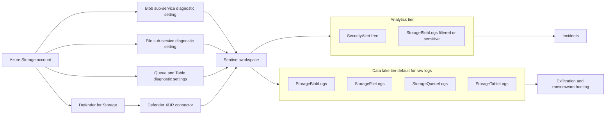

# Azure Storage

> Status: verified. Priority: P2. Last verified: 21 Nov 2026.

## What it is

Azure Storage holds blobs, file shares, queues and tables across data lakes, backups, web assets and application backends. Its resource logs record data plane reads, writes, deletes, authentication method (Entra OAuth, SAS, AccountKey or Anonymous) and caller IP, which are critical for investigating data exfiltration, ransomware encryption or deletion and exposed public containers.

## Key recommendations

- Don't turn on `StorageRead` in the Analytics tier across every storage account blindly. Busy blob and data lake accounts generate massive read volumes that will blow out a Sentinel budget in days.
- Scope data plane logging deliberately: send `StorageBlobLogs` and `StorageFileLogs` for high-value or sensitive storage accounts to the **data lake tier** by default, or use a DCR workspace transformation to keep only `StorageWrite`, `StorageDelete`, anonymous access and failed requests in the Analytics tier while parking `StorageRead` in the data lake tier ([table reference](https://learn.microsoft.com/en-us/azure/azure-monitor/reference/tables/storagebloblogs)).
- Configure diagnostic settings on each storage sub-service separately (`blob`, `file`, `queue`, `table`). Enabling diagnostics on the parent storage account alone only emits metrics, not data plane logs ([Microsoft Learn](https://learn.microsoft.com/en-us/azure/storage/blobs/monitor-blob-storage)).
- Enable **Microsoft Defender for Storage** (per-storage-account plan) across subscriptions to get behavioural exfiltration, suspicious IP, anonymous access, sensitive data threat detection and optional malware scanning alerts in `SecurityAlert` without ingesting raw read logs from every account ([Microsoft Learn](https://learn.microsoft.com/en-us/azure/defender-for-cloud/defender-for-storage-introduction)).
- Always use **Resource-specific** destination mode so logs land in `StorageBlobLogs`, `StorageFileLogs`, `StorageQueueLogs` and `StorageTableLogs` rather than `AzureDiagnostics`.

## High-value log sources

Each Azure Storage sub-service writes to its own resource-specific table when diagnostic settings are enabled on that sub-service for `StorageRead`, `StorageWrite` and `StorageDelete`. All four tables support Analytics, Basic/Auxiliary/Data lake tiers and DCR workspace transformations.

| Source | Table name | Connector | Tier | Cost / volume | Value |
|---|---|---|---|---|---|
| Blob and ADLS Gen2 data plane | `StorageBlobLogs` | Azure Storage diagnostic settings (blob sub-service) | Data lake by default; Analytics only for sensitive accounts or filtered writes/deletes | Billable ingestion. Often very high on active accounts, especially `StorageRead` ([table reference](https://learn.microsoft.com/en-us/azure/azure-monitor/reference/tables/storagebloblogs)) | Tracks `GetBlob`, `PutBlob`, `DeleteBlob`, `AuthenticationType` (`Anonymous`, `SAS`, `AccountKey`, `OAuth`), `CallerIpAddress` and `Uri`. Primary exfiltration and ransomware evidence. |
| Azure Files data plane | `StorageFileLogs` | Azure Storage diagnostic settings (file sub-service) | Data lake, or Analytics for sensitive SMB/NFS shares | Billable ingestion. Medium to very high depending on file share traffic ([table reference](https://learn.microsoft.com/en-us/azure/azure-monitor/reference/tables/storagefilelogs)) | File share access, deletions and mass modifications across SMB and REST operations. |
| Queue Storage data plane | `StorageQueueLogs` | Azure Storage diagnostic settings (queue sub-service) | Data lake (enable only on sensitive queues) | Billable ingestion. Low to high ([table reference](https://learn.microsoft.com/en-us/azure/azure-monitor/reference/tables/storagequeuelogs)) | Message reads, writes and clears on sensitive application queues. |
| Table Storage data plane | `StorageTableLogs` | Azure Storage diagnostic settings (table sub-service) | Data lake (enable only on sensitive tables) | Billable ingestion. Low to high ([table reference](https://learn.microsoft.com/en-us/azure/azure-monitor/reference/tables/storagetablelogs)) | Entity queries, inserts and deletes in Azure Table Storage. |
| Defender for Storage alerts | `SecurityAlert` | Microsoft Defender XDR / Defender for Cloud | Analytics | Free in Sentinel (`_IsBillable == false`) once Defender for Storage is licensed | Malware upload alerts, suspicious IP/app access, phishing hosted in storage, unusual anonymous access and sensitive data exfiltration alerts ([alert catalog](https://learn.microsoft.com/en-us/azure/defender-for-cloud/alerts-azure-storage)). |
| Control plane storage changes | `AzureActivity` | Azure Activity | Analytics | Free in Sentinel | Account key listings (`listKeys`), public access toggles, firewall/network rule edits, SAS policy changes and account deletions. |

### What to enable first

| Priority | Source | Why | Tier |
|---|---|---|---|
| 1 | `AzureActivity` + Microsoft Defender for Storage (`SecurityAlert`) | Covers every storage account for key listing, public access changes, malware uploads and anomalous access without raw log volume shock | Analytics (free ingestion in Sentinel) |
| 2 | `StorageBlobLogs` + `StorageFileLogs` (`StorageWrite`, `StorageDelete`) on Tier-0 / sensitive accounts | Catches tampering, staging, phishing uploads and ransomware deletion at manageable cost | Analytics (or Data lake for high-churn accounts) |
| 3 | `StorageBlobLogs` + `StorageFileLogs` (`StorageRead`) on sensitive accounts | Essential for exfiltration investigation, too noisy for Analytics on busy accounts | Data lake |
| 4 | `StorageQueueLogs` + `StorageTableLogs` | Only enable where those sub-services hold sensitive data | Data lake |

## Prerequisites and licensing

| Item | Detail |
|---|---|
| Storage diagnostic logs | Supported on Azure Storage v2 (general-purpose v2), BlockBlobStorage, FileStorage and ADLS Gen2 accounts. Classic storage accounts do not support Azure Monitor diagnostic settings ([Microsoft Learn](https://learn.microsoft.com/en-us/azure/storage/blobs/monitor-blob-storage)). |
| Sentinel billing | `StorageBlobLogs`, `StorageFileLogs`, `StorageQueueLogs` and `StorageTableLogs` are billable ingestion. Use the data lake tier or a DCR workspace transformation to control cost on read-heavy accounts. |
| Microsoft Defender for Storage | Paid Defender for Cloud plan billed per storage account per month, with optional add-ons for **On-upload malware scanning** (billed per GB scanned, with monthly caps) and **Sensitive data threat detection** ([Microsoft Learn](https://learn.microsoft.com/en-us/azure/defender-for-cloud/defender-for-storage-introduction)). Generated `SecurityAlert` rows ingest into Sentinel for free. |
| Resource providers | `Microsoft.Insights` and `Microsoft.Storage` registered on target subscriptions. |

### Roles you need

| Task | Role |
|---|---|
| Install the Azure Storage Account solution | Microsoft Sentinel Contributor on the workspace resource group ([Microsoft Learn](https://learn.microsoft.com/en-us/azure/sentinel/sentinel-solutions-deploy)) |
| Create diagnostic settings on a storage account's sub-services | Monitoring Contributor (or Owner / Contributor) on the storage account, plus Log Analytics Contributor on the workspace |
| Enforce diagnostic settings across sensitive storage accounts via Azure Policy | Owner or Resource Policy Contributor at management group, subscription or resource group scope |
| Enable Microsoft Defender for Storage | Security Admin or Owner on target subscriptions |

## Step-by-step setup

1. **Enable Microsoft Defender for Storage first.** In the Azure portal, open **Microsoft Defender for Cloud** > **Environment settings** > select your subscription > **Defender plans** > enable **Storage**. Turn on **Sensitive data threat detection** and **On-upload malware scanning** (with a monthly GB cap) on accounts storing user uploads or regulated data ([Microsoft Learn](https://learn.microsoft.com/en-us/azure/defender-for-cloud/defender-for-storage-introduction)).
2. **Install the Azure Storage Account solution.** Defender portal > Microsoft Sentinel > Content management > Content hub. Search for **Azure Storage Account**, select View details, then Install ([Microsoft Learn](https://learn.microsoft.com/en-us/azure/sentinel/sentinel-solutions-deploy)).
3. **Classify storage accounts before enabling raw logs.** Tag sensitive storage accounts (for example `SecurityLogging=Sensitive`) so Azure Policy only turns on verbose diagnostic logging where the investigation value justifies the ingestion cost.
4. **Configure diagnostic settings per sub-service.** In the Azure portal, open a target storage account > **Monitoring** > **Diagnostic settings**. Notice the four child resources listed beneath the storage account: **blob**, **file**, **queue** and **table**.
5. **Enable blob and file logging.** Select **blob** > **+ Add diagnostic setting**. Tick **StorageWrite**, **StorageDelete** and (if sending to data lake or scoping to sensitive accounts) **StorageRead**. Choose **Send to Log Analytics workspace**, select your Sentinel workspace and Save ([Microsoft Learn](https://learn.microsoft.com/en-us/azure/storage/blobs/monitor-blob-storage)). Repeat for **file** (and **queue** / **table** if used) ([Azure Files monitoring](https://learn.microsoft.com/en-us/azure/storage/files/storage-files-monitoring)).
6. **Set tier or workspace transformation before scaling out.** In Defender portal > Setup & configuration > Data management > Tables (or Log Analytics workspace > Tables), set `StorageBlobLogs` and `StorageFileLogs` to the **data lake tier** for hunt-only accounts, or attach a DCR workspace transformation if you keep them in Analytics and want to drop noisy automated reads.
7. **Automate with Azure Policy for tagged accounts.** Deploy separate `DeployIfNotExists` policies targeting `Microsoft.Storage/storageAccounts/blobServices` and `Microsoft.Storage/storageAccounts/fileServices` scoped to your sensitive resource groups or tag filter.
8. **Generate test events.** Upload, read and delete a test blob in a monitored storage account.
9. **Validate.** Wait 10 to 15 minutes and run the validation KQL queries below, then review GB per day in `Usage` after 24 hours before expanding to more storage accounts.

## Architecture diagram



## Validation KQL

For group-wide and workspace-wide freshness checks, see [azure.kql](../../queries/validation/azure.kql) and the [validation query pack](../../queries/validation/README.md).

```kql
// 1. Confirm which Azure Storage resource-specific tables are landing and how fresh each is
// Tables set to data lake only do not appear in Analytics queries; check Data lake explorer instead.
union withsource=Table isfuzzy=true
    StorageBlobLogs, StorageFileLogs, StorageQueueLogs, StorageTableLogs
| where TimeGenerated > ago(1d)
| summarize Events = count(), Accounts = dcount(AccountName), Latest = max(TimeGenerated) by Table
| order by Table asc

// 2. Freshness check for StorageBlobLogs
StorageBlobLogs
| summarize Latest = max(TimeGenerated), AgeMinutes = round((now() - max(TimeGenerated)) / 1m, 1)

// 3. Breakdown by authentication type and category to spot noisy readers or anonymous access
StorageBlobLogs
| where TimeGenerated > ago(1d)
| summarize Events = count() by AccountName, Category, AuthenticationType
| order by Events desc
| take 25

// 4. Cost: GB per day per storage table (watch closely after enabling StorageRead)
Usage
| where TimeGenerated > ago(30d)
| where DataType in ("StorageBlobLogs", "StorageFileLogs", "StorageQueueLogs", "StorageTableLogs")
| summarize GB = round(sum(Quantity) / 1024, 2) by DataType, Day = bin(TimeGenerated, 1d)
| summarize GBperDay = round(avg(GB), 2), TotalGB30d = round(sum(GB), 2) by DataType
| order by GBperDay desc

// 5. Confirm Defender for Storage alerts are flowing into SecurityAlert
SecurityAlert
| where TimeGenerated > ago(30d)
| where ProductComponentName has "Storage" or AlertName has_any ("storage", "blob", "malware")
| summarize Alerts = count(), Latest = max(TimeGenerated) by AlertName, AlertSeverity
```

## Out-of-box analytic rules

The **Azure Storage Account** solution in Content Hub packages the storage diagnostic connector and workbook, while Microsoft's primary out-of-the-box storage threat detections ship through **Microsoft Defender for Storage** (`SecurityAlert`) and community hunting queries in the [Azure-Sentinel repository](https://github.com/Azure/Azure-Sentinel/tree/master/Solutions) (including the [AzureStorage hunting folder](https://github.com/Azure/Azure-Sentinel/tree/master/Hunting%20Queries/AzureStorage)).

| Source / detection | Detects | Tables | MITRE | Suggested |
|---|---|---|---|---|
| Defender for Storage: Malware uploaded to blob container | Malicious file detected by on-upload or on-demand Microsoft Defender Antivirus scan | `SecurityAlert` | Execution, Initial Access | Enable day 1 (requires Defender for Storage with malware scanning) |
| Defender for Storage: Unusual data exfiltration from sensitive container | Anomalous download volume from containers classified as sensitive | `SecurityAlert` | Exfiltration | Enable day 1 (requires sensitive data threat detection) |
| Defender for Storage: Access from suspicious IP or Tor / suspicious app | Authenticated or anonymous storage access from threat-intel flagged IP or tooling | `SecurityAlert` | Initial Access, Collection | Enable day 1 |
| Defender for Storage: Container access level changed to public / unusual anonymous access | Exposure of private containers or unexpected unauthenticated reads | `SecurityAlert` | Collection, Exfiltration | Enable day 1 |

## Custom detections

These are community-written rules for accounts whose `StorageBlobLogs` or `StorageFileLogs` sit in the Analytics tier. Run hourly with a 1-hour lookback unless noted.

### C1. Anonymous blob access on an account that shouldn't be public (High)

Even when public blob access is meant to be disabled by policy, exceptions happen. Catching `AuthenticationType == "Anonymous"` on sensitive accounts gives immediate visibility into accidental exposure.

```kql
// CUSTOM - Successful anonymous read or list against sensitive blob storage accounts
// ASSUMPTION: AuthenticationType uses "Anonymous" and StatusCode is 200 in StorageBlobLogs.
// Populate public_allowlist with any intentionally public static-website or CDN storage accounts.
let public_allowlist = dynamic(["publicwebassets01"]);
StorageBlobLogs
| where TimeGenerated > ago(1h)
| where AuthenticationType =~ "Anonymous"
| where StatusCode == 200
| where AccountName !in~ (public_allowlist)
| summarize Requests = count(),
            BytesOut = sum(ResponseBodySize),
            Operations = make_set(OperationName, 10),
            IPs = make_set(CallerIpAddress, 10)
            by AccountName
| where Requests >= 5
```

MITRE: Collection, Data from Cloud Storage T1530.

### C2. Mass blob or file deletion burst (High)

Ransomware operators and destructive insiders often wipe blob containers or Azure File shares after exfiltration.

```kql
// CUSTOM - High volume of blob deletions by a single caller IP within 15 minutes
// ASSUMPTION: OperationName values include DeleteBlob and DeleteContainer in StorageBlobLogs,
// and StatusCode 202 indicates accepted deletion. Verify with a test deletion first.
let lifecycle_allowlist = dynamic(["backup-cleanup-account"]);
StorageBlobLogs
| where TimeGenerated > ago(1h)
| where Category == "StorageDelete"
| where StatusCode in (200, 202)
| where AccountName !in~ (lifecycle_allowlist)
| summarize Deletes = count(),
            Operations = make_set(OperationName, 10),
            AuthTypes = make_set(AuthenticationType, 5),
            SampleUris = make_set(Uri, 10)
            by AccountName, CallerIpAddress, Window = bin(TimeGenerated, 15m)
| where Deletes >= 100
| order by Deletes desc
```

Tune the threshold against legitimate batch cleanup jobs and Azure Storage lifecycle management policies. MITRE: Impact, Data Destruction T1485.

### C3. Shared key (`AccountKey`) or SAS access on accounts meant to be Entra OAuth only (Medium)

Enforcing Entra ID (`OAuth`) authentication removes static key risk. This rule flags fallback to `AccountKey` or `SAS` on hardened accounts.

```kql
// CUSTOM - Non-OAuth access to hardened storage accounts
// ASSUMPTION: hardened_accounts lists accounts expected to enforce Entra OAuth only.
let hardened_accounts = dynamic(["finprodstorage01", "hrdatalake01"]);
StorageBlobLogs
| where TimeGenerated > ago(1h)
| where AccountName in~ (hardened_accounts)
| where AuthenticationType in~ ("AccountKey", "SAS")
| where StatusCode between (200 .. 299)
| summarize Requests = count(),
            Operations = make_set(OperationName, 10),
            IPs = make_set(CallerIpAddress, 10)
            by AccountName, AuthenticationType
```

MITRE: Credential Access and Lateral Movement, Use Alternate Authentication Material T1550.

## Playbooks

Pair Defender for Storage alerts and custom storage detections with automated containment:

| Playbook | What it does | Connectors and permissions |
|---|---|---|
| Quarantine or delete malware-tagged blob | Triggered via Event Grid when Defender for Storage malware scanning marks a blob as `Malicious`, moves the blob to an isolated quarantine container or deletes it | Event Grid trigger, Storage Blob Data Contributor on source and quarantine accounts ([Microsoft Learn](https://learn.microsoft.com/en-us/azure/defender-for-cloud/defender-for-storage-introduction)) |
| Rotate compromised storage account keys | Regenerates key1/key2 and alerts the application owner after suspicious `AccountKey` usage or `listKeys` alert | Managed identity with Storage Account Key Operator Service Role (always gate behind human approval) |
| Disable public blob access on exposed account | Sets `allowBlobPublicAccess = false` after an anonymous access alert is confirmed | Managed identity with Storage Account Contributor (gate behind approval) |

## Workbooks and hunting

The **Azure Storage Account** Content Hub solution ships a workbook for storage operations and error monitoring. The Azure-Sentinel GitHub repository also includes hunting queries under [Hunting Queries/AzureStorage](https://github.com/Azure/Azure-Sentinel/tree/master/Hunting%20Queries/AzureStorage) (such as `AzureStorageFileCreateAccessDelete`, `AzureStorageUploadFromVPS` and `AzureStorageUploadLinkAccount`).

Two hunts worth running on `StorageBlobLogs` (including in the data lake tier):

- **Large outbound download anomalies (`ResponseBodySize`).** Sum `ResponseBodySize` by `AccountName`, `CallerIpAddress` and `AuthenticationType` over 7 days to spot bulk exfiltration over SAS tokens or account keys.
- **Account key usage audit.** List every storage account still seeing `AuthenticationType == "AccountKey"` so platform teams can migrate apps to Entra ID managed identities and disable shared key access.

```kql
// Hunt: Top outbound data transfers by caller IP and authentication method over 7 days
StorageBlobLogs
| where TimeGenerated > ago(7d)
| where Category == "StorageRead" and StatusCode == 200
| summarize TotalMB = round(sum(ResponseBodySize) / 1048576.0, 2),
            Reads = count()
            by AccountName, AuthenticationType, CallerIpAddress
| where TotalMB >= 500
| order by TotalMB desc
| take 50
```

## Gotchas and deprecations

- **Parent vs sub-service diagnostic settings.** Configuring a diagnostic setting on the storage account itself only exports metrics. You must configure diagnostic settings separately on `blob`, `file`, `queue` and `table` sub-services to populate `StorageBlobLogs`, `StorageFileLogs`, `StorageQueueLogs` and `StorageTableLogs` ([Microsoft Learn](https://learn.microsoft.com/en-us/azure/storage/blobs/monitor-blob-storage)).
- **Read log volume explosion.** Turning on `StorageRead` in the Analytics tier on active application, CDN-origin or analytics lake accounts can generate hundreds of gigabytes a day. Start with Defender for Storage for broad coverage, scope raw logs to sensitive accounts, and use the data lake tier or DCR transformations to filter high-volume reads.
- **Don't confuse Storage diagnostic logs with the Azure Storage Blob CCF connector.** Microsoft Sentinel also has an **Azure Storage Blob (Codeless Connector Framework)** connector that ingests third-party JSON/CSV/Parquet log files dropped into a blob container via Event Grid and queues. That connector is for reading arbitrary logs stored inside blobs, not for auditing access to the storage account itself.
- **Classic storage accounts and legacy Storage Analytics logs (`$logs`).** Classic storage accounts cannot send Azure Monitor resource logs to Log Analytics. Migrate them to general-purpose v2 accounts; avoid relying on legacy `$logs` blob container logging for new SIEM pipelines.
- **Shared key bypasses Entra RBAC and hides the human caller.** When a caller uses `AccountKey` or an account SAS, `StorageBlobLogs` records the `CallerIpAddress` and `AuthenticationType`, not an Entra user identity. Disable shared key access (`allowSharedKeyAccess = false`) wherever apps support Entra OAuth.
- **Sentinel in the Azure portal retires on 31 March 2027.** Manage Defender for Storage incidents, hunting and rules in the Microsoft Defender portal ([Microsoft Learn](https://learn.microsoft.com/en-us/azure/sentinel/microsoft-sentinel-defender-portal)).

## Official links

- [Monitor Azure Blob Storage](https://learn.microsoft.com/en-us/azure/storage/blobs/monitor-blob-storage)
- [Monitor Azure Files](https://learn.microsoft.com/en-us/azure/storage/files/storage-files-monitoring)
- [Monitor Azure Queue Storage](https://learn.microsoft.com/en-us/azure/storage/queues/monitor-queue-storage)
- [Monitor Azure Table Storage](https://learn.microsoft.com/en-us/azure/storage/tables/monitor-table-storage)
- [StorageBlobLogs table reference](https://learn.microsoft.com/en-us/azure/azure-monitor/reference/tables/storagebloblogs)
- [StorageFileLogs table reference](https://learn.microsoft.com/en-us/azure/azure-monitor/reference/tables/storagefilelogs)
- [StorageQueueLogs table reference](https://learn.microsoft.com/en-us/azure/azure-monitor/reference/tables/storagequeuelogs)
- [StorageTableLogs table reference](https://learn.microsoft.com/en-us/azure/azure-monitor/reference/tables/storagetablelogs)
- [Overview of Microsoft Defender for Storage](https://learn.microsoft.com/en-us/azure/defender-for-cloud/defender-for-storage-introduction)
- [Security alerts for Azure Storage](https://learn.microsoft.com/en-us/azure/defender-for-cloud/alerts-azure-storage)
- [Connect Microsoft Sentinel to Azure services using diagnostic settings](https://learn.microsoft.com/en-us/azure/sentinel/connect-services-diagnostic-setting-based)
- [Discover and deploy Microsoft Sentinel out-of-the-box content](https://learn.microsoft.com/en-us/azure/sentinel/sentinel-solutions-deploy)
- [Enable a data connector in Microsoft Sentinel](https://learn.microsoft.com/en-us/azure/sentinel/configure-data-connector)
- [Microsoft Sentinel in the Microsoft Defender portal](https://learn.microsoft.com/en-us/azure/sentinel/microsoft-sentinel-defender-portal)
- [Azure Storage hunting queries, Azure-Sentinel repo](https://github.com/Azure/Azure-Sentinel/tree/master/Hunting%20Queries/AzureStorage)
- [Azure-Sentinel Solutions directory](https://github.com/Azure/Azure-Sentinel/tree/master/Solutions)

## Last verified

21 Nov 2026, against Microsoft Learn and the Azure-Sentinel repo. Re-verify before relying on table names, navigation or rule names.
