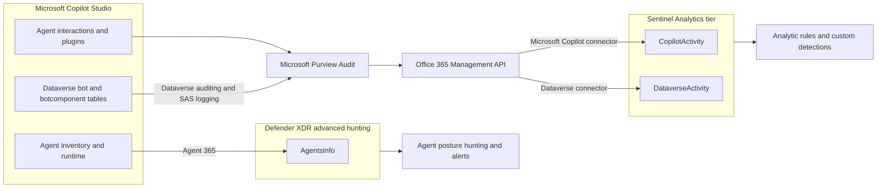

# Microsoft Copilot Studio

> Status: verified. Priority: P2. Last verified: 21 Nov 2026.

## What it is

Microsoft Copilot Studio lets makers build custom AI agents connected to internal knowledge sources, Dataverse, connectors and external channels. For a SOC, the key risks are unauthenticated agents exposing internal data, risky tool or plugin changes, prompt-injection attempts and shadow agents built without IT oversight.

This guide covers Copilot Studio agent runtime telemetry (`CopilotActivity`), agent definition auditing via Dataverse (`DataverseActivity`), Purview maker audit events and Defender Security for AI / Microsoft Agent 365 (`AgentsInfo`). For Power Platform data policies and admin logs, see [Power Platform](../power-platform/README.md). For Dataverse environment auditing, see [Microsoft Dataverse and Dynamics 365](../dataverse-dynamics-365/README.md). For Microsoft 365 Copilot broadly, see [Microsoft 365 Copilot](../../ai/microsoft-365-copilot/README.md).

## Key recommendations

- Prevention beats detection for anonymous agents. Block the `Chat without Microsoft Entra ID authentication` connector in a Power Platform data policy so makers can't publish unauthenticated agents ([Microsoft Learn](https://learn.microsoft.com/en-us/microsoft-copilot-studio/admin-data-loss-prevention)).
- Install the **Microsoft Copilot** solution (GA April 2026) from Content hub and connect the Microsoft Copilot data connector to populate `CopilotActivity` (formerly `LLMActivity`). Keep it in the Analytics tier if you run the jailbreak and plugin rules, or move it to the data lake tier if you only hunt.
- Turn on Dataverse auditing for the `bot` and `botcomponent` tables in every production environment where agents live, and ingest `DataverseActivity`. Copilot Studio maker audit events (`BotCreate`, `BotUpdateOperation-*`) are logged in Microsoft Purview, but Microsoft Learn doesn't document a dedicated Sentinel table for them, so watching the Dataverse `bot` table is the dependable Sentinel path.
- Use Microsoft Defender XDR advanced hunting's `AgentsInfo` table (which replaced `AIAgentsInfo` on 1 July 2026) for unified agent inventory, posture and runtime protection. Note that Defender agent inventory and real-time protection for Copilot Studio require a **Microsoft Agent 365** licence from 1 July 2026 ([Microsoft Learn](https://learn.microsoft.com/en-us/defender-xdr/security-for-ai/transition-agent-security-to-agent-365)).

## High-value log sources

`CopilotActivity` and `DataverseActivity` are billable Sentinel tables fed via codeless (CCF) connectors polling the Office 365 Management API through Microsoft Purview Audit. `AgentsInfo` lives in Defender XDR advanced hunting.

| Source | Table name | Connector | Tier | Cost / volume | Value |
|---|---|---|---|---|---|
| Copilot and agent runtime interactions | `CopilotActivity` | Microsoft Copilot (Microsoft Copilot solution) | Analytics, or data lake if hunt-only | Medium to high (one row per interaction) | `CopilotInteraction` events (including Copilot Studio agents), jailbreak flags (`JailbreakDetected`), accessed resources, plugin create/change and Copilot settings ([table reference](https://learn.microsoft.com/en-us/azure/azure-monitor/reference/tables/copilotactivity)). |
| Agent definitions and config changes | `DataverseActivity` (`bot` and `botcomponent` tables) | Microsoft Dataverse (Business Applications solution) | Analytics | Low for `bot` / `botcomponent` alone; medium overall | Dependable Sentinel audit trail for agent creation, edits, topic/component changes and authentication mode changes (`authenticationmode`). See [Microsoft Dataverse and Dynamics 365](../dataverse-dynamics-365/README.md). |
| Agent inventory and posture (Agent 365) | `AgentsInfo` | None, native to Defender XDR (Security for AI / Agent 365) | Already in Defender XDR | Free ingestion in Defender XDR; needs Agent 365 licence from 1 Jul 2026 | Unified AI agent inventory across Copilot Studio and other platforms: `PublishedStatus`, `LifecycleStatus`, `EntraAgentId`, `ToolsAuthenticationType`, `Permissions` and `RawAgentInfo` ([table reference](https://learn.microsoft.com/en-us/defender-xdr/advanced-hunting-agentsinfo-table)). |
| Power Platform data policies and admin ops | `PowerPlatformAdminActivity` | Microsoft Power Platform Admin Activity | Analytics | Low | Detects tampering with the data policies that block anonymous agents and risky connectors. See [Power Platform](../power-platform/README.md). |
| Purview maker audit events (`BotCreate`, `BotUpdateOperation-*`) | Purview Audit (no dedicated Sentinel table documented) | Purview Audit / Office 365 Management API | Purview Audit (check `OfficeActivity` / `CloudAppEvents` in your tenant) | Low | Maker operations (`BotCreate`, `BotDelete`, `BotUpdateOperation-BotAuthUpdate`, `BotUpdateOperation-BotPublish`, `BotUpdateOperation-BotShare`) are documented in Purview ([Microsoft Learn](https://learn.microsoft.com/en-us/purview/audit-copilot)), but not mapped to a dedicated Sentinel table. Verify in your tenant and use `DataverseActivity` as your primary Sentinel source. |
| Legacy AI tables (retired) | `LLMActivity`, `AIAgentsInfo` | Renamed / replaced | Skip | Retired | `LLMActivity` was renamed `CopilotActivity` in December 2025. `AIAgentsInfo` was replaced by `AgentsInfo` on 1 July 2026. |

### What to ingest first

| Priority | Table | Why | Rough volume | Tier |
|---|---|---|---|---|
| 1 | `DataverseActivity` (`bot` and `botcomponent` audited) | Reliable Sentinel detection for unauthenticated agents and agent config tampering | Low for bot tables | Analytics |
| 1 | `PowerPlatformAdminActivity` | Protects the Power Platform data policies blocking anonymous agents | Low | Analytics |
| 2 | `CopilotActivity` | Captures agent runtime interactions, jailbreak detection flags and plugin changes | Medium to high | Analytics if alerting; data lake if hunting only |
| 2 | `AgentsInfo` | Unified agent inventory and security posture in Defender XDR (if licensed for Agent 365) | Low | Already in Defender XDR |
| Skip | Application Insights conversation traces (in Sentinel), `LLMActivity`, `AIAgentsInfo` | Operational debugging telemetry or retired tables | | |

## Prerequisites and licensing

| Item | Detail |
|---|---|
| Purview Audit | Microsoft Purview Audit (Standard) or (Premium) must be enabled. Both the Microsoft Copilot and Dataverse connectors rely on it ([Microsoft Learn](https://learn.microsoft.com/en-us/purview/audit-copilot)). |
| Copilot Studio user licensing | Copilot Studio audit events are only recorded for users with an assigned Microsoft 365 licence. |
| Dataverse auditing | Required in production environments hosting Copilot Studio agents to populate `DataverseActivity` for the `bot` and `botcomponent` tables ([Microsoft Learn](https://learn.microsoft.com/en-us/power-platform/admin/manage-dataverse-auditing)). |
| Microsoft Agent 365 | Required from 1 July 2026 for Defender Security for AI agent inventory (`AgentsInfo`) and real-time tool-call protection for Copilot Studio ([Microsoft Learn](https://learn.microsoft.com/en-us/defender-xdr/security-for-ai/transition-agent-security-to-agent-365)). |
| Sentinel | Pay-as-you-go or commitment tier ingestion. `CopilotActivity` and `DataverseActivity` are billable tables. |

### Roles you need

| Task | Role |
|---|---|
| Install solutions and create rules | Microsoft Sentinel Contributor on the workspace resource group ([Microsoft Learn](https://learn.microsoft.com/en-us/azure/sentinel/sentinel-solutions-deploy)) |
| Connect Microsoft Copilot and Dataverse CCF connectors | Security Administrator or Global Administrator on the tenant ([Microsoft Learn](https://learn.microsoft.com/en-us/azure/sentinel/data-connectors-reference)) |
| Enable Dataverse auditing on `bot` and `botcomponent` tables | Power Platform Administrator, or System Administrator in each environment |
| Configure Copilot Studio data policies | Power Platform Administrator |
| Onboard Defender Security for AI / Agent 365 | Security Administrator, plus Power Platform Administrator for the Copilot Studio integration |

## Step-by-step setup

1. **Confirm Purview auditing is on.** Open Microsoft Purview portal > Audit and confirm auditing is active.
2. **Block anonymous agents preventively.** In the Power Platform admin centre, open Policies > Data policies, edit your production and default policies, and block the `Chat without Microsoft Entra ID authentication` connector ([Microsoft Learn](https://learn.microsoft.com/en-us/microsoft-copilot-studio/admin-data-loss-prevention)).
3. **Install the Microsoft Copilot solution.** In the Defender portal, go to Microsoft Sentinel > Content management > Content hub, search for **Microsoft Copilot** and select Install ([Microsoft Learn](https://learn.microsoft.com/en-us/azure/sentinel/data-connectors-reference)).
4. **Connect Microsoft Copilot.** Go to Setup & configuration > Data management > Data & connectors > Connectors tab > select **Microsoft Copilot** > Open connector page > Enable connection ([Microsoft Learn](https://learn.microsoft.com/en-us/azure/sentinel/configure-data-connector)). Data lands in `CopilotActivity`.
5. **Audit the Dataverse `bot` and `botcomponent` tables.** In each production environment that hosts Copilot Studio agents, follow [Microsoft Dataverse and Dynamics 365](../dataverse-dynamics-365/README.md) to turn on Dataverse auditing and SAS logging, then open table properties for `bot` and `botcomponent`, enable **Auditing**, and publish customisations.
6. **Connect Microsoft Dataverse.** Ensure the **Microsoft Business Applications** solution (3.2.5 or later) is installed and the **Microsoft Dataverse** connector is connected so `bot` table edits flow into `DataverseActivity`.
7. **Onboard Defender Security for AI / Agent 365 (if licensed).** In the Defender portal, enable Copilot Studio integration under Security for AI / Agent 365 so agent posture and runtime alerts populate `AgentsInfo` ([Microsoft Learn](https://learn.microsoft.com/en-us/defender-xdr/security-for-ai/transition-agent-security-to-agent-365)).
8. **Generate test activity and validate.** Create a test agent in a sandbox environment, modify a topic, send a prompt and run the validation queries below from Investigation & response > Advanced hunting.

## Best-practice security configuration

Block unauthenticated agents preventively before relying on audit alerts. See [Microsoft recommended security configurations](../../docs/security-configurations.md).

- **Block unauthenticated agents via DLP:** Block the `Chat without Microsoft Entra ID authentication` connector in your Power Platform data policies so makers cannot publish anonymous agents ([Copilot Studio security and governance](https://learn.microsoft.com/en-us/microsoft-copilot-studio/security-and-governance)).
- **Enforce Entra authentication & restrict knowledge sources:** Require **Authenticate with Microsoft** on internal agents, restrict SharePoint/Dataverse grounding to authorised environments, and disable unreviewed generative actions or external HTTP connectors.
- **Agent inventory & runtime protection:** Enable Defender Security for AI / Microsoft Agent 365 (if licensed) for continuous agent posture visibility and real-time tool-call protection.

## Architecture diagram



## Validation KQL

For group-wide and workspace-wide freshness checks, see [business-apps.kql](../../queries/validation/business-apps.kql) and the [validation query pack](../../queries/validation/README.md).

```kql
// 1. Are CopilotActivity and Dataverse bot-table events landing?
union withsource=Table isfuzzy=true
    (CopilotActivity | where TimeGenerated > ago(1d)),
    (DataverseActivity | where TimeGenerated > ago(1d) | where EntityName in ("bot", "botcomponent"))
| summarize Rows = count(), Latest = max(TimeGenerated) by Table

// 2. What Copilot record types and agents appear in YOUR tenant?
CopilotActivity
| where TimeGenerated > ago(7d)
| summarize Events = count(), Users = dcount(ActorUserId) by RecordType, AgentName
| order by Events desc

// 3. Check Dataverse bot table changes and authenticationmode field values
DataverseActivity
| where TimeGenerated > ago(30d)
| where EntityName == "bot"
| mv-expand Field = Fields
| where tostring(Field.Name) == "authenticationmode"
| summarize Events = count() by InstanceUrl, Message, AuthMode = tostring(Field.Value)

// 4. Cost: GB per day for CopilotActivity over 30 days
Usage
| where TimeGenerated > ago(30d)
| where DataType == "CopilotActivity"
| summarize GB = round(sum(Quantity) / 1024, 2) by Day = bin(TimeGenerated, 1d)
| summarize GBperDay = round(avg(GB), 2), TotalGB30d = round(sum(GB), 2)

// 5. Defender XDR side (run in advanced hunting with Defender XDR selected)
AgentsInfo
| summarize arg_max(Timestamp, *) by AgentId
| where LifecycleStatus != "Deleted"
| project Timestamp, AgentName, Platform, PublishedStatus, LifecycleStatus, EntraAgentId, ToolsAuthenticationType
```

## Out-of-box analytic rules

From the **Microsoft Copilot** solution ([solution folder](https://github.com/Azure/Azure-Sentinel/tree/master/Solutions/Microsoft%20Copilot)). MITRE technique IDs are shown where listed in the rule YAML; inspect each rule template in Content hub before enabling.

| Rule | Detects | Tables | MITRE | Suggested |
|---|---|---|---|---|
| Copilot - Jailbreak Attempt Detected | `CopilotInteraction` records flagged with `JailbreakDetected` | `CopilotActivity` | Initial Access, Credential Access, Impact | Enable day 1 |
| Copilot - Plugin Created by Non-Admin User | `CreateCopilotPlugin` performed by a non-admin account | `CopilotActivity` | Persistence, Privilege Escalation (T1546, T1098) | Enable day 1 |
| Copilot - Plugin tampering | Changes to existing Copilot plugins (`CopilotPluginTampering`) | `CopilotActivity` | Check rule YAML | Enable day 1 |
| Copilot - File uploads disabled | Copilot file upload setting turned off (`CopilotFileUploadsDisabled`) | `CopilotActivity` | Check rule YAML | Optional |

With Microsoft Agent 365 licensed and onboarded, Defender Security for AI also generates native Defender XDR alerts for risky agent configurations and blocked real-time tool calls.

## Custom detections

These are community-written rules, not Microsoft content. Any line marked `ASSUMPTION` must be confirmed against a sample row from your tenant before enabling. Run hourly with a 1-hour lookback unless noted.

### C1. Copilot Studio agent created or switched to no authentication (High)

```kql
// CUSTOM - Copilot Studio agent created or switched to "No authentication"
// ASSUMPTION: auditing is enabled on the Dataverse 'bot' table in agent environments,
// and authenticationmode 1 = No authentication. Confirm option values with validation query 3.
DataverseActivity
| where TimeGenerated > ago(1h)
| where EntityName == "bot" and Message in ("Create", "Update")
| mv-expand Field = Fields
| where tostring(Field.Name) == "authenticationmode"
| extend AuthMode = tostring(Field.Value)
| where AuthMode == "1"
| project TimeGenerated, UserId, ClientIp, InstanceUrl, BotId = EntityId, AuthMode
```

Because Copilot Studio maker audit events (`BotCreate`, `BotUpdateOperation-BotAuthUpdate`) don't have a documented Sentinel table, watching the Dataverse `bot` table is the dependable detection path. Block the no-auth connector in a data policy and treat this rule as a backstop. MITRE: Initial Access T1190.

### C2. Agent or component modified by an unapproved maker in production (Medium)

```kql
// CUSTOM - Copilot Studio agent or topic/component created or changed in production outside approved makers
// ASSUMPTION: replace prod_instances and approved_makers with watchlists for your tenant.
let prod_instances = dynamic(["https://your-prod-env.crm6.dynamics.com"]);
let approved_makers = dynamic(["agent-builder@yourdomain.gov.au"]);
DataverseActivity
| where TimeGenerated > ago(1h)
| where InstanceUrl in~ (prod_instances)
| where EntityName in ("bot", "botcomponent") and Message in ("Create", "Update", "Delete")
| where UserId !in~ (approved_makers)
| summarize Changes = count(), Tables = make_set(EntityName), Messages = make_set(Message)
            by UserId, ClientIp, InstanceUrl, EntityId
```

Catches unauthorised agent publishing, prompt/topic tampering or tool additions in production environments. MITRE: Persistence T1098, Execution T1059.

### C3. Repeated jailbreak flags against an agent (High)

```kql
// CUSTOM - Multiple jailbreak detections against the same agent or by the same user in an hour
// ASSUMPTION: confirm LLMEventData.Messages[].JailbreakDetected structure on a sample row in CopilotActivity.
CopilotActivity
| where TimeGenerated > ago(1h)
| where RecordType == "CopilotInteraction"
| extend Messages = LLMEventData.Messages
| mv-expand Messages
| where tobool(Messages.JailbreakDetected) == true
| summarize JailbreakHits = count(), Users = dcount(ActorUserId), SampleUsers = make_set(ActorName, 10)
            by AgentName, bin(TimeGenerated, 1h)
| where JailbreakHits >= 3
```

Adds aggregation on top of single-event jailbreak alerts to spot sustained prompt-injection probing against a specific agent. MITRE: Initial Access T1190, Credential Access.

### C4. Published Copilot Studio agent with weak authentication posture in Defender XDR (Medium)

```kql
// CUSTOM (Defender XDR advanced hunting) - Active published Copilot Studio agents with no auth or unreviewed permissions
// ASSUMPTION: inspect one AgentsInfo row for your Copilot Studio agents to confirm the exact Platform
// string and authentication fields inside ToolsAuthenticationType / RawAgentInfo.
AgentsInfo
| summarize arg_max(Timestamp, *) by AgentId
| where LifecycleStatus == "Active" and PublishedStatus == "Published"
| where Platform has "Copilot Studio"
| where tostring(ToolsAuthenticationType) has_any ("None", "NoAuthentication", "Anonymous")
    or tostring(RawAgentInfo) has_any ("NoAuthentication", "Anonymous")
| project Timestamp, AgentId, AgentName, Platform, EntraAgentId, ToolsAuthenticationType, Permissions
```

Run as a Defender XDR custom detection rule (daily) if you hold Microsoft Agent 365 licences. MITRE: Initial Access T1190.

## Playbooks

No Copilot Studio-specific playbooks ship in the **Microsoft Copilot** solution. Reuse the workload-owner verification playbook from **Microsoft Business Applications** (`MSBizApps-Incident-From-Alert-Teams`) and consider these custom Logic App playbooks:

| Playbook (custom) | Trigger | Actions | Connector and permissions |
|---|---|---|---|
| Alert verification with agent owner | C1, C2, plugin tampering | Post adaptive card to the maker or environment admin in Teams asking to confirm the change; escalate to an incident if unauthorised | Managed identity with Microsoft Sentinel Responder, plus Teams connection |
| Enrich agent incident | Any `CopilotActivity` or `bot`-table alert | Query Power Platform inventory or Defender XDR `AgentsInfo` for the agent's owner, environment, authentication model and connected tools, and append an incident comment | Managed identity with Defender XDR Advanced Hunting API (`ThreatHunting.Read.All`) or Power Platform inventory read access, plus Sentinel Responder |
| Contain compromised maker | C1 combined with risky sign-in, or plugin tampering | Revoke Entra sign-in sessions and add the maker to your Dataverse block-list Entra group behind an analyst approval | Microsoft Graph (`User.RevokeSessions.All`, `GroupMember.ReadWrite.All`) via managed identity |

## Workbooks and hunting

| Item | Source | Use |
|---|---|---|
| Microsoft Copilot Activity Monitoring workbook | Microsoft Copilot solution | Copilot and agent interactions, plugin changes and settings overview |
| `CopilotExternalIPAccess` | Microsoft Copilot hunting | Copilot and agent use from unusual external IP addresses |
| `CopilotPluginReEnabled` | Microsoft Copilot hunting | Copilot plugins switched back on after being disabled |
| Agent inventory census (`AgentsInfo`) | Defender XDR advanced hunting | Periodic review of active published agents, owners, Entra identities and granted permissions |

Example census query in Defender XDR advanced hunting:

```kql
AgentsInfo
| summarize arg_max(Timestamp, *) by AgentId
| where LifecycleStatus != "Deleted"
| summarize Agents = count(), Published = countif(PublishedStatus == "Published") by Platform
| order by Agents desc
```

## Gotchas and deprecations

- **`LLMActivity` renamed to `CopilotActivity`.** The table was renamed in December 2025, and the **Microsoft Copilot** solution reached GA on 2 April 2026. Update any older KQL referencing `LLMActivity`.
- **`AIAgentsInfo` replaced by `AgentsInfo`.** The legacy `AIAgentsInfo` table in Defender XDR advanced hunting was replaced by `AgentsInfo` and remained accessible only until 1 July 2026. Update external scripts, APIs and notebooks to `AgentsInfo` ([Microsoft Learn](https://learn.microsoft.com/en-us/defender-xdr/advanced-hunting-agentsinfo-table)).
- **Agent 365 licensing cutover.** Defender Security for AI agent inventory and real-time tool-call protection for Copilot Studio require a **Microsoft Agent 365** licence from 1 July 2026 ([Microsoft Learn](https://learn.microsoft.com/en-us/defender-xdr/security-for-ai/transition-agent-security-to-agent-365)).
- **Purview maker audit gap in Sentinel.** Copilot Studio maker audit events (`BotCreate`, `BotDelete`, `BotUpdateOperation-BotAuthUpdate`, `BotUpdateOperation-BotPublish`, `BotUpdateOperation-BotShare`) are documented in Microsoft Purview Audit, but Microsoft Learn doesn't document a dedicated Sentinel table for them. Check whether your tenant surfaces them in `OfficeActivity` or `CloudAppEvents`, and rely on Dataverse `bot` and `botcomponent` table auditing in `DataverseActivity` for Sentinel alerts.
- **No prompt text in `CopilotActivity`.** `CopilotActivity` logs interaction metadata, accessed resources and security flags such as `JailbreakDetected`, not full prompt and response transcripts. Full conversation content is retrieved through Microsoft Purview eDiscovery.
- **User licence requirement.** Copilot Studio audit events are only captured for users who hold an assigned Microsoft 365 licence.
- **Sentinel in the Azure portal retires on 31 March 2027.** Build and test connectors and rules in the Defender portal ([Microsoft Learn](https://learn.microsoft.com/en-us/azure/sentinel/microsoft-sentinel-defender-portal)).

## Official links

- [Microsoft Copilot data connector for Microsoft Sentinel](https://learn.microsoft.com/en-us/azure/sentinel/data-connectors-reference)
- [CopilotActivity table reference](https://learn.microsoft.com/en-us/azure/azure-monitor/reference/tables/copilotactivity)
- [Microsoft Copilot solution, Azure-Sentinel repo](https://github.com/Azure/Azure-Sentinel/tree/master/Solutions/Microsoft%20Copilot)
- [Configure data policies for Copilot Studio agents](https://learn.microsoft.com/en-us/microsoft-copilot-studio/admin-data-loss-prevention)
- [Audit logs for Copilot and AI applications](https://learn.microsoft.com/en-us/purview/audit-copilot)
- [Transition Copilot Studio agent security to Agent 365](https://learn.microsoft.com/en-us/defender-xdr/security-for-ai/transition-agent-security-to-agent-365)
- [AgentsInfo table in the advanced hunting schema](https://learn.microsoft.com/en-us/defender-xdr/advanced-hunting-agentsinfo-table)
- [Defender XDR advanced hunting schema tables](https://learn.microsoft.com/en-us/defender-xdr/advanced-hunting-schema-tables)
- [Manage Dataverse auditing](https://learn.microsoft.com/en-us/power-platform/admin/manage-dataverse-auditing)
- [Enable a data connector, Defender portal navigation](https://learn.microsoft.com/en-us/azure/sentinel/configure-data-connector)
- [Microsoft Sentinel in the Defender portal](https://learn.microsoft.com/en-us/azure/sentinel/microsoft-sentinel-defender-portal)

## Last verified

21 Nov 2026, against Microsoft Learn, the Defender XDR schema references and the Azure-Sentinel repo. Re-verify before relying on table names, navigation or rule names.
