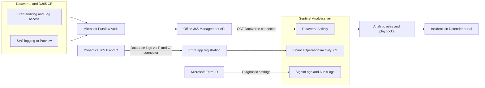

# Microsoft Dataverse and Dynamics 365

> Status: verified. Priority: P2. Last verified: 21 Nov 2026.

## What it is

Microsoft Dataverse stores business data for model-driven Power Apps, Copilot Studio agents and Dynamics 365 Customer Engagement (CE) apps such as Sales and Customer Service. Dynamics 365 Finance and Operations (F&O) is Microsoft's cloud ERP platform. Together, their audit streams expose bulk data exports, mass reads, security role tampering, bank account manipulation and audit-logging sabotage.

This guide covers Dataverse / Dynamics 365 CE (`DataverseActivity`) and Dynamics 365 Finance and Operations (`FinanceOperationsActivity_CL`). For Power Platform admin, Power Apps and Power Automate logs, see [Power Platform](../power-platform/README.md). For Copilot Studio agent monitoring on the Dataverse `bot` table, see [Microsoft Copilot Studio](../copilot-studio/README.md).

## Key recommendations

- Install the **Microsoft Business Applications** solution (3.2.5 or later) from Content hub and connect **Microsoft Dataverse** (`DataverseActivity`) for Dataverse and Dynamics 365 CE, plus **Dynamics 365 Finance and Operations** (`FinanceOperationsActivity_CL`) if you run F&O ([Microsoft Learn](https://learn.microsoft.com/en-us/azure/sentinel/business-applications/solution-overview)).
- Migrate away from the legacy **Dynamics 365** connector (`Dynamics365Activity`). Don't run both connectors at the same time or you'll pay twice for duplicate events.
- Control `DataverseActivity` volume deliberately. Turn on **Start auditing** and **Log access** in production environments only, and turn on **Read logs** only in environments holding sensitive data, because every record read generates an event ([Microsoft Learn](https://learn.microsoft.com/en-us/power-platform/admin/manage-dataverse-auditing)).
- Enable **SAS Logging in Purview** in each audited Dataverse environment and import the **Audit Settings** managed solution so default high-value tables are audited consistently.
- For Dynamics 365 F&O, enable database logging selectively on high-risk ERP tables (such as `UserInfo`, `BankAccountTable` and `SysAADClientTable`) rather than broad transactional tables ([Microsoft Learn](https://learn.microsoft.com/en-us/azure/sentinel/dynamics-365/deploy-dynamics-365-finance-operations-solution)).
- Populate the `TerminatedEmployees`, `VIPUsers` and `NetworkAddresses` watchlists early; several out-of-box Dataverse and F&O rules return nothing until those lists are filled.

## High-value log sources

`DataverseActivity` arrives through a codeless (CCF) connector in the **Microsoft Business Applications** solution that polls the Office 365 Management API via Microsoft Purview Audit. `FinanceOperationsActivity_CL` arrives through the Dynamics 365 Finance and Operations connector using a Microsoft Entra ID app registration mapped inside F&O. Both are billable Sentinel tables.

| Source | Table name | Connector | Tier | Cost / volume | Value |
|---|---|---|---|---|---|
| Dataverse and Dynamics 365 CE audit | `DataverseActivity` | Microsoft Dataverse (Business Applications solution) | Analytics | Medium with CRUD + Log access; high if Read logs are enabled | Record CRUD, Export to Excel, `RetrieveMultiple`, security role and ownership changes, audit setting tampering, org settings, sign-ins, TDS endpoint and Web API use ([table reference](https://learn.microsoft.com/en-us/azure/azure-monitor/reference/tables/dataverseactivity)). |
| Dynamics 365 Finance and Operations audit | `FinanceOperationsActivity_CL` | Dynamics 365 Finance and Operations (Business Applications solution) | Analytics | Low to medium, depends on audited F&O database tables | ERP database log changes (create, update, delete, rename) on sensitive tables such as `UserInfo`, `BankAccountTable` and `SysAADClientTable` ([Microsoft Learn](https://learn.microsoft.com/en-us/azure/sentinel/dynamics-365/deploy-dynamics-365-finance-operations-solution)). |
| Entra sign-in and directory audit | `SigninLogs`, `AuditLogs` | Microsoft Entra ID | Analytics | Already flowing in most tenants | Needed for Dataverse Web API, non-interactive identity and F&O single-factor sign-in rules. See [Microsoft Entra ID](../../identity/entra-id/README.md). |
| Power Platform admin activity | `PowerPlatformAdminActivity` | Microsoft Power Platform Admin Activity | Analytics | Low | Needed for the guest exfiltration following defence impairment rule. See [Power Platform](../power-platform/README.md). |
| SharePoint audit (for D365 document management) | `OfficeActivity` | Microsoft 365 (Office 365) | Analytics | Low to medium | Used only by the four Dataverse SharePoint document management rules. Optional. |
| Defender XDR telemetry | `EmailEvents`, `DeviceFileEvents`, `DeviceEvents`, `SecurityAlert` | Microsoft Defender XDR | Already in Defender XDR | Free in Defender XDR (30 days); billable if streamed to Sentinel | Correlation for terminated employee email/USB exfiltration and TDS endpoint rules. Optional. |
| Legacy Dynamics 365 audit | `Dynamics365Activity` | Dynamics 365 (legacy) | Skip, migrate away | Superseded | Replaced by `DataverseActivity`. Disconnect once `DataverseActivity` is verified ([table reference](https://learn.microsoft.com/en-us/azure/azure-monitor/reference/tables/dynamics365activity)). |

### What to ingest first

| Priority | Table | Why | Rough volume | Tier |
|---|---|---|---|---|
| 1 | `DataverseActivity` (CRUD + Log access) | Covers audit tampering, mass exports, mass deletes, security role abuse and application users | Medium. Scales with users and audited tables | Analytics |
| 1 | `SigninLogs` + `AuditLogs` | Required by Web API, application user and F&O sign-in rules | Already flowing in most tenants | Analytics |
| 2 | `FinanceOperationsActivity_CL` | If you run Dynamics 365 F&O, protects ERP users, bank accounts and Entra app mappings | Low to medium | Analytics |
| 3 | `DataverseActivity` (Read logs) | Required for bulk retrieval, TDS endpoint and Web API detection rules | High. Turn on for sensitive production environments only | Analytics, with a DCR transform to drop noisy system users if needed |
| 4 | `OfficeActivity` (SharePoint) | Only needed if you use Dataverse SharePoint document management | Low to medium | Analytics |
| Skip | `Dynamics365Activity`, non-production Dataverse audit logs | Legacy table or noisy dev/test churn | | |

`DataverseActivity` supports the Sentinel data lake tier and DCR workspace transformations. Keep tables that analytic rules query in the Analytics tier.

## Prerequisites and licensing

| Item | Detail |
|---|---|
| Purview Audit | Microsoft Purview Audit (Standard) or (Premium) must be enabled for `DataverseActivity`. The CCF connector checks for it ([Microsoft Learn](https://learn.microsoft.com/en-us/azure/sentinel/business-applications/deploy-power-platform-solution)). |
| Dataverse auditing | Supported in production environments only. Audit logs consume Dataverse log capacity. **Log access** and **Read logs** options only appear when minimum Microsoft Office licensing requirements are met ([Microsoft Learn](https://learn.microsoft.com/en-us/power-platform/admin/manage-dataverse-auditing)). |
| SAS logging endpoint | Allow-list `https://*.api.powerplatformusercontent.com` before turning on **Enable SAS Logging in Purview** in each Dataverse environment. |
| Dynamics 365 F&O version | Dynamics 365 Finance and Operations version 10.0.33 or later is required for the Sentinel F&O connector ([Microsoft Learn](https://learn.microsoft.com/en-us/azure/sentinel/dynamics-365/deploy-dynamics-365-finance-operations-solution)). |
| Sentinel | Pay-as-you-go or commitment tier ingestion. Neither `DataverseActivity` nor `FinanceOperationsActivity_CL` is a free data source. |

### Roles you need

| Task | Role |
|---|---|
| Install the solution and create rules | Microsoft Sentinel Contributor on the workspace resource group ([Microsoft Learn](https://learn.microsoft.com/en-us/azure/sentinel/sentinel-solutions-deploy)) |
| Create DCR and DCE resources | Write on `Microsoft.Insights/dataCollectionRules` and `Microsoft.Insights/dataCollectionEndpoints` (for example Monitoring Contributor) |
| Connect Microsoft Dataverse CCF connector | Security Administrator or Global Administrator on the tenant |
| Enable Dataverse auditing, SAS logging and import Audit Settings | Power Platform Administrator, or System Administrator in each Dataverse environment |
| Configure Dynamics 365 F&O role, user and app mapping | System Administrator in Dynamics 365 F&O, plus Application Administrator (or Cloud Application Administrator) in Entra ID to create the app registration |
| Deploy and attach playbooks | Microsoft Sentinel Automation Contributor for Sentinel on the playbook resource group, plus Logic App Contributor |

## Step-by-step setup

### Part A: Dataverse and Dynamics 365 CE

1. **Confirm Purview auditing is on.** Open Microsoft Purview portal > Audit and verify auditing is active.
2. **Install the Microsoft Business Applications solution.** In the Defender portal, go to Microsoft Sentinel > Content management > Content hub, search for **Microsoft Business Applications** (version 3.2.5 or later) and install it ([Microsoft Learn](https://learn.microsoft.com/en-us/azure/sentinel/business-applications/deploy-power-platform-solution)).
3. **Turn on Dataverse auditing in each production environment.** Power Platform admin centre > Environments > select environment > Settings > Audit and logs > Audit settings. Enable **Start auditing** and **Log access**. Enable **Read logs** only in environments containing sensitive data. Set an appropriate retention period ([Microsoft Learn](https://learn.microsoft.com/en-us/power-platform/admin/manage-dataverse-auditing)).
4. **Turn on SAS logging to Purview.** In the same environment, go to Settings > Product > Privacy + Security > turn on **Enable SAS Logging in Purview**. Confirm `https://*.api.powerplatformusercontent.com` is allow-listed first.
5. **Turn on table-level auditing.** Import Microsoft's **Audit Settings** managed solution (the Dataverse-only or Dynamics 365 CE edition) to configure auditing on core system tables. For custom tables containing sensitive records, open table properties, enable **Auditing**, enable **Single record** and **Multiple record** auditing where needed, and publish customisations. If the environment hosts Copilot Studio agents, also enable auditing on `bot` and `botcomponent`.
6. **Connect Microsoft Dataverse in Sentinel.** Defender portal > Setup & configuration > Data management > Data & connectors > Connectors tab > select **Microsoft Dataverse** > Open connector page > Connect ([Microsoft Learn](https://learn.microsoft.com/en-us/azure/sentinel/configure-data-connector)). Data lands in `DataverseActivity`.
7. **Retire the legacy Dynamics 365 connector.** Once validation query 1 confirms rows in `DataverseActivity`, disconnect the legacy **Dynamics 365** connector so you aren't paying twice.
8. **Create the watchlists.** Deploy `TerminatedEmployees`, `VIPUsers` and `NetworkAddresses` from Sentinel watchlist templates. `MSBizApps-Configuration` ships with the solution.

### Part B: Dynamics 365 Finance and Operations (if applicable)

1. **Confirm F&O version and URL.** Verify your environment runs version 10.0.33 or later and note the environment URL ([Microsoft Learn](https://learn.microsoft.com/en-us/azure/sentinel/dynamics-365/deploy-dynamics-365-finance-operations-solution)).
2. **Create an Entra ID app registration.** Register an application in Microsoft Entra ID and create a client secret (record the Tenant ID, Client ID and Client Secret).
3. **Create the F&O data collection role and user.** In Finance and Operations, go to System administration > Security configuration, create a role (for example `Database Log Viewer`), assign the **Database log Entity View** privilege and publish. Then go to System administration > Users, create a dedicated service user and assign that role.
4. **Map the Entra app in F&O.** Go to System administration > Setup > Microsoft Entra ID applications, add a row with the Client ID, application name and the F&O service user ID.
5. **Enable database logging on high-risk ERP tables.** In System administration > Setup > Database > Database log setup, enable logging for Create, Update and Delete on sensitive tables needed by the rules (including `UserInfo`, `BankAccountTable` and `SysAADClientTable`). Avoid logging high-churn transactional tables unless required.
6. **Connect Dynamics 365 Finance and Operations in Sentinel.** Open the **Dynamics 365 Finance and Operations** connector from the Business Applications solution and configure it with the Tenant ID, Client ID, Client Secret and F&O environment URL. Data lands in `FinanceOperationsActivity_CL`.
7. **Validate.** Update a test record in Dataverse (and in a non-production or test F&O table) and run the validation queries below.

## Architecture diagram



## Validation KQL

For group-wide and workspace-wide freshness checks, see [business-apps.kql](../../queries/validation/business-apps.kql) and the [validation query pack](../../queries/validation/README.md).

```kql
// 1. Are Dataverse and F&O tables landing, and how fresh?
union withsource=Table isfuzzy=true DataverseActivity, FinanceOperationsActivity_CL
| where TimeGenerated > ago(1d)
| summarize Rows = count(), Latest = max(TimeGenerated), AgeMinutes = (now() - max(TimeGenerated)) / 1m by Table

// 2. Which Dataverse environments and messages are audited?
DataverseActivity
| where TimeGenerated > ago(7d)
| summarize Events = count() by InstanceUrl, Message
| order by Events desc

// 3. Check Read logs volume vs CRUD volume in Dataverse
DataverseActivity
| where TimeGenerated > ago(7d)
| summarize ReadEvents = countif(Message in ("Retrieve", "RetrieveMultiple")),
            WriteOrExportEvents = countif(Message !in ("Retrieve", "RetrieveMultiple"))
            by InstanceUrl
| order by ReadEvents desc

// 4. Legacy check: confirm Dynamics365Activity is no longer receiving data
Dynamics365Activity
| summarize LastRow = max(TimeGenerated)

// 5. Cost: GB per table over 30 days
Usage
| where TimeGenerated > ago(30d)
| where DataType in ("DataverseActivity", "FinanceOperationsActivity_CL", "Dynamics365Activity")
| summarize GB = round(sum(Quantity) / 1024, 2) by DataType, Day = bin(TimeGenerated, 1d)
| summarize GBperDay = round(avg(GB), 2), TotalGB30d = round(sum(GB), 2) by DataType
| order by GBperDay desc
```

## Out-of-box analytic rules

From the **Microsoft Business Applications** solution ([Power Platform and D365 CE security content](https://learn.microsoft.com/en-us/azure/sentinel/business-applications/power-platform-solution-security-content), [F&O security content](https://learn.microsoft.com/en-us/azure/sentinel/dynamics-365/dynamics-365-finance-operations-security-content), [solution folder](https://github.com/Azure/Azure-Sentinel/tree/master/Solutions/Microsoft%20Business%20Applications)). From solution 3.2.4, detections also ship in Defender XDR custom detection format; pick one format per rule to avoid duplicate alerts.

### Dataverse and Dynamics 365 CE

| Rule | Detects | Tables | MITRE | Suggested |
|---|---|---|---|---|
| Dataverse - Audit logging disabled | Global or table auditing turned off | `DataverseActivity` | Defense Evasion | Enable day 1 |
| Dataverse - Audit log data deletion | Audit log records deleted | `DataverseActivity` | Defense Evasion | Enable day 1 |
| Dataverse - Mass export of records to Excel | Export to Excel well above the user's 14-day baseline (or 10,000 rows) | `DataverseActivity` | Exfiltration | Enable day 1 |
| Dataverse - User bulk retrieval outside normal activity | User retrieves far more records than their 2-week norm | `DataverseActivity` | Exfiltration | Enable (needs Read logs) |
| Dataverse - Mass deletion of records | Record deletes above threshold, plus bulk delete jobs | `DataverseActivity` | Impact | Enable day 1 |
| Dataverse - Mass record updates | Record updates above threshold | `DataverseActivity` | Impact | Enable, tune |
| Dataverse - Suspicious security role modifications | Role created, members added, then removed or role deleted quickly | `DataverseActivity` | Privilege Escalation | Enable day 1 |
| Dataverse - New non-interactive identity granted access | App registration or application user granted Dataverse access | `DataverseActivity`, `AuditLogs` | Persistence, Lateral Movement, Privilege Escalation | Enable day 1 |
| Dataverse - Anomalous application user activity | Service-to-service user acting outside its normal pattern | `DataverseActivity` | Credential Access, Execution, Persistence | Enable |
| Dataverse - New Dataverse application user activity type | Never-seen activity type from an application user | `DataverseActivity` | Credential Access, Execution, Privilege Escalation | Enable |
| Dataverse - Organization settings modified | Org-level setting changes in an environment | `DataverseActivity` | Persistence | Enable |
| Dataverse - Removal of blocked file extensions | Extensions removed from the environment block list | `DataverseActivity` | Defense Evasion | Enable |
| Dataverse - Hierarchy security manipulation | Hierarchy security off, or user makes themself a manager | `DataverseActivity` | Privilege Escalation | Enable |
| Dataverse - Bulk record ownership re-assignment or sharing | Many ownership changes or shares in the window | `DataverseActivity` | Privilege Escalation | Enable, tune |
| Dataverse - Guest user exfiltration following Power Platform defense impairment | Tenant isolation off and env security group removed, then guest exfil alerts | `PowerPlatformAdminActivity`, `DataverseActivity`, `SecurityAlert` | Defense Evasion | Enable after exfil rules |
| Dataverse - Suspicious use of TDS endpoint | First TDS (SQL) queries from a user or IP with recent alerts | `DataverseActivity`, `SecurityAlert` | Exfiltration, Initial Access | Enable |
| Dataverse - Suspicious use of Web API | Web API sign-ins across many environments via a well-known public app ID | `DataverseActivity`, `SigninLogs` | Execution, Exfiltration, Reconnaissance, Discovery | Enable |
| Dataverse - Unusual sign-in following disabled IP address-based cookie binding protection | New IP or user agent after cookie binding is turned off | `DataverseActivity` | Defense Evasion | Enable |
| Dataverse - Login by a sensitive privileged user | Sign-in by users on the `VIPUsers` watchlist | `DataverseActivity` | Initial Access, Credential Access, Privilege Escalation | Optional |
| Dataverse - Login from IP in the block list | Sign-in from blocked ranges in `NetworkAddresses` | `DataverseActivity` | Initial Access | Optional |
| Dataverse - Login from IP not in the allow list | Sign-in from outside allowed ranges | `DataverseActivity` | Initial Access | Optional, noisy without a maintained list |
| Dataverse - New sign-in from an unauthorized domain | New UPN suffix not on the allowed list | `DataverseActivity` | Initial Access | Enable |
| Dataverse - New user agent type that was not used before | User agent unseen in any instance for 14 days | `DataverseActivity` | Initial Access, Defense Evasion | Optional |
| Dataverse - New user agent type that was not used with Office 365 | User agent unseen in Office 365 for 14 days | `DataverseActivity` | Initial Access | Optional |
| Dataverse - Export activity from terminated or notified employee | Exports by people on the `TerminatedEmployees` watchlist | `DataverseActivity` | Exfiltration | Enable once watchlist is fed |
| Dataverse - Terminated employee exfiltration over email | Leaver emails to untrusted domains after alerts | `EmailEvents`, `IdentityInfo`, `SecurityAlert` | Exfiltration | Enable once watchlist is fed |
| Dataverse - Terminated employee exfiltration to USB drive | Dataverse downloads copied to USB by leavers | `DataverseActivity`, `DeviceFileEvents`, `DeviceEvents` | Exfiltration | Enable if MDE connected |
| Dataverse - Honeypot instance activity | Any sign-in or table access in a decoy environment | `DataverseActivity` | Discovery, Exfiltration | Optional, high signal |
| Dataverse - TI map IP to DataverseActivity | Activity from a threat intel IP | `DataverseActivity`, `ThreatIntelIndicators` | Initial Access, Lateral Movement, Discovery | Enable |
| Dataverse - TI map URL to DataverseActivity | Activity matching a threat intel URL | `DataverseActivity`, `ThreatIntelIndicators` | Initial Access, Execution, Persistence | Enable |
| Dataverse - SharePoint document management site added or updated | New SharePoint document management mapping | `DataverseActivity` | Exfiltration | Only if D365 doc mgmt used |
| Dataverse - Executable uploaded to SharePoint document management site | Executables on doc management sites | `OfficeActivity` (SharePoint) | Execution, Persistence | Only if D365 doc mgmt used |
| Dataverse - Malware found in SharePoint document management site | Malware on Dataverse-linked SharePoint sites | `DataverseActivity`, `OfficeActivity` | Execution | Only if D365 doc mgmt used |
| Dataverse - Mass download from SharePoint document management | Mass download from doc management sites in an hour | `OfficeActivity` (SharePoint) | Exfiltration | Only if D365 doc mgmt used |

### Dynamics 365 Finance and Operations

| Rule | Detects | Tables | MITRE | Suggested |
|---|---|---|---|---|
| F&O - Non-interactive account mapped to self or sensitive privileged user | Entra client app mapped in F&O to a privileged user or to the actor's own account | `FinanceOperationsActivity_CL` | Persistence, Privilege Escalation | Enable day 1 |
| F&O - Mass update or deletion of user account records | Bulk updates or deletions on F&O user account records above threshold | `FinanceOperationsActivity_CL` | Impact, Defense Evasion | Enable day 1 |
| F&O - Bank account change following network alias reassignment | Bank account modification correlated with a recent network alias change | `FinanceOperationsActivity_CL` | Impact, Credential Access | Enable day 1 |
| F&O - Bank account rapid modification and reversion | Bank account number changed and quickly reverted (classic invoice fraud pattern) | `FinanceOperationsActivity_CL` | Impact | Enable day 1 |
| F&O - Sign-in events using single-factor authentication | Successful sign-in to Finance and Operations or Lifecycle Services without MFA | `SigninLogs` | Initial Access, Credential Access | Enable day 1 |

## Custom detections

These are community-written rules, not Microsoft content. Any line marked `ASSUMPTION` should be checked against a sample row in your workspace before enabling. Run hourly over a 1-hour lookback unless noted.

### C1. System Administrator role assigned in Dataverse (High)

```kql
// CUSTOM - System Administrator security role assigned to a user in Dataverse
// ASSUMPTION: System Administrator roleid values are unique per Dataverse environment.
// Populate sysadmin_role_ids from a watchlist or query your environments first.
let sysadmin_role_ids = dynamic(["<System Administrator roleid, per environment>"]);
DataverseActivity
| where TimeGenerated > ago(1h)
| where Message == "Associate" and EntityName == "systemuser"
| mv-expand Field = Fields
| where tostring(Field.Name) == "role" and tostring(Field.Value) in~ (sysadmin_role_ids)
| project TimeGenerated, Actor = UserId, Action = "System Administrator role assigned", Environment = InstanceUrl, TargetUserId = tostring(EntityId)
```

The out-of-box suspicious security role rule targets short-lived roles created and removed rapidly. This rule catches any direct assignment of the built-in System Administrator role. Pair with `ApplyAdminRole` detection in [Power Platform](../power-platform/README.md). MITRE: Privilege Escalation T1098.

### C2. Dataverse export or bulk read by a guest (High)

```kql
// CUSTOM - Dataverse export or bulk retrieval by a guest account
// ASSUMPTION: guests show #EXT# in UserId or UserUpn. If not, join IdentityInfo on UserType == "Guest".
DataverseActivity
| where TimeGenerated > ago(1h)
| where Message in ("ExportToExcel", "RetrieveMultiple")
| where UserId has "#EXT#" or UserUpn has "#EXT#"
| summarize Events = count(), Entities = make_set(EntityName, 50), FirstSeen = min(TimeGenerated)
            by UserId, ClientIp, InstanceUrl, Message
| where Message == "ExportToExcel" or Events > 500
```

The out-of-box mass export rule baselines per user, so a newly invited guest exporting a moderate dataset can slip under it. The `RetrieveMultiple` branch requires Read logs to be enabled. MITRE: Exfiltration T1567, Collection T1213.

### C3. Unapproved Entra client app added in Dynamics 365 F&O (High)

```kql
// CUSTOM - Any new Microsoft Entra ID application mapping created in F&O outside an approved admin list
// ASSUMPTION: verify exact column names (TableName_s, Operation_s, UserId_s) in your FinanceOperationsActivity_CL schema first.
let approved_fo_admins = dynamic(["fo-admin@yourdomain.gov.au"]);
FinanceOperationsActivity_CL
| where TimeGenerated > ago(1h)
| where tostring(column_ifexists("TableName_s", "")) =~ "SysAADClientTable"
| where tostring(column_ifexists("Operation_s", "")) in~ ("Insert", "Update")
| extend Actor = tostring(column_ifexists("UserId_s", ""))
| where Actor !in~ (approved_fo_admins)
| project TimeGenerated, Actor, TableName = tostring(column_ifexists("TableName_s", "")), Operation = tostring(column_ifexists("Operation_s", ""))
```

The out-of-box F&O rule focuses on mappings to self or privileged accounts. Alerting on any unapproved `SysAADClientTable` change catches silent backdoor integrations mapped to low-privilege or service accounts. MITRE: Persistence T1098.

## Playbooks

All playbooks below ship with the **Microsoft Business Applications** solution ([solution folder](https://github.com/Azure/Azure-Sentinel/tree/master/Solutions/Microsoft%20Business%20Applications)).

| Playbook | What it does | Connections / permissions |
|---|---|---|
| Security workflow: alert verification with workload owners (`MSBizApps-Incident-From-Alert-Teams`) | Posts the alert to the workload owner's Teams channel; if unauthorised, promotes it to an incident | Managed identity with Sentinel Responder. Teams and Office 365 connections |
| Dataverse: Send notification to manager | Emails the affected user's manager (Dynamics or Office 365 manager) | Managed identity (Sentinel). Office 365 Outlook and Office 365 Users connections |
| Dataverse: Add user to block list (incident trigger) | Adds the user to an Entra group that Conditional Access blocks from Dataverse | Managed identity (Sentinel). Azure AD connection with group membership write permissions |
| Dataverse: Add user to block list using Outlook approval workflow | Same, behind an email approval | As above, plus Outlook |
| Dataverse: Add user to block list using Teams approval workflow | Same, behind a Teams adaptive card approval | As above, plus Teams |
| Dataverse: Add user to block list (alert trigger) | On-demand version for SOC analysts | As above |
| Dataverse: Remove user from block list | Removes the user from the block group | As above |
| Dataverse: Add SharePoint sites to watchlist | Keeps the Dataverse SharePoint document management sites watchlist up to date | Managed identity with Microsoft Sentinel Contributor (writes the watchlist) |

The block-list playbooks require a Conditional Access policy you create yourself: target the Entra block group and block access to the Dataverse / Dynamics CRM cloud app. Start with the approval-workflow variants until your alert tuning is solid.

## Workbooks and hunting

| Item | Source | Use |
|---|---|---|
| Dynamics 365 Activity workbook | Business Applications (Sentinel and Defender XDR versions) | Dataverse record retrieval statistics and anomaly charts |
| Dataverse - Activity after Microsoft Entra alerts | Hunting | Dataverse use shortly after an Entra ID Protection alert |
| Dataverse - Activity after failed logons | Hunting | Dataverse activity following a burst of failed sign-ins |
| Dataverse - Cross-environment data export activity | Hunting | Exports spread across multiple Dataverse environments |
| Dataverse - Dataverse export copied to USB devices | Hunting | Exported files later written to USB (requires Defender for Endpoint) |
| Dataverse - Generic client app used to access production environments | Hunting | Use of the Dynamics 365 Example Application, which Entra controls can't restrict cleanly |
| Dataverse - Identity management activity outside of privileged directory role membership | Hunting | Dataverse identity administration by users without Entra privileged roles |
| Dataverse - Identity management changes without MFA | Hunting | Privileged Dataverse changes made from non-MFA sessions |
| Watchlists: `TerminatedEmployees`, `VIPUsers`, `NetworkAddresses`, `MSBizApps-Configuration` | Templates and solution | Required by leaver, VIP, IP block/allow and configuration rules |

Microsoft recommends querying watchlists through the bundled parsers (`MSBizAppsTerminatedEmployees`, `MSBizAppsVIPUsers`, `MSBizAppsNetworkAddresses`, `MSBizAppsOrgSettings`, `DataverseSharePointSites`) rather than referencing the raw watchlist tables.

## Gotchas and deprecations

- **`DataverseActivity` replaces `Dynamics365Activity`.** Migrate existing rules and workbooks to `DataverseActivity` and disconnect the legacy Dynamics 365 connector so you don't pay twice.
- **Read logs can spike ingestion costs.** Every `Retrieve` and `RetrieveMultiple` call produces a row when Read logs are enabled. Turn Read logs on only in sensitive production environments, and consider a DCR workspace transformation to drop noisy system accounts after measuring a week of volume.
- **Production environments and log capacity.** Dataverse auditing to Purview applies to production environments and consumes Dataverse log capacity. **Log access** and **Read logs** won't appear in settings unless minimum Microsoft Office licensing is present.
- **SAS logging allow-list.** If `https://*.api.powerplatformusercontent.com` is blocked by egress filtering, SAS logging to Purview fails silently.
- **F&O database logging performance.** Logging high-churn ERP tables in Dynamics 365 F&O can impact ERP performance as well as Sentinel cost. Restrict database logging to security-relevant tables such as `UserInfo`, `BankAccountTable` and `SysAADClientTable`.
- **Sentinel in the Azure portal retires on 31 March 2027.** Build and test connectors, rules and playbooks in the Defender portal ([Microsoft Learn](https://learn.microsoft.com/en-us/azure/sentinel/microsoft-sentinel-defender-portal)).

## Official links

- [Microsoft Sentinel solution for Microsoft Business Apps](https://learn.microsoft.com/en-us/azure/sentinel/business-applications/solution-overview)
- [Connect Power Platform and Dynamics 365 CE to Microsoft Sentinel](https://learn.microsoft.com/en-us/azure/sentinel/business-applications/deploy-power-platform-solution)
- [Security content reference for Power Platform and Dynamics 365 CE](https://learn.microsoft.com/en-us/azure/sentinel/business-applications/power-platform-solution-security-content)
- [Deploy for Dynamics 365 Finance and Operations](https://learn.microsoft.com/en-us/azure/sentinel/dynamics-365/deploy-dynamics-365-finance-operations-solution)
- [Security content reference for Dynamics 365 Finance and Operations](https://learn.microsoft.com/en-us/azure/sentinel/dynamics-365/dynamics-365-finance-operations-security-content)
- [Microsoft Business Applications solution, Azure-Sentinel repo](https://github.com/Azure/Azure-Sentinel/tree/master/Solutions/Microsoft%20Business%20Applications)
- [Manage Dataverse auditing](https://learn.microsoft.com/en-us/power-platform/admin/manage-dataverse-auditing)
- [DataverseActivity table reference](https://learn.microsoft.com/en-us/azure/azure-monitor/reference/tables/dataverseactivity)
- [Dynamics365Activity table reference](https://learn.microsoft.com/en-us/azure/azure-monitor/reference/tables/dynamics365activity)
- [Enable a data connector, Defender portal navigation](https://learn.microsoft.com/en-us/azure/sentinel/configure-data-connector)
- [Discover and deploy content from Content hub](https://learn.microsoft.com/en-us/azure/sentinel/sentinel-solutions-deploy)
- [Microsoft Sentinel in the Defender portal](https://learn.microsoft.com/en-us/azure/sentinel/microsoft-sentinel-defender-portal)

## Last verified

21 Nov 2026, against Microsoft Learn and the Azure-Sentinel repo. Re-verify before relying on table names, navigation or rule names.
