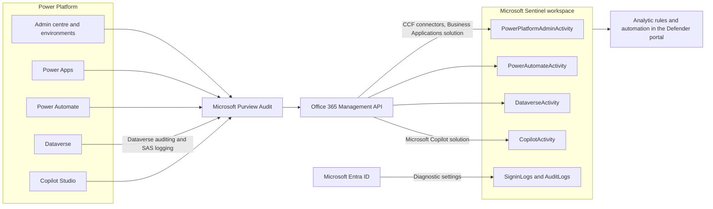

# Power Platform (Power Apps, Power Automate, Power Platform admin)

> Status: seeded, needs review. Last verified: 21 Nov 2026. Dataverse and Copilot Studio detail lives here for now and will move to their own folders (see `business-apps/dataverse-dynamics-365` and `business-apps/copilot-studio`).

## What it is

Power Platform covers Power Apps, Power Automate, Power Pages, Dataverse and Copilot Studio, all governed from the Power Platform admin centre. For security teams it matters because makers can build apps and flows that move data out of the tenant, share them widely, and connect to consumer services, often without IT involvement.

## Key recommendations

- Start with three connectors from one solution. Install the **Microsoft Business Applications** solution (3.2.5 or later) from Content Hub and connect Power Platform Admin Activity, Power Automate and Dataverse. Together they cover admin, DLP, connector, app, flow and data-access events. Add the **Microsoft Copilot** solution for agent and Copilot activity, and make sure Entra ID sign-in and audit logs are already flowing.
- Admin and flow logs are small and give the best signal. Ingest them to the Analytics tier and enable the out-of-box rules on day 1.
- DataverseActivity is the one that grows. Turn on auditing in production environments only, and only turn on Read logs where the data is sensitive.
- Don't build on PowerAppsActivity, PowerPlatformConnectorActivity, PowerPlatformDlpActivity or Dynamics365Activity. Those connectors are retired or legacy.
- Close the main gaps with custom rules for tenant isolation, environment lifecycle, flows using personal connectors, apps shared with Everyone, and unauthenticated Copilot Studio agents.
- Prevention beats detection for agents. Block the `Chat without Microsoft Entra ID authentication` connector in a data policy so no one can publish an anonymous agent.

## What changed (dates)

| Date | Change | What it means for you |
|---|---|---|
| 12 Jul 2024 | Power Apps, Power Platform Connectors and Power Platform DLP connectors removed (solution 3.1.3) | Those events now land in `PowerPlatformAdminActivity`. The old tables still exist in the schema reference but aren't fed by the current solution. |
| 15 Nov 2024 | Solution renamed to Microsoft Business Applications (3.2.0). Dynamics 365 CE and F&O merged in. PPInventory function app retired. | No Sentinel-native inventory feed now. Use Power Platform inventory or Azure Resource Graph instead. |
| Ongoing | Legacy Dynamics 365 connector (`Dynamics365Activity`) replaced by the Microsoft Dataverse connector (`DataverseActivity`) | Migrate if anything still writes to Dynamics365Activity, and don't run both. |
| 11 Apr 2025 | Business Applications solution and content moved to GA (3.2.1) | Supported for production use. |
| 2 Apr 2026 | Microsoft Copilot solution GA. Table renamed from LLMActivity to CopilotActivity in Dec 2025. | Use `CopilotActivity` in all queries. |
| 1 Jul 2026 | Defender AI agent inventory and real-time protection for Copilot Studio need a Microsoft Agent 365 licence | `AIAgentsInfo` is being replaced by `AgentsInfo` in advanced hunting. |
| 25 to 26 Oct 2026 | Rules added in Defender XDR custom detection format (3.2.4). CCF connectors restored and repackaged (3.2.5). | Install or update to 3.2.5 or later so the connectors are present. |
| 31 Mar 2027 | Sentinel in the Azure portal retires. It'll be Defender portal only. | Build and test this in the Defender portal. |

Microsoft still labels the Purview view of Power Platform admin logs as preview, which is what the Admin Activity connector reads from. The connector itself ships in the GA solution.

## High-value log sources

| Source / connector | Table | What you get | Status |
|---|---|---|---|
| Microsoft Power Platform Admin Activity (Business Apps solution, CCF, Purview audit) | PowerPlatformAdminActivity | Environment lifecycle and property changes, tenant isolation, data (DLP) policy ops, environment groups and rules, lockbox, licensing, `ApplyAdminRole`, plus Power Apps (create, launch, share, delete, quarantine), Power Pages and connector/connection events | Current, primary |
| Microsoft Power Automate (Business Apps solution) | PowerAutomateActivity | Flow create, edit, delete, permission changes, connectors used (`FlowConnectorNames`), sharing recipient and level | Current |
| Microsoft Dataverse (Business Apps solution) | DataverseActivity | CRUD, export to Excel, RetrieveMultiple, role and security changes, audit setting changes, org settings, sign-ins, TDS and Web API use. Includes model-driven apps and D365 CE. | Current |
| Microsoft Copilot (separate solution) | CopilotActivity | Copilot and AI interactions (CopilotInteraction, including Copilot Studio agents), plugin create and change, Copilot settings | Current, GA Apr 2026 |
| Microsoft Entra ID | SigninLogs, AuditLogs | Sign-ins to Power Apps (a8f7a65c-f5ba-4859-b2d6-df772c264e9d), Power Automate (6204c1d1-4712-4c46-a7d9-3ed63d992682) and the admin centre (065d9450-1e87-434e-ac2f-69af271549ed). Role changes and guest invites. | Required by several rules |
| Microsoft 365 (Office 365) connector | OfficeActivity | SharePoint events, used only by the Dataverse document management rules | Optional |
| Defender XDR connector | UrlClickEvents, EmailEvents, DeviceFileEvents, SecurityAlert | Correlation for the malicious-link, leaver email and USB rules | Optional but useful |
| Defender (Security for AI) with Agent 365 | AgentsInfo (replacing AIAgentsInfo), alerts | Copilot Studio agent inventory, risky config, real-time tool-call blocking | Needs Agent 365 licence from 1 Jul 2026 |
| Power Platform inventory / Azure Resource Graph | None in Sentinel (pull it yourself) | All agents, apps, flows and sites, with owners and connectors used | Use for enrichment watchlists |
| Legacy: Power Apps, Connectors, DLP connectors | PowerAppsActivity, PowerPlatformConnectorActivity, PowerPlatformDlpActivity | Same events, now inside PowerPlatformAdminActivity | Removed Jul 2024 |
| Legacy: Dynamics 365 connector | Dynamics365Activity | Old Dataverse/D365 feed | Migrate to Dataverse connector |

All four current connectors are codeless (CCF) connectors that poll the Office 365 Management API through Purview Audit, so nothing gets logged unless Purview auditing is on.

### What to ingest first

| Priority | Table | Why | Rough volume | Tier |
|---|---|---|---|---|
| 1 | PowerPlatformAdminActivity | Covers DLP changes, tenant isolation, new environments, connections, app sharing and deletes. Admin events are on by default, so there's no extra config. | Low. Admin events are rare, but LaunchPowerApp adds a bit in busy tenants. | Analytics |
| 1 | SigninLogs + AuditLogs | Most rules join to them for identity, risk and roles | Already flowing in most tenants | Analytics |
| 2 | PowerAutomateActivity | Flows are the main exfil path, and this table gives the connectors used and who a flow was shared with | Low (design-time events only, not run history) | Analytics |
| 3 | DataverseActivity (CRUD + Log access) | Covers role changes, audit tampering, exports and mass deletes | Medium. Scales with users and audited tables. | Analytics |
| 4 | DataverseActivity (Read logs) | Needed for bulk retrieval, TDS and Web API rules | High. Each read is an event. Only turn it on for sensitive environments. | Analytics for rule tables. Consider a DCR transform to drop noisy system users. |
| 4 | CopilotActivity | Covers agent and Copilot usage, jailbreak flags and plugin tampering | Medium to high (one record per interaction) | Analytics, or data lake if you only hunt |
| Skip | Power Automate run history, App Insights telemetry, legacy tables | Operational rather than security data, or already covered |  |  |

Every one of these tables supports the data lake tier and DCR workspace transformations. Analytic rules need the Analytics tier, so keep any table a rule reads there. Run validation query 5 after a week to see actual GB per table.

## Prerequisites and licensing

| Item | Detail |
|---|---|
| Purview Audit | Audit (Standard) or (Premium) must be on. The connectors check for it. Premium gives longer retention in Purview, but Sentinel retention is set separately. |
| Dataverse auditing | Production environments only. Audit logs use Dataverse log capacity. Log access and Read logs only show up when minimum Microsoft Office licensing is met. |
| Copilot Studio | Events are only recorded for users with an assigned Microsoft 365 licence |
| Managed Environments | Not needed for logging. Worth having for sharing limits and environment group rules, and changes to those are logged. |
| Agent 365 | Required from 1 Jul 2026 for Defender agent inventory and runtime protection for Copilot Studio |
| Sentinel | Pay-as-you-go or commitment tier ingestion. These tables aren't free data sources. |

### Roles you need

| Task | Role |
|---|---|
| Install the solution and create rules | Microsoft Sentinel Contributor on the workspace resource group |
| Create the DCR and DCE the connectors deploy | Write on Microsoft.Insights/dataCollectionRules and dataCollectionEndpoints (for example Monitoring Contributor) |
| Connect the CCF connectors | Security Administrator or Global Administrator on the tenant, as stated in each connector definition |
| Turn on Purview auditing | Audit Logs role in Purview, or Compliance Administrator |
| Dataverse audit and SAS logging settings | Power Platform Administrator, or System Administrator in each environment |
| Defender Security for AI onboarding | Security Administrator, plus a Power Platform admin for the Copilot Studio side |
| Attach playbooks to automation rules | Microsoft Sentinel Automation Contributor for the Sentinel service on the playbook resource group, and Logic App Contributor for whoever builds them |

## Step-by-step setup

1. **Confirm Purview auditing is on.** Purview portal > Audit. If it isn't on, select Activate. Allow up to 60 minutes after this for Power Platform data to appear.
2. **Install Microsoft Business Applications from Content Hub.** Use version 3.2.5 or later. Also install Microsoft Copilot if you want agent and Copilot telemetry.
3. **Connect Power Platform Admin Activity.** Data connectors > Microsoft Power Platform Admin Activity > Open connector page > Connect. Admin collection is on by default in Purview, so there's nothing to set in Power Platform.
4. **Connect Microsoft Power Automate.** Same flow. Data lands in PowerAutomateActivity.
5. **Turn on Dataverse auditing in each production environment.** Admin centre > Environments > env > Settings > Audit and logs > Audit settings. Turn on Start auditing and Log access. Turn on Read logs for sensitive environments only. Set a retention period.
6. **Turn on SAS logging to Purview.** Env > Settings > Product > Privacy + Security > Enable SAS Logging in Purview. Allow-list https://*.api.powerplatformusercontent.com first.
7. **Turn on table-level auditing.** Import the Audit Settings managed solution (the Dataverse-only or D365 CE version) for the default tables. On each custom table, turn on Auditing, then Single record and Multiple record auditing, and publish. Include the bot and botcomponent tables where agents live.
8. **Connect Microsoft Dataverse.** Data lands in DataverseActivity. If the legacy Dynamics 365 connector is on, disconnect it once Dataverse data is flowing.
9. **Connect Microsoft Copilot.** Data lands in CopilotActivity
10. **Make sure Entra ID SigninLogs and AuditLogs are connected.** Plus Defender XDR and Microsoft 365 if you want the correlation rules
11. **Create the watchlists.** TerminatedEmployees, VIPUsers and NetworkAddresses from the templates. MSBizApps-Configuration ships with the solution. Feed TerminatedEmployees from HR or Entra leaver data.
12. **Generate test activity and validate.** Create and delete a test app and flow, edit a sandbox data policy, and update a Dataverse record. Then run the validation queries below.

## Architecture diagram



## Validation KQL

```kql
// 1. Are all four tables landing, and how fresh?
union withsource=Table isfuzzy=true PowerPlatformAdminActivity, PowerAutomateActivity, DataverseActivity, CopilotActivity
| where TimeGenerated > ago(1d)
| summarize Rows = count(), Latest = max(TimeGenerated) by Table

// 2. What admin operations does YOUR tenant emit? (pin exact names before writing rules)
PowerPlatformAdminActivity
| where TimeGenerated > ago(30d)
| summarize Events = count(), LastSeen = max(TimeGenerated) by EventOriginalType
| order by Events desc

// 3. Which Dataverse environments and messages are audited?
DataverseActivity
| where TimeGenerated > ago(7d)
| summarize Events = count() by InstanceUrl, Message
| order by Events desc

// 4. Legacy check: you should not still be ingesting the old Dynamics 365 table
Dynamics365Activity
| summarize LastRow = max(TimeGenerated)

// 5. Cost: GB per table over 30 days
Usage
| where TimeGenerated > ago(30d)
| where DataType in ("PowerPlatformAdminActivity", "PowerAutomateActivity", "DataverseActivity", "CopilotActivity")
| summarize GB = round(sum(Quantity) / 1024, 2) by DataType
```

## Out-of-box analytic rules

From the Business Applications and Microsoft Copilot solutions. The five Finance and Operations rules are left out. MITRE technique IDs are shown where the rule YAML lists them, otherwise tactics only.

### Platform

| Rule | Detects | Data | MITRE | Suggested |
|---|---|---|---|---|
| Power Platform - DLP policy updated or removed | Data policy updated or deleted (ignores edits within 10 min of creation) | PowerPlatformAdminActivity | Defense Evasion (T1480) | Enable day 1 |
| Power Platform - Connector added to a sensitive environment | New connection (PutConnection) in environments you list in the KQL | PowerPlatformAdminActivity | Execution, Exfiltration (T1567, T1537) | Enable day 1, add env IDs |
| Power Platform - Possibly compromised user accesses Power Platform services | Risky Entra sign-in to Power Apps, Power Automate or the admin centre | SigninLogs | Initial Access, Lateral Movement (T1078, T1210) | Enable day 1 |
| Power Platform - Account added to privileged Microsoft Entra roles | Adds to Dynamics 365, Power Platform or Fabric Administrator | AuditLogs | Privilege Escalation (T1078, T1068, T1548) | Enable day 1 |

### Power Apps

| Rule | Detects | Data | MITRE | Suggested |
|---|---|---|---|---|
| Power Apps - App activity from unauthorized geo | Power Apps activity from countries on your blocked list | PowerPlatformAdminActivity, SigninLogs | Initial Access (T1078) | Enable, set country list |
| Power Apps - Multiple apps deleted | 25+ apps deleted, or deletes across 10+ environments, in an hour | PowerPlatformAdminActivity | Impact (T1485) | Enable day 1 |
| Power Apps - Multiple users accessing a malicious link after launching new app | New app launched by many users who then click a known-bad URL | PowerPlatformAdminActivity, UrlClickEvents, ThreatIntelIndicators | Initial Access (T1189, T1566) | Enable if Defender XDR connected |
| Power Apps - Bulk sharing of Power Apps to newly created guest users | App shared with 5+ newly invited guests from non-allowed domains | PowerPlatformAdminActivity, AuditLogs | Resource Development, Initial Access, Lateral Movement | Enable, set allowed domains |

### Power Automate

| Rule | Detects | Data | MITRE | Suggested |
|---|---|---|---|---|
| Power Automate - Departing employee flow activity | Flow created or edited by someone on the TerminatedEmployees watchlist | PowerAutomateActivity | Exfiltration, Impact (T1567, T1485) | Enable once watchlist is fed |
| Power Automate - Unusual bulk deletion of flow resources | Anomalous flow deletions (10+ and outside 14-day baseline) | PowerAutomateActivity | Impact, Defense Evasion (T1485, T1562) | Enable day 1 |

### Dataverse

| Rule | Detects | Data | MITRE | Suggested |
|---|---|---|---|---|
| Dataverse - Audit logging disabled | Global or table auditing turned off | DataverseActivity | Defense Evasion | Enable day 1 |
| Dataverse - Audit log data deletion | Audit log records deleted | DataverseActivity | Defense Evasion | Enable day 1 |
| Dataverse - Mass export of records to Excel | Export to Excel well above the user's 14-day baseline (or 10,000 rows) | DataverseActivity | Exfiltration | Enable day 1 |
| Dataverse - User bulk retrieval outside normal activity | User retrieves far more records than their 2-week norm | DataverseActivity | Exfiltration | Enable (needs Read logs) |
| Dataverse - Mass deletion of records | Record deletes above threshold, plus bulk delete jobs | DataverseActivity | Impact | Enable day 1 |
| Dataverse - Mass record updates | Record updates above threshold | DataverseActivity | Impact | Enable, tune |
| Dataverse - Suspicious security role modifications | Role created, members added, then removed or role deleted quickly | DataverseActivity | Privilege Escalation | Enable day 1 |
| Dataverse - New non-interactive identity granted access | App registration or application user granted Dataverse access | DataverseActivity, AuditLogs | Persistence, Lateral Movement, Privilege Escalation | Enable day 1 |
| Dataverse - Anomalous application user activity | Service-to-service user acting outside its normal pattern | DataverseActivity | Credential Access, Execution, Persistence | Enable |
| Dataverse - New Dataverse application user activity type | Never-seen activity type from an application user | DataverseActivity | Credential Access, Execution, Privilege Escalation | Enable |
| Dataverse - Organization settings modified | Org-level setting changes in an environment | DataverseActivity | Persistence | Enable |
| Dataverse - Removal of blocked file extensions | Extensions removed from the environment block list | DataverseActivity | Defense Evasion | Enable |
| Dataverse - Hierarchy security manipulation | Hierarchy security off, or user makes themself a manager | DataverseActivity | Privilege Escalation | Enable |
| Dataverse - Bulk record ownership re-assignment or sharing | Many ownership changes or shares in the window | DataverseActivity | Privilege Escalation | Enable, tune |
| Dataverse - Guest user exfiltration following Power Platform defense impairment | Tenant isolation off and env security group removed, then guest exfil alerts | PowerPlatformAdminActivity, DataverseActivity, SecurityAlert | Defense Evasion | Enable after the exfil rules |
| Dataverse - Suspicious use of TDS endpoint | First TDS (SQL) queries from a user or IP with recent alerts | DataverseActivity, SecurityAlert | Exfiltration, Initial Access | Enable |
| Dataverse - Suspicious use of Web API | Web API sign-ins across many environments via a well-known public app ID | DataverseActivity, SigninLogs | Execution, Exfiltration, Reconnaissance, Discovery | Enable |
| Dataverse - Unusual sign-in following disabled IP address-based cookie binding protection | New IP or user agent after cookie binding is turned off | DataverseActivity | Defense Evasion | Enable |
| Dataverse - Login by a sensitive privileged user | Sign-in by users on the VIPUsers watchlist | DataverseActivity | Initial Access, Credential Access, Privilege Escalation | Optional |
| Dataverse - Login from IP in the block list | Sign-in from blocked ranges in NetworkAddresses | DataverseActivity | Initial Access | Optional |
| Dataverse - Login from IP not in the allow list | Sign-in from outside allowed ranges | DataverseActivity | Initial Access | Optional, noisy without a good list |
| Dataverse - New sign-in from an unauthorized domain | New UPN suffix not on the allowed list | DataverseActivity | Initial Access | Enable |
| Dataverse - New user agent type that was not used before | User agent unseen in any instance for 14 days | DataverseActivity | Initial Access, Defense Evasion | Optional |
| Dataverse - New user agent type that was not used with Office 365 | User agent unseen in Office 365 for 14 days | DataverseActivity | Initial Access | Optional |
| Dataverse - Export activity from terminated or notified employee | Exports by people on the TerminatedEmployees watchlist | DataverseActivity | Exfiltration | Enable once watchlist is fed |
| Dataverse - Terminated employee exfiltration over email | Leaver emails to untrusted domains after alerts | EmailEvents, IdentityInfo, SecurityAlert | Exfiltration | Enable once watchlist is fed |
| Dataverse - Terminated employee exfiltration to USB drive | Dataverse downloads copied to USB by leavers | DataverseActivity, DeviceFileEvents, DeviceEvents | Exfiltration | Enable if MDE connected |
| Dataverse - Honeypot instance activity | Any sign-in or table access in a decoy environment | DataverseActivity | Discovery, Exfiltration | Optional, high signal |
| Dataverse - TI map IP to DataverseActivity | Activity from a threat intel IP | DataverseActivity, ThreatIntelIndicators | Initial Access, Lateral Movement, Discovery | Enable |
| Dataverse - TI map URL to DataverseActivity | Activity matching a threat intel URL | DataverseActivity, ThreatIntelIndicators | Initial Access, Execution, Persistence | Enable |
| Dataverse - SharePoint document management site added or updated | New SharePoint document management mapping | DataverseActivity | Exfiltration | Only if D365 doc mgmt used |
| Dataverse - Executable uploaded to SharePoint document management site | Executables on doc management sites | OfficeActivity (SharePoint) | Execution, Persistence | Only if D365 doc mgmt used |
| Dataverse - Malware found in SharePoint document management site | Malware on Dataverse-linked SharePoint sites | DataverseActivity, OfficeActivity | Execution | Only if D365 doc mgmt used |
| Dataverse - Mass download from SharePoint document management | Mass download from doc management sites in an hour | OfficeActivity (SharePoint) | Exfiltration | Only if D365 doc mgmt used |

### Copilot

| Rule | Detects | Data | MITRE | Suggested |
|---|---|---|---|---|
| Copilot - Jailbreak Attempt Detected | CopilotInteraction records flagged JailbreakDetected | CopilotActivity | Initial Access, Credential Access, Impact | Enable (Microsoft Copilot solution) |
| Copilot - Plugin Created by Non-Admin User | CreateCopilotPlugin by a non-admin | CopilotActivity | Persistence, Privilege Escalation (T1546, T1098) | Enable |
| Copilot - Plugin tampering | Changes to existing Copilot plugins (file: CopilotPluginTampering) | CopilotActivity | See rule YAML | Enable |
| Copilot - File uploads disabled | Copilot file upload setting turned off (file: CopilotFileUploadsDisabled) | CopilotActivity | See rule YAML | Optional |

Most of these ship with thresholds and lists you're meant to edit first, such as sensitive environment IDs, allowed domains, country codes and watchlists. As of 3.2.4 the same detections also come in Defender XDR custom detection format, so pick one version per rule to avoid duplicate alerts.

## Custom detections

These are community-written rules, not Microsoft content. They use the field names and operation names the Microsoft rules use, where those exist. Any line marked ASSUMPTION needs a quick check against your own data before you enable it. Run them hourly over a 1-hour lookback unless the comment says otherwise.

### C1. Tenant isolation off or environment security group changed (High)

```kql
// CUSTOM - Tenant isolation turned off, or an environment's security group changed
PowerPlatformAdminActivity
| where TimeGenerated > ago(1h)
| where (EventOriginalType == "TenantIsolationOperation"
         and PropertyCollection has "powerplatform.analytics.resource.tenant.isolation_policy.enabled")
     or (EventOriginalType == "EnvironmentPropertyChange"
         and PropertyCollection has "Property: SecurityGroupId")
| mv-expand PropertyCollection
| extend Name = tostring(PropertyCollection.Name), Value = tostring(PropertyCollection.Value)
| summarize Props = make_bag(bag_pack(Name, Value)) by TimeGenerated, EventOriginalUid, EventOriginalType, ActorName
| extend IsolationEnabled = tostring(Props["powerplatform.analytics.resource.tenant.isolation_policy.enabled"]),
         EnvironmentUrl = tostring(Props["powerplatform.analytics.resource.environment.url"])
| where EventOriginalType == "EnvironmentPropertyChange" or IsolationEnabled =~ "False"
| project TimeGenerated, ActorName, EventOriginalType, IsolationEnabled, EnvironmentUrl
```

The OOB guest exfil rule only fires when exfil alerts follow, but this change is worth an alert by itself. MITRE: Defense Evasion T1562.

### C2. Data policy changed by a non-approved admin (Medium, High on delete)

```kql
// CUSTOM - Any data policy create/update/delete by someone outside the approved admin list
let approved_admins = dynamic(["pp-admin1@yourdomain.gov.au"]);
PowerPlatformAdminActivity
| where TimeGenerated > ago(1h)
| where EventOriginalType == "GovernanceApiPolicyOperation"
| mv-expand PropertyCollection
| extend Name = tostring(PropertyCollection.Name), Value = tostring(PropertyCollection.Value)
| summarize Props = make_bag(bag_pack(Name, Value)) by TimeGenerated, EventOriginalUid, ActorName
| extend Operation = tostring(Props["powerplatform.analytics.resource.tenant.governance.api_policy.operation_name"]),
         PolicyName = tostring(Props["powerplatform.analytics.resource.display_name"]),
         PolicyId = tostring(Props["powerplatform.analytics.resource.id"]),
         Actor = coalesce(tostring(Props["enduser.principal_name"]), ActorName)
| where Operation in ("CreateDlpPolicy", "UpdateDlpPolicy", "DeleteDlpPolicy")
| where Actor !in~ (approved_admins)
| extend AlertSeverity = iif(Operation == "DeleteDlpPolicy", "High", "Medium")
| project TimeGenerated, Actor, Operation, PolicyName, PolicyId, AlertSeverity
```

The OOB rule ignores policy creates and doesn't know who's allowed to make changes, which this adds. Feed approved_admins from a watchlist of PIM-eligible Power Platform admins. MITRE: Defense Evasion T1562.001.

### C3. Environment created, deleted, copied, converted or moved (Low to Medium)

```kql
// CUSTOM - Environment lifecycle (created, deleted, copied, converted, moved, restored)
// ASSUMPTION: lifecycle operations carry "Environment" in EventOriginalType.
// Run validation query 2 first and replace the has filter with the exact names you see.
PowerPlatformAdminActivity
| where TimeGenerated > ago(1h)
| where EventOriginalType has "Environment"
| where EventOriginalType !in ("EnvironmentPropertyChange", "EnvironmentAddedToEnvironmentGroup",
                               "EnvironmentRemovedFromEnvironmentGroup")
| mv-expand PropertyCollection
| extend Name = tostring(PropertyCollection.Name), Value = tostring(PropertyCollection.Value)
| summarize Props = make_bag(bag_pack(Name, Value)) by TimeGenerated, EventOriginalUid, EventOriginalType, ActorName
| extend EnvironmentId = tostring(Props["powerplatform.analytics.resource.environment.id"]),
         EnvironmentUrl = tostring(Props["powerplatform.analytics.resource.environment.url"])
| project TimeGenerated, ActorName, EventOriginalType, EnvironmentId, EnvironmentUrl
```

Learn lists the friendly names (for example Provisioned environment, Copied environment, Moved environment) but not the raw EventOriginalType values, so pin those from validation query 2. A copy or move of a production environment should be High. MITRE: Persistence T1578, Exfiltration T1537.

### C4. Flow built with personal or raw HTTP connectors (Medium)

```kql
// CUSTOM - Flow created or edited with consumer, file-share or raw HTTP connectors
// ASSUMPTION: FlowConnectorNames holds connector display names. Check first:
//   PowerAutomateActivity | where isnotempty(FlowConnectorNames) | distinct FlowConnectorNames
let risky_connectors = dynamic(["Outlook.com", "Gmail", "Google Drive", "Dropbox", "HTTP", "FTP", "SFTP", "Telegram", "Slack"]);
PowerAutomateActivity
| where TimeGenerated > ago(1h)
| where EventOriginalType in ("CreateFlow", "EditFlow")
| where FlowConnectorNames has_any (risky_connectors)
| extend EnvironmentId = tostring(split(parse_url(FlowDetailsUrl).Path, "/")[2])
| project TimeGenerated, ActorName, EventOriginalType, FlowConnectorNames, FlowDetailsUrl, EnvironmentId, SrcIpAddr
```

Covers flows that forward mail to Gmail or Outlook.com, copy files to Dropbox, or POST to an attacker URL. Your DLP policy should block most of this, so an alert means DLP has a gap or this is an exempt environment. MITRE: Exfiltration T1567, T1048.

### C5. Flow shared with a guest or external account (Medium)

```kql
// CUSTOM - Flow shared with a guest or someone outside your domains
let internal_domains = dynamic(["yourdomain.gov.au"]);
PowerAutomateActivity
| where TimeGenerated > ago(1h)
| where isnotempty(RecipientUpn)
| extend RecipientDomain = tolower(tostring(split(RecipientUpn, "@")[1]))
| where RecipientUpn has "#EXT#" or RecipientDomain !in (internal_domains)
| extend Permission = case(SharingPermission == "3", "Owner", SharingPermission == "2", "Run-only", SharingPermission)
| project TimeGenerated, ActorName, EventOriginalType, RecipientUpn, Permission, FlowDetailsUrl
```

`SharingPermission` 3 is Owner and 2 is Run-only, per the Power Automate log schema. External co-owners are the riskier case. MITRE: Persistence T1098.

### C6. App shared with Everyone or 20+ principals in an hour (Medium)

```kql
// CUSTOM - Canvas app shared with Everyone or a large audience
// ASSUMPTION: sharing with Everyone records your tenant ID as targetuser.id. Test on a sandbox app first.
let tenant_id = "<your-tenant-guid>";
PowerPlatformAdminActivity
| where TimeGenerated > ago(1h)
| where EventOriginalType in ("PowerAppPermissionEdited", "AdminModifyAppPermissions")
| extend Properties = tostring(PropertyCollection)
| extend AppId = tolower(replace_string(extract(@'"powerplatform.analytics.resource.power_app.id","Value":"([^"]+)"', 1, Properties),
                                        "/providers/Microsoft.PowerApps/apps/", "")),
         TargetPrincipalId = extract(@'"targetuser.id","Value":"([^"]+)"', 1, Properties)
| summarize Grants = count(), Targets = dcount(TargetPrincipalId),
            Everyone = countif(TargetPrincipalId =~ tenant_id), SampleTargets = make_set(TargetPrincipalId, 50)
            by ActorName, AppId, bin(TimeGenerated, 1h)
| where Everyone > 0 or Targets >= 20
```

The OOB rule only looks at newly invited guests. This also catches tenant-wide sharing, which is how a phishing or data-harvesting app reaches everyone. MITRE: Lateral Movement T1534.

### C7. Admin self-elevation or System Administrator granted (High)

```kql
// CUSTOM - Privilege inside Power Platform: admin self-elevation or System Administrator granted
let sysadmin_role_ids = dynamic(["<System Administrator roleid, per environment>"]);
union
(PowerPlatformAdminActivity
 | where TimeGenerated > ago(1h)
 | where EventOriginalType == "ApplyAdminRole"
 | extend Properties = tostring(PropertyCollection)
 | extend Environment = extract(@'"powerplatform.analytics.resource.environment.id","Value":"([^"]+)"', 1, Properties)
 | project TimeGenerated, Actor = ActorName, Action = "Tenant admin applied System Administrator to self", Environment, Target = ActorName),
(DataverseActivity
 | where TimeGenerated > ago(1h)
 | where Message == "Associate" and EntityName == "systemuser"
 | mv-expand Field = Fields
 | where tostring(Field.Name) == "role" and tostring(Field.Value) in~ (sysadmin_role_ids)
 | project TimeGenerated, Actor = UserId, Action = "System Administrator role assigned", Environment = InstanceUrl, Target = tostring(EntityId))
```

`ApplyAdminRole` is the documented event for a tenant admin giving themself System Administrator in an environment. Role IDs differ per environment, so keep them in a watchlist. MITRE: Privilege Escalation T1098.

### C8. Dataverse export or bulk read by a guest (High)

```kql
// CUSTOM - Dataverse export or bulk retrieval by a guest
// ASSUMPTION: guests show #EXT# in UserId/UserUpn. If not, join IdentityInfo on UserType == "Guest".
DataverseActivity
| where TimeGenerated > ago(1h)
| where Message in ("ExportToExcel", "RetrieveMultiple")
| where UserId has "#EXT#" or UserUpn has "#EXT#"
| summarize Events = count(), Entities = make_set(EntityName, 50), FirstSeen = min(TimeGenerated)
            by UserId, ClientIp, InstanceUrl, Message
| where Message == "ExportToExcel" or Events > 500
```

The OOB exports rule baselines per user, so a brand-new guest with a moderate export can slip under it. The RetrieveMultiple branch needs Read logs on. MITRE: Exfiltration T1567, Collection T1213.

### C9. Copilot Studio agent with no authentication (High)

```kql
// CUSTOM - Copilot Studio agent created or switched to "No authentication"
// ASSUMPTIONS: auditing is on for the Dataverse 'bot' table in agent environments,
// and authenticationmode 1 = No authentication. Confirm the option values in your bot table.
DataverseActivity
| where TimeGenerated > ago(1h)
| where EntityName == "bot" and Message in ("Create", "Update")
| mv-expand Field = Fields
| where tostring(Field.Name) == "authenticationmode"
| extend AuthMode = tostring(Field.Value)
| where AuthMode == "1"
| project TimeGenerated, UserId, ClientIp, InstanceUrl, BotId = EntityId, AuthMode
```

Copilot Studio's maker audit events (BotCreate, BotUpdateOperation-BotAuthUpdate, BotUpdateOperation-BotPublish, BotUpdateOperation-BotShare) are documented in Purview, but we couldn't find a Sentinel table that's documented to receive them. Watching the Dataverse bot table is the dependable route. Better still, block the no-auth connector in a data policy and treat this rule as a backstop. MITRE: Initial Access T1190.

### C10. Risky sign-in then flow created or edited (High)

```kql
// CUSTOM - Risky sign-in followed by flow creation or edit (compromised maker building an exfil path)
let risky = SigninLogs
    | where TimeGenerated > ago(1d)
    | where RiskLevelDuringSignIn in ("medium", "high") or RiskState == "atRisk"
    | summarize RiskySignIn = max(TimeGenerated) by UserPrincipalName = tolower(UserPrincipalName);
PowerAutomateActivity
| where TimeGenerated > ago(1h)
| where EventOriginalType in ("CreateFlow", "EditFlow")
| extend UserPrincipalName = tolower(ActorName)
| join kind=inner risky on UserPrincipalName
| where TimeGenerated > RiskySignIn
| project TimeGenerated, ActorName, EventOriginalType, FlowConnectorNames, FlowDetailsUrl, RiskySignIn
```

Catches the pattern where an account is compromised and then used to build a forwarding or exfil flow. This needs Entra ID P2 for risk fields. MITRE: Initial Access T1078, Exfiltration T1567.

## Playbooks

### Included in the Business Applications solution

| Playbook | What it does | Connections / permissions |
|---|---|---|
| Security workflow: alert verification with workload owners (MSBizApps-Incident-From-Alert-Teams) | Posts the alert to the workload owner's Teams channel. If they say it wasn't authorised, it becomes an incident. | Managed identity with Sentinel Responder. Teams and Office 365 connections. |
| Dataverse: Send notification to manager | Emails the affected user's manager (Dynamics or Office 365 manager) | Managed identity (Sentinel). Office 365 Outlook and Office 365 Users connections. |
| Dataverse: Add user to block list (incident trigger) | Adds the user to an Entra group that Conditional Access blocks from Dataverse | Managed identity (Sentinel). Azure AD connection that can manage group membership. |
| Dataverse: Add user to block list using Outlook approval workflow | Same, but needs an approval by email first | As above, plus Outlook |
| Dataverse: Add user to block list using Teams approval workflow | Same, with a Teams adaptive card approval | As above, plus Teams |
| Dataverse: Add user to block list (alert trigger) | On-demand version for analysts | As above |
| Dataverse: Remove user from block list | Undoes the block | As above |
| Dataverse: Add SharePoint sites to watchlist | Keeps the doc management sites watchlist current | Managed identity with Sentinel Contributor (it writes the watchlist) |

The block-list playbooks need a Conditional Access policy you create yourself. Target the Entra group and block the Dataverse / Dynamics CRM cloud app.

### Suggested custom playbooks

| Playbook (custom) | Trigger | Actions | Connector and permissions |
|---|---|---|---|
| Turn off a risky flow | C4, C10, departing employee flow | Get Flow as Admin, then Turn Off Flow, then comment the flow details on the incident | Power Automate Management connector, signed in as a Power Platform admin service account. Sentinel Responder for the incident comment. |
| Quarantine a Power App | C6, malicious-link rule, unauthorised geo | Set App Quarantine State to quarantined, then notify the owner | Power Apps for Admins connector (admin account). Release by running it again with the state cleared. |
| Remove an external or personal connection | C4, connector added to sensitive env | Remove Connection as Admin | Power Apps for Admins connector |
| Revert a data policy change | C2, OOB DLP rule | Get DLP Policy V2, compare against a stored baseline, Update DLP Policy V2, then raise severity | Power Platform for Admins (V2 supports a Logic Apps managed identity connection). Needs Power Platform Administrator. |
| Contain a compromised maker | C10, possibly compromised user rule | Revoke sessions, add the user to the Dataverse block group, then turn off any flows they created in the last 24h | Microsoft Graph (User.RevokeSessions.All, GroupMember.ReadWrite.All) through managed identity, plus Power Automate Management |
| Enrich with inventory | Any Power Platform incident | Query the Power Platform inventory or ARG for the app, flow or agent's owner, connectors and environment, and add them as an incident comment | Managed identity with Reader on ARG scope, plus Power Platform inventory access |

Start every write action behind an approval (Teams adaptive card) until you trust the rule. Run admin-connector playbooks under a dedicated, PIM-governed service account excluded from user-facing Conditional Access, and log what the playbook changes.

## Workbooks, hunting and watchlists

| Item | Source | Use |
|---|---|---|
| Dynamics 365 Activity workbook | Business Applications (Sentinel and XDR versions) | Dataverse record retrieval stats and anomaly chart |
| Microsoft Copilot Activity Monitoring workbook | Microsoft Copilot solution | Copilot and agent interactions, plugins, settings |
| Dataverse - Activity after Microsoft Entra alerts | Hunting | Dataverse use shortly after an Identity Protection alert |
| Dataverse - Activity after failed logons | Hunting | Activity after a run of failed sign-ins (possible brute force) |
| Dataverse - Cross-environment data export activity | Hunting | Exports across many environments |
| Dataverse - Dataverse export copied to USB devices | Hunting | Export files that end up on USB (MDE) |
| Dataverse - Generic client app used to access production environments | Hunting | Use of the Dynamics 365 Example Application, which Entra controls can't restrict |
| Dataverse - Identity management activity outside of privileged directory role membership | Hunting | Identity admin in Dataverse by people without the Entra admin roles |
| Dataverse - Identity management changes without MFA | Hunting | Privileged Dataverse changes from non-MFA sessions |
| Power Apps - Anomalous bulk sharing of Power App to newly created guest users | Hunting | Broader version of the guest sharing rule |
| CopilotExternalIPAccess, CopilotPluginReEnabled | Microsoft Copilot hunting | Copilot use from unusual IPs, and plugins switched back on |
| Watchlists: TerminatedEmployees, VIPUsers, NetworkAddresses, MSBizApps-Configuration | Templates and solution | Several rules return nothing until these are populated |

Microsoft recommends querying through the parsers (MSBizAppsTerminatedEmployees, MSBizAppsVIPUsers, MSBizAppsNetworkAddresses, MSBizAppsOrgSettings, DataverseSharePointSites) rather than the watchlists directly.

## Rollout checklist

1. Confirm Purview Audit is on and who holds the Audit Logs role
2. Install Business Applications 3.2.5 or later, plus Microsoft Copilot
3. Connect Power Platform Admin Activity and Power Automate, then check data within 60 minutes
4. Turn on Dataverse auditing (Start auditing and Log access) and SAS logging in production environments. Import Audit Settings.
5. Pick sensitive environments for Read logs and bot table auditing
6. Connect Dataverse and Copilot. Retire the legacy Dynamics 365 connector.
7. Populate the TerminatedEmployees, VIPUsers and NetworkAddresses watchlists
8. Enable the day-1 OOB rules, edit their lists and thresholds, and choose Sentinel or XDR format per rule
9. Run validation query 2, pin operation names, and enable custom rules C1, C2 and C7 first, then C4 to C6 and C8 to C10
10. Deploy the alert verification and block-list playbooks, create the Conditional Access block policy, then add the custom containment playbooks behind approvals
11. Block the no-auth agent, HTTP and consumer connectors in data policies, so detections become a backstop
12. Review cost (query 5) after 7 days and move any hunt-only data to the data lake tier
13. Plan the move to the Defender portal before 31 Mar 2027

## Gotchas and deprecations

- `PowerAppsActivity`, `PowerPlatformConnectorActivity` and `PowerPlatformDlpActivity` stopped receiving data in July 2024 (solution 3.1.3). Those events now land in `PowerPlatformAdminActivity`.
- `DataverseActivity` replaces `Dynamics365Activity`. Don't run both connectors.
- Copilot Studio maker audit events (BotCreate, BotUpdateOperation-BotAuthUpdate, BotUpdateOperation-BotPublish, BotUpdateOperation-BotShare) are documented in Purview, but no Sentinel table is documented to receive them yet. Watch the Dataverse `bot` table instead and treat custom rule C9 as needing validation.
- `LLMActivity` was renamed `CopilotActivity` in December 2025.
- `AIAgentsInfo` is being replaced by `AgentsInfo` in advanced hunting, and Defender agent inventory for Copilot Studio needs a Microsoft Agent 365 licence from 1 July 2026.
- The PPInventory function app was retired in November 2024, so there's no Sentinel-native inventory feed.
- Power Automate run history isn't in these tables. `PowerAutomateActivity` is design-time events only.
- Sentinel in the Azure portal retires on 31 March 2027. Build and test in the Defender portal.

## Official links

- [Microsoft Sentinel solution for Microsoft Business Apps](https://learn.microsoft.com/en-us/azure/sentinel/business-applications/solution-overview) (Microsoft Learn)
- [Connect Power Platform and Dynamics 365 CE to Microsoft Sentinel](https://learn.microsoft.com/en-us/azure/sentinel/business-applications/deploy-power-platform-solution) (Microsoft Learn)
- [Security content reference for Power Platform and Dynamics 365 CE](https://learn.microsoft.com/en-us/azure/sentinel/business-applications/power-platform-solution-security-content) (Microsoft Learn)
- [Microsoft Business Applications solution (rules, playbooks, release notes)](https://github.com/Azure/Azure-Sentinel/tree/master/Solutions/Microsoft%20Business%20Applications) (GitHub, Azure/Azure-Sentinel)
- [Microsoft Copilot solution](https://github.com/Azure/Azure-Sentinel/tree/master/Solutions/Microsoft%20Copilot) (GitHub, Azure/Azure-Sentinel)
- [Power Platform activity logging in Microsoft Purview](https://learn.microsoft.com/en-us/power-platform/admin/activity-logging-auditing/activity-logs-overview) (Microsoft Learn)
- [Manage Dataverse auditing](https://learn.microsoft.com/en-us/power-platform/admin/manage-dataverse-auditing) (Microsoft Learn)
- [PowerPlatformAdminActivity table reference](https://learn.microsoft.com/en-us/azure/azure-monitor/reference/tables/powerplatformadminactivity) (Microsoft Learn)
- [PowerAutomateActivity table reference](https://learn.microsoft.com/en-us/azure/azure-monitor/reference/tables/powerautomateactivity) (Microsoft Learn)
- [DataverseActivity table reference](https://learn.microsoft.com/en-us/azure/azure-monitor/reference/tables/dataverseactivity) (Microsoft Learn)
- [CopilotActivity table reference](https://learn.microsoft.com/en-us/azure/azure-monitor/reference/tables/copilotactivity) (Microsoft Learn)
- [Configure data policies for Copilot Studio agents](https://learn.microsoft.com/en-us/microsoft-copilot-studio/admin-data-loss-prevention) (Microsoft Learn)
- [Audit logs for Copilot and AI applications](https://learn.microsoft.com/en-us/purview/audit-copilot) (Microsoft Learn)
- [Transition Copilot Studio agent security to Agent 365](https://learn.microsoft.com/en-us/defender-xdr/security-for-ai/transition-agent-security-to-agent-365) (Microsoft Learn)
- [Power Platform inventory](https://learn.microsoft.com/en-us/power-platform/admin/power-platform-inventory) (Microsoft Learn)
- [Power Automate Management connector](https://learn.microsoft.com/en-us/connectors/flowmanagement/) (Microsoft Learn)
- [Power Apps for Admins connector](https://learn.microsoft.com/en-us/connectors/powerappsforadmins/) (Microsoft Learn)
- [Sentinel in the Defender portal (Azure portal retirement 31 Mar 2027)](https://learn.microsoft.com/en-us/azure/sentinel/microsoft-sentinel-defender-portal) (Microsoft Learn)
- [New timeline for transitioning Sentinel to the Defender portal](https://techcommunity.microsoft.com/blog/microsoftsentinelblog/update-new-timeline-for-transitioning-sentinel-experience-to-defender-portal/4490464) (Microsoft Tech Community)

## Last verified

21 Nov 2026, against Microsoft Learn and the Azure-Sentinel repo. Re-verify before relying on table names or rule names.
