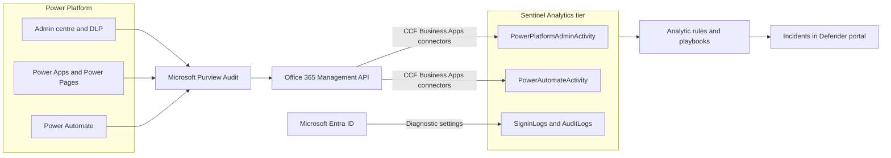

# Power Platform (Power Apps, Power Automate, Power Platform admin)

> Status: verified. Priority: P2. Last verified: 28 Nov 2026.

## What it is

Power Platform covers Power Apps, Power Automate, Power Pages, Dataverse and Copilot Studio, all governed from the Power Platform admin centre. For security teams it matters because makers can build apps and flows that move data out of the tenant, share them widely and connect to consumer services, often without IT involvement.

This guide covers the Power Platform admin plane, Power Apps, Power Automate, Power Pages, data policies and environment lifecycle. Dataverse and Dynamics 365 live in [Microsoft Dataverse and Dynamics 365](../dataverse-dynamics-365/README.md), and Copilot Studio lives in [Microsoft Copilot Studio](../copilot-studio/README.md).

## Key recommendations

- Install the **Microsoft Business Applications** solution (3.2.5 or later) from Content hub and connect **Microsoft Power Platform Admin Activity** and **Microsoft Power Automate**. Together they cover admin changes, data (DLP) policies, connectors, Power Apps, Power Pages and flow design-time events ([Microsoft Learn](https://learn.microsoft.com/en-us/azure/sentinel/business-applications/solution-overview)).
- Ingest `PowerPlatformAdminActivity` and `PowerAutomateActivity` to the Analytics tier and enable the out-of-box rules on day 1. Both tables are low volume and high signal.
- Make sure Microsoft Entra ID `SigninLogs` and `AuditLogs` are already flowing, because several platform and app rules join to them ([Microsoft Entra ID guide](../../identity/entra-id/README.md)).
- Add the Dataverse connector if you run model-driven apps or Dynamics 365 CE, and the Microsoft Copilot solution if you run Copilot Studio. See [Microsoft Dataverse and Dynamics 365](../dataverse-dynamics-365/README.md) and [Microsoft Copilot Studio](../copilot-studio/README.md) for their setup, rules and volume tradeoffs.
- Don't build on `PowerAppsActivity`, `PowerPlatformConnectorActivity` or `PowerPlatformDlpActivity`. Those connectors were removed in July 2024 and their events now land in `PowerPlatformAdminActivity`.
- Close the main gaps with custom rules for tenant isolation changes, unapproved data policy edits, environment lifecycle operations, flows using personal or raw HTTP connectors, apps shared with Everyone and admin self-elevation.
- Use Power Platform data policies to block consumer and raw HTTP connectors in production environments so your detections act as a backstop rather than the only control.

## High-value log sources

Both core Power Platform connectors are codeless (CCF) connectors in the **Microsoft Business Applications** solution that poll the Office 365 Management API through Microsoft Purview Audit. Nothing lands unless Purview auditing is enabled.

| Source | Table name | Connector | Tier | Cost / volume | Value |
|---|---|---|---|---|---|
| Power Platform admin, Power Apps, Power Pages and connectors | `PowerPlatformAdminActivity` | Microsoft Power Platform Admin Activity (Business Applications solution) | Analytics | Low. Admin events are rare; `LaunchPowerApp` adds volume in busy tenants | Environment lifecycle and property changes, tenant isolation, data (DLP) policy operations, environment groups and rules, lockbox, licensing, `ApplyAdminRole`, Power Apps create/launch/share/delete/quarantine, Power Pages and connection events ([table reference](https://learn.microsoft.com/en-us/azure/azure-monitor/reference/tables/powerplatformadminactivity)). |
| Power Automate design-time audit | `PowerAutomateActivity` | Microsoft Power Automate (Business Applications solution) | Analytics | Low. Design-time events only, not run history | Flow create, edit, delete, permission changes, connectors used (`FlowConnectorNames`), sharing recipient and permission level ([table reference](https://learn.microsoft.com/en-us/azure/azure-monitor/reference/tables/powerautomateactivity)). |
| Entra sign-in and directory audit | `SigninLogs`, `AuditLogs` | Microsoft Entra ID | Analytics | Already flowing in most tenants | Sign-ins to Power Apps, Power Automate and the admin centre, privileged role assignments and guest invitations. Required by several platform and app rules. See [Microsoft Entra ID](../../identity/entra-id/README.md). |
| Defender XDR click telemetry | `UrlClickEvents` | Microsoft Defender XDR | Already in Defender XDR | Free in Defender XDR (30 days); billable if streamed to Sentinel | Correlation for the Power Apps malicious-link rule. Optional. |
| Dataverse and Dynamics 365 audit | `DataverseActivity`, `FinanceOperationsActivity_CL` | Microsoft Business Applications solution | Analytics | Medium to high | Covered in [Microsoft Dataverse and Dynamics 365](../dataverse-dynamics-365/README.md). |
| Copilot Studio runtime and inventory | `CopilotActivity`, `AgentsInfo` | Microsoft Copilot solution / Defender XDR | Analytics or data lake / Defender XDR | Medium to high | Covered in [Microsoft Copilot Studio](../copilot-studio/README.md). |
| Power Platform inventory / Azure Resource Graph | None in Sentinel (pull it yourself) | Not a Sentinel connector | Enrichment watchlist | Free to query | Full catalogue of apps, flows, sites and agents with owners and connectors used ([Microsoft Learn](https://learn.microsoft.com/en-us/power-platform/admin/power-platform-inventory)). |
| Legacy Power Apps, Connectors and DLP | `PowerAppsActivity`, `PowerPlatformConnectorActivity`, `PowerPlatformDlpActivity` | Removed in solution 3.1.3 (July 2024) | Skip | Retired | Replaced by `PowerPlatformAdminActivity`. Old tables remain in the schema reference but receive no new data from the current solution. |

### What to ingest first

| Priority | Table | Why | Rough volume | Tier |
|---|---|---|---|---|
| 1 | `PowerPlatformAdminActivity` | Covers DLP changes, tenant isolation, new environments, connections, app sharing and deletions. Admin logging is on by default in Purview | Low | Analytics |
| 1 | `SigninLogs` + `AuditLogs` | Platform and app rules join to them for identity risk, roles and guest invites | Already flowing in most tenants | Analytics |
| 2 | `PowerAutomateActivity` | Flows are the main data exfiltration path, and this table shows connectors used and who a flow was shared with | Low | Analytics |
| 3 | `DataverseActivity` and `CopilotActivity` | Add per workload using the Dataverse and Copilot Studio guides | Medium to high | Analytics, or data lake for hunt-only data |
| Skip | Power Automate run history, Application Insights telemetry, retired legacy tables | Operational telemetry rather than security audit, or superseded | | |

Both `PowerPlatformAdminActivity` and `PowerAutomateActivity` support the Sentinel data lake tier and DCR workspace transformations. Keep tables that analytic rules read in the Analytics tier. Run validation query 5 after a week to measure actual GB per day.

## Prerequisites and licensing

| Item | Detail |
|---|---|
| Purview Audit | Microsoft Purview Audit (Standard) or (Premium) must be enabled. Both CCF connectors check for it. Premium extends retention in Purview, while Sentinel retention is configured separately ([Microsoft Learn](https://learn.microsoft.com/en-us/power-platform/admin/activity-logging-auditing/activity-logs-overview)). |
| Managed Environments | Not required for logging. Worth enabling for sharing limits and environment group rules, and changes to those settings are recorded in `PowerPlatformAdminActivity`. |
| Entra ID P2 | Optional for the core connectors, but required for populated risk fields in `SigninLogs` (needed by the compromised user rule and custom rule C8). |
| Sentinel | Pay-as-you-go or commitment tier ingestion. Neither `PowerPlatformAdminActivity` nor `PowerAutomateActivity` is a free Sentinel data source. |

### Roles you need

| Task | Role |
|---|---|
| Install the solution and create rules | Microsoft Sentinel Contributor on the workspace resource group ([Microsoft Learn](https://learn.microsoft.com/en-us/azure/sentinel/sentinel-solutions-deploy)) |
| Create the DCR and DCE deployed by CCF connectors | Write on `Microsoft.Insights/dataCollectionRules` and `Microsoft.Insights/dataCollectionEndpoints` (for example Monitoring Contributor) |
| Connect the CCF connectors | Security Administrator or Global Administrator on the tenant, as required by each connector definition ([Microsoft Learn](https://learn.microsoft.com/en-us/azure/sentinel/business-applications/deploy-power-platform-solution)) |
| Turn on Purview auditing | Audit Logs role in Purview, or Compliance Administrator |
| Manage Power Platform data policies and environments | Power Platform Administrator |
| Attach playbooks to automation rules | Microsoft Sentinel Automation Contributor for the Sentinel service on the playbook resource group, and Logic App Contributor for playbook authors |

## Step-by-step setup

1. **Confirm Purview auditing is on.** Open the Microsoft Purview portal > Audit. If auditing isn't active, select Activate. Allow up to 60 minutes for Power Platform events to start appearing ([Microsoft Learn](https://learn.microsoft.com/en-us/power-platform/admin/activity-logging-auditing/activity-logs-overview)).
2. **Install the Microsoft Business Applications solution.** In the Defender portal, go to Microsoft Sentinel > Content management > Content hub. Search for **Microsoft Business Applications**, verify version 3.2.5 or later (which packages the current CCF connectors and Defender XDR rule variants) and select Install ([Microsoft Learn](https://learn.microsoft.com/en-us/azure/sentinel/sentinel-solutions-deploy)).
3. **Connect Microsoft Power Platform Admin Activity.** Go to Setup & configuration > Data management > Data & connectors > Connectors tab, select **Microsoft Power Platform Admin Activity**, then Open connector page > Connect ([Microsoft Learn](https://learn.microsoft.com/en-us/azure/sentinel/configure-data-connector)). Admin collection is on by default in Purview, so there's no extra toggle inside Power Platform. Data lands in `PowerPlatformAdminActivity`.
4. **Connect Microsoft Power Automate.** Repeat the same flow for **Microsoft Power Automate**. Data lands in `PowerAutomateActivity`.
5. **Confirm supporting sources.** Verify that Microsoft Entra ID (`SigninLogs` and `AuditLogs`) is connected, and connect Defender XDR if you plan to enable the Power Apps malicious-link rule.
6. **Create the required watchlists.** Deploy the `TerminatedEmployees` watchlist from the Sentinel watchlist templates and populate it from HR or Entra leaver feeds. `MSBizApps-Configuration` ships with the solution.
7. **Onboard Dataverse and Copilot Studio if used.** Follow [Microsoft Dataverse and Dynamics 365](../dataverse-dynamics-365/README.md) and [Microsoft Copilot Studio](../copilot-studio/README.md) for environment auditing, SAS logging and agent monitoring.
8. **Generate test activity.** Create and delete a throwaway canvas app and cloud flow, and make a harmless edit to a sandbox data policy.
9. **Validate ingestion.** Run the validation queries below from the Defender portal under Investigation & response > Advanced hunting with your Sentinel workspace selected. Allow up to 60 minutes on initial setup.
10. **Enable day-1 rules.** Edit environment ID lists, allowed domains and blocked country codes in the out-of-box rules, pick Sentinel or Defender XDR format per rule to avoid duplicates, and enable them.

## Best-practice security configuration

Prevent risky maker connections via governance policies so Sentinel detections serve as a backstop. See [Microsoft recommended security configurations](../../docs/security-configurations.md).

- **Tenant-wide Data (DLP) policies:** Classify Microsoft 365/Dataverse connectors as **Business**, block consumer/raw exfiltration connectors (`Gmail`, `Dropbox`, `Outlook.com`, `HTTP`, `FTP/SFTP`) in the **Blocked** group, and lock down the Default environment tightly ([Data policies](https://learn.microsoft.com/en-us/power-platform/admin/wp-data-loss-prevention)).
- **Tenant Isolation & Managed Environments:** Enable **Tenant Isolation** (block cross-tenant Entra connector traffic except explicit allow-listed partner tenants), enable **Managed Environments** to cap canvas app sharing, and restrict who can create new production environments ([Power Platform security overview](https://learn.microsoft.com/en-us/power-platform/admin/security/security-overview)).
- **Environment routing & security groups:** Route new makers to personal developer environments and bind every production environment to a dedicated Entra security group.

## Architecture diagram



## Validation KQL

For group-wide and workspace-wide freshness checks, see [business-apps.kql](../../queries/validation/business-apps.kql) and the [validation query pack](../../queries/validation/README.md).

```kql
// 1. Are both core Power Platform tables landing, and how fresh?
union withsource=Table isfuzzy=true PowerPlatformAdminActivity, PowerAutomateActivity
| where TimeGenerated > ago(1d)
| summarize Rows = count(), Latest = max(TimeGenerated), AgeMinutes = (now() - max(TimeGenerated)) / 1m by Table

// 2. What admin and app operations does YOUR tenant emit? Pin exact names before writing custom rules.
PowerPlatformAdminActivity
| where TimeGenerated > ago(30d)
| summarize Events = count(), LastSeen = max(TimeGenerated) by EventOriginalType
| order by Events desc

// 3. What connectors are makers using in Power Automate?
PowerAutomateActivity
| where TimeGenerated > ago(30d)
| where isnotempty(FlowConnectorNames)
| summarize Events = count(), Makers = dcount(ActorName) by FlowConnectorNames
| order by Events desc

// 4. Legacy check: confirm retired tables are no longer receiving data
union withsource=Table isfuzzy=true PowerAppsActivity, PowerPlatformConnectorActivity, PowerPlatformDlpActivity
| summarize LastRow = max(TimeGenerated) by Table

// 5. Cost: GB per table over 30 days
Usage
| where TimeGenerated > ago(30d)
| where DataType in ("PowerPlatformAdminActivity", "PowerAutomateActivity")
| summarize GB = round(sum(Quantity) / 1024, 2) by DataType, Day = bin(TimeGenerated, 1d)
| summarize GBperDay = round(avg(GB), 2), TotalGB30d = round(sum(GB), 2) by DataType
| order by GBperDay desc
```

## Out-of-box analytic rules

From the **Microsoft Business Applications** solution ([security content reference](https://learn.microsoft.com/en-us/azure/sentinel/business-applications/power-platform-solution-security-content), [solution folder](https://github.com/Azure/Azure-Sentinel/tree/master/Solutions/Microsoft%20Business%20Applications)). MITRE technique IDs are shown where the rule YAML lists them, otherwise tactics only.

Dataverse and Dynamics 365 rules are listed in [Microsoft Dataverse and Dynamics 365](../dataverse-dynamics-365/README.md). Copilot rules are listed in [Microsoft Copilot Studio](../copilot-studio/README.md).

### Platform

| Rule | Detects | Tables | MITRE | Suggested |
|---|---|---|---|---|
| Power Platform - DLP policy updated or removed | Data policy updated or deleted (ignores edits within 10 minutes of creation) | `PowerPlatformAdminActivity` | Defense Evasion (T1480) | Enable day 1 |
| Power Platform - Connector added to a sensitive environment | New connection (`PutConnection`) in environments you list in the KQL | `PowerPlatformAdminActivity` | Execution, Exfiltration (T1567, T1537) | Enable day 1, add env IDs |
| Power Platform - Possibly compromised user accesses Power Platform services | Risky Entra sign-in to Power Apps (`a8f7a65c-f5ba-4859-b2d6-df772c264e9d`), Power Automate (`6204c1d1-4712-4c46-a7d9-3ed63d992682`) or the admin centre (`065d9450-1e87-434e-ac2f-69af271549ed`) | `SigninLogs` | Initial Access, Lateral Movement (T1078, T1210) | Enable day 1 (needs Entra ID P2 for risk) |
| Power Platform - Account added to privileged Microsoft Entra roles | Adds to Dynamics 365, Power Platform or Fabric Administrator | `AuditLogs` | Privilege Escalation (T1078, T1068, T1548) | Enable day 1 |

### Power Apps

| Rule | Detects | Tables | MITRE | Suggested |
|---|---|---|---|---|
| Power Apps - App activity from unauthorized geo | Power Apps activity from countries on your blocked list | `PowerPlatformAdminActivity`, `SigninLogs` | Initial Access (T1078) | Enable, set country list |
| Power Apps - Multiple apps deleted | 25 or more apps deleted, or deletions across 10 or more environments, in an hour | `PowerPlatformAdminActivity` | Impact (T1485) | Enable day 1 |
| Power Apps - Multiple users accessing a malicious link after launching new app | New app launched by many users who then click a known-bad URL | `PowerPlatformAdminActivity`, `UrlClickEvents`, `ThreatIntelIndicators` | Initial Access (T1189, T1566) | Enable if Defender XDR connected |
| Power Apps - Bulk sharing of Power Apps to newly created guest users | App shared with 5 or more newly invited guests from non-allowed domains | `PowerPlatformAdminActivity`, `AuditLogs` | Resource Development, Initial Access, Lateral Movement | Enable, set allowed domains |

### Power Automate

| Rule | Detects | Tables | MITRE | Suggested |
|---|---|---|---|---|
| Power Automate - Departing employee flow activity | Flow created or edited by someone on the `TerminatedEmployees` watchlist | `PowerAutomateActivity` | Exfiltration, Impact (T1567, T1485) | Enable once watchlist is fed |
| Power Automate - Unusual bulk deletion of flow resources | Anomalous flow deletions (10 or more and outside 14-day baseline) | `PowerAutomateActivity` | Impact, Defense Evasion (T1485, T1562) | Enable day 1 |

Most rules ship with thresholds and lists you must customise first, such as sensitive environment IDs, allowed domains, country codes and watchlists. From solution 3.2.4, detections also ship in Defender XDR custom detection format; pick one format per rule to avoid duplicate alerts.

## Custom detections

These are community-written rules, not Microsoft content. They follow the field and operation names used by Microsoft's own rules where documented. Any line marked `ASSUMPTION` needs validation against a sample row from your tenant before enabling. Run them hourly with a 1-hour lookback unless noted.

### C1. Tenant isolation off or environment security group changed (High)

```kql
// CUSTOM - Tenant isolation turned off, or an environment's security group changed
PowerPlatformAdminActivity
| where TimeGenerated > ago(1h)
| where (EventOriginalType == "TenantIsolationOperation"
         and PropertyCollection has "powerplatform.analytics.resource.tenant.isolation_policy.enabled")
     or (EventOriginalType == "EnvironmentPropertyChange"
         and PropertyCollection has "Property: SecurityGroupId")
| mv-expand PropertyCollection
| extend Name = tostring(PropertyCollection.Name), Value = tostring(PropertyCollection.Value)
| summarize Props = make_bag(bag_pack(Name, Value)) by TimeGenerated, EventOriginalUid, EventOriginalType, ActorName
| extend IsolationEnabled = tostring(Props["powerplatform.analytics.resource.tenant.isolation_policy.enabled"]),
         EnvironmentUrl = tostring(Props["powerplatform.analytics.resource.environment.url"])
| where EventOriginalType == "EnvironmentPropertyChange" or IsolationEnabled =~ "False"
| project TimeGenerated, ActorName, EventOriginalType, IsolationEnabled, EnvironmentUrl
```

The out-of-box Dataverse guest exfiltration rule only fires when exfiltration alerts follow. Disabling tenant isolation or removing an environment security group warrants an immediate alert on its own. MITRE: Defense Evasion T1562.

### C2. Data policy changed by a non-approved admin (Medium, High on delete)

```kql
// CUSTOM - Any data policy create/update/delete by someone outside the approved admin list
// ASSUMPTION: replace approved_admins with your PIM-eligible Power Platform admins or a watchlist.
let approved_admins = dynamic(["pp-admin1@yourdomain.gov.au"]);
PowerPlatformAdminActivity
| where TimeGenerated > ago(1h)
| where EventOriginalType == "GovernanceApiPolicyOperation"
| mv-expand PropertyCollection
| extend Name = tostring(PropertyCollection.Name), Value = tostring(PropertyCollection.Value)
| summarize Props = make_bag(bag_pack(Name, Value)) by TimeGenerated, EventOriginalUid, ActorName
| extend Operation = tostring(Props["powerplatform.analytics.resource.tenant.governance.api_policy.operation_name"]),
         PolicyName = tostring(Props["powerplatform.analytics.resource.display_name"]),
         PolicyId = tostring(Props["powerplatform.analytics.resource.id"]),
         Actor = coalesce(tostring(Props["enduser.principal_name"]), ActorName)
| where Operation in ("CreateDlpPolicy", "UpdateDlpPolicy", "DeleteDlpPolicy")
| where Actor !in~ (approved_admins)
| extend AlertSeverity = iif(Operation == "DeleteDlpPolicy", "High", "Medium")
| project TimeGenerated, Actor, Operation, PolicyName, PolicyId, AlertSeverity
```

The out-of-box DLP rule ignores policy creations and doesn't check whether the actor is an approved admin. Feed `approved_admins` from a watchlist of PIM-eligible Power Platform Administrators. MITRE: Defense Evasion T1562.001.

### C3. Environment created, deleted, copied, converted or moved (Low to Medium)

```kql
// CUSTOM - Environment lifecycle (created, deleted, copied, converted, moved, restored)
// ASSUMPTION: lifecycle operations carry "Environment" in EventOriginalType.
// Run validation query 2 first and replace the has filter with the exact names your tenant emits.
PowerPlatformAdminActivity
| where TimeGenerated > ago(1h)
| where EventOriginalType has "Environment"
| where EventOriginalType !in ("EnvironmentPropertyChange", "EnvironmentAddedToEnvironmentGroup",
                               "EnvironmentRemovedFromEnvironmentGroup")
| mv-expand PropertyCollection
| extend Name = tostring(PropertyCollection.Name), Value = tostring(PropertyCollection.Value)
| summarize Props = make_bag(bag_pack(Name, Value)) by TimeGenerated, EventOriginalUid, EventOriginalType, ActorName
| extend EnvironmentId = tostring(Props["powerplatform.analytics.resource.environment.id"]),
         EnvironmentUrl = tostring(Props["powerplatform.analytics.resource.environment.url"])
| project TimeGenerated, ActorName, EventOriginalType, EnvironmentId, EnvironmentUrl
```

Microsoft Learn lists friendly names (for example Provisioned environment, Copied environment, Moved environment) rather than raw `EventOriginalType` values, so pin the exact strings from validation query 2. Treat a copy or move of a production environment as High severity. MITRE: Persistence T1578, Exfiltration T1537.

### C4. Flow built with personal or raw HTTP connectors (Medium)

```kql
// CUSTOM - Flow created or edited with consumer, file-share or raw HTTP connectors
// ASSUMPTION: FlowConnectorNames holds connector display names. Confirm with validation query 3 first.
let risky_connectors = dynamic(["Outlook.com", "Gmail", "Google Drive", "Dropbox", "HTTP", "FTP", "SFTP", "Telegram", "Slack"]);
PowerAutomateActivity
| where TimeGenerated > ago(1h)
| where EventOriginalType in ("CreateFlow", "EditFlow")
| where FlowConnectorNames has_any (risky_connectors)
| extend EnvironmentId = tostring(split(parse_url(FlowDetailsUrl).Path, "/")[2])
| project TimeGenerated, ActorName, EventOriginalType, FlowConnectorNames, FlowDetailsUrl, EnvironmentId, SrcIpAddr
```

Catches flows that forward mail to Gmail or Outlook.com, copy files to Dropbox or POST data to an attacker endpoint. Your data policy should block most of these, so an alert indicates either a policy gap or an exempt environment. MITRE: Exfiltration T1567, T1048.

### C5. Flow shared with a guest or external account (Medium)

```kql
// CUSTOM - Flow shared with a guest or someone outside your internal domains
// ASSUMPTION: replace internal_domains with your tenant's verified domains.
let internal_domains = dynamic(["yourdomain.gov.au"]);
PowerAutomateActivity
| where TimeGenerated > ago(1h)
| where isnotempty(RecipientUpn)
| extend RecipientDomain = tolower(tostring(split(RecipientUpn, "@")[1]))
| where RecipientUpn has "#EXT#" or RecipientDomain !in (internal_domains)
| extend Permission = case(SharingPermission == "3", "Owner", SharingPermission == "2", "Run-only", SharingPermission)
| project TimeGenerated, ActorName, EventOriginalType, RecipientUpn, Permission, FlowDetailsUrl
```

`SharingPermission` `3` is Owner and `2` is Run-only per the Power Automate log schema. External co-owners are the higher-risk case. MITRE: Persistence T1098.

### C6. App shared with Everyone or 20+ principals in an hour (Medium)

```kql
// CUSTOM - Canvas app shared with Everyone or a large audience
// ASSUMPTION: sharing with Everyone records your tenant ID as targetuser.id. Test on a sandbox app first.
let tenant_id = "<your-tenant-guid>";
PowerPlatformAdminActivity
| where TimeGenerated > ago(1h)
| where EventOriginalType in ("PowerAppPermissionEdited", "AdminModifyAppPermissions")
| extend Properties = tostring(PropertyCollection)
| extend AppId = tolower(replace_string(extract(@'"powerplatform.analytics.resource.power_app.id","Value":"([^"]+)"', 1, Properties),
                                        "/providers/Microsoft.PowerApps/apps/", "")),
         TargetPrincipalId = extract(@'"targetuser.id","Value":"([^"]+)"', 1, Properties)
| summarize Grants = count(), Targets = dcount(TargetPrincipalId),
            Everyone = countif(TargetPrincipalId =~ tenant_id), SampleTargets = make_set(TargetPrincipalId, 50)
            by ActorName, AppId, bin(TimeGenerated, 1h)
| where Everyone > 0 or Targets >= 20
```

The out-of-box rule only watches newly invited guests. This rule also catches tenant-wide sharing, which is how a phishing or credential-harvesting canvas app reaches the whole organisation. MITRE: Lateral Movement T1534.

### C7. Tenant admin self-elevation in an environment (High)

```kql
// CUSTOM - Power Platform or Dynamics 365 tenant admin assigns themself System Administrator in an environment
PowerPlatformAdminActivity
| where TimeGenerated > ago(1h)
| where EventOriginalType == "ApplyAdminRole"
| extend Properties = tostring(PropertyCollection)
| extend EnvironmentId = extract(@'"powerplatform.analytics.resource.environment.id","Value":"([^"]+)"', 1, Properties)
| project TimeGenerated, Actor = ActorName, Action = "Tenant admin applied System Administrator to self", EnvironmentId
```

`ApplyAdminRole` is the documented event when a tenant admin grants themself System Administrator inside an environment. Pair this with the Dataverse `System Administrator` role assignment rule in [Microsoft Dataverse and Dynamics 365](../dataverse-dynamics-365/README.md). MITRE: Privilege Escalation T1098.

### C8. Risky sign-in then flow created or edited (High)

```kql
// CUSTOM - Risky sign-in followed by flow creation or edit (compromised maker building an exfil path)
// ASSUMPTION: requires Microsoft Entra ID P2 for populated RiskLevelDuringSignIn and RiskState fields.
let risky = SigninLogs
    | where TimeGenerated > ago(1d)
    | where RiskLevelDuringSignIn in ("medium", "high") or RiskState == "atRisk"
    | summarize RiskySignIn = max(TimeGenerated) by UserPrincipalName = tolower(UserPrincipalName);
PowerAutomateActivity
| where TimeGenerated > ago(1h)
| where EventOriginalType in ("CreateFlow", "EditFlow")
| extend UserPrincipalName = tolower(ActorName)
| join kind=inner risky on UserPrincipalName
| where TimeGenerated > RiskySignIn
| project TimeGenerated, ActorName, EventOriginalType, FlowConnectorNames, FlowDetailsUrl, RiskySignIn
```

Catches a compromised account being used to build a mail-forwarding or data-exfiltration flow. MITRE: Initial Access T1078, Exfiltration T1567.

## Playbooks

### Included in the Business Applications solution

| Playbook | What it does | Connections / permissions |
|---|---|---|
| Security workflow: alert verification with workload owners (`MSBizApps-Incident-From-Alert-Teams`) | Posts the alert to the workload owner's Teams channel. If they confirm it wasn't authorised, it creates an incident | Managed identity with Microsoft Sentinel Responder. Teams and Office 365 connections |

Dataverse-specific playbooks (manager notification, Dataverse block-list automation and SharePoint site watchlist sync) are covered in [Microsoft Dataverse and Dynamics 365](../dataverse-dynamics-365/README.md).

### Suggested custom playbooks

| Playbook (custom) | Trigger | Actions | Connector and permissions |
|---|---|---|---|
| Turn off a risky flow | C4, C8, departing employee flow | Get Flow as Admin, Turn Off Flow, comment flow details on the incident | [Power Automate Management connector](https://learn.microsoft.com/en-us/connectors/flowmanagement/) under a Power Platform admin service account; Sentinel Responder for the incident comment |
| Quarantine a Power App | C6, malicious-link rule, unauthorised geo | Set App Quarantine State to quarantined, then notify the owner | [Power Apps for Admins connector](https://learn.microsoft.com/en-us/connectors/powerappsforadmins/) (admin account). Release by running again with the state cleared |
| Remove an external or personal connection | C4, connector added to sensitive environment | Remove Connection as Admin | Power Apps for Admins connector |
| Revert a data policy change | C2, OOB DLP rule | Get DLP Policy V2, compare against a stored baseline, Update DLP Policy V2, raise severity | Power Platform for Admins (V2 supports a Logic Apps managed identity connection); Power Platform Administrator |
| Contain a compromised maker | C8, possibly compromised user rule | Revoke sessions, disable flows created in the last 24 hours, add to block group if using Dataverse | Microsoft Graph (`User.RevokeSessions.All`, `GroupMember.ReadWrite.All`) via managed identity, plus Power Automate Management |
| Enrich with inventory | Any Power Platform incident | Query Power Platform inventory or Azure Resource Graph for the app or flow's owner, connectors and environment, then add as an incident comment | Managed identity with Reader on ARG scope, plus Power Platform inventory access |

Put every write action behind a Teams adaptive card approval until you trust the rule. Run admin-connector playbooks under a dedicated, PIM-governed service account excluded from user-facing Conditional Access, and log every change the playbook makes.

## Workbooks and hunting

| Item | Source | Use |
|---|---|---|
| Power Apps - Anomalous bulk sharing of Power App to newly created guest users | Business Applications hunting | Broader hunting view of the guest sharing detection |
| Watchlists: `TerminatedEmployees`, `MSBizApps-Configuration` | Templates and Business Applications solution | Required by the departing employee flow rule and solution configuration |
| Power Platform inventory / Azure Resource Graph | Power Platform admin centre ([Microsoft Learn](https://learn.microsoft.com/en-us/power-platform/admin/power-platform-inventory)) | Export periodic inventory watchlists to enrich incidents with app/flow owners and connectors |

Microsoft recommends querying through the solution parsers (such as `MSBizAppsTerminatedEmployees`) rather than referencing watchlist tables directly. For Dataverse workbooks and hunting queries, see [Microsoft Dataverse and Dynamics 365](../dataverse-dynamics-365/README.md). For Copilot monitoring workbooks and hunting, see [Microsoft Copilot Studio](../copilot-studio/README.md).

## Gotchas and deprecations

- **Retired tables (July 2024).** `PowerAppsActivity`, `PowerPlatformConnectorActivity` and `PowerPlatformDlpActivity` connectors were removed in solution 3.1.3 (12 July 2024). Those events now land in `PowerPlatformAdminActivity`. Old table schemas remain on Microsoft Learn but aren't populated by the current solution.
- **Solution rename and CCF repackaging.** The solution was renamed **Microsoft Business Applications** in version 3.2.0 (15 November 2024), moved to GA in 3.2.1 (11 April 2025), added Defender XDR custom detection variants in 3.2.4 and repackaged the CCF connectors in 3.2.5 (October 2026). Install or update to 3.2.5 or later.
- **No Sentinel-native inventory feed.** The `PPInventory` function app was retired in November 2024. Use [Power Platform inventory](https://learn.microsoft.com/en-us/power-platform/admin/power-platform-inventory) or Azure Resource Graph to feed watchlists instead.
- **Purview preview label.** Microsoft still labels the Purview view of Power Platform admin logs as preview, which is what the Admin Activity connector reads from. The Sentinel connector itself ships in the GA solution.
- **Design-time flow logs only.** `PowerAutomateActivity` captures create, edit, delete and share events, not individual flow run histories or action payloads.
- **Initial latency.** Allow up to 60 minutes after enabling Purview auditing and connecting Power Platform Admin Activity before expecting events in Sentinel.
- **Sentinel in the Azure portal retires on 31 March 2027.** Build and test connectors, rules and playbooks in the Defender portal ([Microsoft Learn](https://learn.microsoft.com/en-us/azure/sentinel/microsoft-sentinel-defender-portal)).

## Official links

- [Microsoft Sentinel solution for Microsoft Business Apps](https://learn.microsoft.com/en-us/azure/sentinel/business-applications/solution-overview)
- [Connect Power Platform and Dynamics 365 CE to Microsoft Sentinel](https://learn.microsoft.com/en-us/azure/sentinel/business-applications/deploy-power-platform-solution)
- [Security content reference for Power Platform and Dynamics 365 CE](https://learn.microsoft.com/en-us/azure/sentinel/business-applications/power-platform-solution-security-content)
- [Microsoft Business Applications solution, Azure-Sentinel repo](https://github.com/Azure/Azure-Sentinel/tree/master/Solutions/Microsoft%20Business%20Applications)
- [Power Platform activity logging in Microsoft Purview](https://learn.microsoft.com/en-us/power-platform/admin/activity-logging-auditing/activity-logs-overview)
- [PowerPlatformAdminActivity table reference](https://learn.microsoft.com/en-us/azure/azure-monitor/reference/tables/powerplatformadminactivity)
- [PowerAutomateActivity table reference](https://learn.microsoft.com/en-us/azure/azure-monitor/reference/tables/powerautomateactivity)
- [Power Platform inventory](https://learn.microsoft.com/en-us/power-platform/admin/power-platform-inventory)
- [Power Automate Management connector](https://learn.microsoft.com/en-us/connectors/flowmanagement/)
- [Power Apps for Admins connector](https://learn.microsoft.com/en-us/connectors/powerappsforadmins/)
- [Enable a data connector, Defender portal navigation](https://learn.microsoft.com/en-us/azure/sentinel/configure-data-connector)
- [Discover and deploy content from Content hub](https://learn.microsoft.com/en-us/azure/sentinel/sentinel-solutions-deploy)
- [Microsoft Sentinel in the Defender portal](https://learn.microsoft.com/en-us/azure/sentinel/microsoft-sentinel-defender-portal)
- [New timeline for transitioning Sentinel to the Defender portal](https://techcommunity.microsoft.com/blog/microsoftsentinelblog/update-new-timeline-for-transitioning-sentinel-experience-to-defender-portal/4490464)

## Last verified

28 Nov 2026, against Microsoft Learn and the Azure-Sentinel repo. Re-verify before relying on table names, navigation or rule names.
