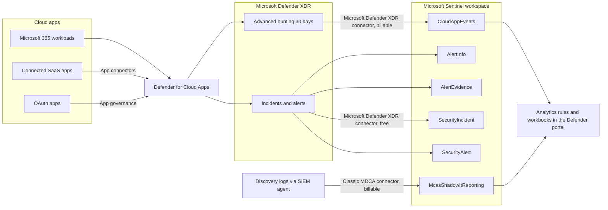

# Microsoft Defender for Cloud Apps

> Status: verified. Priority: P2. Last verified: 21 Nov 2026.

## What it is

Microsoft Defender for Cloud Apps is Microsoft's CASB and SaaS security product, formerly Microsoft Cloud App Security (MCAS). It normalises user activity from Microsoft 365 and connected SaaS apps, discovers shadow IT from network and endpoint logs, assesses SaaS posture, and governs OAuth apps. Its anomaly detections, UEBA and app governance alerts run automatically once it is deployed ([Overview of Defender for Cloud Apps](https://learn.microsoft.com/en-us/defender-cloud-apps/what-is-defender-for-cloud-apps)).

For logging, the product is a Defender XDR workload, not a Sentinel-native connector. Activity lands in advanced hunting in `CloudAppEvents` at no extra cost, and alerts arrive as Defender XDR alerts. Sentinel gets both through the Microsoft Defender XDR connector ([Stream data from Microsoft Defender XDR to Microsoft Sentinel](https://learn.microsoft.com/en-us/azure/sentinel/connect-microsoft-365-defender)). A separate, older Microsoft Defender for Cloud Apps connector still exists for alerts and shadow IT discovery logs, and its state matters, so it is covered below.

## Key recommendations

- Deploy MDCA in the Defender portal first: connect Microsoft 365 with the **Microsoft 365 activities** checkbox ticked, then connect your other SaaS apps. `CloudAppEvents` is empty until you do.
- Use the **Microsoft Defender XDR** connector as the primary pipe into Sentinel. Incidents and alerts are free to ingest, and raw `CloudAppEvents` streaming is optional and billed.
- Stream `CloudAppEvents` into Sentinel only if you have detections or hunting that need more than the 30 days in advanced hunting. Otherwise query it in advanced hunting and skip the ingestion cost.
- Do not run the classic MDCA connector and the XDR connector for the same alerts. Pick one route per data type or you will double-count.
- The classic MDCA SIEM agents are deprecated from November 2025. Plan your migration now if you still use one.
- Enable the MDCA built-in anomaly detections on day 1. They are on by default, learn for seven days, and cover impossible travel, risky IPs, ransomware patterns and unusual download and deletion activity. That coverage means most of your custom rules should target what MDCA cannot see: external users, non-Microsoft apps and hard thresholds.

## High-value log sources

| Source | Table name | Connector | Tier | Cost / volume | Value |
|---|---|---|---|---|---|
| SaaS and Microsoft 365 activity | `CloudAppEvents` | Microsoft Defender XDR | Analytics if rules read it, otherwise skip and use advanced hunting | Medium to high, scales with SaaS users and connected apps. Free for 30 days in Defender XDR advanced hunting before any streaming | Enriched, normalised activity from Office 365, Exchange, SharePoint, Teams, Dynamics 365, Power BI and API-connected apps such as Salesforce, Dropbox, GitHub and Atlassian, plus access and session control events. Includes MDCA anomaly enrichment columns `UncommonForUser` and `LastSeenForUser` |
| Alerts | `AlertInfo`, `AlertEvidence` | Microsoft Defender XDR | Analytics | Low. Alerts are free to ingest | MDCA alerts with severity, MITRE techniques and service source, plus the entities behind them. Part of the incident sync |
| Incidents | `SecurityIncident`, `SecurityAlert` | Microsoft Defender XDR | Analytics | Low. Free to ingest | Correlated XDR incidents that include MDCA alerts alongside email, endpoint and identity alerts |
| Shadow IT discovery | `McasShadowItReporting` | Microsoft Defender for Cloud Apps (classic connector) | Analytics | Low to medium. Discovery summaries only, not raw events. Paid ingestion, and this connector supports no DCR and no lake-only ingestion | Per app, user and IP: event counts, uploaded and downloaded bytes, app risk score and tags. Feeds shadow IT reporting |
| MDCA logon events | `IdentityLogonEvents` | Microsoft Defender XDR | Analytics | Low | Authentication activities against Microsoft online services as captured by MDCA, alongside Defender for Identity on-prem logons |

Alerts ingested via the classic MDCA connector land in `SecurityAlert` and are free ([free data sources](https://learn.microsoft.com/en-us/azure/sentinel/billing)). The raw event tables, `CloudAppEvents` via the XDR connector and `McasShadowItReporting` via the MDCA connector, are billed. The Sentinel billing doc shows the exact split on the connector page: security alerts selected as free, MCAS Shadow IT Reporting as paid.

### OfficeActivity or CloudAppEvents

Both tables carry Microsoft 365 workload audit activity, so pick per workload rather than ingesting both blindly:

- Use `OfficeActivity` from the **Microsoft 365** connector for Exchange, SharePoint and Teams detections. It is free to ingest and covers the unified audit log for those workloads.
- Use `CloudAppEvents` when you need what MDCA adds: API-connected non-Microsoft apps, access and session control events through the `AuditSource` and `SessionData` columns, and the per-user anomaly enrichment columns.
- Do not build the same detection on both tables. Choose one home per detection, and keep the other table for coverage that genuinely needs it.

`CloudAppEvents` gets its Microsoft 365 rows from the same audit source, but only after you enable **Microsoft 365 activities** in the MDCA app connector ([CloudAppEvents table prerequisites](https://learn.microsoft.com/en-us/defender-xdr/advanced-hunting-cloudappevents-table)).

## Prerequisites and licensing

Licences:

- MDCA is a per-user licensed product. It is included with Microsoft 365 E5 and A5, and with Enterprise Mobility + Security E5 and A5 ([Microsoft Defender XDR prerequisites](https://learn.microsoft.com/en-us/defender-xdr/prerequisites)).
- A trial is available through a Microsoft 365 E5 trial ([Get started with Defender for Cloud Apps](https://learn.microsoft.com/en-us/defender-cloud-apps/get-started)).
- The standalone MDCA SKU no longer appears on Microsoft's buying pages. The SaaS security capabilities are now sold as part of the **Microsoft Defender Suite**, at USD 12 per user per month, requiring Microsoft 365 E3 or Office 365 E3 plus EMS E3 ([Microsoft SaaS security buying page](https://www.microsoft.com/en-us/security/business/cloud-apps-defender)). I could not find a public Microsoft statement giving a formal retirement date for the standalone SKU. If you hold standalone MDCA licences today, check the Microsoft 365 message centre posts for your tenant, which is where SKU retirement dates are announced. Treat this point as needing verification against your own licensing position.

Settings that must be on before anything logs:

- Purview unified audit logging enabled for the tenant, which is on by default for most tenants ([enable audit logging](https://learn.microsoft.com/en-us/purview/audit-log-enable-disable)).
- In the Defender portal, **Settings > Cloud apps > App connectors > + Connect an app > Microsoft 365**, with the **Microsoft 365 activities** checkbox selected ([deploy supported services](https://learn.microsoft.com/en-us/defender-xdr/advanced-hunting-cloudappevents-table)).
- App connectors for each non-Microsoft SaaS app you want in `CloudAppEvents` ([connect apps](https://learn.microsoft.com/en-us/defender-cloud-apps/enable-instant-visibility-protection-and-governance-actions-for-your-apps)).
- App governance turned on for OAuth app coverage ([turn on app governance](https://learn.microsoft.com/en-us/defender-cloud-apps/app-governance-get-started)).
- Do not disable the first-party Entra ID applications MDCA depends on, including Microsoft Defender for Cloud Apps - APIs (ID 972bb84a-1d27-4bd3-8306-6b8e57679e8c). The full list of five app IDs is in the get-started doc.

Roles:

| Task | Role |
|---|---|
| Configure MDCA, connectors and policies | Security Administrator in Entra ID or Microsoft 365 |
| Integrate with Sentinel, XDR connector | Security Administrator on the tenant, plus read and write on the Sentinel workspace |
| Install and manage the Content Hub solution | Microsoft Sentinel Contributor |
| Advanced hunting queries | Security Reader or higher, or Defender unified RBAC raw data permissions |

MDCA permissions integrate with Microsoft Defender unified RBAC, available worldwide since December 2025 and enabled by default for new MDCA customers from August 2026 ([Defender for Cloud Apps release notes](https://learn.microsoft.com/en-us/defender-cloud-apps/release-notes)).

## Step-by-step setup

1. Confirm licences and the Security Administrator role.
2. In the [Microsoft Defender portal](https://security.microsoft.com), go to **Settings > Cloud apps > App connectors**, select **+ Connect an app > Microsoft 365**, and in the components page tick **Microsoft 365 activities**. This is the switch that populates `CloudAppEvents`.
3. Connect each SaaS app you care about from the same **+ Connect an app** menu. For GitHub, Microsoft now recommends connecting at the Enterprise level with a new connector instance ([protect GitHub](https://learn.microsoft.com/en-us/defender-cloud-apps/protect-github)).
4. Turn on app governance: **Settings > Cloud apps > App governance**.
5. Confirm anomaly detections are active: **Cloud Apps > Policies > Policy management**, filter policy type to Anomaly detection policy. They are on by default and learn for seven days ([anomaly detection policies](https://learn.microsoft.com/en-us/defender-cloud-apps/anomaly-detection-policy)). Tune the impossible travel sensitivity slider and scope noisy policies.
6. In Sentinel in the Defender portal, go to **Configuration > Data connectors**, open **Microsoft Defender XDR**, and select **Open connector page**.
7. On the connector page, tick **Turn off all Microsoft incident creation rules for these products. Recommended**, then select **Connect incidents & alerts**. This avoids duplicate incidents from older per-product connectors.
8. Under **Connect events**, tick **CloudAppEvents** and, under Defender alerts, **AlertInfo** and **AlertEvidence**, then select **Apply changes**. Note that enabling the XDR connector automatically disconnects any previously connected Defender component connectors in the background.
9. Optional, for shadow IT discovery in Sentinel: in the Defender portal go to **Settings > Cloud apps > System > SIEM agents > Add SIEM agent > Sentinel** and follow the wizard to enable discovery logs. Then in Sentinel open the **Microsoft Defender for Cloud Apps** data connector and enable the discovery logs data type. Discovery logs usually appear within 15 minutes ([Integrate Defender for Cloud Apps with Sentinel](https://learn.microsoft.com/en-us/defender-cloud-apps/siem-sentinel)).
10. Validate with the queries below. Generate some SaaS activity first, such as a download from SharePoint Online and a policy edit in a connected app.

## Best-practice security configuration

Pair MDCA telemetry with preventive SaaS and OAuth controls. See [Defender best-practice security configurations](../../docs/defender-best-practices.md#microsoft-defender-for-cloud-apps).

- **Connect core cloud & SaaS apps:** Connect Microsoft 365, Azure, AWS, Google Cloud and major third-party SaaS/IdP apps (Okta, Salesforce, ServiceNow) ([MDCA best practices](https://learn.microsoft.com/en-us/defender-cloud-apps/best-practices)).
- **Native MDE Cloud Discovery:** Enable Defender for Endpoint integration inside MDCA so managed endpoints stream shadow IT discovery without standalone log collectors.
- **App Governance:** Enable App Governance and turn on built-in OAuth app threat policies to detect and suspend overprivileged or compromised apps ([App governance](https://learn.microsoft.com/en-us/defender-cloud-apps/app-governance-manage-app-governance)).
- **Conditional Access App Control:** Route unmanaged or risky sessions through session policies to block sensitive file downloads, cut/copy/paste and unsanctioned uploads in real time ([Conditional Access app control](https://learn.microsoft.com/en-us/defender-cloud-apps/proxy-intro-aad)).
- **Purview Information Protection integration:** Connect Purview labels so MDCA file policies can inspect and auto-label sensitive SaaS files.

## Architecture diagram



## Validation KQL

For group-wide and workspace-wide freshness checks, see [cloud-apps.kql](../../queries/validation/cloud-apps.kql) and the [validation query pack](../../queries/validation/README.md).

```kql
// 1. Are all the MDCA tables landing, and how fresh?
union withsource=Table isfuzzy=true
    CloudAppEvents, AlertInfo, AlertEvidence, McasShadowItReporting
| where TimeGenerated > ago(1d)
| summarize Rows = count(), Latest = max(TimeGenerated) by Table
| order by Rows desc

// 2. Is the XDR incident sync working, and are MDCA alerts inside it?
SecurityIncident
| where TimeGenerated > ago(7d)
| where ProviderName == "Microsoft XDR"
| summarize Incidents = count(), Latest = max(TimeGenerated)
SecurityAlert
| where TimeGenerated > ago(14d)
| where ProductName == "Microsoft Cloud App Security"
| summarize Alerts = count() by AlertSeverity
| order by Alerts desc

// 3. Which apps and action types is YOUR tenant emitting? Pin these before writing rules.
CloudAppEvents
| where TimeGenerated > ago(7d)
| summarize Rows = count(), Latest = max(TimeGenerated) by Application
| order by Rows desc

// 4. Which MDCA detections actually fired in your tenant?
AlertInfo
| where TimeGenerated > ago(30d)
| where ServiceSource == "Microsoft Cloud App Security"
| summarize Alerts = count() by Title
| order by Alerts desc

// 5. Cost: GB per table over 30 days.
Usage
| where TimeGenerated > ago(30d)
| where DataType in ("CloudAppEvents", "AlertInfo", "AlertEvidence", "McasShadowItReporting")
| summarize GB = round(sum(Quantity) / 1024, 2) by DataType
| order by GB desc
```

## Out-of-box analytic rules

Two Content Hub solutions ship MDCA rules, and the product itself is the biggest detection source.

### Rules from the Microsoft Defender for Cloud Apps solution

The solution, first published May 2022 and at version 3.2.2 since October 2026, ships one analytic rule ([solution contents](https://github.com/Azure/Azure-Sentinel/tree/master/Solutions/Microsoft%20Defender%20for%20Cloud%20Apps)):

| Rule | Detects | Tables | MITRE | Enable day 1? |
|---|---|---|---|---|
| Linked Malicious Storage Artifacts | Files uploaded to Azure Blob or File Storage from the same IP that triggered a malware upload alert | `SecurityAlert`, `StorageBlobLogs`, `StorageFileLogs` | Command and Control T1071, Exfiltration T1567 | Only if you ingest Azure Storage logs. Low value otherwise |

The same detection also ships as a Defender XDR custom detection since version 3.2.2. Enable one format only.

### Rules from the Microsoft Defender Threat Intelligence solution

These rules join threat intel indicators to `CloudAppEvents`, and need both the XDR connector with `CloudAppEvents` and the Microsoft Defender Threat Intelligence connector for `ThreatIntelIndicators` ([rules in GitHub](https://github.com/Azure/Azure-Sentinel/tree/master/Solutions/Threat%20Intelligence%20(NEW)/Analytic%20Rules)):

| Rule | Detects | Tables | MITRE | Enable day 1? |
|---|---|---|---|---|
| TI Map IP entity to Cloud App Events | SaaS activity to a threat intel IP indicator | `CloudAppEvents`, `ThreatIntelIndicators` | Command and Control T1071 | Yes, if you run a TI feed |
| TI Map Domain entity to Cloud App Events | SaaS activity to a threat intel domain | `CloudAppEvents`, `ThreatIntelIndicators` | Command and Control T1071 | Yes, if you run a TI feed |
| TI Map URL entity to Cloud App Events | SaaS activity to a threat intel URL | `CloudAppEvents`, `ThreatIntelIndicators` | Command and Control T1071 | Yes, if you run a TI feed |
| TI Map Email entity to Cloud App Events | SaaS activity involving a threat intel email address | `CloudAppEvents`, `ThreatIntelIndicators` | Initial Access T1566 | Yes, if you run a TI feed |

### Built-in MDCA detections

The real out-of-box coverage is the product itself. Anomaly detection policies are on by default, learn for seven days, and compare each session to a month of activity ([anomaly detection policies](https://learn.microsoft.com/en-us/defender-cloud-apps/anomaly-detection-policy)). The alerts sync to Sentinel through the XDR connector. Key detections:

| Detection | Covers | Enable day 1? |
|---|---|---|
| Impossible travel | Credentials used from two locations too far apart to be real travel | Already on. Tune the sensitivity slider and set corporate IP tags |
| Activity from infrequent country/region | Activity from a location the user has not recently used | Already on |
| Multiple failed login attempts | Login failures above the learned baseline in one session | Already on |
| Activity from a TOR IP address and Anonymous proxy activity | Anonymising infrastructure | Already on |
| Successful logon from a suspicious IP address and Activity from a password-spray associated IP address | Microsoft threat intel flagged IPs | Already on |
| Ransomware payment instruction file uploaded to app | Ransomware note uploads and mass file deletion or upload patterns | Already on |
| Activity by a deprovisioned user | Leavers still active in connected apps | Already on |
| Unusual multiple file download activities | Downloads well above the user baseline | Already on |
| Unusual file deletion activities | Deletions well above the user baseline | Already on |
| Suspicious OAuth app file download activities | An OAuth app downloading SharePoint or OneDrive files unusually | Already on |
| Suspicious email forwarding rule created by third-party app | Inbox rules forwarding mail externally | Already on |
| Malware detection | Known malicious files in connected cloud storage | Off by default. Enable where file scanning matters |

Since June 2025 several legacy policies were disabled and replaced by a dynamic threat detection model, with new names. If your detection inventory still lists policies such as Ransomware activity or Activity from suspicious IP addresses, they are gone. The renamed list is in the Gotchas section below.

## Custom detections

MDCA's built-in detections cover per-user anomalies in Microsoft 365 well. The gaps are external users, non-Microsoft apps and hard thresholds that survive a slow exfil over days. Run these hourly over a 1-hour lookback unless the comment says otherwise.

### C1. Unusual download volume from a web session (High)

```kql
// CUSTOM - Hard threshold on downloads by one account in an hour, across all connected apps
// The built-in Unusual multiple file download activities uses a per-user learned baseline, so a
// slow-and-steady exfil under the baseline is invisible. This is the backstop.
// ASSUMPTION: Download ActionType values differ per app connector. Pin them first:
//   CloudAppEvents | where TimeGenerated > ago(7d) | where ActionType has_cs "ownload"
//   | summarize Rows = count() by Application, ActionType | order by Rows desc
let hourly_downloads = 300;
CloudAppEvents
| where TimeGenerated > ago(1h)
| where ActionType has_cs "ownload" or ActivityType has_cs "ownload"
| summarize Downloads = count(), Objects = dcount(ObjectId), Apps = make_set(Application, 5)
    by AccountObjectId, bin(TimeGenerated, 1h)
| where Downloads > hourly_downloads or Objects > 200
| project TimeGenerated, AccountObjectId, Downloads, Objects, Apps
```

MITRE: Exfiltration T1567.

### C2. Mass delete in a non-Microsoft SaaS app (High)

```kql
// CUSTOM - Burst of delete events by one account in an hour, excluding Microsoft 365 workloads
// Rationale: the built-in Unusual file deletion activities covers M365 per-user anomalies, so
// this rule exists for connected non-Microsoft apps where the baseline coverage is thinner.
// ASSUMPTION: Delete ActionType values differ per app connector, and the excluded app list
// below is a placeholder. Pin exact Application strings with validation query 3 before enabling.
let hourly_deletes = 100;
let m365_apps = dynamic(["Microsoft SharePoint Online", "Microsoft OneDrive for Business", "Microsoft Office 365"]);
CloudAppEvents
| where TimeGenerated > ago(1h)
| where ActionType has_cs "elete" or ActivityType has_cs "elete"
| where Application !in (m365_apps)
| summarize Deletes = count(), Objects = dcount(ObjectId), Apps = make_set(Application, 5)
    by AccountObjectId, bin(TimeGenerated, 1h)
| where Deletes > hourly_deletes
| project TimeGenerated, AccountObjectId, Deletes, Objects, Apps
```

MITRE: Impact T1485.

### C3. Bulk download by an external or guest user (High)

```kql
// CUSTOM - Download burst by a user flagged as external to the organisation
// The built-in detections baseline internal users. A guest with a modest export never
// generates an anomaly because there is no baseline to violate.
// ASSUMPTION: IsExternalUser is not populated on every app connector. Validate coverage:
//   CloudAppEvents | where TimeGenerated > ago(7d) | summarize Rows = count(), Ext = countif(IsExternalUser) by Application
let hourly_downloads = 100;
CloudAppEvents
| where TimeGenerated > ago(1h)
| where IsExternalUser == true
| where ActionType has_cs "ownload" or ActivityType has_cs "ownload"
| summarize Downloads = count(), Apps = make_set(Application, 5), FirstSeen = min(TimeGenerated)
    by AccountObjectId, AccountDisplayName
| where Downloads > hourly_downloads
| project FirstSeen, AccountObjectId, AccountDisplayName, Downloads, Apps
```

MITRE: Exfiltration T1567.

Two candidates from the issue are deliberately not included as custom rules. Impossible travel in cloud app use is fully covered by the MDCA built-in detection, which suppresses VPN and known-location false positives better than a hand-written join. Unusual OAuth app downloads are covered by the built-in Suspicious OAuth app file download activities plus app governance alerts, and rebuilding them in Sentinel would double-alert on the same event.

## Playbooks

The Content Hub solution ships no playbooks. That is verified against the solution folder, which contains the connector, one rule, workbooks and their XDR variants only.

MDCA itself supports alert automation through Power Automate ([customize alert automation with Power Automate](https://learn.microsoft.com/en-us/defender-cloud-apps/flow-integration)), which handles governance actions inside the product.

Suggested custom playbooks for the Sentinel side:

| Playbook (custom) | Trigger | Actions | Connector and permissions |
|---|---|---|---|
| Contain a user after SaaS exfil | C1, C3, mass download alerts | Comment the `CloudAppEvents` evidence on the incident, revoke Entra sessions, require MFA | Microsoft Graph managed identity with User.RevokeSessions.All, plus Sentinel Responder |
| Suspicious OAuth app triage | App governance alerts via XDR sync | Comment the app permissions from the alert evidence, notify the app owner for a business decision before any revoke | Teams connection, Sentinel Responder |
| Terminated user still active | Activity by a deprovisioned user alert | Comment the activity apps, disable the Entra account if still present | Microsoft Graph managed identity with User.ReadWrite.All |

Revoke actions on OAuth apps are available in the Defender portal by hand, or through app governance. Keep playbook-driven app revokes behind an approval until you trust the alert quality.

## Workbooks and hunting

| Item | Source | Use |
|---|---|---|
| Microsoft Defender for Cloud Apps workbook | Content Hub solution | Latest discovery alerts, alert trend by name, top app categories by traffic volume, per-user traffic |
| Shadow IT Discovery app for Power BI | aka.ms/MCASShadowITReporting | Prebuilt Power BI dashboard over the `McasShadowItReporting` data in your Sentinel workspace. Not published on AppSource, so you may need your Power BI admin to install it |
| Behaviors in advanced hunting | Defender XDR, GA June 2025 | Behaviour-level detections surfaced in `BehaviorInfo` and `BehaviorEntities`, with context automatically added to incidents ([investigate behaviors with advanced hunting](https://learn.microsoft.com/en-us/defender-cloud-apps/behaviors)) |
| Activity log in the Defender portal | MDCA | Filterable activity investigation across connected apps, including private activities if your policy allows them |
| Uncommon events hunting query | Custom, from the table schema | See below |

```kql
// HUNT - Events MDCA enrichment flagged as uncommon for the user
// ASSUMPTION: per the schema doc, low-value events have an empty value and clean
// high-value events have an empty list, so this filter keeps only genuine anomalies.
CloudAppEvents
| where TimeGenerated > ago(1d)
| where isnotempty(UncommonForUser) and tostring(UncommonForUser) != "[]"
| project TimeGenerated, AccountDisplayName, Application, ActionType, ObjectName, UncommonForUser
| take 100
```

## Gotchas and deprecations

- **SIEM agents are deprecated.** MDCA SIEM agents deprecate from November 2025, and no new SIEM agents could be configured from 19 June 2025. The Microsoft Sentinel agent integration remains supported and can still be added, but Microsoft's recommendation is to move to the Defender XDR Streaming API, the Graph Security Alerts API and the XDR incidents API ([deprecation notice](https://learn.microsoft.com/en-us/defender-cloud-apps/siem-sentinel), [migration guidance](https://learn.microsoft.com/en-us/defender-cloud-apps/migrate-to-supported-api-solutions)).
- **The classic MDCA Sentinel connector is still listed but limited.** It serves `SecurityAlert` and `McasShadowItReporting`, supports no DCR and no lake-only ingestion ([data connectors reference](https://learn.microsoft.com/en-us/azure/sentinel/data-connectors-reference)). Its alerts are free, its discovery logs are paid. Prefer it only for the discovery logs, and only while it remains supported.
- **Do not double-connect alerts.** Enabling the Defender XDR connector automatically disconnects previously connected Defender component connectors in the background, and the connector page's checkbox turns off per-product incident creation rules. If you built detections on the classic `SecurityAlert` MCAS rows, expect schema differences when you move to the XDR alert path ([alert schema differences](https://learn.microsoft.com/en-us/azure/sentinel/connect-microsoft-365-defender)).
- **Anomaly policy names changed in June 2025.** The dynamic threat detection model replaced several legacy policies. Ransomware activity is now Ransomware payment instruction file uploaded to app. Activity from suspicious IP addresses is now Successful logon from a suspicious IP address and Activity from a password-spray associated IP address. Activity from anonymous IP addresses is now Activity from a TOR IP address and Anonymous proxy activity. Activity performed by terminated user is now Activity by a deprovisioned user. Suspicious inbox forwarding is now Suspicious email forwarding rule created by third-party app ([anomaly detection policies](https://learn.microsoft.com/en-us/defender-cloud-apps/anomaly-detection-policy)). Update any documentation or dashboards that match on the old names.
- **File policies retire on 6 January 2027.** File-based data protection moves to Microsoft Purview DLP and auto-labelling. Recreate your MDCA file policies there before the date ([what's new in Defender for Cloud Apps](https://learn.microsoft.com/en-us/defender-cloud-apps/release-notes)).
- **`CloudAppEvents` is empty until MDCA is deployed and Microsoft 365 activities is ticked.** A query that returns nothing usually means the app connector checkbox, not the Sentinel connector.
- **Advanced hunting keeps 30 days, or 90 with an eligible ISOC licence.** `CloudAppEvents` sits there at no ingestion cost. Streaming it to Sentinel is optional, billed, and only worth it for rules and hunting beyond that window ([advanced hunting overview](https://learn.microsoft.com/en-us/defender-xdr/advanced-hunting-overview)).
- **The standalone licence position is shifting.** Microsoft's buying page now sells SaaS security through the Microsoft Defender Suite rather than a standalone MDCA SKU. No public Learn page gives a standalone retirement date, so check message centre for your tenant.
- **GCC, GCC High and DoD cannot use the direct MDCA to Sentinel integration.** It is commercial only. Use the Microsoft Defender XDR connector instead ([US Government support note](https://learn.microsoft.com/en-us/defender-cloud-apps/siem-sentinel)).
- **The classic MDCA portal is gone.** All customers were redirected to the Microsoft Defender portal from June 2024, with no opt-out.
- Sentinel in the Azure portal retires on 31 March 2027. Everything in this guide uses Defender portal navigation.

## Official links

- [Overview of Microsoft Defender for Cloud Apps](https://learn.microsoft.com/en-us/defender-cloud-apps/what-is-defender-for-cloud-apps)
- [Get started with Defender for Cloud Apps](https://learn.microsoft.com/en-us/defender-cloud-apps/get-started)
- [What's new in Defender for Cloud Apps](https://learn.microsoft.com/en-us/defender-cloud-apps/release-notes)
- [Integrate Microsoft Sentinel with Microsoft Defender for Cloud Apps](https://learn.microsoft.com/en-us/defender-cloud-apps/siem-sentinel)
- [Migrate from SIEM agents to supported API solutions](https://learn.microsoft.com/en-us/defender-cloud-apps/migrate-to-supported-api-solutions)
- [Anomaly detection policies in Defender for Cloud Apps](https://learn.microsoft.com/en-us/defender-cloud-apps/anomaly-detection-policy)
- [Investigate behaviors with advanced hunting](https://learn.microsoft.com/en-us/defender-cloud-apps/behaviors)
- [Set instant visibility, protection and governance actions for your apps](https://learn.microsoft.com/en-us/defender-cloud-apps/enable-instant-visibility-protection-and-governance-actions-for-your-apps)
- [Differences between Defender for Cloud Apps and Office 365 Cloud App Security](https://learn.microsoft.com/en-us/defender-cloud-apps/editions-cloud-app-security-o365)
- [CloudAppEvents table in the advanced hunting schema](https://learn.microsoft.com/en-us/defender-xdr/advanced-hunting-cloudappevents-table)
- [AlertInfo table reference](https://learn.microsoft.com/en-us/azure/azure-monitor/reference/tables/alertinfo)
- [McasShadowItReporting table reference](https://learn.microsoft.com/en-us/azure/azure-monitor/reference/tables/mcasshadowitreporting)
- [Stream data from Microsoft Defender XDR to Microsoft Sentinel](https://learn.microsoft.com/en-us/azure/sentinel/connect-microsoft-365-defender)
- [Find your Microsoft Sentinel data connector](https://learn.microsoft.com/en-us/azure/sentinel/data-connectors-reference)
- [Microsoft Defender XDR prerequisites](https://learn.microsoft.com/en-us/defender-xdr/prerequisites)
- [Plan costs and understand pricing and billing for Microsoft Sentinel, free data sources](https://learn.microsoft.com/en-us/azure/sentinel/billing)
- [Advanced hunting overview in Microsoft Defender](https://learn.microsoft.com/en-us/defender-xdr/advanced-hunting-overview)
- [Microsoft Defender for Cloud Apps solution (Azure-Sentinel repo)](https://github.com/Azure/Azure-Sentinel/tree/master/Solutions/Microsoft%20Defender%20for%20Cloud%20Apps)
- [Microsoft Defender Threat Intelligence solution rules (Azure-Sentinel repo)](https://github.com/Azure/Azure-Sentinel/tree/master/Solutions/Threat%20Intelligence%20(NEW)/Analytic%20Rules)
- [Microsoft SaaS security buying page, Defender Suite](https://www.microsoft.com/en-us/security/business/cloud-apps-defender)
- [Sentinel in the Defender portal, Azure portal retirement 31 Mar 2027](https://learn.microsoft.com/en-us/azure/sentinel/microsoft-sentinel-defender-portal)

## Last verified

21 Nov 2026, against Microsoft Learn and the Azure-Sentinel GitHub repo. Every table name, connector behaviour, rule name and licence statement above was checked against the linked page on that date, except the standalone SKU retirement date, which Microsoft does not publish on Learn and which is flagged in this guide. Re-verify before relying on table names or rule names.
