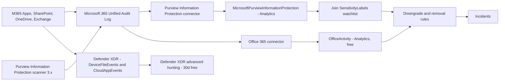

# Microsoft Purview Information Protection

> Status: verified. Priority: P3. Last verified: 21 Nov 2026.

## What it is

Microsoft Purview Information Protection classifies and protects files, emails and collaboration containers with sensitivity labels and encryption. Its audit logs record when labels are applied, upgraded, downgraded or removed, when auto-labelling policies match and when on-premises scanners discover sensitive files. A SOC watches these events for mass label downgrades or removals (a common step before data exfiltration) and unexpected access to protected content.

## Key recommendations

- Connect the **Microsoft Purview Information Protection** data connector to stream labelling and scanner audit events into `MicrosoftPurviewInformationProtection` ([Microsoft Learn](https://learn.microsoft.com/en-us/azure/sentinel/data-connectors/microsoft-purview-information-protection)). This replaces the deprecated legacy Azure Information Protection (AIP) connector and its `InformationProtectionLogs_CL` table.
- Keep `MicrosoftPurviewInformationProtection` in the Analytics tier on day 1 for label downgrade and removal detections. If you run heavy on-premises scanner jobs or tenant-wide auto-labelling, measure daily GB after a week and either trim noisy read/discovery events with a Data Collection Rule (DCR) transformation or move archive data to the data lake tier.
- Remember that `MicrosoftPurviewInformationProtection` is billable in Sentinel, but it explicitly qualifies for the Microsoft 365 E5/A5/F5/G5 **5 MB per user per day** Sentinel data grant ([Microsoft Learn](https://learn.microsoft.com/en-us/azure/sentinel/billing)).
- Keep `OfficeActivity` connected as well (free in Sentinel), but account for event overlap: Microsoft notes that `MicrosoftPurviewInformationProtection` and `OfficeActivity` can carry duplicated sensitivity label events ([Microsoft Learn](https://learn.microsoft.com/en-us/azure/sentinel/data-connectors/microsoft-purview-information-protection)).
- Maintain a Sentinel watchlist (or KQL lookup map) translating `SensitivityLabelId` GUIDs to human-readable label names. Events collected via the Office Management API carry GUIDs rather than display names.
- Use `DeviceFileEvents` (`SensitivityLabel`, `SensitivitySubLabel`, `IsAzureInfoProtectionApplied`) and `CloudAppEvents` in Defender XDR advanced hunting for free 30-day investigation context before paying to stream those raw tables to Sentinel ([Microsoft Learn](https://learn.microsoft.com/en-us/defender-xdr/advanced-hunting-devicefileevents-table)).

## High-value log sources

Label telemetry spans the dedicated Sentinel table, the Microsoft 365 unified audit log and Defender XDR endpoint/cloud tables.

| Source | Table name | Connector | Tier | Cost / volume | Value |
|---|---|---|---|---|---|
| Purview Information Protection audit | `MicrosoftPurviewInformationProtection` | Microsoft Purview Information Protection | Analytics (review volume if using scanners) | Medium; billable in Sentinel, covered by the M365 E5 5 MB/user/day data grant ([Microsoft Learn](https://learn.microsoft.com/en-us/azure/sentinel/billing)) | Dedicated schema (`LabelEventType`, `SensitivityLabelId`, `SensitivityLabelPolicyId`, `SensitiveInfoTypeData`, `RuleActions`) for labelling clients, built-in labelling, protection actions and on-premises scanner runs ([table reference](https://learn.microsoft.com/en-us/azure/azure-monitor/reference/tables/microsoftpurviewinformationprotection)). |
| M365 sensitivity label audit | `OfficeActivity` | Office 365 (Microsoft 365 solution) | Analytics | Free in Sentinel; low to medium volume ([Microsoft Learn](https://learn.microsoft.com/en-us/azure/sentinel/billing)) | Captures `SensitivityLabelApplied`, `SensitivityLabelUpdated`, `SensitivityLabelRemoved`, `FileSensitivityLabelApplied`, `FileSensitivityLabelChanged`, `SiteSensitivityLabelChanged` and apply failures across M365 apps, SharePoint, OneDrive and Teams ([Microsoft Learn](https://learn.microsoft.com/en-us/purview/audit-log-activities)). |
| Endpoint file label context | `DeviceFileEvents` | Microsoft Defender XDR | Already in Defender XDR, or Data lake in Sentinel | Free in Defender XDR (30 days); high and billable in Sentinel (eligible for M365 E5 5 MB grant) | Populates `SensitivityLabel`, `SensitivitySubLabel` and `IsAzureInfoProtectionApplied` on endpoint file operations for exfiltration hunting ([table reference](https://learn.microsoft.com/en-us/defender-xdr/advanced-hunting-devicefileevents-table)). |
| Cloud app label and sharing context | `CloudAppEvents` | Microsoft Defender XDR | Already in Defender XDR, or Data lake in Sentinel | Free in Defender XDR (30 days); high and billable in Sentinel (eligible for M365 E5 5 MB grant) | Cloud file sharing, download and sensitivity label actions across Microsoft 365 and connected SaaS apps ([table reference](https://learn.microsoft.com/en-us/defender-xdr/advanced-hunting-cloudappevents-table)). |

### What to ingest first

| Priority | Table | Why | Rough volume | Tier |
|---|---|---|---|---|
| 1 | `MicrosoftPurviewInformationProtection` | Structured labelling, protection and scanner schema for downgrade and removal detections | Medium | Analytics |
| 2 | `OfficeActivity` | Free M365 audit trail including site/container label changes and web/SharePoint label edits | Low to medium | Analytics |
| 3 | `DeviceFileEvents` + `CloudAppEvents` | Endpoint and cloud file context with label names already resolved; use free in Defender XDR first | High | Already in Defender XDR, or Data lake |

## Prerequisites and licensing

| Item | Detail |
|---|---|
| Manual sensitivity labels and encryption | Microsoft 365 E3 includes manual sensitivity labels in Office desktop, web and mobile apps, encryption/watermarks and container labels for Teams, Microsoft 365 groups and SharePoint sites. |
| Auto-labelling and advanced classification | Microsoft 365 E5, A5, G5, Microsoft 365 E5 Compliance (Microsoft Purview Suite) or Microsoft 365 E5 Information Protection and Governance add-on is required for client-side and service-side auto-labelling policies and automatic scanner labelling. |
| Tenant alignment | Your Microsoft 365 tenant and Microsoft Sentinel workspace must reside in the same tenant to connect the Microsoft Purview Information Protection data connector ([Microsoft Learn](https://learn.microsoft.com/en-us/azure/sentinel/data-connectors/microsoft-purview-information-protection)). |
| Unified audit log | Microsoft Purview auditing must be enabled (on by default) because the connector pulls events via the Office 365 Management Activity API ([Microsoft Learn](https://learn.microsoft.com/en-us/purview/audit-solutions-overview)). |
| Sentinel billing | `MicrosoftPurviewInformationProtection` is a billable table (supporting Analytics, Basic/Auxiliary/data lake tiers and DCR transformations), eligible for the M365 E5/A5/F5/G5 5 MB per user per day data grant ([Microsoft Learn](https://learn.microsoft.com/en-us/azure/sentinel/billing)). `OfficeActivity` is always free. |

### Roles you need

| Task | Role |
|---|---|
| Install Content Hub solutions and create analytic rules | Microsoft Sentinel Contributor on the resource group ([Microsoft Learn](https://learn.microsoft.com/en-us/azure/sentinel/sentinel-solutions-deploy)) |
| Enable the Microsoft Purview Information Protection data connector | Global Administrator or Security Administrator in Microsoft Entra ID, plus Microsoft Sentinel Contributor (read and write) on the workspace ([Microsoft Learn](https://learn.microsoft.com/en-us/azure/sentinel/data-connectors/microsoft-purview-information-protection)) |
| Create and publish sensitivity labels and policies | Information Protection Admin or Compliance Administrator |
| Read label definitions via PowerShell (to export GUID-to-name map) | Information Protection Reader or Compliance Administrator (`Connect-IPPSSession` then `Get-Label`) |

## Step-by-step setup

1. **Confirm sensitivity labels are published.** In the Microsoft Purview portal, go to Information Protection > Labels and Label policies, and confirm at least one sensitivity label policy is published to users.
2. **Export your label GUID-to-name mapping.** Connect to Security & Compliance PowerShell (`Connect-IPPSSession`) and run `Get-Label | Select-Object DisplayName, Guid, Priority`. Save this as a Microsoft Sentinel watchlist (for example `SensitivityLabels`) so rules and workbooks show label names instead of raw GUIDs.
3. **Install Content Hub solutions.** In the Defender portal, go to Microsoft Sentinel > Content management > Content hub. Install **Microsoft Purview Information Protection** (or locate the connector under Classic connectors) and **Microsoft 365** if not already installed ([Microsoft Learn](https://learn.microsoft.com/en-us/azure/sentinel/sentinel-solutions-deploy)).
4. **Connect Microsoft Purview Information Protection.** Go to Setup & configuration > Data management > Data & connectors > Connectors tab > Classic connectors - Microsoft Sentinel. Select **Microsoft Purview Information Protection**, open the connector page and select **Connect** ([Microsoft Learn](https://learn.microsoft.com/en-us/azure/sentinel/configure-data-connector)).
5. **Set table tier and retention.** On the connector page or in Table management, keep `MicrosoftPurviewInformationProtection` in Analytics for day-1 detection rules, and configure data lake mirroring if you need compliance retention beyond 90 days.
6. **Confirm Office 365 and Defender XDR connectors (optional context).** Keep `OfficeActivity` connected for free M365 audit coverage and use Defender XDR advanced hunting for `DeviceFileEvents` and `CloudAppEvents`.
7. **Generate test events.** Apply a sensitivity label to a test document in Word or SharePoint, downgrade or remove it with a justification, and wait 15 to 30 minutes for Office Management API delivery.
8. **Validate.** Run the validation queries below in Defender portal > Investigation & response > Advanced hunting with your Sentinel workspace selected.

## Architecture diagram



## Validation KQL

For group-wide and workspace-wide freshness checks, see [data-security.kql](../../queries/validation/data-security.kql) and the [validation query pack](../../queries/validation/README.md).

```kql
// 1. Is MicrosoftPurviewInformationProtection landing, and what event types are present?
MicrosoftPurviewInformationProtection
| where TimeGenerated > ago(7d)
| summarize Rows = count(), Latest = max(TimeGenerated) by LabelEventType, Workload
| order by Rows desc

// 2. Freshness check on MicrosoftPurviewInformationProtection
MicrosoftPurviewInformationProtection
| summarize Latest = max(TimeGenerated), AgeMinutes = (now() - max(TimeGenerated)) / 1m

// 3. Check sensitivity label operations in OfficeActivity (free table)
OfficeActivity
| where TimeGenerated > ago(7d)
| where Operation has "SensitivityLabel"
| summarize Rows = count(), Latest = max(TimeGenerated) by Operation, OfficeWorkload
| order by Rows desc

// 4. Verify GUID-to-name mapping pattern recommended by Microsoft Learn
// Replace the sample GUIDs with values from Get-Label in Security & Compliance PowerShell.
let labelsMap = dynamic({
    "00000000-0000-0000-0000-000000000001": "Confidential",
    "00000000-0000-0000-0000-000000000002": "Highly Confidential"
});
MicrosoftPurviewInformationProtection
| where TimeGenerated > ago(1d)
| extend SensitivityLabelName = iff(isnotempty(SensitivityLabelId), tostring(labelsMap[tostring(SensitivityLabelId)]), "")
| summarize Events = count() by SensitivityLabelId, SensitivityLabelName, LabelEventType
| order by Events desc

// 5. Cost: GB per day in Sentinel
Usage
| where TimeGenerated > ago(30d)
| where DataType in ("MicrosoftPurviewInformationProtection", "OfficeActivity")
| summarize GB = round(sum(Quantity) / 1024, 2) by DataType, IsBillable, Day = bin(TimeGenerated, 1d)
| summarize GBperDay = round(avg(GB), 2), TotalGB30d = round(sum(GB), 2) by DataType, IsBillable
| order by GBperDay desc

// 6. Defender XDR endpoint label check (run in Advanced hunting with Defender XDR selected)
DeviceFileEvents
| where Timestamp > ago(7d)
| where isnotempty(SensitivityLabel)
| summarize Files = count() by ActionType, SensitivityLabel, IsAzureInfoProtectionApplied
| order by Files desc
```

## Out-of-box analytic rules

Out-of-box analytic rules targeting `MicrosoftPurviewInformationProtection` specifically are limited in the public Content Hub catalog. Related official content sits across two solutions in `Azure/Azure-Sentinel`:

- **Microsoft Purview** ([solution folder](https://github.com/Azure/Azure-Sentinel/tree/master/Solutions/Microsoft%20Purview)): ships `MicrosoftPurviewSensitiveDataDiscoveredCustom.yaml` for Purview data governance asset scans (`PurviewDataSensitivityLogs`), not M365 user label downgrades.
- **Microsoft 365** ([solution folder](https://github.com/Azure/Azure-Sentinel/tree/master/Solutions/Microsoft%20365)): ships `Office Policy Tampering` ([YAML](https://github.com/Azure/Azure-Sentinel/blob/master/Solutions/Microsoft%20365/Analytic%20Rules/office_policytampering.yaml)) on `OfficeActivity`, which helps catch admin changes to compliance policies.

| Rule | Detects | Tables | MITRE | Suggested |
|---|---|---|---|---|
| Office Policy Tampering ([YAML](https://github.com/Azure/Azure-Sentinel/blob/master/Solutions/Microsoft%20365/Analytic%20Rules/office_policytampering.yaml)) | Admin tampering with Microsoft 365 security and compliance policies | `OfficeActivity` | Defense Evasion T1562 | Enable day 1 |
| Microsoft Purview - Sensitive Data Discovered ([YAML](https://github.com/Azure/Azure-Sentinel/blob/master/Solutions/Microsoft%20Purview/Analytic%20Rules/MicrosoftPurviewSensitiveDataDiscoveredCustom.yaml)) | Sensitive data classifications found during Microsoft Purview Data Map scans | `PurviewDataSensitivityLogs` | Collection T1213 | Enable only if you also run Purview Data Map / governance scans |

Because out-of-box user label downgrade and removal rules are not shipped by default, deploy the custom detections below on day 1.

## Custom detections

These are community-written rules, not Microsoft content. Pin exact `LabelEventType` and `Operation` strings against your tenant's logs before enabling.

### C1. Mass sensitivity label downgrade or removal (High)

Catches a user stripping or downgrading labels on multiple files in a short window, a common precursor to bypassing encryption or DLP rules. Run hourly in Sentinel with a 1-hour lookback.

```kql
// CUSTOM - Spike in sensitivity label downgrades or removals by one user
// ASSUMPTION: Pin exact LabelEventType values in your tenant first with:
//   MicrosoftPurviewInformationProtection | where TimeGenerated > ago(30d) | distinct LabelEventType, Operation
// Replace watched_labels with the GUIDs of your Highly Confidential / Restricted labels.
let watched_labels = dynamic([
    "00000000-0000-0000-0000-000000000001",
    "00000000-0000-0000-0000-000000000002"
]);
MicrosoftPurviewInformationProtection
| where TimeGenerated > ago(1h)
| where LabelEventType has_any ("Downgrade", "Remove") or Operation has "Removed"
| where isnotempty(UserId)
| extend TouchedWatchedLabel = SensitivityLabelId in (watched_labels)
| summarize Events = count(), WatchedEvents = countif(TouchedWatchedLabel),
            Operations = make_set(Operation, 5), Workloads = make_set(Workload, 5),
            Apps = make_set(Application, 5)
    by UserId
| where Events >= 10 or WatchedEvents >= 3
| order by Events desc
```

MITRE: Defense Evasion T1562 and Collection T1530.

### C2. Container or file sensitivity label removed in Microsoft 365 (Medium)

Uses the free `OfficeActivity` table to detect removal of sensitivity labels on files, SharePoint sites, Teams or Loop workspaces, including decryption via PowerShell (`Unlock-SPOSensitivityLabelEncryptedFile`). Run hourly in Sentinel with a 1-hour lookback.

```kql
// CUSTOM - Sensitivity label removal or decryption cmdlet in OfficeActivity
// ASSUMPTION: Confirm Operation names in your tenant with:
//   OfficeActivity | where TimeGenerated > ago(30d) | where Operation has "SensitivityLabel" | distinct Operation
OfficeActivity
| where TimeGenerated > ago(1h)
| where Operation in (
    "SensitivityLabelRemoved",
    "SiteSensitivityLabelChanged",
    "Unlock-SPOSensitivityLabelEncryptedFile"
)
| summarize Events = count(), Targets = make_set(ObjectId, 10), Workloads = make_set(OfficeWorkload, 5)
    by UserId, Operation, ClientIP
| where Operation == "Unlock-SPOSensitivityLabelEncryptedFile" or Events >= 5
| order by Events desc
```

MITRE: Defense Evasion T1562 and Exfiltration T1530.

### C3. Encrypted or highly sensitive files staged on endpoints (Medium)

Defender XDR advanced hunting custom detection using `DeviceFileEvents`, where `SensitivityLabel` and `IsAzureInfoProtectionApplied` are already resolved to plain text.

```kql
// CUSTOM - Defender XDR custom detection for labelled or encrypted files copied to staging or removable paths
// ASSUMPTION: Replace "Highly Confidential" with your organisation's top sensitivity label display name.
DeviceFileEvents
| where Timestamp > ago(1h)
| where SensitivityLabel has "Highly Confidential" or IsAzureInfoProtectionApplied == true
| where ActionType in ("FileCreated", "FileRenamed")
| where FolderPath matches regex @"(?i)^([d-z]:\\|\\\\.*\\|.*\\(temp|public|downloads|staging)\\)"
| summarize FileCount = count(), SampleFiles = make_set(FileName, 10),
            Timestamp = max(Timestamp), ReportId = any(ReportId)
    by DeviceId, DeviceName, InitiatingProcessAccountUpn, SensitivityLabel
| where FileCount >= 10
```

MITRE: Collection T1074 (Data Staged) and Exfiltration T1052.

## Playbooks

No Information Protection-specific playbooks ship out of the box. Common automation patterns for label downgrade incidents:

| Playbook pattern | What it does | Connectors and permissions |
|---|---|---|
| Prompt user for downgrade justification | Sends a Teams adaptive card or email asking the user to confirm why sensitive labels were removed; logs reply to the Sentinel incident | Microsoft Teams or Office 365 Outlook connector; Microsoft Sentinel Responder on the managed identity |
| Escalate to data owner and compliance | Emails `SensitivityLabelOwnerEmail` (when present in the log) or the compliance team with affected file list and user details | Office 365 Outlook connector; Microsoft Sentinel Responder |
| Revoke sessions on compromised account | Calls `Revoke-AADSignInSessions` from the Microsoft Entra ID solution if mass label removal coincides with a risky sign-in | Microsoft Graph (`User.RevokeSessions.All`); Microsoft Sentinel Responder |

## Workbooks and hunting

The connector documentation and Purview solutions provide workbook templates to track label adoption, protected file access and scanned assets, and Microsoft Purview's native **Activity explorer** and **Content explorer** offer built-in drill-downs by label and location.

Two practical hunting queries:

- **Failed auto-labelling or manual label applications in `OfficeActivity`** (catches broken policies or files evading encryption):

```kql
OfficeActivity
| where TimeGenerated > ago(7d)
| where Operation in ("FileSensitivityLabelApplyFailed", "FileSensitivityLabelChangeFailed")
| summarize Failures = count() by Operation, OfficeWorkload, UserId
| order by Failures desc
```

- **Top applications and workloads interacting with labelled items in `MicrosoftPurviewInformationProtection`**:

```kql
MicrosoftPurviewInformationProtection
| where TimeGenerated > ago(7d)
| summarize Events = count(), Users = dcount(UserId) by Workload, Application, LabelEventType, ResultStatus
| order by Events desc
```

## Gotchas and deprecations

- **Legacy AIP unified labeling add-in for Office retired on 11 April 2024.** Version 2.x of the Azure Information Protection (AIP) unified labeling add-in for Word, Excel, PowerPoint and Outlook reached retirement on 11 April 2024. Use built-in sensitivity labelling in Microsoft 365 Apps instead ([Microsoft Learn](https://learn.microsoft.com/en-us/azure/sentinel/data-connectors/microsoft-purview-information-protection)).
- **Legacy AIP Sentinel connector and `InformationProtectionLogs_CL` are deprecated.** Older rules, workbooks and queries referencing `InformationProtectionLogs_CL` must be migrated to `MicrosoftPurviewInformationProtection` via the **Microsoft Purview Information Protection** connector ([Microsoft Learn](https://learn.microsoft.com/en-us/azure/sentinel/data-connectors/microsoft-purview-information-protection)).
- **On-premises scanner upgraded to version 3.x.** On-premises file server scanning moved from the legacy AIP unified labeling scanner (2.x, `Uninstall-AIPScanner`) to the **Microsoft Purview Information Protection client and scanner** (3.x, `Install-Scanner`).
- **Label names arrive as GUIDs in `MicrosoftPurviewInformationProtection`.** Events collected through the Office Management API populate `SensitivityLabelId` with a GUID rather than the display name. Always maintain a watchlist or KQL mapping table from `Get-Label` so analysts and rules can read label names ([Microsoft Learn](https://learn.microsoft.com/en-us/azure/sentinel/data-connectors/microsoft-purview-information-protection)).
- **Event duplication with `OfficeActivity`.** Microsoft documents that `MicrosoftPurviewInformationProtection` and `OfficeActivity` may contain duplicated sensitivity label events when both connectors are active. Deduplicate or pick one table per detection rule so you don't double-alert ([Microsoft Learn](https://learn.microsoft.com/en-us/azure/sentinel/data-connectors/microsoft-purview-information-protection)).
- **Different operation names for desktop vs web apps.** Desktop and mobile Microsoft 365 apps emit `SensitivityLabelApplied` and `SensitivityLabelUpdated`, whereas Office for the web, SharePoint libraries, Teams and auto-labelling emit `FileSensitivityLabelApplied` and `FileSensitivityLabelChanged` ([Microsoft Learn](https://learn.microsoft.com/en-us/purview/audit-log-activities)). Write queries to cover both.
- **Sentinel in the Azure portal retires on 31 March 2027.** Build and test connectors, watchlists and rules in the Defender portal ([Microsoft Learn](https://learn.microsoft.com/en-us/azure/sentinel/microsoft-sentinel-defender-portal)).

## Official links

- [Stream data from Microsoft Purview Information Protection to Microsoft Sentinel](https://learn.microsoft.com/en-us/azure/sentinel/data-connectors/microsoft-purview-information-protection)
- [Microsoft Purview Information Protection connector reference](https://learn.microsoft.com/en-us/azure/sentinel/microsoft-purview-record-types-activities)
- [MicrosoftPurviewInformationProtection table reference](https://learn.microsoft.com/en-us/azure/azure-monitor/reference/tables/microsoftpurviewinformationprotection)
- [OfficeActivity table reference](https://learn.microsoft.com/en-us/azure/azure-monitor/reference/tables/officeactivity)
- [Audit log activities reference](https://learn.microsoft.com/en-us/purview/audit-log-activities)
- [Learn about auditing solutions in Microsoft Purview](https://learn.microsoft.com/en-us/purview/audit-solutions-overview)
- [DeviceFileEvents table, Defender XDR](https://learn.microsoft.com/en-us/defender-xdr/advanced-hunting-devicefileevents-table)
- [CloudAppEvents table, Defender XDR](https://learn.microsoft.com/en-us/defender-xdr/advanced-hunting-cloudappevents-table)
- [Plan costs and understand Microsoft Sentinel pricing and billing](https://learn.microsoft.com/en-us/azure/sentinel/billing)
- [Microsoft Purview solution, Azure-Sentinel repo](https://github.com/Azure/Azure-Sentinel/tree/master/Solutions/Microsoft%20Purview)
- [Microsoft 365 solution, Azure-Sentinel repo](https://github.com/Azure/Azure-Sentinel/tree/master/Solutions/Microsoft%20365)
- [Office Policy Tampering rule, Azure-Sentinel repo](https://github.com/Azure/Azure-Sentinel/blob/master/Solutions/Microsoft%20365/Analytic%20Rules/office_policytampering.yaml)
- [Enable a data connector, Defender portal navigation](https://learn.microsoft.com/en-us/azure/sentinel/configure-data-connector)
- [Discover and deploy content from Content hub](https://learn.microsoft.com/en-us/azure/sentinel/sentinel-solutions-deploy)
- [Microsoft Sentinel in the Defender portal](https://learn.microsoft.com/en-us/azure/sentinel/microsoft-sentinel-defender-portal)

## Last verified

21 Nov 2026, against Microsoft Learn, the Defender XDR schema references and the Azure-Sentinel repo. Re-verify before relying on table names, navigation or rule names.
