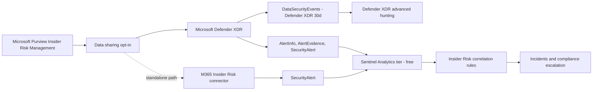

# Microsoft Purview Insider Risk Management

> Status: verified. Priority: P3. Last verified: 21 Nov 2026.

## What it is

Microsoft Purview Insider Risk Management correlates signals across Microsoft 365, endpoints, HR connectors and physical access to detect risky internal activity such as data theft by departing employees, data leaks and security policy violations. Streaming its alerts and enriched events to Defender XDR and Sentinel lets a SOC tell whether suspicious data movement is an external account takeover or a genuine insider risk, subject to strict privacy governance.

## Key recommendations

- **Get HR, legal and privacy sign-off before turning on Defender XDR or Sentinel sharing.** Inside the Purview portal, Insider Risk Management pseudonymises usernames by default (for example `AnonIS8-988`). Once you enable data sharing with Microsoft Defender XDR or export alerts to Microsoft Sentinel, **pseudonymisation is not preserved** and real usernames appear to SOC analysts ([Microsoft Learn](https://learn.microsoft.com/en-us/purview/insider-risk-management)).
- **Prefer the Microsoft Defender XDR unified integration over the standalone connector for Defender portal workspaces.** Turn on Purview data sharing to Defender XDR so insider risk alerts flow into `AlertInfo`, `AlertEvidence`, `SecurityAlert` and `DataSecurityEvents`, and disconnect duplicate standalone connectors when onboarding workspaces to the unified Defender portal ([Microsoft Learn](https://learn.microsoft.com/en-us/azure/sentinel/microsoft-365-defender-sentinel-integration)).
- **Install the Microsoft Purview Insider Risk Management Content Hub solution** for its workbook, 5 analytic rules, 5 hunting queries and notification playbook ([solution folder](https://github.com/Azure/Azure-Sentinel/tree/master/Solutions/MicrosoftPurviewInsiderRiskManagement)).
- **Keep insider risk alerts in the Analytics tier.** Volume is very low and Defender XDR alerts (`AlertInfo`, `AlertEvidence`, `SecurityAlert`) are free in Sentinel ([Microsoft Learn](https://learn.microsoft.com/en-us/azure/sentinel/billing)).
- **Use `DataSecurityEvents` in Defender XDR advanced hunting for rich context** without extra ingestion cost. It carries user actions enriched with sensitive info types, sensitivity labels and DLP policy matches for 30 days ([Microsoft Learn](https://learn.microsoft.com/en-us/defender-xdr/advanced-hunting-datasecurityevents-table)).

## High-value log sources

Insider Risk Management emits low-volume alerts and enriched user activity records. Alerts flow through Defender XDR (recommended) or the standalone Microsoft 365 Insider Risk Management connector.

| Source | Table name | Connector | Tier | Cost / volume | Value |
|---|---|---|---|---|---|
| Insider risk alerts (Defender XDR unified) | `AlertInfo`, `AlertEvidence`, `SecurityAlert` | Microsoft Defender XDR | Analytics | Free in Sentinel; very low volume ([Microsoft Learn](https://learn.microsoft.com/en-us/azure/sentinel/billing)) | Unified insider risk alerts, risk severity and user or file entities correlated directly with Defender XDR and Sentinel incidents. |
| Insider risk alerts (standalone Sentinel connector) | `SecurityAlert` | Microsoft 365 Insider Risk Management | Analytics | Free / low volume (alert ingestion via Office Management API) ([Microsoft Learn](https://learn.microsoft.com/en-us/azure/sentinel/data-connectors/microsoft-365-insider-risk-management)) | Standalone path for workspaces not unified through Defender XDR; feeds the solution's `SecurityAlert` rules and workbook. |
| Enriched data security events | `DataSecurityEvents` | Already in Defender XDR (requires Purview data sharing opt-in) | Already in Defender XDR | Free in Defender XDR (30 days retention) ([Microsoft Learn](https://learn.microsoft.com/en-us/defender-xdr/advanced-hunting-datasecurityevents-table)) | Single user activities enriched with sensitive info types, sensitivity labels, device management state and DLP policy match info. |
| Supporting M365 audit context | `OfficeActivity` | Office 365 (Microsoft 365 solution) | Analytics | Free in Sentinel; low to medium volume ([Microsoft Learn](https://learn.microsoft.com/en-us/azure/sentinel/billing)) | Raw SharePoint, OneDrive, Exchange and Teams activity used by correlation rules and SOC triage after an insider risk alert fires. |

### What to ingest first

| Priority | Table | Why | Rough volume | Tier |
|---|---|---|---|---|
| 1 | `AlertInfo`, `AlertEvidence`, `SecurityAlert` | Core insider risk alerts via Defender XDR (or `SecurityAlert` via the standalone connector if not unified) | Very low | Analytics |
| 2 | `DataSecurityEvents` | Granular Purview-enriched user activity for hunting and triage in Defender XDR | Medium | Already in Defender XDR |
| 3 | `OfficeActivity` | Free M365 audit trail needed to investigate downloads, sharing and deletions around an alert | Low to medium | Analytics |

## Prerequisites and licensing

| Item | Detail |
|---|---|
| Insider Risk Management licence | Microsoft 365 E5, A5 or G5; or Microsoft 365 E3/F3 with the Microsoft 365 E5 Compliance (Microsoft Purview Suite) add-on; or Microsoft 365 E3/F3 with the standalone Microsoft 365 E5 Insider Risk Management add-on ([Microsoft Learn](https://learn.microsoft.com/en-us/purview/insider-risk-management)). |
| Forensic Evidence (optional) | Capturing visual forensic clips requires an opt-in capacity add-on billed in 100 GB per month blocks. |
| Purview data sharing opt-in | You must turn on **Share data with Microsoft Defender XDR** (or share user risk details with other Microsoft security solutions) in Purview portal > Settings > Insider Risk Management > Data sharing before alerts or `DataSecurityEvents` appear in Defender XDR ([Microsoft Learn](https://learn.microsoft.com/en-us/defender-xdr/advanced-hunting-datasecurityevents-table)). |
| Active Insider Risk policies | No alerts fire until at least one Insider Risk Management policy is configured and running in the Purview portal (for example Data leaks or Data theft by departing users). |
| Sentinel billing | Defender XDR alerts (`AlertInfo`, `AlertEvidence`, `SecurityAlert`) and `OfficeActivity` are free to ingest into Sentinel ([Microsoft Learn](https://learn.microsoft.com/en-us/azure/sentinel/billing)). |

### Roles you need

Microsoft recommends separating Purview policy administrators from case investigators to protect employee privacy ([Microsoft Learn](https://learn.microsoft.com/en-us/purview/insider-risk-management)).

| Task | Role |
|---|---|
| Configure Insider Risk policies, global settings and data sharing | Insider Risk Management Admins role group in Microsoft Purview (cannot view individual case details) |
| Triage alerts and review analytics in Purview | Insider Risk Management Analysts role group |
| Deep case investigation, Content Explorer and forensic evidence | Insider Risk Management Investigators role group (Forensic capture also uses Insider Risk Management Approvers for dual authorisation) |
| Install the Sentinel solution and create analytic rules | Microsoft Sentinel Contributor on the resource group ([Microsoft Learn](https://learn.microsoft.com/en-us/azure/sentinel/sentinel-solutions-deploy)) |
| Connect Defender XDR or Microsoft 365 Insider Risk Management connector | Security Administrator in Microsoft Entra ID plus Microsoft Sentinel Contributor on the workspace ([Microsoft Learn](https://learn.microsoft.com/en-us/azure/sentinel/data-connectors/microsoft-365-insider-risk-management)) |

## Step-by-step setup

1. **Agree on privacy and access controls.** Confirm with HR, legal and privacy stakeholders that exposing unmasked usernames to the SOC in Defender XDR and Sentinel is approved, and verify who holds Sentinel and Defender portal read permissions.
2. **Verify Insider Risk Management policies in Purview.** Sign in to the Microsoft Purview portal as an Insider Risk Management Admin and confirm at least one policy is active and generating indicators ([Microsoft Learn](https://learn.microsoft.com/en-us/purview/insider-risk-management)).
3. **Turn on Purview data sharing.** In the Microsoft Purview portal, go to Settings > Insider Risk Management > Data sharing. Enable sharing alert data and user risk severity levels with Microsoft Defender XDR and Microsoft security solutions.
4. **Install the Content Hub solution.** In the Defender portal, go to Microsoft Sentinel > Content management > Content hub. Search for **Microsoft Purview Insider Risk Management**, select View details, then Create ([Microsoft Learn](https://learn.microsoft.com/en-us/azure/sentinel/sentinel-solutions-deploy)).
5. **Connect the alert stream (choose one primary path).**
   - **Recommended (Defender portal workspaces):** Go to Setup & configuration > Data management > Data & connectors > Connectors tab > Classic connectors - Microsoft Sentinel. Open **Microsoft Defender XDR** and confirm **Connect incidents & alerts** is enabled ([Microsoft Learn](https://learn.microsoft.com/en-us/azure/sentinel/configure-data-connector)). Avoid also connecting the standalone connector to the same primary workspace so alerts aren't duplicated.
   - **Standalone path (non-unified or secondary workspace):** Open the **Microsoft 365 Insider Risk Management** connector page and select Connect ([Microsoft Learn](https://learn.microsoft.com/en-us/azure/sentinel/data-connectors/microsoft-365-insider-risk-management)).
6. **Connect supporting audit data.** Ensure the **Office 365** connector (`OfficeActivity`) and **Microsoft Entra ID** connector (`SigninLogs`) are connected so the solution's correlation rules have data to join against.
7. **Validate.** Run the validation queries below in Defender portal > Investigation & response > Advanced hunting once an active policy generates a test or live alert. Note that Insider Risk Management builds baselines over 24 to 48 hours after a policy is created, so alerts don't appear immediately on a brand new tenant.
8. **Enable the day-1 rules and configure escalation.** Enable the alert and correlation rules below and deploy the `Notify-Insider Risk Management Team` playbook if your SOC escalates cases back to the compliance team.

## Best-practice security configuration

Configure Insider Risk Management with strong privacy controls and accurate signals. See [Microsoft recommended security configurations](../../docs/security-configurations.md).

- **Role separation & anonymisation:** Separate **Insider Risk Management Admins** (configure policies, cannot see cases) from **Analysts/Investigators** (review cases), keep pseudonymisation on inside Purview, and get HR/Legal sign-off before turning on Defender XDR data sharing ([Configure Insider Risk Management](https://learn.microsoft.com/en-us/purview/insider-risk-management-configure)).
- **Connect an HR resignation/termination connector:** Feed departure dates from Workday/SuccessFactors/CSV so the **Data theft by departing users** policy triggers reliably.
- **Priority user groups & adaptive protection:** Define priority user groups (execs, R&D, admins) and pair Insider Risk levels with **Adaptive Protection** so elevated-risk users automatically receive stricter Purview DLP blocks.

## Architecture diagram



## Validation KQL

For group-wide and workspace-wide freshness checks, see [data-security.kql](../../queries/validation/data-security.kql) and the [validation query pack](../../queries/validation/README.md).

```kql
// 1. Check Insider Risk alerts arriving in Defender XDR AlertInfo
// ASSUMPTION: ProductName or ServiceSource string varies by alert type; inspect distinct values first.
AlertInfo
| where Timestamp > ago(30d)
| where ServiceSource has "Insider" or DetectionSource has "Insider" or Title has "Insider"
| summarize Alerts = count(), Latest = max(Timestamp) by ServiceSource, Title, Severity
| order by Latest desc

// 2. Check Insider Risk alerts in Sentinel SecurityAlert
SecurityAlert
| where TimeGenerated > ago(30d)
| where ProviderName has "Insider" or ProductName has "Insider"
| summarize Alerts = count(), Latest = max(TimeGenerated) by ProductName, AlertName, AlertSeverity
| order by Latest desc

// 3. Check DataSecurityEvents in Defender XDR advanced hunting (proves Purview data sharing is active)
DataSecurityEvents
| where Timestamp > ago(7d)
| summarize Events = count(), Latest = max(Timestamp) by bin(Timestamp, 1d)
| order by Timestamp desc

// 4. Freshness check on DataSecurityEvents
DataSecurityEvents
| summarize Latest = max(Timestamp), AgeMinutes = (now() - max(Timestamp)) / 1m

// 5. Cost: GB per day in Sentinel for alert tables (free ingestion)
Usage
| where TimeGenerated > ago(30d)
| where DataType in ("SecurityAlert", "AlertInfo", "AlertEvidence")
| summarize GB = round(sum(Quantity) / 1024, 2) by DataType, IsBillable, Day = bin(TimeGenerated, 1d)
| summarize GBperDay = round(avg(GB), 2), TotalGB30d = round(sum(GB), 2) by DataType, IsBillable
| order by GBperDay desc
```

## Out-of-box analytic rules

From the **Microsoft Purview Insider Risk Management** solution in Content Hub ([solution folder](https://github.com/Azure/Azure-Sentinel/tree/master/Solutions/MicrosoftPurviewInsiderRiskManagement)). The solution ships 5 analytic rules, 5 hunting queries, 1 workbook and 1 playbook.

### Day-1 rules

| Rule | Detects | Tables | MITRE | Suggested |
|---|---|---|---|---|
| Insider Risk: M365 IRM Alert Observed ([YAML](https://github.com/Azure/Azure-Sentinel/blob/master/Solutions/MicrosoftPurviewInsiderRiskManagement/Analytic%20Rules/InsiderRiskM365IRMAlertObserved.yaml)) | Surfaces Microsoft Purview Insider Risk Management alerts in Sentinel | `SecurityAlert` | Collection, Exfiltration | Enable day 1 (skip if Defender XDR incident sync already creates incidents for these alerts, to avoid duplicates) |
| Insider Risk: High User Alerts Correlation ([YAML](https://github.com/Azure/Azure-Sentinel/blob/master/Solutions/MicrosoftPurviewInsiderRiskManagement/Analytic%20Rules/InsiderRiskHighUserAlertsCorrelation.yaml)) | Correlates users who trigger Insider Risk alerts with other high-severity security alerts across Microsoft products | `SecurityAlert` | Exfiltration, Collection | Enable day 1 |
| Insider Risk: Sensitive Data Access Outside Organizational Geo-location ([YAML](https://github.com/Azure/Azure-Sentinel/blob/master/Solutions/MicrosoftPurviewInsiderRiskManagement/Analytic%20Rules/InsiderRiskSensitiveDataAccessOutsideOrgGeo.yaml)) | Flags insider risk users accessing sensitive corporate data from outside expected organisational countries | `SecurityAlert`, `SigninLogs` | Exfiltration T1530, Initial Access | Enable day 1 (configure your allowed country list first) |

Review the remaining 2 analytic rules in the [Analytic Rules folder](https://github.com/Azure/Azure-Sentinel/tree/master/Solutions/MicrosoftPurviewInsiderRiskManagement/Analytic%20Rules) before enabling to confirm your workspace ingests every table they reference.

## Custom detections

These are community-written rules, not Microsoft content. Review assumptions against sample rows from your tenant before enabling.

### C1. Insider risk alert paired with risky Entra ID sign-in (High)

Helps the SOC quickly tell whether an insider risk alert is actually a compromised account used by an external attacker. Run hourly in Sentinel with a 24-hour lookback.

```kql
// CUSTOM - Insider Risk alert for a user who also had a medium or high risk Entra ID sign-in
// ASSUMPTION: SigninLogs RiskLevelDuringSignIn requires Entra ID P2; otherwise it returns "hidden".
// Verify Entities JSON structure in SecurityAlert for your tenant's Insider Risk alerts.
let irmUsers = SecurityAlert
    | where TimeGenerated > ago(24h)
    | where ProductName has "Insider" or ProviderName has "Insider"
    | extend ParsedEntities = parse_json(Entities)
    | mv-expand Entity = ParsedEntities
    | extend AccountUpn = tolower(tostring(Entity.UserPrincipalName))
    | where isnotempty(AccountUpn)
    | summarize IRMAlerts = make_set(AlertName, 5), LatestIRM = max(TimeGenerated) by AccountUpn;
SigninLogs
| where TimeGenerated > ago(24h)
| where RiskLevelDuringSignIn in ("medium", "high")
| extend AccountUpn = tolower(UserPrincipalName)
| join kind=inner irmUsers on AccountUpn
| project TimeGenerated, AccountUpn, RiskLevelDuringSignIn, IPAddress, Location, IRMAlerts, LatestIRM
```

MITRE: Initial Access T1078 and Exfiltration T1530.

### C2. Insider risk alert followed by bulk SharePoint or OneDrive downloads (High)

Flags active data staging after an insider risk alert has already fired. Run hourly in Sentinel with a 24-hour lookback.

```kql
// CUSTOM - Bulk file downloads in OfficeActivity by a user with an active Insider Risk alert
// ASSUMPTION: Confirm Entity.UserPrincipalName in SecurityAlert for Insider Risk alerts in your tenant.
let irmUsers = SecurityAlert
    | where TimeGenerated > ago(7d)
    | where ProductName has "Insider" or ProviderName has "Insider"
    | extend ParsedEntities = parse_json(Entities)
    | mv-expand Entity = ParsedEntities
    | extend AccountUpn = tolower(tostring(Entity.UserPrincipalName))
    | where isnotempty(AccountUpn)
    | summarize LatestIRM = max(TimeGenerated) by AccountUpn;
OfficeActivity
| where TimeGenerated > ago(24h)
| where Operation in ("FileDownloaded", "FileSyncDownloadedFull")
| extend AccountUpn = tolower(UserId)
| join kind=inner irmUsers on AccountUpn
| summarize Downloads = count(), Sites = dcount(Site_Url), SampleFiles = make_set(SourceFileName, 10)
    by AccountUpn, LatestIRM
| where Downloads >= 50
| order by Downloads desc
```

MITRE: Collection T1213 and Exfiltration T1567.

### C3. Repeated blocked or bypassed data security actions on unmanaged devices (Medium)

Defender XDR advanced hunting custom detection on `DataSecurityEvents` targeting unmanaged devices where DLP policies triggered in warn, bypass or block mode.

```kql
// CUSTOM - Defender XDR custom detection on DataSecurityEvents for unmanaged device DLP matches
// ASSUMPTION: DlpPolicyEnforcementMode values from Microsoft Learn:
//   2 = Warn, 3 = Warn and bypass, 4 = Block. Verify AccountUpn or DeviceId columns in your tenant.
DataSecurityEvents
| where Timestamp > ago(1h)
| where IsManagedDevice == false
| where DlpPolicyEnforcementMode in (2, 3, 4)
| summarize Events = count(), Policies = make_set(DlpPolicyMatchInfo, 10),
            Timestamp = max(Timestamp)
    by DeviceName, DeviceId, DlpPolicyEnforcementMode
| where Events >= 3
```

MITRE: Exfiltration T1048.

## Playbooks

The **Microsoft Purview Insider Risk Management** Content Hub solution ships 1 playbook ([Playbooks folder](https://github.com/Azure/Azure-Sentinel/tree/master/Solutions/MicrosoftPurviewInsiderRiskManagement/Playbooks)):

| Playbook | What it does | Notes |
|---|---|---|
| Notify-Insider Risk Management Team | Emails or notifies the compliance and Insider Risk Management team when Sentinel detects a correlated incident involving an insider risk user | Keeps SOC and HR/legal teams aligned without exposing full Purview case details to every analyst. Assign Microsoft Sentinel Responder to the managed identity. |

Suggested custom response: avoid automatic account disablement on pure Insider Risk alerts unless correlated with external compromise signals. HR or legal investigations often require preserving evidence and following formal workplace procedures before revoking access.

## Workbooks and hunting

The solution ships 1 workbook and 5 hunting queries ([Workbooks folder](https://github.com/Azure/Azure-Sentinel/tree/master/Solutions/MicrosoftPurviewInsiderRiskManagement/Workbooks), [Hunting Queries folder](https://github.com/Azure/Azure-Sentinel/tree/master/Solutions/MicrosoftPurviewInsiderRiskManagement/Hunting%20Queries)):

| Asset | Use |
|---|---|
| Insider Risk Management Workbook | Visualises insider risk alerts cross-walked against user risk, endpoint indicators and broader Sentinel security alerts |
| 5 out-of-box hunting queries | Proactive hunting for anomalous sensitive data access, exfiltration indicators and cross-product alert correlations |

One extra hunting pattern worth running in Defender XDR advanced hunting:

- **High-risk actions on renamed sensitive files in `DataSecurityEvents`** (renaming extensions is a classic way insiders try to bypass simple upload controls):

```kql
DataSecurityEvents
| where Timestamp > ago(14d)
| where isnotempty(FileRenameInfo)
| project Timestamp, DeviceName, IsManagedDevice, FileRenameInfo, DlpPolicyMatchInfo, ApplicationNames
| order by Timestamp desc
```

## Gotchas and deprecations

- **Pseudonymisation is lost once data leaves Purview.** Insider Risk Management anonymises usernames by default in the Purview portal, and turning on strict anonymisation also restricts features such as the data risk graph. However, sharing data with Defender XDR or exporting alerts to Sentinel reveals actual usernames so the SOC can investigate across tables ([Microsoft Learn](https://learn.microsoft.com/en-us/purview/insider-risk-management)). Treat Defender XDR and Sentinel access accordingly and document the privacy sign-off.
- **Standalone connector vs unified Defender XDR.** If you onboard a Sentinel workspace to the unified Defender portal while also running the standalone Microsoft 365 Insider Risk Management connector, manage or disconnect the redundant standalone connector as guided by Microsoft to avoid duplicate alerts and routing conflicts ([Microsoft Learn](https://learn.microsoft.com/en-us/azure/sentinel/microsoft-365-defender-sentinel-integration)).
- **`DataSecurityEvents` is empty until Purview data sharing is enabled.** Even with E5 licences and active policies, `DataSecurityEvents` returns zero rows in Defender XDR advanced hunting until an admin opts in under Purview portal > Settings > Insider Risk Management > Data sharing ([Microsoft Learn](https://learn.microsoft.com/en-us/defender-xdr/advanced-hunting-datasecurityevents-table)).
- **Baseline warm-up delay.** Insider Risk Management policies need 24 to 48 hours of baseline activity after creation before alerts begin to appear, and some templates (such as data theft by departing users) also depend on an HR connector or Entra ID account deletion signal.
- **Bidirectional option exists.** If you also want non-Microsoft SIEM signals (for example third-party cloud app exfiltration logs in Sentinel) to feed Purview Insider Risk scoring, use the **Insider Risk Indicators** connector in Purview to import aggregated signals back into Purview.
- **Sentinel in the Azure portal retires on 31 March 2027.** Build and test connectors, rules and hunting queries in the Defender portal ([Microsoft Learn](https://learn.microsoft.com/en-us/azure/sentinel/microsoft-sentinel-defender-portal)).

## Official links

- [Learn about Insider Risk Management](https://learn.microsoft.com/en-us/purview/insider-risk-management)
- [Microsoft 365 Insider Risk Management data connector in Microsoft Sentinel](https://learn.microsoft.com/en-us/azure/sentinel/data-connectors/microsoft-365-insider-risk-management)
- [DataSecurityEvents table, Defender XDR](https://learn.microsoft.com/en-us/defender-xdr/advanced-hunting-datasecurityevents-table)
- [Data tables in the Microsoft Defender advanced hunting schema](https://learn.microsoft.com/en-us/defender-xdr/advanced-hunting-schema-tables)
- [AlertInfo table, Defender XDR](https://learn.microsoft.com/en-us/defender-xdr/advanced-hunting-alertinfo-table)
- [AlertEvidence table, Defender XDR](https://learn.microsoft.com/en-us/defender-xdr/advanced-hunting-alertevidence-table)
- [SecurityAlert table reference](https://learn.microsoft.com/en-us/azure/azure-monitor/reference/tables/securityalert)
- [OfficeActivity table reference](https://learn.microsoft.com/en-us/azure/azure-monitor/reference/tables/officeactivity)
- [Microsoft Defender XDR integration with Microsoft Sentinel](https://learn.microsoft.com/en-us/azure/sentinel/microsoft-365-defender-sentinel-integration)
- [Plan costs and understand Microsoft Sentinel pricing and billing](https://learn.microsoft.com/en-us/azure/sentinel/billing)
- [Microsoft Purview Insider Risk Management solution, Azure-Sentinel repo](https://github.com/Azure/Azure-Sentinel/tree/master/Solutions/MicrosoftPurviewInsiderRiskManagement)
- [Enable a data connector, Defender portal navigation](https://learn.microsoft.com/en-us/azure/sentinel/configure-data-connector)
- [Discover and deploy content from Content hub](https://learn.microsoft.com/en-us/azure/sentinel/sentinel-solutions-deploy)
- [Microsoft Sentinel in the Defender portal](https://learn.microsoft.com/en-us/azure/sentinel/microsoft-sentinel-defender-portal)

## Last verified

21 Nov 2026, against Microsoft Learn, the Defender XDR schema references and the Azure-Sentinel repo. Re-verify before relying on table names, navigation or rule names.
