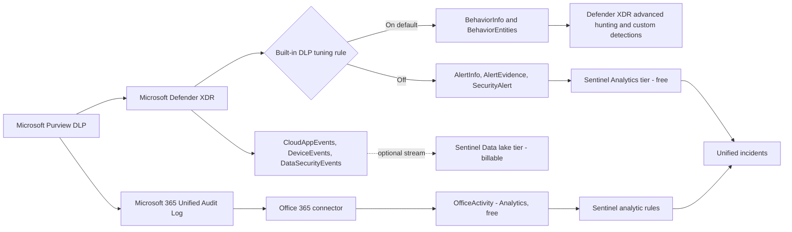

# Microsoft Purview Data Loss Prevention

> Status: verified. Priority: P2. Last verified: 21 Nov 2026.

## What it is

Microsoft Purview Data Loss Prevention (DLP) detects, audits, warns on and blocks sensitive data leaving through Exchange Online, SharePoint Online, OneDrive, Microsoft Teams, endpoints (Windows and macOS) and connected cloud apps. Its alerts, behaviours and audit events let a SOC spot data exfiltration attempts, repeated user overrides and tampering with DLP policies.

## Key recommendations

- Connect **Microsoft Defender XDR** and **Office 365** (from the **Microsoft 365** Content Hub solution) to Microsoft Sentinel. There is no separate standalone Purview DLP connector in Sentinel; DLP telemetry arrives through Defender XDR and the unified audit log ([Microsoft Learn](https://learn.microsoft.com/en-us/azure/sentinel/connect-microsoft-365-defender)).
- Decide deliberately how to handle Defender XDR's built-in DLP alert tuning rule (`Set-As-Behavior - Data Loss Prevention (DLP) Alerts`). By default it turns DLP signals into behaviours (`BehaviorInfo` and `BehaviorEntities`) instead of incidents so they don't flood the SOC queue ([Microsoft Learn](https://learn.microsoft.com/en-us/defender-xdr/dlp-investigate-alerts-defender)). Keep it on and hunt or alert on high-severity matches, or disable it if your SOC triages DLP alerts in the Defender XDR incident queue.
- Keep `OfficeActivity` in the Analytics tier on day 1. Office 365 audit logs (Exchange, SharePoint, OneDrive and Teams) are always free in Sentinel ([Microsoft Learn](https://learn.microsoft.com/en-us/azure/sentinel/billing)), and they carry DLP policy changes and `DlpRuleMatch` / `DlpRuleUndo` audit records.
- Don't ingest `CloudAppEvents` or `DeviceEvents` into the Sentinel Analytics tier just for DLP unless you write Sentinel rules that need them. Both tables are already free in Defender XDR advanced hunting with 30 days retention ([Microsoft Learn](https://learn.microsoft.com/en-us/defender-xdr/advanced-hunting-schema-tables)). If you need longer retention in Sentinel, route raw copies to the data lake tier.
- Enable the out-of-box policy tampering rule from the **Microsoft 365** Content Hub solution on day 1 so an attacker or rogue admin can't quietly weaken DLP policies before exfiltrating data ([office_policytampering.yaml](https://github.com/Azure/Azure-Sentinel/blob/master/Solutions/Microsoft%20365/Analytic%20Rules/office_policytampering.yaml)).

## High-value log sources

DLP telemetry is split across Defender XDR alerts and behaviours, Microsoft 365 unified audit logs and endpoint or cloud activity tables.

| Source | Table name | Connector | Tier | Cost / volume | Value |
|---|---|---|---|---|---|
| DLP alerts (when built-in tuning rule is off) | `AlertInfo`, `AlertEvidence`, `SecurityAlert` | Microsoft Defender XDR | Analytics | Free in Sentinel; low volume ([Microsoft Learn](https://learn.microsoft.com/en-us/azure/sentinel/billing)) | Unified DLP alert metadata, severity and matched file, user and device entities in the Defender XDR and Sentinel incident queues. |
| DLP signals as behaviours (default since Oct 2026) | `BehaviorInfo`, `BehaviorEntities` | Already in Defender XDR advanced hunting | Already in Defender XDR | Free in Defender XDR (30 days retention); not in Event Streaming API ([Microsoft Learn](https://learn.microsoft.com/en-us/defender-xdr/supported-event-types)) | Default landing table for Purview DLP signals in Defender XDR when the built-in alert tuning rule is active. |
| DLP audit and policy changes | `OfficeActivity` | Office 365 (Microsoft 365 solution) | Analytics | Free in Sentinel; low to medium volume ([Microsoft Learn](https://learn.microsoft.com/en-us/azure/sentinel/billing)) | Captures `DlpRuleMatch`, `DlpRuleUndo`, `DlpInfo` and admin changes to DLP policies and rules across Exchange, SharePoint, OneDrive and Teams. |
| Cloud app DLP matches | `CloudAppEvents` | Microsoft Defender XDR | Already in Defender XDR, or Data lake in Sentinel | Free in Defender XDR (30 days); high and billable in Sentinel (eligible for M365 E5 5 MB/user/day grant) | Detailed `DlpRuleMatch` events with `RawEventData` JSON (policy name, rule name, action and sensitive info types) across Microsoft 365 and connected SaaS apps. |
| Endpoint DLP activity | `DeviceEvents` | Microsoft Defender XDR | Already in Defender XDR, or Data lake in Sentinel | Free in Defender XDR (30 days); high and billable in Sentinel (eligible for M365 E5 5 MB/user/day grant) | Endpoint file exfiltration controls (USB copy, print, cloud upload, clipboard) reported by Defender for Endpoint sensors on Windows and macOS. |
| Enriched Purview data security events | `DataSecurityEvents` | Already in Defender XDR (requires Purview Insider Risk Management data sharing) | Already in Defender XDR | Free in Defender XDR (30 days) ([Microsoft Learn](https://learn.microsoft.com/en-us/defender-xdr/advanced-hunting-datasecurityevents-table)) | User actions enriched with `DlpPolicyMatchInfo`, `DlpPolicyEnforcementMode` and `DlpPolicyRuleMatchInfo`. |

### What to ingest first

| Priority | Table | Why | Rough volume | Tier |
|---|---|---|---|---|
| 1 | `AlertInfo`, `AlertEvidence`, `SecurityAlert` | Free alert and incident sync from Defender XDR (populates for DLP if you disable the built-in tuning rule) | Low | Analytics |
| 2 | `OfficeActivity` | Free in Sentinel; covers DLP policy tampering, `DlpRuleMatch` and user overrides (`DlpRuleUndo`) | Low to medium | Analytics |
| 3 | `BehaviorInfo` + `BehaviorEntities` | Default home of DLP signals in Defender XDR; hunt and build custom detections in Defender XDR first | Low to medium | Already in Defender XDR |
| 4 | `CloudAppEvents` + `DeviceEvents` | Deep investigation and long retention for cloud and Endpoint DLP; keep in Defender XDR unless you need >30 days | High | Already in Defender XDR, or Data lake |
| 5 | `DataSecurityEvents` | Cross-product Purview DLP and Insider Risk context when Insider Risk data sharing is enabled | Medium | Already in Defender XDR |

## Prerequisites and licensing

| Item | Detail |
|---|---|
| Core DLP (Exchange, SharePoint, OneDrive) | Microsoft 365 E3 or Office 365 E3 includes core DLP policies and audit logging. Single-event DLP alerts use a 15-minute default aggregation window on E3 ([Microsoft Learn](https://learn.microsoft.com/en-us/purview/dlp-learn-about-dlp)). |
| Endpoint DLP, Teams DLP and Defender XDR DLP incidents | Microsoft 365 E5, A5, G5, Office 365 E5, Microsoft 365 E5 Compliance (Microsoft Purview Suite) or Microsoft 365 E5 Information Protection and Governance is required to investigate Purview DLP incidents in the Microsoft Defender portal and to use full Endpoint DLP and 1-minute alert aggregation ([Microsoft Learn](https://learn.microsoft.com/en-us/defender-xdr/dlp-investigate-alerts-defender)). |
| Endpoint DLP onboarding | Windows 10/11 and macOS devices already onboarded to Microsoft Defender for Endpoint are automatically recognised for Endpoint DLP once device monitoring is turned on in the Purview portal ([Microsoft Learn](https://learn.microsoft.com/en-us/purview/dlp-learn-about-dlp)). |
| Unified audit log | Microsoft Purview auditing is enabled by default for Microsoft 365 organisations; verify auditing is on so `OfficeActivity` receives DLP events ([Microsoft Learn](https://learn.microsoft.com/en-us/purview/audit-solutions-overview)). |
| Sentinel billing | `OfficeActivity` and Defender XDR alerts (`AlertInfo`, `AlertEvidence`, `SecurityAlert`) are free to ingest into Sentinel. Raw advanced hunting tables (`CloudAppEvents`, `DeviceEvents`) are billable if streamed to Sentinel, though eligible for the M365 E5/A5/F5/G5 5 MB per user per day data grant ([Microsoft Learn](https://learn.microsoft.com/en-us/azure/sentinel/billing)). |

### Roles you need

| Task | Role |
|---|---|
| Install Content Hub solutions and create analytic rules | Microsoft Sentinel Contributor on the resource group ([Microsoft Learn](https://learn.microsoft.com/en-us/azure/sentinel/sentinel-solutions-deploy)) |
| Connect Microsoft Defender XDR and Office 365 connectors | Security Administrator in Microsoft Entra ID plus Microsoft Sentinel Contributor on the workspace ([Microsoft Learn](https://learn.microsoft.com/en-us/azure/sentinel/connect-microsoft-365-defender)) |
| Create or edit Purview DLP policies and alert rules | Compliance Administrator, Information Protection Admin or Purview DLP Compliance Management role group |
| Manage Defender XDR alert tuning and view DLP alerts | Security Administrator, Security Operator or Security Reader in Microsoft Entra ID (or Defender unified RBAC with `Security data basics (read)`) ([Microsoft Learn](https://learn.microsoft.com/en-us/defender-xdr/dlp-investigate-alerts-defender)) |

## Step-by-step setup

1. **Confirm your Sentinel workspace in the Defender portal.** Make sure your Log Analytics workspace with Sentinel enabled is onboarded to the unified Microsoft Defender portal ([Microsoft Learn](https://learn.microsoft.com/en-us/azure/sentinel/microsoft-sentinel-defender-portal)).
2. **Verify Purview DLP policies generate alerts.** In the Microsoft Purview portal, go to Data Loss Prevention > Policies. Check that each active policy rule has User notifications and Incident reports / Alert generation turned on where you want SOC visibility ([Microsoft Learn](https://learn.microsoft.com/en-us/purview/dlp-learn-about-dlp)).
3. **Turn on Endpoint DLP monitoring (if licensed).** In the Microsoft Purview portal, go to Settings > Device onboarding and confirm devices onboarded to Defender for Endpoint are reporting into Purview.
4. **Install the Microsoft Defender XDR and Microsoft 365 solutions.** In the Defender portal, go to Microsoft Sentinel > Content management > Content hub. Install **Microsoft Defender XDR** and **Microsoft 365** ([Microsoft Learn](https://learn.microsoft.com/en-us/azure/sentinel/sentinel-solutions-deploy)).
5. **Connect Microsoft Defender XDR.** Go to Setup & configuration > Data management > Data & connectors > Connectors tab > Classic connectors - Microsoft Sentinel. Open **Microsoft Defender XDR**, turn on **Connect incidents & alerts**, and decide whether to stream raw `CloudAppEvents` or `DeviceEvents` (optional; both are already in Defender XDR advanced hunting for 30 days) ([Microsoft Learn](https://learn.microsoft.com/en-us/azure/sentinel/configure-data-connector)).
6. **Connect Office 365.** On the same connectors page, open **Office 365**, tick Exchange, SharePoint and Teams, and select Apply Changes. This streams free audit logs into `OfficeActivity`.
7. **Decide on the built-in DLP alert tuning rule.** In the Defender portal, go to Settings > Microsoft Defender XDR > Alert tuning. Locate the built-in `Set-As-Behavior - Data Loss Prevention (DLP) Alerts` rule ([Microsoft Learn](https://learn.microsoft.com/en-us/defender-xdr/dlp-investigate-alerts-defender)).
   - **Option A (keep enabled, recommended for noisy DLP):** DLP signals land in `BehaviorInfo` and `BehaviorEntities` instead of creating Defender incidents. Build targeted Defender XDR custom detections for high-risk matches.
   - **Option B (disable the rule):** Incoming DLP alerts generate standard Defender XDR alerts and incidents in `AlertInfo`, `AlertEvidence` and `SecurityAlert`.
8. **Generate a test match.** Trigger a test DLP policy in simulation or audit mode (for example, send a test document matching a dummy sensitive info type) and make a harmless test edit to a test DLP policy so you can confirm both match and policy-change events land.
9. **Validate.** Run the validation queries below in Defender portal > Investigation & response > Advanced hunting.

## Best-practice security configuration

Roll out DLP progressively so policies prevent exfiltration without breaking legitimate work. See [Microsoft recommended security configurations](../../docs/security-configurations.md).

- **Simulation mode first, then Block with override, then Block:** Deploy every new DLP policy in **Simulation mode** with policy tips enabled, tune false positives in Activity Explorer, then move high-confidence sensitive info types (TFNs, credit cards, credentials, confidential labels) to Block ([Design a DLP policy](https://learn.microsoft.com/en-us/purview/dlp-policy-design)).
- **Cover all exfiltration channels:** Pair Exchange/SharePoint/OneDrive/Teams policies with **Endpoint DLP** (restricting USB copy, personal cloud uploads, printing and unallowed browsers) and Defender for Cloud Apps session policies.
- **Protect DLP policy integrity:** Limit DLP Compliance Management roles via PIM and alert immediately on any policy disable or edit.

## Architecture diagram



## Validation KQL

For group-wide and workspace-wide freshness checks, see [data-security.kql](../../queries/validation/data-security.kql) and the [validation query pack](../../queries/validation/README.md).

```kql
// 1. Check DLP behaviours in Defender XDR advanced hunting (default when tuning rule is on)
BehaviorInfo
| where Timestamp > ago(7d)
| where ServiceSource == "Data Loss Prevention"
| summarize Behaviors = count(), Latest = max(Timestamp) by Title
| order by Behaviors desc

// 2. Check DLP alerts if the built-in tuning rule is disabled
AlertInfo
| where Timestamp > ago(7d)
| where ServiceSource == "Data Loss Prevention"
| summarize Alerts = count(), Latest = max(Timestamp) by Title, Severity
| order by Alerts desc

// 3. Check OfficeActivity for DLP rule matches and DLP policy admin changes (Sentinel)
OfficeActivity
| where TimeGenerated > ago(7d)
| where Operation has_any ("Dlp", "DlpRuleMatch", "DlpRuleUndo", "DlpCompliance")
| summarize Rows = count(), Latest = max(TimeGenerated) by Operation, OfficeWorkload
| order by Rows desc

// 4. Freshness check on OfficeActivity
OfficeActivity
| summarize Latest = max(TimeGenerated), AgeMinutes = (now() - max(TimeGenerated)) / 1m

// 5. Check CloudAppEvents for DlpRuleMatch in Defender XDR advanced hunting
CloudAppEvents
| where Timestamp > ago(7d)
| where ActionType == "DlpRuleMatch"
| extend Parsed = parse_json(RawEventData)
| summarize Matches = count(), Latest = max(Timestamp)
    by Application, PolicyName = tostring(Parsed.PolicyName)
| order by Matches desc

// 6. Cost: GB per day in Sentinel for tables used with DLP
// OfficeActivity, SecurityAlert, AlertInfo and AlertEvidence are free ingestion;
// CloudAppEvents and DeviceEvents are billable if streamed to Sentinel.
Usage
| where TimeGenerated > ago(30d)
| where DataType in ("OfficeActivity", "SecurityAlert", "AlertInfo", "AlertEvidence", "CloudAppEvents", "DeviceEvents")
| summarize GB = round(sum(Quantity) / 1024, 2) by DataType, IsBillable, Day = bin(TimeGenerated, 1d)
| summarize GBperDay = round(avg(GB), 2), TotalGB30d = round(sum(GB), 2) by DataType, IsBillable
| order by GBperDay desc
```

## Out-of-box analytic rules

There is no dedicated standalone Purview DLP rule pack in Content Hub. Core DLP coverage comes from two official solutions: **Microsoft 365** ([solution folder](https://github.com/Azure/Azure-Sentinel/tree/master/Solutions/Microsoft%20365)) and **Microsoft Defender XDR** (incident sync).

### Day-1 rules

| Rule | Detects | Tables | MITRE | Suggested |
|---|---|---|---|---|
| Office Policy Tampering ([YAML](https://github.com/Azure/Azure-Sentinel/blob/master/Solutions/Microsoft%20365/Analytic%20Rules/office_policytampering.yaml)) | Modifications or removals of Microsoft 365 security and compliance policies, including DLP policies | `OfficeActivity` | Defense Evasion T1562 | Enable day 1 |
| Create incidents based on Microsoft Defender XDR alerts | Syncs Defender XDR alerts (including Purview DLP alerts when the built-in tuning rule is off) into Sentinel incidents | `SecurityAlert` | Multiple (Exfiltration T1048, Collection T1530) | Enable day 1 (handled natively when onboarded to the Defender portal) |

### Also worth reviewing

- **Microsoft Purview** solution ([solution folder](https://github.com/Azure/Azure-Sentinel/tree/master/Solutions/Microsoft%20Purview)): ships `MicrosoftPurviewSensitiveDataDiscoveredCustom.yaml` for Purview data governance sensitivity scans (`PurviewDataSensitivityLogs`), separate from M365 DLP but useful if you also run Purview Data Map scans.
- **Microsoft 365** solution: includes SharePoint/OneDrive mass download, anonymous link sharing and external sharing rules on `OfficeActivity` that pair well with DLP alerts during exfiltration triage.

## Custom detections

These are community-written rules, not Microsoft content. Review assumptions against a sample row from your tenant before enabling.

### C1. DLP policy disabled, deleted or changed to simulation mode (High)

Supplements the out-of-box Office Policy Tampering rule with an explicit check for Purview DLP cmdlets outside your approved compliance admin list. Run hourly in Sentinel with a 1-hour lookback.

```kql
// CUSTOM - Purview DLP policy or rule modified, disabled or removed outside approved admins
// ASSUMPTION: Confirm exact Operation strings emitted by your tenant with:
//   OfficeActivity | where TimeGenerated > ago(30d) | where Operation has "DlpCompliance" | distinct Operation
let approved_admins = dynamic(["compliance-admin@yourdomain.gov.au"]);
OfficeActivity
| where TimeGenerated > ago(1h)
| where Operation in~ (
    "Remove-DlpCompliancePolicy",
    "Remove-DlpComplianceRule",
    "Set-DlpCompliancePolicy",
    "Set-DlpComplianceRule",
    "Disable-DlpComplianceRule"
)
| where UserId !in~ (approved_admins)
| project TimeGenerated, Operation, UserId, ClientIP, OfficeWorkload, Parameters
```

MITRE: Defense Evasion, Impair Defenses T1562.001.

### C2. Repeated DLP overrides or false-positive markings by one user (Medium)

Users who repeatedly bypass DLP blocks with business justification or mark matches as false positives (`DlpRuleUndo`) can indicate data exfiltration or a broken policy. Run hourly in Sentinel with a 24-hour lookback.

```kql
// CUSTOM - Spike in DLP overrides or false-positive undo events by a single user
// ASSUMPTION: DlpRuleUndo captures SharePoint/OneDrive overrides and false positives,
// while Exchange overrides appear inside DlpRuleMatch properties. Verify fields in your tenant.
OfficeActivity
| where TimeGenerated > ago(24h)
| where Operation in ("DlpRuleUndo", "DlpRuleMatch")
| where Operation == "DlpRuleUndo" or tostring(Parameters) has_any ("Override", "FalsePositive")
| summarize Events = count(), Operations = make_set(Operation, 5), Workloads = make_set(OfficeWorkload, 5)
    by UserId, ClientIP
| where Events >= 5
| order by Events desc
```

MITRE: Exfiltration T1048 and Collection T1530.

### C3. High-volume DLP behaviours in Defender XDR (Medium)

Use this as a Defender XDR custom detection when the built-in `Set-As-Behavior` tuning rule is left enabled, so genuine bursts of DLP violations still raise an incident without flooding the queue on single accidental matches.

```kql
// CUSTOM - Defender XDR custom detection for repeated DLP behaviours for one account in 1 hour
// ASSUMPTION: ServiceSource is "Data Loss Prevention" and AccountUpn is populated in BehaviorEntities.
// Test against 7 days of BehaviorInfo/BehaviorEntities in Advanced hunting first.
BehaviorInfo
| where Timestamp > ago(1h)
| where ServiceSource == "Data Loss Prevention"
| join kind=inner (
    BehaviorEntities
    | where Timestamp > ago(1h)
    | where isnotempty(AccountUpn)
) on BehaviorId
| summarize BehaviorCount = dcount(BehaviorId), Titles = make_set(Title, 10),
            Timestamp = max(Timestamp), ReportId = any(BehaviorId)
    by AccountUpn
| where BehaviorCount >= 5
```

MITRE: Exfiltration T1048.

## Playbooks

No Purview DLP-specific playbooks ship in Content Hub, so most SOCs reuse Entra ID and notification playbooks triggered from DLP incidents:

| Playbook pattern | What it does | Connectors and permissions |
|---|---|---|
| Notify user manager and compliance team | Posts matched policy, file path and user details to a private Teams channel or ServiceNow ticket | Office 365 Outlook or Microsoft Teams connector; Microsoft Sentinel Responder on the managed identity |
| Revoke sessions on high-severity DLP + risky sign-in | Calls `Revoke-AADSignInSessions` from the Microsoft Entra ID solution when a DLP incident correlates with a compromised account | Microsoft Graph (`User.RevokeSessions.All` or Entra ID solution managed identity); Microsoft Sentinel Responder |
| Request DLP incident review | Emails or messages the user via adaptive card to confirm intent before escalating to HR or Legal | Microsoft Teams / Office 365 Outlook connector; Microsoft Sentinel Responder |

Keep automated account blocking behind a human approval step for DLP alerts, because many DLP matches are benign business mistakes rather than external compromise.

## Workbooks and hunting

No dedicated Purview DLP workbook ships in Content Hub. For visual dashboards, use the native **Data loss prevention > Activity explorer** and **Alerts** views in the Microsoft Purview portal, plus the **Office 365** workbook from the **Microsoft 365** Sentinel solution for `OfficeActivity` trends.

Two high-value hunting queries to run in Defender XDR advanced hunting:

- **Endpoint DLP policy matches in `DataSecurityEvents`** (when Purview Insider Risk Management data sharing is enabled):

```kql
DataSecurityEvents
| where Timestamp > ago(7d)
| where isnotempty(DlpPolicyMatchInfo)
| summarize Events = count() by DeviceName, DlpPolicyEnforcementMode, DlpPolicyMatchInfo
| order by Events desc
```

- **Cloud DLP matches joined to recent risky sign-ins**:

```kql
// ASSUMPTION: EntraIdSignInEvents requires Entra ID P2 in Defender XDR advanced hunting.
let riskyUsers = EntraIdSignInEvents
    | where Timestamp > ago(7d)
    | where RiskLevelDuringSignIn in (50, 100)
    | distinct AccountUpn = tolower(AccountUpn);
CloudAppEvents
| where Timestamp > ago(7d)
| where ActionType == "DlpRuleMatch"
| extend Parsed = parse_json(RawEventData)
| extend UserUpn = tolower(tostring(Parsed.UserId))
| where UserUpn in (riskyUsers)
| project Timestamp, UserUpn, Application, PolicyName = tostring(Parsed.PolicyName),
          RuleName = tostring(Parsed.RuleName), Action = tostring(Parsed.Action)
| order by Timestamp desc
```

## Gotchas and deprecations

- **Built-in Defender XDR alert tuning hides DLP alerts from the incident queue by default.** Since early October 2026, the built-in `Set-As-Behavior - Data Loss Prevention (DLP) Alerts` rule turns DLP signals into behaviours (`BehaviorInfo` and `BehaviorEntities`) rather than Defender XDR alerts. If your SOC relies on `AlertInfo` or `SecurityAlert` for DLP, disable this tuning rule under Settings > Microsoft Defender XDR > Alert tuning ([Microsoft Learn](https://learn.microsoft.com/en-us/defender-xdr/dlp-investigate-alerts-defender)).
- **`BehaviorInfo` and `BehaviorEntities` can't be streamed via Event Streaming API.** Both tables are marked not available in the Defender XDR Event Streaming API ([Microsoft Learn](https://learn.microsoft.com/en-us/defender-xdr/supported-event-types)). Query them directly in Defender XDR advanced hunting or create Defender XDR custom detections.
- **Some DLP details only live in audit logs or Purview Activity Explorer.** `OfficeActivity` records `DlpRuleMatch`, `DlpRuleUndo` and policy admin changes, whereas `AlertInfo` only fires when a DLP rule is configured to raise an alert and passes aggregation thresholds. Sensitive content previews stay restricted to authorised Purview compliance roles.
- **E3 vs E5 differences affect latency and portal visibility.** E3 uses a 15-minute single-event alert aggregation window and doesn't unlock Defender portal DLP incident investigation; E5 (or E5 Compliance / Information Protection and Governance) drops aggregation to 1 minute and enables unified Defender XDR DLP incident triage ([Microsoft Learn](https://learn.microsoft.com/en-us/defender-xdr/dlp-investigate-alerts-defender)).
- **Exchange vs SharePoint override events differ in `OfficeActivity`.** SharePoint and OneDrive false positives and overrides emit explicit `DlpRuleUndo` records, while Exchange records override details inside the `DlpRuleMatch` event ([Microsoft Learn](https://learn.microsoft.com/en-us/office/office-365-management-api/office-365-management-activity-api-schema)).
- **Sentinel in the Azure portal retires on 31 March 2027.** Build and test rules, connectors and hunting queries in the Defender portal ([Microsoft Learn](https://learn.microsoft.com/en-us/azure/sentinel/microsoft-sentinel-defender-portal)).

## Official links

- [Learn about data loss prevention](https://learn.microsoft.com/en-us/purview/dlp-learn-about-dlp)
- [Investigate data loss alerts with Microsoft Defender XDR](https://learn.microsoft.com/en-us/defender-xdr/dlp-investigate-alerts-defender)
- [Connect Microsoft Defender XDR to Microsoft Sentinel](https://learn.microsoft.com/en-us/azure/sentinel/connect-microsoft-365-defender)
- [Microsoft Defender XDR integration with Microsoft Sentinel](https://learn.microsoft.com/en-us/azure/sentinel/microsoft-365-defender-sentinel-integration)
- [Plan costs and understand Microsoft Sentinel pricing and billing](https://learn.microsoft.com/en-us/azure/sentinel/billing)
- [Data tables in the Microsoft Defender advanced hunting schema](https://learn.microsoft.com/en-us/defender-xdr/advanced-hunting-schema-tables)
- [BehaviorInfo table, Defender XDR](https://learn.microsoft.com/en-us/defender-xdr/advanced-hunting-behaviorinfo-table)
- [BehaviorEntities table, Defender XDR](https://learn.microsoft.com/en-us/defender-xdr/advanced-hunting-behaviorentities-table)
- [AlertInfo table, Defender XDR](https://learn.microsoft.com/en-us/defender-xdr/advanced-hunting-alertinfo-table)
- [AlertEvidence table, Defender XDR](https://learn.microsoft.com/en-us/defender-xdr/advanced-hunting-alertevidence-table)
- [CloudAppEvents table, Defender XDR](https://learn.microsoft.com/en-us/defender-xdr/advanced-hunting-cloudappevents-table)
- [DeviceEvents table, Defender XDR](https://learn.microsoft.com/en-us/defender-xdr/advanced-hunting-deviceevents-table)
- [DataSecurityEvents table, Defender XDR](https://learn.microsoft.com/en-us/defender-xdr/advanced-hunting-datasecurityevents-table)
- [Supported Microsoft Defender XDR streaming event types](https://learn.microsoft.com/en-us/defender-xdr/supported-event-types)
- [OfficeActivity table reference](https://learn.microsoft.com/en-us/azure/azure-monitor/reference/tables/officeactivity)
- [Office 365 Management Activity API schema](https://learn.microsoft.com/en-us/office/office-365-management-api/office-365-management-activity-api-schema)
- [Learn about auditing solutions in Microsoft Purview](https://learn.microsoft.com/en-us/purview/audit-solutions-overview)
- [Microsoft 365 solution, Azure-Sentinel repo](https://github.com/Azure/Azure-Sentinel/tree/master/Solutions/Microsoft%20365)
- [Office Policy Tampering rule, Azure-Sentinel repo](https://github.com/Azure/Azure-Sentinel/blob/master/Solutions/Microsoft%20365/Analytic%20Rules/office_policytampering.yaml)
- [Microsoft Purview solution, Azure-Sentinel repo](https://github.com/Azure/Azure-Sentinel/tree/master/Solutions/Microsoft%20Purview)
- [Enable a data connector, Defender portal navigation](https://learn.microsoft.com/en-us/azure/sentinel/configure-data-connector)
- [Discover and deploy content from Content hub](https://learn.microsoft.com/en-us/azure/sentinel/sentinel-solutions-deploy)
- [Microsoft Sentinel in the Defender portal](https://learn.microsoft.com/en-us/azure/sentinel/microsoft-sentinel-defender-portal)

## Last verified

21 Nov 2026, against Microsoft Learn, the Defender XDR schema references and the Azure-Sentinel repo. Re-verify before relying on table names, navigation or rule names.
