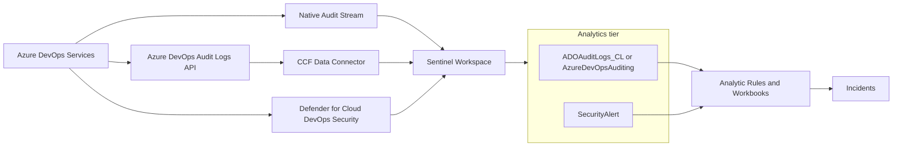

# Azure DevOps

> Status: verified. Priority: P3. Last verified: 21 Nov 2026.

## What it is

Azure DevOps Services hosts Git repositories, CI/CD pipelines, build agent pools, service connections into Azure and artifact feeds. Its audit logs record PAT creation and misuse, service connection changes, build agent additions, pipeline variable edits, PR policy bypasses and organisation security policy changes.

## Key recommendations

- Install the **Azure DevOps Auditing** solution from Content Hub ([solution folder](https://github.com/Azure/Azure-Sentinel/tree/master/Solutions/AzureDevOpsAuditing)). You have two supported ingestion paths; pick one so you don't pay twice:
  - **Recommended for new Sentinel deployments:** Use the **Azure DevOps Audit Logs (via Codeless Connector Framework)** connector (`ADOAuditLogs_CL`). It authenticates via an Entra ID app registration (`vso.auditlog`), avoids shared workspace keys, supports multiple Azure DevOps organisations in one connector and supports DCR workspace transformations ([Microsoft Learn](https://learn.microsoft.com/en-us/azure/sentinel/data-connectors-reference)).
  - **Native streaming option:** Use **Azure DevOps Audit Streaming** pointing to Azure Monitor Logs, which writes directly into the built-in `AzureDevOpsAuditing` table ([Microsoft Learn](https://learn.microsoft.com/en-us/azure/devops/organizations/audit/auditing-streaming)). Note that native Azure Monitor Logs streaming relies on the Log Analytics workspace ID and shared key, which fails with HTTP 403 if `disableLocalAuth` is enforced on the workspace.
- Keep Azure DevOps audit logs in the **Analytics** tier. Volume is low in almost every organisation, and high-value supply-chain rules (PAT misuse, rogue build agents, service connection hijacking) need near real-time alerting.
- Pair audit logs with **Microsoft Defender for Cloud DevOps Security** (connecting your Azure DevOps organisations to Defender for Cloud) so code vulnerabilities, exposed secrets and IaC misconfigurations flow into Defender for Cloud and `SecurityAlert` ([Microsoft Learn](https://learn.microsoft.com/en-us/azure/defender-for-cloud/defender-for-devops-introduction)).
- Enable auditing explicitly in every Entra-backed Azure DevOps organisation. Auditing is **off by default**, and Azure DevOps only retains logs natively for 90 days.
- Monitor the audit stream itself. Alert immediately if someone disables auditing or deletes an audit stream in organisation settings.

## High-value log sources

| Source | Table name | Connector | Tier | Cost / volume | Value |
|---|---|---|---|---|---|
| Azure DevOps audit logs (CCF, recommended) | `ADOAuditLogs_CL` (queried via `ADOAuditLogs` parser/table in rules) | Azure DevOps Audit Logs (via Codeless Connector Framework) | Analytics | Billable. Low | Organisation and project audit events via the Azure DevOps Audit Logs API with Entra ID auth and DCR support ([Microsoft Learn](https://learn.microsoft.com/en-us/azure/sentinel/data-connectors-reference)). |
| Azure DevOps native audit stream | `AzureDevOpsAuditing` | Azure DevOps Audit Streaming to Azure Monitor Logs | Analytics | Billable. Low | Built-in Azure Monitor table receiving near real-time streams of PAT, pipeline, repo, agent pool, extension and policy changes ([table reference](https://learn.microsoft.com/en-us/azure/azure-monitor/reference/tables/azuredevopsauditing)). |
| Defender for Cloud DevOps Security | `SecurityAlert` / Defender for Cloud recommendations | Microsoft Defender for Cloud (Azure DevOps connector) | Analytics | Alerts free in Sentinel; DevOps posture included in Defender CSPM / Defender for Cloud | Exposed secrets, GitHub Advanced Security for Azure DevOps (GHAzDO) / MSDO scan findings, IaC posture and PR annotations ([Microsoft Learn](https://learn.microsoft.com/en-us/azure/defender-for-cloud/defender-for-devops-introduction)). |

Azure DevOps audit streaming also supports **Azure Event Grid** and **Splunk** as destinations if you route logs through a central event broker rather than straight to Sentinel ([Microsoft Learn](https://learn.microsoft.com/en-us/azure/devops/organizations/audit/auditing-streaming)).

### What to ingest first

| Priority | Table | Why | Rough volume | Tier |
|---|---|---|---|---|
| 1 | `ADOAuditLogs_CL` (CCF) or `AzureDevOpsAuditing` (native stream) | Low volume, high supply-chain value: PAT misuse, rogue agents, service connections and policy changes | Low | Analytics |
| 2 | `SecurityAlert` via Defender for Cloud DevOps Security | Surfaces exposed credentials, IaC flaws and pipeline security findings alongside cloud workloads | Very low | Analytics |
| Skip | Running both CCF and native Azure Monitor streaming on the same org | Duplicates every audit event and doubles ingestion cost | Low | Pick one path per org |

## Prerequisites and licensing

| Item | Detail |
|---|---|
| Identity backing | Your Azure DevOps Services organisation **must be backed by Microsoft Entra ID**. Organisations backed by Microsoft Accounts (MSA) and on-premises Azure DevOps Server do not support auditing or audit streaming ([Microsoft Learn](https://learn.microsoft.com/en-us/azure/devops/organizations/audit/auditing-streaming)). |
| Auditing switch | Auditing is **off by default** in Azure DevOps. You must enable **Log Audit Events** in Organisation Settings > Policies before any stream or API connector receives events. |
| CCF connector auth | Requires an Entra ID app registration granted Azure DevOps `vso.auditlog` API permission and added to the target Azure DevOps organisation with audit log read access. |
| Native Azure Monitor stream auth | Requires the Log Analytics workspace ID and primary/secondary shared key, which requires `disableLocalAuth = false` on the workspace. |
| Defender for Cloud DevOps Security | Requires Microsoft Defender for Cloud enabled in Azure (Defender CSPM recommended) and optionally GitHub Advanced Security for Azure DevOps (GHAzDO) or the Microsoft Security DevOps (MSDO) extension ([Microsoft Learn](https://learn.microsoft.com/en-us/azure/defender-for-cloud/defender-for-devops-introduction)). |
| Sentinel | A Log Analytics workspace with Microsoft Sentinel enabled. Both `ADOAuditLogs_CL` and `AzureDevOpsAuditing` are billable ingestion. |

### Roles you need

| Task | Role |
|---|---|
| Enable auditing and manage audit streams in Azure DevOps | **Project Collection Administrators** group member (Organisation Owner), or explicit **Manage audit streams** and **View audit log** permissions set to Allow ([Microsoft Learn](https://learn.microsoft.com/en-us/azure/devops/organizations/audit/auditing-streaming)) |
| Install the Azure DevOps Auditing solution and connect Sentinel | Microsoft Sentinel Contributor on the resource group and workspace ([Microsoft Learn](https://learn.microsoft.com/en-us/azure/sentinel/sentinel-solutions-deploy)) |
| Register the Entra ID app (for CCF connector) | Application Administrator (or Cloud Application Administrator) in Entra ID |
| Connect Azure DevOps to Defender for Cloud | Security Admin in Azure + Project Collection Administrator in Azure DevOps |

## Step-by-step setup

1. **Confirm Entra ID backing and enable auditing.** In Azure DevOps, open **Organisation settings** > **Microsoft Entra** to confirm the organisation is connected to your Entra tenant. Then go to **Organisation settings** > **Policies** and switch **Log Audit Events** to **On** ([Microsoft Learn](https://learn.microsoft.com/en-us/azure/devops/organizations/audit/auditing-streaming)).
2. **Install the Azure DevOps Auditing solution.** Defender portal > Microsoft Sentinel > Content management > Content hub. Search for **Azure DevOps Auditing**, select View details, then Install ([Microsoft Learn](https://learn.microsoft.com/en-us/azure/sentinel/sentinel-solutions-deploy)).
3. **Connect using Option A (CCF, recommended) or Option B (native stream):**
   - **Option A (CCF -> `ADOAuditLogs_CL`):** Register an Entra ID application with Azure DevOps `vso.auditlog` permission, grant it audit read access in your Azure DevOps organisation(s), then open **Azure DevOps Audit Logs (via Codeless Connector Framework)** in Defender portal > Setup & configuration > Data management > Data & connectors and supply the app credentials and organisation name(s) ([Microsoft Learn](https://learn.microsoft.com/en-us/azure/sentinel/configure-data-connector)).
   - **Option B (Native stream -> `AzureDevOpsAuditing`):** In Azure DevOps, open **Organisation settings** > **Auditing** > **Streams** > **New stream** > **Azure Monitor Logs**. Paste your Log Analytics workspace ID and shared key, select **Set up**, and confirm status shows **Enabled** ([Microsoft Learn](https://learn.microsoft.com/en-us/azure/devops/organizations/audit/auditing-streaming)).
4. **Connect Defender for Cloud DevOps Security (optional, recommended).** Azure portal > Microsoft Defender for Cloud > Environment settings > **Add environment** > **Azure DevOps**. Authorise your target Azure DevOps organisations and enable PR annotations and secret/IaC scanning ([Microsoft Learn](https://learn.microsoft.com/en-us/azure/defender-for-cloud/defender-for-devops-introduction)).
5. **Generate test events.** Create and delete a test repository or short-lived PAT in a sandbox project.
6. **Validate.** Native audit streams typically land within 5 to 15 minutes; CCF polling lands on its polling cycle. Run the validation queries below in Advanced hunting with your Sentinel workspace selected.

## Architecture diagram



## Validation KQL

For group-wide and workspace-wide freshness checks, see [devops.kql](../../queries/validation/devops.kql) and the [validation query pack](../../queries/validation/README.md).

```kql
// 1. Confirm which Azure DevOps table is landing and how fresh it is
union withsource=Table isfuzzy=true AzureDevOpsAuditing, ADOAuditLogs_CL
| where TimeGenerated > ago(1d)
| summarize Rows = count(), Latest = max(TimeGenerated) by Table

// 2. Check top areas, categories and operations in AzureDevOpsAuditing
// (Swap table name to ADOAuditLogs_CL or the solution parser if using CCF)
AzureDevOpsAuditing
| where TimeGenerated > ago(7d)
| summarize Events = count(), Latest = max(TimeGenerated) by Area, Category, OperationName
| order by Events desc

// 3. Check authentication mechanisms in use (spot PAT vs OAuth/Entra sessions)
AzureDevOpsAuditing
| where TimeGenerated > ago(7d)
| summarize Events = count(), Users = dcount(ActorUPN) by AuthenticationMechanism
| order by Events desc

// 4. Cost: GB per day across both possible Azure DevOps audit tables
Usage
| where TimeGenerated > ago(30d)
| where DataType in ("AzureDevOpsAuditing", "ADOAuditLogs_CL")
| summarize GB = round(sum(Quantity) / 1024, 3) by DataType, Day = bin(TimeGenerated, 1d)
| summarize GBperDay = round(avg(GB), 3), TotalGB30d = round(sum(GB), 2) by DataType
```

## Out-of-box analytic rules

From the **Azure DevOps Auditing** solution in Content Hub ([Analytic Rules folder](https://github.com/Azure/Azure-Sentinel/tree/master/Solutions/AzureDevOpsAuditing/Analytic%20Rules)). Rules in the solution query the `ADOAuditLogs` parser/table; confirm the parser in your workspace maps to whichever table (`ADOAuditLogs_CL` or `AzureDevOpsAuditing`) you ingest into before enabling rules.

| Rule | Detects | Tables | MITRE | Suggested |
|---|---|---|---|---|
| New agent added to pool by new user or of new OS (`NewAgentAddedToPoolbyNewUserorofNewOS.yaml`) | Build agent added by an unaccustomed user or running a new OS (supply-chain persistence) | `ADOAuditLogs` | Persistence, Initial Access T1195 | Enable day 1 |
| Azure DevOps PAT used with browser (`ADOPATUsedWithBrowser.yaml`) | Personal Access Token authenticated from a browser User-Agent string, indicating token theft | `ADOAuditLogs` | Credential Access, Initial Access T1528 | Enable day 1 |
| Azure DevOps PAT session misuse (`AzDOPatSessionMisuse.yaml`) | Sensitive group, project or security operations executed with a PAT outside normal patterns | `ADOAuditLogs` | Credential Access, Privilege Escalation | Enable day 1 |
| Azure DevOps agent pool created or deleted (`ADOAgentPoolCreatedDeleted.yaml`) | Creation or rapid deletion of self-hosted or hosted agent pools | `ADOAuditLogs` | Persistence, Defense Evasion | Enable day 1 |
| Azure DevOps new extension added (`ADONewExtensionAdded.yaml`) | Third-party extension installed from a publisher outside an approved list | `ADOAuditLogs` | Persistence T1195 | Enable day 1, configure allow list |
| Azure DevOps service connection usage (`AzDOServiceConnectionUsage.yaml`) | Rapid service connection additions or suspicious pipeline access to dump credentials | `ADOAuditLogs` | Credential Access, Lateral Movement | Enable day 1 |
| Azure DevOps secret not secured (`ADOSecretNotSecured.yaml`) | Pipeline variables carrying secrets without the secret flag enabled | `ADOAuditLogs` | Credential Access T1552 | Enable, tune |
| Azure DevOps variable modified by new user (`ADOVariableModifiedByNewUser.yaml`) | Pipeline variable edits by users who have not previously modified variables in that project | `ADOAuditLogs` | Persistence, Execution | Enable, tune |
| Azure DevOps historic PR policy bypassing (`AzDOHistoricPrPolicyBypassing.yaml`) | Pull request branch policy bypasses outside historical norms | `ADOAuditLogs` | Defense Evasion, Initial Access | Enable, tune |

Also review `AzDOHistoricServiceConnectionAdds.yaml` and malicious tooling detections in the solution folder before enabling.

## Custom detections

Run these hourly with a 1-hour lookback. Examples below query `AzureDevOpsAuditing`; swap to `ADOAuditLogs_CL` (or your workspace's `ADOAuditLogs` parser) if you ingest via CCF.

### C1. Audit stream deleted, disabled or auditing policy turned off (High)

An attacker with Project Collection Administrator access often turns off auditing or removes the SIEM stream before tampering with production pipelines.

```kql
// CUSTOM - Azure DevOps audit stream modified/deleted or Log Audit Events disabled
// ASSUMPTION: OperationName values match Azure DevOps Auditing event names for AuditLog and Policy.
// Confirm exact OperationName strings in your tenant with:
//   AzureDevOpsAuditing | where TimeGenerated > ago(30d) | where Area in ("AuditLog", "Policy") | distinct OperationName
AzureDevOpsAuditing
| where TimeGenerated > ago(1h)
| where OperationName in~ (
    "AuditLog.DeleteStream",
    "AuditLog.UpdateStream",
    "AuditLog.DisableStream",
    "Policy.PolicyValueUpdated"
)
| where OperationName !~ "Policy.PolicyValueUpdated" or Details has_any ("LogAuditEvents", "Audit")
| project TimeGenerated, ActorUPN, ActorDisplayName, IpAddress, UserAgent, Area, OperationName, Details, Data
```

MITRE ATT&CK: Defense Evasion T1562.008 (Disable or Modify Cloud Logs).

### C2. Full-scope or long-lived Personal Access Token (PAT) created (Medium to High)

Broad-scope PATs (`vso.full_access` or global tokens across all organisations) are a common persistence mechanism and bypass Conditional Access session controls.

```kql
// CUSTOM - Personal Access Token created with broad scope or by non-standard actor
// ASSUMPTION: OperationName for PAT creation is "Token.PatCreateEvent" and Scopes/Data carries
// token scope metadata (verify exact column contents on a test PAT creation event first).
AzureDevOpsAuditing
| where TimeGenerated > ago(1h)
| where OperationName =~ "Token.PatCreateEvent"
| where Scopes has_any ("app_token", "vso.full_access") or Details has_any ("All accessible organizations", "Full access")
| project TimeGenerated, ActorUPN, ActorDisplayName, IpAddress, UserAgent, AuthenticationMechanism, Scopes, Details, Data
```

MITRE ATT&CK: Persistence T1098 (Account Manipulation) and Credential Access T1528.

### C3. Service connection shared across all pipelines or modified outside change control (High)

Opening a production Azure service connection to all pipelines lets any contributor with repo write access run a YAML pipeline that uses the service principal's Azure permissions.

```kql
// CUSTOM - Service connection permissions broadened or modified unexpectedly
// ASSUMPTION: Area == "Library" and OperationName matches ServiceEndpoint / PipelinePermission events.
// Validate exact OperationName strings in your tenant with:
//   AzureDevOpsAuditing | where TimeGenerated > ago(30d) | where Area == "Library" | distinct OperationName
let approved_admins = dynamic(["devops-admin@yourdomain.gov.au"]);
AzureDevOpsAuditing
| where TimeGenerated > ago(1h)
| where Area =~ "Library"
| where OperationName has_any ("ServiceEndpoint", "PipelinePermission")
| where Details has_any ("all pipelines", "Authorize", "Modified", "Created")
| where ActorUPN !in~ (approved_admins)
| project TimeGenerated, ProjectName, ActorUPN, IpAddress, AuthenticationMechanism, OperationName, Details, Data
```

MITRE ATT&CK: Privilege Escalation T1078.004 and Lateral Movement.

## Playbooks

Check the `Playbooks` folder in the **Azure DevOps Auditing** Content Hub solution ([solution folder](https://github.com/Azure/Azure-Sentinel/tree/master/Solutions/AzureDevOpsAuditing)). Two practical automated responses to pair with these alerts:

- **Revoke user sessions and PATs on suspected token theft.** Triggered by `ADOPATUsedWithBrowser` or `AzDOPatSessionMisuse`. Calls Microsoft Graph to revoke Entra ID refresh tokens (`Revoke-AADSignInSessions` from the Entra ID solution) and notifies the SOC and DevOps leads in Teams to revoke the specific PAT via the Azure DevOps PAT Lifecycle Management REST API (requires a managed identity or Entra app with `vso.tokens` / Entra token revocation permissions).
- **Quarantine modified service connection or agent pool.** Sends an approval card to the platform team when a new self-hosted agent or broad service connection change fires outside change windows, linking directly to the Azure DevOps project settings page for immediate review.

## Workbooks and hunting

The **Azure DevOps Auditing** solution includes workbooks and **Hunting Queries** over `ADOAuditLogs` covering administrative actions, authentication mechanisms (PAT vs Entra OAuth), agent pool activity, pipeline edits and user activity baselines ([solution folder](https://github.com/Azure/Azure-Sentinel/tree/master/Solutions/AzureDevOpsAuditing)).

Two hunting queries worth running weekly:

- **PAT authentication from multiple IPs or unusual user agents.** Spot shared or leaked developer PATs being replayed from outside corporate egress ranges.

```kql
// Hunt: PATs used from 3 or more distinct IPs inside 24 hours
AzureDevOpsAuditing
| where TimeGenerated > ago(1d)
| where AuthenticationMechanism has "PAT"
| summarize DistinctIPs = dcount(IpAddress),
            IPs = make_set(IpAddress, 10),
            UserAgents = make_set(UserAgent, 5),
            Operations = make_set(OperationName, 10)
            by ActorUPN
| where DistinctIPs >= 3
| order by DistinctIPs desc
```

- **Organisation security policy weakenings.** Review `AzureDevOpsAuditing | where TimeGenerated > ago(30d) | where Area == "Policy"` monthly to confirm third-party OAuth access, SSH authentication, public projects and PAT restriction policies stay hardened.

## Gotchas and deprecations

- **Entra ID backing is mandatory.** Auditing and audit streaming are only available for Azure DevOps Services organisations backed by Microsoft Entra ID; on-premises Azure DevOps Server and MSA-backed organisations aren't supported ([Microsoft Learn](https://learn.microsoft.com/en-us/azure/devops/organizations/audit/auditing-streaming)).
- **Auditing is off by default.** New Azure DevOps organisations don't emit audit events until you switch **Log Audit Events** on under Organisation Settings > Policies.
- **Native retention is 90 days only.** Azure DevOps drops audit records older than 90 days unless you stream or ingest them into Sentinel or archival storage ([Microsoft Learn](https://learn.microsoft.com/en-us/azure/devops/organizations/audit/auditing-streaming)).
- **Workspace local auth breaks native Azure Monitor streaming.** The native Azure Monitor Logs audit stream authenticates using the Log Analytics workspace shared key. If your workspace enforces `disableLocalAuth = true`, stream setup returns HTTP 403 Forbidden; use the **Codeless Connector Framework** connector (`ADOAuditLogs_CL`) with Entra ID authentication instead.
- **Two table names across the ecosystem.** Native streaming writes to `AzureDevOpsAuditing`, while the CCF connector writes to `ADOAuditLogs_CL`. Always verify which table your `ADOAuditLogs` parser points to so out-of-box rules don't silently return zero results.
- **Project-Scoped Users can't access auditing.** If the "Limit user visibility and collaboration to specific projects" preview feature is enabled, members of the Project-Scoped Users group cannot view or manage audit streams even if granted permissions ([Microsoft Learn](https://learn.microsoft.com/en-us/azure/devops/organizations/audit/auditing-streaming)).
- **Sentinel in the Azure portal retires on 31 March 2027.** Build and test connectors, rules and workbooks in the Defender portal ([Microsoft Learn](https://learn.microsoft.com/en-us/azure/sentinel/microsoft-sentinel-defender-portal)).

## Official links

- [Create audit streaming for Azure DevOps](https://learn.microsoft.com/en-us/azure/devops/organizations/audit/auditing-streaming)
- [AzureDevOpsAuditing table reference](https://learn.microsoft.com/en-us/azure/azure-monitor/reference/tables/azuredevopsauditing)
- [Azure DevOps Auditing solution, Azure-Sentinel repo](https://github.com/Azure/Azure-Sentinel/tree/master/Solutions/AzureDevOpsAuditing)
- [Azure DevOps Auditing Analytic Rules, Azure-Sentinel repo](https://github.com/Azure/Azure-Sentinel/tree/master/Solutions/AzureDevOpsAuditing/Analytic%20Rules)
- [Defender for Cloud DevOps security overview](https://learn.microsoft.com/en-us/azure/defender-for-cloud/defender-for-devops-introduction)
- [Microsoft Sentinel tables and associated connectors](https://learn.microsoft.com/en-us/azure/sentinel/data-connectors-reference)
- [Enable a data connector, Defender portal navigation](https://learn.microsoft.com/en-us/azure/sentinel/configure-data-connector)
- [Discover and deploy content from Content hub](https://learn.microsoft.com/en-us/azure/sentinel/sentinel-solutions-deploy)
- [Microsoft Sentinel in the Defender portal](https://learn.microsoft.com/en-us/azure/sentinel/microsoft-sentinel-defender-portal)

## Last verified

21 Nov 2026, against Microsoft Learn and the Azure-Sentinel repo. Re-verify before relying on connector authentication methods, parser mappings or operation strings.
