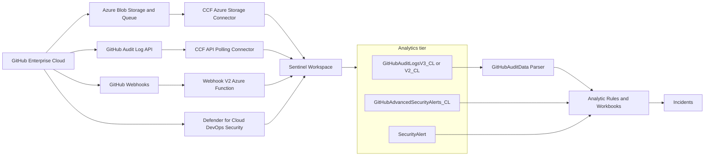

# GitHub (Enterprise Cloud)

> Status: verified. Priority: P2. Last verified: 21 Nov 2026.

## What it is

GitHub Enterprise Cloud hosts source code, CI/CD workflows (GitHub Actions), secrets and deployment environments. Its audit logs and security alerts expose repository visibility flips (private to public), personal access token (PAT) and SSH key additions, branch protection bypasses, workflow tampering and secret-scanning alerts.

## Key recommendations

- Pick **one** audit log connector from the **GitHub** Content Hub solution and don't run legacy and modern connectors side by side ([solution folder](https://github.com/Azure/Azure-Sentinel/tree/master/Solutions/GitHub)):
  - **Best for GitHub Enterprise Cloud (recommended):** Use GitHub's native **audit log streaming to Azure Blob Storage** paired with the **GitHub Enterprise Audit Log (via Azure Storage)** connector (`GitHubAuditLogsV3_CL`). It gives near real-time delivery, captures both audit and Git events, avoids PAT polling rate limits and supports DCR workspace transformations ([GitHub Docs](https://docs.github.com/en/enterprise-cloud@latest/admin/monitoring-activity-in-your-enterprise/reviewing-audit-logs-for-your-enterprise/streaming-the-audit-log-for-your-enterprise)).
  - **Fastest setup if you can't provision Blob Storage streaming yet:** Use **GitHub Enterprise Audit Log (via Codeless Connector Framework)** (`GitHubAuditLogsV2_CL`), which polls the Enterprise Audit Log API via CCF with a PAT (`read:audit_log`) ([Microsoft Learn](https://learn.microsoft.com/en-us/azure/sentinel/data-connectors-reference)).
  - **Avoid deprecated connectors:** Skip `[Deprecated] GitHub Enterprise Audit Log` (`GitHubAuditLogPolling_CL`) and legacy `GitHub_CL` / `githubscanaudit_CL` webhook v1 connectors.
- Query through the `GitHubAuditData` parser shipped with the solution ([GitHubAuditData.yaml](https://github.com/Azure/Azure-Sentinel/blob/master/Solutions/GitHub/Parsers/GitHubAuditData.yaml)). It normalises `GitHubAuditLogsV3_CL`, `GitHubAuditLogsV2_CL`, `GitHubAuditLogPolling_CL` and `GitHub_CL` into one schema so rules survive connector migrations.
- Keep audit logs in the **Analytics** tier for administrative and security events. If you enable Git events (`git.clone`, `git.fetch`, `git.push`) in enterprise audit streaming, volume jumps sharply; either filter noisy `git.fetch`/`git.clone` events in the DCR or route high-volume Git events to the **data lake** tier.
- Connect **GitHub Advanced Security** alerts via either the **GitHub (using Webhooks) V2** connector (`GitHubAdvancedSecurityAlerts_CL`) or **Microsoft Defender for Cloud DevOps Security** (which brings GitHub code scanning, secret scanning, Dependabot and IaC posture into Defender for Cloud and Defender XDR) ([Microsoft Learn](https://learn.microsoft.com/en-us/azure/defender-for-cloud/defender-for-devops-introduction)).
- Enable **Include Git events** and **IP address disclosure** carefully in GitHub Enterprise settings. Without IP disclosure, audit logs omit actor IP addresses unless the action is taken by a managed user or inside your configured enterprise IP allow list.

## High-value log sources

| Source | Table name | Connector | Tier | Cost / volume | Value |
|---|---|---|---|---|---|
| Enterprise audit log (streaming, recommended) | `GitHubAuditLogsV3_CL` (parsed via `GitHubAuditData`) | GitHub Enterprise Audit Log (via Azure Storage) | Analytics (consider DCR filter or data lake for high-volume `git.*` events) | Billable. Low for admin/org audit; medium to high if Git events are enabled | Near real-time enterprise audit and Git events via Blob Storage streaming and Storage Queue notifications ([GitHub Docs](https://docs.github.com/en-us/enterprise-cloud@latest/admin/monitoring-activity-in-your-enterprise/reviewing-audit-logs-for-your-enterprise/streaming-the-audit-log-for-your-enterprise)). |
| Enterprise audit log (API polling CCF) | `GitHubAuditLogsV2_CL` (parsed via `GitHubAuditData`) | GitHub Enterprise Audit Log (via Codeless Connector Framework) | Analytics | Billable. Low to medium | Codeless REST API polling of the GitHub Enterprise audit log with DCR transformation support ([Microsoft Learn](https://learn.microsoft.com/en-us/azure/sentinel/data-connectors-reference)). |
| GitHub Advanced Security alerts | `GitHubAdvancedSecurityAlerts_CL` (parsed via `GitHubScanAudit`) | GitHub (using Webhooks) V2 (Azure Function + Logs Ingestion API) | Analytics | Billable. Low | Real-time Dependabot, Code Scanning and Secret Scanning alerts from repositories ([solution folder](https://github.com/Azure/Azure-Sentinel/tree/master/Solutions/GitHub)). |
| Defender for Cloud DevOps Security | `SecurityAlert` / Defender for Cloud recommendations | Microsoft Defender for Cloud (GitHub connector) | Analytics | Alerts free in Sentinel; DevOps posture included in Defender CSPM / Defender for Cloud | Unified code-to-cloud visibility, exposed secret recommendations, IaC scanning and PR annotations across GitHub and Azure DevOps ([Microsoft Learn](https://learn.microsoft.com/en-us/azure/defender-for-cloud/defender-for-devops-introduction)). |
| Legacy audit polling / webhook v1 (deprecated) | `GitHubAuditLogPolling_CL`, `GitHub_CL`, `githubscanaudit_CL` | `[Deprecated] GitHub Enterprise Audit Log` / legacy webhook | Do not deploy new | Billable | Superseded by `GitHubAuditLogsV3_CL`, `GitHubAuditLogsV2_CL` and `GitHubAdvancedSecurityAlerts_CL`. Migrate off these. |

### What to ingest first

| Priority | Table | Why | Rough volume | Tier |
|---|---|---|---|---|
| 1 | `GitHubAuditLogsV3_CL` (or `GitHubAuditLogsV2_CL`) | Core audit trail for visibility changes, PAT/SSH grants, org owners and branch protection tampering | Low (admin/audit), medium+ with Git events | Analytics |
| 2 | `GitHubAdvancedSecurityAlerts_CL` | Secret scanning bypasses, exposed credentials and critical repo vulnerabilities | Low | Analytics |
| 3 | Defender for Cloud DevOps Security | Correlates GitHub repos and IaC misconfigurations with production Azure workloads | Very low (alerts) | Analytics |
| Skip | `GitHubAuditLogPolling_CL` and `GitHub_CL` | Deprecated legacy connectors; running them alongside V2/V3 duplicates ingestion | Low to medium | Skip |

## Prerequisites and licensing

| Item | Detail |
|---|---|
| GitHub plan | **GitHub Enterprise Cloud** is required for enterprise audit log streaming (Azure Blob Storage / Azure Event Hubs) and the enterprise audit log REST API ([GitHub Docs](https://docs.github.com/en/enterprise-cloud@latest/admin/monitoring-activity-in-your-enterprise/reviewing-audit-logs-for-your-enterprise/streaming-the-audit-log-for-your-enterprise)). GitHub Team/Free plans only expose organisation-level audit logs via the UI or limited APIs and do not support enterprise streaming. |
| GitHub Advanced Security | Required on private repositories for Code Scanning and Secret Scanning alerts (free on public repositories). |
| Azure Storage (for V3 streaming) | An Azure Storage Account (Blob container + Event Grid / Storage Queue notifications) reachable by GitHub's streaming service. |
| PAT scope (for V2 CCF polling) | A classic Personal Access Token from an Enterprise Owner with the `read:audit_log` scope (and SSO authorised if SAML SSO is enforced). |
| Defender for Cloud DevOps Security | Microsoft Defender for Cloud enabled in Azure (Defender CSPM recommended for full code-to-cloud attack paths and secret scanning posture) ([Microsoft Learn](https://learn.microsoft.com/en-us/azure/defender-for-cloud/defender-for-devops-introduction)). |
| Sentinel | A Log Analytics workspace with Microsoft Sentinel enabled. Custom `_CL` tables are billable ingestion. |

### Roles you need

| Task | Role |
|---|---|
| Configure GitHub Enterprise audit log streaming or create the PAT | GitHub Enterprise Owner |
| Install the GitHub solution and configure Sentinel connectors | Microsoft Sentinel Contributor on the resource group and workspace ([Microsoft Learn](https://learn.microsoft.com/en-us/azure/sentinel/sentinel-solutions-deploy)) |
| Create Storage Account, Queue and Event Grid subscription (for V3) | Contributor (or Storage Account Contributor + EventGrid Contributor) on the resource group |
| Connect GitHub to Defender for Cloud DevOps Security | Security Admin in Azure + GitHub Organisation Owner to authorise the Microsoft Security DevOps GitHub App |

## Step-by-step setup

### Option A (recommended): Near real-time streaming via Azure Storage (`GitHubAuditLogsV3_CL`)

1. **Install the GitHub solution.** Defender portal > Microsoft Sentinel > Content management > Content hub. Search for **GitHub**, select View details, then Install ([Microsoft Learn](https://learn.microsoft.com/en-us/azure/sentinel/sentinel-solutions-deploy)).
2. **Prepare Azure Storage.** Create an Azure Storage Account and Blob container, plus a Storage Queue and Event Grid subscription that pushes blob-created events into the queue as described on the connector page.
3. **Configure audit log streaming in GitHub.** Open your GitHub Enterprise account > **Settings** > **Audit log** > **Log streaming** > **Configure stream** > **Azure Blob Storage**. Provide the container SAS URL, select **Audit events** (and **Git events** if you want clone/push visibility), select **Check endpoint**, then **Save** ([GitHub Docs](https://docs.github.com/en/enterprise-cloud@latest/admin/monitoring-activity-in-your-enterprise/reviewing-audit-logs-for-your-enterprise/streaming-the-audit-log-for-your-enterprise)).
4. **Enable the V3 Sentinel connector.** Defender portal > Setup & configuration > Data management > Data & connectors > Connectors tab > select **GitHub Enterprise Audit Log (via Azure Storage)**. Provide the Storage Account and Queue details so the CCF connector ingests blobs into `GitHubAuditLogsV3_CL` ([Microsoft Learn](https://learn.microsoft.com/en-us/azure/sentinel/configure-data-connector)).

### Option B (alternative): API polling via CCF (`GitHubAuditLogsV2_CL`)

1. **Create a scoped token.** As a GitHub Enterprise Owner, create a classic PAT with `read:audit_log` (authorise it for SAML SSO if enabled) and note your enterprise slug.
2. **Connect via CCF.** On the **GitHub Enterprise Audit Log (via Codeless Connector Framework)** connector page in Sentinel, enter the enterprise name and PAT, then select **Connect**. Logs begin polling into `GitHubAuditLogsV2_CL`.

### Optional: Security alerts and Defender for Cloud DevOps Security

1. **Ingest GitHub Advanced Security alerts.** Deploy **GitHub (using Webhooks) V2** from the GitHub solution (Azure Function using Managed Identity + Logs Ingestion API) and configure organisation or repository webhooks for Code Scanning, Secret Scanning and Dependabot alerts into `GitHubAdvancedSecurityAlerts_CL`.
2. **Connect Defender for Cloud DevOps Security.** Azure portal > Microsoft Defender for Cloud > Environment settings > **Add environment** > **GitHub**. Authorise the GitHub App on your target organisations so findings flow into Defender for Cloud and `SecurityAlert` ([Microsoft Learn](https://learn.microsoft.com/en-us/azure/defender-for-cloud/defender-for-devops-introduction)).
3. **Validate.** Perform a benign test action in a sandbox repo (for example toggle a test repo setting), wait 5 to 15 minutes, and run the validation queries below.

## Architecture diagram



## Validation KQL

For group-wide and workspace-wide freshness checks, see [devops.kql](../../queries/validation/devops.kql) and the [validation query pack](../../queries/validation/README.md).

```kql
// 1. Check which GitHub tables are landing and how fresh they are
union withsource=Table isfuzzy=true
    GitHubAuditLogsV3_CL, GitHubAuditLogsV2_CL, GitHubAuditLogPolling_CL,
    GitHub_CL, GitHubAdvancedSecurityAlerts_CL
| where TimeGenerated > ago(1d)
| summarize Rows = count(), Latest = max(TimeGenerated) by Table
| order by Table asc

// 2. Verify the GitHubAuditData parser works and inspect top action categories
GitHubAuditData
| where TimeGenerated > ago(1d)
| summarize Events = count(), Latest = max(TimeGenerated) by Action
| top 20 by Events desc

// 3. Check whether actor IP addresses are populated (confirm IP disclosure setting)
GitHubAuditData
| where TimeGenerated > ago(1d)
| summarize Total = count(), WithIP = countif(isnotempty(ActorIp))

// 4. Cost: GB per day across GitHub custom tables
Usage
| where TimeGenerated > ago(30d)
| where DataType in ("GitHubAuditLogsV3_CL", "GitHubAuditLogsV2_CL", "GitHubAuditLogPolling_CL",
                     "GitHub_CL", "GitHubAdvancedSecurityAlerts_CL")
| summarize GB = round(sum(Quantity) / 1024, 3) by DataType, Day = bin(TimeGenerated, 1d)
| summarize GBperDay = round(avg(GB), 3), TotalGB30d = round(sum(GB), 2) by DataType
| order by GBperDay desc
```

## Out-of-box analytic rules

From the **GitHub** solution in Content Hub ([Analytic Rules folder](https://github.com/Azure/Azure-Sentinel/tree/master/Solutions/GitHub/Analytic%20Rules)). Out-of-box analytic rule count in the GitHub solution is minimal, with most built-in detections shipped as **Hunting Queries** instead. Convert the high-value hunting queries and the custom detections below into scheduled rules on day 1.

| Rule | Detects | Tables | MITRE | Suggested |
|---|---|---|---|---|
| Security Vulnerability in Repo (`Security Vulnerability in Repo.yaml`) | New security vulnerability detected in a GitHub repository | `GitHubAdvancedSecurityAlerts_CL` / `GitHubScanAudit` | Initial Access T1190, T1203, T1068 | Enable day 1, raise severity from Informational for critical CVEs |

Note also that the **Microsoft Entra ID** solution ships **GitHub Signin Burst from Multiple Locations** on `SigninLogs` if your GitHub Enterprise uses Entra ID SAML SSO or Enterprise Managed Users (EMU).

## Custom detections

Run these every 15 to 60 minutes over `GitHubAuditData`. Because GitHub audit action names and parser column aliases can vary slightly across V2/V3 versions, verify field names (`Action`, `Actor`, `Repo`, `Org`, `ActorIp`, `Country`) against one sample row in your workspace before enabling.

### C1. Private or internal repository made public (High)

Exposing a private repository is one of the fastest paths to source-code and secret leakage.

```kql
// CUSTOM - Repository visibility changed to public
// ASSUMPTION: GitHubAuditData exposes Action, Actor, Repo, Org and ActorIp.
// Confirm exact column names and Action values on your workspace:
//   GitHubAuditData | where TimeGenerated > ago(30d) | where Action has "repo.access" | take 5
GitHubAuditData
| where TimeGenerated > ago(1h)
| where Action =~ "repo.access"
| where tostring(Visibility) =~ "public" or tostring(RawData) has "\"visibility\":\"public\""
| project TimeGenerated, Actor, ActorIp, Org, Repo, Action
```

MITRE ATT&CK: Exfiltration T1567 (Exfiltration Over Web Service) and Impact.

### C2. Secret scanning push protection bypassed or alert dismissed (High)

Attackers and hurried developers alike bypass push protection or dismiss secret-scanning alerts. Alerting on every bypass gives the SOC immediate verification before leaked keys are abused.

```kql
// CUSTOM - Secret scanning push protection bypass or secret alert resolution
// ASSUMPTION: GitHub audit actions match GitHub Enterprise Cloud naming for secret scanning.
// Verify exact Action values in your tenant before enabling.
GitHubAuditData
| where TimeGenerated > ago(1h)
| where Action in~ (
    "secret_scanning_push_protection.bypass",
    "secret_scanning_alert.resolve",
    "repo.secret_scanning_push_protection_disable",
    "org.secret_scanning_push_protection_disable"
)
| project TimeGenerated, Actor, ActorIp, Org, Repo, Action
```

MITRE ATT&CK: Defense Evasion T1562.001 (Disable or Modify Tools) and Credential Access T1552.001.

### C3. Branch protection disabled, workflow permissions weakened or unexpected PAT/SSH key created (Medium to High)

```kql
// CUSTOM - High-risk persistence and supply-chain tampering in GitHub Enterprise
// ASSUMPTION: GitHubAuditData exposes Action, Actor, Org, Repo and ActorIp.
// Review and tune against your platform engineering automation accounts.
let approved_automation = dynamic(["github-platform-bot"]);
GitHubAuditData
| where TimeGenerated > ago(1h)
| where Action in~ (
    "protected_branch.destroy",
    "protected_branch.policy_override",
    "repository_ruleset.destroy",
    "workflows.update_workflow_permissions",
    "org.add_member",
    "org.update_member",
    "personal_access_token.request_created",
    "personal_access_token.access_granted",
    "public_key.create"
)
| where Actor !in~ (approved_automation)
| project TimeGenerated, Actor, ActorIp, Country, Org, Repo, Action
```

MITRE ATT&CK: Persistence T1098 (Account Manipulation) and Initial Access T1195.002 (Compromise Software Supply Chain).

## Playbooks

Check the `Playbooks` folder in the **GitHub** Content Hub solution ([solution folder](https://github.com/Azure/Azure-Sentinel/tree/master/Solutions/GitHub)). Two practical response playbooks to run via Azure Logic Apps with a dedicated GitHub App (avoid personal PATs):

- **Revert repo visibility or lock user on public exposure.** Triggered by C1 (`repo.access` to `public`). Sends an interactive Teams card to the repo owner and SOC; on approval, calls the GitHub REST API (`PATCH /repos/{owner}/{repo}` with `private: true`) or suspends an Enterprise Managed User in Entra ID.
- **Revoke compromised credentials and disable Actions.** Triggered by a high-severity supply-chain incident. Calls the GitHub API to disable GitHub Actions on the affected repository (`PUT /repos/{owner}/{repo}/actions/permissions`) while the SOC investigates workflow tampering.

## Workbooks and hunting

The **GitHub** Content Hub solution includes monitoring workbooks for organisation activity, repository changes, actor locations and security alerts, plus a suite of **Hunting Queries** over `GitHubAuditData` ([solution folder](https://github.com/Azure/Azure-Sentinel/tree/master/Solutions/GitHub)):

- **Activity from infrequent or new countries.** Flags actors operating from countries rarely seen in the organisation's 30-day baseline.
- **Organisation owner grants and external collaborator additions.** Surfaces privilege escalation and unapproved outside access.
- **GitHub Actions OIDC / federated credential abuse.** Correlate GitHub workflow runs and environment edits with `AADServicePrincipalSignInLogs` in Entra ID to spot unauthorised cloud deployments from rogue branches.

```kql
// Hunt: First-time actors creating SSH keys or deploy keys in the last 24h
let historical_actors = GitHubAuditData
    | where TimeGenerated between (ago(30d) .. ago(1d))
    | where Action in~ ("public_key.create", "repo.add_deploy_key")
    | distinct Actor;
GitHubAuditData
| where TimeGenerated > ago(1d)
| where Action in~ ("public_key.create", "repo.add_deploy_key")
| where Actor !in (historical_actors)
| project TimeGenerated, Actor, ActorIp, Country, Org, Repo, Action
```

## Gotchas and deprecations

- **Multiple GitHub connectors exist; don't run them together.** `[Deprecated] GitHub Enterprise Audit Log` (`GitHubAuditLogPolling_CL`) and legacy `GitHub_CL` / `githubscanaudit_CL` are superseded by **GitHub Enterprise Audit Log (via Azure Storage)** (`GitHubAuditLogsV3_CL`), **GitHub Enterprise Audit Log (via Codeless Connector Framework)** (`GitHubAuditLogsV2_CL`) and **GitHub (using Webhooks) V2** (`GitHubAdvancedSecurityAlerts_CL`). Running an old and new connector together duplicates events and doubles ingestion billing ([Microsoft Learn](https://learn.microsoft.com/en-us/azure/sentinel/data-connectors-reference)).
- **Git events can blow out Sentinel ingestion costs.** Turning on **Include Git events** in GitHub audit log streaming logs every `git.clone`, `git.fetch` and `git.push` across CI/CD runners. Filter routine CI runner fetches in your DCR or route Git events to the data lake tier.
- **PAT expiry breaks V2 polling silently.** If you use the V2 CCF polling connector with a classic PAT, expiring the token or losing SAML SSO authorisation stops ingestion until you rotate the secret. V3 Azure Storage streaming avoids PAT polling limits, though SAS tokens still need rotation (prefer short-lived automated rotation or monitor freshness with an alert).
- **IP addresses are hidden by default for non-EMU users.** GitHub withholds personal account IP addresses from audit logs unless you use Enterprise Managed Users (EMU) or enable IP disclosure with an enterprise IP allow list.
- **GitHub Enterprise Cloud licence required.** Audit log streaming and the enterprise audit log API aren't available on GitHub Free or GitHub Team.
- **Sentinel in the Azure portal retires on 31 March 2027.** Build and test connectors, rules and workbooks in the Defender portal ([Microsoft Learn](https://learn.microsoft.com/en-us/azure/sentinel/microsoft-sentinel-defender-portal)).

## Official links

- [Stream the audit log for your enterprise (GitHub Docs)](https://docs.github.com/en/enterprise-cloud@latest/admin/monitoring-activity-in-your-enterprise/reviewing-audit-logs-for-your-enterprise/streaming-the-audit-log-for-your-enterprise)
- [GitHub solution for Microsoft Sentinel, Azure-Sentinel repo](https://github.com/Azure/Azure-Sentinel/tree/master/Solutions/GitHub)
- [GitHub solution Analytic Rules, Azure-Sentinel repo](https://github.com/Azure/Azure-Sentinel/tree/master/Solutions/GitHub/Analytic%20Rules)
- [GitHubAuditData parser, Azure-Sentinel repo](https://github.com/Azure/Azure-Sentinel/blob/master/Solutions/GitHub/Parsers/GitHubAuditData.yaml)
- [Defender for Cloud DevOps security overview](https://learn.microsoft.com/en-us/azure/defender-for-cloud/defender-for-devops-introduction)
- [Microsoft Sentinel tables and associated connectors](https://learn.microsoft.com/en-us/azure/sentinel/data-connectors-reference)
- [Enable a data connector, Defender portal navigation](https://learn.microsoft.com/en-us/azure/sentinel/configure-data-connector)
- [Discover and deploy content from Content hub](https://learn.microsoft.com/en-us/azure/sentinel/sentinel-solutions-deploy)
- [Microsoft Sentinel in the Defender portal](https://learn.microsoft.com/en-us/azure/sentinel/microsoft-sentinel-defender-portal)

## Last verified

21 Nov 2026, against GitHub Docs, Microsoft Learn and the Azure-Sentinel repo. Re-verify before relying on connector versions, parser fields or webhook schemas.
