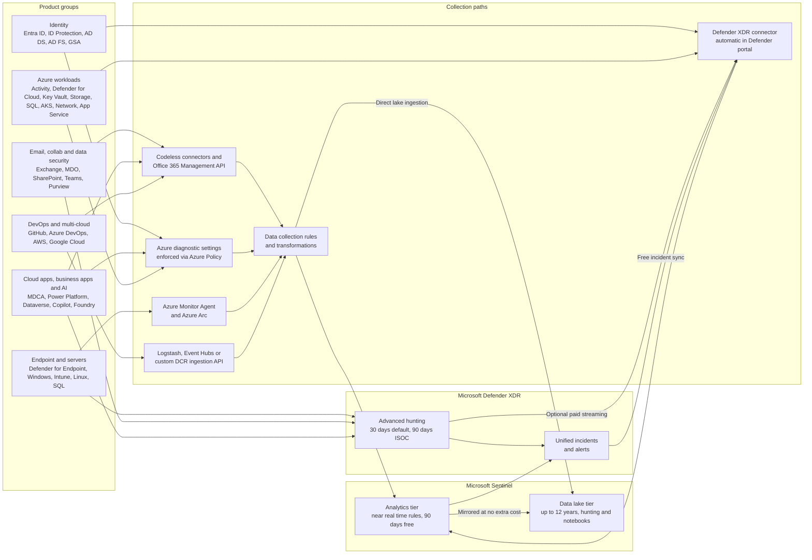

# Architecture overview

> Status: verified. Last verified: 21 Nov 2026.

How security telemetry from every product group in this guide reaches Microsoft Defender XDR and Microsoft Sentinel, and where it lands.

## Collection paths explained

Every product guide in this repo uses one or more of five collection paths:

| Path | Used by | How it works | Key governance step |
|---|---|---|---|
| **Defender XDR integration** | Defender for Endpoint, Office 365, Identity, Cloud Apps, Defender for Cloud, Entra ID Protection, Purview DLP and Insider Risk | Incidents and alerts sync into `SecurityIncident` and `SecurityAlert` for free. Raw advanced hunting tables stay in Defender XDR by default and can optionally stream to Sentinel ([Defender XDR integration](https://learn.microsoft.com/en-us/azure/sentinel/microsoft-365-defender-sentinel-integration)). | Connect Sentinel to the Defender portal and turn off standalone alert connectors to avoid duplicate incidents. See [Defender XDR vs Sentinel](defender-xdr-vs-sentinel.md). |
| **Office 365 Management API and codeless connectors (CCF)** | Exchange Online, SharePoint, Teams, Purview Audit, Power Platform, Dataverse, Copilot, GitHub, Azure DevOps, AWS, Google Cloud | Managed pull connectors defined in Content Hub solutions poll Microsoft or third-party APIs directly into Sentinel without you running a collector VM or function app ([codeless connectors](https://learn.microsoft.com/en-us/azure/sentinel/create-codeless-connector)). | Turn on Microsoft Purview auditing first; Microsoft 365, Power Platform and Copilot connectors pull from it. |
| **Azure diagnostic settings** | Microsoft Entra ID, Azure Activity, Key Vault, Storage, Azure SQL, AKS, Azure networking, App Service, Azure OpenAI / Microsoft Foundry, Intune | Platform-native export from the Azure or Entra resource straight to the Log Analytics workspace ([diagnostic settings](https://learn.microsoft.com/en-us/azure/sentinel/connect-services-diagnostic-setting-based)). | Enforce with Azure Policy at management group scope so new subscriptions and resources are covered automatically. |
| **Azure Monitor Agent (AMA) with DCRs** | On-premises AD DS, AD FS, Windows clients, Windows Server, Linux Syslog and CEF forwarders, SQL Server on machines | Modern agent that replaces the retired Log Analytics agent (MMA). Uses Data Collection Rules (DCRs) to filter events at source and run KQL transformations before ingestion ([AMA overview](https://learn.microsoft.com/en-us/azure/azure-monitor/agents/azure-monitor-agent-overview), [transformations](https://learn.microsoft.com/en-us/azure/azure-monitor/data-collection/data-collection-transformations)). | Onboard non-Azure and on-premises servers to Azure Arc so AMA and DCR associations work uniformly. |
| **Logstash, Event Hubs and custom ingestion API** | Third-party appliances, multi-cloud custom pipelines, unsupported schemas | DCR-based Logs Ingestion API accepts custom JSON streams from Logstash, Event Hubs or custom scripts into `_CL` tables or supported built-in tables ([Logstash DCR connector](https://learn.microsoft.com/en-us/azure/sentinel/connect-logstash-data-connection-rules)). | Use DCR transformations to drop noisy fields and route hunt-only feeds straight to the data lake tier. |

## Defender portal vs Azure portal

Microsoft Sentinel is generally available in the Microsoft Defender portal, whether or not you use other Defender services. **After 31 March 2027, Microsoft Sentinel will no longer be supported in the Azure portal** and all customers will be redirected to the Defender portal ([Microsoft Sentinel in the Defender portal](https://learn.microsoft.com/en-us/azure/sentinel/microsoft-sentinel-defender-portal)).

Build all new rules, connectors, table settings and playbooks in the Defender portal:

- **Unified queue and correlation.** Defender XDR and Sentinel alerts correlate into a single incident queue with attack story graphs, unified entity pages and Security Copilot integration.
- **Unified hunting.** Investigation & response > Advanced hunting queries both Defender XDR tables and Sentinel workspace tables in one editor without paying to stream Defender tables twice.
- **Unified custom detections.** New Content Hub solutions ship detections in both Sentinel analytic rule format and Defender XDR custom detection format. Pick one per rule to avoid duplicate alerts.
- **Table management.** Setup & configuration > Data management > Data & connectors (or Microsoft Sentinel > Configuration > Tables) is the single place to manage tiers and retention.

## Analytics tier, data lake tier and mirroring

Microsoft Sentinel uses two storage tiers ([data lake overview](https://learn.microsoft.com/en-us/azure/sentinel/datalake/sentinel-lake-overview), [manage table tiers and retention](https://learn.microsoft.com/en-us/azure/sentinel/manage-table-tiers-retention)):

- **Analytics tier.** High-performance indexed storage for real-time analytic rules, custom detections, live hunting, workbooks and playbooks. Sentinel workspaces include 90 days of interactive retention at no extra storage charge.
- **Data lake tier.** Open-format Parquet cold storage for up to 12 years of retention, KQL exploration queries, KQL jobs, summary rules and Jupyter notebooks.
- **Automatic mirroring.** Every table in the Analytics tier is mirrored to the data lake tier for the same retention period at no additional data lake ingestion, processing or storage cost. Extending total retention beyond the analytics retention window bills only the extra months in compressed data lake storage (charged at a uniform 6:1 compression ratio).
- **Direct data lake ingestion.** Since September 2026, the data lake is integrated into Sentinel onboarding and enabled per table from Table management ([What's new in Microsoft Sentinel](https://learn.microsoft.com/en-us/azure/sentinel/whats-new)). High-volume, hunt-only tables (flow logs, firewall traffic, verbose storage or Graph activity logs) can go straight to the data lake tier without paying Analytics ingestion rates, then promote high-value slices back to Analytics via summary rules or KQL jobs.

See [docs/data-lake-tiering.md](data-lake-tiering.md) for per-table tier recommendations across every product guide.

## Official links

- [Microsoft Sentinel in the Microsoft Defender portal](https://learn.microsoft.com/en-us/azure/sentinel/microsoft-sentinel-defender-portal)
- [Microsoft Defender XDR integration with Microsoft Sentinel](https://learn.microsoft.com/en-us/azure/sentinel/microsoft-365-defender-sentinel-integration)
- [Microsoft Sentinel data lake overview](https://learn.microsoft.com/en-us/azure/sentinel/datalake/sentinel-lake-overview)
- [Which logs to ingest directly into the Microsoft Sentinel data lake](https://learn.microsoft.com/en-us/azure/sentinel/datalake/sentinel-lake-log-ingestion-guidance)
- [Manage tables, tiers, and retention in Sentinel](https://learn.microsoft.com/en-us/azure/sentinel/manage-table-tiers-retention)
- [What's new in Microsoft Sentinel](https://learn.microsoft.com/en-us/azure/sentinel/whats-new)
- [Connect data sources to Microsoft Sentinel by using data connectors](https://learn.microsoft.com/en-us/azure/sentinel/configure-data-connector)
- [Create a pull codeless connector for Microsoft Sentinel](https://learn.microsoft.com/en-us/azure/sentinel/create-codeless-connector)
- [Stream logs to Microsoft Sentinel via Logstash and DCR-based API](https://learn.microsoft.com/en-us/azure/sentinel/connect-logstash-data-connection-rules)
- [Transformations in Azure Monitor](https://learn.microsoft.com/en-us/azure/azure-monitor/data-collection/data-collection-transformations)
- [Prioritize data connectors for Microsoft Sentinel](https://learn.microsoft.com/en-us/azure/sentinel/prioritize-data-connectors)

## Last verified

21 Nov 2026, against Microsoft Learn.
