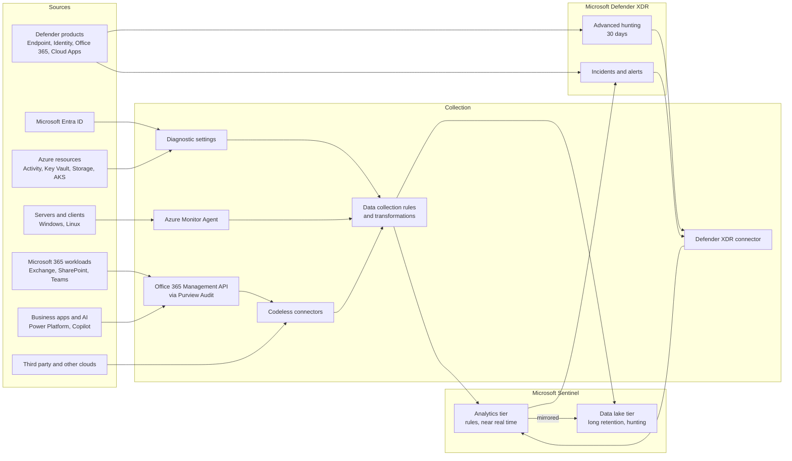

# Architecture overview

How security telemetry from Microsoft products reaches Microsoft Defender XDR and Microsoft Sentinel, and where it ends up.

## Key points

- **Defender XDR first.** Defender products write to advanced hunting automatically and keep 30 days there. The Defender XDR connector sends incidents and alerts to Sentinel, and can also stream raw tables. Streaming raw tables is optional and costs ingestion.
- **Sentinel lives in the Defender portal.** Sentinel in the Azure portal retires on 31 March 2027. New guidance should use Defender portal navigation.
- **Analytics tier vs data lake tier.** Data in the analytics tier is mirrored to the data lake at no extra cost for the same retention. You can send high-volume sources to the data lake tier only. Analytic rules need the analytics tier. Basic and Auxiliary logs aren't being enhanced further, and Auxiliary tables move into the data lake.
- **Purview Audit is a dependency.** Most Microsoft 365, Power Platform and Copilot connectors poll the Office 365 Management API, so they only work if Purview auditing is on.
- **Azure uses diagnostic settings.** Enforce them with Azure Policy at management group scope so new resources are covered.
- **Servers use the Azure Monitor Agent with DCRs.** The legacy Log Analytics agent is retired. Use DCR transformations to drop noise before you pay for it.

## Sources

- [Microsoft Sentinel in the Defender portal](https://learn.microsoft.com/en-us/azure/sentinel/microsoft-sentinel-defender-portal)
- [Which logs to ingest into the data lake](https://learn.microsoft.com/en-us/azure/sentinel/datalake/sentinel-lake-log-ingestion-guidance)
- [Prioritize data connectors](https://learn.microsoft.com/en-us/azure/sentinel/prioritize-data-connectors)
- [Connect Microsoft Defender XDR to Microsoft Sentinel](https://learn.microsoft.com/en-us/azure/sentinel/connect-microsoft-365-defender)
- [Data collection transformations in Azure Monitor](https://learn.microsoft.com/en-us/azure/azure-monitor/data-collection/data-collection-transformations)

> Status: draft. Last verified: 21 Nov 2026. Tracked in the "Overall architecture" issue.
