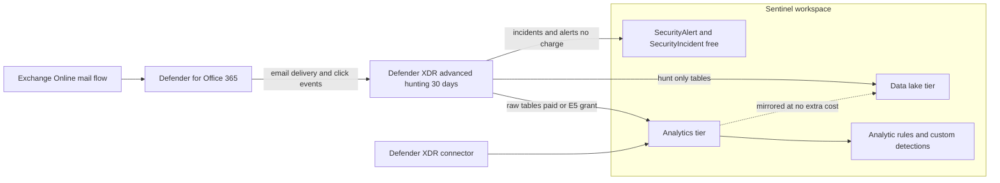

# Microsoft Defender for Office 365

> Status: verified. Priority: P1 (start here). Last verified: 21 Nov 2026.

## What it is

Microsoft Defender for Office 365 (MDO) is Microsoft's primary email and collaboration security service. It adds anti-phishing with impersonation protection, Safe Attachments, Safe Links, and post-delivery cleanup such as zero-hour auto purge (ZAP). It also protects files in SharePoint Online, OneDrive and Microsoft Teams, and messages in Teams. Its detection and click logs are the core email security telemetry for a SOC, and business email compromise investigations rarely close without them.

Email and collaboration threats are the reason MDO exists, so this guide comes before the other email-collab sources. Sibling guides: [Exchange Online](../exchange-online/README.md) for the mailbox and admin audit side, [SharePoint Online and OneDrive](../sharepoint-onedrive/README.md) and [Microsoft Teams](../teams/README.md) for the file and chat workloads, and [Microsoft Purview unified audit log](../purview-unified-audit/README.md) for the audit layer they all sit on.

## Key recommendations

- **Start in Defender XDR, not Sentinel.** With MDO Plan 2, the email tables are already in Defender XDR advanced hunting at no extra cost for 30 days. If you run Microsoft Sentinel in the Defender portal, unified advanced hunting covers hunting and custom detections without any Sentinel ingestion ([Defender XDR integration with Sentinel](https://learn.microsoft.com/en-us/azure/sentinel/microsoft-365-defender-sentinel-integration)).
- **Stream only what your rules need.** If you want MDO tables in Sentinel for longer retention or Sentinel-only rules, keep `EmailEvents`, `EmailPostDeliveryEvents` and `UrlClickEvents` in the Analytics tier so rules can read them. Send `EmailUrlInfo` and `EmailAttachmentInfo` to the data lake tier if you only use them for hunting, because they are the tables that grow with mail volume ([which logs to ingest into the data lake](https://learn.microsoft.com/en-us/azure/sentinel/datalake/sentinel-lake-log-ingestion-guidance)).
- **Alerts and incidents are free.** The Defender XDR connector brings MDO alerts and incidents into `SecurityAlert` and `SecurityIncident` at no charge, so MDO's own detections need no rule and no budget ([Defender XDR integration with Sentinel](https://learn.microsoft.com/en-us/azure/sentinel/microsoft-365-defender-sentinel-integration), [Sentinel free data sources](https://learn.microsoft.com/en-us/azure/sentinel/billing#free-data-sources)).
- **Raw email tables are paid, but E5-family customers get a grant.** Microsoft 365 E7, E5, A5, F5 and G5 customers get up to 5 MB per user per day of Microsoft 365 data ingestion free, and the grant covers `EmailEvents`, `EmailAttachmentInfo`, `EmailPostDeliveryEvents`, `EmailUrlInfo`, `CloudAppEvents` and `AlertEvidence` ([Sentinel benefit for Microsoft 365 E5 customers](https://azure.microsoft.com/en-us/pricing/offers/sentinel-microsoft-365-offer/)). `UrlClickEvents` is not named in the grant table list, so check your cost analysis meters.
- **Enable the threat intel mapping rules on day 1.** The only Sentinel rules that read the MDO email tables out of the box are the threat intelligence match rules, and they need the Threat Intelligence solution connected.
- **Close two gaps with custom detections:** ZAP actions that failed, and users who clicked through a Safe Links warning. Both are in [Custom detections](#custom-detections).

## High-value log sources

| Source | Table name | Connector | Tier | Cost / volume | Value |
|---|---|---|---|---|---|
| Email delivery and filtering verdicts | `EmailEvents` | Microsoft Defender XDR | Analytics, or data lake if no rules read it | Paid; in the E5-family data grant. Medium to high. One row per email per recipient, plus a new row on every verdict or location change | The backbone of email hunting: sender, verdict, threat types, delivery action and latest location |
| Attachments | `EmailAttachmentInfo` | Microsoft Defender XDR | Data lake if hunting only | Paid; in the E5-family grant. High in big tenants, one row per attachment | Joins to `EmailEvents` to find who received a malicious file, and file hashes for pivoting |
| URLs in email | `EmailUrlInfo` | Microsoft Defender XDR | Data lake if hunting only | Paid; in the E5-family grant. High in big tenants, one row per URL | The bridge between a message and a click, and the pivot for URL threat intel |
| Post-delivery actions, ZAP and manual remediation | `EmailPostDeliveryEvents` | Microsoft Defender XDR | Analytics | Paid; in the E5-family grant. Low | Shows what the service did after delivery, whether ZAP worked, and where mail ended up |
| Safe Links clicks in email, Teams and Office apps | `UrlClickEvents` | Microsoft Defender XDR | Analytics | Paid; not named in the E5-family grant table list. Medium | The human signal: who clicked, what was blocked, and who clicked through a warning page |
| MDO alerts and entities | `AlertInfo`, `AlertEvidence` | Defender XDR, in the Defender portal at no extra cost | Already in Defender XDR | Free, 30-day retention in advanced hunting | Enriched alert context when hunting or building custom detections in Defender XDR |
| MDO alerts in Sentinel | `SecurityAlert`, `SecurityIncident` | Microsoft Defender XDR | Analytics | Free ([free data sources](https://learn.microsoft.com/en-us/azure/sentinel/billing#free-data-sources)) | MDO detections land as incidents without any rule or ingestion cost |
| Cloud app view of Office 365 | `CloudAppEvents` | Microsoft Defender XDR | Analytics | Paid; in the E5-family grant. Medium to high | The Defender for Cloud Apps view, useful when you want app-level context across M365. See the [Defender for Cloud Apps guide](../../cloud-apps/defender-for-cloud-apps/README.md) |

All Defender XDR advanced hunting tables are available in the Defender portal first. Streaming them to Sentinel is optional and costs ingestion unless the E5-family grant covers it ([Defender XDR integration with Sentinel](https://learn.microsoft.com/en-us/azure/sentinel/microsoft-365-defender-sentinel-integration)). Mailbox and admin audit data is a separate path through the Microsoft 365 connector: see [Exchange Online](../exchange-online/README.md).

## Prerequisites and licensing

| Item | Detail |
|---|---|
| MDO Plan 1 | Included in Microsoft 365 Business Premium, and effective 1 July 2026 in Office 365 E3 and Microsoft 365 E3. Gives Safe Links, Safe Attachments, anti-phishing with impersonation protection, and real-time detections ([MDO service description](https://learn.microsoft.com/en-us/office365/servicedescriptions/office-365-advanced-threat-protection-service-description)) |
| MDO Plan 2 | Included in Microsoft 365 E5, A5 and GCC G5, or as an add-on. Adds Threat Explorer, automated investigation and response, attack simulation training, and integration with Microsoft Defender XDR. The email advanced hunting tables are Plan 2 |
| Defender XDR integration | Plan 2 only. Without Plan 2 the email tables in this guide are not populated ([MDO service description, feature availability](https://learn.microsoft.com/en-us/office365/servicedescriptions/office-365-advanced-threat-protection-service-description)) |
| Safe Links and Safe Attachments | The Built-in protection preset security policy covers all users with at least one MDO licence ([Safe Links overview](https://learn.microsoft.com/en-us/defender-office-365/safe-links-about)). Review Standard and Strict presets for higher-value groups |
| Purview auditing | On by default for Microsoft 365 organisations. Sentinel's Microsoft 365 connector and parts of the collaboration view depend on it ([auditing solutions in Purview](https://learn.microsoft.com/en-us/purview/audit-solutions-overview)) |
| Sentinel licence | Pay-as-you-go or a commitment tier. The E5-family data grant covers eligible Microsoft 365 tables up to 5 MB per user per day |

### Roles you need

| Task | Role |
|---|---|
| Connect the Defender XDR connector | Security Administrator or Global Administrator on the tenant, plus read and write on the Sentinel workspace ([connect Defender XDR to Sentinel](https://learn.microsoft.com/en-us/azure/sentinel/connect-microsoft-365-defender)) |
| Install the solution from Content Hub | Microsoft Sentinel Contributor on the workspace resource group |
| Manage MDO policies | Security Administrator in the Defender portal |
| Enable Purview auditing | Audit Logs role in Purview, or Compliance Administrator |

## Step-by-step setup

Use the Defender portal at [security.microsoft.com](https://security.microsoft.com). Microsoft Sentinel is generally available in the Defender portal, and the Defender XDR connector is enabled automatically when Sentinel is onboarded there ([Microsoft Sentinel in the Defender portal](https://learn.microsoft.com/en-us/azure/sentinel/microsoft-sentinel-defender-portal)).

1. **Confirm MDO licences.** Microsoft 365 admin centre > Billing > Your products. You need Plan 2 seats, or an E5-family subscription, for the email tables.
2. **Confirm Purview auditing is on.** Purview portal > Audit. Audit (Standard) is on by default; the page prompts you if it isn't. Allow up to 60 minutes for data to flow after any change.
3. **Turn on MDO protection.** Defender portal > Email & collaboration > Policies & rules > Threat policies. Review the Built-in protection preset, then consider Standard and Strict presets. Check Safe Links settings: turn on click tracking and do not allow click-through to the original URL ([Safe Links overview](https://learn.microsoft.com/en-us/defender-office-365/safe-links-about)).
4. **Onboard Sentinel to the Defender portal** if you haven't. The Defender XDR connector is then set up for you and incidents and alerts flow with no manual step. If you still work in the Azure portal, install the **Microsoft Defender XDR** solution from Content Hub > Microsoft Defender XDR, then open the connector.
5. **Connect incidents and alerts.** On the Microsoft Defender XDR connector page, tick the box to turn off the Microsoft incident creation rules for Defender products, then select Connect incidents & alerts. MDO alerts now land in `SecurityAlert` and incidents in `SecurityIncident`, free.
6. **Connect events if you want raw tables in Sentinel.** On the same connector page under Connect events, tick the Defender for Office 365 tables you need: `EmailEvents`, `EmailAttachmentInfo`, `EmailPostDeliveryEvents`, `EmailUrlInfo`, `UrlClickEvents`. Select Apply changes. In the Defender portal this lives at Setup & configuration > Data management > Data & connectors.
7. **Set the tier per table.** Setup & configuration > Data management > Tables. Keep `EmailEvents`, `EmailPostDeliveryEvents` and `UrlClickEvents` on Analytics so analytic rules and custom detections can read them. Send `EmailUrlInfo` and `EmailAttachmentInfo` to the data lake if they are hunt-only. Data in the Analytics tier is mirrored to the lake at no extra cost for the same retention.
8. **Set retention.** Same page. Analytics retention is 90 days by default. Use total retention or the data lake for longer investigation windows.
9. **Validate.** Run the queries in [Validation KQL](#validation-kql) after a few hours of mail flow. `EmailEvents` and `UrlClickEvents` should show rows within the first day.
10. **Enable rules.** Threat intelligence matching rules first, then the custom detections below.

## Architecture diagram



## Validation KQL

For group-wide and workspace-wide freshness checks, see [email-collab.kql](../../queries/validation/email-collab.kql) and the [validation query pack](../../queries/validation/README.md).

```kql
// 1. Are the MDO tables landing in Sentinel, and how fresh?
// Run in Sentinel. In the Defender portal, run the same queries without TimeGenerated filters.
union withsource=Table isfuzzy=true EmailEvents, EmailAttachmentInfo, EmailUrlInfo, EmailPostDeliveryEvents, UrlClickEvents
| where TimeGenerated > ago(1d)
| summarize Rows = count(), Latest = max(TimeGenerated) by Table

// 2. Dedupe EmailEvents to one row per email and recipient.
// The streaming API writes a new record whenever a verdict or delivery location changes.
EmailEvents
| where TimeGenerated > ago(1d)
| summarize arg_max(TimeGenerated, *) by NetworkMessageId, RecipientEmailAddress

// 3. Is the alert path working? SecurityIncident should show the Microsoft XDR provider.
SecurityIncident
| where TimeGenerated > ago(7d)
| summarize Count = count() by ProviderName

// 4. Volume: GB per table per day over the last 7 days.
Usage
| where TimeGenerated > ago(7d)
| where DataType in ("EmailEvents", "EmailAttachmentInfo", "EmailUrlInfo", "EmailPostDeliveryEvents", "UrlClickEvents")
| summarize GB = round(sum(Quantity) / 1024, 2) by DataType, bin(TimeGenerated, 1d)
| order by DataType, TimeGenerated

// 5. What are users clicking? Blocked and allowed clicks by workload.
UrlClickEvents
| where TimeGenerated > ago(7d)
| summarize Clicks = count() by Workload, ActionType
| order by Clicks desc
```

## Out-of-box analytic rules

MDO's own detections need no analytic rule: they arrive as alerts and incidents through the Defender XDR connector, free. The alert types include a potentially malicious URL click detected, email messages containing malware removed after delivery, email messages containing phish URLs removed after delivery, email reported by user as malware or phish, suspicious email sending patterns detected, and user restricted from sending email ([Defender for Office 365 connector reference](https://learn.microsoft.com/en-us/azure/sentinel/data-connectors-reference)).

The rules that read the MDO tables in Sentinel come from the **Threat Intelligence** solution in Content Hub. They need the Threat Intelligence data connector so `ThreatIntelligenceIndicator` is populated.

| Rule | Detects | Tables | MITRE | Suggested |
|---|---|---|---|---|
| [TI map Email entity to EmailEvents](https://github.com/Azure/Azure-Sentinel/blob/master/Solutions/Threat%20Intelligence/Analytic%20Rules/EmailEntity_EmailEvents.yaml) | Delivered mail matching a threat intel email indicator | `EmailEvents`, `ThreatIntelligenceIndicator` | Initial Access (T1566) | Enable day 1 with a TI feed |
| [TI map Domain entity to EmailEvents](https://github.com/Azure/Azure-Sentinel/blob/master/Solutions/Threat%20Intelligence/Analytic%20Rules/DomainEntity_EmailEvents.yaml) | Mail from a threat intel domain | `EmailEvents`, `ThreatIntelligenceIndicator` | Initial Access (T1566) | Enable day 1 with a TI feed |
| [TI Map URL Entity to EmailUrlInfo](https://github.com/Azure/Azure-Sentinel/blob/master/Solutions/Threat%20Intelligence/Analytic%20Rules/URLEntity_EmailUrlInfo.yaml) | Known-bad URLs in delivered mail | `EmailUrlInfo`, `ThreatIntelligenceIndicator` | Command and Control (T1071) | Enable day 1 with a TI feed |
| [TI Map URL Entity to UrlClickEvents](https://github.com/Azure/Azure-Sentinel/blob/master/Solutions/Threat%20Intelligence/Analytic%20Rules/URLEntity_UrlClickEvents.yaml) | Users clicking threat intel URLs | `UrlClickEvents`, `ThreatIntelligenceIndicator` | Command and Control (T1071) | Enable day 1 with a TI feed |

The **Microsoft 365** solution in Content Hub also ships Exchange-side rules that read `OfficeActivity`, including Malicious Inbox Rule, Multiple users email forwarded to same destination, Mail redirect via ExO transport rule, and Exchange AuditLog Disabled. They belong to the [Exchange Online](../exchange-online/README.md) guide and its connector, so enable them there.

The MDO detections and insights workbook ships with the **Microsoft Defender XDR** solution, covered under [Workbooks and hunting](#workbooks-and-hunting).

## Custom detections

Two gaps the out-of-box content does not cover: failed post-delivery cleanup, and people who clicked through a warning page. Run them as Sentinel scheduled rules hourly, or as Defender XDR custom detections if you want them without Sentinel ingestion. Marked lines need a check against your own data first.

### C1. ZAP or manual remediation failed on delivered mail (High)

```kql
// CUSTOM - Post-delivery action on delivered mail did not succeed
// ASSUMPTION: ActionResult values are not documented. Run the summary query first and pin them:
//   EmailPostDeliveryEvents | distinct ActionType, ActionResult
EmailPostDeliveryEvents
| where TimeGenerated > ago(1h)
| where ActionType in ("Phish ZAP", "Malware ZAP", "Manual remediation")
| where tostring(ActionResult) !~ "Success"
| project TimeGenerated, NetworkMessageId, RecipientEmailAddress, SenderFromAddress,
          ActionType, ActionTrigger, ActionResult, DeliveryLocation, ThreatTypes
```

A failure here means a message the service judged malicious may still be sitting in a mailbox. Join to `EmailEvents` on `NetworkMessageId` for the delivery details and to check the latest delivery location. MITRE: Defense Evasion T1562.

### C2. User clicked through a Safe Links warning page (High)

```kql
// CUSTOM - Click allowed or user continued past a phishing warning
// Based on the documented UrlClickEvents example query.
UrlClickEvents
| where TimeGenerated > ago(1h)
| where ActionType == "ClickAllowed" or IsClickedThrough != 0
| where ThreatTypes has "Phish"
| summarize ClickTime = min(TimeGenerated), Latest = max(TimeGenerated) by ReportId, AccountUpn, Url, NetworkMessageId, IPAddress, Workload
| project ClickTime, AccountUpn, Url, NetworkMessageId, IPAddress, Workload
```

Safe Links did its job and the user went anyway. Treat the account as possibly compromised: check the device and recent sign-ins. MITRE: Initial Access T1566.002, Execution T1204.001. The same logic ships as a hunting query in the Defender XDR solution, but not as a rule, so this closes the gap.

### C3. A URL domain clicked today was blocked later (Medium)

```kql
// CUSTOM - Earlier allowed clicks on a domain the service now blocks
UrlClickEvents
| where TimeGenerated > ago(3d)
| extend UrlDomain = tolower(parse_url(Url).Host)
| summarize FirstClick = min(TimeGenerated), LastClick = max(TimeGenerated),
            Users = dcount(AccountUpn), Allowed = countif(ActionType == "ClickAllowed" or IsClickedThrough != 0),
            Blocked = countif(ActionType == "Blocked")
            by UrlDomain
| where Allowed > 0 and Blocked > 0
| project UrlDomain, FirstClick, LastClick, Users, Allowed, Blocked
```

Catches the window between first contact and a verdict flip, which is where campaigns get users. Add a `ThreatIntelligenceIndicator` join if you want to keep it to known-bad domains. MITRE: Initial Access T1566.002.

## Playbooks

The **Microsoft Defender XDR** solution ships one playbook, [AttackSimulatorTrainingNonReporters](https://github.com/Azure/Azure-Sentinel/tree/master/Solutions/Microsoft%20Defender%20XDR/Playbooks), for chasing users who did not report simulated phish. Attach it with the usual permissions: Microsoft Sentinel Automation Contributor on the playbook resource group plus Logic App Contributor for the builder.

Suggested custom playbooks:

| Playbook (custom) | Trigger | Actions | Connector and permissions |
|---|---|---|---|
| Notify on click-through | C2 | Post the user, URL and device to the security Teams channel, and add a comment to the matching incident | Teams and Office 365 connections plus Sentinel Responder via managed identity |
| Contain a clicker | C2 or C3 | Revoke the user's sessions and require re-authentication, then comment the incident | Microsoft Graph with User.RevokeSessions.All, through managed identity |
| Enrich mail incidents | Any MDO incident | Query `EmailEvents` and `EmailPostDeliveryEvents` for the `NetworkMessageId` values in the alert, then comment the incident with delivery and ZAP history | Sentinel Logic Apps connector with workspace query rights |

Microsoft's own guidance now points to Defender XDR custom detections and automatic attack disruption ahead of Sentinel playbooks for MDO containment ([Defender XDR integration with Sentinel](https://learn.microsoft.com/en-us/azure/sentinel/microsoft-365-defender-sentinel-integration)). Build the notification and enrichment playbooks first, and prefer native remediation for containment.

## Workbooks and hunting

| Item | Source | Use |
|---|---|---|
| Microsoft Defender for Office 365 detections and insights workbook | Microsoft Defender XDR solution in Content Hub, in both Sentinel and XDR workbook formats | MDO detection trends and insights alongside the connector data |
| Email and collaboration hunting queries | Microsoft Defender XDR solution | Dozens of verified queries, including URL clicks by action, URL click on ZAP email, malicious clicks allowed, email bombing, and suspicious URL clicked |
| Email entity page and Threat Explorer | Defender portal | Per-message investigation view. Explorer needs Plan 2, real-time detections is the Plan 1 view |
| Shared queries | Defender portal > Investigation & response > Advanced hunting > Shared queries | Microsoft-authored hunting queries over the email tables |

## Gotchas and deprecations

- `EmailEvents` grows on verdict changes. The streaming API writes a new record whenever an email's verdict or delivery location changes, so dedupe with `summarize arg_max` by `NetworkMessageId` and `RecipientEmailAddress` ([EmailEvents table reference](https://learn.microsoft.com/en-us/defender-xdr/advanced-hunting-emailevents-table)).
- `LatestDeliveryLocation` and `LatestDeliveryAction` are not available in the streaming API ([EmailEvents table reference](https://learn.microsoft.com/en-us/defender-xdr/advanced-hunting-emailevents-table)).
- Clicks from URLs in Drafts and Sent items cannot be joined to the `Email*` tables, because `NetworkMessageId` is defaulted when email metadata is missing ([UrlClickEvents table reference](https://learn.microsoft.com/en-us/defender-xdr/advanced-hunting-urlclickevents-table)).
- Enabling the Defender XDR connector silently disconnects the standalone Defender product connectors, including the MDO alerts connector. Schema differences apply ([connect Defender XDR to Sentinel](https://learn.microsoft.com/en-us/azure/sentinel/connect-microsoft-365-defender)).
- MDO Plan 1 does not include Defender XDR integration, so the email tables stay empty without Plan 2. Plan 1 lands in Office 365 E3 and Microsoft 365 E3 from 1 July 2026, which changes what those tenants can see ([MDO service description](https://learn.microsoft.com/en-us/office365/servicedescriptions/office-365-advanced-threat-protection-service-description)).
- Defender Vulnerability Management tables are not ingested into Sentinel through the Defender XDR connector, so don't assume every advanced hunting table streams ([which Defender XDR tables aren't supported](https://learn.microsoft.com/en-us/azure/sentinel/connect-microsoft-365-defender#which-defender-xdr-tables-arent-supported-in-microsoft-sentinel)). The Teams message tables are in the same boat: see [Microsoft Teams](../teams/README.md).
- Safe Links changes for Teams can take up to 24 hours to take effect ([Safe Links overview](https://learn.microsoft.com/en-us/defender-office-365/safe-links-about)).
- Sentinel in the Azure portal retires on 31 March 2027 and becomes Defender portal only. Build and test this connector in the Defender portal ([Microsoft Sentinel in the Defender portal](https://learn.microsoft.com/en-us/azure/sentinel/microsoft-sentinel-defender-portal)).

## Official links

- [Microsoft Defender for Office 365 overview](https://learn.microsoft.com/en-us/defender-office-365/mdo-about)
- [Microsoft Defender for Office 365 service description](https://learn.microsoft.com/en-us/office365/servicedescriptions/office-365-advanced-threat-protection-service-description)
- [Safe Links overview](https://learn.microsoft.com/en-us/defender-office-365/safe-links-about)
- [Safe Attachments for SharePoint, OneDrive and Teams](https://learn.microsoft.com/en-us/defender-office-365/safe-attachments-for-spo-odfb-teams-about)
- [Microsoft Defender for Office 365 support for Microsoft Teams](https://learn.microsoft.com/en-us/defender-office-365/mdo-support-teams-about)
- [Stream data from Microsoft Defender XDR to Microsoft Sentinel](https://learn.microsoft.com/en-us/azure/sentinel/connect-microsoft-365-defender)
- [Microsoft Defender XDR integration with Microsoft Sentinel](https://learn.microsoft.com/en-us/azure/sentinel/microsoft-365-defender-sentinel-integration)
- [Microsoft Sentinel in the Defender portal](https://learn.microsoft.com/en-us/azure/sentinel/microsoft-sentinel-defender-portal)
- [Sentinel free data sources](https://learn.microsoft.com/en-us/azure/sentinel/billing#free-data-sources)
- [Sentinel benefit for Microsoft 365 E7, E5, A5, F5 and G5 customers](https://azure.microsoft.com/en-us/pricing/offers/sentinel-microsoft-365-offer/)
- [Which logs to ingest directly into the Sentinel data lake](https://learn.microsoft.com/en-us/azure/sentinel/datalake/sentinel-lake-log-ingestion-guidance)
- [Data tables in the Microsoft Defender advanced hunting schema](https://learn.microsoft.com/en-us/defender-xdr/advanced-hunting-schema-tables)
- [EmailEvents table](https://learn.microsoft.com/en-us/defender-xdr/advanced-hunting-emailevents-table)
- [EmailAttachmentInfo table](https://learn.microsoft.com/en-us/defender-xdr/advanced-hunting-emailattachmentinfo-table)
- [EmailUrlInfo table](https://learn.microsoft.com/en-us/defender-xdr/advanced-hunting-emailurlinfo-table)
- [EmailPostDeliveryEvents table](https://learn.microsoft.com/en-us/defender-xdr/advanced-hunting-emailpostdeliveryevents-table)
- [UrlClickEvents table](https://learn.microsoft.com/en-us/defender-xdr/advanced-hunting-urlclickevents-table)
- [AlertInfo table](https://learn.microsoft.com/en-us/defender-xdr/advanced-hunting-alertinfo-table)
- [AlertEvidence table](https://learn.microsoft.com/en-us/defender-xdr/advanced-hunting-alertevidence-table)
- [Microsoft Defender XDR solution, Azure-Sentinel repo](https://github.com/Azure/Azure-Sentinel/tree/master/Solutions/Microsoft%20Defender%20XDR)
- [Threat Intelligence solution rules, Azure-Sentinel repo](https://github.com/Azure/Azure-Sentinel/tree/master/Solutions/Threat%20Intelligence)
- [Microsoft auditing solutions in Purview](https://learn.microsoft.com/en-us/purview/audit-solutions-overview)

## Last verified

21 Nov 2026, against Microsoft Learn and the Azure-Sentinel repo. Re-verify before relying on table names or rule names.
