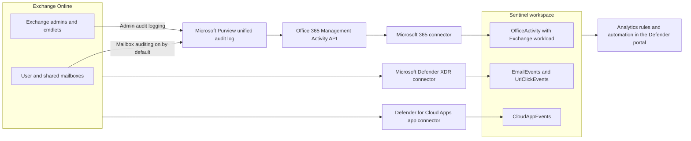

# Exchange Online

> Status: verified. Priority: P1 (start here). Last verified: 21 Nov 2026.

## What it is

Exchange Online activity reaches Microsoft Sentinel through the Purview unified audit log: mailbox actions such as inbox rules and forwarding, admin cmdlets such as `New-TransportRule`, and mail access events such as `MailItemsAccessed`, all landing in `OfficeActivity` where `OfficeWorkload` equals `Exchange`. These events are the core of business email compromise detection, so this guide builds on the [Microsoft Purview unified audit log](../purview-unified-audit/README.md) guide. Get auditing on first, then connect the Exchange feed.

## Key recommendations

- Follow the [Purview audit guide](../purview-unified-audit/README.md) first. Exchange audit events only reach Sentinel if unified auditing is on, and mailbox auditing is on by default in all organisations ([manage mailbox auditing](https://learn.microsoft.com/en-us/purview/audit-mailboxes)).
- Connect the **Microsoft 365 (formerly, Office 365)** connector and tick Exchange. Ingestion is free, but the bytes still count towards workspace storage ([Sentinel billing, free data sources](https://learn.microsoft.com/en-us/azure/sentinel/billing#free-data-sources)).
- `MailItemsAccessed` now needs only Audit (Standard) and is on by default for Office 365 and Microsoft 365 E3/E5 users ([MailItemsAccessed reference](https://learn.microsoft.com/en-us/purview/audit-log-investigate-accounts)). Verify it is actually arriving with the validation queries, because Microsoft's audit overview still groups mail access events under Audit (Premium) ([auditing solutions overview](https://learn.microsoft.com/en-us/purview/audit-solutions-overview)).
- Enable the classic BEC rules from the Microsoft 365 Content Hub solution on day 1: Malicious Inbox Rule, Multiple users email forwarded to same destination, and Mail redirect via ExO transport rule. They catch the attacker behaviours that follow an account takeover.
- Add the Defender XDR view if you have the licences. `EmailEvents` needs Defender for Office 365, and `CloudAppEvents` needs Defender for Cloud Apps, which also runs its own Exchange anomaly detections such as suspicious inbox forwarding ([CloudAppEvents table](https://learn.microsoft.com/en-us/defender-xdr/advanced-hunting-cloudappevents-table)).
- Close the gaps with the custom detections below: external forwarding in inbox and transport rules, unusual mail access clients, and mailbox permission tampering.

## High-value log sources

| Source | Table name | Connector | Tier | Cost / volume | Value |
|---|---|---|---|---|---|
| Exchange admin and mailbox audit | `OfficeActivity` (`OfficeWorkload` == "Exchange") | Microsoft 365 (formerly, Office 365) | Analytics, or data lake for hunt-only | Free ingestion. Medium, and high if `MailItemsAccessed` bind and sync events flow for many users. Bytes still count towards workspace storage | Inbox rule create, modify and remove, forwarding via `Set-Mailbox` and `Set-InboxRule`, transport rules, `Add-MailboxPermission`, `MailItemsAccessed`, and every admin cmdlet except Get-, Search- and Test- verbs ([audit log activities](https://learn.microsoft.com/en-us/purview/audit-log-activities)) |
| Mail flow and verdicts | `EmailEvents`, plus `EmailPostDeliveryEvents`, `EmailUrlInfo`, `EmailAttachmentInfo`, `UrlClickEvents` | Microsoft Defender XDR | Analytics | Paid ingestion. Medium to high | Delivery and blocking events, threat verdicts, authentication results, and clicks on URLs in email. Populated only if Defender for Office 365 is deployed ([EmailEvents table](https://learn.microsoft.com/en-us/defender-xdr/advanced-hunting-emailevents-table)) |
| Cloud app view of Exchange | `CloudAppEvents` | Microsoft Defender XDR, via the Defender for Cloud Apps Microsoft 365 app connector | Analytics | Paid ingestion. Medium | Corroborating activity view for Exchange and other cloud apps, plus Defender for Cloud Apps built in detections such as suspicious inbox forwarding and suspicious email deletion ([connect Microsoft 365 to Defender for Cloud Apps](https://learn.microsoft.com/en-us/defender-cloud-apps/protect-office-365)) |
| Connector health | `SentinelHealth` | Health monitoring for Microsoft Sentinel | Analytics | Free | Catches connector failures so a dead Exchange feed does not look like a quiet tenant ([free data sources](https://learn.microsoft.com/en-us/azure/sentinel/billing#free-data-sources)) |

## Prerequisites and licensing

| Item | Detail |
|---|---|
| Unified auditing | Audit (Standard) minimum, on by default for enterprise subscriptions. Not on by default for Business Basic, Business Standard, Business Premium, or unmanaged tenants on trials ([turn auditing on or off](https://learn.microsoft.com/en-us/purview/audit-log-enable-disable)) |
| Mailbox auditing | On by default for all organisations, with a Microsoft managed set of audited actions per sign-in type. Verify with `Get-OrganizationConfig` and check `AuditDisabled`, where `False` means on ([manage mailbox auditing](https://learn.microsoft.com/en-us/purview/audit-mailboxes)) |
| `MailItemsAccessed` | Audit (Standard) functionality, enabled by default for users with an Office 365 E3/E5 or Microsoft 365 E3/E5 licence. Covers bind and sync access across POP, IMAP, MAPI, EWS, Exchange ActiveSync and REST ([MailItemsAccessed reference](https://learn.microsoft.com/en-us/purview/audit-log-investigate-accounts)) |
| Non-E5 users | `MessageBind` is the fallback action for users without E5/A5/G5, and it only covers admin preview pane access. Expect far less mail access detail for E1 and below ([manage mailbox auditing](https://learn.microsoft.com/en-us/purview/audit-mailboxes)) |
| Other premium framed actions | `Send` is audited by default for Admin and Owner sign-in types, and `SearchQueryInitiated` is available for Owner but not on by default, so add it with `Set-Mailbox -AuditOwner` if you want mailbox search telemetry ([manage mailbox auditing](https://learn.microsoft.com/en-us/purview/audit-mailboxes)) |
| Retention | Standard keeps Exchange audit records 180 days in Purview. Audit (Premium), with E5/A5/G5 or the add-ons, keeps them one year by default ([audit search](https://learn.microsoft.com/en-us/purview/audit-search)) |
| Defender for Office 365 | Required for `EmailEvents` and the other email advanced hunting tables ([EmailEvents table](https://learn.microsoft.com/en-us/defender-xdr/advanced-hunting-emailevents-table)) |
| Defender for Cloud Apps | Required for `CloudAppEvents`. The Microsoft 365 app connector needs auditing enabled in Purview and mailbox auditing on ([connect Microsoft 365 to Defender for Cloud Apps](https://learn.microsoft.com/en-us/defender-cloud-apps/protect-office-365)) |
| Roles to connect | Global Administrator or Security Administrator on the tenant, plus read and write on the workspace ([Microsoft 365 connector definition](https://github.com/Azure/Azure-Sentinel/blob/master/Solutions/Microsoft%20365/Data%20Connectors/Microsoft365.JSON)) |
| Roles to manage audit | *Audit Logs* role in Exchange Online to turn auditing on or off, held by Compliance Management and Organization Management by default. *View-Only Audit Logs* or *Audit Logs* to search the audit log in the Purview portal ([turn auditing on or off](https://learn.microsoft.com/en-us/purview/audit-log-enable-disable), [audit search](https://learn.microsoft.com/en-us/purview/audit-search)) |

## Step-by-step setup

1. **Confirm unified auditing is on.** In Exchange Online PowerShell, run `Get-AdminAuditLogConfig | Format-List UnifiedAuditLogIngestionEnabled`. `True` means on. If it is off, follow the [Purview audit guide](../purview-unified-audit/README.md) to turn it on and allow up to 60 minutes.
2. **Confirm mailbox auditing is on.** Run `Get-OrganizationConfig | Format-List AuditDisabled`. `False` means the org default is on, and new mailboxes are audited automatically ([manage mailbox auditing](https://learn.microsoft.com/en-us/purview/audit-mailboxes)).
3. **Check a mailbox's default audit set.** Run `Get-Mailbox -Identity <mailbox> | Format-List DefaultAuditSet`. `Admin, Delegate, Owner` means Microsoft manages the audited actions for all three sign-in types. Restore defaults with `Set-Mailbox -Identity <mailbox> -DefaultAuditSet Admin,Delegate,Owner` if someone customised them, because customised mailboxes stop receiving new default actions ([manage mailbox auditing](https://learn.microsoft.com/en-us/purview/audit-mailboxes)).
4. **Open the connector in the Defender portal.** Go to **Setup & configuration > Data management > Data & connectors > Connectors**, select **Classic connectors - Microsoft Sentinel**, then open **Microsoft 365 (formerly, Office 365)** ([Sentinel in the Defender portal](https://learn.microsoft.com/en-us/azure/sentinel/microsoft-sentinel-defender-portal)). If it is missing, install the **Microsoft 365** solution from **Content management > Content hub**.
5. **Tick Exchange.** Select the Exchange record type, plus SharePoint and Teams while you are there, then select **Apply Changes** ([connector definition](https://github.com/Azure/Azure-Sentinel/blob/master/Solutions/Microsoft%20365/Data%20Connectors/Microsoft365.JSON)).
6. **Add the email flow view, if licensed.** Open the **Microsoft Defender XDR** connector, select **Connect incidents & alerts**, then tick the Defender for Office 365 event tables you want, such as `EmailEvents` and `UrlClickEvents`, and select **Apply Changes**. When Sentinel is onboarded to the Defender portal this connector is enabled automatically ([stream data from Microsoft Defender XDR](https://learn.microsoft.com/en-us/azure/sentinel/connect-microsoft-365-defender)).
7. **Add the cloud app view, if licensed.** In the Defender portal, go to **Settings > Cloud apps > App connectors**, connect **Microsoft 365**, and confirm Microsoft 365 activities is selected so `CloudAppEvents` populates. Configurations made before January 2026 should be reviewed against the new all-components defaults ([connect Microsoft 365 to Defender for Cloud Apps](https://learn.microsoft.com/en-us/defender-cloud-apps/protect-office-365)).
8. **Generate test activity.** Create a test inbox rule in Outlook on the web that moves messages to a folder, create a forwarding rule to an external test address, remove both, and have an admin run a harmless cmdlet such as `Get-TransportRule`. The Get- operation is not audited, which proves the verb exclusion works ([audit log activities](https://learn.microsoft.com/en-us/purview/audit-log-activities)).
9. **Validate.** Allow up to 12 hours for the first data, then run the validation queries below. Exchange audit records are typically available 60 to 90 minutes after the event ([audit search](https://learn.microsoft.com/en-us/purview/audit-search)).
10. **Enable the day 1 rules** from the Microsoft 365 solution, then add the custom detections.

## Architecture diagram



## Validation KQL

For group-wide and workspace-wide freshness checks, see [email-collab.kql](../../queries/validation/email-collab.kql) and the [validation query pack](../../queries/validation/README.md).

```kql
// 1. Is Exchange data landing, and how fresh? Empty after 12 hours means
// auditing or the connector is off.
OfficeActivity
| where TimeGenerated > ago(1d)
| summarize Rows = count(), Latest = max(TimeGenerated) by OfficeWorkload
| order by Rows desc
// Expect Exchange plus SharePoint or OneDrive, and MicrosoftTeams if ticked.

// 2. Which Exchange operations are arriving? Pin the exact names before
// writing custom rules.
OfficeActivity
| where TimeGenerated > ago(7d)
| where OfficeWorkload =~ "Exchange"
| where Operation in~ ("New-InboxRule", "Set-InboxRule", "Remove-InboxRule",
                        "Set-Mailbox", "Add-MailboxPermission", "Add-MailboxFolderPermission",
                        "New-ManagementRoleAssignment", "New-TransportRule", "Set-TransportRule",
                        "MailItemsAccessed", "Set-AdminAuditLogConfig")
| summarize Rows = count(), Latest = max(TimeGenerated) by Operation
| order by Rows desc
// An operation returning zero rows can mean the sign-in type does not have it
// on by default, or no one has triggered it yet. Generate test activity first.

// 3. Which forwarding parameters show up in Set-Mailbox and inbox rule events?
OfficeActivity
| where TimeGenerated > ago(7d)
| where OfficeWorkload =~ "Exchange"
| where Operation in~ ("Set-Mailbox", "New-InboxRule", "Set-InboxRule")
| where Parameters has_any ("ForwardTo", "RedirectTo", "ForwardingSmtpAddress")
| summarize Rows = count() by Operation, bin(TimeGenerated, 1d)

// 4. MailItemsAccessed reality check: is it actually flowing, and for whom?
// Zero rows in an E3/E5 tenant means a licence or default action gap.
OfficeActivity
| where TimeGenerated > ago(7d)
| where Operation =~ "MailItemsAccessed"
| summarize Rows = count(), Mailboxes = dcount(MailboxOwnerUPN),
            Latest = max(TimeGenerated) by Logon_Type
// ASSUMPTION: Logon_Type values are 0 Owner, 1 Admin, 2 Delegate per the
// MailItemsAccessed property documentation.

// 5. Volume: GB per day from record sizes. OfficeActivity is free to ingest,
// so _BilledSize is the honest measure of what the workspace is storing.
OfficeActivity
| where TimeGenerated > ago(14d)
| where OfficeWorkload =~ "Exchange"
| summarize GB = round(sum(_BilledSize) / 1024 / 1024 / 1024, 2) by Day = bin(TimeGenerated, 1d)
| order by Day desc

// 6. Cost cross-check via the Usage table. This connector is a free data type,
// so Usage may show little or nothing for OfficeActivity. That absence is normal.
Usage
| where TimeGenerated > ago(14d)
| where DataType == "OfficeActivity"
| summarize GB = round(sum(Quantity) / 1024, 2) by Day = bin(TimeGenerated, 1d)
| order by Day desc

// 7. Are the Defender XDR tables landing, if you use them?
union withsource=Table isfuzzy=true EmailEvents, UrlClickEvents, CloudAppEvents
| where TimeGenerated > ago(1d)
| summarize Rows = count(), Latest = max(TimeGenerated) by Table
```

## Out-of-box analytic rules

These ship in the **Microsoft 365** Content Hub solution, version 3.2.2 (25 October 2026), alongside the Microsoft 365 (formerly, Office 365) connector ([solution folder](https://github.com/Azure/Azure-Sentinel/tree/master/Solutions/Microsoft%20365), [release notes](https://github.com/Azure/Azure-Sentinel/blob/master/Solutions/Microsoft%20365/ReleaseNotes.md)). Names, tactics and techniques come from the rule YAMLs. As of 3.2.2 each detection also ships in Defender XDR custom detection format, so enable one format per rule to avoid duplicate alerts. The SharePoint and Teams rules are listed in the [Purview audit guide](../purview-unified-audit/README.md).

| Rule | Detects | Tables | MITRE | Enable day 1? |
|---|---|---|---|---|
| [Malicious Inbox Rule](https://github.com/Azure/Azure-Sentinel/blob/master/Solutions/Microsoft%20365/Analytic%20Rules/Malicious_Inbox_Rule.yaml) | `New-InboxRule` that deletes or junks mail containing security keywords such as phishing, hijacked or suspicious, which attackers use to hide compromise warnings from the victim | `OfficeActivity` | Persistence, Defense Evasion (T1098, T1078) | Yes |
| [Multiple users email forwarded to same destination](https://github.com/Azure/Azure-Sentinel/blob/master/Solutions/Microsoft%20365/Analytic%20Rules/Office_MailForwarding.yaml) | Two or more mailboxes forwarding or redirecting to the same destination in 7 days, the classic BEC collection pattern | `OfficeActivity` | Collection, Exfiltration (T1114, T1020) | Yes |
| [Mail redirect via ExO transport rule](https://github.com/Azure/Azure-Sentinel/blob/master/Solutions/Microsoft%20365/Analytic%20Rules/Mail_redirect_via_ExO_transport_rule.yaml) | `New-TransportRule` or `Set-TransportRule` with BlindCopyTo or RedirectMessageTo, a tenant wide mail theft technique | `OfficeActivity` | Collection, Exfiltration (T1114, T1020) | Yes |
| [Exchange workflow MailItemsAccessed operation anomaly](https://github.com/Azure/Azure-Sentinel/blob/master/Solutions/Microsoft%20365/Analytic%20Rules/MailItemsAccessedTimeSeries.yaml) | Anomalous spikes in `MailItemsAccessed` volume over a 14 day baseline, run hourly with a 25 event floor | `OfficeActivity` | Collection (T1114) | Yes, but expect the first useful alerts only after the baseline builds. Raise scorethreshold from 1.5 to reduce noise |
| [Rare and potentially high-risk Office operations](https://github.com/Azure/Azure-Sentinel/blob/master/Solutions/Microsoft%20365/Analytic%20Rules/RareOfficeOperations.yaml) | `Add-MailboxPermission`, `Add-MailboxFolderPermission`, `Set-Mailbox`, `New-ManagementRoleAssignment`, `New-InboxRule`, `Set-InboxRule`, `Set-TransportRule`, with known Microsoft service accounts excluded | `OfficeActivity` | Persistence, Collection (T1098, T1114) | Yes, but tune. Severity is Low and it fires on every matching operation |
| [Exchange AuditLog Disabled](https://github.com/Azure/Azure-Sentinel/blob/master/Solutions/Microsoft%20365/Analytic%20Rules/exchange_auditlogdisabled.yaml) | An admin runs `Set-AdminAuditLogConfig` and turns Exchange admin audit logging off | `OfficeActivity` | Defense Evasion (T1562) | Yes. This is the audit tampering tripwire |
| [Office Policy Tampering](https://github.com/Azure/Azure-Sentinel/blob/master/Solutions/Microsoft%20365/Analytic%20Rules/office_policytampering.yaml) | Remove or Disable operations on anti phishing, Safe Attachment, Safe Links, DLP or audit policies by admins, including Defender for Office 365 policy removal | `OfficeActivity` | Persistence, Defense Evasion (T1098, T1562) | Yes |

No out-of-box rule watches `Set-OrganizationConfig`, which can turn off mailbox auditing for the whole organisation. The [Purview audit guide](../purview-unified-audit/README.md) includes a custom detection for that.

## Custom detections

The out-of-box rules catch keyword based inbox rules, shared forwarding destinations and redirect transport rules. They miss external forwarding from a single mailbox, quiet rule edits, mail access from clients the user has never used, and permission grants. These close those gaps. Run hourly over a 1-hour lookback unless the comment says otherwise. Every rule needs the exact parameter spelling confirmed in your tenant first, via validation query 2.

### C1. Inbox rule or mailbox forwarding to an external domain (High)

```kql
// CUSTOM - New or modified inbox rule, or Set-Mailbox, forwarding outside the org.
// Catches single-mailbox external forwarding that the OOB shared-destination rule
// only catches when two or more mailboxes point at the same destination.
// ASSUMPTION: ForwardTo, RedirectTo and ForwardingSmtpAddress are the parameter
// names in OfficeActivity Parameters. They match the OOB Office_MailForwarding rule.
let internal_domains = dynamic(["yourdomain.gov.au"]);
OfficeActivity
| where TimeGenerated > ago(1h)
| where OfficeWorkload =~ "Exchange"
| where Operation in~ ("New-InboxRule", "Set-InboxRule", "Set-Mailbox")
| mv-expand P = todynamic(Parameters)
| where tostring(P.Name) in~ ("ForwardTo", "RedirectTo", "ForwardingSmtpAddress")
| extend Destination = tostring(P.Value)
| mv-expand split(Destination, ";")
| extend DestDomain = tolower(tostring(split(tostring(Destination), "@")[1]))
| where isnotempty(DestDomain) and DestDomain !in (internal_domains)
| project TimeGenerated, UserId, ClientIP, Operation, Destination = tostring(Destination)
```

Most legitimate forwarding goes to internal addresses or known partners. Feed `internal_domains` from a watchlist and treat new external destinations as worth a call. MITRE: Exfiltration T1114, Collection T1114.

### C2. MailItemsAccessed from a client the mailbox owner has never used (Medium to High)

```kql
// CUSTOM - Mail access via a client protocol or IP unseen for that mailbox in 14 days.
// Attackers access mail through IMAP, EWS or ActiveSync rather than Outlook,
// so a new client on a busy mailbox is a strong compromise signal.
// ASSUMPTION: ClientInfoString and Client_IPAddress carry protocol and IP for
// MailItemsAccessed, matching the OOB MailItemsAccessedTimeSeries rule fields.
// ASSUMPTION: New joiners have no baseline, so the volume floor matters.
let lookback = 14d;
let floor_events = 10;
let baseline =
  OfficeActivity
  | where TimeGenerated between (ago(lookback) .. ago(1d))
  | where Operation =~ "MailItemsAccessed"
  | summarize by MailboxOwnerUPN, ClientInfoString;
OfficeActivity
| where TimeGenerated > ago(1d)
| where Operation =~ "MailItemsAccessed"
| summarize Events = count(), SampleIP = make_set(Client_IPAddress, 5),
            FirstSeen = min(TimeGenerated), Latest = max(TimeGenerated)
            by MailboxOwnerUPN, ClientInfoString
| where Events >= floor_events
| join kind=leftanti baseline on MailboxOwnerUPN, ClientInfoString
| project MailboxOwnerUPN, ClientInfoString, Events, SampleIP, FirstSeen, Latest
```

Tune `floor_events` to your tenant. Outlook sync generates many `MailItemsAccessed` events, so the 14 day baseline removes the everyday clients and leaves the new ones. MITRE: Collection T1114.

### C3. FullAccess mailbox permission granted by someone other than a service account (High)

```kql
// CUSTOM - Add-MailboxPermission granting FullAccess. The OOB rare operations rule
// fires on every Add-MailboxPermission, so this filters to FullAccess grants by
// humans. Microsoft service accounts perform documented maintenance with this
// cmdlet and are excluded.
// ASSUMPTION: The system account strings match the exclusions Microsoft uses in
// the OOB RareOfficeOperations rule and the documented system account notes.
let system_noise = dynamic(["NT AUTHORITY", "NT SERVICE", "devilfish-applicationaccount",
                            "apcprd03.prod.outlook.com"]);
// ASSUMPTION: the target mailbox identity for Add-MailboxPermission is carried in
// OfficeObjectId, matching how the OOB rules use it for Exchange events. The table
// reference describes OfficeObjectId as SharePoint oriented, so check one record
// in your tenant and switch to the right column if needed.
OfficeActivity
| where TimeGenerated > ago(24h)
| where Operation =~ "Add-MailboxPermission"
| where Parameters has "FullAccess"
| where UserId !has_any (system_noise)
| extend TargetMailbox = tostring(split(tostring(OfficeObjectId), "/")[0])
| project TimeGenerated, UserId, ClientIP, Parameters, TargetMailbox
```

FullAccess lets a delegate read and manage another person's mailbox, a favourite persistence move after account takeover. Microsoft documents that `NT AUTHORITY\SYSTEM` and `Administrator@apcprd03.prod.outlook.com` appear in these records for routine maintenance, so keep the exclusions ([audit log activities](https://learn.microsoft.com/en-us/purview/audit-log-activities)). MITRE: Persistence T1098.

### C4. Transport rule created or modified by anyone (Medium)

```kql
// CUSTOM - Any transport rule create or modify, not just redirects.
// The OOB rule only fires when BlindCopyTo or RedirectMessageTo is set. This
// catches quiet rule edits, so keep an approved-admin list to cut noise.
// Run daily over a 24h lookback to stay out of the OOB rule's way.
let approved_admins = dynamic(["mail-admin@yourdomain.gov.au"]);
OfficeActivity
| where TimeGenerated > ago(24h)
| where OfficeWorkload =~ "Exchange"
| where Operation in~ ("New-TransportRule", "Set-TransportRule")
| where UserId !in~ (approved_admins)
| project TimeGenerated, UserId, ClientIP, Operation, OfficeObjectId, Parameters
| order by TimeGenerated desc
```

Feed `approved_admins` from a watchlist of the people allowed to change mail flow. Any other editor warrants a question. MITRE: Collection T1114, Defense Evasion T1562.

## Playbooks

The Microsoft 365 solution ships no playbooks (the package contains connectors, rules, workbooks and hunting queries only, per the [solution folder](https://github.com/Azure/Azure-Sentinel/tree/master/Solutions/Microsoft%20365)). None documented for Exchange in this solution.

Two customs are worth building:

| Playbook (custom) | Trigger | Actions | Connectors and permissions |
|---|---|---|---|
| BEC containment | C1 to C3, or the OOB inbox rule and forwarding rules | Revoke the account's sessions via Microsoft Graph, require reauthentication, then remove the malicious inbox rule and forwarding with Exchange Online PowerShell (`Remove-InboxRule`, `Set-Mailbox`) | Managed identity with Sentinel Responder for the incident, Graph User.RevokeSessions permission, and an Automation account with the Exchange Administrator role |
| New forwarding confirmation | C1 with a partner domain | Look up the destination in Entra ID and threat intel, comment the result on the incident, and email the mailbox owner's manager for verification | Managed identity with Sentinel Responder, Office 365 Users and Office 365 Outlook connections |

Keep write actions behind an approval until the rules are tuned, and log every change the playbook makes.

## Workbooks and hunting

| Item | Source | Use |
|---|---|---|
| Exchange Online workbook | Microsoft 365 solution ([Workbooks folder](https://github.com/Azure/Azure-Sentinel/tree/master/Solutions/Microsoft%20365/Workbooks)) | Admin and user activity over time, operation breakdowns by user type |
| Office 365 workbook | Microsoft 365 solution | Cross workload activity view covering Exchange, SharePoint and Teams |
| AnomolousUserAccessingOtherUsersMailbox | [Hunting Queries folder](https://github.com/Azure/Azure-Sentinel/tree/master/Solutions/Microsoft%20365/Hunting%20Queries) | One user reading another user's mailbox outside the norm |
| nonowner_MailboxLogin | Hunting queries | Non-owner mailbox sign-ins |
| powershell_or_nonbrowser_MailboxLogin | Hunting queries | Mailbox access via PowerShell or non browser clients, common after takeover |
| new_adminaccountactivity | Hunting queries | First-time admin operations, useful after admin account changes |
| Mail_redirect_via_ExO_transport_rule_hunting and OfficeMailForwarding_hunting | Hunting queries | Broader hunting versions of the OOB transport rule and forwarding rules |
| MultipleUsersEmailForwardedToSameDestination | Hunting queries | The hunting counterpart of the OOB shared forwarding destination rule |

Run these from the Defender portal under **Investigation & response > Hunts** ([Sentinel in the Defender portal](https://learn.microsoft.com/en-us/azure/sentinel/microsoft-sentinel-defender-portal)).

## Gotchas and deprecations

- **The MailItemsAccessed licence position changed, and Microsoft's own pages disagree.** The dedicated page states it is Audit (Standard) and on by default for E3/E5 users ([MailItemsAccessed reference](https://learn.microsoft.com/en-us/purview/audit-log-investigate-accounts)), while the audit overview still describes access to mail item events as an Audit (Premium) capability ([auditing solutions overview](https://learn.microsoft.com/en-us/purview/audit-solutions-overview)). Historically it was Premium, E5 only. Verify with validation query 4 in your own tenant rather than trusting either page.
- **Non-E5 users get far less.** `MessageBind` only covers admin preview pane access for users without E5/A5/G5, so mail access investigation on E1 mailboxes is thin ([manage mailbox auditing](https://learn.microsoft.com/en-us/purview/audit-mailboxes)).
- **Latency, not real time.** Exchange audit records typically appear 60 to 90 minutes after the event, and a new connector subscription can take up to 12 hours for its first blobs ([audit search](https://learn.microsoft.com/en-us/purview/audit-search), [API reference](https://learn.microsoft.com/en-us/office/office-365-management-api/office-365-management-activity-api-reference)). The connector polls the Management Activity API after that.
- **Silent failure.** If Purview auditing is off, Sentinel, the Management Activity API and Purview search all return nothing, with no error anywhere. Watch the freshness queries ([turn auditing on or off](https://learn.microsoft.com/en-us/purview/audit-log-enable-disable)).
- **Retention depends on licence.** 180 days in Purview on Standard, one year for Exchange records with Audit (Premium). Sentinel retention is set separately on the table ([audit search](https://learn.microsoft.com/en-us/purview/audit-search)).
- **Admin audit logging excludes read verbs.** Cmdlets starting with Get-, Search- or Test- are never logged, and admin audit entries can lag up to 30 minutes ([audit log activities](https://learn.microsoft.com/en-us/purview/audit-log-activities)).
- **Service account noise.** `NT AUTHORITY\SYSTEM`, `NT SERVICE\MSExchangeAdminApiNetCore` and `Administrator@apcprd03.prod.outlook.com` appear in `Add-MailboxPermission` records for documented maintenance. Filter them before alerting ([audit log activities](https://learn.microsoft.com/en-us/purview/audit-log-activities)).
- **Not every mailbox type is audited.** Public folder and resource mailboxes are not covered by mailbox auditing, and cross-geo access to shared mailboxes in multi-geo tenants is not logged ([manage mailbox auditing](https://learn.microsoft.com/en-us/purview/audit-mailboxes)).
- **Bypass associations hide users.** `Set-MailboxAuditBypassAssociation -AuditByPassEnabled $true` stops all mailbox logging for that user, and org level default overrides mailbox level settings ([manage mailbox auditing](https://learn.microsoft.com/en-us/purview/audit-mailboxes)).
- **Old per-mailbox retention is gone.** `AuditLogAgeLimit` no longer controls mailbox audit retention. Purview retention policies do ([manage mailbox auditing](https://learn.microsoft.com/en-us/purview/audit-mailboxes)).
- **Streaming columns.** `LatestDeliveryLocation` and `LatestDeliveryAction` are not available when `EmailEvents` is streamed to Sentinel, so use `summarize arg_max` on NetworkMessageId and RecipientEmailAddress for latest state ([EmailEvents table](https://learn.microsoft.com/en-us/defender-xdr/advanced-hunting-emailevents-table)).
- **Connector rename.** The Office 365 connector became Microsoft 365 (formerly, Office 365) in August 2023, so older guidance and community content may use the old name ([release notes](https://github.com/Azure/Azure-Sentinel/blob/master/Solutions/Microsoft%20365/ReleaseNotes.md)).
- **Retired content.** The Forest Blizzard credential harvesting rule in this solution is retired because its indicators are outdated. Use the Microsoft Entra ID solution's rules instead ([rule YAML](https://github.com/Azure/Azure-Sentinel/blob/master/Solutions/Microsoft%20365/Analytic%20Rules/ForestBlizzardCredHarvesting.yaml)).
- **Sentinel in the Azure portal retires on 31 March 2027.** Build and operate this in the Defender portal ([Sentinel in the Defender portal](https://learn.microsoft.com/en-us/azure/sentinel/microsoft-sentinel-defender-portal)).

## Official links

- [Microsoft 365 (formerly, Office 365) data connector](https://learn.microsoft.com/en-us/azure/sentinel/data-connectors-reference#microsoft-365-formerly-office-365) (Microsoft Learn)
- [OfficeActivity table reference](https://learn.microsoft.com/en-us/azure/azure-monitor/reference/tables/officeactivity) (Microsoft Learn)
- [Manage mailbox auditing](https://learn.microsoft.com/en-us/purview/audit-mailboxes) (Microsoft Learn)
- [Use MailItemsAccessed to investigate compromised accounts](https://learn.microsoft.com/en-us/purview/audit-log-investigate-accounts) (Microsoft Learn)
- [Learn about auditing solutions in Microsoft Purview](https://learn.microsoft.com/en-us/purview/audit-solutions-overview) (Microsoft Learn)
- [Audit log activities, Exchange sections](https://learn.microsoft.com/en-us/purview/audit-log-activities) (Microsoft Learn)
- [Turn auditing on or off](https://learn.microsoft.com/en-us/purview/audit-log-enable-disable) (Microsoft Learn)
- [Search the audit log](https://learn.microsoft.com/en-us/purview/audit-search) (Microsoft Learn)
- [Plan costs and understand pricing and billing, free data sources](https://learn.microsoft.com/en-us/azure/sentinel/billing#free-data-sources) (Microsoft Learn)
- [Office 365 Management Activity API reference](https://learn.microsoft.com/en-us/office/office-365-management-api/office-365-management-activity-api-reference) (Microsoft Learn)
- [EmailEvents table in the advanced hunting schema](https://learn.microsoft.com/en-us/defender-xdr/advanced-hunting-emailevents-table) (Microsoft Learn)
- [CloudAppEvents table in the advanced hunting schema](https://learn.microsoft.com/en-us/defender-xdr/advanced-hunting-cloudappevents-table) (Microsoft Learn)
- [Connect Microsoft 365 to Microsoft Defender for Cloud Apps](https://learn.microsoft.com/en-us/defender-cloud-apps/protect-office-365) (Microsoft Learn)
- [Stream data from Microsoft Defender XDR to Microsoft Sentinel](https://learn.microsoft.com/en-us/azure/sentinel/connect-microsoft-365-defender) (Microsoft Learn)
- [Microsoft Sentinel in the Microsoft Defender portal](https://learn.microsoft.com/en-us/azure/sentinel/microsoft-sentinel-defender-portal) (Microsoft Learn)
- [Microsoft 365 solution for Sentinel](https://azuremarketplace.microsoft.com/en-us/product/azuresentinel.azure-sentinel-solution-office365) (Azure Marketplace)
- [Microsoft 365 solution, rules, workbooks and release notes](https://github.com/Azure/Azure-Sentinel/tree/master/Solutions/Microsoft%20365) (GitHub, Azure/Azure-Sentinel)
- [Microsoft Purview unified audit log guide in this repo](../purview-unified-audit/README.md) (this repo)
- [Microsoft Defender for Office 365 guide in this repo](../defender-for-office-365/README.md) (this repo)

## Last verified

21 Nov 2026, against Microsoft Learn and the Azure-Sentinel repo. Re-verify before relying on table names, rule names or licence positions.
