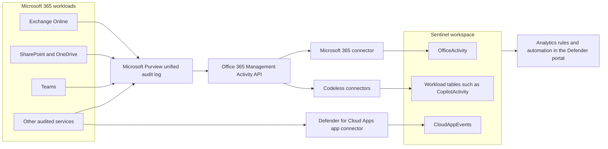

# Microsoft Purview unified audit log

> Status: verified. Priority: P1 (start here). Last verified: 21 Nov 2026.

## What it is

The Microsoft Purview unified audit log records thousands of user and admin operations across dozens of Microsoft services, including Exchange, SharePoint, OneDrive and Teams ([auditing solutions overview](https://learn.microsoft.com/en-us/purview/audit-solutions-overview)). It is the source behind most Microsoft 365 activity data in Microsoft Sentinel, because the Microsoft 365 connector and other codeless connectors read audit records through the Office 365 Management Activity API. Get audit on, at the right tier, before any other Microsoft 365 connector.

## Key recommendations

- Confirm auditing is on before you connect anything. It is on by default for enterprise subscriptions, but not for Microsoft 365 Business Basic, Business Standard, Business Premium, or unmanaged tenants on free trials ([turn auditing on or off](https://learn.microsoft.com/en-us/purview/audit-log-enable-disable)).
- Audit (Standard) is enough to start. It gives 180-day retention in Purview and full access to the Office 365 Management Activity API, including `MailItemsAccessed` for E3/E5 users ([MailItemsAccessed reference](https://learn.microsoft.com/en-us/purview/audit-log-investigate-accounts)).
- Audit (Premium), which comes with E5/A5/G5 or the add-ons, mainly buys retention: one year by default for Exchange, SharePoint, OneDrive and Microsoft Entra ID records, custom retention policies, and about twice the Management API bandwidth ([auditing solutions overview](https://learn.microsoft.com/en-us/purview/audit-solutions-overview)).
- Connect the **Microsoft 365 (formerly, Office 365)** connector for Exchange, SharePoint, OneDrive and Teams. Ingestion is free, but the data still occupies your workspace ([Sentinel billing, free data sources](https://learn.microsoft.com/en-us/azure/sentinel/billing#free-data-sources)).
- That connector covers four workloads only. For other workload activity, use `CloudAppEvents` via Defender for Cloud Apps, or the workload's own codeless connector, such as Microsoft Copilot or the Business Applications connectors ([data connectors reference](https://learn.microsoft.com/en-us/azure/sentinel/data-connectors-reference#microsoft-365-formerly-office-365)).
- Turn on the audit tampering and rare operation rules from the Microsoft 365 Content Hub solution on day 1, then add the custom checks below.
- Expect hours, not seconds. Core workload audit records are typically available 60 to 90 minutes after the event ([audit search](https://learn.microsoft.com/en-us/purview/audit-search)), and the connector polls after that.

## High-value log sources

| Source | Table name | Connector | Tier | Cost / volume | Value |
|---|---|---|---|---|---|
| Unified audit: Exchange, SharePoint, OneDrive, Teams | `OfficeActivity` | Microsoft 365 (formerly, Office 365) | Analytics, or data lake for hunt-only | Free ingestion. Medium to high volume depending on users and `MailItemsAccessed`. Bytes still count towards workspace storage and retention | The main Microsoft 365 activity feed. Admin cmdlets, mailbox actions, file operations, Teams events, in one table split by `OfficeWorkload` |
| Other audited workloads via Defender for Cloud Apps | `CloudAppEvents` | Microsoft Defender XDR (Defender for Cloud Apps app connector) | Analytics | Paid ingestion. Medium | Covers cloud app activity beyond the four connector workloads, including Dynamics 365, Viva Engage, Power BI, plus third party apps ([CloudAppEvents table](https://learn.microsoft.com/en-us/defender-xdr/advanced-hunting-cloudappevents-table)) |
| Other workloads via codeless connectors | `CopilotActivity`, `PowerPlatformAdminActivity`, `PowerAutomateActivity`, `DataverseActivity` | Microsoft Copilot, Microsoft Business Applications | Analytics | Paid ingestion. Low to medium | Workload specific events that also ride the Purview audit pipeline. See [Power Platform](../../business-apps/power-platform/README.md) for detail |
| Connector health | `SentinelHealth` | Health monitoring for Microsoft Sentinel | Analytics | Free | Catches connector failures so a dead audit feed does not look like a quiet tenant ([free data sources](https://learn.microsoft.com/en-us/azure/sentinel/billing#free-data-sources)) |

`OfficeActivity` is one wide table. Columns vary by workload, so filter on `OfficeWorkload` and `RecordType` before you query ([OfficeActivity reference](https://learn.microsoft.com/en-us/azure/azure-monitor/reference/tables/officeactivity)). The table supports workspace transformation DCRs and data lake tier ingestion, so you can drop noise or park hunt-only data cheaply.

## Prerequisites and licensing

| Item | Detail |
|---|---|
| Audit (Standard) | Included with enterprise Microsoft 365 and Office 365 subscriptions. On by default. Not on by default for Business Basic, Business Standard, Business Premium, or unmanaged tenants using free trials ([turn auditing on or off](https://learn.microsoft.com/en-us/purview/audit-log-enable-disable)) |
| Audit (Premium) | Office 365 or Microsoft 365 E5/A5/G5, Microsoft Purview Suite, or the Microsoft 365 E5 eDiscovery and Audit add-on ([audit search](https://learn.microsoft.com/en-us/purview/audit-search)). Adds one year default retention for Exchange, SharePoint, OneDrive and Entra ID records, retention policies up to 10 years with the add-on licence, intelligent insights, and higher API bandwidth ([auditing solutions overview](https://learn.microsoft.com/en-us/purview/audit-solutions-overview)) |
| Retention defaults | Standard: 180 days for all audit records (this default changed from 90 days on 17 October 2023). Premium: one year for Exchange, SharePoint, OneDrive and Entra ID, 180 days for other workloads unless a policy extends it ([turn auditing on or off](https://learn.microsoft.com/en-us/purview/audit-log-enable-disable), [audit search](https://learn.microsoft.com/en-us/purview/audit-search)) |
| Non-user records | Under Audit (Premium), records for service principals, system events and applications are retained for a fixed one year, and retention policies do not apply to them ([auditing solutions overview](https://learn.microsoft.com/en-us/purview/audit-solutions-overview)) |
| Turn auditing on or off | *Audit Logs* role in Exchange Online. The Compliance Management and Organization Management role groups hold it by default ([turn auditing on or off](https://learn.microsoft.com/en-us/purview/audit-log-enable-disable)) |
| Search the audit log | *View-Only Audit Logs* or *Audit Logs* roles in the Purview portal, or the same roles in the Exchange admin center for cmdlets ([audit search](https://learn.microsoft.com/en-us/purview/audit-search)) |
| Connect the Sentinel connector | Global Administrator or Security Administrator on the tenant, plus read and write on the workspace ([Microsoft 365 connector](https://github.com/Azure/Azure-Sentinel/blob/master/Solutions/Microsoft%20365/Data%20Connectors/Microsoft365.JSON)) |
| CloudAppEvents | Defender for Cloud Apps deployed in Defender XDR, and the Microsoft 365 app connector with Microsoft 365 activities selected ([CloudAppEvents table](https://learn.microsoft.com/en-us/defender-xdr/advanced-hunting-cloudappevents-table)) |
| Power BI | Auditing must be turned on in the Power BI admin portal before Power BI events appear ([audit search](https://learn.microsoft.com/en-us/purview/audit-search)) |
| Sentinel workspace | Any pay-as-you-go or commitment tier billing. The `OfficeActivity` data itself is free to ingest ([free data sources](https://learn.microsoft.com/en-us/azure/sentinel/billing#free-data-sources)) |

## Step-by-step setup

1. **Verify auditing is on.** In Exchange Online PowerShell, run `Get-AdminAuditLogConfig | Format-List UnifiedAuditLogIngestionEnabled`. `True` means auditing is on. Run it in Exchange Online PowerShell, not Security and Compliance PowerShell, where the property always reads `False` ([turn auditing on or off](https://learn.microsoft.com/en-us/purview/audit-log-enable-disable)).
2. **Turn on auditing if needed.** Sign in to the [Purview portal](https://purview.microsoft.com), select the **Audit** solution card (if it is not shown, select **View all solutions**, then **Audit** under **Core**), and select **Start recording user and admin activity**. Allow up to 60 minutes. You can also run `Set-AdminAuditLogConfig -UnifiedAuditLogIngestionEnabled $true` ([turn auditing on or off](https://learn.microsoft.com/en-us/purview/audit-log-enable-disable)).
3. **Confirm mailbox auditing is on.** Mailbox auditing is on by default for all organisations. Check it has not been disabled with `Get-OrganizationConfig | Format-List AuditDisabled`. `False` means it is on ([manage mailbox auditing](https://learn.microsoft.com/en-us/purview/audit-mailboxes)). Detail for Exchange lives in the [Exchange Online guide](../exchange-online/README.md).
4. **Open the connector page in the Defender portal.** Go to **Setup & configuration > Data management > Data & connectors > Connectors**, select **Classic connectors - Microsoft Sentinel**, then find **Microsoft 365 (formerly, Office 365)** and open its page ([Sentinel in the Defender portal](https://learn.microsoft.com/en-us/azure/sentinel/microsoft-sentinel-defender-portal)). If the connector is missing, install the **Microsoft 365** solution from **Content management > Content hub**.
5. **Select the record types.** Tick **Exchange**, **SharePoint** and **Teams**. SharePoint includes OneDrive. Select **Apply Changes** ([connector definition](https://github.com/Azure/Azure-Sentinel/blob/master/Solutions/Microsoft%20365/Data%20Connectors/Microsoft365.JSON)).
6. **Wait, then validate.** A new Management Activity API subscription can take up to 12 hours to produce its first content blobs ([API reference](https://learn.microsoft.com/en-us/office/office-365-management-api/office-365-management-activity-api-reference)). After that, core workload records typically arrive 60 to 90 minutes after each event ([audit search](https://learn.microsoft.com/en-us/purview/audit-search)). Run the validation queries below.
7. **Turn on health monitoring.** Enable Sentinel health so connector failures surface in `SentinelHealth`, which is free to ingest ([free data sources](https://learn.microsoft.com/en-us/azure/sentinel/billing#free-data-sources)).
8. **Add the rest of the audit estate.** In the Defender portal, go to **Settings > Cloud apps > App connectors**, connect **Microsoft 365**, and make sure the Microsoft 365 activities checkbox is selected so `CloudAppEvents` populates ([CloudAppEvents table](https://learn.microsoft.com/en-us/defender-xdr/advanced-hunting-cloudappevents-table)). For Power Platform and Copilot, install the Business Applications and Microsoft Copilot solutions, which also read Purview audit ([Microsoft Copilot connector](https://learn.microsoft.com/en-us/azure/sentinel/data-connectors-reference#microsoft-copilot), [Power Platform guide](../../business-apps/power-platform/README.md)).
9. **Enable the day 1 rules** listed below, then add the custom detections.

## Architecture diagram



## Validation KQL

For group-wide and workspace-wide freshness checks, see [email-collab.kql](../../queries/validation/email-collab.kql) and the [validation query pack](../../queries/validation/README.md).

```kql
// 1. Is OfficeActivity landing, and which workloads?
OfficeActivity
| where TimeGenerated > ago(1d)
| summarize Rows = count(), Latest = max(TimeGenerated) by OfficeWorkload
| order by Rows desc
// Expect Exchange, SharePoint or OneDrive, and MicrosoftTeams if you ticked all three.
// An empty result after 12 hours means auditing or the connector is off.

// 2. Freshness per workload. Anything older than a few hours needs investigating.
OfficeActivity
| summarize Latest = max(TimeGenerated) by OfficeWorkload
| extend HoursOld = round((now() - Latest) / 1h, 1)

// 3. Which record types are arriving? New types appearing here can mean a new
// connector, a licence change, or a workload that just started auditing.
OfficeActivity
| where TimeGenerated > ago(7d)
| summarize Rows = count() by RecordType, OfficeWorkload
| order by Rows desc

// 4. Volume: GB per day from the record sizes. OfficeActivity is free to ingest,
// so _BilledSize is the honest measure of what the workspace is storing.
OfficeActivity
| where TimeGenerated > ago(14d)
| summarize GB = round(sum(_BilledSize) / 1024 / 1024 / 1024, 2) by Day = bin(TimeGenerated, 1d)
| order by Day desc

// 5. Cost cross-check via the Usage table. This connector is a free data type,
// so Usage may show little or nothing for OfficeActivity. That absence is normal.
Usage
| where TimeGenerated > ago(14d)
| where DataType == "OfficeActivity"
| summarize GB = round(sum(Quantity) / 1024, 2) by Day = bin(TimeGenerated, 1d)
| order by Day desc

// 6. Is CloudAppEvents landing, if you use the Defender for Cloud Apps path?
CloudAppEvents
| where TimeGenerated > ago(1d)
| summarize Rows = count(), Latest = max(TimeGenerated) by Application
| order by Rows desc
```

## Out-of-box analytic rules

All rules below ship in the **Microsoft 365** Content Hub solution, version 3.2.2 (25 October 2026), which packages the Microsoft 365 (formerly, Office 365) connector, workbooks, hunting queries and rules ([solution folder](https://github.com/Azure/Azure-Sentinel/tree/master/Solutions/Microsoft%20365), [release notes](https://github.com/Azure/Azure-Sentinel/blob/master/Solutions/Microsoft%20365/ReleaseNotes.md)). Names, detections, tactics and techniques are taken from the rule YAMLs. As of 3.2.2 the same detections also ship in Defender XDR custom detection format, so enable one format per rule to avoid duplicate alerts.

These are the cross workload rules that matter for the audit feed. The Exchange specific BEC rules are covered in the [Exchange Online guide](../exchange-online/README.md).

| Rule | Detects | Tables | MITRE | Enable day 1? |
|---|---|---|---|---|
| [Exchange AuditLog Disabled](https://github.com/Azure/Azure-Sentinel/blob/master/Solutions/Microsoft%20365/Analytic%20Rules/exchange_auditlogdisabled.yaml) | An admin runs `Set-AdminAuditLogConfig` and turns Exchange admin audit logging off | `OfficeActivity` | Defense Evasion (T1562) | Yes. This is the audit tampering tripwire |
| [Office Policy Tampering](https://github.com/Azure/Azure-Sentinel/blob/master/Solutions/Microsoft%20365/Analytic%20Rules/office_policytampering.yaml) | Remove or Disable operations on anti phishing, Safe Attachment, Safe Links, DLP or audit policies by admins | `OfficeActivity` | Persistence, Defense Evasion (T1098, T1562) | Yes |
| [Rare and potentially high-risk Office operations](https://github.com/Azure/Azure-Sentinel/blob/master/Solutions/Microsoft%20365/Analytic%20Rules/RareOfficeOperations.yaml) | `Add-MailboxPermission`, `Add-MailboxFolderPermission`, `Set-Mailbox`, `New-ManagementRoleAssignment`, `New-InboxRule`, `Set-InboxRule`, `Set-TransportRule` | `OfficeActivity` | Persistence, Collection (T1098, T1114) | Yes, but tune. It fires on every matching operation |
| [SharePointFileOperation via previously unseen IPs](https://github.com/Azure/Azure-Sentinel/blob/master/Solutions/Microsoft%20365/Analytic%20Rules/SharePoint_Downloads_byNewIP.yaml) | Upload or download volume from IPs unseen for that user, above the 25 event threshold | `OfficeActivity` | Exfiltration (T1030) | Yes, tune the threshold |
| [SharePointFileOperation via devices with previously unseen user agents](https://github.com/Azure/Azure-Sentinel/blob/master/Solutions/Microsoft%20365/Analytic%20Rules/SharePoint_Downloads_byNewUserAgent.yaml) | Upload or download volume from user agents unseen for that user | `OfficeActivity` | Exfiltration (T1030) | Yes, tune |
| [Office365 Sharepoint File transfer above threshold](https://github.com/Azure/Azure-Sentinel/blob/master/Solutions/Microsoft%20365/Analytic%20Rules/sharepoint_file_transfer_above_threshold.yaml) | 5,000 or more distinct files uploaded or downloaded in 15 minutes | `OfficeActivity` | Exfiltration (T1020) | Yes, tune the 5,000 threshold to your tenant |
| [Office365 Sharepoint File transfer Folders above threshold](https://github.com/Azure/Azure-Sentinel/blob/master/Solutions/Microsoft%20365/Analytic%20Rules/sharepoint_file_transfer_folders_above_threshold.yaml) | Uploads or downloads touching 500 or more distinct folders in 15 minutes | `OfficeActivity` | Exfiltration (T1020) | Yes, tune |
| [New executable via Office FileUploaded Operation](https://github.com/Azure/Azure-Sentinel/blob/master/Solutions/Microsoft%20365/Analytic%20Rules/Office_Uploaded_Executables.yaml) | Executable file types (exe, inf, gzip, cmd, bat) uploaded to SharePoint or OneDrive | `OfficeActivity` | Command and Control, Lateral Movement (T1105, T1570) | Yes |
| [Multiple Teams deleted by a single user](https://github.com/Azure/Azure-Sentinel/blob/master/Solutions/Microsoft%20365/Analytic%20Rules/MultipleTeamsDeletes.yaml) | More than 3 teams deleted by one user within the query window | `OfficeActivity` | Impact (T1485, T1489) | Yes, tune the count |
| [External user added and removed in short timeframe](https://github.com/Azure/Azure-Sentinel/blob/master/Solutions/Microsoft%20365/Analytic%20Rules/ExternalUserAddedRemovedInTeams.yaml) | A guest added to a team and removed within an hour | `OfficeActivity` | Persistence (T1136) | Yes |
| [Accessed files shared by temporary external user](https://github.com/Azure/Azure-Sentinel/blob/master/Solutions/Microsoft%20365/Analytic%20Rules/External%20User%20added%20to%20Team%20and%20immediately%20uploads%20file.yaml) | A guest shares a file that 10 or more users access, then the guest is removed | `OfficeActivity` | Initial Access (T1566) | Yes |

The solution also shipped a Forest Blizzard credential harvesting rule. It is retired because its indicators are outdated. Use the Microsoft Entra ID solution's rules for credential harvesting instead ([rule YAML](https://github.com/Azure/Azure-Sentinel/blob/master/Solutions/Microsoft%20365/Analytic%20Rules/ForestBlizzardCredHarvesting.yaml)).

## Custom detections

The out-of-box rules cover audit tampering for the Exchange admin audit log, but not the unified audit log switch itself, and nothing watches for new activity types arriving. These close those gaps. Run them hourly over a 1-hour lookback unless the comment says otherwise.

### C1. Unified audit ingestion turned off (High)

```kql
// CUSTOM - Someone turned off unified audit logging for the tenant.
// The OOB "Exchange AuditLog Disabled" rule only watches AdminAuditLogEnabled.
// This watches the switch that kills every Microsoft 365 feed into Sentinel.
// ASSUMPTION: the Set-AdminAuditLogConfig record still reaches Sentinel after
// ingestion is disabled. Microsoft states that audit status changes are audited
// and searchable (see audit-log-enable-disable), but treat total silence in
// OfficeActivity as the stronger signal either way.
OfficeActivity
| where TimeGenerated > ago(24h)
| where Operation =~ "Set-AdminAuditLogConfig"
| mv-expand P = todynamic(Parameters)
| where tostring(P.Name) =~ "UnifiedAuditLogIngestionEnabled"
| where tostring(P.Value) =~ "False"
| project TimeGenerated, UserId, ClientIP, Operation, ParameterValue = tostring(P.Value)
```

Microsoft documents that turning auditing on or off is itself audited, and that `Search-UnifiedAuditLog -Operations Set-AdminAuditLogConfig` finds the record ([turn auditing on or off](https://learn.microsoft.com/en-us/purview/audit-log-enable-disable)). Pair this rule with the freshness query in Validation KQL. MITRE: Defense Evasion T1562.

### C2. Mailbox auditing disabled for the organisation (High)

```kql
// CUSTOM - Org-wide mailbox auditing turned off, or audit bypass enabled for a user.
// Both are Exchange cmdlets, so admin audit logging records them by default.
// ASSUMPTION: audit-mailboxes documents both cmdlets; confirm the exact Operation
// and parameter spelling in your own OfficeActivity with validation query 3.
let admin_noise = dynamic(["NT AUTHORITY", "NT SERVICE", "devilfish-applicationaccount"]);
union
(OfficeActivity
 | where TimeGenerated > ago(24h)
 | where Operation =~ "Set-OrganizationConfig"
 | where Parameters has_any ("AuditDisabled")
 | project TimeGenerated, Actor = UserId, ClientIP, Operation, Parameters),
(OfficeActivity
 | where TimeGenerated > ago(24h)
 | where Operation =~ "Set-MailboxAuditBypassAssociation"
 | where Parameters has_any ("AuditByPassEnabled")
 | where UserId !has_any (admin_noise)
 | project TimeGenerated, Actor = UserId, ClientIP, Operation, Parameters)
```

`Set-OrganizationConfig -AuditDisabled $true` turns off mailbox auditing for every mailbox, and `Set-MailboxAuditBypassAssociation -AuditByPassEnabled $true` hides one user's mailbox actions everywhere ([manage mailbox auditing](https://learn.microsoft.com/en-us/purview/audit-mailboxes)). Either one blinds you to mailbox attacks. MITRE: Defense Evasion T1562.

### C3. New workload or record type appearing in the audit feed (Low to Medium)

```kql
// CUSTOM - A workload or record type that has not been seen for 30 days starts
// sending data. Legitimate causes: a new connector, a licence change, a service
// that just started auditing. Worth a look either way.
// Run daily with a 1d lookback.
let lookback = 30d;
let known = OfficeActivity
 | where TimeGenerated between (ago(lookback) .. ago(1d))
 | summarize by OfficeWorkload, RecordType;
OfficeActivity
| where TimeGenerated > ago(1d)
| summarize Rows = count(), Actors = dcount(UserId) by OfficeWorkload, RecordType
| join kind=leftanti known on OfficeWorkload, RecordType
| project OfficeWorkload, RecordType, Rows, Actors
```

This is the audit estate's change detector. If you did not connect anything new, a new record type deserves an explanation. Use it with validation query 3.

## Playbooks

The Microsoft 365 solution ships no playbooks (the solution package contains connectors, rules, workbooks and hunting queries only, per the [solution folder](https://github.com/Azure/Azure-Sentinel/tree/master/Solutions/Microsoft%20365)). None documented for the audit feed itself.

Two customs are worth building:

| Playbook (custom) | Trigger | Actions | Connectors and permissions |
|---|---|---|---|
| Audit tamper response | C1 or C2, or the OOB Exchange AuditLog Disabled rule | Page the on-call, comment the affected records on the incident, run `Get-AdminAuditLogConfig` via an Automation runbook and post the result | Managed identity with Sentinel Responder, plus an Automation account holding the *Audit Logs* role in Exchange Online |
| Audit estate report | Weekly schedule | Summarise workloads, record types and GB per day from `OfficeActivity` into a Teams channel or email | Logic Apps with Office 365 Outlook or Teams connection |

## Workbooks and hunting

| Item | Source | Use |
|---|---|---|
| Office 365 workbook | Microsoft 365 solution ([Workbooks folder](https://github.com/Azure/Azure-Sentinel/tree/master/Solutions/Microsoft%20365/Workbooks)) | Activity over time across workloads, split by user and admin |
| SharePoint and OneDrive workbook | Microsoft 365 solution | File operation volume and trends |
| 22 hunting queries | Microsoft 365 solution ([Hunting Queries folder](https://github.com/Azure/Azure-Sentinel/tree/master/Solutions/Microsoft%20365/Hunting%20Queries)) | Includes sharepoint_downloads, new_sharepoint_downloads_by_IP, new_adminaccountactivity, Teams uploads and bot hunting, and Windows reserved file name checks |

Most hunting queries assume the connector is on and all three record types are selected. Run them from the Defender portal under **Investigation & response > Hunts** ([Sentinel in the Defender portal](https://learn.microsoft.com/en-us/azure/sentinel/microsoft-sentinel-defender-portal)).

## Gotchas and deprecations

- **Silent failure.** If auditing is off, the Management Activity API and Sentinel return nothing, and audit searches in Purview come back empty. Nothing errors out. Check `UnifiedAuditLogIngestionEnabled` and the freshness queries regularly ([turn auditing on or off](https://learn.microsoft.com/en-us/purview/audit-log-enable-disable)).
- **SMB and trial tenants start dark.** Business Basic, Business Standard, Business Premium and unmanaged tenants on enterprise trials do not get auditing by default ([turn auditing on or off](https://learn.microsoft.com/en-us/purview/audit-log-enable-disable)).
- **Retention differences.** Standard keeps audit records 180 days in Purview. Premium keeps Exchange, SharePoint, OneDrive and Entra ID records one year by default. Sentinel retention is separate and set on the table. The Standard default changed from 90 to 180 days on 17 October 2023 ([audit search](https://learn.microsoft.com/en-us/purview/audit-search)).
- **Scope of the Microsoft 365 connector.** Exchange, SharePoint, OneDrive and Teams only. Other workloads need `CloudAppEvents`, a workload connector, or your own Management Activity API subscription to the Audit.General content type ([API reference](https://learn.microsoft.com/en-us/office/office-365-management-api/office-365-management-activity-api-reference)).
- **Latency.** Core workload records are typically available 60 to 90 minutes after an event, other services can be slower, and Microsoft commits to no specific time. A new API subscription can take up to 12 hours to produce its first content blobs. Near real time rules are therefore not realistic on this feed ([audit search](https://learn.microsoft.com/en-us/purview/audit-search), [API reference](https://learn.microsoft.com/en-us/office/office-365-management-api/office-365-management-activity-api-reference)).
- **Workloads that need opt in.** Power BI auditing must be enabled in the Power BI admin portal, and Dynamics 365 auditing must be enabled before Defender for Cloud Apps sees those logs, with a 24 to 72 hour delay ([audit search](https://learn.microsoft.com/en-us/purview/audit-search), [connect Microsoft 365 to Defender for Cloud Apps](https://learn.microsoft.com/en-us/defender-cloud-apps/protect-office-365)).
- **Free is not free of consequences.** `OfficeActivity` ingestion costs nothing, but the bytes still occupy workspace storage, count in Usage and capacity views, and retention beyond 90 days is billed like any other table ([Sentinel billing](https://learn.microsoft.com/en-us/azure/sentinel/billing)).
- **Name changes.** The connector was renamed from Office 365 to Microsoft 365 (formerly, Office 365) in solution version 3.0.0, August 2023, and the solution folder and marketplace listing use Microsoft 365 ([release notes](https://github.com/Azure/Azure-Sentinel/blob/master/Solutions/Microsoft%20365/ReleaseNotes.md)).
- **Sentinel in the Azure portal retires on 31 March 2027.** Build and operate this in the Defender portal ([Sentinel in the Defender portal](https://learn.microsoft.com/en-us/azure/sentinel/microsoft-sentinel-defender-portal)).

## Official links

- [Learn about auditing solutions in Microsoft Purview](https://learn.microsoft.com/en-us/purview/audit-solutions-overview) (Microsoft Learn)
- [Turn auditing on or off](https://learn.microsoft.com/en-us/purview/audit-log-enable-disable) (Microsoft Learn)
- [Search the audit log](https://learn.microsoft.com/en-us/purview/audit-search) (Microsoft Learn)
- [Manage mailbox auditing](https://learn.microsoft.com/en-us/purview/audit-mailboxes) (Microsoft Learn)
- [Audit log activities](https://learn.microsoft.com/en-us/purview/audit-log-activities) (Microsoft Learn)
- [Use MailItemsAccessed to investigate compromised accounts](https://learn.microsoft.com/en-us/purview/audit-log-investigate-accounts) (Microsoft Learn)
- [Microsoft 365 (formerly, Office 365) data connector](https://learn.microsoft.com/en-us/azure/sentinel/data-connectors-reference#microsoft-365-formerly-office-365) (Microsoft Learn)
- [OfficeActivity table reference](https://learn.microsoft.com/en-us/azure/azure-monitor/reference/tables/officeactivity) (Microsoft Learn)
- [Plan costs and understand pricing and billing, free data sources](https://learn.microsoft.com/en-us/azure/sentinel/billing#free-data-sources) (Microsoft Learn)
- [Office 365 Management Activity API reference](https://learn.microsoft.com/en-us/office/office-365-management-api/office-365-management-activity-api-reference) (Microsoft Learn)
- [Microsoft 365 solution for Sentinel](https://azuremarketplace.microsoft.com/en-us/product/azuresentinel.azure-sentinel-solution-office365) (Azure Marketplace)
- [Microsoft 365 solution, rules, workbooks and release notes](https://github.com/Azure/Azure-Sentinel/tree/master/Solutions/Microsoft%20365) (GitHub, Azure/Azure-Sentinel)
- [CloudAppEvents table in the advanced hunting schema](https://learn.microsoft.com/en-us/defender-xdr/advanced-hunting-cloudappevents-table) (Microsoft Learn)
- [Connect Microsoft 365 to Microsoft Defender for Cloud Apps](https://learn.microsoft.com/en-us/defender-cloud-apps/protect-office-365) (Microsoft Learn)
- [Stream data from Microsoft Defender XDR to Microsoft Sentinel](https://learn.microsoft.com/en-us/azure/sentinel/connect-microsoft-365-defender) (Microsoft Learn)
- [Microsoft Sentinel in the Microsoft Defender portal](https://learn.microsoft.com/en-us/azure/sentinel/microsoft-sentinel-defender-portal) (Microsoft Learn)
- [Exchange Online guide in this repo](../exchange-online/README.md) (this repo)
- [Power Platform guide in this repo](../../business-apps/power-platform/README.md) (this repo)

## Last verified

21 Nov 2026, against Microsoft Learn and the Azure-Sentinel repo. Re-verify before relying on table names, rule names or licence positions.
