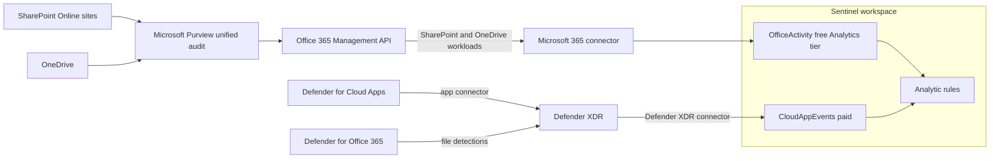

# SharePoint Online and OneDrive

> Status: verified. Priority: P2. Last verified: 21 Nov 2026.

## What it is

SharePoint Online and OneDrive hold most of a Microsoft 365 tenant's data, and the unified audit log records every access, share, download and permission change. This is where data exfiltration shows up first, whether it is an insider bulk-downloading a library, a compromised account sharing a folder to a personal address, or an anonymous link created on a sensitive site. The same audit feed also carries the malware detections that Defender for Office 365 raises on SharePoint and OneDrive files.

Do this after the P1 identity and email guides, and after [Microsoft Purview unified audit log](../purview-unified-audit/README.md) is confirmed on, because the connector reads the same audit layer. Sibling guides: [Exchange Online](../exchange-online/README.md) for the mailbox side, [Microsoft Defender for Office 365](../defender-for-office-365/README.md) for the mail and file protection that feeds this data, and [Microsoft Teams](../teams/README.md) for the chat workload.

## Key recommendations

- **Ingest `OfficeActivity` and relax about the bill.** The Microsoft 365 connector's `OfficeActivity (SharePoint)` data type covers SharePoint and OneDrive events and is on Microsoft's free data source list, so ingestion is free ([Sentinel free data sources](https://learn.microsoft.com/en-us/azure/sentinel/billing#free-data-sources)). Keep it in the Analytics tier and turn rules on against it.
- **Sharing and anonymous-link events are the high-value core.** Keep `AnonymousLinkCreated`, `AnonymousLinkUsed`, `SharingSet`, `SharingInvitationCreated`, `SharingPolicyChanged` and `SiteCollectionAdminAdded` available to rules in the Analytics tier. They are low volume and high signal.
- **`FileAccessed` and `FilePreviewed` are the volume, not the value.** Microsoft documents that preview events typically occur in high volumes, and access events are throttled to one per user and file per five minutes with Extended variants for the rest ([file and page activities in the audit log](https://learn.microsoft.com/en-us/purview/audit-log-activities#file-and-page-activities)). Since ingestion is free, the fix for these is a workspace transform that drops or trims what you do not query, not a paid tier move. Only send the whole workload to the data lake if no rules read it, because lake-only tables cannot run analytic rules ([which logs to ingest into the data lake](https://learn.microsoft.com/en-us/azure/sentinel/datalake/sentinel-lake-log-ingestion-guidance)).
- **Turn on the Microsoft 365 solution rules on day 1.** The mass file transfer thresholds, executable uploads and new-IP download rules all read `OfficeActivity` and cover the main exfiltration patterns.
- **Add the Defender for Cloud Apps view if you have the licence.** `CloudAppEvents` through the Defender XDR connector adds anomaly detection policies (unusual download, share and deletion) and one-click governance actions ([protect Microsoft 365 in Defender for Cloud Apps](https://learn.microsoft.com/en-us/defender-cloud-apps/protect-office-365)).
- **Watch `FileMaliciousContentInfo` in Defender XDR.** It is the advanced hunting view of files that Defender for Office 365 processed in SharePoint Online, OneDrive and Teams, currently in preview.

## High-value log sources

| Source | Table name | Connector | Tier | Cost / volume | Value |
|---|---|---|---|---|---|
| SharePoint and OneDrive file, sharing and admin activity | `OfficeActivity` where `OfficeWorkload` in ("SharePoint", "OneDrive") | Microsoft 365 (formerly, Office 365) | Analytics | Free ([free data sources](https://learn.microsoft.com/en-us/azure/sentinel/billing#free-data-sources)). High volume: `FileAccessed` and `FilePreviewed` dominate | File downloads, uploads, sharing, links, permission and site admin changes. The main exfiltration and privilege signal |
| Sharing detail | Same table, key operations | Microsoft 365 (formerly, Office 365) | Analytics | Free. Low | `AnonymousLinkCreated` and `AnonymousLinkUsed` show anonymous exposure, `SharingSet` and `SharingInvitationCreated` show who shared with whom, with `TargetUserOrGroupType` flagging guests |
| Cloud app view | `CloudAppEvents` | Microsoft Defender XDR, via the Defender for Cloud Apps Microsoft 365 app connector | Analytics | Paid; in the E5-family data grant ([Sentinel benefit for E5 customers](https://azure.microsoft.com/en-us/pricing/offers/sentinel-microsoft-365-offer/)). Medium to high | Enriched activity across Office 365 and other connected SaaS, with anomaly policies and governance actions on top |
| Malicious files in SharePoint, OneDrive and Teams | `FileMaliciousContentInfo` (preview) | Defender XDR, in the Defender portal only | Already in Defender XDR | Free in advanced hunting, 30 days | Defender for Office 365 file detections with workload, file path and hash. Not in the Sentinel connector table list |
| Alerts | `AlertInfo`, `AlertEvidence` | Defender XDR | Already in Defender XDR | Free, 30 days | Malware and file detections for hunting in the Defender portal |
| Alerts in Sentinel | `SecurityAlert`, `SecurityIncident` | Microsoft Defender XDR | Analytics | Free ([free data sources](https://learn.microsoft.com/en-us/azure/sentinel/billing#free-data-sources)) | File malware and MDO alerts land as incidents with no rule or ingestion cost |

The Microsoft 365 connector's SharePoint selection covers both `SharePoint` and `OneDrive` workloads: its data type query checks for `OfficeWorkload == "SharePoint" or OfficeWorkload == "OneDrive"` ([Microsoft 365 connector definition](https://github.com/Azure/Azure-Sentinel/blob/master/Solutions/Microsoft%20365/Data%20Connectors/Microsoft365.JSON)). Audit record types for SharePoint file operations appear in `OfficeActivity` with `RecordType` values such as `SharePointFileOperation`.

## Prerequisites and licensing

| Item | Detail |
|---|---|
| Purview auditing | Audit (Standard) is on by default and is the source for the connector ([auditing solutions in Purview](https://learn.microsoft.com/en-us/purview/audit-solutions-overview)). Audit (Premium) lifts default retention to one year for SharePoint and OneDrive records and adds higher Management API bandwidth |
| Microsoft 365 licence | The connector needs at least one Microsoft 365 licence in the tenant. No specific workload licence is required for the audit feed |
| Safe Attachments for SharePoint, OneDrive and Teams | Part of Defender for Office 365 Plan 1 and above, on by default ([Safe Attachments for SPO, OneDrive and Teams](https://learn.microsoft.com/en-us/defender-office-365/safe-attachments-for-spo-odfb-teams-about)) |
| `FileMaliciousContentInfo` hunting | Defender for Office 365 Plan 2, hunted in Defender XDR advanced hunting ([MDO service description](https://learn.microsoft.com/en-us/office365/servicedescriptions/office-365-advanced-threat-protection-service-description)) |
| Defender for Cloud Apps | Needed for `CloudAppEvents` and anomaly policies. The Office 365 Cloud App Security edition also provides the Office 365 app connector and Office 365 anomaly detection ([editions comparison](https://learn.microsoft.com/en-us/defender-cloud-apps/editions-cloud-app-security-o365)) |
| Sentinel licence | Pay-as-you-go or a commitment tier, but `OfficeActivity` itself is free |

### Roles you need

| Task | Role |
|---|---|
| Connect the Microsoft 365 connector | Global Administrator or Security Administrator on the tenant, plus read and write on the workspace ([connector definition](https://github.com/Azure/Azure-Sentinel/blob/master/Solutions/Microsoft%20365/Data%20Connectors/Microsoft365.JSON)) |
| Enable Purview auditing | Audit Logs role in Purview, or Compliance Administrator |
| Block download of malicious files | SharePoint Administrator, using SharePoint Online PowerShell |
| Connect the Defender for Cloud Apps app connector | Application Administrator or Cloud Application Administrator for file monitoring ([connect Microsoft 365 to Defender for Cloud Apps](https://learn.microsoft.com/en-us/defender-cloud-apps/protect-office-365)) |
| Enable analytic rules | Microsoft Sentinel Contributor |

## Step-by-step setup

1. **Confirm Purview auditing is on.** Purview portal > Audit. If it isn't on, select Activate. Audit data only exists from the point auditing is turned on.
2. **Install the Microsoft 365 solution.** Defender portal > Content management > Content hub > search for **Microsoft 365** > Install. Version 3.2.2 or later also ships the rules in Defender XDR custom detection format, so pick one format per rule to avoid duplicates.
3. **Connect the Microsoft 365 connector.** Defender portal > Setup & configuration > Data management > Data & connectors > Connectors tab > Classic connectors - Microsoft Sentinel > Microsoft 365 (formerly, Office 365) > Open connector page. Tick **SharePoint** (this covers SharePoint and OneDrive) and select Apply changes.
4. **Enable Safe Attachments for SharePoint, OneDrive and Teams.** Defender portal > Email & collaboration > Policies & rules > Threat policies > Safe Attachments > Global settings. In the Protect files in SharePoint, OneDrive, and Microsoft Teams section, verify the Turn on Defender for Office 365 for SharePoint, OneDrive, and Microsoft Teams toggle is on, then Save. Allow up to 30 minutes for the change to take effect. In PowerShell the same switch is `Set-AtpPolicyForO365 -EnableATPForSPOTeamsODB $true` ([turn on Safe Attachments for SPO, OneDrive and Teams](https://learn.microsoft.com/en-us/defender-office-365/safe-attachments-for-spo-odfb-teams-configure)).
5. **Block download of malicious files.** Recommended: in SharePoint Online PowerShell, run `Set-SPOTenant -DisallowInfectedFileDownload $true`. People can still delete malicious files, but not open, copy, move, share or download them. Needs Global Administrator or SharePoint Administrator ([turn on Safe Attachments for SPO, OneDrive and Teams](https://learn.microsoft.com/en-us/defender-office-365/safe-attachments-for-spo-odfb-teams-configure)).
6. **Create the malicious file alert policy.** Recommended: Defender portal > Email & collaboration > Policies & rules > Alert policy > New alert policy. Alert on the Detected malware in file activity so admins hear about `FileMalwareDetected` findings. Microsoft's own walkthrough uses the name Malicious Files in Libraries ([turn on Safe Attachments for SPO, OneDrive and Teams](https://learn.microsoft.com/en-us/defender-office-365/safe-attachments-for-spo-odfb-teams-configure)).
7. **Connect Defender for Cloud Apps if licensed.** Defender portal > Settings > Cloud apps > App connectors > + Connect an app > Microsoft 365. On the components page, keep all components selected for full coverage and select Connect. This populates `CloudAppEvents` through the Defender XDR connector and enables anomaly policies.
8. **Turn on the anomaly policies.** In Defender for Cloud Apps policies, enable unusual file download, unusual file share and unusual file deletion detection if not already on ([activity and anomaly policies](https://learn.microsoft.com/en-us/defender-cloud-apps/protect-office-365)).
9. **Filter the noise, not the signal.** If `FileAccessed` volume hurts queries, add a workspace transformation DCR on `OfficeActivity` (the table supports it) to drop or trim `FileAccessedExtended`, `PageViewedExtended` and, if you never query them, `FilePreviewed`. Keep the sharing operations untouched.
10. **Enable the rules.** Investigation & response > Detection > Analytics. Turn on the Microsoft 365 solution rules listed below and set your thresholds.
11. **Generate test activity and validate.** Download a few files, create an anonymous link on a test library, share a file to an external address. Then run the validation queries.

## Architecture diagram



## Validation KQL

For group-wide and workspace-wide freshness checks, see [email-collab.kql](../../queries/validation/email-collab.kql) and the [validation query pack](../../queries/validation/README.md).

```kql
// 1. Is SharePoint and OneDrive activity landing, and how fresh?
OfficeActivity
| where TimeGenerated > ago(1d)
| where OfficeWorkload in ("SharePoint", "OneDrive")
| summarize Rows = count(), Latest = max(TimeGenerated) by OfficeWorkload

// 2. What operations does your tenant emit? Pin exact names before writing rules.
OfficeActivity
| where TimeGenerated > ago(7d)
| where OfficeWorkload in ("SharePoint", "OneDrive")
| summarize Events = count(), LastSeen = max(TimeGenerated) by Operation
| order by Events desc

// 3. Volume: GB per day for the OfficeActivity table.
// Ingestion is free, so treat this as a size and query-cost number, not a budget number.
Usage
| where TimeGenerated > ago(7d)
| where DataType == "OfficeActivity"
| summarize GB = round(sum(Quantity) / 1024, 2) by bin(TimeGenerated, 1d)

// 4. Are the high-value sharing events present?
OfficeActivity
| where TimeGenerated > ago(7d)
| where Operation in ("AnonymousLinkCreated", "AnonymousLinkUsed", "SharingSet",
                      "SharingInvitationCreated", "SharingPolicyChanged", "SiteCollectionAdminAdded")
| summarize Events = count() by Operation, OfficeWorkload
| order by Events desc

// 5. Who shared with whom outside the tenant this week?
OfficeActivity
| where TimeGenerated > ago(7d)
| where Operation in ("SharingSet", "SharingInvitationCreated")
| where isnotempty(TargetUserOrGroupName)
| summarize Shares = count(), SampleTargets = make_set(TargetUserOrGroupName, 10)
            by UserId, Operation, Site_Url
| order by Shares desc
```

## Out-of-box analytic rules

All of these ship in the **Microsoft 365** solution in Content Hub, version 3.2.2, which also provides each rule in Defender XDR custom detection format. They read `OfficeActivity`, so they need the Microsoft 365 connector with SharePoint selected.

| Rule | Detects | Tables | MITRE | Suggested |
|---|---|---|---|---|
| [New executable via Office FileUploaded Operation](https://github.com/Azure/Azure-Sentinel/blob/master/Solutions/Microsoft%20365/Analytic%20Rules/Office_Uploaded_Executables.yaml) | Executables uploaded to SharePoint or OneDrive | `OfficeActivity` | Command and Control, Lateral Movement (T1105, T1570) | Enable day 1 |
| [Office365 Sharepoint File transfer above threshold](https://github.com/Azure/Azure-Sentinel/blob/master/Solutions/Microsoft%20365/Analytic%20Rules/sharepoint_file_transfer_above_threshold.yaml) | Downloads, syncs or uploads above a threshold, checked every 15 minutes | `OfficeActivity` | Exfiltration (T1020) | Enable day 1, set the threshold |
| [Office365 Sharepoint File transfer Folders above threshold](https://github.com/Azure/Azure-Sentinel/blob/master/Solutions/Microsoft%20365/Analytic%20Rules/sharepoint_file_transfer_folders_above_threshold.yaml) | Same pattern across folders | `OfficeActivity` | Exfiltration (T1020) | Enable day 1, set the threshold |
| [SharePointFileOperation via previously unseen IPs](https://github.com/Azure/Azure-Sentinel/blob/master/Solutions/Microsoft%20365/Analytic%20Rules/SharePoint_Downloads_byNewIP.yaml) | File operations from an IP unseen in the baseline | `OfficeActivity` | Exfiltration (T1030) | Enable day 1, tune the lookback |
| [SharePointFileOperation via devices with previously unseen user agents](https://github.com/Azure/Azure-Sentinel/blob/master/Solutions/Microsoft%20365/Analytic%20Rules/SharePoint_Downloads_byNewUserAgent.yaml) | File operations from a user agent unseen in the baseline | `OfficeActivity` | Exfiltration (T1030) | Enable, tune the lookback |
| [Exchange AuditLog Disabled](https://github.com/Azure/Azure-Sentinel/blob/master/Solutions/Microsoft%20365/Analytic%20Rules/exchange_auditlogdisabled.yaml) | Audit logging turned off in Exchange | `OfficeActivity` | Defense Evasion (T1562) | Enable day 1, covers audit tampering |

Defender for Cloud Apps adds its own out-of-box layer on the same data: built-in anomaly detections for unusual multiple file download, unusual file share and unusual file deletion activities, plus activity policy templates for mass download by a single user ([protect Microsoft 365](https://learn.microsoft.com/en-us/defender-cloud-apps/protect-office-365)). Enable the download and share detections on day 1 if you connected the app connector.

## Custom detections

The mass-download pattern is genuinely covered out of the box, by both the threshold rules above and the Defender for Cloud Apps anomaly policies, so it is not repeated here. Two gaps remain: anonymous links on sensitive sites, and sharing to personal email domains.

### C1. Anonymous link created or used on a sensitive site (High)

```kql
// CUSTOM - Anonymous link activity on sites you care about
// Feed the list from a watchlist of sensitive site URLs.
let sensitive_sites = dynamic(["https://yourtenant.sharepoint.com/sites/finance",
                               "https://yourtenant.sharepoint.com/sites/board"]);
OfficeActivity
| where TimeGenerated > ago(1h)
| where Operation in ("AnonymousLinkCreated", "AnonymousLinkUsed", "AnonymousLinkUpdated")
| where tostring(Site_Url) in (sensitive_sites)
| project TimeGenerated, Operation, UserId, Site_Url, SourceFileName, ClientIP
```

Anyone with the link can read the resource without authenticating, so a link on a finance or board site deserves an alert even when creation is legitimate. Use `AnonymousLinkUsed` rows to see who consumed it, including their IP. MITRE: Exfiltration T1567.002, Collection T1213.

### C2. Sharing to personal email domains (Medium)

```kql
// CUSTOM - File or folder shared to a consumer mail domain
let personal_domains = dynamic(["gmail.com", "outlook.com", "hotmail.com", "yahoo.com",
                                "icloud.com", "proton.me", "bigpond.com"]);
OfficeActivity
| where TimeGenerated > ago(1h)
| where Operation in ("SharingSet", "SharingInvitationCreated")
| extend TargetDomain = tolower(tostring(split(TargetUserOrGroupName, "@")[1]))
| where TargetDomain in (personal_domains)
| project TimeGenerated, Operation, UserId, TargetUserOrGroupName, SharingType,
          SourceFileName, Site_Url
```

Defender for Cloud Apps has a file policy template for this, but MDCA file policies retire on 6 January 2027, so a Sentinel rule is the durable replacement. Tune the domain list to your acceptable-use policy. MITRE: Exfiltration T1567.002.

### C3. Site collection admin added, or admin self-access to a OneDrive (High)

```kql
// CUSTOM - Site collection administrator changes
OfficeActivity
| where TimeGenerated > ago(1h)
| where Operation in ("SiteCollectionAdminAdded", "SiteCollectionAdminRemoved")
| project TimeGenerated, Operation, UserId, TargetUserOrGroupName, OfficeWorkload, Site_Url
```

`SiteCollectionAdminAdded` is also logged when an admin grants themselves access to a user's OneDrive through the profile page, which is exactly the pattern to watch in investigations. Follow up with `FileAccessed` by the new admin on the same site. MITRE: Privilege Escalation T1098, Defense Evasion T1562.

## Playbooks

The Microsoft 365 solution ships no playbooks, so "None documented" is the honest answer for included content. Defender for Cloud Apps provides native governance on the same data, which covers most response needs without Logic Apps:

- OneDrive and SharePoint: put file or folder in admin quarantine, make private, trash, remove external collaborators, remove a specific collaborator, apply or remove a sensitivity label.
- User: notify user, require sign-in again, confirm compromised, suspend user, all through Microsoft Entra ID.
- OAuth apps: revoke app permission.

([governance actions in Defender for Cloud Apps](https://learn.microsoft.com/en-us/defender-cloud-apps/protect-office-365))

If you prefer Sentinel playbooks, the useful custom pair are: on an anonymous-link alert, use the Microsoft 365 connector to remove the link's permission, and on a mass-download incident, trigger an MDCA governance action against the user. Both need Microsoft Sentinel Automation Contributor on the playbook resource group.

## Workbooks and hunting

| Item | Source | Use |
|---|---|---|
| SharePoint and OneDrive workbook | Microsoft 365 solution in Content Hub | File and sharing activity overview on the free audit feed |
| Office 365 workbook | Microsoft 365 solution | Cross-workload audit view including Exchange and Teams |
| Hunting queries: sharepoint_downloads, new_sharepoint_downloads_by_IP, new_sharepoint_downloads_by_UserAgent | Microsoft 365 solution | Download patterns by user, IP and user agent |
| Hunting queries: double_file_ext_exes, WindowsReservedFileNamesOnOfficeFileServices, New_WindowsReservedFileNamesOnOfficeFileService | Microsoft 365 solution | Disguised executables in document libraries |
| File Malware Detected | Audit log operation `FileMalwareDetected` | The SharePoint virus engine's own detections, in the same `OfficeActivity` feed |
| Activity log and anomaly alerts | Defender for Cloud Apps | Enriched view with governance one-click actions |

## Gotchas and deprecations

- `FilePreviewed` events "typically occur in high volumes based on a single activity" and `FileAccessed` is throttled to one event per user and file per five minutes, with `FileAccessedExtended` and `FileModifiedExtended` collapsing repeat activity inside three-hour windows ([file and page activities](https://learn.microsoft.com/en-us/purview/audit-log-activities#file-and-page-activities)). Volume here is a query-performance problem, not an ingestion-cost problem, because the table is free.
- `SitePermissionsModified` is deprecated in SharePoint. Use the site permissions operations such as `AddedToGroup`, `SiteCollectionAdminAdded` and `GroupUpdated` instead ([site permissions activities](https://learn.microsoft.com/en-us/purview/audit-log-activities#site-permissions-activities)).
- Defender for Cloud Apps file policies retire on 6 January 2027. Move file-based detection to Microsoft Purview DLP or auto-labelling, and keep detections that fit the audit feed in Sentinel ([file policy retirement](https://learn.microsoft.com/en-us/defender-cloud-apps/protect-office-365)).
- Safe Attachments for SharePoint, OneDrive and Teams does not scan every file. Scanning is asynchronous and driven by sharing and guest activity events plus heuristics, by design ([Safe Attachments for SPO, OneDrive and Teams](https://learn.microsoft.com/en-us/defender-office-365/safe-attachments-for-spo-odfb-teams-about)).
- Audit records for some SharePoint activities show `app@sharepoint` as the actor when a system process performs the action on a user's behalf. Correlate with `UserId` in related events before blaming a human.
- Some services only feed Defender for Cloud Apps after activity is detected: Exchange, Power BI and Teams events appear once those services are seen in the portal ([how audit logging works with Defender for Cloud Apps](https://learn.microsoft.com/en-us/defender-cloud-apps/protect-office-365)).
- `CloudAppEvents` is paid ingestion through the Defender XDR connector, covered by the E5-family grant, and it duplicates part of what `OfficeActivity` gives you free. Decide whether you need its enrichment and anomaly policies before paying for it.
- Sentinel in the Azure portal retires on 31 March 2027 and becomes Defender portal only. Build and test this connector in the Defender portal ([Microsoft Sentinel in the Defender portal](https://learn.microsoft.com/en-us/azure/sentinel/microsoft-sentinel-defender-portal)).

## Official links

- [Microsoft 365 (formerly, Office 365) connector reference](https://learn.microsoft.com/en-us/azure/sentinel/data-connectors-reference)
- [Microsoft 365 connector definition, Azure-Sentinel repo](https://github.com/Azure/Azure-Sentinel/blob/master/Solutions/Microsoft%20365/Data%20Connectors/Microsoft365.JSON)
- [OfficeActivity table reference](https://learn.microsoft.com/en-us/azure/azure-monitor/reference/tables/officeactivity)
- [Microsoft auditing solutions in Purview](https://learn.microsoft.com/en-us/purview/audit-solutions-overview)
- [Audit log activities: file and page activities](https://learn.microsoft.com/en-us/purview/audit-log-activities#file-and-page-activities)
- [Audit log activities: sharing and access request activities](https://learn.microsoft.com/en-us/purview/audit-log-activities#sharing-and-access-request-activities)
- [Audit log activities: site permissions activities](https://learn.microsoft.com/en-us/purview/audit-log-activities#site-permissions-activities)
- [Safe Attachments for SharePoint, OneDrive and Microsoft Teams](https://learn.microsoft.com/en-us/defender-office-365/safe-attachments-for-spo-odfb-teams-about)
- [Turn on Safe Attachments for SharePoint, OneDrive and Microsoft Teams](https://learn.microsoft.com/en-us/defender-office-365/safe-attachments-for-spo-odfb-teams-configure)
- [Microsoft Defender for Office 365 service description](https://learn.microsoft.com/en-us/office365/servicedescriptions/office-365-advanced-threat-protection-service-description)
- [FileMaliciousContentInfo table](https://learn.microsoft.com/en-us/defender-xdr/advanced-hunting-filemaliciouscontentinfo-table)
- [Protect your Microsoft 365 environment in Defender for Cloud Apps](https://learn.microsoft.com/en-us/defender-cloud-apps/protect-office-365)
- [Defender for Cloud Apps editions compared](https://learn.microsoft.com/en-us/defender-cloud-apps/editions-cloud-app-security-o365)
- [Sentinel free data sources](https://learn.microsoft.com/en-us/azure/sentinel/billing#free-data-sources)
- [Sentinel benefit for Microsoft 365 E7, E5, A5, F5 and G5 customers](https://azure.microsoft.com/en-us/pricing/offers/sentinel-microsoft-365-offer/)
- [Which logs to ingest directly into the Sentinel data lake](https://learn.microsoft.com/en-us/azure/sentinel/datalake/sentinel-lake-log-ingestion-guidance)
- [Microsoft Sentinel in the Defender portal](https://learn.microsoft.com/en-us/azure/sentinel/microsoft-sentinel-defender-portal)
- [Microsoft 365 solution, Azure-Sentinel repo](https://github.com/Azure/Azure-Sentinel/tree/master/Solutions/Microsoft%20365)

## Last verified

21 Nov 2026, against Microsoft Learn and the Azure-Sentinel repo. Re-verify before relying on table names or rule names.
