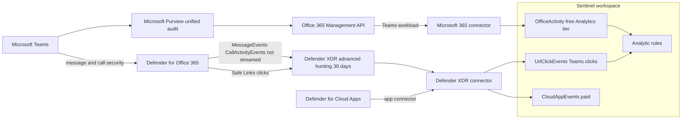

# Microsoft Teams

> Status: verified. Priority: P2. Last verified: 21 Nov 2026.

## What it is

Teams carries chat, channels, calls and meetings, and it is now a phishing channel in its own right. The unified audit log records membership and guest changes, external access, app and bot installs, and meeting activity, so a SOC can see who invited whom and what was installed. Defender for Office 365 adds the message protection layer: Safe Links at time of click, zero-hour auto purge (ZAP) for Teams, and, on Plan 2, the advanced hunting tables for Teams messages, calls and deepfake detections.

Enable this after the P1 identity and email sources. Sibling guides: [Microsoft Purview unified audit log](../purview-unified-audit/README.md) for the audit layer, [Microsoft Defender for Office 365](../defender-for-office-365/README.md) for the protection that generates the Teams security events, [Exchange Online](../exchange-online/README.md) for the mailbox side, and [SharePoint Online and OneDrive](../sharepoint-onedrive/README.md) for the files behind Teams chats and channels.

## Key recommendations

- **Ingest `OfficeActivity` for the Teams workload. It is free.** The Microsoft 365 connector's Teams selection writes to `OfficeActivity` where `OfficeWorkload == "MicrosoftTeams"`, and that data type is on Microsoft's free list ([Sentinel free data sources](https://learn.microsoft.com/en-us/azure/sentinel/billing#free-data-sources)). Keep it in Analytics and run rules on it.
- **Turn on the MDO protections for Teams.** With at least one Defender for Office 365 Plan 1 licence, Safe Links time-of-click protection, Safe Attachments for Teams files and ZAP for Teams apply to users. Verify the Built-in protection preset and turn the ZAP for Teams toggle on ([MDO support for Teams](https://learn.microsoft.com/en-us/defender-office-365/mdo-support-teams-about)).
- **Know what the message security tables are and where they live.** `MessageEvents`, `MessagePostDeliveryEvents` and `MessageUrlInfo` exist in Defender XDR advanced hunting and are a Plan 2 capability, but they are not in the Defender XDR connector's streamable table list, so hunt them in the Defender portal. The verified state is documented under [High-value log sources](#high-value-log-sources) and [Gotchas](#gotchas-and-deprecations).
- **Enable the Microsoft 365 solution Teams rules on day 1.** External user add and remove, files shared by temporary external users, and mass team deletion all read the free audit feed.
- **Add Defender for Cloud Apps if licensed.** Its Teams activity policy templates cover external user added, mass deletion and access level change, with governance actions like suspend user ([search the audit log for Teams events](https://learn.microsoft.com/en-us/purview/audit-teams-audit-log-events)).
- **Watch the new security risk operations.** `TeamsImpersonationDetected`, `SecurityRiskInMeetingDetected` and `SecurityRiskInCallDetected` are newer audit operations worth alerting on once you see them in your tenant.

## High-value log sources

| Source | Table name | Connector | Tier | Cost / volume | Value |
|---|---|---|---|---|---|
| Teams membership, guest, app, channel and meeting activity | `OfficeActivity` where `OfficeWorkload == "MicrosoftTeams"` | Microsoft 365 (formerly, Office 365) | Analytics | Free ([free data sources](https://learn.microsoft.com/en-us/azure/sentinel/billing#free-data-sources)). Low to medium. Message events are only logged for chats with guest, federated or anonymous users | `MemberAdded`, `MemberRemoved`, `TeamCreated`, `TeamDeleted`, `AppInstalled`, `BotAddedToTeam`, `TeamsTenantSettingChanged`, `TeamsAdminAction`, meeting detail events. The backbone for access and persistence detection |
| Safe Links clicks in Teams | `UrlClickEvents` where `Workload == "Teams"` | Microsoft Defender XDR | Analytics | Paid; not named in the E5-family grant table list. Low | Time-of-click verdicts on links in chats and channels, including click-throughs past warnings |
| Teams message security, Plan 2 | `MessageEvents`, `MessagePostDeliveryEvents`, `MessageUrlInfo` | Defender XDR only, not streamable to Sentinel | Already in Defender XDR | Free in advanced hunting, 30 days | Message delivery and threat verdicts, post-delivery ZAP and remediation, and URLs in Teams messages. Hunt them in the Defender portal ([MessageEvents table](https://learn.microsoft.com/en-us/defender-xdr/advanced-hunting-messageevents-table)) |
| Teams call and meeting activity, Plan 2 | `CallActivityEvents` | Defender XDR only, not streamable to Sentinel | Already in Defender XDR | Free in advanced hunting, 30 days | Who did what during calls and meetings, including unauthenticated and external participants ([CallActivityEvents table](https://learn.microsoft.com/en-us/defender-xdr/advanced-hunting-callactivityevents-table)) |
| Deepfake detections, Plan 2 | `SyntheticMediaDetectionEvents` | Defender XDR only | Already in Defender XDR | Free in advanced hunting, 30 days | Synthetic media detections in Teams calls, with severity and confidence. Needs an approved detection engine: Microsoft, GetReal, Pindrop, Reality Defender or Resemble AI ([SyntheticMediaDetectionEvents table](https://learn.microsoft.com/en-us/defender-xdr/advanced-hunting-synthetic-media-detection-events)) |
| Cloud app view | `CloudAppEvents` | Microsoft Defender XDR, via the Defender for Cloud Apps Microsoft 365 app connector | Analytics | Paid; in the E5-family grant. Medium | The Defender for Cloud Apps view of Teams activity, with activity policies and governance actions |
| Alerts | `AlertInfo`, `AlertEvidence` | Defender XDR | Already in Defender XDR | Free, 30 days | Teams-relevant MDO alerts for hunting in the Defender portal |
| Alerts in Sentinel | `SecurityAlert`, `SecurityIncident` | Microsoft Defender XDR | Analytics | Free ([free data sources](https://learn.microsoft.com/en-us/azure/sentinel/billing#free-data-sources)) | Teams detections land as incidents with no rule or ingestion cost |

## Prerequisites and licensing

| Item | Detail |
|---|---|
| Any Teams licence | Built-in virus protection in SharePoint, OneDrive and Teams, the Teams external domain anomalies report, and near real-time URL warnings in messages for up to 48 hours after delivery ([MDO support for Teams](https://learn.microsoft.com/en-us/defender-office-365/mdo-support-teams-about)) |
| Defender for Office 365 Plan 1 | Safe Links for Teams, Safe Attachments for Teams files, the Tenant Allow Block List for Teams, ZAP for Teams, quarantined Teams messages, the Teams message and call entity panels, and user reporting of Teams items. Included in Microsoft 365 Business Premium and, from 1 July 2026, Office 365 E3 and Microsoft 365 E3 |
| Defender for Office 365 Plan 2 or Microsoft 365 E5 | Remove users from Teams chats as remediation, advanced hunting on Teams messages and calls, and synthetic media detections ([MDO support for Teams](https://learn.microsoft.com/en-us/defender-office-365/mdo-support-teams-about)) |
| Purview auditing | On by default. Required for the audit feed and for the Office 365 Management API path behind it ([auditing solutions in Purview](https://learn.microsoft.com/en-us/purview/audit-solutions-overview)) |
| Purview Audit (Premium) | Some Teams events need it: `MessageDeleted` is an Audit (Premium) event, and Premium adds properties such as `ParticipatingDomainInformation` to message events ([Audit (Premium) activity properties](https://learn.microsoft.com/en-us/purview/audit-solutions-overview#audit-premium-activity-properties)) |
| Defender for Cloud Apps | Needed for `CloudAppEvents` and the Teams activity policy templates |

### Roles you need

| Task | Role |
|---|---|
| Connect the Microsoft 365 connector | Global Administrator or Security Administrator on the tenant, plus read and write on the workspace |
| Enable Purview auditing | Audit Logs role in Purview, or Compliance Administrator |
| Configure ZAP for Teams and Teams protection | Security Administrator in the Defender portal |
| Connect the Defender for Cloud Apps app connector | Application Administrator or Cloud Application Administrator |
| Enable analytic rules | Microsoft Sentinel Contributor |

## Step-by-step setup

1. **Confirm Purview auditing is on.** Purview portal > Audit. Audit data only exists from the point it is turned on.
2. **Install the Microsoft 365 solution.** Defender portal > Content management > Content hub > search for **Microsoft 365** > Install. Version 3.2.2 or later also ships the rules in Defender XDR custom detection format, so enable one format per rule.
3. **Connect the Microsoft 365 connector.** Defender portal > Setup & configuration > Data management > Data & connectors > Connectors tab > Classic connectors - Microsoft Sentinel > Microsoft 365 (formerly, Office 365) > Open connector page. Tick **Teams**, alongside SharePoint if it is not already on, then Apply changes.
4. **Verify Safe Links protection for Teams.** Defender portal > Email & collaboration > Policies & rules > Threat policies > Safe Links. The Built-in protection preset covers users with at least one MDO licence. If you create custom policies, turn on the Teams setting and allow up to 24 hours for changes ([Safe Links overview](https://learn.microsoft.com/en-us/defender-office-365/safe-links-about)).
5. **Turn on ZAP for Teams.** Defender portal > Settings > Email & collaboration > Microsoft Teams protection. Verify the ZAP toggle is on, set the quarantine policies for malware and high-confidence phishing, and add any recipient exclusions. Save ([MDO support for Teams](https://learn.microsoft.com/en-us/defender-office-365/mdo-support-teams-about)).
6. **Set up user reporting for Teams items.** Turn on the reporting toggles in the Teams admin centre under Settings & policies, including Report a security concern in Messaging and Report a call in Calling settings. Then in the Defender portal go to Settings > Email & collaboration > Teams user reported settings and turn on Monitor reported items in Microsoft Teams. It is on by default for new tenants, and existing tenants need to enable it. Reported items then generate alerts by default ([user reported settings in Teams](https://learn.microsoft.com/en-us/defender-office-365/submissions-teams)).
7. **Hunt the message tables if you have Plan 2.** Defender portal > Investigation & response > Advanced hunting. Query `MessageEvents`, `MessagePostDeliveryEvents`, `MessageUrlInfo` and `CallActivityEvents` there. They hold 30 days at no ingestion cost, and they are not streamable to Sentinel through the Defender XDR connector.
8. **Connect Defender for Cloud Apps if licensed.** Defender portal > Settings > Cloud apps > App connectors > + Connect an app > Microsoft 365, keep all components selected. This feeds `CloudAppEvents` and enables the Teams activity policy templates.
9. **Enable the activity policies.** In Defender for Cloud Apps, create policies from the External user added (Teams), Mass deletion (Teams) and Access level change (Teams) templates ([search the audit log for Teams events](https://learn.microsoft.com/en-us/purview/audit-teams-audit-log-events)).
10. **Enable the rules and validate.** Turn on the rules below, add a test guest to a test team, upload a file to a chat, and run the validation queries.

## Best-practice security configuration

Harden external federation, meetings and third-party apps in Teams alongside audit logging. See [Microsoft recommended security configurations](../../docs/security-configurations.md).

- **Restrict external access (federation):** Switch external access from "Allow all external domains" to an **allow-list of approved partner domains** (blocks uninvited external Teams phishing and impersonation) ([Teams security overview](https://learn.microsoft.com/en-us/microsoftteams/security-compliance-overview)).
- **Lock down third-party & custom apps:** Block unapproved third-party apps by default and require admin review before users can install bots or connectors into channels.
- **Meeting lobby & anonymous join:** Require external/anonymous participants to wait in the meeting lobby and restrict who can present or record sensitive meetings.
- **Safe Links & ZAP for Teams:** Enable Defender for Office 365 Safe Links and Zero-hour Auto Purge for Teams chats.

## Architecture diagram



## Validation KQL

For group-wide and workspace-wide freshness checks, see [email-collab.kql](../../queries/validation/email-collab.kql) and the [validation query pack](../../queries/validation/README.md).

```kql
// 1. Is the Teams workload landing, and how fresh?
OfficeActivity
| where TimeGenerated > ago(1d)
| where OfficeWorkload =~ "MicrosoftTeams"
| summarize Rows = count(), Latest = max(TimeGenerated)

// 2. What operations does your tenant emit? Pin exact names before writing rules.
OfficeActivity
| where TimeGenerated > ago(7d)
| where OfficeWorkload =~ "MicrosoftTeams"
| summarize Events = count(), LastSeen = max(TimeGenerated) by Operation
| order by Events desc

// 3. Volume: GB per day for the OfficeActivity table.
// Ingestion is free, so this is a size and query-cost number.
Usage
| where TimeGenerated > ago(7d)
| where DataType == "OfficeActivity"
| summarize GB = round(sum(Quantity) / 1024, 2) by bin(TimeGenerated, 1d)

// 4. Guest and external member activity this week.
OfficeActivity
| where TimeGenerated > ago(7d)
| where OfficeWorkload =~ "MicrosoftTeams"
| where Operation in ("MemberAdded", "MemberRemoved", "MemberRoleChanged")
| mv-expand Members
| extend MemberUpn = tostring(Members.UPN)
| where MemberUpn has "#EXT#"
| summarize Events = count() by Operation, UserId, TeamName
| order by Events desc

// 5. Safe Links clicks from Teams, if the Defender XDR connector streams UrlClickEvents.
UrlClickEvents
| where TimeGenerated > ago(7d)
| where Workload =~ "Teams"
| summarize Clicks = count(), Blocked = countif(ActionType == "Blocked") by AccountUpn
| order by Clicks desc
```

## Out-of-box analytic rules

These ship in the **Microsoft 365** solution in Content Hub, version 3.2.2, in both Sentinel and Defender XDR custom detection formats. All read the free `OfficeActivity` Teams feed.

| Rule | Detects | Tables | MITRE | Suggested |
|---|---|---|---|---|
| [External user added and removed in short timeframe](https://github.com/Azure/Azure-Sentinel/blob/master/Solutions/Microsoft%20365/Analytic%20Rules/ExternalUserAddedRemovedInTeams.yaml) | A guest added to a team and removed within an hour | `OfficeActivity` (Teams) | Persistence (T1136) | Enable day 1 |
| [Accessed files shared by temporary external user](https://github.com/Azure/Azure-Sentinel/blob/master/Solutions/Microsoft%20365/Analytic%20Rules/External%20User%20added%20to%20Team%20and%20immediately%20uploads%20file.yaml) | A temporary external user shares a file in a team chat that more than 10 users access | `OfficeActivity` (Teams and SharePoint) | Initial Access (T1566) | Enable day 1, tune the access threshold |
| [Multiple teams deleted by a single user](https://github.com/Azure/Azure-Sentinel/blob/master/Solutions/Microsoft%20365/Analytic%20Rules/MultipleTeamsDeletes.yaml) | One user deleting many teams in a day | `OfficeActivity` (Teams) | Impact (T1485, T1489) | Enable day 1, tune the count |

Defender for Cloud Apps adds the Teams activity policy templates: External user added (Teams), Mass deletion (Teams) and Access level change (Teams), plus built-in anomaly detections. The Microsoft 365 solution also ships Exchange rules on the same connector, covered in [Exchange Online](../exchange-online/README.md).

Two more detections arrive without any rule to enable. Safe Links clicks in Teams raise the MDO alerts described in [Microsoft Defender for Office 365](../defender-for-office-365/README.md), free through the Defender XDR connector. And when users report Teams items, the alert policies Teams message reported by user as a security risk and Teams call reported by user as a security risk generate alerts by default ([user reported settings in Teams](https://learn.microsoft.com/en-us/defender-office-365/submissions-teams)).

## Custom detections

The out-of-box rules cover the add-and-remove pattern, the shared-file pattern and mass deletion. Three gaps remain: what a new guest does after joining, who installs apps, and changes to external access policy.

### C1. External member added then file download or upload (High)

```kql
// CUSTOM - Guest joined a team and then moved files within the window
let window = 2h;
let guests = OfficeActivity
| where TimeGenerated > ago(1h)
| where OfficeWorkload =~ "MicrosoftTeams"
| where Operation =~ "MemberAdded"
| mv-expand Members
| extend MemberUpn = tostring(Members.UPN)
| where MemberUpn has "#EXT#"
| project AddTime = TimeGenerated, MemberUpn, AddedBy = UserId, TeamName;
guests
| join kind=inner (
    OfficeActivity
    | where TimeGenerated > ago(3h)
    | where OfficeWorkload in ("SharePoint", "OneDrive")
    | where Operation in ("FileDownloaded", "FileSyncDownloadedFull", "FileUploaded")
    | where SourceRelativeUrl has "Microsoft Teams" or SourceRelativeUrl has "Teams"
    | project FileTime = TimeGenerated, MemberUpn = UserId, Operation, SourceFileName, Site_Url
) on MemberUpn
| where FileTime between (AddTime .. AddTime + window)
| project AddTime, MemberUpn, AddedBy, TeamName, FileTime, Operation, SourceFileName, Site_Url
```

The out-of-box rule covers the chat-file share path; this catches guests who download from team document libraries. Correlate on the guest UPN, which carries `#EXT#`. MITRE: Exfiltration T1567, Collection T1213.

### C2. New app, bot or connector installed (Medium)

```kql
// CUSTOM - App or bot installed or published, with an approved list
// ASSUMPTION: Your approved app list. Feed it from a watchlist.
let approved_apps = dynamic(["Microsoft Planner", "Microsoft Lists", "Approval"]);
let app_ops = dynamic(["AppInstalled", "AppPublishedToCatalog", "BotAddedToTeam", "ConnectorAdded"]);
OfficeActivity
| where TimeGenerated > ago(1h)
| where OfficeWorkload =~ "MicrosoftTeams"
| where Operation in (app_ops)
| extend Target = coalesce(tostring(ItemName), tostring(AddonName), "")
| where Target !in~ (approved_apps)
| project TimeGenerated, Operation, UserId, Target, TeamName, ClientIP
```

Apps and connectors can read chat content and post messages, so an unapproved install is persistence as well as productivity. Admin installs show under `TeamsAdminAction` too. MITRE: Persistence T1098, Collection T1213.

### C3. External access or guest policy changed (High)

```kql
// CUSTOM - Teams tenant or admin settings that change who can get in
// ASSUMPTION: The setting name is in the Item column for TeamsTenantSettingChanged.
// Pin the values your tenant emits before narrowing the filter:
//   OfficeActivity | where Operation in ("TeamsTenantSettingChanged", "TeamsAdminAction")
//   | distinct Operation, Item, Parameters
OfficeActivity
| where TimeGenerated > ago(1h)
| where OfficeWorkload =~ "MicrosoftTeams"
| where Operation in ("TeamsTenantSettingChanged", "TeamsAdminAction")
| where tostring(Item) has_any ("guest", "external", "federation", "sharing", "access")
    or tostring(Parameters) has_any ("Guest", "Federation", "AllowGuest")
| project TimeGenerated, Operation, UserId, Item, Parameters, ClientIP
```

`TeamsTenantSettingChanged` records org-wide changes by a global admin, and `TeamsAdminAction` records admin tool changes through PowerShell, the admin centre or the API ([Teams activities in the audit log](https://learn.microsoft.com/en-us/purview/audit-log-activities#teams-activities)). An attacker who flips guest or federation settings gets a durable door. MITRE: Defense Evasion T1562, Persistence T1098.

## Playbooks

The Microsoft 365 solution ships no playbooks, so "None documented" is the honest answer for included content. Two native options cover most of the response:

- **Defender for Cloud Apps governance actions.** For activity policy matches, including the Teams templates, you can suspend the user, require sign-in again, or confirm the account compromised, all through Microsoft Entra ID ([search the audit log for Teams events](https://learn.microsoft.com/en-us/purview/audit-teams-audit-log-events)). The documented example suspends a user who deleted two or more teams in 30 minutes.
- **Remove users from Teams chats.** With MDO Plan 2, this is built into the Teams message entity panel as a remediation action, no Logic App required ([MDO support for Teams](https://learn.microsoft.com/en-us/defender-office-365/mdo-support-teams-about)).

If you build Sentinel playbooks, the useful pair are: on an external member alert, use the Microsoft 365 connector to remove the member from the team, and on a malicious link incident, revoke the clicker's sessions through Microsoft Graph. Both need Microsoft Sentinel Automation Contributor on the playbook resource group.

## Workbooks and hunting

| Item | Source | Use |
|---|---|---|
| Office 365 workbook | Microsoft 365 solution in Content Hub | Cross-workload audit view, no Teams-specific workbook ships |
| Hunting queries: ExternalUserAddedRemovedInTeams_HuntVersion, ExternalUserFromNewOrgAddedToTeams, UserAddToTeamsAndUploadsFile | Microsoft 365 solution | Broader versions of the guest add patterns |
| Hunting queries: MultiTeamBot, MultiTeamOwner, NewBotAddedToTeams, TeamsFilesUploaded, MultipleTeamsDeletes | Microsoft 365 solution | Bots and owners added across many teams, files uploaded to Teams |
| MessageEvents and CallActivityEvents hunting | Defender portal advanced hunting | Plan 2 hunting on message verdicts, ZAP on Teams messages, and call activity, including the documented join of `SyntheticMediaDetectionEvents` to `CallActivityEvents` on call ID |
| UrlClickEvents hunting queries | Microsoft Defender XDR solution | URL clicks by action and workload, including Teams |

## Gotchas and deprecations

- **The Teams message security tables are not streamable to Sentinel.** `MessageEvents`, `MessagePostDeliveryEvents` and `MessageUrlInfo`, plus `CallActivityEvents` and `SyntheticMediaDetectionEvents`, are absent from the Defender XDR connector's table list ([connector definition](https://github.com/Azure/Azure-Sentinel/blob/master/Solutions/Microsoft%20Defender%20XDR/Data%20Connectors/MicrosoftThreatProtection.JSON)). Hunt them in Defender XDR advanced hunting, where they hold 30 days. In Sentinel, rely on `OfficeActivity`, `UrlClickEvents` and `CloudAppEvents`.
- **Teams message hunting is Plan 2.** With MDO Plan 1 you get the protections, the entity panels and quarantine, but not the `MessageEvents` family ([MDO support for Teams](https://learn.microsoft.com/en-us/defender-office-365/mdo-support-teams-about)).
- `MessageSent` is only logged for chats involving guests, federated or anonymous users, and `MessageDeleted` needs Audit (Premium) ([Teams activities footnotes](https://learn.microsoft.com/en-us/purview/audit-log-activities#teams-activities)). Absence of message events does not mean absence of messages.
- **Membership changes made outside Teams are misattributed.** When membership changes come through Microsoft Entra ID, the Microsoft 365 admin centre or the Graph API, the Teams audit record names an existing team owner as the initiator. Check the Entra ID or M365 group audit logs for the real actor ([Teams audit attribution](https://learn.microsoft.com/en-us/purview/audit-teams-audit-log-events)).
- Safe Links changes for Teams can take up to 24 hours to take effect ([Safe Links overview](https://learn.microsoft.com/en-us/defender-office-365/safe-links-about)).
- Quarantined Teams messages are admin-only by default, with the AdminOnlyAccess quarantine policy, and users do not get quarantine notifications ([MDO support for Teams](https://learn.microsoft.com/en-us/defender-office-365/mdo-support-teams-about)).
- `SyntheticMediaDetectionEvents` only holds data with an approved detection engine, Microsoft or a supported third party, and it is very new documentation, so validate table availability in your tenant before writing rules against it ([SyntheticMediaDetectionEvents table](https://learn.microsoft.com/en-us/defender-xdr/advanced-hunting-synthetic-media-detection-events)).
- Teams events only appear in Defender for Cloud Apps after activity from those services is detected in the portal ([how audit logging works with Defender for Cloud Apps](https://learn.microsoft.com/en-us/defender-cloud-apps/protect-office-365)).
- Sentinel in the Azure portal retires on 31 March 2027 and becomes Defender portal only. Build and test this connector in the Defender portal ([Microsoft Sentinel in the Defender portal](https://learn.microsoft.com/en-us/azure/sentinel/microsoft-sentinel-defender-portal)).

## Official links

- [Microsoft Defender for Office 365 support for Microsoft Teams](https://learn.microsoft.com/en-us/defender-office-365/mdo-support-teams-about)
- [Microsoft Defender for Office 365 overview](https://learn.microsoft.com/en-us/defender-office-365/mdo-about)
- [Safe Links overview](https://learn.microsoft.com/en-us/defender-office-365/safe-links-about)
- [Microsoft 365 (formerly, Office 365) connector reference](https://learn.microsoft.com/en-us/azure/sentinel/data-connectors-reference)
- [Microsoft 365 connector definition, Azure-Sentinel repo](https://github.com/Azure/Azure-Sentinel/blob/master/Solutions/Microsoft%20365/Data%20Connectors/Microsoft365.JSON)
- [Microsoft Defender XDR connector definition, Azure-Sentinel repo](https://github.com/Azure/Azure-Sentinel/blob/master/Solutions/Microsoft%20Defender%20XDR/Data%20Connectors/MicrosoftThreatProtection.JSON)
- [OfficeActivity table reference](https://learn.microsoft.com/en-us/azure/azure-monitor/reference/tables/officeactivity)
- [Teams activities in the audit log](https://learn.microsoft.com/en-us/purview/audit-log-activities#teams-activities)
- [Search the audit log for events in Microsoft Teams](https://learn.microsoft.com/en-us/purview/audit-teams-audit-log-events)
- [User reported settings in Teams](https://learn.microsoft.com/en-us/defender-office-365/submissions-teams)
- [Microsoft auditing solutions in Purview](https://learn.microsoft.com/en-us/purview/audit-solutions-overview)
- [MessageEvents table](https://learn.microsoft.com/en-us/defender-xdr/advanced-hunting-messageevents-table)
- [MessagePostDeliveryEvents table](https://learn.microsoft.com/en-us/defender-xdr/advanced-hunting-messagepostdeliveryevents-table)
- [MessageUrlInfo table](https://learn.microsoft.com/en-us/defender-xdr/advanced-hunting-messageurlinfo-table)
- [CallActivityEvents table](https://learn.microsoft.com/en-us/defender-xdr/advanced-hunting-callactivityevents-table)
- [SyntheticMediaDetectionEvents table](https://learn.microsoft.com/en-us/defender-xdr/advanced-hunting-synthetic-media-detection-events)
- [UrlClickEvents table](https://learn.microsoft.com/en-us/defender-xdr/advanced-hunting-urlclickevents-table)
- [Data tables in the Microsoft Defender advanced hunting schema](https://learn.microsoft.com/en-us/defender-xdr/advanced-hunting-schema-tables)
- [Protect your Microsoft 365 environment in Defender for Cloud Apps](https://learn.microsoft.com/en-us/defender-cloud-apps/protect-office-365)
- [Sentinel free data sources](https://learn.microsoft.com/en-us/azure/sentinel/billing#free-data-sources)
- [Microsoft Sentinel in the Defender portal](https://learn.microsoft.com/en-us/azure/sentinel/microsoft-sentinel-defender-portal)
- [Microsoft 365 solution, Azure-Sentinel repo](https://github.com/Azure/Azure-Sentinel/tree/master/Solutions/Microsoft%20365)

## Last verified

21 Nov 2026, against Microsoft Learn and the Azure-Sentinel repo. Re-verify before relying on table names or rule names.
