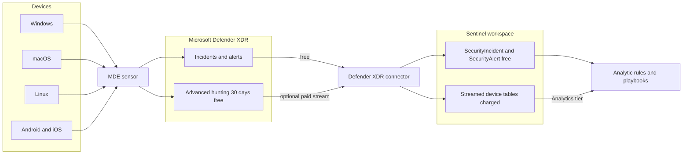

# Microsoft Defender for Endpoint

> Status: verified. Priority: P1 (start here). Last verified: 21 Nov 2026.

## What it is

Defender for Endpoint (MDE) is Microsoft's EDR for Windows, macOS, Linux, Android and iOS. It feeds endpoint signals into the unified Microsoft Defender portal, where Defender XDR correlates them with identity, email and cloud alerts into single incidents. Its device tables are the richest endpoint telemetry in the Microsoft stack, and they are free to query in advanced hunting for 30 days before you pay anything for Sentinel ingestion.

## Key recommendations

- Onboard every device to Defender for Endpoint Plan 2, or Defender for Business if you're an SMB. The advanced hunting device tables come with the EDR sensor.
- Connect Defender XDR to Sentinel for incidents and alerts first. That stream is free of ingestion charges and keeps incidents synchronised in both directions.
- Don't stream the raw device tables into Sentinel by default. This is the biggest single cost decision in this guide. Advanced hunting keeps 30 days of raw Defender data at no extra cost, and 90 days if you hold an eligible ISOC licence (Microsoft Defender Suite, Microsoft 365 E5 or Microsoft 365 E7, from 15 Nov 2026). Sentinel ingestion is charged per GB. See [Defender XDR vs Sentinel](../../docs/defender-xdr-vs-sentinel.md).
- If you do opt in, do it per table and only for one of three reasons: your Sentinel rules need to join device data with non-Microsoft data, you need device events beyond 30 days, or you want them in the data lake for hunting.
- Prefer Defender XDR custom detections for device-only logic. They run against advanced hunting data and avoid ingestion costs altogether.
- Vulnerability management (TVM) tables are never ingested into Sentinel. Query them in advanced hunting.

## High-value log sources

Everything in this table except the first row is already in Defender XDR advanced hunting at no extra cost. The connector name is as it appears in the Sentinel Content Hub: **Microsoft Defender XDR**.

| Source | Table name | Connector | Tier | Cost / volume | Value |
|---|---|---|---|---|---|
| Incidents and alerts | `SecurityIncident`, `SecurityAlert` | Microsoft Defender XDR | Analytics | Ingestion free, low volume | Correlated incidents from all Defender products, synchronised both ways with the Defender portal |
| Alert metadata and evidence | `AlertInfo`, `AlertEvidence` | Microsoft Defender XDR | Free in advanced hunting | Low | Alert severity, category and MITRE ATT&CK techniques, plus the files, users, IPs and devices behind each alert |
| Process creation | `DeviceProcessEvents` | Microsoft Defender XDR | Free in advanced hunting. Analytics or data lake if streamed | High. One row per process start on every onboarded device | Full command lines, hashes, signing info and parent process. The backbone of endpoint detection |
| Network connections | `DeviceNetworkEvents` | Microsoft Defender XDR | Free in advanced hunting | High | Every connection attempt with the initiating process, remote IP, port and URL. C2, lateral movement, exfiltration |
| File events | `DeviceFileEvents` | Microsoft Defender XDR | Free in advanced hunting | Medium to high | File create, change, rename and delete, with download origin URL and IP. Ransomware behaviour and droppers |
| Registry events | `DeviceRegistryEvents` | Microsoft Defender XDR | Free in advanced hunting | Medium | Persistence keys, with previous and new values. Autostart tampering |
| Logons | `DeviceLogonEvents` | Microsoft Defender XDR | Free in advanced hunting | Medium | Logon type, failure reason, remote IP and device, local admin flag. Not collected on Windows 7 or Server 2008 R2 |
| Image loads | `DeviceImageLoadEvents` | Microsoft Defender XDR | Free in advanced hunting | High if unfiltered | DLL loads in every process. Side-loading detection. Stream to the data lake only, or not at all |
| Security control and other events | `DeviceEvents` | Microsoft Defender XDR | Free in advanced hunting | Medium to high | ASR rule hits, antivirus detections, exploit protection, USB mounts and named pipe creation |
| Device inventory | `DeviceInfo`, `DeviceNetworkInfo` | Microsoft Defender XDR | Free in advanced hunting | Low | OS version, join type, sensor health, IPs and MACs. Enrichment for alerts and rules |
| Signed file certificates | `DeviceFileCertificateInfo` | Microsoft Defender XDR | Free in advanced hunting | Low to medium | Signer and trust status for files. Join to `DeviceProcessEvents` on SHA1 |
| Vulnerability management | `DeviceTvmSoftwareInventory`, `DeviceTvmSoftwareVulnerabilities` and other `DeviceTvm*` tables | Not ingested into Sentinel | Free in advanced hunting | Low | Software inventory and CVEs per device. Query in the Defender portal only |

If you do stream tables, start with `DeviceProcessEvents`, `DeviceNetworkEvents` and `DeviceEvents`. Those three carry most of the rule logic below. Keep `DeviceImageLoadEvents` out unless a rule reads it, and put anything you only hunt with into the data lake tier.

## Prerequisites and licensing

| Item | Detail |
|---|---|
| Defender for Endpoint Plan 2 | Standalone, or included in Microsoft 365 E5 and Microsoft 365 E5 Security. The EDR sensor fills the device tables |
| Defender for Endpoint Plan 1 | Standalone or included in Microsoft 365 E3. Next-generation protection, attack surface reduction and manual response actions only. The advanced hunting device tables need the Plan 2 sensor |
| Small business | Microsoft Defender for Business, or Microsoft 365 Business Premium which includes it |
| Servers | Separate licences: Defender for Servers Plan 1 or 2 via Defender for Cloud, Defender for Endpoint Server, or Defender for Business servers |
| Defender XDR portal access | Any one of several licences, including Microsoft 365 E5, E3 with the Microsoft Defender Suite add-on, any Defender for Endpoint plan, or Microsoft 365 Business Premium |
| Automatic attack disruption and threat analytics | Require Defender for Endpoint Plan 2 |
| Sentinel | Pay-as-you-go or commitment tier. Incidents and alerts are free to ingest. Raw advanced hunting tables are charged |
| ISOC 90-day retention | Microsoft Defender Suite, Microsoft 365 E5 or Microsoft 365 E7. Retention can be extended up to 180 days at extra cost |

The device tables are populated by the MDE sensor, not by Windows audit policy. There is no audit setting to turn on before endpoint data lands in advanced hunting.

### Roles you need

| Task | Role |
|---|---|
| Turn on Microsoft Defender and connect the Defender XDR connector | Security Administrator on the tenant, minimum |
| Change connector settings | Read and write on the Sentinel workspace, and an account in the same Microsoft Entra tenant as the workspace |
| Run advanced hunting queries | Microsoft Entra Global Administrator, Security Administrator, Security Reader or Global Reader, or Defender unified RBAC. Endpoint data access also follows Defender for Endpoint RBAC |
| Onboard devices | Defender portal access with device management permissions |

## Step-by-step setup

1. **Confirm licensing.** Microsoft 365 admin center > Billing > Licenses. You need Billing admin or higher to see licence detail.
2. **Onboard devices.** Defender portal (security.microsoft.com) > System > Settings > Endpoints > Device management > Onboarding. Select the operating system, the connectivity type (Streamlined or Standard), and a deployment method. Download the onboarding package and deploy it with your tool of choice, such as Intune, Configuration Manager or Group Policy.
3. **Verify onboarding.** Check the devices appear in the device inventory, run a detection test on a pilot device, and confirm alerts flow. Use a ring rollout: evaluate on about 50 devices, pilot on 50 to 100, then go broad.
4. **Bring Sentinel into the Defender portal.** If you onboarded your Sentinel workspace after 1 July 2025 as a subscription Owner or User Access Administrator, the workspace is already in the Defender portal and the Defender XDR connector is enabled automatically. Just run the verification query in step 6. If you still work in the Azure portal, install the **Microsoft Defender XDR** solution from the Content Hub, then continue with step 5.
5. **Connect incidents and alerts, Azure portal only.** Data connectors > Microsoft Defender XDR > Open connector page. Tick **Turn off all Microsoft incident creation rules for these products. Recommended**, then select **Connect incidents & alerts**. This avoids duplicate incidents.
6. **Verify incidents land.** Run the `SecurityIncident` query below. Incidents normally appear in Sentinel within five minutes of being generated in Defender XDR.
7. **Choose raw tables, if you opt in.** On the same connector page, under Connect events, tick only the tables you need, then Apply Changes. Start with nothing. Add a table only when a rule needs it.
8. **Enable the out-of-box rules and playbooks** listed below.
9. **Check cost after a week.** Run the Usage query below. If a streamed table has no rule or hunting query reading it, turn it off or move it to the data lake tier.

## Best-practice security configuration

Logging is only half the job; configure these controls via Intune Endpoint Security (roll out restrictive rules in Audit mode for 14 to 30 days first, then move to Block). See the full checklist in [Defender best-practice security configurations](../../docs/defender-best-practices.md#microsoft-defender-for-endpoint).

- **Tamper Protection:** On across all Windows and macOS devices so attackers and local admins can't disable AV or EDR ([Tamper protection](https://learn.microsoft.com/en-us/defender-endpoint/prevent-changes-to-security-settings-with-tamper-protection)).
- **EDR in block mode:** On everywhere, especially alongside third-party AV running in active mode ([EDR in block mode](https://learn.microsoft.com/en-us/defender-endpoint/edr-in-block-mode)).
- **Attack Surface Reduction (ASR):** Enable all standard rules; move high-confidence rules (LSASS credential theft, Office child processes, macro Win32 API calls, PsExec/WMI process creation, obfuscated scripts, vulnerable signed drivers) to Block ([ASR rules](https://learn.microsoft.com/en-us/defender-endpoint/attack-surface-reduction)).
- **Network Protection & PUA:** Set both to **Block** mode so malicious URLs, C2 IPs and PUAs are stopped across every browser and process ([Network protection](https://learn.microsoft.com/en-us/defender-endpoint/enable-network-protection), [PUA protection](https://learn.microsoft.com/en-us/defender-endpoint/detect-block-potentially-unwanted-apps-microsoft-defender-antivirus)).
- **Cloud protection & AIR:** Enable Block at First Sight (Cloud Block Level **High** or **High+**, 50s extended check), set Automated Investigation and Remediation (AIR) to **Full** on workstations, and keep **Automatic attack disruption** enabled ([Block at First Sight](https://learn.microsoft.com/en-us/defender-endpoint/configure-block-at-first-sight-microsoft-defender-antivirus), [AIR](https://learn.microsoft.com/en-us/defender-endpoint/configure-automated-investigations-remediation), [Automatic attack disruption](https://learn.microsoft.com/en-us/defender-xdr/automatic-attack-disruption)).
- **Controlled Folder Access & Live Response:** Pilot Controlled Folder Access in Audit mode on high-value endpoints ([Controlled folder access](https://learn.microsoft.com/en-us/defender-endpoint/controlled-folders)) and keep Live Response unsigned script execution disabled unless explicitly required.

## Architecture diagram



## Validation KQL

For group-wide and workspace-wide freshness checks, see [endpoint.kql](../../queries/validation/endpoint.kql) and the [validation query pack](../../queries/validation/README.md).

```kql
// 1. Are Defender XDR incidents landing, and how fresh?
SecurityIncident
| where ProviderName == "Microsoft XDR"
| where TimeGenerated > ago(3d)
| summarize Incidents = count(), Latest = max(TimeGenerated)

// 2. Are alerts landing, and from which products?
SecurityAlert
| where TimeGenerated > ago(3d)
| summarize Alerts = count(), Latest = max(TimeGenerated) by ProviderName
| order by Alerts desc

// 3. Are the streamed device tables landing, and how fresh?
// Returns nothing if you have not opted in to raw event streaming. That is a valid result.
union withsource=Table isfuzzy=true
    DeviceProcessEvents, DeviceNetworkEvents, DeviceFileEvents,
    DeviceRegistryEvents, DeviceLogonEvents, DeviceImageLoadEvents,
    DeviceEvents, DeviceInfo, DeviceNetworkInfo, DeviceFileCertificateInfo
| where TimeGenerated > ago(1d)
| summarize Rows = count(), Latest = max(TimeGenerated) by Table

// 4. Cost: GB per streamed table over 30 days
Usage
| where TimeGenerated > ago(30d)
| where DataType in ("DeviceProcessEvents", "DeviceNetworkEvents", "DeviceFileEvents",
    "DeviceRegistryEvents", "DeviceLogonEvents", "DeviceImageLoadEvents",
    "DeviceEvents", "DeviceInfo", "DeviceNetworkInfo", "DeviceFileCertificateInfo")
| summarize GB = round(sum(Quantity) / 1024, 2) by DataType
| order by GB desc

// 5. Free side: check freshness in advanced hunting in the Defender portal, not Sentinel
DeviceProcessEvents
| where Timestamp > ago(1d)
| summarize Rows = count(), Latest = max(Timestamp)
```

Query 5 uses `Timestamp` rather than `TimeGenerated` because advanced hunting schema uses `Timestamp`. Run it from the Defender portal under Hunting > Advanced hunting.

## Out-of-box analytic rules

Two Content Hub solutions cover MDE:

- **Microsoft Defender XDR** (version 3.2.2, Oct 2026): the connector plus the analytic rules below, hunting queries and workbooks.
- **Microsoft Defender for Endpoint** (version 3.2.1, Oct 2026): the MDE playbooks, two hunting queries and one IOC rule (Aqua Blizzard AV hits, which reads `SecurityAlert`).

Each rule needs the tables it queries streamed to Sentinel. If you're not streaming, run the same logic as a Defender XDR custom detection instead. Most rules below run hourly.

| Rule | Detects | Tables | MITRE | Enable day 1? |
|---|---|---|---|---|
| LSASS Credential Dumping with Procdump | procdump or procdump64 targeting LSASS, or any `-ma` full dump of lsass.exe | `DeviceProcessEvents` | Credential Access T1003 | Yes, High severity |
| LaZagne Credential Theft | `reg.exe` saving the HKLM SAM hive, a common credential theft step | `DeviceProcessEvents` | Credential Access T1003 | Yes, Medium severity |
| Remote File Creation with PsExec | remote file drops to ADMIN$ shares via PsExec | `DeviceFileEvents` | Lateral Movement T1570 | Yes, High severity |
| C2-NamedPipe | named pipe creation patterns used by command and control frameworks | `DeviceEvents` | Command and Control T1105 | Yes, High severity |
| Local Admin Group Changes | additions to local administrator groups | `DeviceEvents`, `IdentityInfo` | Persistence T1098 | Yes, High severity |
| Files Copied to USB Drives | files written to a mounted USB drive | `DeviceEvents`, `DeviceFileEvents` | Exfiltration T1041 | Yes, tune for your environment |
| Office Apps Launching Wscript | Office applications spawning wscript.exe | `DeviceProcessEvents` | Execution T1059, Command and Control T1105, Exploitation for Client Execution T1203 | Yes, Medium severity |
| Bitsadmin Activity | bitsadmin jobs used for download or persistence | `DeviceProcessEvents` | Persistence T1197, Command and Control T1105, Exfiltration T1048 | Yes, Medium severity, expect some noise |
| Rare Process as a Service | a rare binary registered and started as a service | `DeviceProcessEvents`, `DeviceNetworkEvents`, `DeviceFileEvents` | Persistence T1543.003 | Yes after tuning the whitelist |
| Account Creation | `net.exe` or `net1.exe` account creation | `DeviceProcessEvents` | Persistence T1136 | Yes, tune for your environment |
| Detect Potential Kerberoast Activities | high volumes of Kerberos service ticket requests | `IdentityLogonEvents` | Credential Access T1558.003 | Yes after tuning MaxCount. Needs Defender for Identity or Defender for Cloud Apps data |
| Potential Ransomware activity related to Cobalt Strike | alert and logon patterns tied to Cobalt Strike ransomware campaigns | `AlertInfo`, `AlertEvidence`, `DeviceLogonEvents` | Execution T1059, Defense Evasion T1070, Impact T1490 | Yes if alert and logon tables are on |

The solution also ships campaign-specific rule sets (DEV-0270, Macaw ransomware, Sysrv-botnet, Jupyter-Solarmaker, SolarWinds SUNBURST and TEARDROP) and a pair of regsvr32 and rundll32 image-load rules. Enable those when the campaign is relevant to you.

Rule and solution sources: [Microsoft Defender XDR solution](https://github.com/Azure/Azure-Sentinel/tree/master/Solutions/Microsoft%20Defender%20XDR) and [Microsoft Defender for Endpoint solution](https://github.com/Azure/Azure-Sentinel/tree/master/Solutions/MicrosoftDefenderForEndpoint) in the Azure-Sentinel repo.

## Custom detections

Device-only detections belong in Defender XDR custom detections, which run against advanced hunting data at no ingestion cost. The Sentinel versions below only earn their keep when they join MDE data with something Sentinel has and Defender XDR doesn't. Run them hourly over a 1-hour lookback unless the comment says otherwise.

### C1. Office app spawns a script interpreter, then the device calls out (High)

```kql
// CUSTOM - Office app spawned a script interpreter, then the device made an outbound connection
// ASSUMPTION: DeviceProcessEvents and DeviceNetworkEvents are streamed to this workspace.
// Without streaming, port this query to a Defender XDR custom detection instead.
let office_apps = dynamic(["winword.exe", "excel.exe", "powerpnt.exe", "outlook.exe", "msaccess.exe"]);
let interpreters = dynamic(["powershell.exe", "cmd.exe", "wscript.exe", "cscript.exe", "mshta.exe"]);
let spawns = DeviceProcessEvents
| where TimeGenerated > ago(2h)
| where InitiatingProcessFileName in~ (office_apps)
| where FileName in~ (interpreters)
| project DeviceId, FirstSeen = TimeGenerated, Parent = InitiatingProcessFileName,
    Interpreter = FileName, Cmd = ProcessCommandLine;
DeviceNetworkEvents
| where TimeGenerated > ago(1h)
| where RemoteIPType == "Public"
| join kind=inner spawns on DeviceId
| where TimeGenerated > FirstSeen
| summarize Connections = count(), DestIPs = make_set(RemoteIP, 5), Ports = make_set(RemotePort, 5)
    by DeviceId, Parent, Interpreter, Cmd
| project-away DeviceId1
```

MITRE: Execution T1059 followed by Command and Control T1071. This is the classic macro or phishing attachment pattern.

### C2. Process hash matches a non-Microsoft threat feed (Medium)

```kql
// CUSTOM - Process SHA1 matching a watchlist fed from your own threat intel
// This is the case that justifies streaming: joining MDE data with non-Microsoft data in Sentinel.
// ASSUMPTION: a watchlist alias "BlockedHashes" exists, with the hash in the SearchKey column.
let blocked = _GetWatchlist("BlockedHashes")
| project SHA1 = tolower(tostring(SearchKey));
DeviceProcessEvents
| where TimeGenerated > ago(1h)
| where tolower(SHA1) in ((blocked))
| project TimeGenerated, DeviceName, AccountName, FileName, FolderPath,
    ProcessCommandLine, InitiatingProcessFileName, SHA1
```

MITRE: varies by indicator. Feed the watchlist from a TI platform or vendor feed. If your only indicator sources are already in Defender XDR, use a custom detection with `FileProfile()` there instead and skip the ingestion.

### C3. Regular low-rate beaconing (Medium)

```kql
// CUSTOM - Steady low-rate outbound connections, typical of C2 beaconing
// Run over a 24-hour lookback.
// ASSUMPTION: thresholds are a starting point. Tune against a week of your own traffic.
DeviceNetworkEvents
| where TimeGenerated > ago(24h)
| where RemoteIPType == "Public"
| summarize Attempts = count()
    by DeviceId, InitiatingProcessFileName, RemoteIP, bin(TimeGenerated, 10m)
| summarize QuietBins = countif(Attempts between 1 .. 5), Total = sum(Attempts)
    by DeviceId, InitiatingProcessFileName, RemoteIP
| where QuietBins >= 20
| project DeviceId, InitiatingProcessFileName, RemoteIP, Total, QuietBins
```

MITRE: Command and Control T1071, T1571. At least 20 mostly-quiet 10-minute bins in a day means something is keeping a schedule.

## Playbooks

The Microsoft Defender for Endpoint solution ships these Logic Apps playbooks. Each has entity, incident and alert trigger variants where listed in its readme.

| Playbook | What it does | Connections and permissions |
|---|---|---|
| Isolate-MDEMachine | Fully isolates the device from the network, keeping only Defender cloud connectivity | Managed identity with Microsoft Sentinel Responder, plus the `Machine.Isolate` and `Machine.Read.All` application roles on the Defender for Endpoint API |
| Unisolate-MDEMachine | Releases isolation | Same as above, with the unisolate permission noted in the readme |
| Restrict-MDEAppExecution | Restricts app execution to signed Microsoft binaries | Managed identity with Sentinel Responder plus the MDE API role listed in the readme |
| Restrict-MDEDomain | Adds a block indicator for a domain | Managed identity with Sentinel Responder plus the MDE API indicator role listed in the readme |
| Restrict-MDEFileHash | Adds a block indicator for a file hash | As above |
| Restrict-MDEIPAddress | Adds a block indicator for an IP | As above |
| Restrict-MDEUrl | Adds a block indicator for a URL | As above |
| Run-MDEAntivirus | Starts an antivirus scan on the device | Managed identity with Sentinel Responder plus the MDE scan role listed in the readme |

The Microsoft Defender XDR solution also ships an AttackSimulatorTrainingNonReporters playbook for attack simulation reporting, which is training rather than response.

Attach Isolate-MDEMachine to an automation rule on high-severity incidents. Put it behind an approval until you trust your rule set.

## Workbooks and hunting

| Item | Source | Use |
|---|---|---|
| Microsoft Defender for Endpoint workbook | Microsoft Defender XDR solution | MDE alert, device and detection trends. Ships in both Sentinel and XDR workbook formats (3.2.1) |
| Microsoft Defender for Identity and Defender for Office 365 workbooks | Microsoft Defender XDR solution | The rest of the XDR picture |
| MDE_Process-IOCs, MDE_Usage hunting queries | Microsoft Defender for Endpoint solution | IOC matching and usage overviews |
| 57 plus hunting queries | Microsoft Defender XDR solution | Added progressively in 2026 releases, mostly for Defender for Office 365 |

## Gotchas and deprecations

- **Cost duplication is the big one.** Everything in the device tables is already queryable in advanced hunting for 30 days at no extra cost, 90 days with an eligible ISOC licence. Streaming the same tables into Sentinel doubles your data into a paid tier. Only stream what a rule, a join or a long-retention requirement needs. See [Defender XDR vs Sentinel](../../docs/defender-xdr-vs-sentinel.md).
- Incidents and alerts are free to ingest. Raw advanced hunting tables are charged. The free stream is the default for a reason.
- TVM tables (`DeviceTvmSoftwareInventory`, `DeviceTvmSoftwareVulnerabilities`, `DeviceTvmSecureConfigurationAssessment` and the rest) appear in the Sentinel schema but are never ingested by the connector. Queries against them return nothing in Sentinel. Run them in advanced hunting.
- Enabling the Defender XDR connector disconnects the standalone Defender connectors in the background: Defender for Endpoint, Defender for Office 365, Defender for Cloud Apps alerts, Defender for Identity and Microsoft Entra ID Protection. They can still appear connected in the UI while no data flows through them.
- With the XDR connector on, Microsoft incident creation rules for the XDR products are turned off. Filter alerts by tuning them in the Defender portal, or suppress incidents with Sentinel automation rules. Incident titles are chosen by the Defender XDR correlation engine, so don't build automation on incident names. Use tags.
- A Defender XDR incident can hold more than 150 alerts. The synced Sentinel incident shows 150 plus and links back to the Defender portal.
- `DeviceLogonEvents` isn't collected on Windows 7 or Windows Server 2008 R2 devices onboarded to MDE.
- Old operating systems have special onboarding paths: Windows 7 SP1 and Server 2008 R2 SP1 via the Defender deployment tool, and Windows 8.1 via the legacy Log Analytics agent path.
- Defender for Cloud incidents arrive through the same connector but need the Defender for Cloud connector enabled too, or they appear empty.
- Microsoft positions Defender XDR custom detections over Sentinel analytic rules for new device detections. Many Content Hub solutions now ship both formats. Enable one, not both, to avoid duplicate alerts.
- Sentinel in the Azure portal retires on 31 March 2027. Build and test in the Defender portal.

## Official links

- [Microsoft Defender for Endpoint documentation](https://learn.microsoft.com/en-us/defender-endpoint/)
- [Microsoft Defender for Endpoint overview](https://learn.microsoft.com/en-us/defender-endpoint/microsoft-defender-endpoint)
- [Overview of Microsoft Defender for Endpoint Plan 1](https://learn.microsoft.com/en-us/defender-endpoint/defender-endpoint-plan-1)
- [Minimum requirements for Microsoft Defender for Endpoint](https://learn.microsoft.com/en-us/defender-endpoint/minimum-requirements)
- [Onboard devices to Microsoft Defender for Endpoint](https://learn.microsoft.com/en-us/defender-endpoint/onboarding)
- [Microsoft Defender XDR prerequisites](https://learn.microsoft.com/en-us/defender-xdr/prerequisites)
- [Stream data from Microsoft Defender XDR to Microsoft Sentinel](https://learn.microsoft.com/en-us/azure/sentinel/connect-microsoft-365-defender)
- [Microsoft Defender XDR integration with Microsoft Sentinel](https://learn.microsoft.com/en-us/azure/sentinel/microsoft-365-defender-sentinel-integration)
- [Advanced hunting overview (data freshness and retention)](https://learn.microsoft.com/en-us/defender-xdr/advanced-hunting-overview)
- [Data tables in the advanced hunting schema](https://learn.microsoft.com/en-us/defender-xdr/advanced-hunting-schema-tables)
- [Data ingestion, retention and billing for ISOC](https://learn.microsoft.com/en-us/defender-xdr/integrated-security-operations-data-billing-retention)
- [Overview of custom detections in Microsoft Defender XDR](https://learn.microsoft.com/en-us/defender-xdr/custom-detections-overview)
- [`DeviceProcessEvents` table](https://learn.microsoft.com/en-us/defender-xdr/advanced-hunting-deviceprocessevents-table)
- [`DeviceNetworkEvents` table](https://learn.microsoft.com/en-us/defender-xdr/advanced-hunting-devicenetworkevents-table)
- [`DeviceFileEvents` table](https://learn.microsoft.com/en-us/defender-xdr/advanced-hunting-devicefileevents-table)
- [`DeviceRegistryEvents` table](https://learn.microsoft.com/en-us/defender-xdr/advanced-hunting-deviceregistryevents-table)
- [`DeviceLogonEvents` table](https://learn.microsoft.com/en-us/defender-xdr/advanced-hunting-devicelogonevents-table)
- [`DeviceImageLoadEvents` table](https://learn.microsoft.com/en-us/defender-xdr/advanced-hunting-deviceimageloadevents-table)
- [`DeviceEvents` table](https://learn.microsoft.com/en-us/defender-xdr/advanced-hunting-deviceevents-table)
- [`DeviceInfo` table](https://learn.microsoft.com/en-us/defender-xdr/advanced-hunting-deviceinfo-table)
- [`DeviceNetworkInfo` table](https://learn.microsoft.com/en-us/defender-xdr/advanced-hunting-devicenetworkinfo-table)
- [`AlertInfo` table](https://learn.microsoft.com/en-us/defender-xdr/advanced-hunting-alertinfo-table)
- [`AlertEvidence` table](https://learn.microsoft.com/en-us/defender-xdr/advanced-hunting-alertevidence-table)
- [`DeviceFileCertificateInfo` table](https://learn.microsoft.com/en-us/defender-xdr/advanced-hunting-devicefilecertificateinfo-table)
- [Microsoft Defender XDR solution (rules, workbooks, release notes)](https://github.com/Azure/Azure-Sentinel/tree/master/Solutions/Microsoft%20Defender%20XDR) (GitHub, Azure/Azure-Sentinel)
- [Microsoft Defender for Endpoint solution (playbooks, hunting queries)](https://github.com/Azure/Azure-Sentinel/tree/master/Solutions/MicrosoftDefenderForEndpoint) (GitHub, Azure/Azure-Sentinel)
- [Microsoft Sentinel in the Defender portal](https://learn.microsoft.com/en-us/azure/sentinel/microsoft-sentinel-defender-portal)

## Last verified

21 Nov 2026, against Microsoft Learn and the Azure-Sentinel repo. Re-verify before relying on table names or rule names.
