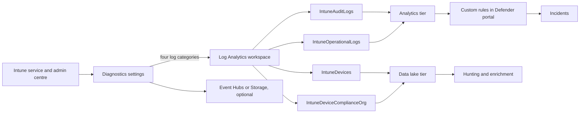

# Microsoft Intune

> Status: verified. Priority: P2. Last verified: 21 Nov 2026.

## What it is

Intune is Microsoft's cloud endpoint management service. It enrolls devices, pushes configuration, compliance and app policy, and runs remote actions such as wipe, retire and script deployment. Its audit log records who made every change, including remote actions, so a SOC can spot a compromised admin account weakening device controls or wiping the fleet. Auditing is on for all customers and can't be disabled ([Microsoft Learn](https://learn.microsoft.com/en-us/intune/governance/monitor-audit-logs)).

## Key recommendations

- There is no Sentinel connector for Intune. Turn on diagnostic settings in the Intune admin centre and send the log categories to your Log Analytics workspace ([Microsoft Learn](https://learn.microsoft.com/en-us/intune/governance/integrate-azure-monitor)).
- Ingest `IntuneAuditLogs` and `IntuneOperationalLogs` to the Analytics tier and write your own detections. There are no out-of-box analytic rules for Intune, so nothing alerts on wipes, retires or script pushes until you add them.
- Detect wipe, retire, delete and script deployment first. Those are the actions an attacker or rogue insider uses to destroy devices, remove management, or run code across the fleet.
- Put `IntuneDevices` and `IntuneDeviceComplianceOrg` on the data lake tier, or skip them. They're daily inventory snapshots, up to 48 hours old, and overlap Intune's own reports.
- Expect duplicates. The export pipeline can duplicate up to 100% of a 24-hour period, so deduplicate on `CorrelationId` before alerting or counting.
- Intune audit events don't appear in Defender XDR advanced hunting. If you only run Defender XDR, these events aren't queryable anywhere.

## High-value log sources

Intune is different to most products in this guide. There is no Content Hub solution and no data connector. Data flows through diagnostic settings configured in the Intune admin centre under **Reports** > **Diagnostics settings**, which route four log categories to a Log Analytics workspace, a storage account or Event Hubs. All four tables are billable ingestion. None is free in Sentinel, and none exists in Defender XDR advanced hunting.

| Source | Table name | Connector | Tier | Cost / volume | Value |
|---|---|---|---|---|---|
| Audit | `IntuneAuditLogs` | Intune diagnostic settings, configured in the Intune admin centre | Analytics | Low. About 2 KB per event. Microsoft estimates about 15,000 events a day for 1,000 users and about 1.5 million a day for 100,000 users | Every create, update, delete, assign and remote action, with actor, operation, target and result. The table detections read. |
| Operational | `IntuneOperationalLogs` | Intune diagnostic settings | Analytics | Low | Enrollment success and failure for users and devices, plus noncompliant device detail. Good for enrollment abuse patterns. |
| Device inventory | `IntuneDevices` | Intune diagnostic settings | Data lake | Medium. One row per managed device per day, exported once every 24 hours | Full inventory snapshot: OS, compliance state, jailbreak, encryption, serial, primary user, IMEI. Enrichment for incidents and fleet shrinkage checks. |
| Org compliance report | `IntuneDeviceComplianceOrg` | Intune diagnostic settings | Data lake, or skip | Low to medium. One row per device per day | Org-wide compliance report export. Overlaps `IntuneDevices`. Only worth ingesting if you report on compliance from Sentinel. |

Volume estimates come from Microsoft's [cost considerations](https://learn.microsoft.com/en-us/intune/governance/integrate-azure-monitor#cost-considerations) for Intune log routing.

### What to ingest first

| Priority | Table | Why | Rough volume | Tier |
|---|---|---|---|---|
| 1 | `IntuneAuditLogs` | Remote actions, policy, script and role changes. Nothing else covers these events. | Low for most tenants, higher in large fleets | Analytics |
| 2 | `IntuneOperationalLogs` | Enrollment anomalies and noncompliant device detail | Low | Analytics |
| 3 | `IntuneDevices` | Device and owner enrichment for incidents | Medium, scales with fleet size | Data lake |
| 4 or skip | `IntuneDeviceComplianceOrg` | Overlaps `IntuneDevices` and Intune's built-in reports | Medium | Data lake |

Audit and operational events arrive within about 30 minutes of the action. The two report tables export once every 24 hours at no fixed time, and can take up to 48 hours ([Microsoft Learn](https://learn.microsoft.com/en-us/intune/governance/integrate-azure-monitor#frequently-ask-questions-faq)).

## Prerequisites and licensing

| Item | Detail |
|---|---|
| Intune licence | Intune Plan 1, Plan 2 or Intune Suite per user, or a device-only subscription for kiosks and shared devices. Most tenants get Intune through Microsoft 365 E3, E5 or E7. Any user or device that benefits directly or indirectly from Intune needs a licence ([Microsoft Learn](https://learn.microsoft.com/en-us/intune/fundamentals/licensing)). |
| Admin licence | Not always required. Unlicensed admin access is on by default for tenants created after July 2021. Pre-July 2021 tenants can enable it under **Tenant administration** > **Roles** > **Administrator Licensing**, and it can't be undone. |
| Auditing | Nothing to enable. Audit logs are on for all customers and can't be disabled ([Microsoft Learn](https://learn.microsoft.com/en-us/intune/governance/monitor-audit-logs)). |
| Azure | An Azure subscription and a Log Analytics workspace. With Sentinel enabled on the workspace, the four tables become billable ingestion. |
| Diagnostic settings | Configured in the Intune admin centre, not in Sentinel. Needs the Intune Administrator Microsoft Entra role, which the Intune docs also call the Intune Service Administrator role. |
| Remote action control | Optional but recommended. Intune access policies can require Multiple Administrative Approval before Wipe, Retire or Delete runs ([Microsoft Learn](https://learn.microsoft.com/en-us/intune/device-management/actions/wipe)). |

### Roles you need

| Task | Role |
|---|---|
| Configure diagnostic settings in Intune | Intune Administrator Microsoft Entra role (Intune Service Administrator) |
| Read audit logs in the Intune admin centre | Intune Administrator, or any Intune role with Audit data, Read |
| Create Sentinel analytic rules | Microsoft Sentinel Contributor on the workspace |
| Run Wipe or Retire | Help Desk Operator, School Administrator, or a custom role with Remote tasks, Wipe or Retire, plus device read permissions |
| Create, assign or delete device scripts | Intune role with Device configurations permissions |
| Backfill audit events via Graph | DeviceManagementApps.Read.All. The List auditEvents API returns two years of events ([Microsoft Learn](https://learn.microsoft.com/en-us/graph/api/intune-auditing-auditevent-list?view=graph-rest-1.0)). |

## Step-by-step setup

1. **Confirm your workspace.** Create or choose a Log Analytics workspace with Sentinel enabled. In the Defender portal this sits under Microsoft Sentinel. You won't configure anything on the Sentinel side, because Intune pushes the data.
2. **Open diagnostic settings.** In the [Intune admin centre](https://go.microsoft.com/fwlink/?linkid=2109431), go to **Reports** > **Diagnostics settings**. The first time, turn it on, then add a setting. If your Azure subscription isn't shown, select the signed-in account in the top right and use **Switch directory**.
3. **Send to Log Analytics.** Select **Send to Log Analytics** > **Configure** > choose your workspace > **OK**.
4. **Choose the log categories.** Tick **AuditLogs** and **OperationalLogs**. Tick **IntuneDevices** and **DeviceComplianceOrg** if you want inventory and compliance in the workspace.
5. **Save.** The setting appears in the list. You can change it later with **Edit setting** > **Save**.
6. **Generate test events.** Create and assign a harmless PowerShell platform script to a test group, and edit then revert a compliance policy. Don't test Wipe or Retire without a sacrificial device.
7. **Wait for data.** Audit and operational events flow immediately and usually show within about 30 minutes. The two report tables export once every 24 hours and can take up to 48 hours, at no fixed time.
8. **Validate.** Run the validation queries below in the Defender portal under **Investigation & response** > **Advanced hunting**, with your Sentinel workspace selected.
9. **Pin operation names.** Run validation query 2 and record the exact `OperationName` values your tenant emits for wipe, retire, delete, scripts, compliance and role changes. The custom detections below depend on them.
10. **Add detections.** In the Defender portal, go to **Investigation & response** > **Detection** > **Analytics** and create the custom rules from the next sections.

## Best-practice security configuration

Harden both the Intune management plane and enrolled devices. See [Microsoft recommended security configurations](../../docs/security-configurations.md).

- **Enrolment restrictions:** Block personal (BYOD) device enrolment where corporate devices are required, enforce minimum OS versions, and limit devices per user.
- **Compliance policies paired with Conditional Access:** Mark devices non-compliant if BitLocker, firewall, Defender AV, or minimum patch levels fail, and require **Compliant device** in Conditional Access ([Intune security baselines](https://learn.microsoft.com/en-us/intune/intune-service/protect/security-baselines)).
- **Multi-Admin Approval (MAA):** Enable Multi-Admin Approval for high-impact Intune actions (device wipes, scripts, apps and role changes) so one compromised Intune Admin cannot wipe the fleet.
- **Role scoping:** Use Intune scope tags and custom RBAC roles rather than assigning Entra Global Admin or unrestricted Intune Administrator.

## Architecture diagram



## Validation KQL

For group-wide and workspace-wide freshness checks, see [endpoint.kql](../../queries/validation/endpoint.kql) and the [validation query pack](../../queries/validation/README.md).

```kql
// 1. Are all four tables landing, and how fresh?
// IntuneDevices and IntuneDeviceComplianceOrg export daily, so use a 3-day window.
union withsource=Table isfuzzy=true IntuneAuditLogs, IntuneOperationalLogs, IntuneDevices, IntuneDeviceComplianceOrg
| where TimeGenerated > ago(3d)
| summarize Rows = count(), Latest = max(TimeGenerated) by Table
| order by Table asc

// 2. What operations does YOUR tenant emit? Pin these before writing rules.
IntuneAuditLogs
| where TimeGenerated > ago(30d)
| summarize Events = count(), LastSeen = max(TimeGenerated) by OperationName, Category
| order by Events desc

// 3. Audit failures by day
IntuneAuditLogs
| where TimeGenerated > ago(7d)
| summarize Events = count() by ResultType, bin(TimeGenerated, 1d)

// 4. Duplicate export check
// ASSUMPTION: CorrelationId is unique per audit event. Rows above distinct events means the pipeline duplicated data.
IntuneAuditLogs
| where TimeGenerated > ago(7d)
| summarize Rows = count(), DistinctEvents = dcount(CorrelationId)

// 5. Cost: GB per table over 30 days
Usage
| where TimeGenerated > ago(30d)
| where DataType in ("IntuneAuditLogs", "IntuneOperationalLogs", "IntuneDevices", "IntuneDeviceComplianceOrg")
| summarize GB = round(sum(Quantity) / 1024, 2) by DataType
```

## Out-of-box analytic rules

None exist. As of 21 Nov 2026 there is no Microsoft Intune solution in the [Sentinel content hub catalog](https://learn.microsoft.com/en-us/azure/sentinel/sentinel-solutions-catalog), no Intune data connector, and no analytic rules anywhere in the [Azure-Sentinel repo](https://github.com/Azure/Azure-Sentinel/tree/master/Solutions) that read `IntuneAuditLogs`, `IntuneOperationalLogs`, `IntuneDevices` or `IntuneDeviceComplianceOrg`. The table names appear only in a supported-tables list inside the repo's tooling. The Australian Cyber Security Centre solution in the same repo has no Intune content either.

So there is nothing to enable on day 1. Go straight to custom detections. The closest official endpoint content is the Defender for Endpoint rules, which run on MDE telemetry and never see Intune admin actions.

## Custom detections

These are community-written rules, not Microsoft content. Run them hourly with a 1-hour lookback unless noted. Pin `OperationName` and `Properties` values against your own tenant with validation query 2 before enabling. Anything unconfirmed carries an ASSUMPTION comment.

### C1. Remote wipe, retire or delete (High)

A wipe factory resets the device. A retire removes company data and unenrols the device, which strips the management agent and any policy enforcement. Both are Help Desk Operator permissions, so any compromised help desk account can run them ([Microsoft Learn](https://learn.microsoft.com/en-us/intune/device-management/actions/wipe)).

```kql
// CUSTOM - Wipe, Retire or Delete device action
// ASSUMPTION: OperationName matches the friendly action names shown in the Intune admin centre,
// such as Wipe, Retire and Delete. Pin the exact strings with validation query 2 before enabling.
// ASSUMPTION: CorrelationId is unique per audit event. The summarize deduplicates the export's known duplicate rows.
IntuneAuditLogs
| where TimeGenerated > ago(1h)
| where OperationName has_any ("wipe", "retire", "delete")
| summarize FirstSeen = min(TimeGenerated), Sample = any(Properties)
            by OperationName, Actor = Identity, CorrelationId
| project FirstSeen, OperationName, Actor, CorrelationId, Sample
```

MITRE: Impact T1485 for wipe, Defense Evasion T1562.001 for retire, because it removes the management agent.

### C2. Mass device destruction by one actor (High)

```kql
// CUSTOM - Many wipe, retire or delete actions by one actor in an hour
// Tenant limits are 500 Wipe and 1,000 Retire or Delete actions per day, so bursts can be a
// legitimate device refresh. Alert above your baseline and always check the actor's sign-ins.
// ASSUMPTION: same OperationName values as C1.
IntuneAuditLogs
| where TimeGenerated > ago(1h)
| where OperationName has_any ("wipe", "retire", "delete")
| summarize Events = dcount(CorrelationId), FirstSeen = min(TimeGenerated)
            by Actor = Identity, bin(TimeGenerated, 1h)
| where Events >= 10
| project FirstSeen, Actor, Events
```

MITRE: Impact T1485.

### C3. Device script created, changed or assigned (High)

Platform scripts run PowerShell or shell on managed devices, optionally as SYSTEM or root. A pushed script is remote code execution on every assigned device, and macOS custom attributes re-run every 8 hours ([Microsoft Learn](https://learn.microsoft.com/en-us/intune/device-management/tools/run-powershell-scripts-windows)).

```kql
// CUSTOM - Platform script or remediation created, changed or assigned
// ASSUMPTION: script operations carry Script in OperationName. Pin the exact values with
// validation query 2 and replace the has filter with your OperationName list.
IntuneAuditLogs
| where TimeGenerated > ago(24h)
| where OperationName has "script"
| summarize FirstSeen = min(TimeGenerated), Sample = any(Properties)
            by OperationName, Actor = Identity, CorrelationId
| project FirstSeen, OperationName, Actor, Sample
```

Raise severity when the assignment targets the All Users or All Devices groups. ASSUMPTION: the target group name appears in the Properties JSON. Inspect a sample before relying on it. MITRE: Execution T1059.001 for PowerShell scripts and T1059.004 for macOS shell scripts, plus Persistence where a run frequency is set.

### C4. Compliance policy change by a non-approved admin (Medium)

Compliance policies gate Conditional Access. Deleting or weakening one can re-admit noncompliant devices to your apps.

```kql
// CUSTOM - Compliance policy change outside the approved admin list
let approved_admins = dynamic(["intune-admin@yourdomain.gov.au"]);
// ASSUMPTION: the audit schema lists Compliance as category value 2, but your table may store
// the name or the number. Check both forms with validation query 2.
IntuneAuditLogs
| where TimeGenerated > ago(24h)
| where Category =~ "compliance" or Category == "2"
| where Identity !in~ (approved_admins)
| summarize FirstSeen = min(TimeGenerated), Sample = any(Properties)
            by OperationName, Actor = Identity, CorrelationId
| project FirstSeen, OperationName, Actor, Sample
```

MITRE: Defense Evasion T1562.001.

### C5. Intune role or scope change (High)

New Intune RBAC roles or assignments are how an attacker keeps the ability to run device actions after the initial account is fixed.

```kql
// CUSTOM - Intune role created, changed or deleted
// ASSUMPTION: the audit schema lists Role as category value 9. Confirm how your table stores it.
IntuneAuditLogs
| where TimeGenerated > ago(24h)
| where Category =~ "role" or Category == "9"
| summarize FirstSeen = min(TimeGenerated), Sample = any(Properties)
            by OperationName, Actor = Identity, CorrelationId
| project FirstSeen, OperationName, Actor, Sample
```

MITRE: Privilege Escalation T1098.003, additional cloud roles.

## Playbooks

None documented. No Intune playbooks ship with Sentinel, because no Intune solution exists.

Suggested custom playbooks:

| Playbook (custom) | Trigger | Actions | Connector and permissions |
|---|---|---|---|
| Contain a rogue Intune admin | C1 to C5, or a risky sign-in joined to any Intune action | Disable the Entra account and revoke its sessions, then comment on the incident | Microsoft Graph, run behind an approval |
| Remove a malicious script | C3 | Delete the script with Graph: `DELETE /deviceManagement/deviceManagementScripts/{id}` | DeviceManagementScripts.ReadWrite.All, beta endpoint only ([Microsoft Learn](https://learn.microsoft.com/en-us/graph/api/intune-devices-devicemanagementscript-delete?view=graph-rest-beta)) |
| Enrich device incidents | Any device-related alert | Look the device up in `IntuneDevices` for owner, serial and compliance state, and comment on the incident | Managed identity with Log Analytics Reader on the workspace |
| Confirm a destructive action | C1, C2 | Post the action, device and actor to the device owner's manager or a Teams channel for verification before containment | Teams and Office 365 connectors |

There's no undo for a processed wipe, so response focuses on containing the actor and reviewing what else they touched, not on reversing the action.

## Workbooks and hunting

None documented. No Intune workbooks or hunting queries ship with Sentinel. Three patterns worth building:

- **Actor baseline.** Summarise `OperationName` counts per `Identity` over 14 days and diff against the last day. New operation types from an admin are worth a look.
- **Risky sign-in then remote action.** Join Entra ID risk to the next Intune action by the same account. Needs Entra ID P2 for risk fields.

```kql
// ASSUMPTION: Identity holds the actor's UPN, matching SigninLogs UserPrincipalName.
// Confirm with a sample before relying on the join.
let risky = SigninLogs
    | where TimeGenerated > ago(1d)
    | where RiskLevelDuringSignIn in ("medium", "high")
    | summarize RiskySignIn = max(TimeGenerated) by UserPrincipalName = tolower(UserPrincipalName);
IntuneAuditLogs
| where TimeGenerated > ago(1d)
| extend UserPrincipalName = tolower(Identity)
| join kind=inner risky on UserPrincipalName
| where TimeGenerated > RiskySignIn
| project TimeGenerated, OperationName, Identity, RiskySignIn
```

- **Fleet shrinkage.** Count distinct `DeviceId` per day in `IntuneDevices`. A sudden drop after a mass retire event is visible here, 24 to 48 hours late.

For investigation beyond Sentinel retention, the Intune admin centre audit view (**Tenant administration** > **Audit logs**) filters by date and category, and the Graph auditEvent API returns two years of events ([Microsoft Learn](https://learn.microsoft.com/en-us/graph/api/resources/intune-auditing-auditevent?view=graph-rest-1.0)).

## Gotchas and deprecations

- No Content Hub connector. Configure diagnostic settings in the Intune admin centre. Anyone looking for an Intune data connector in Sentinel won't find one.
- Duplicates. The export pipeline can duplicate up to 100% of the data published in a 24-hour period ([Microsoft Learn](https://learn.microsoft.com/en-us/intune/governance/integrate-azure-monitor#known-issues)). Deduplicate on `CorrelationId` before alerting or counting.
- Two speeds. Audit and operational logs arrive in about 30 minutes. `IntuneDevices` and `IntuneDeviceComplianceOrg` export once every 24 hours at no fixed time, up to 48 hours late. Don't put tight freshness thresholds on the report tables.
- Transformations. `IntuneAuditLogs`, `IntuneOperationalLogs` and `IntuneDevices` support DCR workspace transformations. `IntuneDeviceComplianceOrg` does not, per its [table reference](https://learn.microsoft.com/en-us/azure/azure-monitor/reference/tables/intunedevicecomplianceorg). Check before planning to filter a table at ingestion.
- Schema drift. Microsoft warns that these log schemas can change. Re-pin `OperationName` values after service updates.
- Destructive side effect. Retiring or deleting the Intune object for a Microsoft Entra joined device protected by BitLocker triggers a sync that removes key protectors and suspends BitLocker on the OS volume ([Microsoft Learn](https://learn.microsoft.com/en-us/intune/device-management/actions/retire)).
- Action limits. A tenant can submit 500 Wipe, 1,000 Retire and 1,000 Delete actions per day, cumulative across the admin centre, bulk actions and Graph. Bulk actions cover up to 100 devices. Set the C2 threshold with those limits in mind.
- Approvals. If an Intune access policy requires Multiple Administrative Approval, Wipe, Retire and Delete wait for a second admin to approve. Both actors show in the audit trail.
- Defender XDR. No Intune tables exist in advanced hunting. Intune events are Sentinel-only. Device inventory in Defender XDR comes from Defender services, not from these tables ([schema reference](https://learn.microsoft.com/en-us/defender-xdr/advanced-hunting-schema-tables)).
- Data Warehouse. The Intune Data Warehouse is a separate OData feed for reporting. Its Power BI connector v1 is being retired, so migrate to connector v2 or the OData feed if you use it. Warehouse data doesn't land in Sentinel ([Microsoft Learn](https://learn.microsoft.com/en-us/intune/developer/data-warehouse/create-reports)).
- Sentinel in the Azure portal retires on 31 March 2027. Build and test in the Defender portal ([Microsoft Learn](https://learn.microsoft.com/en-us/azure/sentinel/microsoft-sentinel-defender-portal)).

## Official links

- [Route logs to Azure Monitor using Microsoft Intune](https://learn.microsoft.com/en-us/intune/governance/integrate-azure-monitor)
- [Audit changes and events in Microsoft Intune](https://learn.microsoft.com/en-us/intune/governance/monitor-audit-logs)
- [IntuneAuditLogs table reference](https://learn.microsoft.com/en-us/azure/azure-monitor/reference/tables/intuneauditlogs)
- [IntuneOperationalLogs table reference](https://learn.microsoft.com/en-us/azure/azure-monitor/reference/tables/intuneoperationallogs)
- [IntuneDevices table reference](https://learn.microsoft.com/en-us/azure/azure-monitor/reference/tables/intunedevices)
- [IntuneDeviceComplianceOrg table reference](https://learn.microsoft.com/en-us/azure/azure-monitor/reference/tables/intunedevicecomplianceorg)
- [Microsoft Intune licensing plans and options](https://learn.microsoft.com/en-us/intune/fundamentals/licensing)
- [Device actions overview](https://learn.microsoft.com/en-us/intune/device-management/actions/)
- [Wipe devices with Microsoft Intune](https://learn.microsoft.com/en-us/intune/device-management/actions/wipe)
- [Device action: Retire](https://learn.microsoft.com/en-us/intune/device-management/actions/retire)
- [Add PowerShell scripts to Windows devices](https://learn.microsoft.com/en-us/intune/device-management/tools/run-powershell-scripts-windows)
- [Use shell scripts on macOS devices](https://learn.microsoft.com/en-us/intune/device-management/tools/run-shell-scripts-macos)
- [Microsoft Graph wipe action](https://learn.microsoft.com/en-us/graph/api/intune-devices-manageddevice-wipe?view=graph-rest-1.0)
- [Microsoft Graph retire action](https://learn.microsoft.com/en-us/graph/api/intune-devices-manageddevice-retire?view=graph-rest-1.0)
- [Microsoft Graph auditEvent resource type](https://learn.microsoft.com/en-us/graph/api/resources/intune-auditing-auditevent?view=graph-rest-1.0)
- [Microsoft Graph List auditEvents](https://learn.microsoft.com/en-us/graph/api/intune-auditing-auditevent-list?view=graph-rest-1.0)
- [Microsoft Graph Delete deviceManagementScript, beta](https://learn.microsoft.com/en-us/graph/api/intune-devices-devicemanagementscript-delete?view=graph-rest-beta)
- [Microsoft Sentinel in the Microsoft Defender portal](https://learn.microsoft.com/en-us/azure/sentinel/microsoft-sentinel-defender-portal)
- [Microsoft Sentinel content hub catalog](https://learn.microsoft.com/en-us/azure/sentinel/sentinel-solutions-catalog)
- [Azure-Sentinel repo, Solutions folder](https://github.com/Azure/Azure-Sentinel/tree/master/Solutions)
- [Defender XDR advanced hunting schema tables](https://learn.microsoft.com/en-us/defender-xdr/advanced-hunting-schema-tables)
- [Defender XDR DeviceInfo table](https://learn.microsoft.com/en-us/defender-xdr/advanced-hunting-deviceinfo-table)
- [Use the Intune Data Warehouse](https://learn.microsoft.com/en-us/intune/developer/data-warehouse/create-reports)

## Last verified

21 Nov 2026, against Microsoft Learn, the Microsoft Graph references and the Azure-Sentinel repo. Re-verify before relying on table names, navigation or operation names.
