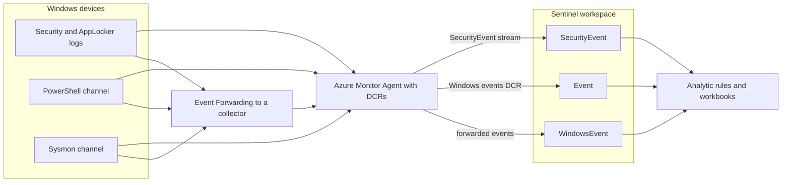

# Windows security event logs (clients)

> Status: verified. Priority: P1 (start here). Last verified: 21 Nov 2026.

## What it is

Native Windows event logs, collected by the Azure Monitor Agent (AMA) or Windows Event Forwarding (WEF) into Microsoft Sentinel. Use them where you need events Defender for Endpoint doesn't record: PowerShell script contents, Sysmon, AppLocker decisions, and the Security log of devices that aren't onboarded to MDE. The legacy Log Analytics agent that used to collect these is retired, so AMA with data collection rules (DCRs) is the only supported path.

## Key recommendations

- If a device runs MDE Plan 2, don't stream its whole Security log into Sentinel. Process, network, file, registry and logon events are already in Defender XDR advanced hunting at no extra cost. See [Microsoft Defender for Endpoint](../defender-for-endpoint/README.md).
- Worth paying for: PowerShell 4104 script blocks, Sysmon, AppLocker events, and the Security log of any device not covered by MDE.
- Choose the Minimal or Common event set, or a custom XPath. The All set is expensive. Event set choice is the single biggest cost lever on this connector.
- PowerShell script block logging and Sysmon are not on by default. Nothing lands in Sentinel until you turn them on at the source.
- Windows 10 and 11 clients take the AMA client installer plus a tenant-wide monitored object, not the VM extension. The DCR applies to every client device in the tenant, so there's no per-device targeting. Filter hard.
- WEF events land in `WindowsEvent`, not `SecurityEvent`, and most built-in Windows rules query `SecurityEvent`. Use the Windows Security Events via AMA connector for the Security log. Only use WEF where you already run Windows Event Collection.

## High-value log sources

| Source | Table name | Connector | Tier | Cost / volume | Value |
|---|---|---|---|---|---|
| Security log | `SecurityEvent` | Windows Security Events via AMA | Analytics. Basic and data lake also supported | High unfiltered. The Minimal set is mostly 4624, 4625 and 4688 traffic | Logons, process creation with command lines, service installs, account and group changes, policy changes, log clears |
| Forwarded events | `WindowsEvent` | Windows Forwarded Events | Analytics. Data lake supported | Depends on your WEF subscriptions | Any channel forwarded from WEF collectors, including Security. Needs ASIM parsers for most rules |
| PowerShell script blocks | `Event` | AMA with a custom DCR XPath | Analytics only. The `Event` table has no data lake tier | Low | Event 4104 script block contents, the single best PowerShell telemetry MDE doesn't give you |
| Sysmon | `Event` or `WindowsEvent` | AMA with a custom DCR XPath, or WEF | Analytics, or data lake for hunting | Medium to high. Tune the config, not just the XPath | Process, network, registry, WMI, pipe and DNS events with hashes and GUIDs |
| AppLocker | `SecurityEvent` | Windows Security Events via AMA, All set or event sets | Analytics | Low | Events 8001 to 8007 and 8222, the authoritative record of app control decisions |

The AppLocker channels are already inside the connector's event sets, including Minimal and Common. You don't pay extra to get them if you're collecting Security events anyway.

### Overlap with Defender for Endpoint

Be explicit about what you're paying for twice. On devices with the MDE Plan 2 sensor:

| Event or source | MDE already gives you | Verdict |
|---|---|---|
| 4688 process creation | `DeviceProcessEvents` with full command lines and hashes, free for 30 days in advanced hunting | Skip on MDE devices. Keep for non-MDE devices only |
| 4624, 4625 logons | `DeviceLogonEvents` with logon type, remote IP and failure reason | Skip on MDE devices. Keep for non-MDE devices |
| 4657, 4663 registry and object access | `DeviceRegistryEvents` and `DeviceFileEvents` cover creates and modifies, and don't need object access audit policy on | Mostly skip on MDE devices |
| 4720 to 4740 account and group changes | Identity events on domain controllers are covered by Defender for Identity. On clients these events are cheap and low volume | Keep. It costs little |
| 7045 service install | No clean MDE equivalent | Keep. Low volume, common persistence path |
| 1102 log cleared | No clean MDE equivalent | Keep. One event, high value |
| PowerShell 4104 script blocks | Not in any MDE table | Keep. This is the main reason to pay for client event logs |
| Sysmon | Heavy overlap with the device tables, but richer in places, such as WMI and pipe events | Only if you use the extra fields. Consider the data lake tier |
| AppLocker 8001 to 8007 | MDE device control and ASR cover some of it | Keep. It's already in the event sets |

## Prerequisites and licensing

| Item | Detail |
|---|---|
| Sentinel | Pay-as-you-go or commitment tier. `SecurityEvent`, `Event` and `WindowsEvent` ingestion is charged. None of them are free data sources |
| Azure Monitor Agent | No cost for the agent itself. Ingestion and storage are charged |
| Azure VMs | AMA deploys as a VM extension |
| Non-Azure servers | Azure Arc must be installed and enabled before the AMA connector will collect from them |
| Windows 10 and 11 clients | AMA client MSI installer. The device must be Microsoft Entra joined or hybrid joined, running Windows 10 RS4 or later, with C++ Redistributable 2015 or later. Azure Arc is not needed for Entra-joined clients |
| Client monitored object | Creating and associating one needs the Monitored Objects Contributor role, and elevating an Entra tenant admin as Azure Tenant Admin at root scope |
| WEF | Windows Event Collection must be enabled and running, with AMA installed on the collector machine |
| Device-side logging | Turn on what you want to collect: PowerShell script block logging, Sysmon with a config, an AppLocker policy, and Audit Process Creation with command lines for 4688 |

Audit settings that must be on before the Security log has anything worth reading:

- **Audit Process Creation** generates 4688. Without it there are no process creation events at all.
- The command line in 4688 needs the Group Policy setting **Administrative Templates > System > Audit Process Creation > Include command line in process creation events**. By default the command line field is empty.
- PowerShell script block logging needs the Group Policy setting **Turn on PowerShell Script Block Logging** (Windows PowerShell under Administrative Templates > Windows Components, or PowerShell Core for PowerShell 7).
- Sysmon and AppLocker are software and policy you deploy. Neither ships enabled.

### Roles you need

| Task | Role |
|---|---|
| Connect either AMA connector, create DCRs from the connector page | Read and write on the Sentinel workspace (workspace data sources) |
| Create and associate client monitored objects | Monitored Objects Contributor, plus tenant admin elevation at root scope |
| Manage DCRs outside the connector page | Monitoring Contributor on the subscription or resource group |
| Turn on device-side logging | Local administrator, or Group Policy edit rights |

## Step-by-step setup

1. **Turn on device-side logging first.** Enable PowerShell script block logging by Group Policy or the registry. Deploy Sysmon with a config file (`sysmon64 -accepteula -i config.xml`). Put an AppLocker policy in audit mode before enforcing. Confirm Audit Process Creation and the command line inclusion policy are applied.
2. **Install the Content Hub solution.** Defender portal > Microsoft Sentinel > Content hub > install **Windows Security Events**. It ships both connectors plus the rules, workbooks and hunting queries. Install **Windows Forwarded Events** too if you use WEF.
3. **Open the connector.** Configuration > Data connectors > Windows Security Events via AMA > Open connector page > **+ Add data collection rule**.
4. **Create the DCR.** In the wizard: give it a name, subscription and resource group. On the Resources tab, add the Azure VMs and Arc-enabled servers it applies to. AMA installs on any selected machine that doesn't have it.
5. **Pick the event set.** On the Collect tab, choose All, Common, Minimal or Custom. Start with Common for a pilot, then measure with the validation queries and drop to Minimal or a custom XPath if volume is too high.
6. **Add Windows clients.** Client devices don't take the VM extension. Install the AMA client MSI on each device (`msiexec /i AzureMonitorAgentClientSetup.msi /qn`), create the monitored object for your Entra tenant, and associate the DCR to it with the Azure CLI, PowerShell or REST. The DCR then applies to every client device in the tenant that has the client-installed agent.
7. **Collect PowerShell and Sysmon channels.** Create a separate DCR in the Azure portal (Azure Monitor > Data collection rules > Create) with a **Windows Event Logs** data source. Events land in the `Event` table. Use the XPath samples below.
8. **Or use WEF.** Set up Windows Event Collection subscriptions on a collector, install AMA on the collector, then connect the Windows Forwarded Events connector and create its DCR. Forwarded events land in `WindowsEvent`. Deploy the ASIM WindowsEvent parsers so normalised rules work.
9. **Validate.** Run the queries below within a few minutes of finishing. Generate test events first: a few PowerShell commands, a service install, a failed logon.
10. **Enable the out-of-box rules**, then review cost after a week with the Usage query.

### Sample DCR XPath queries

DCR custom filtering takes XPath 1.0 in the form `LogName!XPathQuery`. Test each query locally first with `Get-WinEvent -LogName <log> -FilterXPath '<xpath>'`. You can use up to 20 expressions per box and 100 boxes in one rule.

| Purpose | XPath |
|---|---|
| PowerShell 5.1 script blocks | `Microsoft-Windows-PowerShell/Operational!*[System[(EventID=4104)]]` |
| PowerShell 7 script blocks | `PowerShellCore/Operational!*[System[(EventID=4104)]]` |
| Sysmon high-value events | `Microsoft-Windows-Sysmon/Operational!*[System[(EventID=1 or EventID=3 or EventID=8 or EventID=10 or EventID=11 or EventID=12 or EventID=13 or EventID=17 or EventID=18 or EventID=19 or EventID=20 or EventID=21 or EventID=22 or EventID=25)]]` |
| AppLocker EXE and DLL | `Microsoft-Windows-AppLocker/EXE and DLL!*[System[(EventID=8001 or EventID=8002 or EventID=8003 or EventID=8004)]]` |
| AppLocker MSI and Script | `Microsoft-Windows-AppLocker/MSI and Script!*[System[(EventID=8005 or EventID=8006 or EventID=8007)]]` |
| Security log, lean custom set | `Security!*[System[(EventID=4624 or EventID=4625 or EventID=4688 or EventID=4700 or EventID=4702 or EventID=4720 or EventID=4722 or EventID=4724 or EventID=4728 or EventID=4732 or EventID=4756 or EventID=7045 or EventID=1102)]]` |

The AppLocker channel-to-event-ID split above (8001 to 8004 in EXE and DLL, 8005 to 8007 in MSI and Script) is the standard mapping. Check it against a blocked app in your own Event Viewer before you rely on it.

## Architecture diagram



## Validation KQL

For group-wide and workspace-wide freshness checks, see [endpoint.kql](../../queries/validation/endpoint.kql) and the [validation query pack](../../queries/validation/README.md).

```kql
// 1. Is SecurityEvent landing, and which event IDs dominate?
SecurityEvent
| where TimeGenerated > ago(1d)
| summarize Rows = count(), Latest = max(TimeGenerated) by EventID
| top 15 by Rows desc

// 2. Is the Security log fresh on every reporting device?
SecurityEvent
| where TimeGenerated > ago(2d)
| summarize Latest = max(TimeGenerated) by Computer
| where Latest < ago(1h)

// 3. Are PowerShell script blocks landing in Event?
Event
| where TimeGenerated > ago(1d)
| where EventLog == "Microsoft-Windows-PowerShell/Operational" and EventID == 4104
| summarize Rows = count(), Latest = max(TimeGenerated)

// 4. Are forwarded events landing, and from which channels?
WindowsEvent
| where TimeGenerated > ago(1d)
| summarize Rows = count(), Latest = max(TimeGenerated) by Channel
| order by Rows desc

// 5. Cost: GB per table over 30 days
Usage
| where TimeGenerated > ago(30d)
| where DataType in ("SecurityEvent", "Event", "WindowsEvent")
| summarize GB = round(sum(Quantity) / 1024, 2) by DataType
| order by GB desc
```

Query 3 assumes you used the PowerShell 5.1 channel. For PowerShell 7, filter on `EventLog == "PowerShellCore/Operational"`.

## Out-of-box analytic rules

From the **Windows Security Events** Content Hub solution (version 3.2.1, Oct 2026). Most of these query `SecurityEvent`. If you collect via WEF instead, your data lands in `WindowsEvent`, the rules won't match it as written, and you need to adapt the queries or use the ASIM parsers.

| Rule | Detects | Tables | MITRE | Enable day 1? |
|---|---|---|---|---|
| NRT Security Event log cleared | Event 1102, the Security log was cleared | `SecurityEvent` | Defense Evasion T1070 | Yes, Medium severity |
| Scheduled Task Hide | scheduled tasks registered with the hidden flag | `SecurityEvent` | Defense Evasion T1562 | Yes, High severity |
| Potential Fodhelper UAC Bypass | fodhelper registry manipulation for UAC bypass | `SecurityEvent` | Privilege Escalation T1548.002 | Yes, Medium severity |
| NRT Base64 Encoded Windows Process Command-lines | base64-encoded command lines in process creation | `SecurityEvent` | Execution T1059, Defense Evasion T1027 and T1140 | Yes, Medium severity, expect tuning |
| Excessive Windows Logon Failures | high volume of 4625 failures per account | `SecurityEvent` | Credential Access T1110 | Yes, Low severity, tune the threshold |
| SecurityEvent - Multiple authentication failures followed by a success | brute force that ends in a successful logon | `SecurityEvent` | Credential Access T1110 | Yes, Low severity |
| Non Domain Controller Active Directory Replication | directory replication requested by a non-DC account | `SecurityEvent` | Credential Access T1003.006 | Yes, High severity. Mainly fires on DC data |
| AD user enabled and password not set within 48 hours | an account enabled with no password | `SecurityEvent` | Persistence T1098 | Yes, Low severity. DC data |
| Process Execution Frequency Anomaly | statistical anomaly in process execution volume | `SecurityEvent` | Execution T1059 | Optional. Needs a tuning period |
| WMI Spawning Suspicious Child Process (Living off the Land) | WmiPrvSE spawning PowerShell, cmd or other LOLBins | `DeviceProcessEvents`, `SecurityEvent` | See rule YAML | Only if MDE device tables are streamed, or use the SecurityEvent branch |

The solution also ships ADFS rules (ADFSDBNamedPipeConnection, ADFSRemoteAuthSyncConnection, ADFSRemoteHTTPNetworkConnection, GainCodeExecutionADFSViaSMB), rules for the Exchange OAB webshell and EXE deployed via default domain policies, and 21 disabled Defender XDR custom detections added in October 2026.

The **Windows Forwarded Events** solution (version 3.2.2, Oct 2026) ships four rules that query `WindowsEvent`: Caramel Tsunami Actor IOC, Chia Crypto Mining IOC, and two MOVEit file transfer threshold rules.

## Custom detections

These fill gaps the solution rules don't cover. Run them hourly over a 1-hour lookback. Each has assumptions marked. Test them against a week of your own data before you enable them.

### C1. Credential dumping patterns in process creation (High)

```kql
// CUSTOM - Known credential dumping command lines in 4688
// ASSUMPTION: 4688 is collected AND the command line inclusion policy is on.
// Without the policy the CommandLine field is empty and this rule is blind.
SecurityEvent
| where TimeGenerated > ago(1h)
| where EventID == 4688
| where isnotempty(CommandLine)
| where CommandLine has_any ("procdump", "mimikatz", "sekurlsa", "lsass", "comsvcs.dll, minidump",
                             "comsvcs.dll,minidump", "ntds.dit")
    or NewProcessName has_any ("procdump", "procdump64", "mimikatz", "pypykatz", "secretsdump")
| project TimeGenerated, Computer, SubjectUserName, ParentProcessName, NewProcessName, CommandLine
```

MITRE: Credential Access T1003. The comsvcs.dll MiniDump variant catches rundll32-based LSASS dumps that rename nothing.

### C2. Service installed from a user-writable path (High)

```kql
// CUSTOM - New service whose binary lives outside Program Files and System32
// 7045 is a low-volume event, so alert on everything that isn't a standard install path.
SecurityEvent
| where TimeGenerated > ago(1h)
| where EventID == 7045
| where ServiceFileName !has ":\\Windows\\"
    and ServiceFileName !has ":\\Program Files\\"
    and ServiceFileName !has ":\\Program Files (x86)\\"
| project TimeGenerated, Computer, SubjectUserName, ServiceName, ServiceFileName, ServiceStartType
```

MITRE: Persistence T1543.003, Create or Modify System Process: Windows Service. A service binary in Users, ProgramData or Temp is persistence until proven otherwise.

### C3. Obfuscation and download cradles in PowerShell script blocks (High)

```kql
// CUSTOM - Encoded or download-cradle patterns in 4104 script blocks
// ASSUMPTION: the PowerShell Operational channel is collected into Event via a custom DCR XPath.
// For PowerShell 7, also collect PowerShellCore and match EventLog == "PowerShellCore/Operational".
Event
| where TimeGenerated > ago(1h)
| where EventLog == "Microsoft-Windows-PowerShell/Operational"
| where EventID == 4104
| where RenderedDescription has_any ("FromBase64String", "downloadstring", "downloaddata",
                                     "invoke-expression", "iex ", " -enc ", " -encodedcommand",
                                     "hidden", "bypass")
| project TimeGenerated, Computer, RenderedDescription
```

MITRE: Execution T1059.001, Defense Evasion T1027 and T1140. This catches what MDE can't: the script content itself.

### C4. AppLocker blocked a binary from a user-writable path (Medium)

```kql
// CUSTOM - AppLocker block events where the blocked file sits in a user-writable path
// ASSUMPTION: your event set includes 8004 and 8006. Minimal and Common both do.
// ASSUMPTION: AppLocker events map the file path into FilePath. Check one real event first.
SecurityEvent
| where TimeGenerated > ago(1h)
| where EventID in (8004, 8006)
| where FilePath has_any (":\\Users\\", ":\\ProgramData\\", ":\\Windows\\Temp\\")
| project TimeGenerated, Computer, SubjectUserName, EventID, FilePath
```

MITRE: Defense Evasion T1218 or Execution T1204 depending on the binary. An AppLocker block means your control worked. A block in a staging path means something tried anyway.

### C5. First-time RDP source for a user (Medium)

```kql
// CUSTOM - RDP logon from an IP the user hasn't used in the last 14 days
// Run daily over a 1-day lookback.
// ASSUMPTION: LogonType 10 is RemoteInteractive in your data. LogonType is an int column.
let lookback = 14d;
let history = SecurityEvent
| where TimeGenerated > ago(lookback) and TimeGenerated < ago(1d)
| where EventID == 4624 and LogonType == 10
| summarize by TargetUserName, IpAddress;
SecurityEvent
| where TimeGenerated > ago(1d)
| where EventID == 4624 and LogonType == 10
| join kind=leftanti history on TargetUserName, IpAddress
| project TimeGenerated, Computer, TargetUserName, IpAddress
```

MITRE: Lateral Movement T1021.001. Cheap to run because 4624 Type 10 is a small slice of logon traffic.

## Playbooks

No playbooks ship with the Windows Security Events or Windows Forwarded Events solutions: the solution folders have no Playbooks directory. We checked, rather than assuming.

Two suggestions:

| Playbook (custom) | Trigger | Actions | Connector and permissions |
|---|---|---|---|
| Isolate the device | C1, C2 or any high-severity incident on an MDE-onboarded device | Isolate the machine in MDE, comment the incident | Reuse the [Isolate-MDEMachine playbook](https://github.com/Azure/Azure-Sentinel/tree/master/Solutions/MicrosoftDefenderForEndpoint/Playbooks/Isolate-MDEMachine). Managed identity with Sentinel Responder, plus `Machine.Isolate` and `Machine.Read.All` on the MDE API |
| Disable the account | C1 or C5 on a device without MDE | Disable the Entra account, comment the incident | Microsoft Graph with `User.ReadWrite.All` through a managed identity, plus Sentinel Responder |

Put both behind an approval until you trust the rules.

## Workbooks and hunting

| Item | Source | Use |
|---|---|---|
| Event Analyzer workbook | Windows Security Events solution | Event volume by ID, channel and computer. Also shipped as an XDR Workbook in 3.2.1 |
| Identity and Access workbook | Windows Security Events solution | Logon trends and account activity. Also shipped as an XDR Workbook |
| Hunting queries (over 30) | Windows Security Events solution | Includes ADAccountLockouts, FailedUserLogons, GroupAddedToPrivlegeGroup, Least_Common_Process_Command_Lines, Invoke-PowerShellTcpOneLine, KrbRelayUpServiceCreation, MSRPRN_Printer_Bug_Exploitation, MultipleExplicitCredentialUsage4648Events |
| ASIM WindowsEvent parsers | Azure-Sentinel repo | Normalise `WindowsEvent` so ASIM-based rules work on WEF data |

## Gotchas and deprecations

- **The legacy Log Analytics agent is dead.** It was retired on 31 August 2024. After 2 March 2026, data upload from it can stop at any time without notice. You can't install it from the Azure portal, and Microsoft doesn't support it. The only exception is machines managed by SCOM. If anything still collects Windows events through MMA or OMS, migrate it to AMA with DCRs now.
- **Event set choice drives volume.** All collects the unfiltered Security and AppLocker channels. Common keeps a full audit trail. Minimal keeps breach-relevant events only. Custom XPath filters at the source, before you pay for it. Don't collect on the device and filter in the workspace.
- **PowerShell script block logging is off by default.** Sysmon isn't installed by default. AppLocker needs a policy. Streaming an empty channel to Sentinel is a common silent failure: the DCR looks healthy and the table stays empty.
- **4688 command lines need their own policy.** Without **Include command line in process creation events**, the command line is empty and half the detection value of 4688 is gone.
- **WEF data lands in `WindowsEvent`.** Many built-in Windows rules, including some near-real-time rules, query `SecurityEvent` and won't match it. Either use the Windows Security Events via AMA connector, adapt the rules, or use the ASIM parsers.
- **Client DCRs apply tenant-wide.** Client devices associate through a monitored object that covers the whole Entra tenant. There's no per-device targeting for the client installer. One noisy laptop makes the whole tenant pay for it.
- **The client agent has limits.** Hibernation isn't supported and can lose data. Private link isn't supported for clients. Azure Monitor Metrics isn't a valid destination. The agent isn't optimised for laptop battery use.
- **Tier support differs by table.** `SecurityEvent` supports Basic and the data lake. `WindowsEvent` supports the data lake. `Event` supports neither, so PowerShell and Sysmon events via the plain DCR route are Analytics tier only.
- **Some channels can't be collected at all.** AMA can't collect Analytic or Debug channels, and event logs on network shares or UNC paths aren't supported.
- **XPath is version 1.0 only.** Functions like `starts-with` and `contains` aren't supported. Up to 20 expressions per box, 100 boxes per rule.
- **Windows Server Core lacks the AppLocker MSI and Script log.** Don't expect those events from Server Core collectors.
- Sentinel in the Azure portal retires on 31 March 2027. The connector and its DCR wizard are in the Defender portal under Microsoft Sentinel. DCRs themselves are Azure resources you can also manage in the Azure portal under Azure Monitor.

## Official links

- [Windows security event sets that can be sent to Microsoft Sentinel](https://learn.microsoft.com/en-us/azure/sentinel/windows-security-event-id-reference)
- [Windows Security Events via AMA connector (data connectors reference)](https://learn.microsoft.com/en-us/azure/sentinel/data-connectors-reference#windows-security-events-via-ama)
- [Windows Forwarded Events connector (data connectors reference)](https://learn.microsoft.com/en-us/azure/sentinel/data-connectors-reference#windows-forwarded-events)
- [Connect Microsoft Sentinel to services with a Windows agent-based data connector](https://learn.microsoft.com/en-us/azure/sentinel/connect-services-windows-based)
- [Azure Monitor Agent overview](https://learn.microsoft.com/en-us/azure/azure-monitor/agents/azure-monitor-agent-overview)
- [Set up the Azure Monitor Agent on Windows client devices](https://learn.microsoft.com/en-us/azure/azure-monitor/agents/azure-monitor-agent-windows-client)
- [Migrate from the Log Analytics agent (retirement notice)](https://learn.microsoft.com/en-us/azure/azure-monitor/agents/azure-monitor-agent-migration)
- [Collect Windows events with Azure Monitor Agent, including XPath filtering](https://learn.microsoft.com/en-us/azure/azure-monitor/vm/data-collection-windows-events)
- [SecurityEvent table reference](https://learn.microsoft.com/en-us/azure/azure-monitor/reference/tables/securityevent)
- [WindowsEvent table reference](https://learn.microsoft.com/en-us/azure/azure-monitor/reference/tables/windowsevent)
- [Event table reference](https://learn.microsoft.com/en-us/azure/azure-monitor/reference/tables/event)
- [about_Logging (Windows PowerShell 5.1, event 4104 and the Group Policy path)](https://learn.microsoft.com/en-us/powershell/module/microsoft.powershell.core/about/about_logging?view=powershell-5.1)
- [about_Logging_Windows (PowerShell 7, PowerShellCore channel)](https://learn.microsoft.com/en-us/powershell/module/microsoft.powershell.core/about/about_logging_windows)
- [Sysmon (Sysinternals)](https://learn.microsoft.com/en-us/sysinternals/downloads/sysmon)
- [AppLocker overview](https://learn.microsoft.com/en-us/windows/security/application-security/application-control/app-control-for-business/applocker/applocker-overview)
- [Understanding App Control event IDs (AppLocker channels)](https://learn.microsoft.com/en-us/windows/security/application-security/application-control/app-control-for-business/operations/event-id-explanations)
- [Audit Process Creation (the policy behind 4688)](https://learn.microsoft.com/en-us/previous-versions/windows/it-pro/windows-10/security/threat-protection/auditing/audit-process-creation)
- [Event 4688 reference (command line policy requirement)](https://learn.microsoft.com/en-us/previous-versions/windows/it-pro/windows-10/security/threat-protection/auditing/event-4688)
- [Windows Security Events solution (rules, workbooks, release notes)](https://github.com/Azure/Azure-Sentinel/tree/master/Solutions/Windows%20Security%20Events) (GitHub, Azure/Azure-Sentinel)
- [Windows Forwarded Events solution](https://github.com/Azure/Azure-Sentinel/tree/master/Solutions/Windows%20Forwarded%20Events) (GitHub, Azure/Azure-Sentinel)
- [ASIM WindowsEvent parsers](https://github.com/Azure/Azure-Sentinel/tree/master/Parsers/ASim%20WindowsEvent) (GitHub, Azure/Azure-Sentinel)
- [Microsoft Defender for Endpoint guide](../defender-for-endpoint/README.md) (this repo)

## Last verified

21 Nov 2026, against Microsoft Learn and the Azure-Sentinel repo. Re-verify before relying on table names or rule names.
