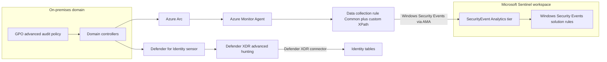

# Active Directory Domain Services (on-premises)

> Status: verified. Priority: P1 (start here). Last verified: 21 Nov 2026.

## What it is

Windows security events from domain controllers are still the primary record of on-premises identity attacks: Kerberoasting, DCSync, DCShadow, Golden Ticket fallout, privileged group changes and audit log clearing. They reach Microsoft Sentinel as raw events in the `SecurityEvent` table through the Windows Security Events via AMA connector and a data collection rule. Microsoft Defender for Identity adds detections on top, but it isn't an audit trail, so the raw events stay essential for custom KQL, long retention and forensics.

## Key recommendations

- Ingest domain controller security events with **Windows Security Events via AMA**, not the retired Log Analytics agent. The connector is DCR-based, so event selection is a data collection rule you can manage at scale.
- Pick the event set deliberately. The **Common** set covers most of the high-value domain controller events, but it does not include 4769 (Kerberos service tickets, the Kerberoasting evidence) or 4776 (NTLM credential validation). Add those two IDs with a custom XPath in the DCR, or take the **All** set if your budget allows ([event ID reference](https://learn.microsoft.com/en-us/azure/sentinel/windows-security-event-id-reference)).
- Set advanced audit policy by GPO before you deploy agents, or the events never exist. In particular, Audit Kerberos Service Ticket Operations and Audit Credential Validation are not Windows defaults and only appear in Microsoft's stronger recommendation tier ([audit policy recommendations](https://learn.microsoft.com/en-us/windows-server/identity/ad-ds/plan/security-best-practices/audit-policy-recommendations)).
- Keep `SecurityEvent` in the Analytics tier. It is not part of the Microsoft 365 E5-family data grant, which covers Entra and Defender XDR suite tables only, so budget for full ingestion ([benefit details](https://azure.microsoft.com/en-us/pricing/offers/sentinel-microsoft-365-offer/)).
- Run Defender for Identity sensors on the same domain controllers (see the [Defender for Identity guide](../defender-for-identity/README.md)). MDI gives you the detections, `SecurityEvent` gives you the evidence.

## High-value log sources

| Source | Table name | Connector | Tier | Cost / volume | Value |
|---|---|---|---|---|---|
| Domain controller Windows security events | `SecurityEvent` | Windows Security Events via AMA | Analytics | High with the All set, medium with Common. Scales with domain size, logon rate and 4688 process auditing. Use the Usage query below after a week | The raw audit trail for every on-prem identity attack. Feeds the built-in Windows rules and all custom detections in this guide |
| MDI filtered view of the same DCs | `IdentityDirectoryEvents`, `IdentityLogonEvents`, `IdentityQueryEvents` | Microsoft Defender XDR (event streaming) | Analytics or data lake | Low to medium. Covered by the M365 E5-family 5 MB/user/day grant | Enriched, normalised DC activity for cross-source hunting, without the raw event volume |
| MDI alerts and incidents | `SecurityIncident`, `SecurityAlert`, `AlertInfo`, `AlertEvidence` | Microsoft Defender XDR (incident and alert sync) | Analytics | `SecurityIncident` and `SecurityAlert` are free in Sentinel. `AlertInfo` and `AlertEvidence` are billed but sit inside the same grant | Detection outcomes, with severity and MITRE, for case management |
| Identity inventory for joins | `IdentityInfo` | Defender XDR entities sync with UEBA | Analytics | Low | Account to SID to UPN to Entra ID mapping for enrichment |

Do not substitute the generic Azure Monitor Agent Windows event DCR for this connector. A plain DCR pointed at the Security log sends events to the `Event` table, and the Sentinel Windows rules query `SecurityEvent` ([Windows event collection](https://learn.microsoft.com/en-us/azure/azure-monitor/vm/data-collection-windows-events)).

## Prerequisites and licensing

| Item | Detail |
|---|---|
| Sentinel | Pay-as-you-go or commitment tier ingestion. `SecurityEvent` is billed at full analytics rates. There is no per-user licence requirement for the events themselves |
| Agent | Azure Monitor Agent on every domain controller. On-premises DCs must be Azure Arc-enabled first ([connector prerequisites](https://learn.microsoft.com/en-us/azure/sentinel/data-connectors-reference#windows-security-events-via-ama)) |
| Roles | To create the DCR and DCE: write on Microsoft.Insights/dataCollectionRules and dataCollectionEndpoints, for example Monitoring Contributor. To manage Sentinel content: Microsoft Sentinel Contributor. To join DCs to Arc: the Arc onboarding roles for your method |
| Outbound access | AMA needs port 443 outbound to Azure Monitor endpoints ([connector prerequisites](https://learn.microsoft.com/en-us/azure/sentinel/data-connectors-reference)) |

### Audit policy: the events must exist before the agent can ship them

Set these by GPO on the Default Domain Controllers Policy or a dedicated DC policy, under Computer Configuration > Policies > Windows Settings > Security Settings > Advanced Audit Policy Configuration. The table maps the ASD ACSC priority event IDs to the subcategory that generates them. Sources: [Windows Server audit policy recommendations](https://learn.microsoft.com/en-us/windows-server/identity/ad-ds/plan/security-best-practices/audit-policy-recommendations) and the [MDI event collection requirements](https://learn.microsoft.com/en-us/defender-for-identity/deploy/configure-windows-event-collection).

| ASD priority event ID | What it records | Required audit subcategory | Notes |
|---|---|---|---|
| 4624, 4625 | Successful and failed logon | Logon/Logoff > Audit Logon | Enabled by default on modern Windows |
| 4776 | NTLM credential validation | Account Logon > Audit Credential Validation | Not in the Common DCR event set. Needs the custom XPath in this guide |
| 4768 | Kerberos TGT requests | Account Logon > Audit Kerberos Authentication Service | Microsoft's stronger recommendation, not the baseline |
| 4769 | Kerberos service tickets | Account Logon > Audit Kerberos Service Ticket Operations | The Kerberoasting evidence. Also missing from Common, so needs the custom XPath |
| 4771 | Kerberos preauth failures | Account Logon > Audit Kerberos Authentication Service | Password spraying and AS-REP probing signal |
| 4662 | Operations on directory objects | DS Access > Audit Directory Service Access | DCSync evidence. Also needs a domain object auditing SACL on user, group, computer and managed service account object types, or you only see a fraction of operations |
| 4720 | User account created | Account Management > Audit User Account Management | Rogue account creation |
| 4728, 4732, 4756 | Member added to global, local or universal security group | Account Management > Audit Security Group Management | Privilege escalation evidence. 4729, 4733 and 4757 cover removals |
| 5136 | Directory service object modified | DS Access > Audit Directory Service Changes | Schema, AdminSdHolder and AD FS config tampering |
| 1102 | Security log cleared | Logged by the Event Log service itself | Covered by the NRT rule below. Also check for 104 if log clearing by Event Viewer is in scope |

Add 4688 (Audit Process Creation) and 4697 (Audit Security System Extension) while you're in the policy. MDI's DCSync, DCShadow and service-install detections use them, and 4688 gives you process evidence on DCs.

The 4662 SACL step is the one teams forget. In Active Directory Users and Computers, enable Advanced Features, then add auditing entries for Everyone, Success, Full Control minus read permissions, applied separately to Descendant User Objects, Descendant Group Objects, Descendant Computer Objects, and the managed service account object types. Configuring only user objects gives incomplete coverage ([domain object auditing](https://learn.microsoft.com/en-us/defender-for-identity/deploy/configure-windows-event-collection#configure-domain-object-auditing)).

Confirm what's live with `auditpol.exe /get /category:*` on each DC.

### Which DCR event set gets the ASD events

From the [Sentinel event ID reference](https://learn.microsoft.com/en-us/azure/sentinel/windows-security-event-id-reference):

| Event ID | Minimal | Common | Notes |
|---|---|---|---|
| 4624, 4625, 4720, 4728, 4732, 4756, 1102 | Yes | Yes | Minimal is enough for these |
| 4662, 4768, 4771, 5136 | No | Yes | DCSync and Kerberos TGT coverage needs Common |
| 4769, 4776 | No | No | Add with a custom XPath, or take the All set |

Recommended DCR selection: **Common**, plus a custom XPath data source for the two missing IDs:

```text
Security!*[System[(EventID=4769 or EventID=4776)]]
```

XPath entries in a DCR take the form `LogName!XPathQuery` and support up to 20 expressions. Test locally with `Get-WinEvent -LogName Security -FilterXPath '...'` before you deploy ([filter events using XPath queries](https://learn.microsoft.com/en-us/azure/azure-monitor/vm/data-collection-windows-events#filter-events-using-xpath-queries)). Note the volume impact: 4769 fires once for every Kerberos service ticket request, so size it against your domain's ticket rate.

## Step-by-step setup

1. **Set the GPO audit policies.** Apply the subcategories in the table above with Success and Failure, to every DC. Run `gpupdate`, then confirm with `auditpol.exe /get /category:*`.
2. **Configure domain object auditing.** Add the SACL entries for 4662 coverage as described above, once per domain.
3. **Check the events exist locally.** In Event Viewer on a DC, filter the Security log for 4662, 4728 and 4769. If any of them are empty, fix audit policy before going further.
4. **Arc-enable the domain controllers.** On-premises and non-Azure DCs need Azure Arc for the AMA extension. Use the Arc onboarding script or Azure Policy.
5. **Install the Content Hub solution.** In the Microsoft Defender portal, open **Microsoft Sentinel > Content hub**, search for **Windows Security Events**, and install it ([solution folder](https://github.com/Azure/Azure-Sentinel/tree/master/Solutions/Windows%20Security%20Events)).
6. **Open the connector and create the DCR.** Go to **Data connectors > Windows Security Events via AMA > Open connector page > Create data collection rule**. Name it for the DC fleet.
7. **Choose the event set.** Select **Common**. Then add a second data source in the same DCR with the custom XPath above for 4769 and 4776. If your DCs already ship to a monitoring DCR, keep the Sentinel DCR separate so the event set stays deliberate.
8. **Scope the rule.** On the Resources tab, add the domain controllers, by Arc server, resource group or subscription. Leave the DCR associated only with DCs so member servers don't flood `SecurityEvent` with unrelated events.
9. **Review and create.** Data starts landing shortly after the agent applies the DCR. Check the validation queries within the hour.
10. **Add a workspace transform if needed.** The `SecurityEvent` table supports DCR workspace transformations. A common one drops 4624 noise from service accounts or health probes before you pay for it ([table attributes](https://learn.microsoft.com/en-us/azure/azure-monitor/reference/tables/securityevent)).
11. **Run the validation KQL below**, including the ASD event coverage query, before you enable any analytic rules.

## Best-practice security configuration

Harden on-premises Active Directory to prevent Tier-0 escalation alongside DC security event logging. See [Microsoft recommended security configurations](../../docs/security-configurations.md).

- **Enterprise access model (Tiering & PAWs):** Isolate Tier-0 identities (Domain Admins, Enterprise Admins, AD FS/AD CS/Entra Connect admins) onto hardened Privileged Access Workstations and block Tier-0 accounts from signing in to workstations or member servers ([Enterprise access model](https://learn.microsoft.com/en-us/security/privileged-access-workstations/privileged-access-access-model)).
- **Protected Users & minimal Domain Admins:** Place human privileged accounts in the **Protected Users** group (disables NTLM, DES/RC4 and delegation), keep permanent Domain Admins minimal, and disable unconstrained Kerberos delegation ([Best practices for securing AD](https://learn.microsoft.com/en-us/windows-server/identity/ad-ds/plan/security-best-practices/best-practices-for-securing-active-directory)).
- **LDAP signing, channel binding & SMB signing:** Enforce LDAP signing, LDAP channel binding and SMB signing on all Domain Controllers, and disable NTLMv1 and SMBv1 domain-wide.
- **Rotate `krbtgt` twice & harden AD CS:** Plan periodic double rotation of the `krbtgt` password and audit AD CS certificate templates for ESC1 to ESC8 misconfigurations.

## Architecture diagram



## Validation KQL

For group-wide and workspace-wide freshness checks, see [identity.kql](../../queries/validation/identity.kql) and the [validation query pack](../../queries/validation/README.md).

```kql
// 1. Is SecurityEvent landing, and from how many DCs?
SecurityEvent
| where TimeGenerated > ago(1d)
| summarize Rows = count(), Latest = max(TimeGenerated) by Computer
| order by Rows desc

// 2. Freshness: every DC should have data inside the last hour.
SecurityEvent
| where TimeGenerated > ago(1d)
| summarize Latest = max(TimeGenerated) by Computer
| where Latest < ago(1h)

// 3. ASD ACSC priority event coverage.
// Which of the priority IDs actually arrived in the last 24 hours?
let asd_ids = dynamic([4624, 4625, 4662, 4720, 4728, 4732, 4756, 4768, 4769, 4771, 4776, 5136, 1102]);
let coverage = SecurityEvent
| where TimeGenerated > ago(24h)
| where EventID in (asd_ids)
| summarize Events = count(), Latest = max(TimeGenerated) by EventID;
print Wanted = asd_ids
| mv-expand EventID = Wanted to typeof(int)
| join kind=leftouter coverage on EventID
| project EventID, Events, Latest
| order by EventID asc
// Rows with empty Events mean the event isn't arriving: fix the audit policy or the DCR event set.

// 4. Audit policy reality check: the events only exist if the subcategory is on.
SecurityEvent
| where TimeGenerated > ago(7d)
| where EventID in (4769, 4776)
| count()

// 5. Cost: GB per day for SecurityEvent.
Usage
| where TimeGenerated > ago(30d)
| where DataType == "SecurityEvent"
| summarize GB = round(sum(Quantity) / 1024, 2) by bin(StartTime, 1d)
| render columnchart
```

Query 3 is the acceptance test for this guide. Run it after your first day of collection and after any GPO or DCR change.

## Out-of-box analytic rules

From the **Windows Security Events** solution in the Sentinel Content Hub ([Analytic Rules folder](https://github.com/Azure/Azure-Sentinel/tree/master/Solutions/Windows%20Security%20Events/Analytic%20Rules)). Names, severities, tactics and techniques are from the rule YAML as at verification.

| Rule | Detects | Data | MITRE | Enable day 1? |
|---|---|---|---|---|
| Non Domain Controller Active Directory Replication | A non-DC account using directory replication services. The DCSync signature | `SecurityEvent` | Credential Access, T1003.006 | Yes. This is the core DCSync detection |
| NRT Security Event log cleared | Event 1102, with the AD FS server false positive case excluded by the rule | `SecurityEvent` | Defense Evasion, T1070 | Yes |
| New EXE deployed via Default Domain or Default Domain Controller Policies | Executables pushed through the default GPOs, which should never be used for deployment | `SecurityEvent` | Execution, Lateral Movement | Yes on a domain that follows that best practice |
| SecurityEvent - Multiple authentication failures followed by a success | Brute force that gets in: five failures then a success within an hour | `SecurityEvent` | Credential Access | Yes, tune the threshold |
| Excessive Windows Logon Failures | Over 50 failures in a day, at least a third of the 7-day baseline | `SecurityEvent` | Credential Access | Yes, tune per domain |
| Starting or Stopping HealthService to Avoid Detection | Stopping the monitoring agent's HealthService to blind telemetry. Needs a SACL on the service | `SecurityEvent` | Defense Evasion, T1562.001 | Yes, after you set the service SACL |

The solution also ships WMI abuse, hidden scheduled task, fodhelper UAC bypass, renamed sdelete, base64 PE execution, password-not-set and time-series process anomaly rules. Review each against your baseline before enabling: they are all in the same [folder](https://github.com/Azure/Azure-Sentinel/tree/master/Solutions/Windows%20Security%20Events/Analytic%20Rules). The detection source for the DCSync behaviour in Defender XDR is MDI's alert of the same name, so keep the two alert streams deduplicated in your incident process.

## Custom detections

The built-in rules cover log clearing, brute force and replication basics. These three close the gaps the OOB content misses. Run hourly with a 1-hour lookback unless noted. Every `// ASSUMPTION:` line depends on event content that Microsoft documents only in the raw event schema, so validate one row before enabling.

### C1. DCSync by GUID, with actor detail (High)

The OOB replication rule is the primary detector. This one adds the replication GUID filter and the target object, so it survives actor-based tuning and gives responders the "what was replicated" question an answer.

```kql
// CUSTOM - directory replication from a non domain controller account, filtered to the replication rights GUIDs
SecurityEvent
| where TimeGenerated > ago(1h)
| where EventID == 4662
| where ObjectServer =~ "DS"
// ASSUMPTION: the replication access rights are listed in the Properties field of 4662 events.
// The GUIDs below are the DS-Replication-Get-Changes rights. Confirm they appear in your events with:
//   SecurityEvent | where EventID == 4662 | take 5 | project Properties
| where Properties has_any ("1131f6aa-9c07-11d1-f79f-00c04fc2dcd2",
                            "1131f6ad-9c07-11d1-f79f-00c04fc2dcd2")
// Domain controllers authenticate as computer accounts ending in $. Exclude them.
| where SubjectUserName !endswith "$" and AccountType != "Machine"
| project TimeGenerated, Computer, SubjectUserName, SubjectDomainName, ObjectName, IpAddress, Process
```

MITRE: Credential Access T1003.006. Pair with MDI's DCSync alert (external ID 2006) rather than replacing it.

### C2. Kerberoasting pattern: RC4 service tickets in volume (High)

4769 alone is noise. RC4 (0x17) service tickets for unusual SPNs, requested in volume from one host, are the fingerprint of Rubeus, Impacket's GetUserSPNs and friends.

```kql
// CUSTOM - burst of RC4 encrypted Kerberos service tickets per requesting account
SecurityEvent
| where TimeGenerated > ago(1h)
| where EventID == 4769
// ASSUMPTION: the ticket encryption type is inside EventData, with RC4 encoded as 0x17,
// and the requested SPN is in the same EventData. Confirm the rendering first:
//   SecurityEvent | where EventID == 4769 | take 5 | project EventData
| where EventData has "0x17"
| summarize Tickets = count() by SubjectUserName, IpAddress
| where Tickets >= 10
| project SubjectUserName, IpAddress, Tickets
```

MITRE: Credential Access T1558.003. Modern domains issue AES tickets, so a healthy baseline has almost no RC4. Investigate legacy application exceptions before you tune the threshold.

### C3. Dormant account added to a privileged group (High)

Attackers with domain admin rights often build persistence with a stale, trusted-looking account. Both the actor and the OOB group rules can miss it if the change looks routine.

```kql
// CUSTOM - account with no logon history for 30 days added to a Tier 0 group
let tier0_groups = dynamic(["Domain Admins", "Enterprise Admins", "Schema Admins", "Account Operators", "Administrators"]);
let recent_logons = SecurityEvent
    | where TimeGenerated > ago(30d)
    | where EventID == 4624
    | summarize LastLogon = max(TimeGenerated) by TargetUserName;
SecurityEvent
| where TimeGenerated > ago(24h)
| where EventID in (4728, 4732, 4756)
// ASSUMPTION: for these events the group is in TargetAccount and the added member in MemberName.
// Validate with: SecurityEvent | where EventID == 4728 | take 5
| where TargetAccount has_any (tier0_groups)
| extend AddedAccount = tostring(split(MemberName, "\\")[-1])
| join kind=leftouter recent_logons on $left.AddedAccount == $right.TargetUserName
| where isempty(LastLogon) or LastLogon < ago(30d)
| project TimeGenerated, Computer, Actor = SubjectUserName, AddedAccount, TargetAccount, LastLogon
```

MITRE: Persistence T1098. Feed the tier 0 group list from a watchlist if yours differs.

## Playbooks

The Windows Security Events solution ships no playbooks, verified against the [solution folder](https://github.com/Azure/Azure-Sentinel/tree/master/Solutions/Windows%20Security%20Events). Suggested custom automations for a domain controller incident:

| Playbook (custom) | Trigger | Actions | Connector and permissions |
|---|---|---|---|
| Freeze a suspect account | C1, C2, C3 or the OOB replication rule | Disable the AD account via an Automation runbook, comment the incident, page the identity on-call | Automation account with account-disable rights in the domain, plus Sentinel Logic Apps Contributor |
| Snapshot DC state | C1, C3 or 1102 | Open a ticket for triage imaging of the affected DC, capture the last 24h of `SecurityEvent` for that Computer into the ticket | ITSM connector, plus Log Analytics reader |

## Workbooks and hunting

| Item | Source | Use |
|---|---|---|
| Event Analyzer workbook | Windows Security Events solution ([Workbooks folder](https://github.com/Azure/Azure-Sentinel/tree/master/Solutions/Windows%20Security%20Events/Workbooks)) | Event volume and type breakdown per host |
| Identity and Access workbook | Same folder | Identity-centric views over the security events |
| Hunting queries: AD account lockouts, failed user logons, group added to privileged group, decoy account authentication, DC installation media creation, WMI on new hosts, crash dump disabled, Exchange PowerShell snap-in | [Hunting Queries folder](https://github.com/Azure/Azure-Sentinel/tree/master/Solutions/Windows%20Security%20Events/Hunting%20Queries) | The starting points for most AD investigations |

Query 3 above doubles as a standing workbook view for ASD priority coverage.

## Gotchas and deprecations

- **The legacy agent is retired.** The old Security Events via Legacy Agent connector and the Log Analytics agent are gone. AMA with a DCR is the only supported path ([AMA overview](https://learn.microsoft.com/en-us/azure/azure-monitor/agents/azure-monitor-agent-overview)).
- **Forwarded events are not the same thing.** The Windows Forwarded Events connector writes to `WindowsEvent`, not `SecurityEvent`, and built-in rules that query `SecurityEvent` won't fire on it ([event sets reference](https://learn.microsoft.com/en-us/azure/sentinel/windows-security-event-id-reference)).
- **The Common set has holes.** 4769 and 4776 are not in Common or Minimal. If you take Common without the custom XPath, Kerberoasting and NTLM validation coverage is zero. This guide's XPath fixes it.
- **No GPO, no events.** Every event ID here maps to an audit subcategory. If the subcategory is off, the DCR collects nothing, the table looks healthy from other events, and the coverage query is the only thing that tells you.
- **4662 needs the SACL too.** The audit subcategory alone produces sparse results without the domain object auditing entries on every listed object type ([domain object auditing](https://learn.microsoft.com/en-us/defender-for-identity/deploy/configure-windows-event-collection#configure-domain-object-auditing)).
- **Watch the volume.** The All set on a busy DC fleet can dwarf every other source in the workspace. Common plus two custom events is the usual landing zone. Check the Usage query after a week and consider a workspace transformation for noisy 4624 sources.
- **Table tier flexibility.** `SecurityEvent` supports the data lake tier and workspace transformations if you later want to split hot detection data from long-term storage ([table attributes](https://learn.microsoft.com/en-us/azure/azure-monitor/reference/tables/securityevent)).
- **Event log sizing.** If the Security log rolls before AMA ships it, events are lost. Keep Security log auto-growth enabled on DCs or size it for your retention needs.
- **Sentinel portal retirement.** Sentinel in the Azure portal retires on 31 March 2027 and becomes Defender portal only. Build and test everything here in the Defender portal ([Defender portal](https://learn.microsoft.com/en-us/azure/sentinel/microsoft-sentinel-defender-portal)).

## Official links

- [Windows Security Events via AMA connector reference](https://learn.microsoft.com/en-us/azure/sentinel/data-connectors-reference#windows-security-events-via-ama)
- [Windows security event sets that can be sent to Sentinel](https://learn.microsoft.com/en-us/azure/sentinel/windows-security-event-id-reference)
- [Audit policy recommendations for Windows Server](https://learn.microsoft.com/en-us/windows-server/identity/ad-ds/plan/security-best-practices/audit-policy-recommendations)
- [Azure Monitor Agent overview](https://learn.microsoft.com/en-us/azure/azure-monitor/agents/azure-monitor-agent-overview)
- [Collect Windows events with the Azure Monitor Agent, including XPath filters](https://learn.microsoft.com/en-us/azure/azure-monitor/vm/data-collection-windows-events)
- [SecurityEvent table reference](https://learn.microsoft.com/en-us/azure/azure-monitor/reference/tables/securityevent)
- [Configure Windows event auditing for Defender for Identity](https://learn.microsoft.com/en-us/defender-for-identity/deploy/configure-windows-event-collection)
- [Windows Security Events solution, Azure-Sentinel repo](https://github.com/Azure/Azure-Sentinel/tree/master/Solutions/Windows%20Security%20Events)
- [Windows Security Events analytic rules, Azure-Sentinel repo](https://github.com/Azure/Azure-Sentinel/tree/master/Solutions/Windows%20Security%20Events/Analytic%20Rules)
- [Microsoft Sentinel free data sources](https://learn.microsoft.com/en-us/azure/sentinel/billing#free-data-sources)
- [Microsoft Sentinel pricing](https://azure.microsoft.com/en-us/pricing/details/microsoft-sentinel)
- [Microsoft Sentinel in the Defender portal](https://learn.microsoft.com/en-us/azure/sentinel/microsoft-sentinel-defender-portal)

## Last verified

21 Nov 2026, against Microsoft Learn and the Azure-Sentinel repo. Re-verify before relying on table names, rule names or the event set membership.
