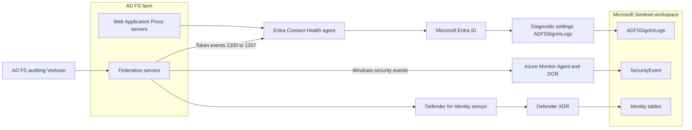

# Active Directory Federation Services (AD FS)

> Status: verified. Priority: P1 (start here). Last verified: 21 Nov 2026.

## What it is

AD FS issues tokens that let users sign in to federated applications, including federated domains in Microsoft Entra ID. The highest-impact attack against it is token-signing abuse, often called Golden SAML: an attacker with the AD FS service account or the token-signing private keys can forge tokens for any application, and the forgery is invisible unless AD FS auditing is on. Three logging streams matter: AD FS sign-ins streamed through Entra Connect Health into `ADFSSignInLogs`, the servers' own Windows security events in `SecurityEvent`, and the AD FS-specific detections from Microsoft Defender for Identity sensors.

## Key recommendations

- Turn AD FS auditing on before anything else. The default audit level is Basic, which records the four core token events and nothing else, and even those need the audit policy, service account rights and federation service settings in place first ([AD FS auditing](https://learn.microsoft.com/en-us/windows-server/identity/ad-fs/troubleshooting/ad-fs-tshoot-logging)). Set the level to **Verbose** with `Set-AdfsProperties -AuditLevel Verbose`.
- Stream sign-ins to Sentinel via Connect Health and Entra diagnostic settings. The Microsoft Entra Connect Health agent on every federation and Web Application Proxy server sends AD FS data to Entra ID, and a diagnostic setting exports the `ADFSSignInLogs` category to your Sentinel workspace ([Connect Health for AD FS](https://learn.microsoft.com/en-us/entra/identity/hybrid/connect/how-to-connect-health-adfs), [diagnostic settings](https://learn.microsoft.com/en-us/entra/identity/monitoring-health/howto-integrate-activity-logs-with-azure-monitor-logs)).
- Put Defender for Identity sensors on the federation servers. MDI watches the AD FS DKM key store, authentication with suspicious certificates and federation trust changes, and it configures most AD FS auditing automatically on v3.x sensors ([event collection](https://learn.microsoft.com/en-us/defender-for-identity/deploy/configure-windows-event-collection)).
- Ship the AD FS servers' Security log to Sentinel with Windows Security Events via AMA. `ADFSSignInLogs` records token outcomes, not the Windows activity around them. The Golden SAML custom detections in this guide run on `SecurityEvent`.
- Migrating to Entra ID? Keep every part of this logging until the last farm node is decommissioned. Federated trust, token-signing keys and the AD FS service account are high-value targets precisely in the window when teams stop watching them.

## High-value log sources

| Source | Table name | Connector | Tier | Cost / volume | Value |
|---|---|---|---|---|---|
| AD FS sign-ins | `ADFSSignInLogs` | Microsoft Entra ID (diagnostic settings, fed by Connect Health) | Analytics | Medium. One row per sign-in request. Covered by the M365 E5-family 5 MB/user/day grant ([benefit details](https://azure.microsoft.com/en-us/pricing/offers/sentinel-microsoft-365-offer/)) | Token issuance outcomes, user, app, IP, MFA and Conditional Access detail for federated apps that never touch Entra sign-in logs |
| AD FS server security events | `SecurityEvent` | Windows Security Events via AMA | Analytics | Low on a dedicated AD FS farm, higher if AD FS shares hosts | Windows account logons to the AD FS servers, directory changes to the AD FS configuration container, service and process activity. The raw evidence for Golden SAML preparation |
| MDI on AD FS | `IdentityLogonEvents`, `IdentityDirectoryEvents` | Microsoft Defender XDR (event streaming) | Analytics or data lake | Low. Covered by the same grant | Credential validation events the MDI sensor parses from the AD FS servers, and the AD FS detections' underlying signals |
| MDI alerts and incidents | `SecurityIncident`, `SecurityAlert`, `AlertInfo`, `AlertEvidence` | Microsoft Defender XDR (incident and alert sync) | Analytics | `SecurityIncident` and `SecurityAlert` free. `AlertInfo` and `AlertEvidence` inside the same grant | AD FS DKM key read, suspicious certificate authentication and trust modification alerts, with MITRE context |
| Domain federation changes | `AuditLogs` | Microsoft Entra ID (diagnostic settings) | Analytics | Low | Federation settings changes in Entra, including switching a domain from managed to federated, which is the cloud-side half of a Golden SAML attack |

`ADFSSignInLogs` supports the data lake tier and workspace transformations if you want long retention without analytics pricing ([table attributes](https://learn.microsoft.com/en-us/azure/azure-monitor/reference/tables/adfssigninlogs)).

## Prerequisites and licensing

| Item | Detail |
|---|---|
| Entra licence | Microsoft Entra ID P1 or P2, for Microsoft Entra Connect Health ([Connect Health prerequisites](https://learn.microsoft.com/en-us/entra/identity/hybrid/connect/how-to-connect-health-adfs#prerequisites)) |
| MDI licence (optional but recommended) | Any of the E5-family, EMS E5 or standalone Defender for Identity licences ([licensing requirements](https://learn.microsoft.com/en-us/defender-for-identity/deploy/prerequisites-sensor-version-2#licensing-requirements)) |
| Sentinel | Pay-as-you-go or commitment tier ingestion for the billed tables |
| Agent install | Global Administrator to register Connect Health agents, or Hybrid Identity Administrator permissions. Install on federation and Web Application Proxy servers. Server Core is not supported ([Connect Health prerequisites](https://learn.microsoft.com/en-us/entra/identity/hybrid/connect/how-to-connect-health-adfs#prerequisites)) |
| Diagnostic settings | Security Administrator on the Entra tenant to create the export ([prerequisites](https://learn.microsoft.com/en-us/entra/identity/monitoring-health/howto-integrate-activity-logs-with-azure-monitor-logs#prerequisites)) |
| AMA prerequisites | Azure Arc on non-Azure AD FS servers, and write access to create the DCR ([Windows Security Events via AMA](https://learn.microsoft.com/en-us/azure/sentinel/data-connectors-reference#windows-security-events-via-ama)) |

### AD FS auditing requirements

From [Connect Health for AD FS](https://learn.microsoft.com/en-us/entra/identity/hybrid/connect/how-to-connect-health-adfs#enable-auditing-for-ad-fs) and [AD FS events and logging](https://learn.microsoft.com/en-us/windows-server/identity/ad-fs/troubleshooting/ad-fs-tshoot-logging):

1. Give the AD FS service account the **Generate security audits** right in Local Security Policy, under Security Settings > Local Policies > User Rights Assignment. If AD FS runs on a domain controller, set this in the Default Domain Controllers Policy instead.
2. Enable the audit policy subcategory: `auditpol.exe /set /subcategory:"Application Generated" /failure:enable /success:enable`. MDI's automatic auditing configures the GPO equivalent on v3.x sensors.
3. In AD FS Management, edit Federation Service Properties > Events, and tick **Success audits** and **Failure audits**.
4. Set the audit level to Verbose: `Set-AdfsProperties -AuditLevel Verbose`. Basic is the default and logs at most five events per request. Verbose logs all of them.

Basic-level events: 1200 (token issued), 1201 (token issuance failed), 1202 (fresh credential validated), 1203 (fresh credential validation failed). MDI's AD FS detections require 1202, 1203, 4624 and 4625, plus the Verbose level. For full MDI coverage, also enable object-level auditing on the AD FS configuration container in Active Directory, under Program Data > Microsoft > ADFS ([AD FS container auditing](https://learn.microsoft.com/en-us/defender-for-identity/deploy/configure-windows-event-collection#configure-object-level-auditing-on-the-ad-fs-configuration-folder)).

The AD FS Admin log and the Tracelog in Event Viewer are troubleshooting aids, not security logs. They're off by default and generate too much data to leave on ([AD FS events and logging](https://learn.microsoft.com/en-us/windows-server/identity/ad-fs/troubleshooting/ad-fs-tshoot-logging)).

## Step-by-step setup

1. **Check licences.** Confirm Entra ID P1 or P2 for Connect Health, and an MDI licence if you're deploying sensors.
2. **Install the Connect Health agent.** Download the agent for AD FS and install it on every federation server and Web Application Proxy server, signing in with an account that can register the agent ([install the agent](https://learn.microsoft.com/en-us/entra/identity/hybrid/connect/how-to-connect-health-adfs#install-the-agent-for-ad-fs)).
3. **Enable AD FS auditing** with the four steps above, on the primary AD FS servers. GPO can silently disable AD FS auditing, so check for a policy that overrides your settings.
4. **Set Verbose and verify.** Run `Get-AdfsProperties`, confirm the audit level, then generate a test sign-in and check the Security log for 1200-series events from the AD FS Auditing source.
5. **Deploy MDI sensors** on the federation servers. Sensors are supported on federation servers only, not on Web Application Proxy servers ([sensor prerequisites](https://learn.microsoft.com/en-us/defender-for-identity/deploy/prerequisites-sensor-version-2)). On v3.x sensors, enable automatic Windows auditing, which covers the Application Generated policy and the AD FS container SACL. Verbose level still needs the manual `Set-AdfsProperties` command.
6. **Create the diagnostic setting.** In the Microsoft Entra admin center, go to **Entra ID > Monitoring & health > Diagnostic settings**, select **+ Add diagnostic setting**, tick the **ADFSSignInLogs** log category, choose **Send to Log Analytics workspace**, select your Sentinel workspace, and save ([integrate Entra logs with Azure Monitor](https://learn.microsoft.com/en-us/entra/identity/monitoring-health/howto-integrate-activity-logs-with-azure-monitor-logs)).
7. **Ingest the servers' Security log.** Install the **Windows Security Events** solution from the Content Hub, open **Windows Security Events via AMA**, and create a DCR scoped to the AD FS servers. The **Common** set covers 4624, 4625, 4662, 5136 and 1102, which drive the custom detections below ([event sets](https://learn.microsoft.com/en-us/azure/sentinel/windows-security-event-id-reference)).
8. **Connect Defender XDR to Sentinel.** Incident and alert sync is automatic when Sentinel is onboarding to the Defender portal, and gives you the MDI AD FS alerts. Optionally stream `IdentityLogonEvents` and `IdentityDirectoryEvents` through the XDR connector's event streaming.
9. **Validate with the KQL below**, including a check that 1200-series events are arriving through the `SecurityEvent` stream.

## Best-practice security configuration

Microsoft recommends migrating off AD FS to Microsoft Entra cloud authentication (Password Hash Sync or Pass-through Authentication) where possible; while AD FS remains in service, harden every farm node. See [Microsoft recommended security configurations](../../docs/security-configurations.md).

- **Extranet Smart Lockout (ESL):** Enable Extranet Smart Lockout on AD FS 2016/2019/2022 to stop external password spray without locking out legitimate users on familiar IPs ([Extranet Smart Lockout](https://learn.microsoft.com/en-us/windows-server/identity/ad-fs/operations/configure-ad-fs-extranet-smart-lockout-protection)).
- **Protect token-signing certificates & Tier-0 access:** Treat AD FS servers and their WID/SQL databases as Tier-0 assets (same controls as Domain Controllers), deploy the Defender for Identity sensor on every AD FS node, and disable legacy WS-Trust / legacy auth endpoints that aren't required.
- **Plan cloud-auth migration:** Move relying-party apps directly to Entra ID and retire AD FS federation to eliminate Golden SAML attack surface ([Best practices for securing AD](https://learn.microsoft.com/en-us/windows-server/identity/ad-ds/plan/security-best-practices/best-practices-for-securing-active-directory)).

## Architecture diagram



## Validation KQL

For group-wide and workspace-wide freshness checks, see [identity.kql](../../queries/validation/identity.kql) and the [validation query pack](../../queries/validation/README.md).

```kql
// 1. Are AD FS sign-ins landing, and how fresh?
ADFSSignInLogs
| where TimeGenerated > ago(1d)
| summarize Rows = count(), Latest = max(TimeGenerated), Apps = dcount(AppId)
    by bin(TimeGenerated, 1d)
| order by TimeGenerated desc

// 2. What's failing on the farm?
ADFSSignInLogs
| where TimeGenerated > ago(24h)
| where ResultType !in (0, 50144)
| summarize Failures = count() by ResultType, ResultDescription
| order by Failures desc

// 3. Is AD FS auditing reaching Sentinel through the Windows event stream?
// The 1200 to 1207 range is the AD FS Auditing source in the Security log.
SecurityEvent
| where TimeGenerated > ago(24h)
| where EventID between (1200 .. 1207)
| summarize Rows = count(), Latest = max(TimeGenerated) by Computer
| where Rows > 0

// 4. Cost: GB per day.
Usage
| where TimeGenerated > ago(30d)
| where DataType in ("ADFSSignInLogs", "SecurityEvent")
| summarize GB = round(sum(Quantity) / 1024, 2) by DataType, bin(StartTime, 1d)

// 5. MDI identity stream for the AD FS sensors.
// ASSUMPTION: AD FS credential validation rows appear with the AD FS server in DestinationDeviceName.
IdentityLogonEvents
| where TimeGenerated > ago(24h)
| where DestinationDeviceName has_any ("adfs", "sts", "fs")
| summarize Rows = count() by ActionType
```

Query 3 failing with query 1 passing means the Connect Health path is healthy but the servers' Security log isn't streaming. Fix the DCR before you rely on the custom detections.

## Out-of-box analytic rules

There is no standalone AD FS Content Hub solution today. The AD FS content lives in two places, both verified in the Azure-Sentinel repo:

**Microsoft Entra ID solution** ([Analytic Rules folder](https://github.com/Azure/Azure-Sentinel/tree/master/Solutions/Microsoft%20Entra%20ID/Analytic%20Rules)):

| Rule | Detects | Data | MITRE | Enable day 1? |
|---|---|---|---|---|
| Password spray attack against ADFSSignInLogs | Failures across 10 or more accounts from one IP inside the window, excluding integrated Windows auth | `ADFSSignInLogs` | Credential Access, T1110 | Yes. The core AD FS spray detection |
| Modified domain federation trust settings | Domain federation settings changed in Entra, including a new signing certificate or a domain switched from managed to federated | `AuditLogs` | Credential Access, Persistence, Privilege Escalation, T1555 and T1098 | Yes. This is the cloud-side Golden SAML signal |

**Windows Security Events solution** ([Analytic Rules folder](https://github.com/Azure/Azure-Sentinel/tree/master/Solutions/Windows%20Security%20Events/Analytic%20Rules)):

| Rule | Detects | Data | MITRE | Enable day 1? |
|---|---|---|---|---|
| AD FS Database Named Pipe Connection | Local named pipe access to the AD FS configuration database. Needs Sysmon event 18 collected into `SecurityEvent` | `SecurityEvent` | Collection, T1005 | Only if you collect Sysmon event 18. The query errors out without Sysmon data |
| Gain Code Execution on ADFS Server via SMB + Remote Service or Scheduled Task | Code execution on an AD FS server through SMB with a remote service or scheduled task | `SecurityEvent` | Lateral Movement, T1210 | Yes. Classic ADFarm compromise path |
| AD FS Remote Auth Sync Connection | AD FS authentication correlated with port 80 WFP traffic, indicating AD FS replication service abuse to pull configuration and certificates. Requires AD FS auditing enabled | `SecurityEvent` | Collection, T1005 | Yes |
| AD FS Remote HTTP Network Connection | Inbound port 80 traffic on AD FS servers via Sysmon network events | `SecurityEvent` | Collection, T1005 | Only with Sysmon telemetry |
| Microsoft Entra ID Local Device Join Information and Transport Key Registry Keys Access | Access to the Entra device join and transport key registry keys, usable to impersonate joined devices. Needs SACLs on the listed keys | `SecurityEvent` | Discovery | Only after you set the registry SACLs the rule documents |
| NRT Security Event log cleared | 1102, deliberately filtered to avoid false positives from AD FS servers' own log management | `SecurityEvent` | Defense Evasion, T1070 | Yes |

On the Defender XDR side, enable the MDI AD FS detections by deploying the sensors: Suspected AD FS DKM key read (High, T1552.004), Abnormal AD FS authentication using a suspicious certificate (High, T1606) and Suspicious modification of the trust relationship of AD FS server (Medium, T1484.002) ([classic alerts](https://learn.microsoft.com/en-us/defender-for-identity/alerts-mdi-classic)).

## Custom detections

Two gaps remain once the OOB rules and MDI detections are on: the AD FS service account going interactive, and token-signing material changing in the directory. Run hourly with a 1-hour lookback unless noted. Validate the ASSUMPTION lines against one row before enabling.

### C1. AD FS service account interactive or remote logon (High)

Golden SAML preparation needs the AD FS service account's credentials on a workstation or over RDP. That account should only ever log on as a service, so any type 2 or type 10 logon is a finding.

```kql
// CUSTOM - interactive or RDP logon by the AD FS service account
// ASSUMPTION: replace the list with your AD FS service account names.
// A gMSA renders with a trailing dollar, for example ADFSSVC$.
let adfs_service_accounts = dynamic(["adfssvc$", "ADFS-SVC$"]);
SecurityEvent
| where TimeGenerated > ago(1h)
| where EventID == 4624
| where LogonType in (2, 10)
| where TargetUserName has_any (adfs_service_accounts)
| project TimeGenerated, Computer, TargetUserName, LogonType, IpAddress, Process
```

MITRE: Credential Access T1078 (Valid Accounts) leading to T1606 (Forge Web Credentials). If you use MDI action accounts or a gMSA, the same query works for the Entra Connect service account on sync servers.

### C2. Directory change on the AD FS configuration container (High)

The AD FS configuration, including token-signing and token-decryption certificate references, lives in AD under the ADFS container. A 5136 change there is either the annual AutoCertificateRollover or an attacker adding their own signing material. Baseline the change rate for a month, then alert on anything outside it.

```kql
// CUSTOM - directory service change touching the AD FS configuration container
// ASSUMPTION: AD FS configuration objects carry "ADFS" in the ObjectName of 5136 events.
// Confirm with: SecurityEvent | where EventID == 5136 | take 20 | project ObjectName, OperationType
SecurityEvent
| where TimeGenerated > ago(24h)
| where EventID == 5136
| where ObjectName has_cs "ADFS"
| project TimeGenerated, Computer, SubjectUserName, ObjectName, OperationType, ObjectDN
```

Requires Audit Directory Service Changes and the AD FS container auditing SACL, both covered by MDI's automatic auditing or the manual steps ([AD FS container auditing](https://learn.microsoft.com/en-us/defender-for-identity/deploy/configure-windows-event-collection#configure-object-level-auditing-on-the-ad-fs-configuration-folder)). MITRE: Credential Access T1552.004 and Persistence T1098. Expect roughly one change per certificate rollover per year, so a burst is a compromise signal, not tuning noise.

### C3. Brute force against a single federated account (Medium)

The OOB spray rule looks for many accounts from one IP. Its blind side is many passwords against one account, which on AD FS is common against break-glass and service accounts that bypass Entra smart lockout.

```kql
// CUSTOM - repeated failures against one account through AD FS
ADFSSignInLogs
| where TimeGenerated > ago(1h)
| where ResultType !in (0, 50144)
| summarize Failures = count(), Ips = dcount(IPAddress), FirstSeen = min(TimeGenerated)
    by UserPrincipalName
| where Failures >= 10
| project UserPrincipalName, Failures, Ips, FirstSeen
```

MITRE: Credential Access T1110.001. Correlate with the Connect Health bad password report if you want the portal view as well.

## Playbooks

None documented. The Entra ID solution ships no AD FS playbooks, and the Windows Security Events solution has none, verified against both [solution folders](https://github.com/Azure/Azure-Sentinel/tree/master/Solutions/Microsoft%20Entra%20ID). The incident response for a confirmed Golden SAML is infrastructure work, not automation: rotate the AD FS token-signing certificate, reset the service account, revoke issued tokens per relying party, and rebuild if the DKM store is gone.

Suggested automation for the early stages:

| Playbook (custom) | Trigger | Actions | Connector and permissions |
|---|---|---|---|
| Page the identity team | MDI AD FS DKM key read alert, C1 or C2 | Open a high-priority incident, page the on-call, comment the affected server | Sentinel automation rules with a Logic App connector to your paging tool |
| Snapshot an AD FS server | C1, C2, or the code execution rule | Create a triage ticket for memory capture before the server is reimaged | ITSM connector |

## Workbooks and hunting

| Item | Where | Use |
|---|---|---|
| Usage analytics | Entra Connect Health portal, AD FS service page | Application visits and traffic per federation server ([Connect Health for AD FS](https://learn.microsoft.com/en-us/entra/identity/hybrid/connect/how-to-connect-health-adfs)) |
| Bad password attempts report | Same | Top 50 users with bad username or password failures, refreshed every 12 hours |
| Risky IP report | Same | Failure trends by source IP |
| Health service data is not up to date alert | Connect Health portal | Fires when an agent stops uploading for more than two hours |
| Sample queries | Azure Monitor reference for `ADFSSignInLogs` | Starting point queries for the table ([table reference](https://learn.microsoft.com/en-us/azure/azure-monitor/reference/tables/adfssigninlogs)) |

No AD FS-specific Sentinel workbook is documented. The Connect Health portal views cover monitoring, and hunting runs from the analytic rule queries above.

## Gotchas and deprecations

- **Basic is the default and it's not enough.** Basic auditing logs at most five events per request. Set Verbose for MDI and for anything that wants the full request trail ([audit levels](https://learn.microsoft.com/en-us/windows-server/identity/ad-fs/troubleshooting/ad-fs-tshoot-logging)).
- **GPO can silently kill AD FS auditing.** A domain policy that reverts the Application Generated subcategory or the service account rights empties the log with no other symptom ([Connect Health warning](https://learn.microsoft.com/en-us/entra/identity/hybrid/connect/how-to-connect-health-adfs#enable-auditing-for-ad-fs)).
- **`ADFSSignInLogs` has a dependency chain.** Diagnostic settings export the category, but the data only exists if Connect Health agents are installed, registered and healthy on the farm. An agent down for two hours raises the Connect Health alert, not a Sentinel one.
- **WAP servers need the agent too.** The Connect Health agent runs on Web Application Proxy servers as well as federation servers ([prerequisites](https://learn.microsoft.com/en-us/entra/identity/hybrid/connect/how-to-connect-health-adfs#prerequisites)). MDI sensors, by contrast, are federation-server only.
- **AD FS on a domain controller is a config trap.** The service account audit right then comes from the Default Domain Controllers Policy, not local security policy ([AD FS events and logging](https://learn.microsoft.com/en-us/windows-server/identity/ad-fs/troubleshooting/ad-fs-tshoot-logging)). Few farms do this on purpose. Don't host one this way.
- **China sovereign cloud.** Microsoft Entra Connect Health isn't available there, which removes the `ADFSSignInLogs` path ([Connect Health availability](https://learn.microsoft.com/en-us/entra/identity/hybrid/connect/how-to-connect-health-adfs)).
- **No standalone AD FS solution.** The issue list assumed a "Active Directory Federation Services (AD FS)" solution in the Azure-Sentinel repo. It doesn't exist as of verification. The content lives in the Microsoft Entra ID and Windows Security Events solutions, linked above.
- **Migration needs logging more, not less.** Between the decision to move to Entra ID and the last farm node's retirement, the token-signing keys are still valid attack material. Keep the audit policies, the diagnostic setting and the MDI sensors until the farm is gone, then capture a final export of `ADFSSignInLogs` for retention before the agents are uninstalled.
- **Sentinel portal retirement.** Sentinel in the Azure portal retires on 31 March 2027 and becomes Defender portal only. Build and test everything here in the Defender portal ([Defender portal](https://learn.microsoft.com/en-us/azure/sentinel/microsoft-sentinel-defender-portal)).

## Official links

- [ADFSSignInLogs table reference](https://learn.microsoft.com/en-us/azure/azure-monitor/reference/tables/adfssigninlogs)
- [Troubleshoot AD FS with events and logging](https://learn.microsoft.com/en-us/windows-server/identity/ad-fs/troubleshooting/ad-fs-tshoot-logging)
- [Microsoft Entra Connect Health agents for AD FS](https://learn.microsoft.com/en-us/entra/identity/hybrid/connect/how-to-connect-health-adfs)
- [Integrate Microsoft Entra logs with Azure Monitor logs](https://learn.microsoft.com/en-us/entra/identity/monitoring-health/howto-integrate-activity-logs-with-azure-monitor-logs)
- [Microsoft Entra activity log integration options](https://learn.microsoft.com/en-us/entra/identity/monitoring-health/concept-log-monitoring-integration-options-considerations)
- [Windows Security Events via AMA connector reference](https://learn.microsoft.com/en-us/azure/sentinel/data-connectors-reference#windows-security-events-via-ama)
- [Windows security event sets that can be sent to Sentinel](https://learn.microsoft.com/en-us/azure/sentinel/windows-security-event-id-reference)
- [Configure Windows event auditing for Defender for Identity](https://learn.microsoft.com/en-us/defender-for-identity/deploy/configure-windows-event-collection)
- [Defender for Identity classic security alerts](https://learn.microsoft.com/en-us/defender-for-identity/alerts-mdi-classic)
- [Microsoft Entra ID solution, Azure-Sentinel repo](https://github.com/Azure/Azure-Sentinel/tree/master/Solutions/Microsoft%20Entra%20ID)
- [Windows Security Events solution, Azure-Sentinel repo](https://github.com/Azure/Azure-Sentinel/tree/master/Solutions/Windows%20Security%20Events)
- [Microsoft Sentinel benefit for Microsoft 365 E7, E5, A5, F5 and G5 customers](https://azure.microsoft.com/en-us/pricing/offers/sentinel-microsoft-365-offer/)
- [Microsoft Sentinel in the Defender portal](https://learn.microsoft.com/en-us/azure/sentinel/microsoft-sentinel-defender-portal)

## Last verified

21 Nov 2026, against Microsoft Learn and the Azure-Sentinel repo. Re-verify before relying on table names, rule names or the solution layout.
