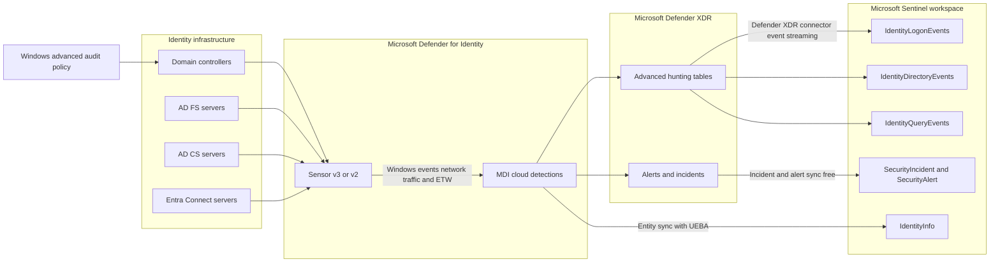

# Microsoft Defender for Identity

> Status: verified. Priority: P1 (start here). Last verified: 21 Nov 2026.

## What it is

Microsoft Defender for Identity (MDI) watches on-premises Active Directory, AD FS, AD CS and Microsoft Entra Connect through lightweight sensors on those servers. It detects identity attacks such as DCSync, Golden Ticket, Kerberoasting recon, honeytoken use and suspicious group changes, and raises alerts in the Microsoft Defender portal. Its signals land in Defender XDR advanced hunting tables, which can stream into Microsoft Sentinel through the Defender XDR connector.

One framing point from Microsoft: MDI "isn't designed to serve as an auditing or logging solution". It captures only what its detections need ([security alerts overview](https://learn.microsoft.com/en-us/defender-for-identity/alerts-overview)). For full domain controller audit trails, pair it with the [AD DS guide](../active-directory-on-prem/README.md).

## Key recommendations

- Put a sensor on every domain controller, and on AD FS, AD CS and Entra Connect servers that aren't domain controllers. Microsoft recommends a sensor per domain controller, including read-only DCs ([sensor deployment](https://learn.microsoft.com/en-us/defender-for-identity/deploy/deploy-defender-identity)).
- Use sensor v3.x on Windows Server 2019 or later with the September 2026 cumulative update, and v2.x on older servers. v3.x activates through Defender for Endpoint and configures Windows auditing automatically. v2.x needs manual audit configuration.
- Turn on **Automatic Windows auditing configuration** in the Defender portal (Settings > Identities > Advanced features). Without the underlying audit policies, group-change, NTLM and directory-service detections degrade silently and the only sign is a health alert.
- Allow learning periods before tuning. Behavioural detections start about three weeks after deployment, and some detections learn for up to a month per domain controller ([classic alerts](https://learn.microsoft.com/en-us/defender-for-identity/alerts-mdi-classic)).
- In Sentinel, alert and incident sync from Defender XDR is free. Streaming the raw identity tables (`IdentityLogonEvents`, `IdentityDirectoryEvents`, `IdentityQueryEvents`, `AlertEvidence`) is billed, but those tables sit inside the Microsoft 365 E7/E5/A5/F5/G5 data grant of up to 5 MB per user per day ([benefit details](https://azure.microsoft.com/en-us/pricing/offers/sentinel-microsoft-365-offer/)). Enable them if your SOC writes custom KQL over identity events; skip them if MDI alerts and the AD DS raw events are enough.

## High-value log sources

| Source | Table name | Connector | Tier | Cost / volume | Value |
|---|---|---|---|---|---|
| MDI alerts and incidents | `SecurityIncident`, `SecurityAlert` | Microsoft Defender XDR (incident and alert sync) | Analytics | Free. Alerts from Defender products are free data sources in Sentinel ([billing](https://learn.microsoft.com/en-us/azure/sentinel/billing#free-data-sources)) | All MDI detections, correlated into XDR incidents, at no ingestion cost |
| MDI alert detail | `AlertInfo`, `AlertEvidence` | Microsoft Defender XDR (event streaming) | Analytics | Low. Billed, but covered by the M365 E5-family 5 MB/user/day grant | Alert metadata, severity, MITRE techniques and evidence entities for KQL joins |
| Domain controller authentication | `IdentityLogonEvents` | Microsoft Defender XDR (event streaming) | Analytics | Low to medium. Covered by the same grant | NTLM and Kerberos logons and failures, LDAP cleartext bind, RDP, plus Entra/Defender for Cloud Apps logon activity. Already in Defender XDR advanced hunting at no extra cost if you don't stream it |
| Directory events on DCs | `IdentityDirectoryEvents` | Microsoft Defender XDR (event streaming) | Analytics | Low to medium. Covered by the same grant | Password changes and expirations, UPN changes, group changes, and DC system events like service installs |
| AD reconnaissance queries | `IdentityQueryEvents` | Microsoft Defender XDR (event streaming) | Analytics or data lake | Low if filtered. Covered by the same grant | LDAP, SAMR and DNS queries against AD objects. The raw material for recon and Kerberoasting hunts |
| Identity inventory | `IdentityInfo` | Defender XDR entities sync with Sentinel UEBA | Analytics | Low | Account attributes, group membership, on-prem SIDs, Entra object IDs, MDI sensitivity tags. The join table for every identity query. Unified with the Sentinel UEBA version of the table |

All six Defender XDR tables already exist in advanced hunting in the Defender portal when MDI is deployed, with no extra ingestion cost. Streaming to Sentinel is for long retention, cross-source KQL and Sentinel analytic rules.

## Prerequisites and licensing

| Item | Detail |
|---|---|
| Licence | A per-user MDI licence. Included in Enterprise Mobility + Security E5/A5, Microsoft 365 E5/A5/G5, Microsoft 365 E5/F5/G5 Security, the Microsoft Defender Suite family, or standalone ([licensing requirements](https://learn.microsoft.com/en-us/defender-for-identity/deploy/prerequisites-sensor-version-2#licensing-requirements), [service description](https://learn.microsoft.com/en-us/office365/servicedescriptions/microsoft-365-service-descriptions/microsoft-365-tenantlevel-services-licensing-guidance/microsoft-defender-service-description#microsoft-defender-for-identity)) |
| Entra tenant | Required to create the MDI workspace. The workspace lands in the Azure region closest to the tenant and can't be moved ([FAQ](https://learn.microsoft.com/en-us/defender-for-identity/technical-faq)) |
| Portal roles | Security Administrator, or Unified RBAC with `System settings (Read and manage)` and `Security settings (All permissions)` ([v3.x requirements](https://learn.microsoft.com/en-us/defender-for-identity/deploy/deploy-sensor-v3#roles-and-permissions)) |
| Sensor v3.x server requirements | Windows Server 2019 or later, the September 2026 or later cumulative update, and Defender for Endpoint onboarding, or the v3.x onboarding package for servers without MDE ([deploy sensor v3.x](https://learn.microsoft.com/en-us/defender-for-identity/deploy/deploy-sensor-v3)) |
| Sensor v2.x server requirements | Two cores, 6 GB RAM, 6 to 10 GB disk, Npcap 1.0 or later for packet capture, network access to `*.atp.azure.com` on 443 ([v2.x prerequisites](https://learn.microsoft.com/en-us/defender-for-identity/deploy/prerequisites-sensor-version-2)) |
| v3.x service account | LocalSystem only. No Directory Service Account (DSA) or gMSA. If any v3.x sensors exist, select **Automatically use the sensor's local system account** for action accounts |
| v2.x service account | A DSA with read access to monitored domains, or a gMSA. Up to 30 DSAs for untrusted forests ([FAQ](https://learn.microsoft.com/en-us/defender-for-identity/technical-faq)) |
| Windows auditing | See below. The single biggest source of silent detection gaps |

### Windows event collection requirements

MDI detections depend on specific Windows events from the servers the sensors watch. The sensor parses these events, so the audit policies must generate them first ([configure Windows event auditing](https://learn.microsoft.com/en-us/defender-for-identity/deploy/configure-windows-event-collection)).

Required domain controller events and their audit subcategories:

| Event IDs | Audit policy subcategory | Notes |
|---|---|---|
| 4776, 8004 | Account Logon > Audit Credential Validation, plus NTLM restriction policies for 8004 | NTLM validation and NTLM server-access enrichment |
| 4726 | Account Management > Audit User Account Management | Account deletion |
| 4728, 4729, 4730, 4732, 4733, 4756, 4757, 4758 | Account Management > Audit Security Group Management | Sensitive group change detections, including the "Suspicious additions to sensitive groups" alert |
| 4741, 4743 | Account Management > Audit Computer Account Management | Computer account lifecycle, DCShadow context |
| 4753, 4763 | Account Management > Audit Distribution Group Management | Distribution group deletion |
| 5136 | DS Access > Audit Directory Service Changes | Directory object modification |
| 4662 | DS Access > Audit Directory Service Access, plus domain object auditing SACL | Object operations. Also needs a SACL on user, group, computer and managed service account object types, applied per object type, not just users |
| 7045 | System > service installation auditing via the service control manager | New service installs on DCs |
| 4697 | System > Audit Security System Extension | Used alongside replication context |

Also required for non-DC sensors: AD FS servers need events 1202, 1203, 4624 and 4625; AD CS servers need events 4870, 4882, 4885, 4887, 4888, 4890 and 4896; Entra Connect servers need event 4624.

Set these one of three ways:

1. **v3.x automatic auditing.** Turn on **Automatic Windows auditing configuration** (Settings > Identities > Advanced features). It checks every 24 hours and applies directory services auditing, NTLM auditing, domain object auditing SACLs, the configuration container, and the AD FS, AD CS and Entra Connect requirements.
2. **Manual GPO.** Under Computer Configuration > Policies > Windows Settings > Security Settings > Advanced Audit Policy Configuration > Audit Policies, set Success and Failure for each subcategory above, then add the domain object SACL and NTLM policies. This is the only option for v2.x.
3. **PowerShell.** The DefenderForIdentity module's `Set-MDIConfiguration -Mode Domain -Configuration All` builds the GPOs, and `New-MDIConfigurationReport` audits what you have today.

Windows event 1644 (LDAP query stats) is no longer required. Remove the old registry tweaks if you have them.

## Step-by-step setup

1. **Check licences.** Confirm every user you want covered holds one of the E5-family, EMS E5 or MDI licences. MDI enables at tenant level, so partial licensing is hard to enforce ([service description](https://learn.microsoft.com/en-us/office365/servicedescriptions/microsoft-365-service-descriptions/microsoft-365-tenantlevel-services-licensing-guidance/microsoft-defender-service-description#microsoft-defender-for-identity)).
2. **Open the identity settings.** In the [Microsoft Defender portal](https://security.microsoft.com), go to **Settings > Identities**. This creates the MDI workspace for your tenant.
3. **Turn on the automatic features.** Under **Settings > Identities > Advanced features**, enable **Automatic sensor v3.x activation** and **Automatic Windows auditing configuration**.
4. **Deploy sensors.** Use the **Sensor management** tab. Action cards list domain controllers ready for activation (MDE-onboarded), servers ready for manual onboarding, and v2.x servers ready for migration. Activate eligible DCs directly, or download the onboarding package for servers without MDE ([sensor deployment](https://learn.microsoft.com/en-us/defender-for-identity/deploy/deploy-defender-identity)).
5. **Handle the older fleet.** For Windows Server 2016 or earlier, install the v2.x sensor package, configure the DSA or gMSA, and set the audit policies manually (GPO or PowerShell, above).
6. **Add the identity-role servers.** Sensors on AD FS, AD CS and Entra Connect servers need the extra audit configuration steps in the event collection guide. If you deploy v3.x sensors only on these servers, you must also run at least one v3.x sensor on a domain controller.
7. **Check RPC auditing.** Sensor 3.0.8 and later enable RPC auditing automatically on domain controllers. Earlier v3.x versions need the September 2026 cumulative update or the RPC audit configuration tag.
8. **Tag your decoys and VIPs.** In Settings > Identities, configure honeytoken accounts and extra sensitive accounts. MDI alerts on any honeytoken authentication, attribute change or group change.
9. **Validate the deployment.** Run the [Test-MdiReadiness.ps1](https://github.com/microsoft/Microsoft-Defender-for-Identity/tree/main/Test-MdiReadiness) script, then watch **Settings > Identities > Health issues** for the first few days.
10. **Onboard Sentinel in the Defender portal.** The Defender XDR connector is enabled automatically when Sentinel is onboarded there. From the Azure portal path, install the **Microsoft Defender XDR** solution from Content Hub and open its connector page.
11. **Connect incidents and alerts.** Select **Connect incidents & alerts** and keep the checkbox that turns off duplicate Microsoft incident creation rules. Verify with `SecurityIncident | where ProviderName == "Microsoft XDR"` ([XDR connector](https://learn.microsoft.com/en-us/azure/sentinel/connect-microsoft-365-defender)).
12. **Connect entities.** From the connector page, open the UEBA configuration, turn on UEBA, and mark **Active Directory (Preview)**. This syncs on-prem user entities through MDI into `IdentityInfo`.
13. **Connect events if you want raw tables.** Select **Connect events**, tick `IdentityDirectoryEvents`, `IdentityLogonEvents` and `IdentityQueryEvents` under the Defender for Identity tab, plus `AlertInfo` and `AlertEvidence` under Defender alerts, then apply.
14. **Run the validation KQL below.** Expect known-attack detections immediately and behavioural detections after the learning period.

## Architecture diagram



## Validation KQL

For group-wide and workspace-wide freshness checks, see [identity.kql](../../queries/validation/identity.kql) and the [validation query pack](../../queries/validation/README.md).

Run these in the Sentinel workspace. For a quick health check without Sentinel streaming, run the equivalents in Defender XDR advanced hunting.

```kusto
// 1. Are the MDI tables landing, and how fresh?
union withsource=TableName isfuzzy=true IdentityDirectoryEvents, IdentityLogonEvents, IdentityQueryEvents, IdentityInfo, AlertInfo, AlertEvidence
| where TimeGenerated > ago(1d)
| summarize Rows = count(), Latest = max(TimeGenerated) by TableName
| order by Rows desc

// 2. Freshness per reporting domain controller.
// ASSUMPTION: DestinationDeviceName holds the DC that processed the event for directory rows.
IdentityDirectoryEvents
| where TimeGenerated > ago(1d)
| summarize Rows = count(), Latest = max(TimeGenerated) by DestinationDeviceName
| order by Latest asc

// 3. What logon activity is the identity stream actually recording?
IdentityLogonEvents
| where TimeGenerated > ago(7d)
| summarize Rows = count() by ActionType, Protocol
| order by Rows desc

// 4. Are MDI alerts syncing into Sentinel incidents?
SecurityIncident
| where TimeGenerated > ago(7d)
| where ProviderName == "Microsoft XDR"
| summarize Incidents = count() by bin(TimeGenerated, 1d)

// 5. Cost: GB per day for the streamed identity tables.
Usage
| where TimeGenerated > ago(30d)
| where DataType in ("IdentityDirectoryEvents", "IdentityLogonEvents", "IdentityQueryEvents", "IdentityInfo", "AlertInfo", "AlertEvidence")
| summarize GB = round(sum(Quantity) / 1024, 2) by DataType, bin(StartTime, 1d)
```

## Out-of-box analytic rules

MDI detections are built into the service. There are no Sentinel analytic rules to enable for them, and the Content Hub **Microsoft Defender for Identity** solution contains only the legacy alerts connector that feeds `SecurityAlert (AATP)` ([solution folder](https://github.com/Azure/Azure-Sentinel/tree/master/Solutions/Microsoft%20Defender%20For%20Identity)). Detections arrive as alerts through the Defender XDR connector, trigger XDR automated investigation and response, and need tuning only for exclusions ([alerts overview](https://learn.microsoft.com/en-us/defender-for-identity/alerts-overview)).

The detections worth knowing on day 1, from the [classic alert catalogue](https://learn.microsoft.com/en-us/defender-for-identity/alerts-mdi-classic) and the [Defender-format list](https://learn.microsoft.com/en-us/defender-for-identity/alerts-xdr):

| Detection | External ID | Severity | MITRE | Notes |
|---|---|---|---|---|
| Suspected DCSync attack (replication of directory services) | 2006 | High | T1003.006 | Replication request from a non-DC |
| Suspected Golden Ticket usage (nonexistent account, time anomaly, ticket anomaly, encryption downgrade) | 2027, 2022, 2032, 2009 | High or Medium | T1558.001 | Four distinct detections |
| Suspected DCShadow attack (promotion and replication request) | 2028, 2029 | High | T1207 | Rogue DC registration and replication |
| Suspected AD FS DKM key read | 2413 | High | T1552.004 | Golden SAML preparation on AD FS sensors |
| Suspected Kerberos SPN exposure | 2410 | High | T1558.003 | Kerberoasting tooling behaviour |
| Suspected AS-REP Roasting attack | 2412 | High | T1558.004 | Kerberos preauth-disabled accounts |
| Suspicious additions to sensitive groups | 2024 | Medium | T1098, T1484 | Needs the group management audit events above |
| Suspected Brute Force attack (Kerberos, NTLM) | 2023 | Medium | T1110 | One-week learning period |
| Suspected skeleton key attack (encryption downgrade) | 2010 | Medium | T1556.001 | Malware on DCs allowing any-password auth |
| Suspected SID-History injection | 1106 | High | T1134.005 | Privilege escalation via SID history |
| Honeytoken authentication activity | 2014 | Medium | T1087.002 | Near-zero false positive rate if the account stays unused |
| Account Enumeration reconnaissance (LDAP) | 2437 | Medium | T1087.002 | Username guessing via LDAP pings |
| User and Group membership reconnaissance (SAMR) | 2021 | Medium | T1087.002, T1069.002 | Four-week learning period per DC |
| Security principal reconnaissance (LDAP) | 2038 | Medium | T1087.002 | Often the first stage of Kerberoasting |

Enable day 1: all of them are on by default once sensors and audit policies are healthy. Your job is tuning, not enabling. Add the AD FS, AD CS and posture-specific detections (ESC8, AD FS trust modification, DFSCoerce, shadow credentials) when those sensors are deployed.

## Custom detections

The MDI detection catalogue is broad, so these two rules cover operational gaps rather than attack techniques: sensor health from inside the data, and a dormant-account group change that MDI's behavioural profile may miss on a quiet domain. Run them hourly over a 1-hour lookback unless noted.

### C1. MDI sensor silence per domain controller (High)

MDI raises its own "Sensor stopped communicating" health alert after five minutes ([health alerts](https://learn.microsoft.com/en-us/defender-for-identity/health-alerts)). This rule gives the SOC the same signal in Sentinel, where it can drive an incident and an automation rule.

```kql
// CUSTOM - a domain controller that normally reports has gone quiet in the identity stream
// ASSUMPTION: every healthy DC emits IdentityDirectoryEvents regularly. Measure your baseline first.
IdentityDirectoryEvents
| where TimeGenerated > ago(24h)
| summarize Rows = count(), Latest = max(TimeGenerated) by DestinationDeviceName
| where Latest < ago(2h)
| project DestinationDeviceName, Rows, Latest,
          HoursQuiet = round((now() - Latest) / 1h, 1)
```

Investigate before you respond: a quiet hour on a small site's DC can be normal, and the pattern in `IdentityLogonEvents` should agree.

### C2. Dormant account added to a privileged group (High)

MDI's "Suspicious additions to sensitive groups" profiles the actor making the change. A careful attacker using an admin account on a quiet domain can stay under the behavioural threshold. This rule looks at the target instead: an account with no recent logon history, added to a Tier 0 group.

```kql
// CUSTOM - account with no recent logons added to a privileged group
// ASSUMPTION: group membership changes surface with an ActionType containing "Group".
// Pin the exact values first: IdentityDirectoryEvents | where TimeGenerated > ago(7d) | distinct ActionType
let tier0_groups = dynamic(["Domain Admins", "Enterprise Admins", "Schema Admins", "Account Operators", "Administrators"]);
IdentityDirectoryEvents
| where TimeGenerated > ago(1h)
| where ActionType has_cs "Group"
| extend GroupName = tostring(parse_json(AdditionalFields).TARGET_OBJECT_ORIGINAL_NAME)
// ASSUMPTION: the added account name and the group are in AdditionalFields for this ActionType.
// Confirm the property names from one alert row before you enable this rule.
| extend AddedAccount = tostring(parse_json(AdditionalFields).TARGET_ACCOUNT_NAME)
| where GroupName in~ (tier0_groups) and isnotempty(AddedAccount)
| join kind=leftouter (
    IdentityLogonEvents
    | where TimeGenerated > ago(30d)
    | extend AccountName = tolower(AccountName)
    | summarize LastLogon = max(TimeGenerated) by AccountName
) on $left.AddedAccount == $right.AccountName
| where isempty(LastLogon) or LastLogon < ago(30d)
| project TimeGenerated, AddedAccount, GroupName, Actor = AccountName, ActorUpn = AccountUpn, LastLogon
```

MITRE: Persistence T1098 (Account Manipulation), matching MDI external ID 2024.

## Playbooks

The Content Hub MDI solution ships no playbooks, verified against the [solution folder](https://github.com/Azure/Azure-Sentinel/tree/master/Solutions/Microsoft%20Defender%20For%20Identity). MDI's native response actions are the alternative: disable a compromised account or force a password reset from the Defender portal, using the action account you configured (gMSA or action account for v2.x, LocalSystem for v3.x, with the account setting applied to all sensors when any v3.x sensor exists).

Suggested custom playbook, for when an MDI incident needs containment beyond the portal action:

| Playbook (custom) | Trigger | Actions | Connector and permissions |
|---|---|---|---|
| Contain an identity incident | MDI incident with High severity entities | Disable the AD account through the on-prem path (for example an Azure Automation runbook with the AD PowerShell module, or a Graph call for synced accounts), comment the incident, notify the identity team | Automation account with domain account-disable rights, plus Sentinel Logic Apps Contributor for the incident comment |

Keep approvals on any disable-account automation until the rule precision is proven.

## Workbooks and hunting

| Item | Where | Use |
|---|---|---|
| Identity inventory | Defender portal, Identities blade | All monitored identities, exposure and risk, including accounts not synced to Entra ID ([identity inventory](https://learn.microsoft.com/en-us/defender-for-identity/identity-inventory)) |
| Lateral movement paths reports | Defender portal, Identities | Sensitive account exposure paths ([what is MDI](https://learn.microsoft.com/en-us/defender-for-identity/what-is)) |
| Identity security posture assessments | Microsoft Secure Score | Flagged misconfigurations such as unconstrained delegation and clear-text domain creds |
| Health issues | Settings > Identities > Health issues | Sensor and audit policy state, including the daily audit validation alerts ([health alerts](https://learn.microsoft.com/en-us/defender-for-identity/health-alerts)) |
| UEBA Essentials hunting queries | Sentinel Content Hub, [UEBA Essentials](https://azuremarketplace.microsoft.com/marketplace/apps/azuresentinel.azure-sentinel-solution-uebaessentials?tab=Overview) | Behavioural hunting over the synced entities |

No MDI-specific Sentinel workbook is documented. The portal views above cover the same ground.

## Gotchas and deprecations

- **Audit policies are the silent killer.** Every event-driven detection above needs its audit subcategory and, for 4662, the domain object SACL on all listed object types. Health alerts validate once per day per sensor or domain, so a broken GPO can cost you a day of coverage before anything fires ([health alerts](https://learn.microsoft.com/en-us/defender-for-identity/health-alerts)).
- **Known issue, v3.x health noise.** With manual auditing (GPO or PowerShell), Windows event auditing health alerts can persist even when configuration is correct. Sensors stay healthy. Fix by enabling automatic Windows auditing ([known issue](https://learn.microsoft.com/en-us/defender-for-identity/deploy/configure-windows-event-collection)).
- **GPO can fight the sensor.** Automatic auditing writes local policy. GPO settings can conflict with it ([event collection](https://learn.microsoft.com/en-us/defender-for-identity/deploy/configure-windows-event-collection)).
- **v3.x feature gaps.** No VPN integration, no syslog notifications, and ExpressRoute limitations. Keep v2.x sensors on DCs that need those features. Offboarding a server from MDE stops v3.x sensor reporting, including migrated sensors ([FAQ](https://learn.microsoft.com/en-us/defender-for-identity/technical-faq)).
- **Mixed v2.x and v3.x fleets.** v3.x ignores the DSA and gMSA, but workspace-level credential validation continues while any v2.x sensor needs them, so "Directory services user credentials are incorrect" alerts can fire for v3.x sensors. Remove the DSA or gMSA after full migration ([v3.x deployment](https://learn.microsoft.com/en-us/defender-for-identity/deploy/deploy-sensor-v3)).
- **Alert retirements.** The classic "Suspected identity theft (pass-the-hash)" alert retires at the end of November 2026. The classic "Remote code execution attempt" alert retires at the end of November 2026, with a replacement custom detection query promised to the Defender XDR Community hub ([classic alerts](https://learn.microsoft.com/en-us/defender-for-identity/alerts-mdi-classic)).
- **Legacy Sentinel connector.** The old "Microsoft Defender for Identity" connector only fed alerts into `SecurityAlert (AATP)`. It still works and is free, but raw tables require the Defender XDR connector. Switching connectors changes the alert schema and can break queries that assumed the standalone connector ([schema differences](https://learn.microsoft.com/en-us/azure/sentinel/security-alert-schema-differences)).
- **Learning periods.** Known-attack detections fire from day 1. Behavioural detections need about three weeks, SAMR recon needs four weeks per DC, and security principal recon learns for 15 days per computer.
- **Advanced Threat Analytics is dead.** Extended support ended 13 January 2026. Migrate any remaining ATA deployments ([FAQ](https://learn.microsoft.com/en-us/defender-for-identity/technical-faq)).
- **No 1644 requirement.** MDI no longer needs event 1644 or the NTDS diagnostic registry values. Clean up any old configuration.
- **Sentinel portal retirement.** Sentinel in the Azure portal retires on 31 March 2027 and becomes Defender portal only. Build and test everything here in the Defender portal ([Defender portal](https://learn.microsoft.com/en-us/azure/sentinel/microsoft-sentinel-defender-portal)).

## Official links

- [What is Microsoft Defender for Identity](https://learn.microsoft.com/en-us/defender-for-identity/what-is)
- [Deploy Microsoft Defender for Identity sensors](https://learn.microsoft.com/en-us/defender-for-identity/deploy/deploy-defender-identity)
- [Deploy the sensor v3.x](https://learn.microsoft.com/en-us/defender-for-identity/deploy/deploy-sensor-v3)
- [Sensor v2.x prerequisites](https://learn.microsoft.com/en-us/defender-for-identity/deploy/prerequisites-sensor-version-2)
- [Configure Windows event auditing](https://learn.microsoft.com/en-us/defender-for-identity/deploy/configure-windows-event-collection)
- [Identity security health issues](https://learn.microsoft.com/en-us/defender-for-identity/health-alerts)
- [Defender for Identity security alerts overview](https://learn.microsoft.com/en-us/defender-for-identity/alerts-overview)
- [Defender for Identity classic alerts](https://learn.microsoft.com/en-us/defender-for-identity/alerts-mdi-classic)
- [Defender for Identity Defender-format alerts](https://learn.microsoft.com/en-us/defender-for-identity/alerts-xdr)
- [Defender for Identity frequently asked questions](https://learn.microsoft.com/en-us/defender-for-identity/technical-faq)
- [IdentityLogonEvents table](https://learn.microsoft.com/en-us/defender-xdr/advanced-hunting-identitylogonevents-table)
- [IdentityDirectoryEvents table](https://learn.microsoft.com/en-us/defender-xdr/advanced-hunting-identitydirectoryevents-table)
- [IdentityQueryEvents table](https://learn.microsoft.com/en-us/defender-xdr/advanced-hunting-identityqueryevents-table)
- [IdentityInfo table](https://learn.microsoft.com/en-us/defender-xdr/advanced-hunting-identityinfo-table)
- [Advanced hunting schema tables](https://learn.microsoft.com/en-us/defender-xdr/advanced-hunting-schema-tables)
- [Stream data from Microsoft Defender XDR to Microsoft Sentinel](https://learn.microsoft.com/en-us/azure/sentinel/connect-microsoft-365-defender)
- [Microsoft Defender for Identity service description and licensing](https://learn.microsoft.com/en-us/office365/servicedescriptions/microsoft-365-service-descriptions/microsoft-365-tenantlevel-services-licensing-guidance/microsoft-defender-service-description#microsoft-defender-for-identity)
- [Microsoft Sentinel benefit for Microsoft 365 E7, E5, A5, F5 and G5 customers](https://azure.microsoft.com/en-us/pricing/offers/sentinel-microsoft-365-offer/)
- [Microsoft Sentinel free data sources](https://learn.microsoft.com/en-us/azure/sentinel/billing#free-data-sources)
- [Microsoft Defender for Identity solution folder, Azure-Sentinel repo](https://github.com/Azure/Azure-Sentinel/tree/master/Solutions/Microsoft%20Defender%20For%20Identity)
- [Test-MdiReadiness script](https://github.com/microsoft/Microsoft-Defender-for-Identity/tree/main/Test-MdiReadiness)
- [Microsoft Sentinel in the Defender portal](https://learn.microsoft.com/en-us/azure/sentinel/microsoft-sentinel-defender-portal)

## Last verified

21 Nov 2026, against Microsoft Learn and the Azure-Sentinel repo. Re-verify before relying on table names, rule names or the alert retirement dates.
