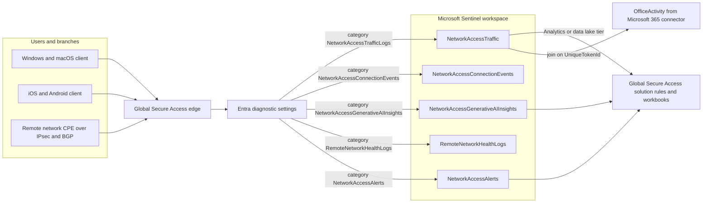

# Microsoft Entra Internet Access and Private Access (Global Secure Access)

> Status: verified. Priority: P3. Last verified: 21 Nov 2026.

## What it is

Global Secure Access is Microsoft's security service edge (SSE). It covers two products: Microsoft Entra Internet Access, an identity-aware secure web gateway for internet and SaaS traffic, and Microsoft Entra Private Access, a ZTNA service that replaces VPN access to private apps. Both are managed in one place in the Microsoft Entra admin centre ([What is Global Secure Access](https://learn.microsoft.com/en-us/entra/global-secure-access/overview-what-is-global-secure-access)).

Its traffic logs record every HTTP and HTTPS transaction that flows through the service from the Windows, macOS, iOS and Android clients, and from remote network tunnels at branch sites. For a SOC this is the web proxy log most tenants have never had, tied to a signed-in user and a device. Logs reach Sentinel through Microsoft Entra diagnostic settings, not a polling connector ([Integrate Global Secure Access with Microsoft Sentinel](https://learn.microsoft.com/en-us/entra/global-secure-access/how-to-sentinel-integration)).

## Key recommendations

- Turn on all five diagnostic categories in one Entra diagnostic setting and send them to your Sentinel workspace: `NetworkAccessTrafficLogs`, `NetworkAccessConnectionEvents`, `NetworkAccessGenerativeAIInsights`, `RemoteNetworkHealthLogs` and `NetworkAccessAlerts`.
- `NetworkAccessTraffic` is the high-volume one. One row per transaction. If you enable the Global Secure Access solution rules it must sit on the Analytics tier. If you only hunt, put it in the data lake.
- Install the **Global Secure Access** solution from Content Hub. It ships 7 analytic rules and 3 workbooks, and since version 3.2.2 (Oct 2026) the same detections also come in Defender XDR custom detection format.
- Turn on TLS inspection on the Internet profile if you want full URLs in `DestinationUrl` and prompt content in `NetworkAccessGenerativeAIInsights`. Without it you get FQDNs but not full request URLs.
- `RemoteNetworkHealthLogs` is operational data with little detection value. Data lake tier and a heartbeat alert are enough.

## High-value log sources

| Source | Table name | Connector | Tier | Cost / volume | Value |
|---|---|---|---|---|---|
| Network traffic logs | `NetworkAccessTraffic` | Microsoft Entra ID via Entra diagnostic settings, category `NetworkAccessTrafficLogs` | Analytics if rules run on it, otherwise data lake | High. One row per transaction across internet, Microsoft 365 and private access traffic. Measure GB/day before you commit | The SWG record: user, device, source IP, destination FQDN and URL, action (Allowed, Denied, Redirect), policy and rule, bytes in and out, web category, threat type, and AI agent signals |
| Connection logs | `NetworkAccessConnectionEvents` | Same diagnostic setting, category `NetworkAccessConnectionEvents` | Analytics or data lake | Medium. One row per connection lifecycle, and one connection maps to many traffic rows | Connection start and end, forwarding and security profile, point of presence region, device join type, cross-tenant access type for B2B, and source IP geo fields |
| Gen AI insights | `NetworkAccessGenerativeAIInsights` | Same diagnostic setting, category `NetworkAccessGenerativeAIInsights` | Analytics | Low to medium. One row per prompt or MCP operation, with a content field up to 65 KB | GenAI prompt content and MCP client, server and tool names. The only documented way to see shadow MCP servers, found by protocol inspection rather than a catalog |
| Remote network health | `RemoteNetworkHealthLogs` | Same diagnostic setting, category `RemoteNetworkHealthLogs` | Data lake | Low. A heartbeat every 15 minutes for each active tunnel, plus tunnel and BGP state changes | IPsec tunnel and BGP health per branch. Catches a branch silently offline, which is often the first sign something is wrong |
| Network access alerts | `NetworkAccessAlerts` | Same diagnostic setting, category `NetworkAccessAlerts` | Analytics | Low. Native product alerts only | Alerts Global Secure Access raises itself, such as Increased External Tenant Activity, Token or Device Inconsistency and Unhealthy Remote Network |

All five tables support lake-only ingestion. All support DCR workspace transformations except `NetworkAccessGenerativeAIInsights`, which does not ([NetworkAccessGenerativeAIInsights table reference](https://learn.microsoft.com/en-us/azure/azure-monitor/reference/tables/networkaccessgenerativeaiinsights)).

The Microsoft 365 enriched logs feature is a join, not a table you must ingest. Microsoft's current guidance is to join `NetworkAccessTraffic` with `OfficeActivity` from the Microsoft 365 connector on `UniqueTokenId`, which adds the device ID, OS and original source IP to Microsoft 365 audit events. Only SharePoint Online supports enrichment today, and the Enriched Microsoft 365 logs workbook in the solution does the join for you ([How to use enriched Microsoft 365 logs](https://learn.microsoft.com/en-us/entra/global-secure-access/how-to-view-enriched-logs)). The `EnrichedMicrosoft365AuditLogs` table still appears in the Entra ID connector's data type list, but the join approach is what the current docs describe. Verify whether that data type still streams before you pay for it.

## Prerequisites and licensing

Licences. Global Secure Access is per-user licensed, and the feature split matters ([What is Global Secure Access, licensing overview](https://learn.microsoft.com/en-us/entra/global-secure-access/overview-what-is-global-secure-access)):

| Capability | Licence that includes it |
|---|---|
| Microsoft traffic forwarding profile, traffic logs, universal tenant restrictions, compliant network, source IP restoration | Microsoft Entra ID P1 or P2 |
| Internet access profile: web category and FQDN filtering, TLS inspection, threat intelligence, prompt injection protection, DLP, shadow AI discovery | Microsoft Entra Internet Access, included in Microsoft Entra Suite, or standalone. Users still need Entra ID P1 or P2 |
| Private access profile: per-app ZTNA, Quick Access, app discovery, Kerberos SSO | Microsoft Entra Private Access, included in Microsoft Entra Suite, or standalone. Users still need Entra ID P1 or P2 |
| Traffic logs (Preview) | Available on all three licence profiles |
| Remote network branch connectivity | Combined total of at least 50 licences from Entra ID P1 and Entra Internet Access |
| Network controls for agents | Microsoft Agent 365 |

Settings that must be on before anything logs:

- At least one traffic forwarding profile enabled and traffic flowing, from clients or remote networks ([How the traffic logs work](https://learn.microsoft.com/en-us/entra/global-secure-access/how-to-view-traffic-logs)).
- TLS inspection enabled for full URL capture and prompt logging. MCP traffic from the Copilot Studio integration path is captured without TLS inspection ([Generative AI Insights in Global Secure Access](https://learn.microsoft.com/en-us/entra/global-secure-access/concept-generative-ai-insights)).

Roles ([prerequisites in the Sentinel integration how-to](https://learn.microsoft.com/en-us/entra/global-secure-access/how-to-sentinel-integration)):

| Task | Role |
|---|---|
| View traffic and remote network health logs | Global Secure Access Administrator or Global Secure Access Log Reader |
| Configure diagnostic settings | Security Administrator in Entra ID |
| Install the solution and manage analytics | Microsoft Sentinel Contributor on the workspace resource group |
| Enable Microsoft Sentinel on the workspace | Contributor on the subscription |

## Step-by-step setup

1. Sign in to the [Microsoft Entra admin centre](https://entra.microsoft.com) as at least a Security Administrator.
2. Go to **Entra ID > Monitoring & health > Diagnostic settings** and select **Add diagnostic setting**.
3. Name it, then select the log categories `NetworkAccessTrafficLogs`, `NetworkAccessConnectionEvents`, `NetworkAccessGenerativeAIInsights`, `RemoteNetworkHealthLogs` and `NetworkAccessAlerts`.
4. Under destination details select **Send to Log Analytics workspace** and pick your Sentinel workspace. Save.
5. In the [Microsoft Defender portal](https://security.microsoft.com), go to **Microsoft Sentinel > Content management > Content hub**, search for **Global Secure Access**, open the solution and select **Install**.
6. Enable the seven analytics rules that ship with the solution. Edit the hours in GSA - Detect Connections Outside Operational Hours to match your business hours before you turn it on.
7. Validate. In the Defender portal go to **Microsoft Sentinel > Configuration > Tables** and confirm `NetworkAccessTraffic`, `NetworkAccessConnectionEvents`, `NetworkAccessGenerativeAIInsights`, `RemoteNetworkHealthLogs` and `NetworkAccessAlerts` exist. Tables only appear once data lands, so generate some traffic from a client or branch first.
8. Optional: connect the Microsoft 365 data connector (Exchange, SharePoint, Teams) into the same workspace if you want the Enriched Microsoft 365 logs workbook.
9. Optional: enable TLS inspection on the Internet traffic forwarding profile for full URL and prompt capture.

The same streams can be enabled from the Microsoft Entra ID data connector in Sentinel, which lists Network access traffic logs and Remote network health logs among its data types ([Send Microsoft Entra ID data to Microsoft Sentinel](https://learn.microsoft.com/en-us/azure/sentinel/connect-azure-active-directory)). Under the hood it is the same diagnostic settings mechanism, so pick one place to manage it.

Remote network health logs can take up to three days to start appearing in the destination ([How to use the remote network health logs](https://learn.microsoft.com/en-us/entra/global-secure-access/how-to-remote-network-health-logs)).

## Best-practice security configuration

Pair Global Secure Access telemetry with Zero Trust network enforcement. See [Microsoft recommended security configurations](../../docs/security-configurations.md).

- **Strict enforcement & compliant network:** Enable the **Compliant network** Conditional Access control so Microsoft 365 and private apps reject sessions bypassing the Global Secure Access tunnel (prevents token replay from attacker IPs) ([Global Secure Access overview](https://learn.microsoft.com/en-us/entra/global-secure-access/overview-what-is-global-secure-access)).
- **Web content filtering & TLS inspection:** Enable web category filtering and threat-intelligence blocking on the Internet Access forwarding profile, and scope Private Access app segments to least-privilege host/port pairs instead of broad CIDR ranges.
- **Source IP restoration:** Enable source IP restoration for Microsoft 365 traffic so Conditional Access location policies and `SigninLogs` see the real client egress IP.

## Architecture diagram



## Validation KQL

For group-wide and workspace-wide freshness checks, see [identity.kql](../../queries/validation/identity.kql) and the [validation query pack](../../queries/validation/README.md).

```kql
// 1. Are all five tables landing, and how fresh?
union withsource=Table isfuzzy=true
    NetworkAccessTraffic, NetworkAccessConnectionEvents, NetworkAccessGenerativeAIInsights,
    RemoteNetworkHealthLogs, NetworkAccessAlerts
| where TimeGenerated > ago(1d)
| summarize Rows = count(), Latest = max(TimeGenerated) by Table
| order by Rows desc

// 2. Is the remote network heartbeat alive? Expect a row per tunnel every 15 minutes.
RemoteNetworkHealthLogs
| where TimeGenerated > ago(2h)
| summarize LastSeen = max(TimeGenerated), Statuses = make_set(Status, 10) by RemoteNetworkId
| extend MinutesSinceHeartbeat = datetime_diff('minute', now(), LastSeen)
| where MinutesSinceHeartbeat > 20
| project RemoteNetworkId, LastSeen, Statuses

// 3. What traffic types and actions is YOUR tenant emitting? Pin these before writing rules.
NetworkAccessTraffic
| where TimeGenerated > ago(24h)
| summarize Rows = count() by TrafficType, Action
| order by Rows desc

// 4. Which fields are populated only under TLS inspection? Run this before relying on DestinationUrl.
NetworkAccessTraffic
| where TimeGenerated > ago(24h)
| summarize HasUrl = countif(isnotempty(DestinationUrl)), HasFqdn = countif(isnotempty(DestinationFqdn)),
            HasCategory = countif(isnotempty(DestinationWebCategories)), Total = count()
| extend UrlPercent = round(100.0 * HasUrl / Total, 1), FqdnPercent = round(100.0 * HasFqdn / Total, 1)

// 5. Cost: GB per table over 30 days.
Usage
| where TimeGenerated > ago(30d)
| where DataType in ("NetworkAccessTraffic", "NetworkAccessConnectionEvents", "NetworkAccessGenerativeAIInsights",
                     "RemoteNetworkHealthLogs", "NetworkAccessAlerts")
| summarize GB = round(sum(Quantity) / 1024, 2) by DataType
| order by GB desc
```

## Out-of-box analytic rules

The Global Secure Access Content Hub solution ships seven rules, first published April 2024, version 3.2.2 in October 2026. Since 3.2.2 each rule also ships in Defender XDR custom detection format. Enable one version per rule, not both, or you will get duplicate alerts ([solution rules in GitHub](https://github.com/Azure/Azure-Sentinel/tree/master/Solutions/Global%20Secure%20Access/Analytic%20Rules)).

| Rule | Detects | Tables | MITRE | Enable day 1? |
|---|---|---|---|---|
| GSA - TI Domain Entity | Tenant internet traffic to a domain matching a threat intel domain indicator | `NetworkAccessTraffic`, `ThreatIntelIndicators` | Command and Control T1071 | Yes, if you run a TI feed |
| GSA - TI IP Entity | Tenant internet traffic to an IP matching a threat intel indicator | `NetworkAccessTraffic`, `ThreatIntelIndicators` | Command and Control T1071 | Yes, if you run a TI feed |
| GSA - TI URL Entity | Tenant traffic to a URL matching a threat intel URL indicator | `NetworkAccessTraffic`, `ThreatIntelIndicators` | Command and Control T1071 | Yes, if you run a TI feed |
| GSA - Detect Abnormal Deny Rate for Source to Destination IP | Deny rate between a source and destination above the learned baseline, five day learning period | `NetworkAccessTraffic` | Initial Access, Exfiltration, Command and Control T1571 | Yes |
| GSA - Detect Protocol Changes for Destination Ports | Protocol used on a destination port differs from the learned baseline, seven day learning period | `NetworkAccessTraffic` | Defense Evasion, Exfiltration, Command and Control T1571 | Yes |
| GSA - Detect Source IP Scanning Multiple Open Ports | One source scanning 100 or more distinct ports on a destination within 30 seconds | `NetworkAccessTraffic` | Discovery T1046 | Yes |
| GSA - Detect Connections Outside Operational Hours | Connections before 08:00 or after 18:00, hours set in the rule | `NetworkAccessTraffic` | Initial Access T1078, T1133 | Only after you tune the hours. Very noisy in 24/7 orgs |

The TI rules only look at `TrafficType == "internet"` traffic, per the rule YAML, so they will not fire on private access flows. Rule names and tactics verified against the rule YAML in the Azure-Sentinel repo on 21 Nov 2026.

## Custom detections

These cover gaps the solution rules leave. Run them hourly over a 1-hour lookback unless the comment says otherwise.

### C1. Traffic to a destination first seen in the tenant (High)

```kql
// CUSTOM - First-seen destination FQDN in the tenant, 14 day baseline
// Catches freshly spun-up C2 or exfil infrastructure the TI rules have never seen.
// ASSUMPTION: DestinationFqdn is populated for internet traffic. Raw IP destinations return
// an empty FQDN, so pair this with a first-seen DestinationIp rule if you care about IP-only traffic.
let lookback = 14d;
let known =
    NetworkAccessTraffic
    | where TimeGenerated between (ago(lookback) .. ago(1h))
    | where isnotempty(DestinationFqdn)
    | summarize by DestinationFqdn;
NetworkAccessTraffic
| where TimeGenerated > ago(1h)
| where isnotempty(DestinationFqdn)
| where DestinationFqdn !in (known)
| summarize FirstSeen = min(TimeGenerated), Users = dcount(UserPrincipalName),
            Samples = make_set(strcat(SourceIp, ' ', Action), 5)
    by DestinationFqdn
| project DestinationFqdn, FirstSeen, Users, Samples
```

Add a web category or web-reputation filter once you have run validation query 4 and know what `DestinationWebCategories` looks like in your tenant. MITRE: Command and Control T1071, T1090.

### C2. Bulk upload to one destination in an hour (High)

```kql
// CUSTOM - Large outbound volume from one user to one destination in an hour
// Exfiltration over the SWG path that policy allowed. MDCA only sees SaaS app activity,
// so this catches uploads to destinations no app connector covers.
// ASSUMPTION: The threshold. Start high, then tune against validation query 5 volume data.
let threshold_bytes = 2 * 1024 * 1024 * 1024; // 2 GB
NetworkAccessTraffic
| where TimeGenerated > ago(1h)
| where isnotempty(DestinationFqdn)
| summarize SentBytes = sum(SentBytes), Transactions = count() by UserPrincipalName, DestinationFqdn, bin(TimeGenerated, 1h)
| where SentBytes > threshold_bytes
| project TimeGenerated, UserPrincipalName, DestinationFqdn, SentBytes, Transactions
```

MITRE: Exfiltration T1567.

### C3. Kerberos pre-auth failures through Private Access (High)

```kql
// CUSTOM - Burst of Kerberos pre-auth failures from one principal or IP in 10 minutes
// Password spraying against on-prem apps exposed through the Private Access ZTNA path.
// ASSUMPTION: Kerberos columns only populate for private access flows that use Kerberos SSO.
// Verify with: NetworkAccessTraffic | where TimeGenerated > ago(1d) | where isnotempty(KerberosErrorCodeName) | take 10
NetworkAccessTraffic
| where TimeGenerated > ago(10m)
| where KerberosErrorCodeName == "KDC_ERR_PREAUTH_FAILED"
| summarize Failures = count(), Targets = dcount(ServicePrincipalName) by UserPrincipalName, SourceIp, bin(TimeGenerated, 10m)
| where Failures > 10 or Targets > 5
| project TimeGenerated, UserPrincipalName, SourceIp, Failures, Targets
```

MITRE: Credential Access T1110.

### C4. Shadow MCP server first seen (Medium)

```kql
// CUSTOM - MCP traffic to a destination URL never seen in the last 14 days
// The MCP Servers Dashboard workbook shows current MCP servers, but the solution ships no
// detection for a NEW one. Needs the NetworkAccessGenerativeAIInsights diagnostic category
// and TLS inspection, or the Copilot Studio integration path.
// ASSUMPTION: Activity is "MCP" for MCP operations and "Prompt" for prompt events, per the
// Generative AI Insights docs. Pin values first:
// NetworkAccessGenerativeAIInsights | where TimeGenerated > ago(1d) | summarize Rows = count() by Activity, SubActivity
let lookback = 14d;
let known =
    NetworkAccessGenerativeAIInsights
    | where TimeGenerated between (ago(lookback) .. ago(1h))
    | where Activity == "MCP"
    | summarize by DestinationUrl;
NetworkAccessGenerativeAIInsights
| where TimeGenerated > ago(1h)
| where Activity == "MCP"
| where DestinationUrl !in (known)
| summarize FirstSeen = min(TimeGenerated), Users = dcount(UserPrincipalName),
            Primitives = make_set(McpPrimitiveNames, 10) by DestinationUrl
| project DestinationUrl, FirstSeen, Users, Primitives
```

MITRE: Command and Control T1071.

Cross-tenant B2B spikes are already covered by the native Increased External Tenant Activity alert, which lands in `NetworkAccessAlerts`, so there is no custom rule for them here. Enable the `NetworkAccessAlerts` category and let the product do that one.

## Playbooks

The Global Secure Access solution ships no playbooks. That is verified against the solution folder, which contains rules and workbooks only ([solution contents](https://github.com/Azure/Azure-Sentinel/tree/master/Solutions/Global%20Secure%20Access)).

Suggested custom playbooks, all using the standard Sentinel automation pattern:

| Playbook (custom) | Trigger | Actions | Connector and permissions |
|---|---|---|---|
| Contain a user | C2, C3, TI rules, after-hours rule | Comment CloudAppEvents-free network evidence on the incident, revoke Entra sessions, require MFA | Microsoft Graph managed identity with User.RevokeSessions.All and UserAuthenticationMethod.ReadWrite.All, plus Sentinel Responder |
| Notify network team on remote network failure | Unhealthy Remote Network alert | Post to the network Teams channel with the tunnel IP pair and status | Teams connection, Sentinel Responder |
| Shadow MCP server triage | C4 | Comment the MCP server URL, client name and primitives on the incident for the AI governance owner | Sentinel Responder with Logic App Contributor |

## Workbooks and hunting

The solution ships three workbooks ([preconfigured workbooks](https://learn.microsoft.com/en-us/entra/global-secure-access/how-to-sentinel-integration)):

| Workbook | Shows | Needs |
|---|---|---|
| Network Traffic Insights | End-to-end traffic view across internet, Microsoft 365 and private access: volume, top destinations, blocked traffic, policy validation | `NetworkAccessTrafficLogs` category |
| Enriched Microsoft 365 logs | Microsoft 365 audit events joined to GSA traffic on `UniqueTokenId`, adding device ID, OS and original source IP | `NetworkAccessTrafficLogs` plus the Microsoft 365 connector, same workspace. SharePoint Online enrichment only |
| MCP Servers Dashboard (preview) | MCP client and server traffic, AI agent usage patterns, shadow MCP servers | `NetworkAccessGenerativeAIInsights` category, TLS inspection or the Copilot Studio integration |

No hunting queries ship with the solution. The validation queries above are the practical starting set.

## Gotchas and deprecations

- Traffic logs, the diagnostic export and Gen AI insights are all in preview per Microsoft's docs. Expect schema and category changes.
- `NetworkAccessTraffic` is high volume. One row per transaction, so a busy tenant can generate tens of GB per day. Run validation query 5 after a week, and use the data lake tier if no rule reads it. Every GSA solution rule reads `NetworkAccessTraffic`, so keeping rules means keeping Analytics tier.
- The Entra ID connector lists the data type as Network access traffic logs and the diagnostic category is `NetworkAccessTrafficLogs`, but the table is `NetworkAccessTraffic` without the Logs suffix. Same pattern for `RemoteNetworkHealthLogs`, where the category and table names match.
- `DestinationUrl` is only populated when traffic is TLS-inspected. Without TLS inspection you get `DestinationFqdn` but not full URLs.
- Session ID is not available in the traffic log details ([note in the traffic logs doc](https://learn.microsoft.com/en-us/entra/global-secure-access/how-to-view-traffic-logs)). Correlate on `ConnectionId` and `TransactionId` instead.
- `NetworkAccessGenerativeAIInsights` does not support DCR workspace transformations, and its `Content` field stores up to 65 KB per event, which drives volume. It also only sees remote MCP servers, not local ones on the device.
- Remote network health logs can take up to three days to appear after you configure the destination.
- Licence split gotcha: Entra ID P1 or P2 covers the Microsoft traffic profile only. Web filtering, TLS inspection, threat intelligence and prompt protection need the Internet Access licence, and per-app ZTNA needs the Private Access licence. Both are in the Entra Suite.
- Sentinel in the Azure portal retires on 31 March 2027. Everything in this guide uses Defender portal navigation.

## Official links

- [What is Global Secure Access](https://learn.microsoft.com/en-us/entra/global-secure-access/overview-what-is-global-secure-access)
- [Global Secure Access network traffic logs](https://learn.microsoft.com/en-us/entra/global-secure-access/how-to-view-traffic-logs)
- [How to use the remote network health logs](https://learn.microsoft.com/en-us/entra/global-secure-access/how-to-remote-network-health-logs)
- [How to use enriched Microsoft 365 logs](https://learn.microsoft.com/en-us/entra/global-secure-access/how-to-view-enriched-logs)
- [Integrate Global Secure Access with Microsoft Sentinel](https://learn.microsoft.com/en-us/entra/global-secure-access/how-to-sentinel-integration)
- [Generative AI Insights in Global Secure Access (preview)](https://learn.microsoft.com/en-us/entra/global-secure-access/concept-generative-ai-insights)
- [Shadow AI discovery in Global Secure Access](https://learn.microsoft.com/en-us/entra/global-secure-access/concept-shadow-ai-discovery)
- [Send Microsoft Entra ID data to Microsoft Sentinel](https://learn.microsoft.com/en-us/azure/sentinel/connect-azure-active-directory)
- [NetworkAccessTraffic table reference](https://learn.microsoft.com/en-us/azure/azure-monitor/reference/tables/networkaccesstraffic)
- [NetworkAccessConnectionEvents table reference](https://learn.microsoft.com/en-us/azure/azure-monitor/reference/tables/networkaccessconnectionevents)
- [NetworkAccessGenerativeAIInsights table reference](https://learn.microsoft.com/en-us/azure/azure-monitor/reference/tables/networkaccessgenerativeaiinsights)
- [RemoteNetworkHealthLogs table reference](https://learn.microsoft.com/en-us/azure/azure-monitor/reference/tables/remotenetworkhealthlogs)
- [NetworkAccessAlerts table reference](https://learn.microsoft.com/en-us/azure/azure-monitor/reference/tables/networkaccessalerts)
- [EnrichedMicrosoft365AuditLogs table reference](https://learn.microsoft.com/en-us/azure/azure-monitor/reference/tables/enrichedmicrosoft365auditlogs)
- [Global Secure Access solution, rules and workbooks (Azure-Sentinel repo)](https://github.com/Azure/Azure-Sentinel/tree/master/Solutions/Global%20Secure%20Access)
- [Plan costs and understand pricing and billing for Microsoft Sentinel](https://learn.microsoft.com/en-us/azure/sentinel/billing)
- [Sentinel in the Defender portal, Azure portal retirement 31 Mar 2027](https://learn.microsoft.com/en-us/azure/sentinel/microsoft-sentinel-defender-portal)

## Last verified

21 Nov 2026, against Microsoft Learn and the Azure-Sentinel GitHub repo. Every table name, diagnostic category, rule name and licence statement above was checked against the linked page on that date. Re-verify before relying on table names or rule names.
