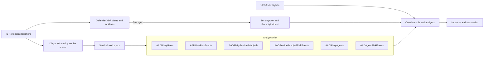

# Microsoft Entra ID Protection (risk detections)

> Status: verified. Priority: P1 (start here). Last verified: 21 Nov 2026.

## What it is

Microsoft Entra ID Protection continuously evaluates sign-ins, accounts and workload identities, and produces risk detections: leaked credentials, password spray, anomalous tokens, atypical travel, suspicious credential additions and more. Each detection carries a risk level and feeds risk-based Conditional Access. Its raw risk data lands in Sentinel through Entra diagnostic settings, and its alerts arrive in Defender XDR as incidents.

## Key recommendations

- Turn on the risk categories in the Entra diagnostic setting: RiskyUsers, UserRiskEvents, RiskyServicePrincipals, ServicePrincipalRiskEvents, RiskyAgents and AgentRiskEvents. The Microsoft Entra ID data connector streams them to Sentinel. The category names differ from the table names, so use the mapping below ([Microsoft Learn](https://learn.microsoft.com/en-us/entra/id-protection/howto-export-risk-data)).
- Don't buy content twice. ID Protection alerts already arrive through the Defender XDR connector into `SecurityAlert` and `SecurityIncident` at no ingestion charge. Skip the standalone Microsoft Entra ID Protection alerts connector unless you run Sentinel in the Azure portal without Defender XDR ([Microsoft Learn](https://learn.microsoft.com/en-us/azure/sentinel/microsoft-365-defender-sentinel-integration)).
- Enable the one out-of-box rule from the Microsoft Entra ID Protection solution, plus the day-1 sign-in rules from the Microsoft Entra ID solution. Microsoft's own detections cover most identity risk patterns, so add custom rules only for post-risk persistence joins.
- Full detection detail needs Entra ID P2. Without it, premium detections arrive titled Additional risk detected with no detection name, and the risk fields on `SigninLogs` read `hidden`.
- Service principal risk needs Microsoft Entra Workload ID Premium. Verify you hold it before promising workload identity coverage.

## High-value log sources

The risk tables arrive through the Microsoft Entra ID data connector. The alerts arrive through the Defender XDR connector. Both are billable and low volume, because rows only appear when something is flagged.

| Source | Table name | Connector | Tier | Cost / volume | Value |
|---|---|---|---|---|---|
| Risky users | `AADRiskyUsers` | Microsoft Entra ID | Analytics | Very low. One row per user risk state change | Current and historical risk state per user, with level and last update. The investigation starting point. |
| User risk detections | `AADUserRiskEvents` | Microsoft Entra ID | Analytics | Low. One row per detection | Detection type, level, IP, timing and the correlated sign-in request. The table detections read. |
| Risky service principals | `AADRiskyServicePrincipals` | Microsoft Entra ID | Analytics | Very low. Needs Workload ID Premium | Workload identity risk state, with app ID and service principal type. |
| Service principal risk detections | `AADServicePrincipalRiskEvents` | Microsoft Entra ID | Analytics | Very low. Needs Workload ID Premium | Detection detail per workload identity, including key IDs and IP. |
| Risky agents | `AADRiskyAgents` | Microsoft Entra ID | Analytics | Very low | Risk state for autonomous AI agents using Microsoft Entra Agent ID ([Microsoft Learn](https://learn.microsoft.com/en-us/entra/id-protection/concept-risk-detection-types)). |
| Agent risk detections | `AADAgentRiskEvents` | Microsoft Entra ID | Analytics | Very low | Detection detail per agent, with evidence and timing. |
| ID Protection alerts | `SecurityAlert` and `SecurityIncident` | Microsoft Defender XDR | Analytics, free | Free ingestion and sync, very low volume | Each detection also raises an alert, grouped into incidents and synced to Sentinel at no charge ([Microsoft Learn](https://learn.microsoft.com/en-us/azure/sentinel/microsoft-365-defender-sentinel-integration)). |
| Alert detail, optional | `AlertInfo` and `AlertEvidence` | Microsoft Defender XDR, Connect events | Analytics, charged | Low | Only worth streaming if your rules read the Defender alert schema rather than `SecurityAlert`. |

### Diagnostic setting categories versus table names

The names you tick in the diagnostic setting are not the names you query ([Microsoft Learn](https://learn.microsoft.com/en-us/entra/id-protection/howto-export-risk-data)).

| Category you enable | Table you query |
|---|---|
| RiskyUsers | `AADRiskyUsers` |
| UserRiskEvents | `AADUserRiskEvents` |
| RiskyServicePrincipals | `AADRiskyServicePrincipals` |
| ServicePrincipalRiskEvents | `AADServicePrincipalRiskEvents` |
| RiskyAgents | `AADRiskyAgents` |
| AgentRiskEvents | `AADAgentRiskEvents` |

## Prerequisites and licensing

| Item | Detail |
|---|---|
| Entra ID P2 | Required for risk policies, full risk reports, the Users at risk detected alert, the weekly digest and the Graph risk APIs. The capability table pairs P2 with Microsoft Entra Suite, and the detection licence notes reference the Microsoft 365 E5 with Enterprise Mobility + Security E5 bundle ([Microsoft Learn](https://learn.microsoft.com/en-us/entra/id-protection/overview-identity-protection)). |
| Without P2 | Risky users and risky sign-ins show limited information, no risk detail or level, and premium detections arrive as Additional risk detected, riskEventType `generic` ([Microsoft Learn](https://learn.microsoft.com/en-us/entra/id-protection/concept-identity-protection-risks)). |
| Nonpremium detections | Anonymous IP address, leaked credentials, Microsoft Entra threat intelligence and admin confirmed user compromised are available on Free and P1. Leaked credentials is always high risk ([Microsoft Learn](https://learn.microsoft.com/en-us/entra/id-protection/concept-identity-protection-risks)). |
| Defender sourced detections | Impossible travel, new country, mass access to sensitive files, suspicious inbox rules and forwarding, possible Primary Refresh Token access, suspicious sending patterns and Attacker in the Middle need P2 plus the matching Defender product licence, or Microsoft 365 E5 with EMS E5 ([Microsoft Learn](https://learn.microsoft.com/en-us/entra/id-protection/concept-identity-protection-risks)). |
| Workload identity risk | Risky service principals and service principal risk detections need Microsoft Entra Workload ID Premium ([Microsoft Learn](https://learn.microsoft.com/en-us/entra/id-protection/overview-identity-protection)). |
| Defender XDR connector | A Defender XDR licence and the Microsoft Defender XDR solution. If Sentinel is onboarded to the Defender portal, the connector is automatic ([Microsoft Learn](https://learn.microsoft.com/en-us/azure/sentinel/connect-microsoft-365-defender)). |
| Diagnostic settings | Security Administrator is the least privileged role to configure them for the Entra tenant ([Microsoft Learn](https://learn.microsoft.com/en-us/entra/id-protection/howto-export-risk-data)). |
| Retention in Entra | Risk reports stay 7 days on Free and 30 days on P1 or P2. Export is the only long term copy ([Microsoft Learn](https://learn.microsoft.com/en-us/entra/id-protection/howto-export-risk-data)). |

### Roles you need

| Task | Role |
|---|---|
| Configure diagnostic settings and alerts | Security Administrator |
| View risk reports | Security Reader, or Global Reader for read only |
| Dismiss risk, confirm safe or confirm compromised | Security Operator |
| Create risk based Conditional Access policies | Conditional Access Administrator |
| Connect the Microsoft Entra ID connector | Security Administrator on the tenant plus Microsoft Sentinel Contributor on the workspace |

Notification emails go to actively assigned Global Administrators, Security Administrators and Security Readers. PIM eligible users only get mail while elevated, and group assigned roles are not supported ([Microsoft Learn](https://learn.microsoft.com/en-us/entra/id-protection/howto-identity-protection-configure-notifications)).

## Step-by-step setup

1. **Confirm licensing.** Entra ID P2 for user risk, Workload ID Premium for service principal risk, Defender XDR for alerts. Without P2, do the setup anyway: you still get the nonpremium detections and the Entra retention problem is the same.
2. **Check how Sentinel runs.** If Sentinel is onboarded to the Defender portal, the Defender XDR connector is already enabled and ID Protection alerts already flow. Confirm by filtering alerts in the Defender portal: Incidents & alerts > Alerts > Product name filter, AAD Identity Protection ([Microsoft Learn](https://learn.microsoft.com/en-us/entra/id-protection/howto-identity-protection-investigate-risk)).
3. **Add the risk categories to the diagnostic setting.** Entra admin centre > Entra ID > Monitoring & health > Diagnostic settings > + Add diagnostic setting. Tick RiskyUsers, UserRiskEvents, RiskyServicePrincipals, ServicePrincipalRiskEvents, RiskyAgents and AgentRiskEvents. Choose Send to Log Analytics workspace, select the Sentinel workspace, Save. Allow about 15 minutes ([Microsoft Learn](https://learn.microsoft.com/en-us/entra/id-protection/howto-export-risk-data)). You can also tick these on the Microsoft Entra ID connector page in Sentinel.
4. **Do not enable the standalone alerts connector.** If you see Microsoft Entra ID Protection in the classic connector list, leave it disconnected when the Defender XDR connector is on, to avoid duplicate incidents. In Defender portal onboarded workspaces Microsoft disconnects it automatically ([Microsoft Learn](https://learn.microsoft.com/en-us/azure/sentinel/microsoft-365-defender-sentinel-integration)).
5. **Install the Microsoft Entra ID Protection solution.** Defender portal > Microsoft Sentinel > Content management > Content hub > search Microsoft Entra ID Protection > View details > Create.
6. **Enable UEBA.** The out-of-box rule joins `IdentityInfo`. Enable it from the Microsoft Entra ID connector page under Advanced options, or from the UEBA settings ([Microsoft Learn](https://learn.microsoft.com/en-us/azure/sentinel/configure-data-connector)).
7. **Configure notifications.** Entra admin centre > ID Protection > Dashboard > Users at risk detected alerts: set the level, High by default, and add recipients. Weekly digest sits on the same page ([Microsoft Learn](https://learn.microsoft.com/en-us/entra/id-protection/howto-identity-protection-configure-notifications)).
8. **Enable the out-of-box rule and the day-1 Entra ID rules.** See the next section. If you run the Defender XDR custom detection variant of the correlate rule, enable only that one.
9. **Generate or simulate detections.** The simulate risk page in ID Protection can produce test detections for some types ([Microsoft Learn](https://learn.microsoft.com/en-us/entra/id-protection/howto-identity-protection-simulate-risk)).
10. **Validate.** Run the queries below. Real-time detections surface in 5 to 10 minutes, offline detections can take up to 48 hours ([Microsoft Learn](https://learn.microsoft.com/en-us/entra/id-protection/concept-risk-detection-types)).

## Best-practice security configuration

Turn Entra ID Protection signals into automated Conditional Access controls rather than alert-only visibility. See [Microsoft recommended security configurations](../../docs/security-configurations.md).

- **User risk policy (Conditional Access):** Require a secure password change (plus MFA) on **High** user risk, and review **Medium** user risk for sensitive groups ([Risk policies](https://learn.microsoft.com/en-us/entra/id-protection/howto-identity-protection-configure-risk-policies)).
- **Sign-in risk policy (Conditional Access):** Require MFA (or block) on **Medium and High** sign-in risk so anomalous token or credential replay prompts immediate re-authentication.
- **Workload identity risk policy (if licensed):** Block or alert on **High** risk service principals and rotate app credentials immediately when flagged.
- **Keep risk policies in Conditional Access, not legacy ID Protection blades:** Manage risk policies in Conditional Access so exclusions, report-only testing and break-glass rules stay consistent.

## Architecture diagram



## Validation KQL

For group-wide and workspace-wide freshness checks, see [identity.kql](../../queries/validation/identity.kql) and the [validation query pack](../../queries/validation/README.md).

```kql
// 1. Are the risk tables landing, and how fresh?
union withsource=Table isfuzzy=true
    AADRiskyUsers, AADUserRiskEvents, AADRiskyServicePrincipals,
    AADServicePrincipalRiskEvents, AADRiskyAgents, AADAgentRiskEvents
| where TimeGenerated > ago(14d)
| summarize Rows = count(), Latest = max(TimeGenerated) by Table
| order by Table asc

// 2. Which detections does YOUR tenant produce, at what level?
AADUserRiskEvents
| where TimeGenerated > ago(30d)
| summarize Events = count(), Latest = max(TimeGenerated) by RiskEventType, RiskLevel
| order by Events desc

// 3. P2 check. All premium detections read as generic without P2.
AADUserRiskEvents
| where TimeGenerated > ago(30d)
| where RiskEventType == "generic"
| summarize GenericEvents = count()

// 4. Are ID Protection alerts arriving through Defender XDR?
// In Sentinel this is the value Microsoft's own correlate rule filters on.
SecurityAlert
| where TimeGenerated > ago(14d)
| where ProductName =~ "Azure Active Directory Identity Protection"
| summarize Alerts = count(), Latest = max(TimeGenerated) by AlertName
| order by Alerts desc

// 5. Current at-risk users by level
AADRiskyUsers
| where TimeGenerated > ago(1d)
| where RiskState == "atRisk"
| summarize Latest = max(TimeGenerated) by UserPrincipalName, RiskLevel
| order by RiskLevel desc

// 6. Cost: GB per table per day. Expect tiny numbers.
Usage
| where TimeGenerated > ago(30d)
| where DataType in ("AADRiskyUsers", "AADUserRiskEvents", "AADRiskyServicePrincipals",
                     "AADServicePrincipalRiskEvents", "AADRiskyAgents", "AADAgentRiskEvents")
| summarize GB = round(sum(Quantity) / 1024, 4) by DataType, Day = bin(TimeGenerated, 1d)
| summarize GBperDay = round(avg(GB), 4), TotalGB30d = round(sum(GB), 4) by DataType
```

Query 5 uses `RiskState` and `RiskLevel` values documented on the [`AADRiskyUsers` reference](https://learn.microsoft.com/en-us/azure/azure-monitor/reference/tables/aadriskyusers).

## Out-of-box analytic rules

The **Microsoft Entra ID Protection** solution ([solution folder](https://github.com/Azure/Azure-Sentinel/tree/master/Solutions/Microsoft%20Entra%20ID%20Protection)) ships exactly one analytic rule. From solution version 3.2.1, dated 15 October 2026, the same detection also ships as a disabled Defender XDR custom detection. Enable one format only.

| Rule | Detects | Tables | MITRE | Suggested |
|---|---|---|---|---|
| Correlate Unfamiliar sign-in properties & atypical travel alerts | An Unfamiliar sign-in properties alert and an Atypical travel alert about the same user within 10 minutes of each other | `SecurityAlert`, `IdentityInfo` | Initial Access T1078 | Enable day 1 |

The rule needs the ID Protection alerts connector as a data source and UEBA for `IdentityInfo`, so both prerequisites from the setup section apply.

### Why one rule is enough

The Microsoft detections themselves are the coverage. Each risk detection is an alert in Defender XDR before it is ever a row in Sentinel: anonymous IP, anomalous token, atypical travel, leaked credentials, password spray, suspicious browser, verified threat actor IP, suspicious credential addition and the rest ([detection catalogue](https://learn.microsoft.com/en-us/entra/id-protection/concept-identity-protection-risks)). The alert is the detection. Writing a Sentinel rule that re-alerts on every `AADUserRiskEvents` row duplicates what Defender XDR already gives you.

Two complements from the Microsoft Entra ID solution are worth enabling alongside:

| Rule | Detects | Tables | MITRE | Suggested |
|---|---|---|---|---|
| Password spray attack against Microsoft Entra ID application | Failures across many accounts from one IP, including successes | `SigninLogs`, `AADNonInteractiveUserSignInLogs` | Credential Access T1110 | Enable day 1 |
| MFA Spamming followed by Successful login | 10 MFA denials then a success inside 5 minutes | `SigninLogs` | Credential Access T1110 | Enable day 1 |
| Anomalous user app sign-in location increase | UEBA anomaly on sign-in location | `SigninLogs` and UEBA tables | Credential Access | Enable once UEBA is on |

For the MITRE view of the real-time detections, Microsoft maps anomalous token to T1539, unfamiliar sign-in properties and verified threat actor IP to T1078, and anonymous IP to T1090 ([dashboard mapping](https://learn.microsoft.com/en-us/entra/id-protection/id-protection-dashboard)).

## Custom detections

The out-of-box content covers risk raising and alerting. The gaps are joins between risk and what the attacker does next, and workload identity follow up. These are community-written rules, not Microsoft content. Anything unconfirmed carries an ASSUMPTION comment.

### C1. High risk user then a persistence change (High)

An attacker who just got into an account adds an authentication method or consents an app. The Entra ID solution covers MFA changes after suspicious sign-ins, but not the risk table join, which works even when no alert fired.

```kql
// CUSTOM - Risky user followed by a credential or consent change inside 3 days
// The actor extraction mirrors Microsoft's own AuditLogs rules.
// ASSUMPTION: OperationName values. Pin exact strings first:
//   AuditLogs | where TimeGenerated > ago(30d)
//   | where OperationName has "consent" or OperationName has "method" or OperationName has "credential"
//   | distinct OperationName
let risky = AADRiskyUsers
    | where TimeGenerated > ago(3d)
    | where RiskLevel in ("medium", "high") and RiskState == "atRisk"
    | summarize RiskSeen = max(TimeGenerated) by UserPrincipalName = tolower(UserPrincipalName);
AuditLogs
| where TimeGenerated > ago(3d)
| extend Actor = iff(isnotempty(tostring(InitiatedBy.user.userPrincipalName)),
                     tostring(InitiatedBy.user.userPrincipalName), tostring(InitiatedBy.app.displayName))
| extend UserPrincipalName = tolower(Actor)
| join kind=inner risky on UserPrincipalName
| where TimeGenerated > RiskSeen
| where OperationName has_any ("consent", "method", "credential", "role")
| project TimeGenerated, OperationName, Actor, RiskSeen, TargetResources
```

MITRE: Persistence T1098, account manipulation, and T1098.005, device registration or MFA registration abuse.

### C2. Risky service principal then sign-in or permission activity (High)

```kql
// CUSTOM - Service principal flagged risky then authenticating or gaining permissions
// ASSUMPTION: AuditLogs TargetResources carries the service principal identifier for
// permission grants to apps. Inspect a sample row before relying on the join.
let risky_sp = AADRiskyServicePrincipals
    | where TimeGenerated > ago(7d)
    | where RiskState == "atRisk"
    | summarize RiskSeen = max(TimeGenerated) by ServicePrincipalId = Id;
AADServicePrincipalSignInLogs
| where TimeGenerated > ago(7d)
| join kind=inner risky_sp on ServicePrincipalId
| where TimeGenerated > RiskSeen
| summarize SignIns = count(), FirstAfterRisk = min(TimeGenerated),
            IPs = make_set(IPAddress, 10), Resources = make_set(ResourceDisplayName, 10)
            by ServicePrincipalId, ServicePrincipalName
```

MITRE: Valid Accounts T1078.004 and Steal or Forge Authentication Certificates, credential use against the flagged workload identity.

### C3. Leaked credentials still at risk days later (Medium)

Leaked credentials is always high risk and available without P2. A cloud password reset fully remediates it. A user still at risk days later means the reset never happened, or the attacker changed the password first.

```kql
// CUSTOM - Leaked credentials detection with no remediation after 24 hours
// ASSUMPTION: RiskEventType stores the Graph riskEventType string, leakedCredentials.
// The catalogue documents the value for the Graph API. Verify against a sample row.
AADUserRiskEvents
| where TimeGenerated > ago(7d)
| where RiskEventType == "leakedCredentials"
| summarize FirstSeen = min(TimeGenerated), LatestState = arg_max(TimeGenerated, RiskState)
            by UserPrincipalName, UserId
| where LatestState == "atRisk" and FirstSeen < ago(24h)
| project FirstSeen, UserPrincipalName, UserId
```

MITRE: Valid Accounts T1078. The fix is a password reset plus session revocation, which is exactly what the shipped playbooks do.

## Playbooks

Three ship with the Microsoft Entra ID Protection solution ([playbook folder](https://github.com/Azure/Azure-Sentinel/tree/master/Solutions/Microsoft%20Entra%20ID%20Protection/Playbooks)). All need Entra ID P2 and permissions on the ID Protection Graph API to authorise the playbook connection.

| Playbook | What it does | Notes |
|---|---|---|
| Confirm-EntraIDRiskyUser | Confirms the risky user as compromised via the Graph riskyUsers API | Incident or alert trigger |
| Dismiss-EntraIDRiskyUser | Dismisses the risky user risk via the Graph API | Use only after investigation, it clears the signal |
| IdentityProtection-TeamsBotResponse | Posts an adaptive card in the SOC Teams channel with the risky user detail, offering confirm compromised or dismiss, then comments the action on the incident | Needs the Teams group and channel IDs. Good governed containment |

For full containment, pair them with the Microsoft Entra ID solution playbooks: Revoke-AADSignInSessions, Reset-AADUserPassword and Block-AADUser. Confirm compromised before revoking sessions, so the risk state survives as evidence.

## Workbooks and hunting

| Item | Source | Use |
|---|---|---|
| Impact analysis of risk-based access policies workbook | ID Protection, Entra admin centre | Where risk is evident in your tenant and which risk policies to enable ([Microsoft Learn](https://learn.microsoft.com/en-us/entra/id-protection/workbook-risk-based-policy-impact)) |
| ID Protection dashboard | Entra admin centre, ID Protection > Dashboard | Attacks blocked, users protected, mean time to remediate, high risk user counts, a MITRE-tagged attack graphic and risky sign-in map ([Microsoft Learn](https://learn.microsoft.com/en-us/entra/id-protection/id-protection-dashboard)) |
| Microsoft Entra ID sign-ins and audit workbooks | Microsoft Entra ID solution in Sentinel | Sign-in failures and directory changes around a risky user |
| UEBA Essentials hunting queries | Content Hub | Anomaly hunting on the same identity data ([catalog](https://learn.microsoft.com/en-us/azure/sentinel/sentinel-solutions-catalog)) |

No hunting queries ship with the ID Protection solution. The investigation loop Microsoft documents runs from a risky user to the sign-in logs: same IP, geography, app, device and user agent, then out to what was accessed ([Microsoft Learn](https://learn.microsoft.com/en-us/entra/id-protection/howto-identity-protection-investigate-risk)).

## Gotchas and deprecations

- **Alerts belong to the Defender XDR connector.** When Sentinel is onboarded to the Defender portal, the XDR connector is automatic and the standalone ID Protection alerts connector is disconnected in the background. Enabling both, or re-enabling Microsoft incident creation rules for XDR-integrated products, creates duplicate incidents. Incident titles also can't be predetermined with the XDR connector, so key automation rules off tags, not names ([Microsoft Learn](https://learn.microsoft.com/en-us/azure/sentinel/microsoft-365-defender-sentinel-integration)).
- **P2 gates the detail, not just the feature.** Without P2 you still get rows, but premium detections read `generic` and the risk fields on `SigninLogs` read `hidden`. Check validation query 3 before you trust the data.
- **Workload identity risk needs its own licence.** `AADRiskyServicePrincipals` and `AADServicePrincipalRiskEvents` don't stream without Workload ID Premium ([Microsoft Learn](https://learn.microsoft.com/en-us/azure/sentinel/connect-azure-active-directory)).
- **Two speeds.** Real-time detections surface in 5 to 10 minutes. Offline detections, leaked credentials among them, can take up to 48 hours. Risk levels can change after the sign-in as offline processing completes ([Microsoft Learn](https://learn.microsoft.com/en-us/entra/id-protection/concept-risk-detection-types)).
- **The tables are state changes, not a feed.** `AADRiskyUsers` records risk as it moves: at risk, remediated, dismissed, confirmed. Don't count rows as incidents, query the latest state per user instead.
- **Low risk ages out.** Low level detections and users persist six months then disappear from the product. Medium and high persist until remediated or dismissed ([Microsoft Learn](https://learn.microsoft.com/en-us/entra/id-protection/concept-risk-detection-types)).
- **No backfill.** Log Analytics sees risk data only from the moment the diagnostic setting was enabled, and Entra keeps reports 30 days on P1 and P2. Export early.
- **Agent tables don't support workspace transformations.** `AADRiskyAgents` and `AADAgentRiskEvents` are the two tables here without DCR transformation support, per their table references. It rarely matters at these volumes.
- **On-behalf-of risk lands on the user.** Where an agent acts on a user's delegated permissions, risky activity is attributed to the user, not the agent ([Microsoft Learn](https://learn.microsoft.com/en-us/entra/id-protection/concept-risk-detection-types)).
- **Unified risk signals need Defender for Identity.** Correlating ID Protection and Defender risk into one compounded score requires Defender for Identity configured ([Microsoft Learn](https://learn.microsoft.com/en-us/entra/id-protection/id-protection-dashboard)).
- **Sentinel in the Azure portal retires on 31 March 2027.** Build and test in the Defender portal ([Microsoft Learn](https://learn.microsoft.com/en-us/azure/sentinel/microsoft-sentinel-defender-portal)).

## Official links

- [Export and use Microsoft Entra ID Protection data](https://learn.microsoft.com/en-us/entra/id-protection/howto-export-risk-data)
- [What is Microsoft Entra ID Protection](https://learn.microsoft.com/en-us/entra/id-protection/overview-identity-protection)
- [What are risk detections, detection catalogue](https://learn.microsoft.com/en-us/entra/id-protection/concept-identity-protection-risks)
- [Risk detection types and levels](https://learn.microsoft.com/en-us/entra/id-protection/concept-risk-detection-types)
- [Investigate risk with Microsoft Entra ID Protection](https://learn.microsoft.com/en-us/entra/id-protection/howto-identity-protection-investigate-risk)
- [Configure Microsoft Entra ID Protection notifications](https://learn.microsoft.com/en-us/entra/id-protection/howto-identity-protection-configure-notifications)
- [Microsoft Entra ID Protection dashboard](https://learn.microsoft.com/en-us/entra/id-protection/id-protection-dashboard)
- [Impact analysis of risk-based access policies workbook](https://learn.microsoft.com/en-us/entra/id-protection/workbook-risk-based-policy-impact)
- [Simulate risk detections](https://learn.microsoft.com/en-us/entra/id-protection/howto-identity-protection-simulate-risk)
- [Send Microsoft Entra ID data to Microsoft Sentinel](https://learn.microsoft.com/en-us/azure/sentinel/connect-azure-active-directory)
- [Find your Microsoft Sentinel data connector](https://learn.microsoft.com/en-us/azure/sentinel/data-connectors-reference)
- [Stream data from Microsoft Defender XDR to Microsoft Sentinel](https://learn.microsoft.com/en-us/azure/sentinel/connect-microsoft-365-defender)
- [Microsoft Defender XDR integration with Microsoft Sentinel](https://learn.microsoft.com/en-us/azure/sentinel/microsoft-365-defender-sentinel-integration)
- [AADRiskyUsers table reference](https://learn.microsoft.com/en-us/azure/azure-monitor/reference/tables/aadriskyusers)
- [AADUserRiskEvents table reference](https://learn.microsoft.com/en-us/azure/azure-monitor/reference/tables/aaduserriskevents)
- [AADRiskyServicePrincipals table reference](https://learn.microsoft.com/en-us/azure/azure-monitor/reference/tables/aadriskyserviceprincipals)
- [AADServicePrincipalRiskEvents table reference](https://learn.microsoft.com/en-us/azure/azure-monitor/reference/tables/aadserviceprincipalriskevents)
- [AADRiskyAgents table reference](https://learn.microsoft.com/en-us/azure/azure-monitor/reference/tables/aadriskyagents)
- [AADAgentRiskEvents table reference](https://learn.microsoft.com/en-us/azure/azure-monitor/reference/tables/aadagentriskevents)
- [Microsoft Entra ID Protection solution, Azure-Sentinel repo](https://github.com/Azure/Azure-Sentinel/tree/master/Solutions/Microsoft%20Entra%20ID%20Protection)
- [Enable a data connector, Defender portal navigation](https://learn.microsoft.com/en-us/azure/sentinel/configure-data-connector)
- [Microsoft Sentinel in the Defender portal](https://learn.microsoft.com/en-us/azure/sentinel/microsoft-sentinel-defender-portal)

## Last verified

21 Nov 2026, against Microsoft Learn, the Azure Monitor table references and the Azure-Sentinel repo. Re-verify before relying on table names, navigation or rule names.
