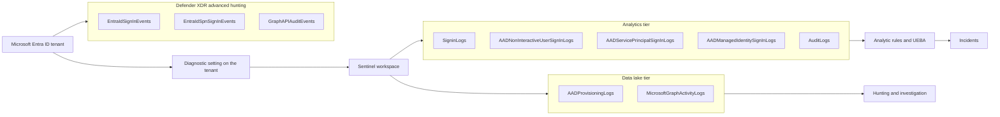

# Microsoft Entra ID (sign-in, audit and Graph activity logs)

> Status: verified. Priority: P1 (start here). Last verified: 28 Nov 2026.

## What it is

Microsoft Entra ID is the identity provider for Microsoft 365, Azure and most SaaS in the tenant. Its activity logs record every authentication, interactive or token based, and every directory change, from role assignments to OAuth consent grants. They back almost every identity detection. The same events are also exposed in Defender XDR advanced hunting.

## Key recommendations

- Install the **Microsoft Entra ID** solution from Content Hub and connect the Microsoft Entra ID data connector. One connector streams sign-in, audit, provisioning and risk logs into Sentinel ([Microsoft Learn](https://learn.microsoft.com/en-us/azure/sentinel/connect-azure-active-directory)).
- Put interactive sign-ins, directory audit and workload identity sign-ins in the Analytics tier on day 1 and enable the out-of-box rules. Low volume, high value.
- Decide the tier for non-interactive sign-ins deliberately. The table is huge, but the password spray and Conditional Access bypass rules read it. Start in Analytics, measure GB after a week, then add a workspace transformation or move hunt-only data to the data lake tier.
- Microsoft Graph activity logs don't come through the standard connector. Turn them on with a diagnostic setting in the Entra admin centre and send them to the data lake tier unless you write rules on them ([Microsoft Learn](https://learn.microsoft.com/en-us/graph/microsoft-graph-activity-logs-overview)).
- Don't pay twice. On Entra ID P2, `EntraIdSignInEvents`, `EntraIdSpnSignInEvents` and `GraphAPIAuditEvents` are already in Defender XDR advanced hunting at no ingestion cost, with 30 days retention ([Microsoft Learn](https://learn.microsoft.com/en-us/defender-xdr/advanced-hunting-schema-tables)). Use Sentinel for rules, correlation and long retention.
- Enable UEBA from the connector page. The Entra sign-in and audit tables feed the behavioural baselines that the anomaly rules depend on ([Microsoft Learn](https://learn.microsoft.com/en-us/azure/sentinel/ueba-reference)).

## High-value log sources

All tables below arrive through the Microsoft Entra ID data connector, which writes a diagnostic setting on the Entra tenant. Microsoft Graph activity logs are the exception: Microsoft documents them as a diagnostic setting configured in the Entra admin centre, not a workspace connector. All of these tables are billable Sentinel ingestion.

| Source | Table name | Connector | Tier | Cost / volume | Value |
|---|---|---|---|---|---|
| Interactive user sign-ins | `SigninLogs` | Microsoft Entra ID | Analytics | Low to medium. One row per interactive sign-in | Every authentication with MFA detail, Conditional Access outcome, device, location and risk fields. The table most identity rules read. |
| Non-interactive user sign-ins | `AADNonInteractiveUserSignInLogs` | Microsoft Entra ID | Analytics, decide deliberately | High. One row per token redemption on a user's behalf. Often the biggest Entra table | Stolen token and refresh token use. ID Protection says unfamiliar non-interactive sign-ins deserve extra scrutiny because of token replay risk ([Microsoft Learn](https://learn.microsoft.com/en-us/entra/id-protection/concept-identity-protection-risks)). |
| Service principal sign-ins | `AADServicePrincipalSignInLogs` | Microsoft Entra ID | Analytics | Medium to high. One row per app-only authentication | App credential abuse: which app, which credential, from where, to what resource. A UEBA data source. |
| Managed identity sign-ins | `AADManagedIdentitySignInLogs` | Microsoft Entra ID | Analytics | Low to medium | Azure resource identities. Small in most tenants, cheap to keep. |
| Directory audit | `AuditLogs` | Microsoft Entra ID | Analytics | Low | Role and group changes, app registrations, consent grants, Conditional Access policy changes, user admin. The consent and privilege rules read this. |
| Provisioning | `AADProvisioningLogs` | Microsoft Entra ID | Data lake, or Analytics if you alert on it | Low to medium | Who was created, changed or removed in each connected SaaS app. Mostly investigation value. |
| Microsoft Graph activity | `MicrosoftGraphActivityLogs` | Entra diagnostic setting in the Entra admin centre, not the standard connector | Data lake | High. Microsoft estimates about 15 GiB per month per 1,000 users, about 1,200 GiB per month at 100,000 users ([Microsoft Learn](https://learn.microsoft.com/en-us/graph/microsoft-graph-activity-logs-overview)) | Every Graph HTTP request: URI, method, app, caller, status. App abuse and recon hunting. Can't be filtered at the diagnostic setting, transform at the workspace instead. |
| AD FS sign-ins, if federated | `ADFSSignInLogs` | Microsoft Entra ID | Analytics | Low | On-premises federation sign-ins. Skip if you don't run AD FS. |
| Defender XDR user sign-in view | `EntraIdSignInEvents` | None, already in advanced hunting | Already in Defender XDR | Free, 30 days. Needs Entra ID P2 ([Microsoft Learn](https://learn.microsoft.com/en-us/defender-xdr/advanced-hunting-entraidsigninevents-table)) | Interactive and non-interactive sign-ins for hunting without Sentinel ingestion. |
| Defender XDR workload view | `EntraIdSpnSignInEvents` | None, already in advanced hunting | Already in Defender XDR | Free, 30 days. Needs Entra ID P2 ([Microsoft Learn](https://learn.microsoft.com/en-us/defender-xdr/advanced-hunting-entraidspnsigninevents-table)) | Service principal and managed identity sign-ins in the same place. |
| Defender XDR Graph view | `GraphAPIAuditEvents` | None, already in advanced hunting | Already in Defender XDR | Free, 30 days | Graph API requests in advanced hunting. Needs verification: not confirmed whether it populates without the Graph activity diagnostic setting enabled. Check in your tenant. |

The connector also offers `NetworkAccessTraffic`, `RemoteNetworkHealthLogs` and the enriched Microsoft 365 audit logs. Those belong to Global Secure Access and sit in their own guide.

### What to ingest first

| Priority | Table | Why | Rough volume | Tier |
|---|---|---|---|---|
| 1 | `SigninLogs` + `AuditLogs` | Every rule reads them. Activity logging is on by default, there's no audit switch to enable | Low to medium | Analytics |
| 2 | `AADServicePrincipalSignInLogs` + `AADManagedIdentitySignInLogs` | Workload identity abuse and UEBA baselines | Medium | Analytics |
| 3 | `AADNonInteractiveUserSignInLogs` | Token replay, Conditional Access bypass, password spray rules | High, measure before committing | Analytics, review after a week |
| 4 | `MicrosoftGraphActivityLogs` | App abuse and recon hunting | High | Data lake |
| 5 | `AADProvisioningLogs` | Provisioning investigation | Low | Data lake |
| Skip | `ADFSSignInLogs` if not federated, Global Secure Access tables | No value in your tenant, or another guide | | |

Microsoft's Zero Trust workshop guidance lists audit, sign-in, service principal, managed identity and AD FS logs as the minimum Entra export, with non-interactive, provisioning and Graph activity logs as a deliberate second tier for retention cost reasons ([Zero Trust workshop](https://microsoft.github.io/zerotrustassessment/docs/workshop-guidance/identity/RMI_074)).

## Prerequisites and licensing

| Item | Detail |
|---|---|
| Entra licence, activity logs | Any Microsoft Entra ID licence, including Free and the Microsoft 365 plans, is enough to stream audit, provisioning and AD FS logs into Sentinel ([Microsoft Learn](https://learn.microsoft.com/en-us/azure/sentinel/connect-azure-active-directory)). |
| Entra licence, sign-in logs | Microsoft Entra ID P1 or P2 is required to ingest sign-in logs into Sentinel. That covers interactive, non-interactive, service principal and managed identity sign-ins. |
| Risk fields on sign-ins | `RiskLevelAggregated`, `RiskLevelDuringSignIn` and `RiskDetail` are only populated for P2 tenants. Everyone else gets `hidden` ([table reference](https://learn.microsoft.com/en-us/azure/azure-monitor/reference/tables/signinlogs)). |
| Workload identity risk | `AADRiskyServicePrincipals` and `AADServicePrincipalRiskEvents` need Microsoft Entra Workload ID Premium to stream to Sentinel ([Microsoft Learn](https://learn.microsoft.com/en-us/azure/sentinel/connect-azure-active-directory)). |
| Microsoft Graph activity logs | A Microsoft Entra ID P1 or P2 tenant licence ([Microsoft Learn](https://learn.microsoft.com/en-us/graph/microsoft-graph-activity-logs-overview)). |
| Defender XDR Entra tables | `EntraIdSignInEvents` and `EntraIdSpnSignInEvents` need Entra ID P2 ([Microsoft Learn](https://learn.microsoft.com/en-us/defender-xdr/advanced-hunting-entraidsigninevents-table)). |
| Sentinel | A workspace with Sentinel enabled. Entra tables are billable ingestion. Analytics tier data mirrors to the data lake at the same retention for no extra cost ([Microsoft Learn](https://learn.microsoft.com/en-us/azure/sentinel/configure-data-connector)). |

### Roles you need

| Task | Role |
|---|---|
| Install the solution and create rules | Microsoft Sentinel Contributor on the resource group ([Microsoft Learn](https://learn.microsoft.com/en-us/azure/sentinel/sentinel-solutions-deploy)) |
| Connect the Microsoft Entra ID connector | Security Administrator on the tenant, plus Microsoft Sentinel Contributor on the workspace, plus read and write on the Entra diagnostic settings to see connection status ([Microsoft Learn](https://learn.microsoft.com/en-us/azure/sentinel/connect-azure-active-directory)) |
| Create or edit diagnostic settings in the Entra admin centre | Security Administrator is the least privileged role for Entra diagnostic settings ([Microsoft Learn](https://learn.microsoft.com/en-us/entra/identity/monitoring-health/howto-integrate-activity-logs-with-azure-monitor-logs)) |
| Read sign-in and audit logs | Reports Reader is the least privileged role for the sign-in and audit log views ([Microsoft Learn](https://learn.microsoft.com/en-us/entra/id-protection/howto-identity-protection-investigate-risk)) |

## Step-by-step setup

1. **Confirm the workspace.** Create or choose a Log Analytics workspace with Sentinel enabled, onboarded to the Defender portal.
2. **Install the Microsoft Entra ID solution.** Defender portal > Microsoft Sentinel > Content management > Content hub. Search for Microsoft Entra ID, select View details, then Create. Needs Microsoft Sentinel Contributor at the resource group level ([Microsoft Learn](https://learn.microsoft.com/en-us/azure/sentinel/sentinel-solutions-deploy)).
3. **Open the connector.** Defender portal > Setup & configuration > Data management > Data & connectors > Connectors tab > Classic connectors - Microsoft Sentinel. Select Microsoft Entra ID, then Open connector page ([Microsoft Learn](https://learn.microsoft.com/en-us/azure/sentinel/configure-data-connector)).
4. **Mark the log types and connect.** Tick Audit logs, Sign-in logs, Non-interactive user sign-in logs, Service principal sign-in logs, Managed Identity sign-in logs and Provisioning logs. Tick the risk categories if you hold the licences. The connector writes a diagnostic setting on the Entra tenant.
5. **Set tier and retention.** On the connector page, in Table management, select each table and set the Analytics retention, then choose data lake mirroring or data lake only. Data lake only stops Analytics ingestion, so keep any table a rule reads in Analytics.
6. **Turn on Microsoft Graph activity logs.** Entra admin centre > Entra ID > Monitoring & health > Diagnostic settings > + Add diagnostic setting. Tick MicrosoftGraphActivityLogs, choose Send to Log Analytics workspace, select your workspace, Save. Sign in as at least a Security Administrator. You can also reach this page from Export settings on the Sign-ins or Audit logs page ([Microsoft Learn](https://learn.microsoft.com/en-us/entra/identity/monitoring-health/howto-integrate-activity-logs-with-azure-monitor-logs)).
7. **Enable UEBA.** Back on the connector page, select Advanced options, then Configure UEBA, and toggle the Entra tables on. The rule in the ID Protection solution that joins `IdentityInfo` needs this ([Microsoft Learn](https://learn.microsoft.com/en-us/azure/sentinel/configure-data-connector)).
8. **Generate test events.** Sign in to a Microsoft 365 app, run a Graph query in a portal, and consent a throwaway test app so `AuditLogs` carries a Consent to application row.
9. **Validate.** Run the validation queries below from the Defender portal under Investigation & response > Advanced hunting, with your Sentinel workspace selected. Sign-in and audit events usually land within about 15 minutes. Graph activity events mostly arrive within 30 minutes, up to 2 hours.
10. **Enable the day-1 rules.** See the next section, then run validation query 5 after a week to review cost.

## Best-practice security configuration

Lock down the identity plane alongside logging so stolen passwords and illicit consent grants fail before reaching data. See all product baselines in [Microsoft recommended security configurations](../../docs/security-configurations.md).

- **Phishing-resistant MFA & Conditional Access:** Require MFA for all users (phishing-resistant FIDO2/passkey or Windows Hello for Business for admins), block legacy authentication protocols, and require compliant or hybrid-joined devices for sensitive apps ([Plan Conditional Access](https://learn.microsoft.com/en-us/entra/identity/conditional-access/plan-conditional-access)).
- **Privileged Identity Management (PIM):** Keep all privileged Entra roles (Global Admin, Security Admin, Privileged Role Admin) eligible rather than permanently active, with MFA, approval and time-bound activation ([PIM overview](https://learn.microsoft.com/en-us/entra/id-governance/privileged-identity-management/pim-configure)).
- **Break-glass emergency accounts:** Maintain two cloud-only emergency access accounts excluded from Conditional Access, protected with FIDO2 hardware keys and monitored by a high-severity alert on any sign-in ([Emergency access accounts](https://learn.microsoft.com/en-us/entra/identity/role-based-access-control/security-emergency-access)).
- **Lock down user OAuth consent:** Disable unrestricted end-user app consent and require admin consent workflows for third-party apps ([Configure user consent](https://learn.microsoft.com/en-us/entra/identity/enterprise-apps/configure-user-consent)).

## Architecture diagram



## Validation KQL

For group-wide and workspace-wide freshness checks, see [identity.kql](../../queries/validation/identity.kql) and the [validation query pack](../../queries/validation/README.md).

```kql
// 1. Are all seven tables landing, and how fresh?
// Tables set to data lake only don't appear in the workspace union. Query those in
// Data lake explorer, or check the connector page's data received graph instead.
union withsource=Table isfuzzy=true
    SigninLogs, AADNonInteractiveUserSignInLogs, AADServicePrincipalSignInLogs,
    AADManagedIdentitySignInLogs, AuditLogs, AADProvisioningLogs, MicrosoftGraphActivityLogs
| where TimeGenerated > ago(1d)
| summarize Rows = count(), Latest = max(TimeGenerated) by Table
| order by Table asc

// 2. Freshness check. Sign-in and audit tables should be minutes old.
SigninLogs
| summarize Latest = max(TimeGenerated), AgeMinutes = (now() - max(TimeGenerated)) / 1m

// 3. Are the risk fields populated? P2 only. If every row says hidden, you are not licensed.
SigninLogs
| where TimeGenerated > ago(1d)
| summarize HiddenRows = countif(RiskLevelDuringSignIn == "hidden"),
            LowOrHigher = countif(RiskLevelDuringSignIn in ("low", "medium", "high"))
    by bin(TimeGenerated, 1d)

// 4. What non-interactive event types does YOUR tenant emit? Pin before writing rules.
AADNonInteractiveUserSignInLogs
| where TimeGenerated > ago(7d)
| summarize Events = count() by SignInEventTypes
| order by Events desc

// 5. Cost: GB per table per day
Usage
| where TimeGenerated > ago(30d)
| where DataType in ("SigninLogs", "AADNonInteractiveUserSignInLogs", "AADServicePrincipalSignInLogs",
                     "AADManagedIdentitySignInLogs", "AuditLogs", "AADProvisioningLogs", "MicrosoftGraphActivityLogs")
| summarize GB = round(sum(Quantity) / 1024, 2) by DataType, Day = bin(TimeGenerated, 1d)
| summarize GBperDay = round(avg(GB), 2), TotalGB30d = round(sum(GB), 2) by DataType
| order by GBperDay desc

// 6. Defender XDR side. Run in advanced hunting without a workspace, or with Defender XDR selected.
EntraIdSignInEvents
| where Timestamp > ago(1d)
| take 5
```

## Out-of-box analytic rules

From the **Microsoft Entra ID** solution in Content Hub ([solution folder](https://github.com/Azure/Azure-Sentinel/tree/master/Solutions/Microsoft%20Entra%20ID)). It ships about 70 rules, including a full Conditional Access change series and a Defender XDR custom detection version of each rule. Pick one format per rule, Sentinel or Defender XDR, to avoid duplicate alerts. MITRE technique IDs below come from the rule YAML.

### Day-1 rules

| Rule | Detects | Tables | MITRE | Suggested |
|---|---|---|---|---|
| Password spray attack against Microsoft Entra ID application | Failures across many accounts from one IP in a window, with detail on any successes | `SigninLogs`, `AADNonInteractiveUserSignInLogs` | Credential Access T1110 | Enable day 1 |
| MFA Spamming followed by Successful login | 10 MFA denials then a success inside 5 minutes | `SigninLogs` | Credential Access T1110 | Enable day 1 |
| Suspicious application consent similar to O365 Attack Toolkit | Consent to an app asking for the toolkit's permission set | `AuditLogs` | Credential Access T1528, T1550 | Enable day 1 |
| Rare application consent | Consent to application by a user who never or rarely consents | `AuditLogs` | Persistence T1136, T1068 | Enable day 1 |
| End-user consent to app with mailbox and offline access delegated scopes | Illicit consent grant for mailbox scopes by a non-admin | `AuditLogs` | Credential Access | Enable day 1 |
| Credential added after admin consented to Application | Service principal credential added by one user after another consented | `AuditLogs` | Credential Access T1555, T1098 | Enable day 1 |
| Microsoft Entra ID Role Management Permission Grant | RoleManagement.ReadWrite.Directory granted to a service principal | `AuditLogs` | Persistence | Enable day 1 |
| Suspicious Service Principal creation activity | SPN created, permissioned, credentialed, used and deleted inside 10 minutes | `AuditLogs`, `AADServicePrincipalSignInLogs` | Credential Access and Privilege Escalation T1078, T1528 | Enable day 1 |
| NRT Privileged Role Assigned Outside PIM | Privileged role assigned outside PIM | `AuditLogs` | Privilege Escalation T1078.004 | Enable day 1 |
| Attempt to bypass conditional access rule in Microsoft Entra ID | Sign-ins with a Conditional Access bypass or unsatisfied status | `SigninLogs`, `AADNonInteractiveUserSignInLogs` | Initial Access T1078, T1098 | Enable, tune thresholds |
| GitHub Signin Burst from Multiple Locations | Sign-in burst across locations via Entra SSO to GitHub | `SigninLogs`, `AADNonInteractiveUserSignInLogs` | Credential Access | Enable, tune |
| Suspicious application consent for offline access | Consent granting offline access to an unknown app | `AuditLogs` | Credential Access | Enable, tune |

### Also in the solution

Names verified in the solution folder. Read the rule before enabling.

- The Conditional Access series: policy created, deleted, disabled, updated, put into report-only mode, app and user group role exclusions changed, device platform condition changed.
- Suspicious sign-in followed by MFA modification, and authentication methods changed for a privileged account.
- Bulk changes to privileged account permissions, user assigned a new privileged role, PIM elevation request rejected.
- Sign-in attempts by IP via disabled accounts, and privileged accounts sign-in failure spikes.
- Anomalous user app sign-in location increase, the UEBA anomaly rule. Enable UEBA first or it returns nothing.
- AD FS rules: domain trust modifications and password spray against AD FS.

For hunting content, the UEBA Essentials solution ships hunting queries on top of the same tables ([content hub catalog](https://learn.microsoft.com/en-us/azure/sentinel/sentinel-solutions-catalog)).

## Custom detections

These are community-written rules, not Microsoft content. Run them hourly with a 1-hour lookback unless noted. Anything unconfirmed carries an ASSUMPTION comment.

### C1. Refresh token replay across countries (High)

ID Protection's atypical travel covers this for P2 tenants. This rule is the fallback for P1 tenants and also catches replay where risk didn't fire. It reads non-interactive sign-ins because a stolen refresh token is used silently, with no interactive prompt.

```kql
// CUSTOM - Non-interactive sign-ins for one user from many countries inside an hour
// ASSUMPTION: Location holds the two letter country code, as documented for SigninLogs.
// Inspect one sample row before enabling.
AADNonInteractiveUserSignInLogs
| where TimeGenerated > ago(1h)
| where isnotempty(Location)
| summarize Countries = dcount(Location), SampleCountries = make_set(Location, 8),
            IPs = dcount(IPAddress), Apps = dcount(AppId)
            by UserPrincipalName, Hour = bin(TimeGenerated, 1h)
| where Countries >= 3
| project Hour, UserPrincipalName, Countries, SampleCountries, IPs, Apps
```

Tune the threshold against your VPN and SSO proxy patterns. Microsoft maps anomalous token to MITRE T1539 and the replay pattern sits with T1550, use of alternate authentication material ([MITRE mapping](https://learn.microsoft.com/en-us/entra/id-protection/id-protection-dashboard)).

### C2. Dormant service principal suddenly active (Medium, High if new country)

```kql
// CUSTOM - Service principal with no successful sign-ins for 60 days suddenly signs in
// ASSUMPTION: ResultType 0 means success, matching the documented SigninLogs convention.
// Confirm with a sample before enabling.
let baseline = AADServicePrincipalSignInLogs
    | where TimeGenerated between (ago(60d) .. ago(1d))
    | where ResultType == "0"
    | summarize LastSeen = max(TimeGenerated) by ServicePrincipalId;
AADServicePrincipalSignInLogs
| where TimeGenerated > ago(1d)
| where ResultType == "0"
| join kind=leftanti baseline on ServicePrincipalId
| summarize FirstSeen = min(TimeGenerated), SignIns = count(),
            IPs = make_set(IPAddress, 10), Resources = make_set(ResourceDisplayName, 10)
            by ServicePrincipalId, ServicePrincipalName
```

A dormant app waking up is often a decommissioned integration left with valid credentials, sometimes a compromised one. MITRE: Initial Access and Persistence, valid accounts T1078.004.

### C3. Consent or app permission grant outside the approved list (Medium)

Microsoft's Rare application consent rule describes Consent to application, Add service principal and Add OAuth2PermissionGrant as typically rare events. This adds an allow list of who may consent at all.

```kql
// CUSTOM - OAuth consent or grant by someone outside the approved admin list
// The extraction pattern mirrors Microsoft's own consent rules: user UPN if present, app name otherwise.
// ASSUMPTION: OperationName values. Pin exact strings first:
//   AuditLogs | where TimeGenerated > ago(30d)
//   | where OperationName has "consent" or OperationName has "OAuth2" or OperationName has "service principal"
//   | distinct OperationName
let approved_admins = dynamic(["id-admin@yourdomain.gov.au"]);
AuditLogs
| where TimeGenerated > ago(1d)
| where OperationName in ("Consent to application", "Add OAuth2PermissionGrant", "Add service principal")
| extend Actor = iff(isnotempty(tostring(InitiatedBy.user.userPrincipalName)),
                     tostring(InitiatedBy.user.userPrincipalName), tostring(InitiatedBy.app.displayName))
| where Actor !in~ (approved_admins)
| project TimeGenerated, OperationName, Actor, TargetResources, Result
```

Feed approved_admins from a watchlist of PIM-eligible Identity Administrators. MITRE: Persistence T1098 and T1528, steal or forge app access tokens.

### Covered out of the box

Impossible travel needs no custom rule. ID Protection covers it with unlikelyTravel and mcasImpossibleTravel for P2 tenants, the burst rule and the UEBA anomaly rule cover the Sentinel side, and the O365 toolkit consent rule covers the classic illicit grant.

## Playbooks

All four ship with the Microsoft Entra ID solution, with incident, alert and entity trigger variants. Assign Microsoft Sentinel Responder to the playbook's managed identity after deployment ([playbook folder](https://github.com/Azure/Azure-Sentinel/tree/master/Solutions/Microsoft%20Entra%20ID/Playbooks)).

| Playbook | What it does | Notes |
|---|---|---|
| Block-AADUser | Disables the user in Entra ID, comments on the incident, notifies the user's manager | Can't disable users with active or eligible admin roles. Use the admin-capable variant for those |
| Reset-AADUserPassword | Resets the password via Graph, sends the temporary password to the user's manager, user must change it at next sign-in | Password Administrator for regular users, Global Administrator for admins too |
| Revoke-AADSignInSessions | Revokes all sign-in sessions via Graph, emails the user's manager | Entity trigger recommended |
| Prompt-User | Asks the user if they did the action. If yes, closes the incident with a comment. If no, posts to Teams for the SOC | Good first automation while you build trust in the rules |

Suggested custom chain: on a high-severity identity incident, revoke sessions, require a password reset, then block, each behind an approval. Automating containment on a privileged account risks locking out your own admins, so keep an approved break glass path.

## Workbooks and hunting

Shipped with the solution and opened from the solution's Manage page in Content hub:

| Workbook | Use |
|---|---|
| Microsoft Entra ID audit logs | Directory activity by operation, actor and target |
| Microsoft Entra ID sign-ins | Sign-in trends, failures, legacy auth and Conditional Access outcomes |
| Conditional Access SISM | Conditional Access policy state and gaps |

No hunting queries ship with the Microsoft Entra ID solution. Two patterns worth building:

- **Risky sign-in then admin action.** Join risk-flagged sign-ins to the next `AuditLogs` change by the same account. Needs Entra ID P2 for populated risk fields.

```kql
let risky = SigninLogs
    | where TimeGenerated > ago(1d)
    | where RiskLevelDuringSignIn in ("medium", "high")
    | summarize RiskySignIn = max(TimeGenerated) by UserPrincipalName = tolower(UserPrincipalName);
AuditLogs
| where TimeGenerated > ago(1d)
| extend Actor = tostring(InitiatedBy.user.userPrincipalName)
| extend UserPrincipalName = tolower(Actor)
| join kind=inner risky on UserPrincipalName
| where TimeGenerated > RiskySignIn
| project TimeGenerated, OperationName, Actor, RiskySignIn
```

- **App census.** Distinct `AppId` and `ResourceDisplayName` pairs from `AADServicePrincipalSignInLogs` over 30 days, diffed monthly. New apps and new target resources are the review queue for your Conditional Access for workload identities.

## Gotchas and deprecations

- **Beta table replacement.** `AADSignInEventsBeta` and `AADSpnSignInEventsBeta` in Defender XDR advanced hunting were deprecated on 19 October 2026 and replaced by `EntraIdSignInEvents` and `EntraIdSpnSignInEvents`. Queries were migrated automatically, but anything stored outside Defender, in GitHub, Notebooks or third party tooling, needs the rename. Both still appear in the schema index, so don't trust the index alone ([deprecation notice](https://learn.microsoft.com/en-us/defender-xdr/advanced-hunting-aadsignineventsbeta-table)).
- **Non-interactive sign-ins are the biggest table.** Decide the tier deliberately. Every table in this guide supports workspace transformations, so a DCR can drop noisy event types before you pay for them. Graph activity logs can only be trimmed at the workspace, the diagnostic setting can't filter them.
- **Licences per table.** Sign-in logs need P1 to reach Sentinel. Risk detail on sign-ins needs P2, otherwise it reads `hidden`. `AADRiskyServicePrincipals` and `AADServicePrincipalRiskEvents` need Workload ID Premium. The Defender XDR Entra tables need P2.
- **Diagnostic settings are the single point of failure.** The Sentinel connector is a view over a diagnostic setting on the Entra tenant. Remove or edit the setting in the Entra admin centre and the stream stops silently, while the connector can still look connected. Give whoever manages the connector read and write on the diagnostic settings so the status page tells the truth.
- **No backfill.** Log Analytics only sees data from the moment the setting was enabled. Entra keeps the reports for 7 days on Free and 30 days on P1 or P2, so export early if you want history.
- **UEBA is off by default.** The anomaly rules and the `IdentityInfo` joins return nothing until you enable it on the connector page.
- **Graph activity logs are tenant scoped.** You see requests against your tenant's resources, not your apps' activity in other tenants.
- **Old names linger.** The connector and tables still carry AAD prefixes in Log Analytics. The Content Hub connector is named Microsoft Entra ID, and rules reference both names.
- **Sentinel in the Azure portal retires on 31 March 2027.** Build and test in the Defender portal ([Microsoft Learn](https://learn.microsoft.com/en-us/azure/sentinel/microsoft-sentinel-defender-portal)).

## Official links

- [Send Microsoft Entra ID data to Microsoft Sentinel](https://learn.microsoft.com/en-us/azure/sentinel/connect-azure-active-directory)
- [Find your Microsoft Sentinel data connector](https://learn.microsoft.com/en-us/azure/sentinel/data-connectors-reference)
- [Integrate Microsoft Entra logs with Azure Monitor logs](https://learn.microsoft.com/en-us/entra/identity/monitoring-health/howto-integrate-activity-logs-with-azure-monitor-logs)
- [Access Microsoft Graph activity logs for tenant monitoring](https://learn.microsoft.com/en-us/graph/microsoft-graph-activity-logs-overview)
- [Zero Trust workshop: integrate all Entra logs into SIEM](https://microsoft.github.io/zerotrustassessment/docs/workshop-guidance/identity/RMI_074)
- [Enable a data connector, Defender portal navigation](https://learn.microsoft.com/en-us/azure/sentinel/configure-data-connector)
- [Discover and deploy content from Content hub](https://learn.microsoft.com/en-us/azure/sentinel/sentinel-solutions-deploy)
- [Microsoft Sentinel UEBA reference](https://learn.microsoft.com/en-us/azure/sentinel/ueba-reference)
- [Microsoft Defender XDR integration with Microsoft Sentinel](https://learn.microsoft.com/en-us/azure/sentinel/microsoft-365-defender-sentinel-integration)
- [SigninLogs table reference](https://learn.microsoft.com/en-us/azure/azure-monitor/reference/tables/signinlogs)
- [AADNonInteractiveUserSignInLogs table reference](https://learn.microsoft.com/en-us/azure/azure-monitor/reference/tables/aadnoninteractiveusersigninlogs)
- [AADServicePrincipalSignInLogs table reference](https://learn.microsoft.com/en-us/azure/azure-monitor/reference/tables/aadserviceprincipalsigninlogs)
- [AADManagedIdentitySignInLogs table reference](https://learn.microsoft.com/en-us/azure/azure-monitor/reference/tables/aadmanagedidentitysigninlogs)
- [AuditLogs table reference](https://learn.microsoft.com/en-us/azure/azure-monitor/reference/tables/auditlogs)
- [AADProvisioningLogs table reference](https://learn.microsoft.com/en-us/azure/azure-monitor/reference/tables/aadprovisioninglogs)
- [MicrosoftGraphActivityLogs table reference](https://learn.microsoft.com/en-us/azure/azure-monitor/reference/tables/microsoftgraphactivitylogs)
- [EntraIdSignInEvents table, Defender XDR](https://learn.microsoft.com/en-us/defender-xdr/advanced-hunting-entraidsigninevents-table)
- [EntraIdSpnSignInEvents table, Defender XDR](https://learn.microsoft.com/en-us/defender-xdr/advanced-hunting-entraidspnsigninevents-table)
- [AADSignInEventsBeta deprecation notice](https://learn.microsoft.com/en-us/defender-xdr/advanced-hunting-aadsignineventsbeta-table)
- [GraphAPIAuditEvents table, Defender XDR](https://learn.microsoft.com/en-us/defender-xdr/advanced-hunting-graphapiauditevents-table)
- [Defender XDR advanced hunting schema tables](https://learn.microsoft.com/en-us/defender-xdr/advanced-hunting-schema-tables)
- [Microsoft Entra ID solution, Azure-Sentinel repo](https://github.com/Azure/Azure-Sentinel/tree/master/Solutions/Microsoft%20Entra%20ID)
- [Microsoft Sentinel in the Defender portal](https://learn.microsoft.com/en-us/azure/sentinel/microsoft-sentinel-defender-portal)

## Last verified

28 Nov 2026, against Microsoft Learn, the Defender XDR schema references and the Azure-Sentinel repo. Re-verify before relying on table names, navigation or rule names.
