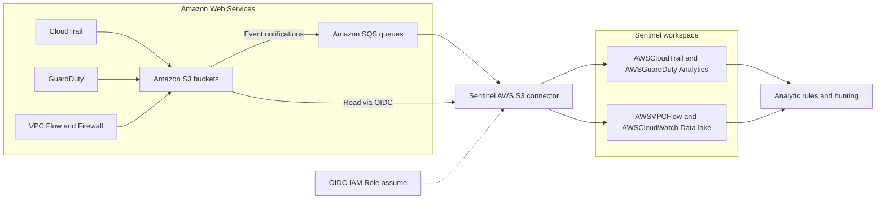

# Amazon Web Services (optional)

> Status: verified. Priority: P3. Last verified: 21 Nov 2026.

## What it is

AWS sits outside the Microsoft product stack, but most enterprise estates run AWS workloads alongside Azure and need centralised SOC monitoring in Microsoft Sentinel. This guide is intentionally concise: it covers the core AWS tables, keyless OIDC ingestion through the **Amazon Web Services S3** connector, and links out to Microsoft Learn for full AWS-side provisioning scripts.

## Key recommendations

- Use the **Amazon Web Services S3** connector with **OpenID Connect (OIDC)** keyless authentication (Microsoft Entra ID assuming an AWS IAM role) and SQS notifications rather than long-lived IAM access keys ([Microsoft Learn](https://learn.microsoft.com/en-us/azure/sentinel/connect-aws)).
- Start with **`AWSCloudTrail`** (management events) and **`AWSGuardDuty`** in the **Analytics** tier on day 1. Both are low to medium volume and back almost all built-in AWS detections.
- Send **`AWSVPCFlow`** and noisy **`AWSCloudWatch`** log groups to the **data lake** tier (or Basic logs). VPC flow logs are huge and rarely justify Analytics ingestion pricing.
- If you already connected AWS to Microsoft Defender for Cloud via OIDC, reuse that existing AWS OIDC identity provider and add Sentinel's audience (`api://1462b192-27f7-4cb9-8523-0f4ecb54b47e` in Azure Commercial) rather than creating a duplicate provider ([Microsoft Learn](https://learn.microsoft.com/en-us/azure/sentinel/connect-aws)).

## High-value log sources

All tables below arrive through the **Amazon Web Services S3** connector in the **Amazon Web Services** Content Hub solution and are billable Sentinel ingestion.

| Source | Table name | Connector | Tier | Cost / volume | Value |
|---|---|---|---|---|---|
| AWS CloudTrail | `AWSCloudTrail` | Amazon Web Services S3 | Analytics (management events); keep S3 data events out or in data lake | Low to medium for management events | Control-plane API calls, IAM changes, console logins, root activity and trail tampering |
| Amazon GuardDuty | `AWSGuardDuty` | Amazon Web Services S3 | Analytics | Low | Managed AWS threat findings across IAM, EC2, S3, EKS and DNS |
| Amazon VPC Flow Logs | `AWSVPCFlow` | Amazon Web Services S3 | Data lake | Very high | Network flow telemetry for lateral movement, C2 and egress investigations |
| AWS Network Firewall | `AWSNetworkFirewall` | Amazon Web Services S3 | Analytics (alert logs) or data lake (flow logs) | Medium to high | Stateful/stateless firewall alerts and network flow records |
| AWS CloudWatch Logs | `AWSCloudWatch` | Amazon Web Services S3 | Data lake (or Analytics if filtered) | Varies by exported log group | Route 53 Resolver DNS queries, EKS audit logs and custom application logs exported to S3 |

## Prerequisites and licensing

| Item | Detail |
|---|---|
| AWS side | An AWS account (or AWS Organizations management/security account) with S3 buckets, SQS queues, an OIDC identity provider and an IAM role with read access to S3 and consume permissions on SQS |
| Log file formats | CloudTrail: `.json` GZIP; GuardDuty: JSON-line GZIP; VPC Flow: space-delimited `.csv` GZIP with header; CloudWatch: `.csv` GZIP without header ([Microsoft Learn](https://learn.microsoft.com/en-us/azure/sentinel/connect-aws)) |
| Sentinel workspace | Pay-as-you-go or commitment tier workspace. All AWS tables are billable ingestion |
| Roles needed | Microsoft Sentinel Contributor on the Sentinel workspace; AWS IAM permissions to create OIDC providers, roles, S3 policies and SQS queues |

## Step-by-step setup

1. **Install the solution.** Defender portal > **Microsoft Sentinel > Content management > Content hub** > search for **Amazon Web Services** and install it.
2. **Open the S3 connector.** **Setup & configuration > Data management > Data & connectors > Connectors > Amazon Web Services S3 > Open connector page** ([Microsoft Learn](https://learn.microsoft.com/en-us/azure/sentinel/connect-aws)).
3. **Provision AWS resources (automated script recommended).** Download Microsoft's PowerShell/AWS CLI setup script from the connector page (or follow the [manual OIDC + S3 + SQS guide](https://learn.microsoft.com/en-us/azure/sentinel/connect-aws)) to configure the OIDC trust, IAM role, S3 bucket notifications and SQS queue per log type.
4. **Link each data stream in Sentinel.** Back on the **Amazon Web Services S3** connector page, paste the **Role ARN**, select the **Destination table** (`AWSCloudTrail`, `AWSGuardDuty`, `AWSVPCFlow`, `AWSNetworkFirewall` or `AWSCloudWatch`), paste the **SQS URL**, and select **Add**.
5. **Set table tiers.** Keep `AWSCloudTrail` and `AWSGuardDuty` in Analytics. Move `AWSVPCFlow` and verbose `AWSCloudWatch` streams to the data lake tier in Table management.
6. **Validate.** Allow 20 to 30 minutes for initial polling, then run the KQL queries below.

## Architecture diagram



## Validation KQL

For group-wide and workspace-wide freshness checks, see [multi-cloud.kql](../../queries/validation/multi-cloud.kql) and the [validation query pack](../../queries/validation/README.md).

```kql
// 1. Confirm AWS tables are landing and check freshness
union withsource=Table isfuzzy=true
    AWSCloudTrail, AWSGuardDuty, AWSVPCFlow, AWSNetworkFirewall, AWSCloudWatch
| where TimeGenerated > ago(1d)
| summarize Rows = count(), Latest = max(TimeGenerated) by Table
| order by Table asc

// 2. Check CloudTrail freshness in minutes
AWSCloudTrail
| summarize Latest = max(TimeGenerated), AgeMinutes = (now() - max(TimeGenerated)) / 1m

// 3. Cost: GB per day over 30 days
Usage
| where TimeGenerated > ago(30d)
| where DataType in ("AWSCloudTrail", "AWSGuardDuty", "AWSVPCFlow", "AWSNetworkFirewall", "AWSCloudWatch")
| summarize GB = round(sum(Quantity) / 1024, 2) by DataType, Day = bin(TimeGenerated, 1d)
| summarize GBperDay = round(avg(GB), 2), TotalGB30d = round(sum(GB), 2) by DataType
| order by GBperDay desc
```

## Out-of-box analytic rules

From the **Amazon Web Services** Content Hub solution ([solution folder](https://github.com/Azure/Azure-Sentinel/tree/master/Solutions/Amazon%20Web%20Services)):

| Rule | Detects | Tables | MITRE | Enable day 1? |
|---|---|---|---|---|
| Console logon without MFA (`AWS_ConsoleLogonWithoutMFA`) | AWS Console sign-ins where MFA wasn't used | `AWSCloudTrail` | Initial Access T1078 | Yes |
| GuardDuty disabled (`AWS_GuardDutyDisabled`) | Deletion or suspension of an Amazon GuardDuty detector | `AWSCloudTrail` | Defense Evasion T1562.001 | Yes |
| CloudTrail log tampering (`AWS_LogTampering` / `AWS_ClearStopChangeTrailLogs`) | CloudTrail logging stopped, deleted or altered | `AWSCloudTrail` | Defense Evasion T1562.008 | Yes |
| S3 bucket or object publicly exposed (`AWS_S3ObjectPubliclyExposed`) | ACL or policy changes exposing S3 data publicly | `AWSCloudTrail` | Exfiltration T1537 | Yes, tune public static buckets |
| AWS GuardDuty alert (`AWS_GuardDuty_template`) | High-severity findings generated by GuardDuty | `AWSGuardDuty` | Varies by finding | Yes |

## Custom detections

Run hourly over a 1-hour lookback unless noted. Test against your AWS accounts before enabling.

### C1. AWS root account activity (High)

```kql
// CUSTOM - Any API call or console sign-in performed by the AWS root user
// ASSUMPTION: AWSCloudTrail populates UserIdentityType == "Root" for root account actions.
AWSCloudTrail
| where TimeGenerated > ago(1h)
| where UserIdentityType == "Root"
| where EventType != "AwsServiceEvent"
| project TimeGenerated, RecipientAccountId, AWSRegion, EventSource, EventName,
          SourceIpAddress, UserAgent, ErrorCode
```

MITRE: Privilege Escalation and Initial Access T1078.004 (Valid Accounts: Cloud Accounts). Root should only ever be used for break-glass tasks.

### C2. IAM access key created for another user or admin policy attached (High)

```kql
// CUSTOM - Detects long-lived access key creation for a different IAM user or AdministratorAccess attachment
// ASSUMPTION: RequestParameters is JSON text containing userName and policyArn fields.
AWSCloudTrail
| where TimeGenerated > ago(1h)
| where EventName in ("CreateAccessKey", "AttachUserPolicy", "AttachRolePolicy")
| where isempty(ErrorCode)
| extend Params = parse_json(RequestParameters)
| extend TargetUser = tostring(Params.userName),
         PolicyArn = tostring(Params.policyArn)
| where (EventName == "CreateAccessKey" and isnotempty(TargetUser) and TargetUser != UserIdentityUserName)
    or (EventName in ("AttachUserPolicy", "AttachRolePolicy") and PolicyArn has "AdministratorAccess")
| project TimeGenerated, RecipientAccountId, EventName, Actor = UserIdentityArn,
          TargetUser, PolicyArn, SourceIpAddress
```

MITRE: Persistence T1098.001 (Additional Cloud Credentials) and T1098.003 (Additional Cloud Roles).

## Playbooks

The **Amazon Web Services** solution and [Azure-Sentinel Playbooks repository](https://github.com/Azure/Azure-Sentinel/tree/master/Solutions/Amazon%20Web%20Services) focus on incident enrichment and IAM containment. Suggested Logic Apps automation:

| Playbook | Trigger | Actions | Connector and permissions |
|---|---|---|---|
| Enrich AWS account and notify owner | High-severity `AWSCloudTrail` or `AWSGuardDuty` incident | Maps `RecipientAccountId` via a Sentinel watchlist to the AWS account owner and posts to Teams/ITSM | Managed identity with Sentinel Responder, plus Teams/ITSM connector |
| Disable compromised IAM access key | Confirmed credential compromise (C2 or GuardDuty IAM finding) | Calls AWS IAM `UpdateAccessKey` (Status=Inactive) behind analyst approval | AWS IAM connector or Azure Function assuming a tightly scoped AWS response IAM role |

## Workbooks and hunting

| Item | Source | Use |
|---|---|---|
| AWS Network Activities / AWS CloudTrail workbooks | Amazon Web Services solution | Overview of CloudTrail management events, GuardDuty findings and VPC Flow traffic |
| AWS hunting queries | Amazon Web Services solution | Hunting for IAM privilege escalation, S3 policy changes and anomalous console logins |

## Gotchas and deprecations

- **OIDC provider reuse with Defender for Cloud.** AWS allows only one OIDC provider per issuer URL per account. If Microsoft Defender for Cloud already created the Microsoft Entra OIDC provider, add Sentinel's audience to it instead of creating a second one ([Microsoft Learn](https://learn.microsoft.com/en-us/azure/sentinel/connect-aws)).
- **CloudTrail data events can explode costs.** Management events are low volume; S3 object-level data events (`GetObject`/`PutObject`) can produce terabytes per day. Exclude data events from the Analytics trail or route them to a separate data lake stream.
- **Polling latency is normal.** The S3 connector polls SQS and typically takes 10 to 30 minutes to ingest logs after AWS writes them to S3. Set analytic rule lookbacks accordingly.
- **KMS-encrypted S3 buckets.** If your CloudTrail or GuardDuty S3 bucket uses a customer-managed KMS key, the Sentinel IAM role also needs `kms:Decrypt` permission on that key or ingestion fails silently.
- **Keep this integration scoped.** AWS has deep native security services (Security Hub, CloudTrail Lake); only ingest into Sentinel what your SOC actively alerts on or correlates with Microsoft identities.
- **Sentinel in the Azure portal retires on 31 March 2027.** Manage connectors and rules in the Microsoft Defender portal ([Microsoft Learn](https://learn.microsoft.com/en-us/azure/sentinel/microsoft-sentinel-defender-portal)).

## Official links

- [Connect Microsoft Sentinel to Amazon Web Services to ingest AWS service log data](https://learn.microsoft.com/en-us/azure/sentinel/connect-aws)
- [Set up your AWS environment to collect AWS logs to Microsoft Sentinel](https://learn.microsoft.com/en-us/azure/sentinel/connect-aws)
- [AWSCloudTrail table reference](https://learn.microsoft.com/en-us/azure/azure-monitor/reference/tables/awscloudtrail)
- [AWSGuardDuty table reference](https://learn.microsoft.com/en-us/azure/azure-monitor/reference/tables/awsguardduty)
- [AWSVPCFlow table reference](https://learn.microsoft.com/en-us/azure/azure-monitor/reference/tables/awsvpcflow)
- [AWSNetworkFirewall table reference](https://learn.microsoft.com/en-us/azure/sentinel/connect-aws)
- [AWSCloudWatch table reference](https://learn.microsoft.com/en-us/azure/azure-monitor/reference/tables/awscloudwatch)
- [Amazon Web Services solution (Azure-Sentinel repo)](https://github.com/Azure/Azure-Sentinel/tree/master/Solutions/Amazon%20Web%20Services)
- [Microsoft Sentinel in the Defender portal](https://learn.microsoft.com/en-us/azure/sentinel/microsoft-sentinel-defender-portal)

## Last verified

21 Nov 2026, against Microsoft Learn and the Azure-Sentinel repo. Re-verify before relying on table names, navigation or rule names.
