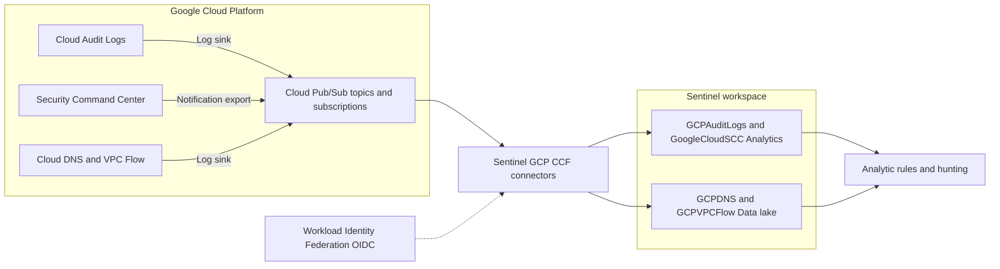

# Google Cloud (optional)

> Status: verified. Priority: P3. Last verified: 21 Nov 2026.

## What it is

Google Cloud Platform (GCP) sits outside the Microsoft product stack, but multi-cloud estates often centralise GCP audit trails and security findings in Microsoft Sentinel. This guide is intentionally concise: it covers the modern Codeless Connector Framework (CCF) connectors powered by GCP Pub/Sub and Workload Identity Federation (WIF), and links out to Microsoft Learn for full Terraform and GCP setup scripts.

## Key recommendations

- Use the modern **Codeless Connector Framework (CCF)** connectors with **Google Cloud Workload Identity Federation (WIF)** and **GCP Pub/Sub**. WIF establishes an OIDC trust with Microsoft Entra ID so you never store static GCP service account JSON keys ([Microsoft Learn](https://learn.microsoft.com/en-us/azure/sentinel/connect-google-cloud-platform)).
- Start with **`GCPAuditLogs`** (Admin Activity and System Event logs) and **`GoogleCloudSCC`** (Security Command Center findings) in the **Analytics** tier on day 1. Both are manageable in volume and cover high-value GCP threats.
- Route **`GCPVPCFlow`** and **`GCPDNS`** to the **data lake** tier by default. Network flow and DNS query logs are high volume and best kept for hunting unless you deploy specific real-time DNS rules.
- Filter noisy **Data Access** audit logs at the GCP Cloud Logging sink before publishing to Pub/Sub so you don't pay twice (GCP Pub/Sub egress plus Sentinel ingestion).

## High-value log sources

All tables below are billable Sentinel ingestion delivered via GCP Pub/Sub and Sentinel CCF connectors.

| Source | Table name | Connector (Content Hub solution) | Tier | Cost / volume | Value |
|---|---|---|---|---|---|
| Cloud Audit Logs (Admin Activity, Data Access, System Event, Access Transparency) | `GCPAuditLogs` | GCP Pub/Sub Audit Logs (**Google Cloud Platform Audit Logs**) | Analytics (Admin Activity); filter or data lake for verbose Data Access | Low to medium for Admin Activity; high if broad Data Access enabled | IAM policy edits, service account key creation, bucket exposure and logging tampering |
| Security Command Center (SCC) | `GoogleCloudSCC` | Google Security Command Center (**Google Cloud Platform Security Command Center**) | Analytics | Low | Managed GCP threat findings, misconfigurations and vulnerability alerts |
| Cloud DNS | `GCPDNS` | Google Cloud Platform DNS (CCF) (**Google Cloud Platform DNS**) | Data lake (or Analytics if alerting on DNS) | Medium to high | DNS query and audit logs; normalised by ASIM DNS parser (`_Im_Dns_Gcp`) |
| VPC Flow Logs | `GCPVPCFlow` | Google Cloud Platform VPC Flow Logs (CCF) (**Google Cloud Platform VPC Flow Logs**) | Data lake | Very high | Network flow records for lateral movement, C2 and egress investigations |

## Prerequisites and licensing

| Item | Detail |
|---|---|
| GCP side | GCP project or organisation with Cloud Logging sinks exporting to **Pub/Sub** topics and pull subscriptions, plus a **Workload Identity Pool**, OIDC provider trusting your Microsoft Entra tenant, and a dedicated GCP service account with `roles/pubsub.subscriber` and `roles/pubsub.viewer` (and SCC reader roles for SCC) |
| GCP Security Command Center | SCC Standard or Premium/Enterprise enabled in Google Cloud for `GoogleCloudSCC` findings |
| Sentinel workspace | Pay-as-you-go or commitment tier workspace. All GCP tables are billable ingestion |
| Roles needed | Microsoft Sentinel Contributor on the Sentinel workspace; GCP IAM, Pub/Sub and Logging Admin roles to deploy the WIF pool, sinks and subscriptions |

## Step-by-step setup

1. **Install the Content Hub solutions.** In the Defender portal (**Microsoft Sentinel > Content management > Content hub**), install **Google Cloud Platform Audit Logs** first, plus **Google Cloud Platform Security Command Center**, **Google Cloud Platform DNS** and **Google Cloud Platform VPC Flow Logs** as needed.
2. **Deploy Workload Identity Federation and Pub/Sub in GCP.** Follow Microsoft's [GCP integration guide](https://learn.microsoft.com/en-us/azure/sentinel/connect-google-cloud-platform) (using the provided Terraform scripts or manual steps) to create the Workload Identity Pool, OIDC provider for Microsoft Entra ID, GCP service account, Cloud Logging sinks and Pub/Sub pull subscriptions.
3. **Configure each CCF connector in Sentinel.** Go to **Setup & configuration > Data management > Data & connectors > Connectors**, open **GCP Pub/Sub Audit Logs** (and SCC/DNS/VPC Flow connectors), select **Add new collector**, and enter your GCP Project Number, Workload Identity Pool/Provider ID, Service Account email and Pub/Sub subscription name.
4. **Set table tiers.** Keep `GCPAuditLogs` and `GoogleCloudSCC` in Analytics. Set `GCPVPCFlow` and `GCPDNS` to the data lake tier in Table management if you only use them for hunting.
5. **Validate.** Allow 15 to 30 minutes for initial Pub/Sub polling, then run the KQL queries below.

## Architecture diagram



## Validation KQL

For group-wide and workspace-wide freshness checks, see [multi-cloud.kql](../../queries/validation/multi-cloud.kql) and the [validation query pack](../../queries/validation/README.md).

```kql
// 1. Confirm GCP tables are landing and check freshness
union withsource=Table isfuzzy=true
    GCPAuditLogs, GoogleCloudSCC, GCPDNS, GCPVPCFlow
| where TimeGenerated > ago(1d)
| summarize Rows = count(), Latest = max(TimeGenerated) by Table
| order by Table asc

// 2. Check Cloud Audit Logs freshness in minutes
GCPAuditLogs
| summarize Latest = max(TimeGenerated), AgeMinutes = (now() - max(TimeGenerated)) / 1m

// 3. Cost: GB per day over 30 days
Usage
| where TimeGenerated > ago(30d)
| where DataType in ("GCPAuditLogs", "GoogleCloudSCC", "GCPDNS", "GCPVPCFlow")
| summarize GB = round(sum(Quantity) / 1024, 2) by DataType, Day = bin(TimeGenerated, 1d)
| summarize GBperDay = round(avg(GB), 2), TotalGB30d = round(sum(GB), 2) by DataType
| order by GBperDay desc
```

## Out-of-box analytic rules

From the **Google Cloud Platform Audit Logs** ([solution folder](https://github.com/Azure/Azure-Sentinel/tree/master/Solutions/Google%20Cloud%20Platform%20Audit%20Logs)), **GoogleCloudPlatformDNS** ([solution folder](https://github.com/Azure/Azure-Sentinel/tree/master/Solutions/GoogleCloudPlatformDNS)) and **GoogleCloudPlatformIAM** ([solution folder](https://github.com/Azure/Azure-Sentinel/tree/master/Solutions/GoogleCloudPlatformIAM)) solutions:

| Rule | Detects | Tables | MITRE | Enable day 1? |
|---|---|---|---|---|
| VPC Flow Logs Disabled (`GCPVpcFlowLogsDisabled`) | Modification or disablement of GCP VPC Flow Logs on a subnet | `GCPAuditLogs` | Defense Evasion T1562.008 | Yes |
| Storage Bucket Made Public (`GCPStorageBucketMadePublic`) | Cloud Storage IAM policy granted to `allUsers` or `allAuthenticatedUsers` | `GCPAuditLogs` | Exfiltration T1537 | Yes, tune public static buckets |
| Data Access Logging Exemption (`GCPDataAccessLoggingExemption`) | Principal added to the data access audit logging exemption list | `GCPAuditLogs` | Defense Evasion T1562.008 | Yes |
| GCP IAM Privileges Enumeration (`GCPIAMPrivilegesEnumeration`) | Burst of IAM permission discovery calls (`testIamPermissions`) | `GCPAuditLogs` | Discovery T1069.003 | Yes, tune CI/CD service accounts |
| GCP DNS Data Exfiltration (`GCPDNSDataExfiltration`) | Anomalous DNS query volume or length indicative of tunnelling | `GCPDNS` | Exfiltration T1048 | Only if `GCPDNS` is in Analytics |

## Custom detections

Run hourly over a 1-hour lookback unless noted. Verify exact column names against a sample row in your workspace before enabling.

### C1. GCP service account key created (High)

```kql
// CUSTOM - Detects creation of a user-managed GCP service account key (common persistence path)
// ASSUMPTION: GCPAuditLogs populates MethodName and PrincipalEmail per the standard table schema.
GCPAuditLogs
| where TimeGenerated > ago(1h)
| where MethodName == "google.iam.admin.v1.CreateServiceAccountKey"
| project TimeGenerated, ProjectId, PrincipalEmail, CallerIp, ResourceName, MethodName
```

MITRE: Persistence T1098.001 (Account Manipulation: Additional Cloud Credentials). Organisations enforcing Workload Identity Federation should treat any static service account key creation as high priority.

### C2. High or critical Google Cloud Security Command Center finding (High)

```kql
// CUSTOM - Surfaces HIGH and CRITICAL Security Command Center findings as Sentinel alerts
// ASSUMPTION: GoogleCloudSCC populates FindingSeverity, FindingCategory and ResourceName.
// Confirm exact column casing with "GoogleCloudSCC | take 5" before enabling.
GoogleCloudSCC
| where TimeGenerated > ago(1h)
| where FindingSeverity in~ ("HIGH", "CRITICAL")
| project TimeGenerated, FindingSeverity, FindingCategory, ResourceName, State
```

MITRE: Varies by SCC finding category.

## Playbooks

No GCP containment playbooks ship by default inside the audit logs solution. Suggested automation:

| Playbook | Trigger | Actions | Connector and permissions |
|---|---|---|---|
| Enrich GCP project owner and notify SOC | High-severity `GCPAuditLogs` (C1) or `GoogleCloudSCC` (C2) incident | Maps `ProjectId` via a Sentinel watchlist to the owning team and posts to Teams or ITSM | Managed identity with Sentinel Responder, plus Teams/ITSM connector |
| Disable compromised service account key | Confirmed key theft (C1) | Calls the GCP IAM API to disable or delete the key behind analyst approval | Azure Function authenticating via Workload Identity Federation to a scoped GCP IAM admin service account |

## Workbooks and hunting

| Item | Source | Use |
|---|---|---|
| GCP Audit Logs workbook | Google Cloud Platform Audit Logs solution | Overview of GCP admin actions, IAM changes and top callers |
| GCP hunting queries | Google Cloud Platform Audit Logs and IAM solutions | Hunting for service account impersonation, firewall rule opens and bucket exposure |

## Gotchas and deprecations

- **Prefer Workload Identity Federation over static keys.** Legacy GCP connectors required downloading long-lived service account JSON keys and running Azure Functions. Use the modern CCF connectors with WIF and Pub/Sub instead ([Microsoft Learn](https://learn.microsoft.com/en-us/azure/sentinel/connect-google-cloud-platform)).
- **GCP Data Access logs are off by default and noisy when enabled.** Admin Activity logs are always on in GCP. If you enable Data Access logs, filter high-frequency service accounts in the Cloud Logging sink before publishing to Pub/Sub to avoid paying for both Pub/Sub throughput and Sentinel ingestion.
- **Organisation-level sinks beat per-project sinks.** For multi-project GCP estates, configure an aggregated organisation or folder log sink into one central security project's Pub/Sub topic so new projects are covered automatically.
- **SCC exports need active notification configs.** Security Command Center doesn't push findings to Pub/Sub until you create an SCC continuous export (notification configuration) targeting your Pub/Sub topic.
- **Sentinel in the Azure portal retires on 31 March 2027.** Build and manage connectors and rules in the Microsoft Defender portal ([Microsoft Learn](https://learn.microsoft.com/en-us/azure/sentinel/microsoft-sentinel-defender-portal)).

## Official links

- [Ingest Google Cloud Platform log data into Microsoft Sentinel](https://learn.microsoft.com/en-us/azure/sentinel/connect-google-cloud-platform)
- [GCPAuditLogs table reference](https://learn.microsoft.com/en-us/azure/azure-monitor/reference/tables/gcpauditlogs)
- [GoogleCloudSCC table reference](https://learn.microsoft.com/en-us/azure/azure-monitor/reference/tables/googlecloudscc)
- [GCPVPCFlow table reference](https://learn.microsoft.com/en-us/azure/azure-monitor/reference/tables/gcpvpcflow)
- [Google Cloud Platform Audit Logs solution (Azure-Sentinel repo)](https://github.com/Azure/Azure-Sentinel/tree/master/Solutions/Google%20Cloud%20Platform%20Audit%20Logs)
- [Google Cloud Platform DNS solution (Azure-Sentinel repo)](https://github.com/Azure/Azure-Sentinel/tree/master/Solutions/GoogleCloudPlatformDNS)
- [Google Cloud Platform IAM solution (Azure-Sentinel repo)](https://github.com/Azure/Azure-Sentinel/tree/master/Solutions/GoogleCloudPlatformIAM)
- [Microsoft Sentinel in the Defender portal](https://learn.microsoft.com/en-us/azure/sentinel/microsoft-sentinel-defender-portal)

## Last verified

21 Nov 2026, against Microsoft Learn and the Azure-Sentinel repo. Re-verify before relying on table names, navigation or rule names.
