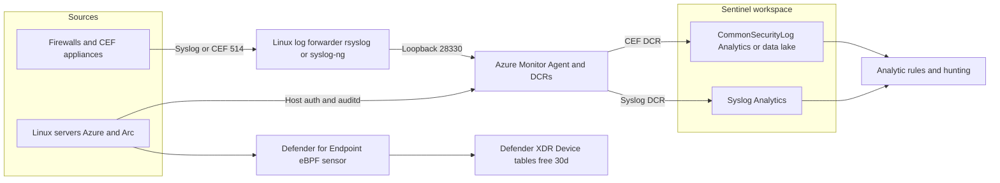

# Linux (Syslog, CEF and auditd)

> Status: verified. Priority: P2. Last verified: 21 Nov 2026.

## What it is

Linux servers emit authentication, privilege escalation and daemon activity through Syslog and the kernel audit subsystem (`auditd`), while network firewalls, proxies and security appliances send vendor-neutral Common Event Format (CEF) and Syslog streams through dedicated Linux log forwarders. Collecting these through the Azure Monitor Agent (AMA) alongside Microsoft Defender for Endpoint on Linux gives a SOC coverage across Linux workloads and perimeter infrastructure.

## Key recommendations

- Collect **`auth` and `authpriv`** facilities at `Informational` (or `Notice` if volume is tight) as the non-negotiable minimum for every Linux server. They capture SSH logons, `sudo` escalations, PAM failures and account changes at low cost.
- Separate **host Syslog collection** from **network appliance log forwarders**. Install AMA directly on Azure Linux VMs and Azure Arc-enabled Linux servers for host logs (`Syslog`), and deploy dedicated, load-balanced Linux forwarder VMs to receive UDP/TCP 514 (or TLS 6514) CEF and Syslog feeds from firewalls and appliances ([Microsoft Learn](https://learn.microsoft.com/en-us/azure/sentinel/connect-cef-syslog-ama)).
- Don't rebuild legacy `auditd` ingestion unless compliance demands raw `audit.log` records. The legacy `auoms` / `LinuxAuditLog` pipeline retired with the Log Analytics agent on 31 August 2024. Prefer **Microsoft Defender for Endpoint on Linux** (which uses an eBPF kernel sensor with far lower overhead than `auditd`) for process, file and network telemetry in Defender XDR advanced hunting ([Microsoft Learn](https://learn.microsoft.com/en-us/defender-endpoint/microsoft-defender-endpoint-linux)).
- If you must ingest `auditd` into Sentinel, forward targeted audit rules to `Syslog` via `audispd-plugins` (`audisp-syslog`) and `rsyslog`, or collect `/var/log/audit/audit.log` as an AMA custom text log DCR.
- Route high-volume perimeter `CommonSecurityLog` traffic (such as firewall allow logs) to the **data lake** or Basic tier, or split high-value threat/deny events into Analytics using a DCR transformation so you don't blow your Sentinel budget.

## High-value log sources

| Source | Table name | Connector | Tier | Cost / volume | Value |
|---|---|---|---|---|---|
| Linux host Syslog (`auth`, `authpriv`, `cron`, `syslog`) | `Syslog` | Syslog via AMA | Analytics (for `auth`/`authpriv`); data lake for verbose daemons | Low for `auth`/`authpriv`; medium to high if `daemon` or `local*` unfiltered. Billable | SSH logons, `sudo` usage, PAM failures, user/group changes, cron persistence |
| Network and security appliance CEF logs | `CommonSecurityLog` | Common Event Format (CEF) via AMA | Data lake (allow/traffic logs) or Analytics (IDS/IPS, blocks, filtered) | High to very high depending on firewalls and proxies. Billable | Normalised firewall, proxy, IDS/IPS and VPN telemetry across third-party vendors |
| Linux `auditd` (optional) | `Syslog` (via `audisp-syslog`) or custom `*_CL` table | Syslog via AMA or AMA Custom Text Log DCR | Analytics (filtered) or data lake | Medium to high if audit rules are broad. Billable | Kernel-level execve, file watch and syscall auditing when MDE isn't deployed or compliance requires raw `auditd` |
| Defender for Endpoint on Linux (eBPF sensor) | `DeviceProcessEvents`, `DeviceNetworkEvents`, `DeviceFileEvents`, `DeviceLogonEvents`, `DeviceEvents` | Microsoft Defender XDR | Free in Defender XDR advanced hunting (30 days; 90 days with eligible ISOC licence) | Free in advanced hunting. Paid if streamed to Sentinel | Full Linux process trees, command lines, network connections and file writes with low CPU overhead |

### Choosing how to handle `auditd`

The legacy Log Analytics agent's `auoms` plugin that populated `LinuxAuditLog` is retired. You have three supported options on modern Linux estates:

1. **Defender for Endpoint on Linux (recommended default).** MDE on Linux switched from `auditd` to an eBPF sensor by default, streaming process, network, file and logon telemetry into Defender XDR `Device*` tables without `auditd` rule collisions or Sentinel ingestion charges ([Microsoft Learn](https://learn.microsoft.com/en-us/defender-endpoint/microsoft-defender-endpoint-linux)).
2. **Forward `auditd` to `Syslog` via `audispd-plugins`.** Install `audispd-plugins`, enable the `syslog` plugin (`/etc/audit/plugins.d/syslog.conf` with `active = yes`), configure a focused `/etc/audit/rules.d/` ruleset (for example `/etc/passwd`, `/etc/sudoers`, `execve` for root), and collect via **Syslog via AMA**.
3. **Collect `/var/log/audit/audit.log` as an AMA custom text log.** Use an Azure Monitor custom text log DCR into a custom `*_CL` table (or data lake) when you need raw unmodified `audit.log` lines for compliance.

## Prerequisites and licensing

| Item | Detail |
|---|---|
| Sentinel workspace | Pay-as-you-go or commitment tier workspace onboarded to the Defender portal |
| Azure Monitor Agent (AMA) | Free agent. Supported on modern Ubuntu, RHEL, SLES, Debian, Rocky, AlmaLinux and Amazon Linux releases ([AMA overview](https://learn.microsoft.com/en-us/azure/azure-monitor/agents/azure-monitor-agent-overview)) |
| Non-Azure Linux servers | Must be onboarded to **Azure Arc-enabled servers** before AMA and DCRs can be attached ([Azure Arc overview](https://learn.microsoft.com/en-us/azure/azure-arc/servers/overview)) |
| Log forwarder sizing (for appliances) | Dedicated Linux VM (typically 4+ vCPU, 8+ GB RAM minimum for moderate EPS) running `rsyslog` or `syslog-ng` with local port `28330/tcp` open on loopback for AMA, and UDP/TCP 514 (or TLS 6514) reachable from appliances |
| Defender for Endpoint on Linux | Licensed via Defender for Servers Plan 1/2 or Microsoft Defender for Endpoint for Servers |

### Roles you need

| Task | Role |
|---|---|
| Install Content Hub solutions and enable rules | Microsoft Sentinel Contributor on the resource group ([Microsoft Learn](https://learn.microsoft.com/en-us/azure/sentinel/sentinel-solutions-deploy)) |
| Create Syslog/CEF DCRs and attach machines | Monitoring Contributor on the resource group, plus Virtual Machine Contributor or Azure Connected Machine Resource Administrator |
| Run the forwarder installer script on Linux | `root` or `sudo` access on the Linux log forwarder machine |

## Step-by-step setup

1. **Onboard non-Azure Linux hosts to Azure Arc.** Register on-premises and multi-cloud Linux servers via **Azure Arc > Infrastructure > Machines** so they accept AMA extensions and DCRs.
2. **Install Content Hub solutions.** In the Defender portal (**Microsoft Sentinel > Content management > Content hub**), install **Syslog** and **Common Event Format (CEF)**.
3. **Collect Linux host Syslog.** Open **Setup & configuration > Data management > Data & connectors > Connectors > Syslog via AMA > Open connector page > + Create data collection rule**. Attach your Linux servers, and on the Collect tab select at least `LOG_AUTH` and `LOG_AUTHPRIV` at `LOG_INFO` (add `LOG_CRON` and `LOG_SYSLOG` as needed).
4. **Deploy a Linux log forwarder for network appliances (CEF/Syslog).** Provision dedicated Linux VM(s) (put two behind an internal load balancer for high availability). Install the **Common Event Format (CEF) via AMA** connector DCR targeting the forwarder VM(s) and select the facilities your appliances emit (commonly `LOG_LOCAL0` to `LOG_LOCAL7`).
5. **Run Microsoft's forwarder setup script on the forwarder VM.** Download and run `Forwarder_AMA_installer.py` from the [Azure-Sentinel repo](https://github.com/Azure/Azure-Sentinel/tree/master/DataConnectors/Syslog) as `root` to configure `rsyslog` or `syslog-ng` to listen on port 514 and relay CEF/Syslog locally to AMA on `127.0.0.1:28330` ([Microsoft Learn](https://learn.microsoft.com/en-us/azure/sentinel/connect-cef-syslog-ama)).
6. **Point appliances at the forwarder.** Configure firewalls, proxies and security appliances to send CEF (or Syslog) to the forwarder VIP/IP, then verify with the validation queries below.
7. **Onboard Linux servers to MDE (recommended).** Enable Defender for Servers auto-provisioning or deploy the MDE for Linux agent so kernel-level process, network and file events populate Defender XDR `Device*` tables automatically.
8. **Tune tiers and cost.** After 7 days, run the `Usage` query below. Move chatty `CommonSecurityLog` firewall streams to the data lake tier or add DCR workspace transformations to drop routine allow noise.

## Best-practice security configuration

Pair Syslog/CEF collection with **Microsoft Defender for Servers Plan 2** (which includes Defender for Endpoint on Linux) across Azure VMs and Azure Arc Linux servers. See [Defender best-practice security configurations](../../docs/defender-best-practices.md#defender-for-servers).

- **MDE on Linux + agentless scanning:** Auto-provision Defender for Endpoint on Linux (eBPF runtime telemetry) and keep Plan 2 agentless vulnerability/secret scanning enabled ([Plan Defender for Servers](https://learn.microsoft.com/en-us/azure/defender-for-cloud/defender-for-servers-introduction)).
- **File Integrity Monitoring & JIT (Plan 2):** Enable Defender for Cloud FIM via AMA on critical `/etc`, SSH and binary paths, and enforce **Just-in-Time (JIT) VM access** or Azure Bastion instead of internet-exposed SSH (`22`) ([FIM overview](https://learn.microsoft.com/en-us/azure/defender-for-cloud/file-integrity-monitoring-overview), [JIT VM access](https://learn.microsoft.com/en-us/azure/defender-for-cloud/just-in-time-access-overview)).
- **Hardening Syslog/CEF forwarders:** Restrict inbound UDP/TCP `514` on forwarders to known appliance subnets, prefer TLS-encrypted Syslog where appliances support it, and keep SSH key-only auth with `PermitRootLogin no`.

## Architecture diagram



## Validation KQL

For group-wide and workspace-wide freshness checks, see [servers.kql](../../queries/validation/servers.kql) and the [validation query pack](../../queries/validation/README.md).

```kql
// 1. Confirm Syslog and CommonSecurityLog are landing and fresh
union withsource=Table isfuzzy=true Syslog, CommonSecurityLog
| where TimeGenerated > ago(1d)
| summarize Rows = count(), Latest = max(TimeGenerated) by Table

// 2. Check Syslog coverage by host and facility (confirm auth and authpriv are present)
Syslog
| where TimeGenerated > ago(1d)
| summarize Rows = count(), Latest = max(TimeGenerated) by Computer, Facility
| order by Computer asc, Rows desc

// 3. Check CEF vendors and products landing in CommonSecurityLog
CommonSecurityLog
| where TimeGenerated > ago(1d)
| summarize Rows = count(), Latest = max(TimeGenerated) by DeviceVendor, DeviceProduct
| order by Rows desc

// 4. Flag Linux hosts that stopped sending Syslog in the last hour
Syslog
| where TimeGenerated > ago(2d)
| summarize Latest = max(TimeGenerated) by Computer
| where Latest < ago(1h)

// 5. Cost: GB per day over 30 days
Usage
| where TimeGenerated > ago(30d)
| where DataType in ("Syslog", "CommonSecurityLog")
| summarize GB = round(sum(Quantity) / 1024, 2) by DataType, Day = bin(TimeGenerated, 1d)
| summarize GBperDay = round(avg(GB), 2), TotalGB30d = round(sum(GB), 2) by DataType
| order by GBperDay desc
```

## Out-of-box analytic rules

From the **Syslog** ([solution folder](https://github.com/Azure/Azure-Sentinel/tree/master/Solutions/Syslog)) and **Common Event Format** ([solution folder](https://github.com/Azure/Azure-Sentinel/tree/master/Solutions/Common%20Event%20Format)) Content Hub solutions. Vendor-specific CEF rules (Palo Alto, Fortinet, Cisco and others) ship in each vendor's own Content Hub solution and query `CommonSecurityLog`.

| Rule | Detects | Tables | MITRE | Enable day 1? |
|---|---|---|---|---|
| SSH - Potential Brute Force | High count of failed SSH logins from a single IP against Linux hosts | `Syslog` | Credential Access T1110 | Yes, tune threshold for jump hosts |
| Squid proxy events related to mining pools | Outbound proxy requests to known cryptomining domains | `Syslog` | Impact T1496 | Only if running Squid |
| SFTP threshold / anomalous transfer rules | Unusual SFTP file transfer patterns logged via Syslog | `Syslog` | Exfiltration T1048 | Optional, if SFTP servers report |
| Vendor-specific CEF rules (install vendor Content Hub solution) | Firewall threat blocks, IPS hits, C2 connections | `CommonSecurityLog` | Varies by vendor solution | Yes, install the solution for each firewall/proxy vendor you forward |

## Custom detections

Run these hourly over a 1-hour lookback unless noted. Test against a week of your own `Syslog` data before enabling.

### C1. SSH brute force followed by a successful login (High)

```kql
// CUSTOM - Multiple failed SSH authentication attempts followed by an Accepted login from the same IP
// ASSUMPTION: OpenSSH logs to auth or authpriv with standard "Failed password" and "Accepted" strings.
// Verify exact SyslogMessage format on your Linux distros before enabling.
let failed = Syslog
| where TimeGenerated > ago(1h)
| where Facility in ("auth", "authpriv") and ProcessName == "sshd"
| where SyslogMessage has "Failed password"
| extend SrcIP = extract(@"from ([0-9a-fA-F\.:]+) port", 1, SyslogMessage)
| where isnotempty(SrcIP)
| summarize FailCount = count(), FirstFail = min(TimeGenerated), LastFail = max(TimeGenerated)
            by Computer, SrcIP
| where FailCount >= 10;
Syslog
| where TimeGenerated > ago(1h)
| where Facility in ("auth", "authpriv") and ProcessName == "sshd"
| where SyslogMessage has "Accepted "
| extend SrcIP = extract(@"from ([0-9a-fA-F\.:]+) port", 1, SyslogMessage)
| join kind=inner failed on Computer, SrcIP
| where TimeGenerated >= FirstFail
| project TimeGenerated, Computer, SrcIP, FailCount, SyslogMessage
```

MITRE: Credential Access T1110 (Brute Force) and Initial Access T1078 (Valid Accounts).

### C2. Suspicious `sudo` privilege escalation or repeated auth failures (Medium)

```kql
// CUSTOM - User not in sudoers attempting sudo, or repeated sudo authentication failures
// ASSUMPTION: sudo logs to auth or authpriv with ProcessName == "sudo".
Syslog
| where TimeGenerated > ago(1h)
| where Facility in ("auth", "authpriv") and ProcessName == "sudo"
| where SyslogMessage has_any ("user NOT in sudoers", "authentication failure", "incorrect password attempts")
| summarize Events = count(), Samples = make_set(SyslogMessage, 5) by Computer, bin(TimeGenerated, 1h)
| where Events >= 3 or tostring(Samples) has "NOT in sudoers"
| project TimeGenerated, Computer, Events, Samples
```

MITRE: Privilege Escalation T1548.003 (Abuse Elevation Control Mechanism: Sudo and Sudo Caching).

### C3. Local user creation or privileged group modification (Medium)

```kql
// CUSTOM - Local account creation or addition to sudo/wheel/root groups via useradd/usermod/adduser
// ASSUMPTION: Shadow utilities log to auth or authpriv on your Linux distributions.
Syslog
| where TimeGenerated > ago(1h)
| where Facility in ("auth", "authpriv")
| where ProcessName in ("useradd", "usermod", "adduser", "gpasswd", "groupadd")
| where SyslogMessage has_any ("new user", "add ", "added ", "sudo", "wheel", "root")
| project TimeGenerated, Computer, ProcessName, SyslogMessage
```

MITRE: Persistence T1136.001 (Create Account: Local Account) and T1098 (Account Manipulation).

## Playbooks

No playbooks ship directly inside the generic **Syslog** or **Common Event Format** solutions. Common response playbooks come from your firewall vendor's Content Hub solution or MDE:

| Playbook | Trigger | Actions | Connector and permissions |
|---|---|---|---|
| Isolate-MDEMachine (from [Microsoft Defender for Endpoint solution](https://github.com/Azure/Azure-Sentinel/tree/master/Solutions/MicrosoftDefenderForEndpoint/Playbooks/Isolate-MDEMachine)) | High-severity Linux compromise (C1) on an MDE-onboarded Linux server | Isolates the Linux host via MDE and comments on the incident | Managed identity with Sentinel Responder, plus MDE API `Machine.Isolate` and `Machine.Read.All` |
| Block IP on perimeter firewall (vendor playbook) | Confirmed brute force or C2 IP from `Syslog` or `CommonSecurityLog` | Adds the offending IP to a firewall dynamic block list | Vendor-specific Logic Apps connector and API credentials from the firewall Content Hub solution |

## Workbooks and hunting

| Item | Source | Use |
|---|---|---|
| Syslog workbook | Syslog solution | Host reporting health, facility distribution and top noisy Linux sources |
| CEF / vendor workbooks | Vendor Content Hub solutions | Traffic, threat and ingestion dashboards over `CommonSecurityLog` |
| Syslog hunting queries | Syslog solution (`Solutions/Syslog/Hunting Queries`) | Proactive hunts for cryptomining, unusual SSH sessions and failed logins |
| ASIM network and authentication parsers | Azure-Sentinel repo | Normalise `CommonSecurityLog` and `Syslog` into ASIM schemas for cross-vendor hunting |

## Gotchas and deprecations

- **Legacy Log Analytics agent (`omsagent` / `auoms`) is retired.** It retired on 31 August 2024. The legacy `Syslog`, `CEF` and `LinuxAuditLog` MMA paths are unsupported; migrate all Linux hosts and forwarders to AMA ([migration guide](https://learn.microsoft.com/en-us/azure/azure-monitor/agents/azure-monitor-agent-migration)).
- **Don't mix CEF and plain Syslog on the same facility on a forwarder.** If a forwarder collects the same facility (for example `local4`) in both a Syslog DCR and a CEF DCR, every CEF message is ingested twice into both `Syslog` and `CommonSecurityLog`, doubling your bill. Dedicate facilities or use separate forwarders.
- **Avoid double-collecting forwarder host logs.** On a dedicated CEF forwarder VM, keep host `auth`/`authpriv` in a Syslog DCR and keep appliance facilities (`local0` to `local7`) strictly in the CEF DCR.
- **Log forwarder is a single point of failure.** Run at least two forwarder VMs behind an internal load balancer and monitor their `Heartbeat` and EPS so a dead `rsyslog` daemon doesn't silently drop all firewall logs.
- **CEF field mapping quirks.** Vendors populate `CommonSecurityLog` columns inconsistently. Check Microsoft's [CEF key mapping reference](https://learn.microsoft.com/en-us/azure/sentinel/cef-name-mapping) and inspect sample rows before writing rules on `AdditionalExtensions`.
- **Facility minimum matters.** Many teams accidentally turn on `LOG_DEBUG` across all facilities and generate tens of GB per host per day. Start with `auth` and `authpriv` at `Informational` and expand deliberately.
- **Sentinel in the Azure portal retires on 31 March 2027.** Configure connectors, rules and hunting queries in the Microsoft Defender portal ([Microsoft Learn](https://learn.microsoft.com/en-us/azure/sentinel/microsoft-sentinel-defender-portal)).

## Official links

- [Ingest syslog and CEF messages to Microsoft Sentinel with the Azure Monitor Agent](https://learn.microsoft.com/en-us/azure/sentinel/connect-cef-syslog-ama)
- [Common Event Format (CEF) key and CommonSecurityLog field mapping](https://learn.microsoft.com/en-us/azure/sentinel/cef-name-mapping)
- [Find your Microsoft Sentinel data connector](https://learn.microsoft.com/en-us/azure/sentinel/data-connectors-reference)
- [Azure Monitor Agent overview](https://learn.microsoft.com/en-us/azure/azure-monitor/agents/azure-monitor-agent-overview)
- [Migrate from the Log Analytics agent](https://learn.microsoft.com/en-us/azure/azure-monitor/agents/azure-monitor-agent-migration)
- [Azure Arc-enabled servers overview](https://learn.microsoft.com/en-us/azure/azure-arc/servers/overview)
- [Microsoft Defender for Endpoint on Linux](https://learn.microsoft.com/en-us/defender-endpoint/microsoft-defender-endpoint-linux)
- [Syslog table reference](https://learn.microsoft.com/en-us/azure/azure-monitor/reference/tables/syslog)
- [CommonSecurityLog table reference](https://learn.microsoft.com/en-us/azure/azure-monitor/reference/tables/commonsecuritylog)
- [LinuxAuditLog table reference](https://learn.microsoft.com/en-us/azure/azure-monitor/reference/tables/linuxauditlog)
- [Syslog solution (Azure-Sentinel repo)](https://github.com/Azure/Azure-Sentinel/tree/master/Solutions/Syslog)
- [Common Event Format solution (Azure-Sentinel repo)](https://github.com/Azure/Azure-Sentinel/tree/master/Solutions/Common%20Event%20Format)
- [Syslog AMA forwarder installer (Azure-Sentinel repo)](https://github.com/Azure/Azure-Sentinel/tree/master/DataConnectors/Syslog)
- [Microsoft Sentinel in the Defender portal](https://learn.microsoft.com/en-us/azure/sentinel/microsoft-sentinel-defender-portal)

## Last verified

21 Nov 2026, against Microsoft Learn and the Azure-Sentinel repo. Re-verify before relying on table names, navigation or rule names.
