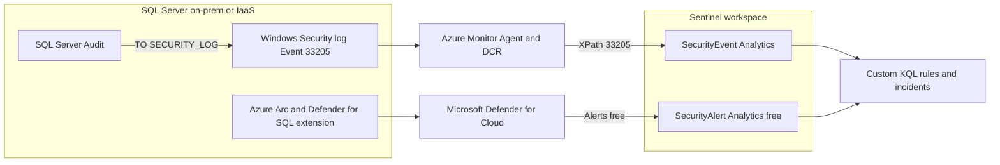

# SQL Server (on-premises and IaaS)

> Status: verified. Priority: P3. Last verified: 21 Nov 2026.

## What it is

SQL Server running on-premises, on Azure VMs (IaaS) or in other clouds stores high-value business data and is a frequent target for privilege escalation, credential abuse and data exfiltration. Combining **SQL Server Audit** routed to the Windows Security log (collected via AMA) with **Microsoft Defender for SQL servers on machines** (via Azure Arc and Defender for Cloud) gives a SOC both raw audit trails and managed SQL threat detections. For Azure SQL Database and Managed Instance, see [Azure SQL Database and Managed Instance](../../azure/azure-sql/README.md).

## Key recommendations

- Write **SQL Server Audit** events to the **Windows Security log**, not the Application log. The Security log is far harder for a local admin or compromised service to tamper with, lands in `SecurityEvent` (Event ID `33205`), and qualifies for the Defender for Servers Plan 2 500 MB/node/day free data ingestion benefit ([Microsoft Learn](https://learn.microsoft.com/en-us/sql/relational-databases/security/auditing/write-sql-server-audit-events-to-the-security-log)).
- Enable **Microsoft Defender for SQL servers on machines** via Defender for Cloud and Azure Arc. It provides managed threat protection (SQL injection, brute force, anomalous access) and vulnerability assessment, and streams alerts into `SecurityAlert` at no Sentinel ingestion cost ([Microsoft Learn](https://learn.microsoft.com/en-us/azure/defender-for-cloud/defender-for-sql-usage)).
- Audit security-relevant server and database action groups first: failed logins, permission and role changes, audit tampering and server configuration changes. Don't turn on blanket `SELECT` auditing across busy OLTP databases unless a compliance mandate requires it, or your `SecurityEvent` volume will explode.
- Collect Event ID `33205` via **Windows Security Events via AMA** using a custom XPath filter (`Security!*[System[(EventID=33205)]]`) or the Common/All event set, and parse the structured `EventData` payload in KQL.

## High-value log sources

| Source | Table name | Connector | Tier | Cost / volume | Value |
|---|---|---|---|---|---|
| SQL Server Audit (Windows Security log, preferred) | `SecurityEvent` (Event ID `33205`) | Windows Security Events via AMA | Analytics | Low to medium for admin/auth action groups; very high if `SELECT` audited. Covered by Defender for Servers Plan 2 500 MB/day benefit | Tamper-resistant audit trail of logins, `sysadmin` role changes, permission grants, audit tampering and `sp_configure` changes |
| SQL Server Audit (Windows Application log, fallback) | `Event` (Event ID `33205`) | AMA custom DCR (Windows Event Logs) | Analytics only (`Event` has no data lake tier) | Same volume as above, but NOT covered by Defender for Servers 500 MB/day benefit | Fallback when OS security policy or registry rights can't be granted for the Security log |
| Defender for SQL servers on machines alerts | `SecurityAlert` | Microsoft Defender for Cloud / Microsoft Defender XDR | Analytics | Alert ingestion into Sentinel is free. Defender plan is billed per SQL Server instance | Managed detections for SQL injection, brute force, anomalous client access and potential data exfiltration |
| Underlying OS security events | `SecurityEvent` / Defender XDR `Device*` | Windows Security Events via AMA / Defender XDR | Analytics / Free in Defender XDR | Covered in [Windows Server](../windows-server/README.md) | Detects `xp_cmdshell` child processes, OS privilege escalation and lateral movement off the SQL host |

## Prerequisites and licensing

| Item | Detail |
|---|---|
| SQL Server edition | Server-level and database-level **SQL Server Audit** are supported across all editions from SQL Server 2016 SP1 onwards (previously Enterprise only for database-level audits) ([Microsoft Learn](https://learn.microsoft.com/en-us/sql/relational-databases/security/auditing/sql-server-audit-database-engine)) |
| Windows Security log permissions | Three OS settings are mandatory before SQL Server can write to the Security log: **Generate security audits** user right for the SQL Server service account, Windows **Audit Object Access > Application Generated** policy enabled, and Full Control for the SQL Server service account on `HKLM\SYSTEM\CurrentControlSet\Services\EventLog\Security` ([Microsoft Learn](https://learn.microsoft.com/en-us/sql/relational-databases/security/auditing/write-sql-server-audit-events-to-the-security-log)) |
| Azure Arc (for on-premises and multi-cloud) | Onboard host machines as **Azure Arc-enabled servers** and register instances as **SQL Server enabled by Azure Arc** for both AMA and Defender for SQL |
| Microsoft Defender for SQL servers on machines | Paid Defender for Cloud plan billed per protected SQL Server instance (list price USD 15 per instance per month; verify current regional pricing in Azure Pricing Calculator) |
| Sentinel workspace | Pay-as-you-go or commitment tier workspace onboarded to the Defender portal |

### Roles you need

| Task | Role |
|---|---|
| Create SQL Server Audits and Specifications | SQL Server `sysadmin` fixed server role (or `ALTER ANY SERVER AUDIT` permission) |
| Configure Windows Security log rights and audit policy | Local Administrator on the Windows host (or Group Policy edit rights in AD) |
| Enable Defender for SQL servers on machines | Security Admin or Owner on the Azure subscription |
| Create AMA DCRs and Sentinel rules | Microsoft Sentinel Contributor and Monitoring Contributor on the resource group |

## Step-by-step setup

1. **Grant Windows Security log rights on the SQL host.**
   - Open Local Security Policy (`secpol.msc`) or Group Policy and add the SQL Server service account to **Local Policies > User Rights Assignment > Generate security audits** (built-in `LOCAL SERVICE` and `NETWORK SERVICE` already have this).
   - Enable the Windows **Application Generated** audit subcategory from an elevated prompt (and enforce via GPO so domain policy doesn't overwrite it):

   ```cmd
   auditpol /set /subcategory:"application generated" /success:enable /failure:enable
   ```

   - In `regedit`, grant the SQL Server service account **Full Control** on `HKEY_LOCAL_MACHINE\SYSTEM\CurrentControlSet\Services\EventLog\Security`, then restart the SQL Server service ([Microsoft Learn](https://learn.microsoft.com/en-us/sql/relational-databases/security/auditing/write-sql-server-audit-events-to-the-security-log)).
2. **Create the SQL Server Audit and Server Audit Specification.** Run in SQL Server Management Studio (SSMS) against `master`:

   ```sql
   USE master;
   GO
   CREATE SERVER AUDIT [Sentinel_Security_Audit]
   TO SECURITY_LOG
   WITH (QUEUE_DELAY = 1000, ON_FAILURE = CONTINUE);
   GO
   ALTER SERVER AUDIT [Sentinel_Security_Audit] WITH (STATE = ON);
   GO
   CREATE SERVER AUDIT SPECIFICATION [Sentinel_Server_Audit_Spec]
   FOR SERVER AUDIT [Sentinel_Security_Audit]
       ADD (FAILED_LOGIN_GROUP),
       ADD (SUCCESSFUL_LOGIN_GROUP),
       ADD (SERVER_ROLE_MEMBER_CHANGE_GROUP),
       ADD (DATABASE_ROLE_MEMBER_CHANGE_GROUP),
       ADD (SERVER_PERMISSION_CHANGE_GROUP),
       ADD (DATABASE_PERMISSION_CHANGE_GROUP),
       ADD (AUDIT_CHANGE_GROUP),
       ADD (SERVER_OPERATION_GROUP),
       ADD (LOGIN_CHANGE_PASSWORD_GROUP)
   WITH (STATE = ON);
   GO
   ```

   Skip `SUCCESSFUL_LOGIN_GROUP` on very busy application servers if login volume dominates ingestion, or filter out known service accounts via a SQL Audit `WHERE` predicate.
3. **Verify Event ID `33205` locally.** Open Windows Event Viewer > Windows Logs > Security and confirm SQL Server `33205` events appear after a test failed login.
4. **Onboard non-Azure hosts to Azure Arc.** Register the server as an Azure Arc-enabled server and enable the Azure extension for SQL Server so it appears as **SQL Server - Azure Arc**.
5. **Collect Event ID `33205` via AMA.** In the Defender portal (**Microsoft Sentinel > Configuration > Data connectors > Windows Security Events via AMA**), create or update a DCR targeting your SQL servers. Use **Common** or **Custom** with XPath `Security!*[System[(EventID=33205)]]` (combined with your base server Security event IDs).
6. **Enable Defender for SQL servers on machines.** In **Microsoft Defender for Cloud > Environment settings**, select your subscription, turn on **Databases > SQL servers on machines**, and confirm the Defender for SQL extension deploys to your Azure VMs and Arc-enabled SQL servers ([Microsoft Learn](https://learn.microsoft.com/en-us/azure/defender-for-cloud/defender-for-sql-usage)).
7. **Connect Defender for Cloud alerts to Sentinel.** In the Defender portal, confirm the **Microsoft Defender for Cloud** (tenant-based) and **Microsoft Defender XDR** connectors are enabled so Defender for SQL alerts land in `SecurityAlert` ([Microsoft Learn](https://learn.microsoft.com/en-us/azure/sentinel/connect-defender-for-cloud)).
8. **Validate.** Run the KQL queries below to verify Event ID `33205` rows and `SecurityAlert` visibility.

## Architecture diagram



## Validation KQL

For group-wide and workspace-wide freshness checks, see [servers.kql](../../queries/validation/servers.kql) and the [validation query pack](../../queries/validation/README.md).

```kql
// 1. Confirm SQL Server Audit Event ID 33205 is landing in SecurityEvent
SecurityEvent
| where TimeGenerated > ago(1d)
| where EventID == 33205
| summarize Rows = count(), Latest = max(TimeGenerated) by Computer
| order by Rows desc

// 2. Inspect parsed SQL Audit action IDs from EventData (check exact fields in your estate)
SecurityEvent
| where TimeGenerated > ago(1d)
| where EventID == 33205
| extend ActionId = extract(@"action_id:([^\r\n]+)", 1, EventData),
         Principal = extract(@"server_principal_name:([^\r\n]+)", 1, EventData),
         Database = extract(@"database_name:([^\r\n]+)", 1, EventData)
| summarize Events = count() by ActionId, Principal, Database
| top 20 by Events desc

// 3. Confirm Defender for SQL on machines alerts are flowing into SecurityAlert
SecurityAlert
| where TimeGenerated > ago(30d)
| where ProviderName == "ASI Scheduled Alerts" or ProductName has "Defender for Cloud"
| where AlertName has "SQL" or tostring(ExtendedProperties) has "SQL"
| summarize Alerts = count(), Latest = max(TimeGenerated) by AlertName, AlertSeverity

// 4. Cost: GB per day for SecurityEvent on your SQL Server hosts
// ASSUMPTION: Replace the Computer filter with your SQL server naming pattern or watchlist.
SecurityEvent
| where TimeGenerated > ago(30d)
| where EventID == 33205
| summarize EstimatedGB = round(sum(_BilledSize) / 1024 / 1024 / 1024, 3) by Computer
| order by EstimatedGB desc
```

## Out-of-box analytic rules

Sentinel's Content Hub doesn't ship a dedicated KQL analytic rule pack specifically for SQL Server on-premises/IaaS `SecurityEvent` Event ID `33205`. Out-of-box coverage comes from two places:

- **Microsoft Defender for SQL servers on machines** (managed detections delivered into `SecurityAlert` via the **Microsoft Defender for Cloud** solution, [solution folder](https://github.com/Azure/Azure-Sentinel/tree/master/Solutions/Microsoft%20Defender%20for%20Cloud)): detects SQL injection, brute-force attempts, anomalous client access, unusual query patterns and potential data exfiltration automatically without custom KQL.
- **Windows Security Events** ([solution folder](https://github.com/Azure/Azure-Sentinel/tree/master/Solutions/Windows%20Security%20Events)): covers OS-level tampering (1102 log cleared), service installs and credential dumping on the host.

| Rule / detection source | Detects | Tables | MITRE | Enable day 1? |
|---|---|---|---|---|
| Defender for SQL threat alerts (via Defender for Cloud / XDR connector) | SQL injection, brute force, anomalous database access, potential data exfiltration | `SecurityAlert` | Initial Access T1190, Credential Access T1110, Exfiltration T1048 | Yes, automatically enabled with the plan |
| NRT Security Event log cleared | Event 1102 clearing the Windows Security log holding SQL audit records | `SecurityEvent` | Defense Evasion T1070 | Yes |

## Custom detections

Because all SQL Server audit records arrive under Event ID `33205`, custom Sentinel rules must extract fields from `EventData`. Run these hourly over a 1-hour lookback and verify exact `EventData` text formatting against one real `33205` row in your workspace first.

### C1. SQL Server audit disabled, modified or dropped (High)

```kql
// CUSTOM - Detects tampering with SQL Server Audit or Audit Specifications
// ASSUMPTION: AUDIT_CHANGE_GROUP is included in your Server Audit Specification
// and EventData contains "action_id:" and "statement:" key-value pairs as emitted by SQL Server 33205.
SecurityEvent
| where TimeGenerated > ago(1h)
| where EventID == 33205
| extend ActionId = trim(" ", extract(@"action_id:([^\r\n]+)", 1, EventData)),
         Principal = trim(" ", extract(@"server_principal_name:([^\r\n]+)", 1, EventData)),
         Statement = trim(" ", extract(@"statement:([^\r\n]+)", 1, EventData))
| where ActionId in ("AUSC", "AUDD", "AUSF")
    or Statement has_any ("ALTER SERVER AUDIT", "DROP SERVER AUDIT", "STATE = OFF")
| project TimeGenerated, Computer, Principal, ActionId, Statement
```

MITRE: Defense Evasion T1562.001 (Impair Defenses: Disable or Modify Tools).

### C2. Privileged SQL server role change or `xp_cmdshell` enabled (High)

```kql
// CUSTOM - Detects additions to sysadmin/securityadmin or enabling xp_cmdshell
// ASSUMPTION: SERVER_ROLE_MEMBER_CHANGE_GROUP and SERVER_OPERATION_GROUP are enabled in SQL Server Audit.
SecurityEvent
| where TimeGenerated > ago(1h)
| where EventID == 33205
| extend ActionId = trim(" ", extract(@"action_id:([^\r\n]+)", 1, EventData)),
         Principal = trim(" ", extract(@"server_principal_name:([^\r\n]+)", 1, EventData)),
         Statement = trim(" ", extract(@"statement:([^\r\n]+)", 1, EventData))
| where Statement has_any ("sysadmin", "securityadmin", "xp_cmdshell", "Ole Automation Procedures", "sp_addsrvrolemember")
| project TimeGenerated, Computer, Principal, ActionId, Statement
```

MITRE: Privilege Escalation T1098 (Account Manipulation) and Execution T1059 (Command and Scripting Interpreter).

### C3. SQL login brute force followed by successful login (Medium)

```kql
// CUSTOM - Burst of failed SQL logins (LGIF) followed by a successful login (LGIS)
// ASSUMPTION: FAILED_LOGIN_GROUP and SUCCESSFUL_LOGIN_GROUP are enabled in SQL Server Audit.
let failures = SecurityEvent
| where TimeGenerated > ago(1h)
| where EventID == 33205
| extend ActionId = trim(" ", extract(@"action_id:([^\r\n]+)", 1, EventData)),
         Principal = trim(" ", extract(@"server_principal_name:([^\r\n]+)", 1, EventData)),
         ClientIp = trim(" ", extract(@"client_ip:([^\r\n]+)", 1, EventData))
| where ActionId == "LGIF"
| summarize FailCount = count(), FirstFail = min(TimeGenerated) by Computer, Principal, ClientIp
| where FailCount >= 10;
SecurityEvent
| where TimeGenerated > ago(1h)
| where EventID == 33205
| extend ActionId = trim(" ", extract(@"action_id:([^\r\n]+)", 1, EventData)),
         Principal = trim(" ", extract(@"server_principal_name:([^\r\n]+)", 1, EventData)),
         ClientIp = trim(" ", extract(@"client_ip:([^\r\n]+)", 1, EventData))
| where ActionId == "LGIS"
| join kind=inner failures on Computer, Principal, ClientIp
| where TimeGenerated >= FirstFail
| project TimeGenerated, Computer, Principal, ClientIp, FailCount
```

MITRE: Credential Access T1110 (Brute Force).

## Playbooks

No SQL Server on-premises playbooks ship out of the box in Sentinel. Recommended response playbooks:

| Playbook | Trigger | Actions | Connector and permissions |
|---|---|---|---|
| Notify DBA on-call and enrich SQL asset | C1 (audit tampered) or C2 (`sysadmin` / `xp_cmdshell`) | Queries Azure Resource Graph for Arc/VM owner tags and posts a high-priority alert to Teams or ServiceNow | Managed identity with Reader on subscriptions and Sentinel Responder, plus Teams/ITSM connector |
| Isolate-MDEMachine (from [Microsoft Defender for Endpoint solution](https://github.com/Azure/Azure-Sentinel/tree/master/Solutions/MicrosoftDefenderForEndpoint/Playbooks/Isolate-MDEMachine)) | Confirmed `xp_cmdshell` or OS command execution from `sqlservr.exe` | Isolates the SQL host in MDE after analyst approval | Managed identity with Sentinel Responder, plus MDE API `Machine.Isolate` and `Machine.Read.All` |

## Workbooks and hunting

| Item | Source | Use |
|---|---|---|
| Microsoft Defender for Cloud workbook | Microsoft Defender for Cloud solution | Tracks Defender for SQL alerts and database security posture |
| Event Analyzer workbook | Windows Security Events solution | Monitors Event ID `33205` volume so SQL auditing doesn't swamp the workspace |
| Hunting pattern: `sqlservr.exe` spawning shells | Defender XDR advanced hunting (`DeviceProcessEvents`) | Hunt for `InitiatingProcessFileName =~ "sqlservr.exe"` spawning `cmd.exe`, `powershell.exe` or `whoami.exe` to catch `xp_cmdshell` abuse even without SQL Audit enabled |

## Gotchas and deprecations

- **Domain GPOs silently break SQL Security log auditing.** If a domain Group Policy overwrites the local **Audit Object Access > Application Generated** subcategory back to `No Auditing`, SQL Server stops writing `33205` events to the Security log without alerting the DBA. Enforce the subcategory through domain GPO on your SQL Server OU ([Microsoft Learn](https://learn.microsoft.com/en-us/sql/relational-databases/security/auditing/write-sql-server-audit-events-to-the-security-log)).
- **Every SQL audit action shares Event ID `33205`.** You can't filter specific SQL audit actions with a Windows XPath Event ID filter. Control volume inside the SQL Server Audit Specification (action groups and `WHERE` predicates), not at the DCR.
- **Security log size and `ON_FAILURE` behaviour.** Size the Windows Security log generously and set it to overwrite older events as needed. Never set `ON_FAILURE = SHUTDOWN` on a production SQL Server unless strict compliance requires halting the instance on audit write failure.
- **Application log fallback costs more.** Writing SQL Audit to the Windows Application log lands in `Event`, which doesn't qualify for the Defender for Servers Plan 2 500 MB/day free ingestion benefit and doesn't support the data lake tier.
- **SQL Server on Linux.** SQL Server on Linux writes audits to local `.sqlaudit` files rather than Windows Event Logs. Pair **Defender for SQL servers on machines** (via Azure Arc) with **Microsoft Defender for Endpoint on Linux** for OS-level visibility.
- **Sentinel in the Azure portal retires on 31 March 2027.** Build and test rules and connectors in the Microsoft Defender portal ([Microsoft Learn](https://learn.microsoft.com/en-us/azure/sentinel/microsoft-sentinel-defender-portal)).

## Official links

- [SQL Server Audit (Database Engine)](https://learn.microsoft.com/en-us/sql/relational-databases/security/auditing/sql-server-audit-database-engine)
- [Write SQL Server audit events to the Security log](https://learn.microsoft.com/en-us/sql/relational-databases/security/auditing/write-sql-server-audit-events-to-the-security-log)
- [Enable Microsoft Defender for SQL servers on machines](https://learn.microsoft.com/en-us/azure/defender-for-cloud/defender-for-sql-usage)
- [Connect Microsoft Defender for Cloud to Microsoft Sentinel](https://learn.microsoft.com/en-us/azure/sentinel/connect-defender-for-cloud)
- [Azure Monitor Agent overview](https://learn.microsoft.com/en-us/azure/azure-monitor/agents/azure-monitor-agent-overview)
- [Azure Arc-enabled servers overview](https://learn.microsoft.com/en-us/azure/azure-arc/servers/overview)
- [SecurityEvent table reference](https://learn.microsoft.com/en-us/azure/azure-monitor/reference/tables/securityevent)
- [Event table reference](https://learn.microsoft.com/en-us/azure/azure-monitor/reference/tables/event)
- [SecurityAlert table reference](https://learn.microsoft.com/en-us/azure/azure-monitor/reference/tables/securityalert)
- [Microsoft Defender for Cloud solution (Azure-Sentinel repo)](https://github.com/Azure/Azure-Sentinel/tree/master/Solutions/Microsoft%20Defender%20for%20Cloud)
- [Microsoft Sentinel in the Defender portal](https://learn.microsoft.com/en-us/azure/sentinel/microsoft-sentinel-defender-portal)
- [Azure SQL Database and Managed Instance](../../azure/azure-sql/README.md) (this repo)
- [Windows Server](../windows-server/README.md) (this repo)

## Last verified

21 Nov 2026, against Microsoft Learn and the Azure-Sentinel repo. Re-verify before relying on table names, navigation or rule names.
