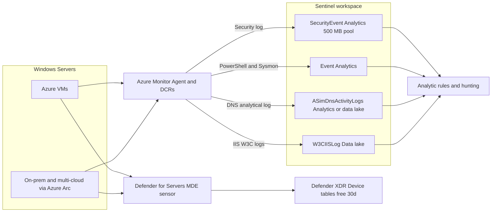

# Windows Server

> Status: verified. Priority: P2. Last verified: 21 Nov 2026.

## What it is

Windows member servers run file shares, line-of-business apps, DNS, IIS and management jump hosts outside the domain controller tier. Collecting their security, DNS, IIS and PowerShell telemetry through the Azure Monitor Agent (AMA) alongside Microsoft Defender for Servers gives a SOC visibility into lateral movement, persistence, web shells and DNS-based command and control. For domain controllers see [Active Directory Domain Services (on-premises)](../../identity/active-directory-on-prem/README.md); for client workstations see [Windows security event logs (clients)](../../endpoint/windows-security-events/README.md).

## Key recommendations

- Onboard every Azure VM and non-Azure Windows Server (via Azure Arc) to **Microsoft Defender for Servers Plan 2** where budget permits. Plan 2 includes Defender for Endpoint EDR telemetry plus a **500 MB per protected node, per day** pooled free data ingestion benefit covering `SecurityEvent` and other eligible security tables ([Defender for Servers overview](https://learn.microsoft.com/en-us/azure/defender-for-cloud/defender-for-servers-overview)).
- Use the **Azure Monitor Agent (AMA)** with scoped Data Collection Rules (DCRs) rather than legacy agents. The legacy Log Analytics agent (MMA) retired on 31 August 2024 and is unsupported ([migration guide](https://learn.microsoft.com/en-us/azure/azure-monitor/agents/azure-monitor-agent-migration)).
- Avoid paying twice for process and logon telemetry. If a server runs Defender for Servers (Plan 1 or Plan 2), `DeviceProcessEvents`, `DeviceNetworkEvents`, `DeviceFileEvents` and `DeviceLogonEvents` are already in Defender XDR advanced hunting for 30 days at no ingestion cost. Use AMA to stay within the 500 MB/day pool for `SecurityEvent` (Minimal or Common event set), and add targeted DCRs for PowerShell 4104, DNS and IIS logs.
- Use **Windows DNS Events via AMA** (`ASimDnsActivityLogs`) on DNS servers and filter aggressively at the DCR. Raw DNS logs are huge; drop noisy internal zones or routine successful lookups before ingestion ([Microsoft Learn](https://learn.microsoft.com/en-us/azure/sentinel/connect-dns)).
- Send **IIS logs** (`W3CIISLog`) to the data lake tier by default, or filter out static assets and health checks in a workspace transformation if you keep them in Analytics for web shell rules.
- Only use **Windows Forwarded Events** (`WindowsEvent`) if you already run Windows Event Forwarding (WEF) collectors. Standard built-in rules target `SecurityEvent`, and non-Security channels in `WindowsEvent` don't qualify for the Defender for Servers 500 MB/day allowance.

## High-value log sources

| Source | Table name | Connector | Tier | Cost / volume | Value |
|---|---|---|---|---|---|
| Windows Security log | `SecurityEvent` | Windows Security Events via AMA | Analytics (Basic and data lake also supported) | Medium to high. Covered by Defender for Servers Plan 2 500 MB/node/day pooled benefit | Logons (4624/4625), service installs (7045), scheduled tasks (4698), account/group changes, log clears (1102), AppLocker |
| Forwarded events (WEF) | `WindowsEvent` | Windows Forwarded Events | Analytics or data lake | Depends on WEF subscriptions. Only Security stream routing to `SecurityEvent` gets the 500 MB/day benefit | Centralised collection from WEF collectors; requires ASIM parsers for built-in rules |
| PowerShell, System, Application, Sysmon | `Event` | AMA custom DCR (Windows Event Logs) | Analytics only (`Event` has no data lake tier) | Low when filtered by XPath. Billable ingestion | PowerShell 4104 script blocks, service errors, Sysmon telemetry not covered by MDE |
| Windows Server DNS analytical logs | `ASimDnsActivityLogs` | Windows DNS Events via AMA | Analytics (filtered) or data lake | Very high unfiltered. Billable ingestion | DNS queries and responses normalised to ASIM for DGA, tunnelling and C2 hunting. Replaces legacy `DnsEvents` |
| IIS web server logs | `W3CIISLog` | AMA custom DCR (IIS Logs) | Data lake (or Analytics with DCR filter) | Medium to high depending on web traffic. Billable ingestion | HTTP requests, status codes, URI stems and client IPs for web shell and exploitation detection |
| Defender for Servers EDR telemetry | `DeviceProcessEvents`, `DeviceNetworkEvents`, `DeviceFileEvents`, `DeviceLogonEvents`, `DeviceRegistryEvents`, `DeviceEvents` | Microsoft Defender XDR | Free in Defender XDR advanced hunting (30 days; 90 days with eligible ISOC licence) | Free in advanced hunting. Paid if streamed to Sentinel | Full process trees, network sockets, file writes and registry changes without paying for raw `SecurityEvent` 4688 volume |
| Defender for Servers alerts and agentless FIM | `SecurityAlert`, `MDCFileIntegrityMonitoringEvents` | Microsoft Defender for Cloud / Defender XDR | Analytics | `SecurityAlert` free; `MDCFileIntegrityMonitoringEvents` covered by Plan 2 500 MB/day benefit | High-signal server threat alerts and file/registry integrity changes |

### Defender for Servers Plan 2 free ingestion benefit

With **Defender for Servers Plan 2** enabled on a subscription and Log Analytics workspace, Microsoft grants **500 MB per protected node, per day**, pooled across the workspace rather than capped per individual server. Eligible tables include `SecurityEvent`, `SecurityAlert`, `SecurityBaseline`, `SecurityBaselineSummary`, `SecurityDetection`, `WindowsFirewall`, `ProtectionStatus`, `Update`, `UpdateSummary` (when Update Management isn't running) and `MDCFileIntegrityMonitoringEvents`. Data must be collected via AMA, the MDE sensor or agentless FIM. `Event`, `W3CIISLog` and `ASimDnsActivityLogs` are not covered by the allowance and bill normally ([Defender for Servers overview](https://learn.microsoft.com/en-us/azure/defender-for-cloud/defender-for-servers-overview)).

## Prerequisites and licensing

| Item | Detail |
|---|---|
| Sentinel workspace | Pay-as-you-go or commitment tier workspace onboarded to the Defender portal |
| Azure Monitor Agent (AMA) | Free agent. Runs as a VM extension on Azure VMs and an Arc extension on hybrid servers |
| Non-Azure and multi-cloud servers | Onboard on-premises, AWS and Google Cloud Windows servers to **Azure Arc-enabled servers** before attaching DCRs ([Azure Arc overview](https://learn.microsoft.com/en-us/azure/azure-arc/servers/overview)) |
| Defender for Servers (recommended) | Plan 1 provides MDE EDR only; Plan 2 adds agentless scanning, FIM, vulnerability assessment and the 500 MB/node/day free data ingestion benefit |
| Windows audit policy | Enable **Audit Process Creation** plus **Include command line in process creation events** (only needed on servers without MDE), **PowerShell Script Block Logging** (4104), and **DNS Server Analytical Logging** on DNS servers |
| IIS logging | Must use W3C format, write to a local directory (default `C:\inetpub\logs\LogFiles\W3SVC*`), and have circular logging disabled ([Microsoft Learn](https://learn.microsoft.com/en-us/azure/azure-monitor/vm/data-collection-iis)) |

### Roles you need

| Task | Role |
|---|---|
| Install Content Hub solutions and enable rules | Microsoft Sentinel Contributor on the resource group ([Microsoft Learn](https://learn.microsoft.com/en-us/azure/sentinel/sentinel-solutions-deploy)) |
| Create DCRs and associate Azure VMs / Arc servers | Monitoring Contributor on the subscription or resource group, plus Virtual Machine Contributor or Azure Connected Machine Resource Administrator on target machines |
| Enable Defender for Servers Plan 2 | Security Admin or Owner on the Azure subscription |

## Step-by-step setup

1. **Onboard non-Azure servers to Azure Arc.** In the Azure portal, go to **Azure Arc > Infrastructure > Machines > Add/Create** and generate the onboarding script for your on-premises or multi-cloud Windows servers ([Azure Arc overview](https://learn.microsoft.com/en-us/azure/azure-arc/servers/overview)).
2. **Enable Defender for Servers (recommended).** In **Microsoft Defender for Cloud > Environment settings**, enable **Defender for Servers Plan 2** on your subscription and enable auto-provisioning for Defender for Endpoint so servers report `Device*` telemetry to Defender XDR and unlock the 500 MB/day ingestion pool.
3. **Install Content Hub solutions.** In the Defender portal (**Microsoft Sentinel > Content management > Content hub**), install **Windows Security Events**, **Windows Server DNS** (if you run Windows DNS) and **Windows Forwarded Events** (only if you use WEF).
4. **Configure Windows Security Events via AMA.** Go to **Setup & configuration > Data management > Data & connectors > Connectors** (or **Microsoft Sentinel > Configuration > Data connectors**), open **Windows Security Events via AMA**, select **+ Create data collection rule**, attach your server resource groups or Arc servers, and pick **Minimal** (if MDE is deployed) or **Common** (if MDE isn't deployed).
5. **Add PowerShell 4104 and System/Application channels.** In the Azure portal (**Azure Monitor > Data Collection Rules > Create**), create a DCR with a **Windows Event Logs** data source targeting `Event`, using a custom XPath for `Microsoft-Windows-PowerShell/Operational!*[System[(EventID=4104)]]` and `PowerShellCore/Operational!*[System[(EventID=4104)]]`. See [Windows security event logs (clients)](../../endpoint/windows-security-events/README.md) for tested XPath filters.
6. **Connect Windows DNS Servers (if applicable).** Open the **Windows DNS Events via AMA** connector, create a DCR targeting your DNS servers, and configure DCR filters to drop low-value internal lookup noise before ingestion into `ASimDnsActivityLogs` ([Microsoft Learn](https://learn.microsoft.com/en-us/azure/sentinel/connect-dns)).
7. **Collect IIS logs (if applicable).** In **Azure Monitor > Data Collection Rules**, create a DCR with the **IIS Logs** data source pointing to your Sentinel workspace (`W3CIISLog`), associate your IIS servers, and set `W3CIISLog` to the data lake tier or apply a workspace transformation to filter health checks ([Microsoft Learn](https://learn.microsoft.com/en-us/azure/azure-monitor/vm/data-collection-iis)).
8. **Validate ingestion.** Run the KQL queries below in the Defender portal (**Investigation & response > Advanced hunting**) with your Sentinel workspace selected, and check daily GB after one week.

## Architecture diagram



## Validation KQL

For group-wide and workspace-wide freshness checks, see [servers.kql](../../queries/validation/servers.kql) and the [validation query pack](../../queries/validation/README.md).

```kql
// 1. Confirm which Windows Server tables are landing and how fresh they are
union withsource=Table isfuzzy=true
    SecurityEvent, WindowsEvent, Event, ASimDnsActivityLogs, DnsEvents, W3CIISLog
| where TimeGenerated > ago(1d)
| summarize Rows = count(), Latest = max(TimeGenerated) by Table
| order by Table asc

// 2. Freshness check per server for SecurityEvent (flag hosts silent for over 1 hour)
SecurityEvent
| where TimeGenerated > ago(2d)
| summarize Latest = max(TimeGenerated), Events24h = countif(TimeGenerated > ago(1d)) by Computer
| where Latest < ago(1h)
| order by Latest asc

// 3. Check DNS analytical logs landing via AMA
ASimDnsActivityLogs
| where TimeGenerated > ago(1d)
| summarize Queries = count(), Latest = max(TimeGenerated) by DvcHostname, EventResultDetails
| top 20 by Queries desc

// 4. Check IIS logs landing and top HTTP status codes
W3CIISLog
| where TimeGenerated > ago(1d)
| summarize Requests = count(), Latest = max(TimeGenerated) by Computer, scStatus
| top 20 by Requests desc

// 5. Cost: GB per day and 30-day total across server tables
Usage
| where TimeGenerated > ago(30d)
| where DataType in ("SecurityEvent", "WindowsEvent", "Event", "ASimDnsActivityLogs", "DnsEvents", "W3CIISLog")
| summarize GB = round(sum(Quantity) / 1024, 2) by DataType, Day = bin(TimeGenerated, 1d)
| summarize GBperDay = round(avg(GB), 2), TotalGB30d = round(sum(GB), 2) by DataType
| order by GBperDay desc
```

## Out-of-box analytic rules

From the **Windows Security Events** ([solution folder](https://github.com/Azure/Azure-Sentinel/tree/master/Solutions/Windows%20Security%20Events)) and **Windows Server DNS** ([solution folder](https://github.com/Azure/Azure-Sentinel/tree/master/Solutions/Windows%20Server%20DNS)) Content Hub solutions:

| Rule | Detects | Tables | MITRE | Enable day 1? |
|---|---|---|---|---|
| NRT Security Event log cleared | Event 1102 indicating the Security log was cleared | `SecurityEvent` | Defense Evasion T1070 | Yes |
| Scheduled Task Hide | Scheduled tasks created or modified with the hidden flag | `SecurityEvent` | Defense Evasion T1562 | Yes |
| NRT Base64 Encoded Windows Process Command-lines | Base64-encoded command lines in 4688 process creation | `SecurityEvent` | Execution T1059, Defense Evasion T1027 | Yes, tune admin scripts |
| Excessive Windows Logon Failures | Spike in 4625 logon failures against a server account | `SecurityEvent` | Credential Access T1110 | Yes, tune threshold |
| SecurityEvent - Multiple authentication failures followed by a success | Brute force followed by a valid logon | `SecurityEvent` | Credential Access T1110 | Yes |
| Rare DNS query / High NXDomain count (`DNS_HighNXDomainCount_detection`) | Client generating unusually high NXDOMAIN responses, typical of DGA malware | `DnsEvents` / `ASimDnsActivityLogs` (via ASIM) | Command and Control T1568.002 | Yes if DNS logs are on, tune scanners |
| Exchange / IIS web shell indicators (from **Web Shells Threat Protection** solution) | Suspicious POST requests and command execution patterns in IIS | `W3CIISLog` | Persistence T1505.003 | Yes if IIS logs are in Analytics |

Check whether each DNS rule in your installed solution reads `DnsEvents` or the ASIM parser `_Im_Dns`. Deploy the ASIM DNS parsers so rules read `ASimDnsActivityLogs` seamlessly.

## Custom detections

Run these hourly with a 1-hour lookback unless noted. Test against 7 days of your own server data first.

### C1. Potential IIS web shell execution in writable paths (High)

```kql
// CUSTOM - POST requests to executable scripts inside upload, temp or content folders
// ASSUMPTION: W3CIISLog is in Analytics tier, and IIS logs include csMethod, csUriStem, scStatus and cIP.
// Tune excluded paths for legitimate application upload handlers.
W3CIISLog
| where TimeGenerated > ago(1h)
| where csMethod == "POST" and scStatus between (200 .. 299)
| where csUriStem matches regex @"(?i)/(uploads|upload|temp|tmp|images|content|public|aspnet_client)/.*\.(aspx|ashx|asmx|asp|php|jsp)$"
| summarize Hits = count(), DistinctIPs = dcount(cIP), SampleIPs = make_set(cIP, 5),
            UserAgents = make_set(csUserAgent, 5)
            by Computer, sSiteName, csUriStem
| project Computer, sSiteName, csUriStem, Hits, DistinctIPs, SampleIPs, UserAgents
```

MITRE: Persistence T1505.003 (Server Software Component: Web Shell).

### C2. High NXDOMAIN rate from a Windows server in ASIM DNS logs (Medium)

```kql
// CUSTOM - Server generating a burst of NXDOMAIN responses, indicating DGA or DNS tunnelling
// ASSUMPTION: Windows DNS Events via AMA populates ASimDnsActivityLogs with EventResultDetails == "NXDOMAIN".
// Tune threshold against vulnerability scanners and misconfigured internal services.
ASimDnsActivityLogs
| where TimeGenerated > ago(1h)
| where EventResultDetails =~ "NXDOMAIN"
| summarize UniqueDomains = dcount(DnsQuery), TotalQueries = count(),
            SampleDomains = make_set(DnsQuery, 10)
            by SrcIpAddr, DvcHostname
| where UniqueDomains >= 50
| project DvcHostname, SrcIpAddr, UniqueDomains, TotalQueries, SampleDomains
```

MITRE: Command and Control T1568.002 (Domain Generation Algorithms) and T1071.004 (DNS).

### C3. New service or scheduled task installed on a server from a non-standard path (High)

```kql
// CUSTOM - Windows service installed on a server pointing to Temp, Users or ProgramData
// ASSUMPTION: Event 7045 is collected into SecurityEvent (included in Minimal and Common sets).
SecurityEvent
| where TimeGenerated > ago(1h)
| where EventID == 7045
| where ServiceFileName has_any ("\\Temp\\", "\\Users\\", "\\ProgramData\\", "powershell", "cmd.exe", "mshta")
| project TimeGenerated, Computer, SubjectUserName, ServiceName, ServiceFileName, ServiceStartType
```

MITRE: Persistence T1543.003 (Create or Modify System Process: Windows Service).

## Playbooks

No playbooks ship with the **Windows Security Events** or **Windows Server DNS** solutions. Recommended response playbooks:

| Playbook | Trigger | Actions | Connector and permissions |
|---|---|---|---|
| Isolate-MDEMachine (from [Microsoft Defender for Endpoint solution](https://github.com/Azure/Azure-Sentinel/tree/master/Solutions/MicrosoftDefenderForEndpoint/Playbooks/Isolate-MDEMachine)) | High-severity web shell (C1) or service persistence (C3) on a Defender for Servers host | Isolates the server in MDE and comments on the Sentinel incident | Managed identity with Microsoft Sentinel Responder, plus MDE API `Machine.Isolate` and `Machine.Read.All`. Always gate behind analyst approval for production servers |
| Enrich server owner and tags | Any high-severity server incident | Queries Azure Resource Graph for VM or Azure Arc tags (owner, environment, tier) and posts to the incident | Managed identity with Reader on target subscriptions and Microsoft Sentinel Responder |

## Workbooks and hunting

| Item | Source | Use |
|---|---|---|
| Event Analyzer workbook | Windows Security Events solution | Breakdown of `SecurityEvent` volume by Event ID and server to keep ingestion inside the 500 MB/day pool |
| Identity and Access workbook | Windows Security Events solution | Server logon patterns and account modifications |
| DNS hunting queries (`DNS_CommonlyAbusedTLDs`, `DNS_LongURILookup`, `DNS_HighReverseDNSCount`) | Windows Server DNS solution | Hunting for abused TLDs, DNS tunnelling and reverse lookup sweeps |
| IIS web shell hunting queries | Azure-Sentinel repo (`Hunting Queries/W3CIISLog`) | Spotting `whoami`, `cmd` and unusual GET/POST requests in `W3CIISLog` |

## Gotchas and deprecations

- **Legacy Log Analytics agent (MMA) is retired.** It retired on 31 August 2024 and data upload can cease without notice. Migrate all Windows servers, DNS servers and IIS hosts to AMA with DCRs ([migration guide](https://learn.microsoft.com/en-us/azure/azure-monitor/agents/azure-monitor-agent-migration)).
- **`DnsEvents` vs `ASimDnsActivityLogs`.** The legacy DNS connector wrote to `DnsEvents`. **Windows DNS Events via AMA** streams analytical logs to `ASimDnsActivityLogs`. Update older custom queries or use the ASIM DNS parser (`_Im_Dns`) so detections don't go blind after migrating.
- **Defender for Servers 500 MB/day benefit has strict scope.** It applies only with Plan 2, only on eligible security tables (`SecurityEvent`, `SecurityAlert`, `MDCFileIntegrityMonitoringEvents` and related Defender tables), and doesn't cover `Event`, `W3CIISLog`, `ASimDnsActivityLogs` or non-Security channels in `WindowsEvent`.
- **Overlapping DCRs cause duplicate billing.** Never associate two DCRs that collect the same Windows Security or IIS stream from the same VM or Arc server to the same workspace.
- **IIS W3C field requirements.** If `s-sitename` or `c-ip` aren't enabled in local IIS logging properties, those columns arrive empty in `W3CIISLog`. Check site logging fields before deploying rules.
- **Azure Arc is mandatory for non-Azure servers.** AMA won't deploy or apply DCRs to on-premises, AWS or Google Cloud Windows servers unless the Azure Connected Machine agent is installed and connected.
- **Sentinel in the Azure portal retires on 31 March 2027.** Build connectors, rules and hunting queries in the Microsoft Defender portal ([Microsoft Learn](https://learn.microsoft.com/en-us/azure/sentinel/microsoft-sentinel-defender-portal)).

## Official links

- [Windows Security Events via AMA (data connectors reference)](https://learn.microsoft.com/en-us/azure/sentinel/data-connectors-reference#windows-security-events-via-ama)
- [Windows security event sets that can be sent to Microsoft Sentinel](https://learn.microsoft.com/en-us/azure/sentinel/windows-security-event-id-reference)
- [Stream and filter Windows DNS logs with the AMA connector](https://learn.microsoft.com/en-us/azure/sentinel/connect-dns)
- [Collect IIS logs with Azure Monitor Agent](https://learn.microsoft.com/en-us/azure/azure-monitor/vm/data-collection-iis)
- [Collect Windows events with Azure Monitor Agent](https://learn.microsoft.com/en-us/azure/azure-monitor/vm/data-collection-windows-events)
- [Azure Monitor Agent overview](https://learn.microsoft.com/en-us/azure/azure-monitor/agents/azure-monitor-agent-overview)
- [Migrate from the Log Analytics agent](https://learn.microsoft.com/en-us/azure/azure-monitor/agents/azure-monitor-agent-migration)
- [Microsoft Defender for Servers overview](https://learn.microsoft.com/en-us/azure/defender-for-cloud/defender-for-servers-overview)
- [Azure Arc-enabled servers overview](https://learn.microsoft.com/en-us/azure/azure-arc/servers/overview)
- [SecurityEvent table reference](https://learn.microsoft.com/en-us/azure/azure-monitor/reference/tables/securityevent)
- [WindowsEvent table reference](https://learn.microsoft.com/en-us/azure/azure-monitor/reference/tables/windowsevent)
- [Event table reference](https://learn.microsoft.com/en-us/azure/azure-monitor/reference/tables/event)
- [ASimDnsActivityLogs table reference](https://learn.microsoft.com/en-us/azure/azure-monitor/reference/tables/asimdnsactivitylogs)
- [DnsEvents table reference](https://learn.microsoft.com/en-us/azure/azure-monitor/reference/tables/dnsevents)
- [W3CIISLog table reference](https://learn.microsoft.com/en-us/azure/azure-monitor/reference/tables/w3ciislog)
- [Windows Security Events solution (Azure-Sentinel repo)](https://github.com/Azure/Azure-Sentinel/tree/master/Solutions/Windows%20Security%20Events)
- [Windows Server DNS solution (Azure-Sentinel repo)](https://github.com/Azure/Azure-Sentinel/tree/master/Solutions/Windows%20Server%20DNS)
- [Microsoft Sentinel in the Defender portal](https://learn.microsoft.com/en-us/azure/sentinel/microsoft-sentinel-defender-portal)
- [Windows security event logs (clients)](../../endpoint/windows-security-events/README.md) (this repo)
- [Microsoft Defender for Endpoint](../../endpoint/defender-for-endpoint/README.md) (this repo)

## Last verified

21 Nov 2026, against Microsoft Learn and the Azure-Sentinel repo. Re-verify before relying on table names, navigation or rule names.
